<!-- source: DeepWiki mcp.deepwiki.com · repo alibaba/nacos · page 8.2 Configuration and Naming Management UI · fetched 2026-10-29 -->

# Configuration and Naming Management UI

<details>
<summary>Relevant source files</summary>

The following files were used as context for generating this wiki page:

- [console-ui/package-lock.json](console-ui/package-lock.json)
- [console-ui/package.json](console-ui/package.json)
- [console-ui/src/components/Page/TotalRender.js](console-ui/src/components/Page/TotalRender.js)
- [console-ui/src/locales/en-US.js](console-ui/src/locales/en-US.js)
- [console-ui/src/locales/zh-CN.js](console-ui/src/locales/zh-CN.js)
- [console-ui/src/pages/AI/McpDetail/CreateTools/DeleteTool.js](console-ui/src/pages/AI/McpDetail/CreateTools/DeleteTool.js)
- [console-ui/src/pages/AI/McpDetail/CreateTools/components.js](console-ui/src/pages/AI/McpDetail/CreateTools/components.js)
- [console-ui/src/pages/AI/McpDetail/CreateTools/index.js](console-ui/src/pages/AI/McpDetail/CreateTools/index.js)
- [console-ui/src/pages/AI/McpDetail/McpDetail.js](console-ui/src/pages/AI/McpDetail/McpDetail.js)
- [console-ui/src/pages/AI/McpDetail/ShowTools.js](console-ui/src/pages/AI/McpDetail/ShowTools.js)
- [console-ui/src/pages/AI/McpManagement/McpManagement.js](console-ui/src/pages/AI/McpManagement/McpManagement.js)
- [console-ui/src/pages/AI/NewMcpServer/NewMcpServer.js](console-ui/src/pages/AI/NewMcpServer/NewMcpServer.js)
- [console-ui/src/pages/ClusterManagement/ClusterNodeList/ClusterNodeList.js](console-ui/src/pages/ClusterManagement/ClusterNodeList/ClusterNodeList.js)
- [console-ui/src/pages/ConfigurationManagement/ConfigurationManagement/ConfigurationManagement.js](console-ui/src/pages/ConfigurationManagement/ConfigurationManagement/ConfigurationManagement.js)
- [console-ui/src/pages/ConfigurationManagement/HistoryRollback/HistoryRollback.js](console-ui/src/pages/ConfigurationManagement/HistoryRollback/HistoryRollback.js)
- [console-ui/src/pages/ConfigurationManagement/ListeningToQuery/ListeningToQuery.js](console-ui/src/pages/ConfigurationManagement/ListeningToQuery/ListeningToQuery.js)
- [console-ui/src/pages/NameSpace/NameSpace.js](console-ui/src/pages/NameSpace/NameSpace.js)
- [console-ui/src/pages/ServiceManagement/ServiceList/ServiceList.js](console-ui/src/pages/ServiceManagement/ServiceList/ServiceList.js)
- [console-ui/src/pages/ServiceManagement/SubscriberList/SubscriberList.js](console-ui/src/pages/ServiceManagement/SubscriberList/SubscriberList.js)
- [console/src/main/resources/static/css/main.css](console/src/main/resources/static/css/main.css)
- [console/src/main/resources/static/index.html](console/src/main/resources/static/index.html)
- [console/src/main/resources/static/js/main.js](console/src/main/resources/static/js/main.js)

</details>


This page documents the management pages rendered within the `console-ui` frontend: configuration listing and bulk operations, history rollback, listener tracking, service discovery management, namespace CRUD, cluster node visibility, and the initial admin registration flow. All of these pages are React components mounted under the `MainLayout` shell described in [8.1](#8.1). For the AI/MCP management pages that share the same shell, see [8.3](#8.3).

---

## Navigation Structure

The left-hand navigation is built from a static data structure in `menu.js` whose shape is interpreted at runtime by `MainLayout`.

**Menu group definitions and their routes**

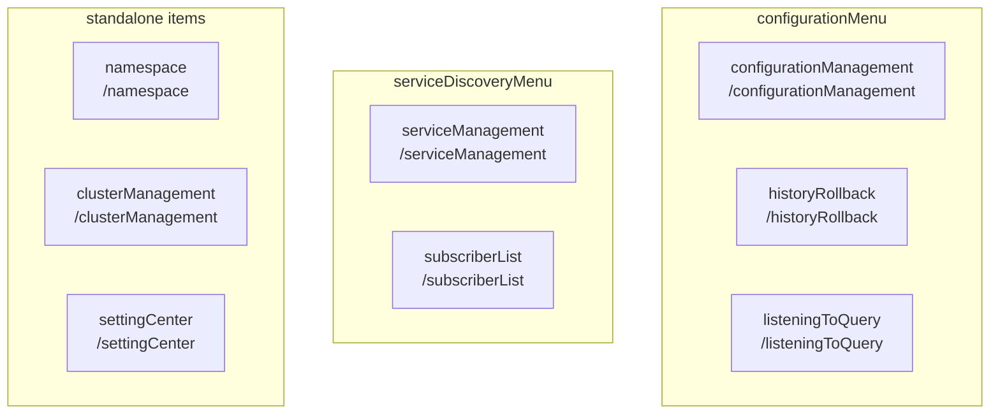

Sources: [console-ui/src/layouts/menu.js:19-48](), [console-ui/src/layouts/menu.js:82-98]()

The `getMenuData(functionMode)` function in `menu.js` accepts the `functionMode` string from the Redux store (sourced from `v3/console/server/state`). When `functionMode` is `"naming"`, only `serviceDiscoveryMenu` is emitted. When `"config"`, only `configurationMenu`. The default `""` emits both, plus the AI and agent menus.

Sources: [console-ui/src/layouts/menu.js:118-139]()

All routes are registered centrally in `index.js` under `<HashRouter>` inside a `<Layout>` wrapper.

**Route-to-component map**

| Hash route | Component | File |
|---|---|---|
| `/configurationManagement` | `ConfigurationManagement` | `pages/ConfigurationManagement/ConfigurationManagement/ConfigurationManagement.js` |
| `/historyRollback` | `HistoryRollback` | `pages/ConfigurationManagement/HistoryRollback/HistoryRollback.js` |
| `/listeningToQuery` | `ListeningToQuery` | `pages/ConfigurationManagement/ListeningToQuery/ListeningToQuery.js` |
| `/configdetail` | `Configdetail` | `pages/ConfigurationManagement/ConfigDetail` |
| `/configeditor` | `Configeditor` | `pages/ConfigurationManagement/ConfigEditor` |
| `/configRollback` | `ConfigRollback` | `pages/ConfigurationManagement/ConfigRollback` |
| `/serviceManagement` | `ServiceList` | `pages/ServiceManagement/ServiceList/ServiceList.js` |
| `/serviceDetail` | `ServiceDetail` | `pages/ServiceManagement/ServiceDetail` |
| `/subscriberList` | `SubscriberList` | `pages/ServiceManagement/SubscriberList/SubscriberList.js` |
| `/namespace` | `Namespace` | `pages/NameSpace/NameSpace.js` |
| `/clusterManagement` | `ClusterNodeList` | `pages/ClusterManagement/ClusterNodeList/ClusterNodeList.js` |
| `/register` | `Register` | `pages/Register/Register.jsx` |

Sources: [console-ui/src/index.js:88-116]()

---

## Configuration Management Page

### Component: `ConfigurationManagement`

`ConfigurationManagement` is the primary list view for configuration data located at [console-ui/src/pages/ConfigurationManagement/ConfigurationManagement/ConfigurationManagement.js](). It uses the React class component pattern with `@ConfigProvider.config` and Redux `connect` decorators for state management.

**UI Component Composition**

The page uses Alibaba Fusion Design components from `@alifd/next`:

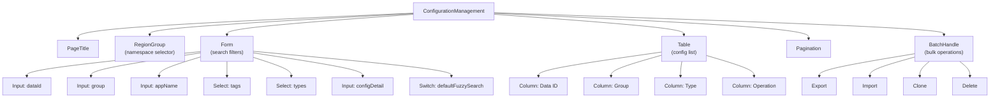

Sources: [console-ui/src/pages/ConfigurationManagement/ConfigurationManagement/ConfigurationManagement.js:75-76](), [console-ui/src/pages/ConfigurationManagement/ConfigurationManagement/ConfigurationManagement.js:1167-1368]()

**State initialisation**: URL query parameters (`dataId`, `group`, `appName`, `configTags`, `types`, `configDetail`, `pageNo`, `pageSize`) are read via `getParams()` on construction and stored in component state. The constructor also initializes a `Field` instance for form management and a module-level `Map` called `configsTableSelected` for tracking row selections.

Sources: [console-ui/src/pages/ConfigurationManagement/ConfigurationManagement/ConfigurationManagement.js:83-146]()

#### Search and Listing

The component dispatches either `getConfigs` or `getConfigsV2` (from `reducers/configuration`) depending on whether `config_detail` is populated. The `defaultFuzzySearch` state variable (initialized to `true`) controls the search mode through the `changeParamsBySearchType()` method.

**Search mode transformation logic**:
- When `defaultFuzzySearch` is `true`: wraps `dataId` and `groupName` in `*...*` wildcards, sets `search='blur'`
- When `defaultFuzzySearch` is `false`: leaves parameters unchanged, sets `search='accurate'`

The UI provides a `Switch` component labeled with locale strings `fuzzydMode`/`defaultFuzzyd` (Chinese) or `fuzzyd`/`defaultFuzzyg` (English) to toggle this behavior.

Supported filter fields:

| Field | State key | URL param key | API param key | Component |
|---|---|---|---|---|
| Data ID | `dataId` | `dataId` | `dataId` | `Input` |
| Group | `group` | `group` | `groupName` | `Input` |
| App Name | `appName` | `appName` | `appName` | `Input` |
| Tags | `config_tags` | `configTags` | `configTags` | `Select` (multi) |
| File type | `types` | `types` | `type` | `Select` (multi) |
| Content detail | `config_detail` | `configDetail` | `configDetail` | `Input` |

Sources: [console-ui/src/pages/ConfigurationManagement/ConfigurationManagement/ConfigurationManagement.js:258-272](), [console-ui/src/pages/ConfigurationManagement/ConfigurationManagement/ConfigurationManagement.js:274-335]()

#### Row Actions and Table Rendering

Each row exposes inline actions rendered by `renderCol()`. The operation column is built using a combination of `<a>` tags and a `Dropdown` + `Menu` component for secondary actions.

**Row action flow diagram**

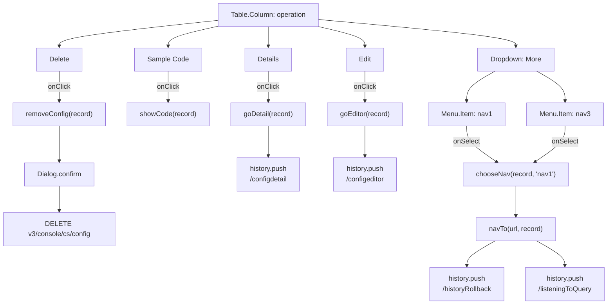

Sources: [console-ui/src/pages/ConfigurationManagement/ConfigurationManagement/ConfigurationManagement.js:412-448](), [console-ui/src/pages/ConfigurationManagement/ConfigurationManagement/ConfigurationManagement.js:337-351](), [console-ui/src/pages/ConfigurationManagement/ConfigurationManagement/ConfigurationManagement.js:353-406]()

**State preservation for navigation**: Methods `goDetail()` and `goEditor()` call `setParams()` to save `pageNo`, `pageSize`, `searchDataId`, and `searchGroup` before navigation. This allows the browser back button to restore the exact scroll position and filter state.

The `chooseNav()` method builds specialized URLs for history rollback and listener query pages by prefixing parameter names with `history` or `listening` respectively (e.g., `historyDataId`, `listeningGroup`).

Sources: [console-ui/src/pages/ConfigurationManagement/ConfigurationManagement/ConfigurationManagement.js:450-485](), [console-ui/src/pages/ConfigurationManagement/ConfigurationManagement/ConfigurationManagement.js:202-224]()

#### Batch Operations

Bulk selection is tracked in a module-level `Map` called `configsTableSelected` (defined at file scope) keyed by a compound string `${dataId}@@@${group}@@@${tenant}`. The `BatchHandle` component at the top of the table provides a toolbar with four batch operation buttons that become enabled when rows are selected.

**Selection management**: The `Table` component's `rowSelection` prop is configured with an `onChange` callback (`configDataTableOnChange`) that updates both `configsTableSelected` and `state.rowSelection.selectedRowKeys`. An "Enable full-page selection" checkbox (`state.isCheckAll`) allows selecting all items matching the current filter, not just the current page.

**Batch operation implementations**

**Export**: Two modes available:
1. **Export all/filtered** (`openExport`): Constructs URL `v3/console/cs/config/export2` with current filter params, opens in new window via `openUri()`
2. **Export selected** (`exportSearch`): Same endpoint, but includes `ids` parameter with comma-separated config IDs from `configsTableSelected`

The method constructs the parameter object and calls `openUri()` which generates a signed URL including `accessToken`.

**Import**: Opens `Dialog.confirm` with:
- `Upload` component configured with `action='v3/console/cs/config/import'`, `accept='application/zip'`
- Target namespace `Select` (populated from `v3/console/core/namespace/list`)
- Conflict policy `Select` with options: ABORT, SKIP, OVERWRITE
- The upload `onSuccess` callback parses the response and calls `processImportAndCloneResult()`

**Clone**: Multi-step dialog flow:
1. Show `CloneDialog` component with source namespace, target namespace selector, and conflict policy selector
2. Optionally show `Dialog.alert` with inline editors for modifying Data ID and Group of each selected config
3. POST to `v3/console/cs/config/clone?targetNamespaceId=...&policy=...` with array of `{dataId, group, tenant}` objects
4. Process response via `processImportAndCloneResult()`

**Batch delete**: Shows `Dialog.alert` listing all selected configs, then DELETE to `v3/console/cs/config/batchDelete?ids=...&namespaceId=...`.

**Result processing flow**

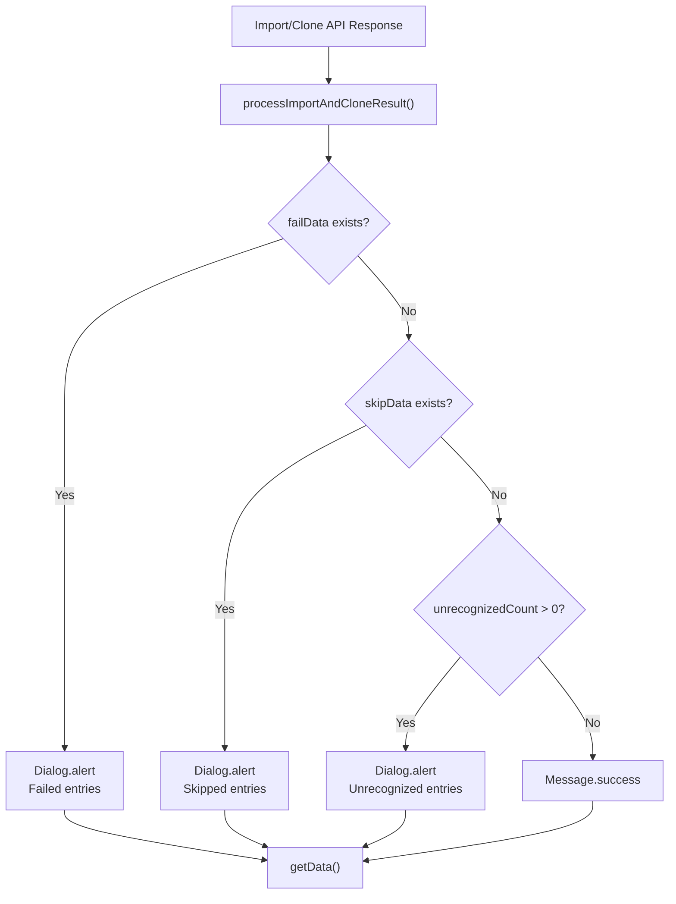

Sources: [console-ui/src/pages/ConfigurationManagement/ConfigurationManagement/ConfigurationManagement.js:614-693](), [console-ui/src/pages/ConfigurationManagement/ConfigurationManagement/ConfigurationManagement.js:695-806](), [console-ui/src/pages/ConfigurationManagement/ConfigurationManagement/ConfigurationManagement.js:808-971](), [console-ui/src/pages/ConfigurationManagement/ConfigurationManagement/ConfigurationManagement.js:973-1069](), [console-ui/src/pages/ConfigurationManagement/ConfigurationManagement/ConfigurationManagement.js:1071-1165]()

**Batch operation API summary**

| Operation | Method | Endpoint | Handler |
|---|---|---|---|
| Export all/filtered | GET (window.open) | `v3/console/cs/config/export2` | `openExport()` |
| Export selected | GET (window.open) | `v3/console/cs/config/export2?ids=...` | `exportSearch()` |
| Import zip | POST (Upload) | `v3/console/cs/config/import` | `Upload.onSuccess` → `processImportAndCloneResult()` |
| Clone to namespace | POST | `v3/console/cs/config/clone` | `cloneConfig()` → `processImportAndCloneResult()` |
| Delete single | DELETE | `v3/console/cs/config` | `removeConfig()` |
| Batch delete | DELETE | `v3/console/cs/config/batchDelete` | `multipleSelectionDeletion()` |

Sources: [console-ui/src/pages/ConfigurationManagement/ConfigurationManagement/ConfigurationManagement.js:614-693](), [console-ui/src/pages/ConfigurationManagement/ConfigurationManagement/ConfigurationManagement.js:1071-1165]()

---

## History Rollback Page

### Component: `HistoryRollback`

`HistoryRollback` lists the modification history for a single configuration identified by Data ID and Group (both are required). Located at [console-ui/src/pages/ConfigurationManagement/HistoryRollback/HistoryRollback.js](), it uses Redux to read `configRetentionDays` from the base store.

**UI Structure**: The page has a two-stage filter:
1. **Configuration selector**: Two cascading `Select` components populate from `v3/console/cs/history/configs?namespaceId=...`. The first `Select` shows available Data IDs, and when one is chosen, the second `Select` shows Groups that have history for that Data ID.
2. **History table**: After both Data ID and Group are selected, clicking "Query" fetches `v3/console/cs/history/list?dataId=...&groupName=...&namespaceId=...&pageNo=...&pageSize=...` and displays the results in a `Table`.

**Table columns**

| Column | `dataIndex` | Renderer |
|---|---|---|---|
| Data ID | `dataId` | Plain text |
| Group | `group` | Plain text |
| Last Update Time | `lastModifiedTime` | `moment(value).format('YYYY-MM-DD HH:mm:ss')` |
| Operator | `srcUser` | Plain text |
| Publish Type | `publishType` | `<Tag>` with color: `publishType==='formal'` → normal, `publishType==='gray'` → blue |
| Operation | - | Custom cell (see below) |

**Operations per history row**

| Action | Implementation | Behaviour |
|---|---|---|
| Details | `<a onClick={() => goDetail(record)}>` | Calls `setParams({...})` then navigates to `/historyDetail?...&nid=<record.id>` |
| Rollback | `<a>` (enabled) or `<span>` (disabled) | Enabled only if `publishType !== 'gray'`. Navigates to `/configRollback?...&nid=<record.id>`. |
| Compare | `<a onClick={() => compareConfig(record)}>` | Async handler: fetches both current config and historical config, opens `DiffEditorDialog` |

**Compare operation data flow**

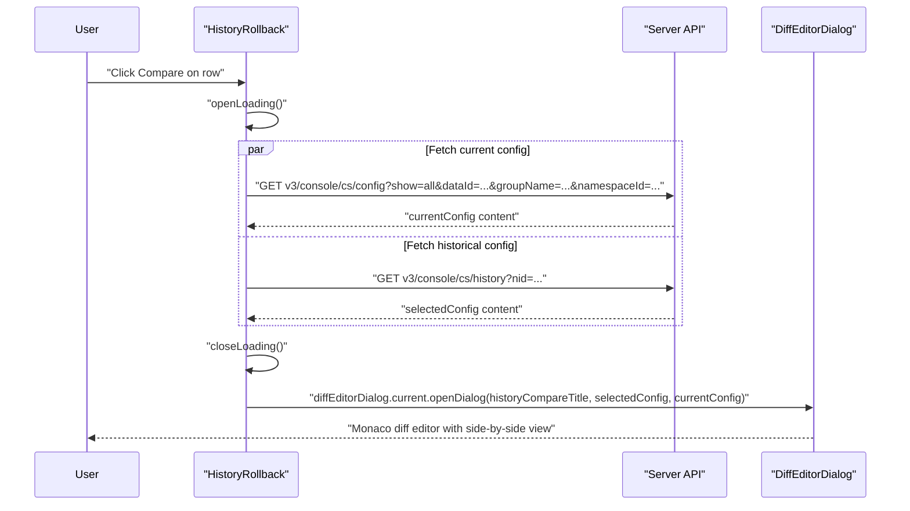

The `DiffEditorDialog` component (referenced via `this.diffEditorDialog = React.createRef()`) receives two content strings and two labels: the selected historical version on the left (`selectedVersion` / `historyCompareSelectedVersion`), and the current published version on the right (`lastVersion` / `historyCompareLastVersion`).

Sources: [console-ui/src/pages/ConfigurationManagement/HistoryRollback/HistoryRollback.js:50-66](), [console-ui/src/pages/ConfigurationManagement/HistoryRollback/HistoryRollback.js:115-138](), [console-ui/src/pages/ConfigurationManagement/HistoryRollback/HistoryRollback.js:140-165](), [console-ui/src/pages/ConfigurationManagement/HistoryRollback/HistoryRollback.js:228-291]()

**History page data flow**

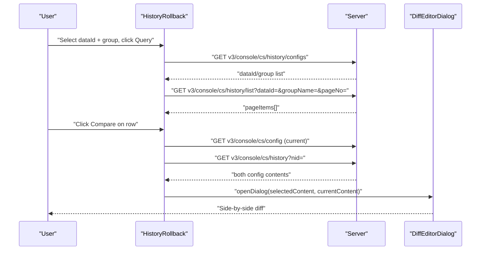

Sources: [console-ui/src/pages/ConfigurationManagement/HistoryRollback/HistoryRollback.js:115-138](), [console-ui/src/pages/ConfigurationManagement/HistoryRollback/HistoryRollback.js:228-291]()

The `configRetentionDays` value read from the Redux `base` store (populated by `v3/console/server/state`) is shown in the page title to inform users of the retention window.

Sources: [console-ui/src/pages/ConfigurationManagement/HistoryRollback/HistoryRollback.js:39-50](), [console-ui/src/pages/ConfigurationManagement/HistoryRollback/HistoryRollback.js:354-358]()

---

## Listening To Query Page

### Component: `ListeningToQuery`

This page at [console-ui/src/pages/ConfigurationManagement/ListeningToQuery/ListeningToQuery.js]() reveals which SDK clients are currently long-polling (listening to) a configuration item, or which configurations an SDK client IP is watching. It's the operational visibility tool for the configuration push mechanism.

**Query dimension selector**: A `Select` component with `dataSource` set to:
```javascript
[
  { value: 0, label: locale.configuration }, // Query by config
  { value: 1, label: 'IP' }                  // Query by IP
]
```

This controls which API endpoint is called and which form fields are displayed.

**Query modes and API mapping**

| Mode | `type` value | Required fields | API endpoint | Response key format |
|---|---|---|---|---|
| Configuration | `0` | Data ID, Group | `v3/console/cs/config/listener` | `listenersStatus[ip] = md5` |
| IP | `1` | IP address | `v3/console/cs/config/listener/ip` | `listenersStatus["dataId+group"] = md5` |

**Request flow for Configuration mode**

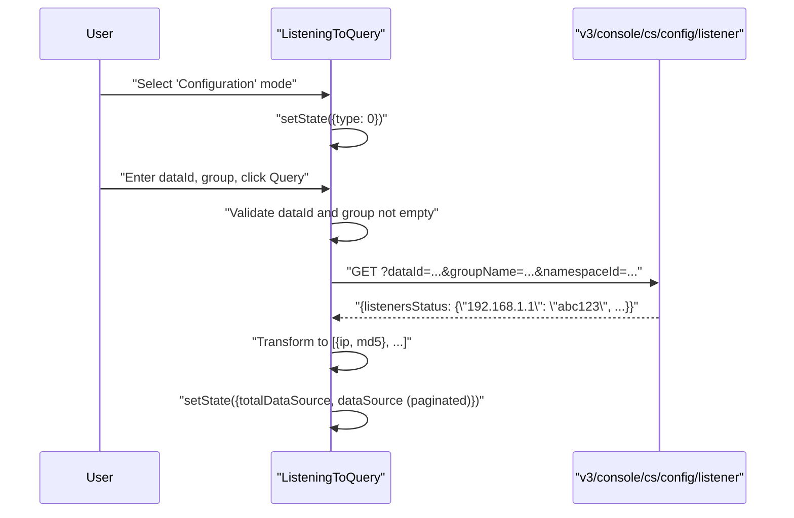

**Request flow for IP mode**

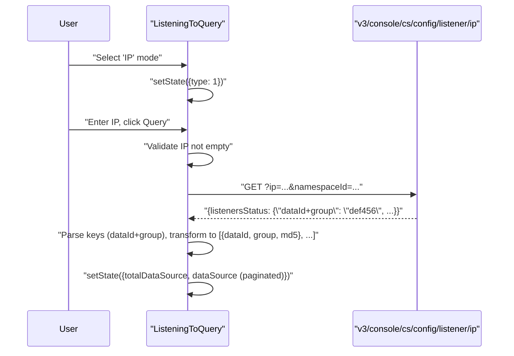

Sources: [console-ui/src/pages/ConfigurationManagement/ListeningToQuery/ListeningToQuery.js:63-87](), [console-ui/src/pages/ConfigurationManagement/ListeningToQuery/ListeningToQuery.js:89-155]()

**Pagination**: Client-side only. The full result from the API is stored in `state.totalDataSource`, and `state.dataSource` contains only the slice for the current page. The `changePage(currentPage)` method recalculates the slice using array `slice(start, end)`.

**Table rendering**: The table structure is conditional based on `state.type`:

| Mode | Columns displayed |
|---|---|
| Configuration (`type=0`) | IP, MD5 |
| IP (`type=1`) | Data ID, Group, MD5 |

The MD5 column in both cases displays the current content hash that the client expects. This allows operators to verify that clients are synchronized with the server state.

Sources: [console-ui/src/pages/ConfigurationManagement/ListeningToQuery/ListeningToQuery.js:157-167](), [console-ui/src/pages/ConfigurationManagement/ListeningToQuery/ListeningToQuery.js:226-280]()

---

## Service Management Pages

### Component: `ServiceList`

`ServiceList` is the main service registry browser located at [console-ui/src/pages/ServiceManagement/ServiceList/ServiceList.js](). It queries `v3/console/ns/service/list` with search parameters and displays a paginated table of registered services.

**UI Component Structure**

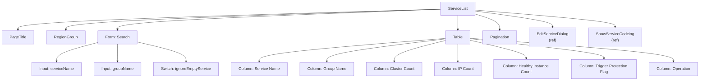

Sources: [console-ui/src/pages/ServiceManagement/ServiceList/ServiceList.js:49-74](), [console-ui/src/pages/ServiceManagement/ServiceList/ServiceList.js:296-342]()

**Search functionality**: The `queryServiceList()` method constructs a query string with parameters:
- `serviceName` (from `state.search.serviceName`)
- `groupName` (from `state.search.groupName`)
- `ignoreEmptyService` (boolean, persisted to `localStorage`)
- `withInstances` (hardcoded to `false`)
- `pageNo`, `pageSize` (pagination state)

The **Hide empty services** toggle is a `Switch` component whose value is both stored in component state (`ignoreEmptyService`) and persisted to `localStorage` with key `'ignoreEmptyService'`. The initial value is read from localStorage on mount (defaulting to `true` if key is `'false'` string, otherwise `true`).

**Table row highlighting**: The `Table` component's `getRowClassName` prop is set to a `rowColor(record)` function that returns `'row-bg-red'` CSS class when `record.healthyInstanceCount === 0`, visually highlighting unhealthy services.

**Per-row actions**

| Label | Implementation | Behaviour |
|---|---|---|
| detail | `<Button onClick={() => gotoServiceDetail(record)}>` | `history.push(generateUrl('/serviceDetail', {namespace, name, groupName}))` |
| sampleCode | `<Button onClick={() => showSampleCode(record)}>` | Opens `ShowServiceCodeing` dialog via `showcode.current.getInstance().openDialog(record)` |
| subscriber | `<Button onClick={() => querySubscriber(record)}>` | Navigates to `/subscriberList` with service name and group |
| delete | `<Button onClick={() => deleteService(record)}>` | Shows `Dialog.confirm`, then DELETE `v3/console/ns/service?serviceName=...&groupName=...&namespaceId=...` |

The **Create Service** button in the page toolbar opens `EditServiceDialog` (stored as `this.editServiceDialog = React.createRef()`). The dialog's `onOk` callback is set to `this.getQueryLater` which re-queries the service list after creation.

**Service table columns with data types**

| Column | `dataIndex` | Type | Description |
|---|---|---|---|
| Service Name | `name` | `string` | Service identifier |
| Group Name | `groupName` | `string` | Service group |
| Cluster Count | `clusterCount` | `number` | Number of clusters |
| IP Count | `ipCount` | `number` | Total instance count |
| Healthy Instance Count | `healthyInstanceCount` | `number` | Healthy instance count |
| Trigger Protection Flag | `triggerFlag` | `boolean` | Rendered as `<Icon type={triggerFlag ? 'success' : 'delete'}/>` |

Sources: [console-ui/src/pages/ServiceManagement/ServiceList/ServiceList.js:56-72](), [console-ui/src/pages/ServiceManagement/ServiceList/ServiceList.js:90-122](), [console-ui/src/pages/ServiceManagement/ServiceList/ServiceList.js:124-141](), [console-ui/src/pages/ServiceManagement/ServiceList/ServiceList.js:296-342]()

### Component: `SubscriberList`

`SubscriberList` at [console-ui/src/pages/ServiceManagement/SubscriberList/SubscriberList.js]() lists all SDK clients currently subscribed to a named service. It's a Redux-connected component that reads service name and group from URL parameters and requires at least `serviceName` to be present.

**Component lifecycle**: 
1. On mount (`componentDidMount`), checks for `serviceName` in URL params
2. If missing, shows `Message.error` with locale string `searchServiceNamePrompt`
3. If present, calls `getQuery()` to fetch subscriber data
4. Namespace changes trigger `removeSubscribers()` Redux action to clear stale state before re-query

**Query parameters**

| Parameter | Source | Required |
|---|---|---|
| `serviceName` | `getParams('name')` | Yes |
| `groupName` | `getParams('groupName')` | No (defaults to `''`) |
| `namespaceId` | `state.nowNamespaceId` | Yes |
| `pageNo` | `state.pageNo` | Yes |
| `pageSize` | `state.pageSize` | Yes |

**Redux integration**: Dispatches `getSubscribers(params)` action creator from `reducers/subscribers`, which makes a request to `v3/console/ns/service/subscribers`. The Redux state shape is:

```javascript
state.subscribers = {
  subscribers: [], // Array of subscriber objects
  total: 0         // Total count for pagination
}
```

**Table columns**

| Column Header (en-US) | `dataIndex` | Data Type |
|---|---|---|
| Group Name | `groupName` | `string` |
| Service Name | `serviceName` | `string` |
| Address | `addrStr` | `string` |
| Client Version | `agent` | `string` |
| Application Name | `app` | `string` |

Sources: [console-ui/src/pages/ServiceManagement/SubscriberList/SubscriberList.js:63-84](), [console-ui/src/pages/ServiceManagement/SubscriberList/SubscriberList.js:86-99](), [console-ui/src/pages/ServiceManagement/SubscriberList/SubscriberList.js:101-103](), [console-ui/src/pages/ServiceManagement/SubscriberList/SubscriberList.js:197-228]()

---

## Namespace Management

### Component: `NameSpace` (CRUD page)

`NameSpace` is reached from the menu entry `key: 'namespace'` at route `/namespace`. It shows a full table of all namespaces and supports create, view detail, edit, and delete.

**API surface used**

| Operation | Method | Endpoint |
|---|---|---|
| List | GET | `v3/console/core/namespace/list` |
| Detail | GET | `v3/console/core/namespace?namespaceId=...` |
| Create | (delegated) | `NewNameSpace` dialog component |
| Edit | (delegated) | `EditorNameSpace` dialog component |
| Delete | DELETE | `v3/console/core/namespace?namespaceId=...` |

The `public` namespace (type `0`) has its delete and edit actions rendered as disabled `<span>` elements rather than clickable links.

When a currently-active namespace is deleted, the URL params `namespace` and `namespaceShowName` are reset to the default public namespace to keep the app in a consistent state.

Sources: [console-ui/src/pages/NameSpace/NameSpace.js:52-97](), [console-ui/src/pages/NameSpace/NameSpace.js:160-210](), [console-ui/src/pages/NameSpace/NameSpace.js:237-273]()

### Component: `NameSpaceList` (switcher widget)

`NameSpaceList` is a shared component embedded in each management page via `RegionGroup`. It is not a route-level page but a persistent namespace-context switcher. When the user selects a different namespace:

1. `localStorage.setItem('namespace', ns)` is called.
2. `setParams({ namespace, namespaceShowName })` updates the URL hash query string without a navigation.
3. `window.nownamespace`, `window.namespaceShowName`, and `window.namespaceDesc` global variables are updated.
4. The parent-supplied `namespaceCallBack(needclean)` is invoked, which triggers the parent page to reload its data with the new namespace context.
5. The parent-supplied `setNowNameSpace(name, id, desc)` callback updates the parent's title area.

The display style (tab buttons vs. dropdown `Select`) is controlled by the `NAME_SHOW` localStorage key (`'label'` | `'select'`), configurable from `SettingCenter`.

Sources: [console-ui/src/components/NameSpaceList/NameSpaceList.js:90-112](), [console-ui/src/components/NameSpaceList/NameSpaceList.js:175-218]()

**Namespace context propagation**

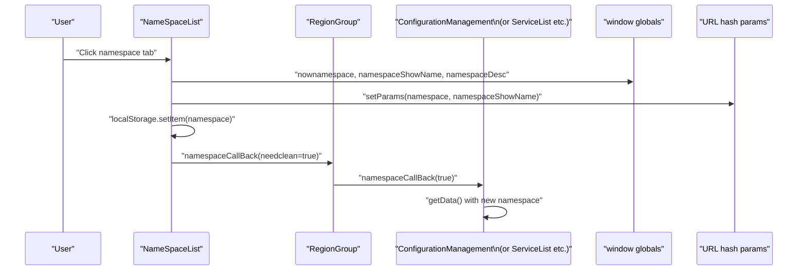

Sources: [console-ui/src/components/NameSpaceList/NameSpaceList.js:90-112]()

---

## Cluster Node List Page

### Component: `ClusterNodeList`

`ClusterNodeList` is accessible at `/clusterManagement`. It fetches the cluster member list from `v3/console/core/cluster/nodes?withInstances=false&pageNo=...&pageSize=...&keyword=...`.

**Node state colouring** is done in the `state` column cell renderer: `UP` → green tag, `DOWN` → red tag, `SUSPICIOUS` → orange tag, any other → turquoise tag.

The `extendInfo` column shows the node's extra metadata in a collapsible `<Collapse>` panel rendered as pretty-printed JSON.

The **Leave** button per row triggers a confirm dialog, then POSTs the node address array to `v3/console/core/cluster/server/leave?accessToken=...` using `axios` directly (rather than the jQuery-backed `request()` utility).

Sources: [console-ui/src/pages/ClusterManagement/ClusterNodeList/ClusterNodeList.js:78-103](), [console-ui/src/pages/ClusterManagement/ClusterNodeList/ClusterNodeList.js:105-131](), [console-ui/src/pages/ClusterManagement/ClusterNodeList/ClusterNodeList.js:220-290]()

---

## Initial Admin Registration Flow

### Component: `Register`

The `Register` component at route `/register` handles the one-time admin password initialisation that is required when a Nacos server starts with `nacos.core.auth.enabled=true` and no admin account exists yet.

**Trigger mechanism**: The `Welcome` component checks the Redux `base.authAdminRequest` field (sourced from `v3/console/server/state` → `auth_admin_request`). When it is `"true"`, `Welcome` redirects to `/register`. The Axios interceptor in `request.js` also calls `goRegister()` when `auth_admin_request === "true"` is present in the server state response.

Sources: [console-ui/src/pages/Welcome/Welcome.js:31-36](), [console-ui/src/utils/request.js:77-89]()

**Registration flow**

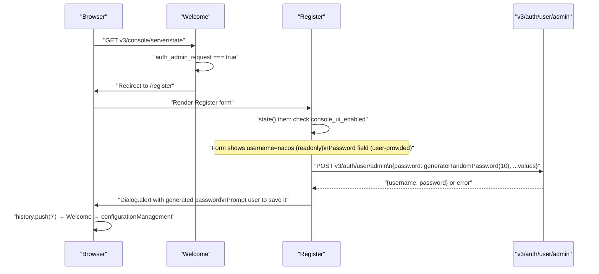

Sources: [console-ui/src/pages/Register/Register.jsx:43-108](), [console-ui/src/reducers/base.js:38-39]()

The password shown in the success dialog is the server-generated one returned in `res.data.password`, not the one the user typed (the submitted password is only used as a seed; the server generates the actual credential).

Sources: [console-ui/src/pages/Register/Register.jsx:70-80]()

---

## Cross-Page Patterns

### URL parameter persistence

All list pages use `getParams()` / `setParams()` from `globalLib.js` to read and write the hash portion of the URL. This makes the current search state shareable and back-button-safe without using the React Router `history` object for parameter storage.

Sources: [console-ui/src/globalLib.js:239-312]()

### Namespace context sharing

The active namespace is stored in three places simultaneously: `window.nownamespace` (for synchronous reads), `localStorage['namespace']` (for page reload persistence), and the URL hash param `namespace` (for shareability). Each management page reads the active namespace via `getParams('namespace')` at query time and passes it as `namespaceId` to the server.

### `request()` utility and authentication

All API calls use the jQuery-backed `request()` from `globalLib.js`. It reads `localStorage.token` (a JSON blob containing `accessToken` and `username`) and injects them as the `AccessToken` header and `username` query parameter on every request. On HTTP 401/403 with token-related error messages, it calls `goLogin()` to clear the token and redirect to `#/login`.

Sources: [console-ui/src/globalLib.js:518-567]()

### `RegionGroup` pattern

Every management list page embeds the `RegionGroup` component as a standard header above its filter form. `RegionGroup` internally renders `NameSpaceList`. The page supplies two callbacks:

- `setNowNameSpace(name, id, desc)` — updates the page's `state.nowNamespaceName`, `nowNamespaceId`, `nowNamespaceDesc` for display in `PageTitle`.
- `namespaceCallBack(needclean)` — triggers the page's data-fetch function. If `needclean=true`, search filters are reset first.

**Component relationships across a typical management page**

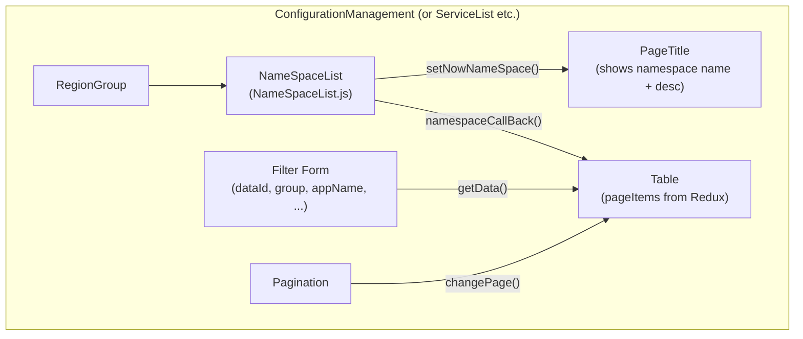

Sources: [console-ui/src/components/NameSpaceList/NameSpaceList.js:90-112](), [console-ui/src/pages/ServiceManagement/ServiceList/ServiceList.js:183-188](), [console-ui/src/pages/ConfigurationManagement/ConfigurationManagement/ConfigurationManagement.js:535-541]()

---

