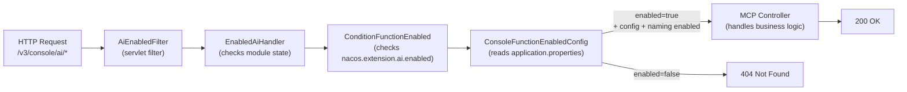
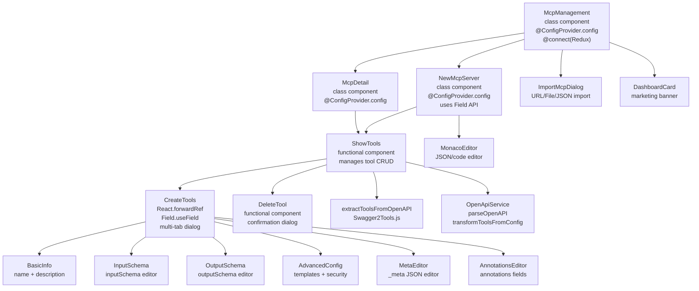
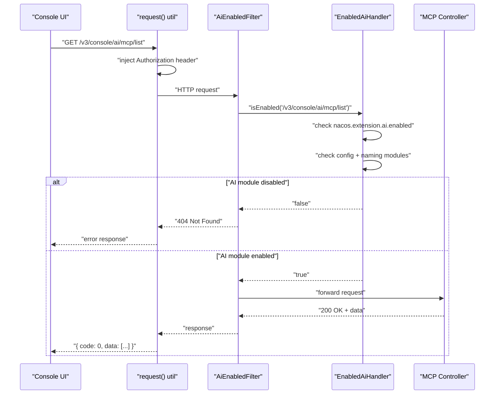
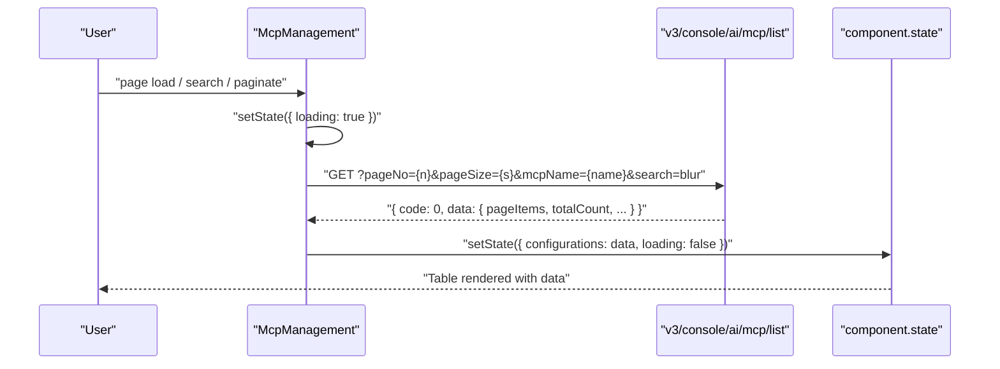
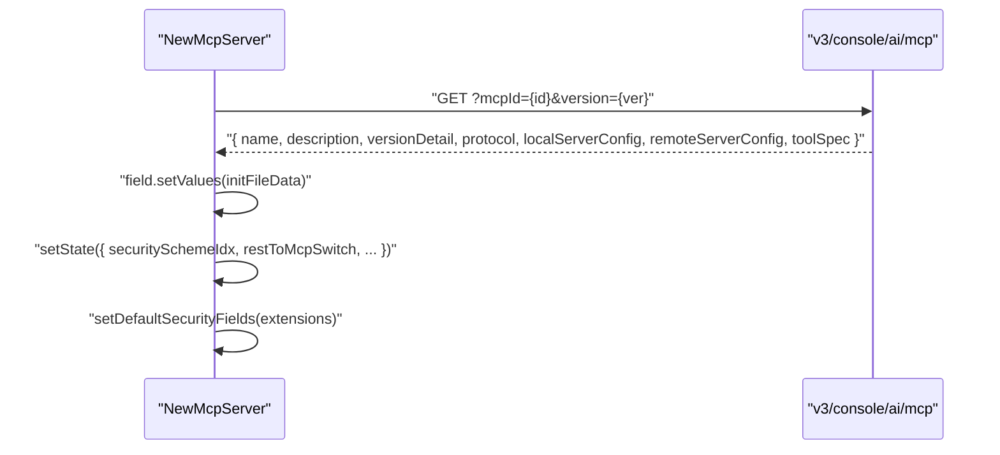
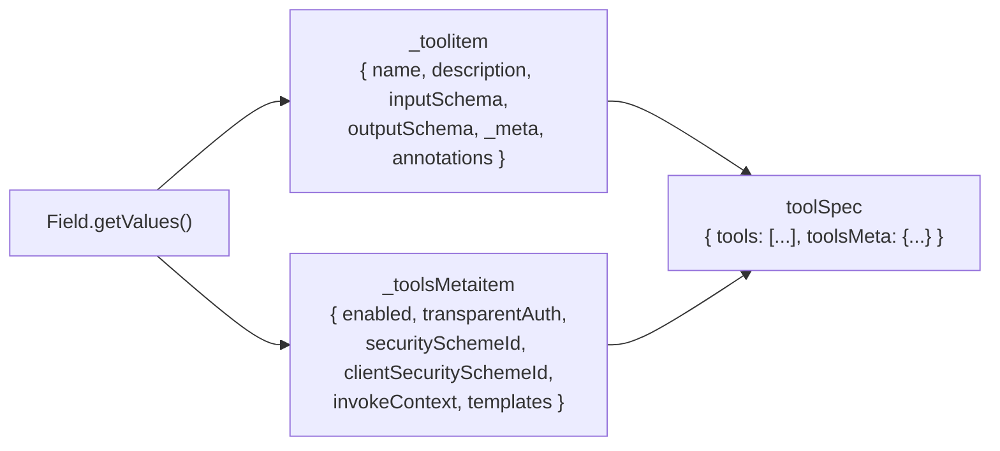
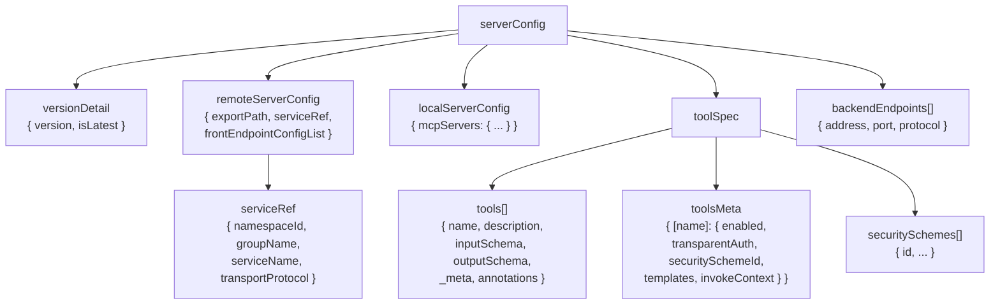

<!-- source: DeepWiki mcp.deepwiki.com · repo alibaba/nacos · page 8.3 AI and MCP Management System · fetched 2026-10-29 -->

# AI and MCP Management System

<details>
<summary>Relevant source files</summary>

The following files were used as context for generating this wiki page:

- [console-ui/package-lock.json](console-ui/package-lock.json)
- [console-ui/package.json](console-ui/package.json)
- [console-ui/src/components/Page/TotalRender.js](console-ui/src/components/Page/TotalRender.js)
- [console-ui/src/locales/en-US.js](console-ui/src/locales/en-US.js)
- [console-ui/src/locales/zh-CN.js](console-ui/src/locales/zh-CN.js)
- [console-ui/src/pages/AI/McpDetail/CreateTools/DeleteTool.js](console-ui/src/pages/AI/McpDetail/CreateTools/DeleteTool.js)
- [console-ui/src/pages/AI/McpDetail/CreateTools/components.js](console-ui/src/pages/AI/McpDetail/CreateTools/components.js)
- [console-ui/src/pages/AI/McpDetail/CreateTools/index.js](console-ui/src/pages/AI/McpDetail/CreateTools/index.js)
- [console-ui/src/pages/AI/McpDetail/McpDetail.js](console-ui/src/pages/AI/McpDetail/McpDetail.js)
- [console-ui/src/pages/AI/McpDetail/ShowTools.js](console-ui/src/pages/AI/McpDetail/ShowTools.js)
- [console-ui/src/pages/AI/McpManagement/McpManagement.js](console-ui/src/pages/AI/McpManagement/McpManagement.js)
- [console-ui/src/pages/AI/NewMcpServer/NewMcpServer.js](console-ui/src/pages/AI/NewMcpServer/NewMcpServer.js)
- [console-ui/src/pages/ClusterManagement/ClusterNodeList/ClusterNodeList.js](console-ui/src/pages/ClusterManagement/ClusterNodeList/ClusterNodeList.js)
- [console-ui/src/pages/ConfigurationManagement/ConfigurationManagement/ConfigurationManagement.js](console-ui/src/pages/ConfigurationManagement/ConfigurationManagement/ConfigurationManagement.js)
- [console-ui/src/pages/ConfigurationManagement/HistoryRollback/HistoryRollback.js](console-ui/src/pages/ConfigurationManagement/HistoryRollback/HistoryRollback.js)
- [console-ui/src/pages/ConfigurationManagement/ListeningToQuery/ListeningToQuery.js](console-ui/src/pages/ConfigurationManagement/ListeningToQuery/ListeningToQuery.js)
- [console-ui/src/pages/NameSpace/NameSpace.js](console-ui/src/pages/NameSpace/NameSpace.js)
- [console-ui/src/pages/ServiceManagement/ServiceList/ServiceList.js](console-ui/src/pages/ServiceManagement/ServiceList/ServiceList.js)
- [console-ui/src/pages/ServiceManagement/SubscriberList/SubscriberList.js](console-ui/src/pages/ServiceManagement/SubscriberList/SubscriberList.js)
- [console/src/main/resources/static/css/main.css](console/src/main/resources/static/css/main.css)
- [console/src/main/resources/static/index.html](console/src/main/resources/static/index.html)
- [console/src/main/resources/static/js/main.js](console/src/main/resources/static/js/main.js)

</details>


This page documents the MCP (Model Context Protocol) management user interface introduced in the AI module of the Nacos console. It covers the frontend React components for listing, creating, editing, and inspecting MCP servers and their tools, plus the zh-CN and en-US localization strings. For backend authentication of MCP and Agent endpoints, see [Authentication and Security](#9.3). For the overall console frontend architecture, see [Frontend Architecture](#8.1).

---

## Feature Overview

The AI management section appears in the Nacos console sidebar under a virtual parent menu item. It contains multiple subsystems for managing MCP servers, agents, skills, and prompts:

| Menu key (`MainLayout` locale) | Route | zh-CN label | Purpose |
|---|---|---|---|
| `aiRegistry` | (parent group) | AI Registry | Top-level AI registry group |
| `mcpRegistry` | (sub-group) | MCP Registry | MCP-related entries |
| `mcpServerManagement` | `/mcpServerManagement` | MCP管理 | List and manage MCP servers |
| `credentialManagement` | `/credentialManagement` | Credential管理 | Manage authentication credentials |
| `agentRegistry` | (sub-group) | Agent Registry | Agent-related entries |
| `agentManagement` | `/agentManagement` | Agent管理 | Manage AI agents |
| `skillRegistry` | `/skillRegistry` | Skill Registry | Manage agent skills |
| `promptRegistry` | `/promptRegistry` | Prompt Registry | Manage prompts (coming soon) |

This document focuses on the MCP server management subsystem. Agent management and other registries share the same sidebar group but have their own locale sections.

**Backend Enablement**: The entire AI module is conditionally loaded based on the `nacos.extension.ai.enabled` property (default: `true`). When disabled, all `/v3/console/ai/*` endpoints return 404 via the `AiEnabledFilter` servlet filter. The AI module also requires both config and naming modules to be enabled.

Sources: [console-ui/src/locales/zh-CN.js:71-79](), [console-ui/src/locales/en-US.js:72-82](), [distribution/conf/application.properties:179-189](), [ai/src/main/java/com/alibaba/nacos/ai/config/AiEnabledFilter.java:1-73]()

---

## AI Module Backend Architecture

The AI module uses a conditional loading system that gates access to all AI-related endpoints based on configuration and module availability.

**AI Module Backend Filter Chain**



**Key Components**:

- **`AiEnabledFilter`** ([ai/src/main/java/com/alibaba/nacos/ai/config/AiEnabledFilter.java]()): Servlet filter registered at `/*` that intercepts all requests matching `/v3/console/ai/*`. Uses `EnabledAiHandler` to determine if the module is enabled.

- **`EnabledAiHandler`** ([console/src/main/java/com/alibaba/nacos/console/handler/ai/EnabledAiHandler.java]()): Implements the `ConsoleFunctionModuleHandler` interface. Returns `false` if AI module is disabled via property or if required modules (config and naming) are unavailable.

- **`ConditionFunctionEnabled`** ([console/src/main/java/com/alibaba/nacos/console/handler/impl/ConditionFunctionEnabled.java]()): Condition evaluator that reads `nacos.extension.ai.enabled` from environment properties. Defaults to `true` if not explicitly set.

- **`ConsoleFunctionEnabledConfig`** ([console/src/main/java/com/alibaba/nacos/console/config/ConsoleFunctionEnabledConfig.java]()): Configuration bean that loads enablement settings from `application.properties`.

**Configuration Properties**:

| Property | Default | Description |
|---|---|---|
| `nacos.extension.ai.enabled` | `true` | Master switch for AI module. When `false`, all AI endpoints return 404. |
| `nacos.ai.mcp.registry.enabled` | `false` | Enables standalone MCP registry server on separate port. |
| `nacos.ai.mcp.registry.port` | `9080` | Port for standalone MCP registry server when enabled. |

Sources: [ai/src/main/java/com/alibaba/nacos/ai/config/AiEnabledFilter.java:1-73](), [console/src/main/java/com/alibaba/nacos/console/handler/ai/EnabledAiHandler.java:1-56](), [console/src/main/java/com/alibaba/nacos/console/handler/impl/ConditionFunctionEnabled.java:1-70](), [console/src/main/java/com/alibaba/nacos/console/config/ConsoleFunctionEnabledConfig.java:1-53](), [distribution/conf/application.properties:179-189]()

---

## Frontend Component Hierarchy

**MCP Management Frontend Component Tree**



Sources: [console-ui/src/pages/AI/McpManagement/McpManagement.js:52-63](), [console-ui/src/pages/AI/NewMcpServer/NewMcpServer.js:52-62](), [console-ui/src/pages/AI/McpDetail/McpDetail.js:25-35](), [console-ui/src/pages/AI/McpDetail/ShowTools.js:19-46](), [console-ui/src/pages/AI/McpDetail/CreateTools/index.js:23-47]()

---

## API Endpoints

All requests use the `request()` utility from `globalLib`, which injects the `Authorization` and `AccessToken` headers. Requests are filtered by `AiEnabledFilter` before reaching controllers.

**MCP Management Endpoints**

| HTTP Method | URL | Component | Purpose | Filter Behavior |
|---|---|---|---|---|
| `GET` | `v3/console/ai/mcp/list` | `McpManagement` | Paginated list of MCP servers. Params: `pageNo`, `pageSize`, `mcpName`, `search` (`blur` for fuzzy) | Returns 404 if `nacos.extension.ai.enabled=false` |
| `GET` | `v3/console/ai/mcp?mcpId={id}&namespaceId={ns}` | `McpDetail`, `NewMcpServer` | Fetch single server (latest version) | Returns 404 if AI module disabled |
| `GET` | `v3/console/ai/mcp?mcpId={id}&version={ver}&namespaceId={ns}` | `McpDetail` | Fetch specific version | Returns 404 if AI module disabled |
| `PUT` | `v3/console/ai/mcp` | `CreateTools` | Update server tool spec. Body: `{ mcpName, serverSpecification, toolSpecification, endpointSpecification }` (all JSON-stringified) | Returns 404 if AI module disabled |
| `GET` | `v3/console/ns/instance/list` | `ShowTools` | Query Nacos service instances for auto-import tool discovery | Not filtered by `AiEnabledFilter` (naming module endpoint) |

**Request Flow Through Filter**:



Sources: [console-ui/src/pages/AI/McpManagement/McpManagement.js:277-313](), [console-ui/src/pages/AI/McpDetail/McpDetail.js:69-89](), [console-ui/src/pages/AI/NewMcpServer/NewMcpServer.js:107-118](), [ai/src/main/java/com/alibaba/nacos/ai/config/AiEnabledFilter.java:36-56]()

---

## MCP Server List Page — `McpManagement`

**File:** `console-ui/src/pages/AI/McpManagement/McpManagement.js`

`McpManagement` is a class component decorated with `@ConfigProvider.config` and connected to the Redux store via `@connect`. It renders the main MCP server list table with search, pagination, and batch operations.

**Component Decorators and Lifecycle**:

```javascript
@ConfigProvider.config
@connect(state => ({ ...state.locale }), { getConfigs, getConfigsV2 })
class McpManagement extends React.Component {
  componentDidMount() {
    this.getConfigurations();  // Initial data fetch
  }
}
```

**State Management:**

| Field | Type | Purpose |
|---|---|---|
| `configurations` | `{ pageItems, pageNumber, pagesAvailable, totalCount }` | Paginated API result from `v3/console/ai/mcp/list` |
| `loading` | `boolean` | Controls `<Loading>` spinner overlay |
| `selectedRowKeys` | `string[]` | Selected row keys for batch delete via `Table.rowSelection` |
| `mcpName` | `string` | Current search filter value (fuzzy search) |
| `importVisible` | `boolean` | Controls `<ImportMcpDialog>` visibility |
| `defaultFuzzySearch` | `boolean` | Toggles fuzzy search mode display text |
| `isCn` | `boolean` | Derived from `locale`, drives language-specific logic |

**Data Fetching Flow**:



**Navigation Methods:**

| Method | Target Route | Query Params |
|---|---|---|
| `handleCreate()` | `/newMcpServer` | `namespace={ns}` |
| `handleDetail(record)` | `/mcpServerDetail` | `namespace={ns}&id={id}&version={ver}` |
| `handleEdit(record)` | `/newMcpServer` | `namespace={ns}&id={id}&version={ver}&mcptype=edit` |

**Batch Operations:**

- `handleBatchDelete()`: Iterates over `selectedRowKeys`, calls delete endpoint for each, then refreshes list.
- Row selection managed via `Table.rowSelection` prop with `selectedRowKeys` state.

Sources: [console-ui/src/pages/AI/McpManagement/McpManagement.js:52-315]()

---

## MCP Server Creation/Edit Form — `NewMcpServer`

**File:** `console-ui/src/pages/AI/NewMcpServer/NewMcpServer.js`

`NewMcpServer` is a class component decorated with `@ConfigProvider.config`. It uses `@alifd/next`'s `Field` for form state. Edit mode is determined by the `mcptype=edit` URL parameter.

### Form Field Groups

**Basic Fields** (always shown):

| Field key | Control | Notes |
|---|---|---|
| `serverName` | `Input` | MCP server name |
| `description` | `Input.TextArea` | Server description |
| `version` | `Input` | Semantic version string |
| `protocol` | `Select` | Backend protocol (`http`, `https`, `stdio`, `off`) |
| `frontProtocol` | `Select` | Frontend protocol |

**Remote Service Config** (when `restToMcpSwitch = true`):

| Field key | Notes |
|---|---|
| `exportPath` | Path prefix exposed by the MCP server |
| `useExistService` | Toggle: use existing Nacos service vs. manual address |
| `service` | `{groupName}@@{serviceName}` from Nacos service registry |
| `serviceTransportProtocol` | `http` or `https` |
| `mcpServerEndpoint` | Manual endpoint when `protocol === 'off'` |

**Security Schemes** (dynamic list via `securitySchemes[]`):

| Field key | Notes |
|---|---|
| `securitySchemes` | Array; each entry has `id` plus scheme-specific fields |
| `defaultDownstreamSecurityId` | Default security for downstream calls |
| `defaultDownstreamSecurityPassthrough` | Passthrough flag |
| `defaultUpstreamSecurityId` | Default security for upstream |
| `defaultUpstreamSecurityCredential` | Credential for upstream |

**Local Server Config** (for `stdio` type):

Initialized from `localServerConfigDesc`, a JSON template matching the MCP stdio format:

```
{
  "mcpServers": {
    "<server-name>": {
      "command": "npx",
      "args": [...],
      "env": { ... }
    }
  }
}
```

Edited via `MonacoEditor`. On submit, `convertServerConfigToPackages()` parses this JSON into a normalized `packages[]` structure including `registryType`, `identifier`, `version`, `runtimeArguments`, `packageArguments`, and `environmentVariables`.

### Version Management

- `currentVersion`, `isLatestVersion`, `versionsList` stored in component state.
- Edit mode pre-populates from `result.data.allVersions`.
- Only versions up to and including the latest are shown in `versionsList`.

### `initEditedData()` Flow



Sources: [console-ui/src/pages/AI/NewMcpServer/NewMcpServer.js:60-230](), [console-ui/src/pages/AI/NewMcpServer/NewMcpServer.js:238-447]()

---

## MCP Server Detail Page — `McpDetail`

**File:** `console-ui/src/pages/AI/McpDetail/McpDetail.js`

`McpDetail` is a class component that fetches and displays a single MCP server's full configuration. It uses `getParams('id')`, `getParams('version')`, and `getParams('namespace')` from the URL.

**Key state:**

| Field | Purpose |
|---|---|
| `serverConfig` | Full server object from API |
| `packageTabsExpanded` | Per-package expand/collapse state (keyed by index) |
| `toolParametersExpanded` | Per-tool expand/collapse state (keyed by index) |
| `parameterContainersExpanded` | Per-container type per-package state |
| `defaultSecurityCollapsed` | `{ downstream, upstream }` collapse state |
| `activeToolIndex` | Currently selected tool in tool list |

**Navigation methods:**

- `goToVersion(version)` — navigates to `/mcpServerDetail?version={ver}` and re-fetches.
- `goToToEditVersion()` — navigates to `/newMcpServer?mcptype=edit` for the current version.
- `goToServiceDetail(serviceRef)` — navigates to `/serviceDetail` for the backing Nacos service.

The detail page renders tool information via `ShowTools` using a `ref` (`this.toolsRef`) to call `openVisible()` imperatively.

Sources: [console-ui/src/pages/AI/McpDetail/McpDetail.js:25-180]()

---

## Tool Management

### `ShowTools` — Tool Listing

**File:** `console-ui/src/pages/AI/McpDetail/ShowTools.js`

A functional component receiving `serverConfig`, `frontProtocol`, `address`, `port`, `useExistService`, `service`, `exportPath`, `restToMcpSwitch`, `locale`, `isPreview`, and `onlyEditRuntimeInfo` as props.

**Core responsibilities:**

- Renders the list of tools from `serverConfig.toolSpec.tools`.
- Opens `CreateTools` (via `toolsRef.current.openVisible()`) for create or edit.
- Opens `DeleteTool` for removal.
- Supports **OpenAPI import**: `importToolsFromOpenApi()` triggers a file-upload dialog. On confirm, calls `parseOpenAPI()` and `transformToolsFromConfig()` from `OpenApiService`, then `extractToolsFromOpenAPI()` from `Swagger2Tools`.
- Supports **auto-import from live server**: `autoImportToolsFromMCPServer()` queries `v3/console/ns/instance/list` to get instance IP/port, then calls the live MCP server's tool list endpoint directly.

**Parameter tree rendering:**

`buildParameterTreeData(properties, required, parentKey, mapRef)` recursively converts a JSON Schema `properties` object into an `@alifd/next` `Tree` compatible structure, handling `object`, `array`, and scalar types. Results are stored in `inputParameterMap` or `outputParameterMap` refs for lookup.

```
properties → buildParameterTreeData() → [{ key, label, children, isLeaf }]
```

Sources: [console-ui/src/pages/AI/McpDetail/ShowTools.js:19-400]()

---

### `CreateTools` — Tool Creation/Edit Dialog

**File:** `console-ui/src/pages/AI/McpDetail/CreateTools/index.js`

A `React.forwardRef` component exposing `openVisible({ record, type, toolsMeta })` via `useImperativeHandle`. Uses `Field.useField` from `@alifd/next`.

**Multi-tab layout:**

| Tab | Component | Data managed |
|---|---|---|
| Basic Info | `BasicInfo` | `name`, `description` |
| Input Schema | `InputSchema` | `toolParams` (properties), `required` |
| Output Schema | `OutputSchema` | `outputToolParams`, `outputRequired` |
| Advanced Config | `AdvancedConfig` | `templates` (json-go-template), `securitySchemeId`, `clientSecuritySchemeId`, `transparentAuth`, `invokeContext[]` |
| Meta | `MetaEditor` | `meta` (raw JSON for `_meta`) |
| Annotations | `AnnotationsEditor` | `annotationsTitle`, `readOnlyHint`, `destructiveHint`, `idempotentHint`, `openWorldHint` |

**Tool data model assembled on submit:**



Input/output schema initialization uses `convertPropertiesToTreeData()` from `CreateTools/utils.js` to convert JSON Schema `properties` into a tree structure. Default empty args are added if the schema has no properties.

The `templates` field supports `json-go-template` format for HTTP-based MCP servers. The security fields (`securitySchemeId`, `clientSecuritySchemeId`) are extracted from or injected into the template's `requestTemplate.security` and `security` sub-objects.

Sources: [console-ui/src/pages/AI/McpDetail/CreateTools/index.js:23-370]()

---

### `DeleteTool` — Deletion Confirmation

**File:** `console-ui/src/pages/AI/McpDetail/CreateTools/DeleteTool.js`

A functional component that renders a text link triggering a confirmation `Dialog`. On confirm it:

1. Deep-copies `serverConfig.toolSpec.toolsMeta` and removes the target key.
2. Calls `props.onChange({ tools: filteredTools, toolsMeta: updatedMeta }, closeDialog)`.
3. The parent (`ShowTools`) is responsible for persisting the updated spec to the API.

Props: `record`, `locale`, `getServerDetail`, `serverConfig`, `onChange`.

Sources: [console-ui/src/pages/AI/McpDetail/CreateTools/DeleteTool.js:1-96]()

---

## MCP Server Data Model

The following shows the shape of the object returned from `v3/console/ai/mcp` and stored in component state as `serverConfig`:



Sources: [console-ui/src/pages/AI/NewMcpServer/NewMcpServer.js:119-229](), [console-ui/src/pages/AI/McpDetail/McpDetail.js:36-62]()

---

## `convertServerConfigToPackages` — Local Config Normalization

`NewMcpServer.convertServerConfigToPackages(serverConfig)` is called to normalize a `localServerConfig` JSON blob (MCP stdio format) into the server-side package spec. The mapping logic is:

| Source field | Target field | Logic |
|---|---|---|
| `command` | `registryType` | `inferRegistryType(command)` — maps `npx`→`npm`, `pip`→`pypi`, `docker`→`docker`, `java`→`maven` etc. |
| `args` | `identifier` | `extractPackageNameFromArgs()` — finds first non-flag, non-URL arg |
| `args` | `version` | `extractPackageVersionFromArgs()` — finds `@version` suffix or `--version` flag |
| `args` before package | `runtimeArguments` | `separateArguments()` |
| `args` after package | `packageArguments` | `separateArguments()` |
| `env` | `environmentVariables` | `{ name, value, format: 'string' }` array |

Sources: [console-ui/src/pages/AI/NewMcpServer/NewMcpServer.js:237-448]()

---

## Localization

Both `zh-CN.js` and `en-US.js` define locale objects passed to components via `ConfigProvider.config`. The AI management UI locale keys are organized into several namespaces:

**Main Menu Labels** (`MainLayout` namespace):

| Locale key | zh-CN | en-US |
|---|---|---|
| `aiRegistry` | AI Registry | AI Registry |
| `mcpRegistry` | MCP Registry | MCP Registry |
| `mcpServerManagement` | MCP管理 | MCP Management |
| `credentialManagement` | Credential管理 | Credential Management |
| `agentRegistry` | Agent Registry | Agent Registry |
| `agentManagement` | Agent管理 | Agent Management |
| `skillRegistry` | Skill Registry | Skill Registry |
| `promptRegistry` | Prompt Registry | Prompt Registry |
| `promptRegistryComingSoon` | Prompt Registry 功能即将推出... | Prompt Registry is coming soon... |

**MCP Server Management Labels** (`McpServerManagement` namespace):

| Locale key | zh-CN | en-US |
|---|---|---|
| `addNewMcpServer` | 创建 MCP Server | Create MCP Server |
| `mcpServerName` | MCP 服务名 | MCP Server Name |
| `mcpServerGroup` | MCP 服务分组 | MCP Server Group |
| `mcpServerType` | 类型 | Type |
| `mcpServerVersion` | 版本 | Version |
| `capability` | 支持能力 | Capability |
| `online` / `offline` | 启用 / 禁用 | Enable / Disable |
| `deleteMcpServer` | 确定要删除以下 MCP 服务吗？ | Confirm delete MCP server? |
| `importMcpServer` | 导入 MCP Server | Import MCP Server |
| `importSource` | 导入来源 | Import Source |
| `sampleConfig` | 配置示例 | Sample Config |
| `deleteToolTitle` | 删除工具 | Delete Tool |
| `deleteToolContent` | 确定要删除此工具吗？ | Confirm delete this tool? |
| `operationToolDelete` | 删除 | Delete |
| `pleaseEnterIPAndPort` | 请输入IP和端口 | Please enter IP and port |
| `pleaseEnterServiceName` | 请选择服务 | Please select service |
| `importSuccess` | 导入成功 | Import successful |
| `fileInvalidFormat` | 文件格式错误 | File format error |

**Agent Management Labels** (`AgentManagement` namespace):

Separate namespace for agent management UI at [console-ui/src/locales/zh-CN.js:786-871](), including keys like `agentManagement`, `agentName`, `newAgent`, `editAgent`, `deleteConfirm`, etc.

**Usage Pattern in Components**:

```javascript
@ConfigProvider.config
class McpManagement extends React.Component {
  render() {
    const { locale } = this.props;  // Injected by ConfigProvider
    return (
      <Button>{locale.McpServerManagement.addNewMcpServer}</Button>
    );
  }
}
```

Sources: [console-ui/src/locales/zh-CN.js:71-79](), [console-ui/src/locales/zh-CN.js:873-1000](), [console-ui/src/locales/en-US.js:72-82](), [console-ui/src/locales/en-US.js:873-1000]()

---

## Inter-Component Data Flow

**MCP Tool Save Flow (NewMcpServer context)**

```mermaid
sequenceDiagram
  participant U as "User"
  participant ST as "ShowTools"
  participant CT as "CreateTools"
  participant NS as "NewMcpServer"
  participant API as "v3/console/ai/mcp (PUT)"

  U->>ST: "click 'Add Tool'"
  ST->>CT: "toolsRef.current.openVisible({ record, type, toolsMeta })"
  CT-->>U: "Dialog visible; tabs: BasicInfo, InputSchema, OutputSchema, AdvancedConfig"
  U->>CT: "fill form fields, click OK"
  CT->>CT: "field.validate() -> assembles _toolitem + _toolsMetaitem"
  CT->>NS: "props.onChange({ tools, toolsMeta })"
  NS->>API: "PUT v3/console/ai/mcp with full serverSpec + toolSpec"
  API-->>NS: "{ code: 0 }"
  NS->>ST: "getServerDetail() re-fetch"
```

Sources: [console-ui/src/pages/AI/McpDetail/CreateTools/index.js:228-370](), [console-ui/src/pages/AI/McpDetail/ShowTools.js:270-354]()

---

