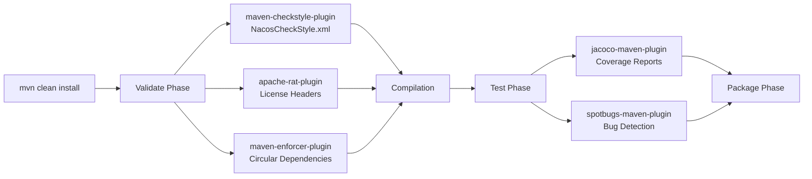
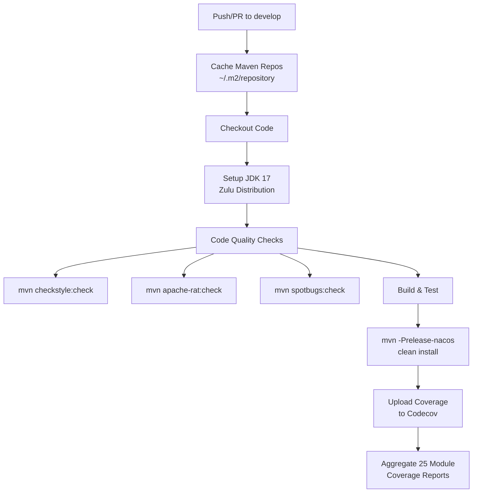
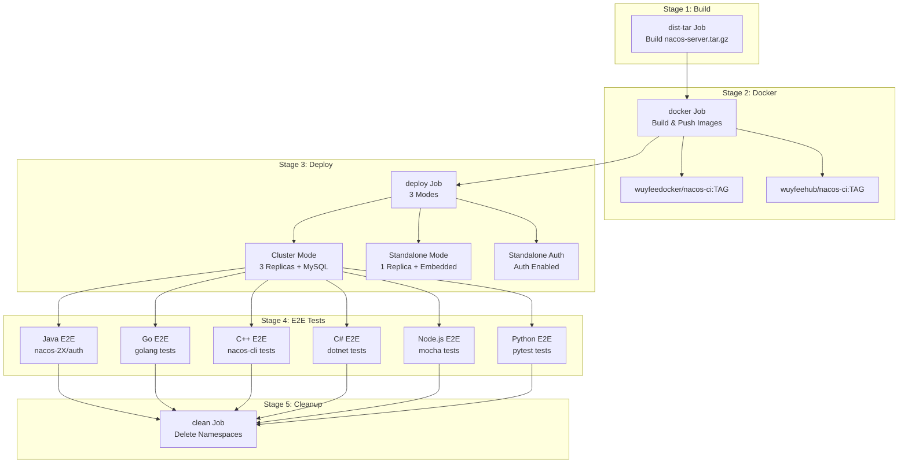
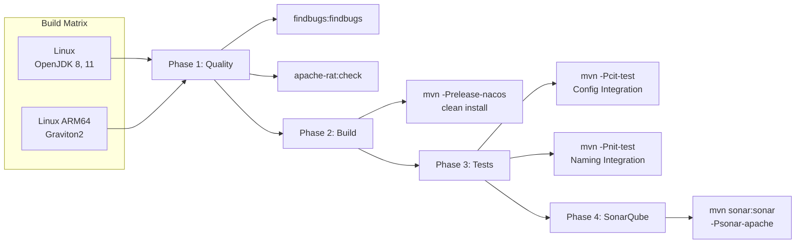
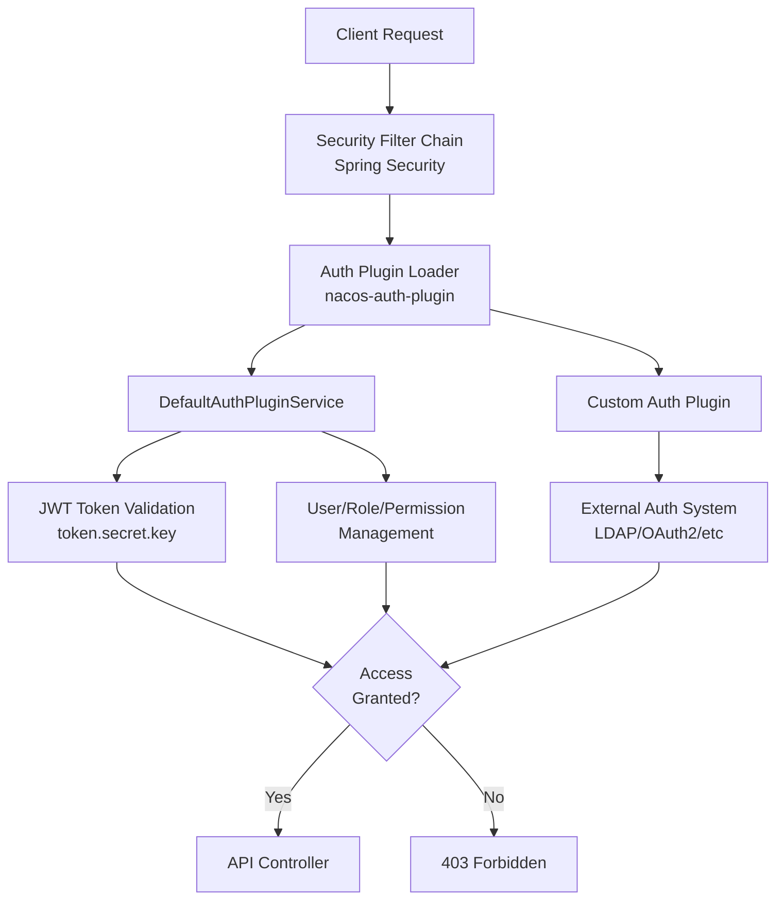
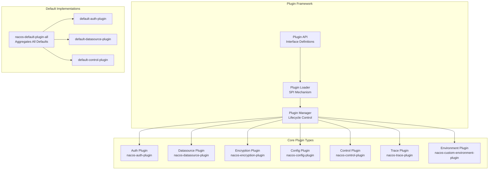

<!-- source: DeepWiki mcp.deepwiki.com · repo alibaba/nacos · page 9 Development and Operations · fetched 2026-10-29 -->

# Development and Operations

<details>
<summary>Relevant source files</summary>

The following files were used as context for generating this wiki page:

- [.github/PULL_REQUEST_TEMPLATE.md](.github/PULL_REQUEST_TEMPLATE.md)
- [.github/workflows/ci.yml](.github/workflows/ci.yml)
- [.github/workflows/it.yml](.github/workflows/it.yml)
- [.github/workflows/pr-ci.yml](.github/workflows/pr-ci.yml)
- [.github/workflows/pr-e2e-test.yml](.github/workflows/pr-e2e-test.yml)
- [.github/workflows/push-ci.yaml](.github/workflows/push-ci.yaml)
- [.travis.yml](.travis.yml)
- [api/pom.xml](api/pom.xml)
- [api/src/main/java/com/alibaba/nacos/api/annotation/NacosProperties.java](api/src/main/java/com/alibaba/nacos/api/annotation/NacosProperties.java)
- [api/src/main/java/com/alibaba/nacos/api/common/ResponseCode.java](api/src/main/java/com/alibaba/nacos/api/common/ResponseCode.java)
- [api/src/main/java/com/alibaba/nacos/api/naming/NamingResponseCode.java](api/src/main/java/com/alibaba/nacos/api/naming/NamingResponseCode.java)
- [api/src/main/java/com/alibaba/nacos/api/selector/Selector.java](api/src/main/java/com/alibaba/nacos/api/selector/Selector.java)
- [api/src/main/java/com/alibaba/nacos/api/selector/context/CmdbContext.java](api/src/main/java/com/alibaba/nacos/api/selector/context/CmdbContext.java)
- [api/src/main/java/com/alibaba/nacos/api/selector/context/SelectorContextBuilder.java](api/src/main/java/com/alibaba/nacos/api/selector/context/SelectorContextBuilder.java)
- [client/pom.xml](client/pom.xml)
- [common/pom.xml](common/pom.xml)
- [config/pom.xml](config/pom.xml)
- [console/pom.xml](console/pom.xml)
- [core/pom.xml](core/pom.xml)
- [distribution/pom.xml](distribution/pom.xml)
- [example/pom.xml](example/pom.xml)
- [naming/pom.xml](naming/pom.xml)
- [pom.xml](pom.xml)
- [test/config-test/src/test/java/com/alibaba/nacos/test/base/ConfigCleanUtils.java](test/config-test/src/test/java/com/alibaba/nacos/test/base/ConfigCleanUtils.java)
- [test/pom.xml](test/pom.xml)

</details>


This page provides guidance for developers and operators working with Nacos, covering build processes, continuous integration/delivery, monitoring, security configuration, and plugin development. For information about deploying Nacos in production environments, see [Installation and Deployment](#2). For details on the plugin API contracts, see [Plugin Development](#9.4).

## Build System Structure

Nacos uses a multi-module Maven build managed by a parent POM at the repository root. The build system enforces code quality, dependency management, and packaging across all modules.

### Maven Module Hierarchy

The parent POM [pom.xml:614-645]() defines 25 modules organized in a layered structure:

| Layer | Modules | Purpose |
|-------|---------|---------|
| **API & Common** | `api`, `common` | Interface definitions and shared utilities |
| **Core Infrastructure** | `core`, `consistency`, `auth`, `persistence` | Cluster management, consensus, authentication |
| **Service Modules** | `config`, `naming`, `ai` | Business logic for configuration and service discovery |
| **Client SDKs** | `client`, `client-basic`, `maintainer-client` | Client libraries for different use cases |
| **Extensions** | `plugin`, `plugin-default-impl` | Plugin framework and default implementations |
| **Distribution** | `bootstrap`, `console`, `distribution` | Server assembly and packaging |
| **Testing** | `test`, `example` | Integration tests and examples |

### Build Properties and Profiles

The root POM defines critical properties for build consistency:

```
Java Version Requirements:
- Server modules: Java 17 [pom.xml:96]()
- Client modules: Java 8 [pom.xml:95]()
- Maven requirement: 3.2.5+ [pom.xml:32]()
```

The build supports multiple profiles for different scenarios:

| Profile | Purpose | Activation |
|---------|---------|------------|
| `release-nacos` | Build full distribution package | Manual |
| `release-client` | Build client SDK only | Manual |
| `cit-test` | Run configuration integration tests | Manual |
| `nit-test` | Run naming integration tests | Manual |
| `remove-test-data` | Clean test artifacts | Manual |
| `jdk17` | JDK 17+ specific settings | Auto on JDK 17+ |

**Sources:** [pom.xml:90-168](), [pom.xml:491-602]()

### Build Lifecycle and Plugin Configuration

#### Code Quality Enforcement

The build enforces strict quality gates before compilation:



The `maven-checkstyle-plugin` [pom.xml:278-305]() validates code style against `style/NacosCheckStyle.xml`, excluding auto-generated protobuf classes and test code. The `apache-rat-plugin` [pom.xml:307-362]() verifies Apache license headers on all source files.

The `maven-enforcer-plugin` [pom.xml:211-234]() prevents circular dependencies between modules using the `banCircularDependencies` rule, ensuring clean architectural boundaries.

#### Test Coverage and Analysis

Test execution uses `maven-surefire-plugin` [pom.xml:405-417]() with JVM arguments to support Java 17 module access:

```
--add-opens java.base/java.lang=ALL-UNNAMED
--add-opens java.base/java.lang.reflect=ALL-UNNAMED
--add-opens java.base/java.util=ALL-UNNAMED
```

Code coverage is collected by `jacoco-maven-plugin` [pom.xml:372-403](), generating reports at `target/coverage-reports/jacoco-unit.exec`. The plugin excludes generated gRPC code and package scanning utilities.

Static analysis runs via `spotbugs-maven-plugin` [pom.xml:419-427]() with exclusions defined in `style/spotbugs-exclude.xml`, using maximum effort and high threshold.

**Sources:** [pom.xml:172-433]()

### Client SDK Packaging

The `nacos-client` module uses specialized packaging to create shaded JARs with relocated dependencies, preventing classpath conflicts in client applications.

#### Dependency Shading Strategy

The `maven-shade-plugin` [client/pom.xml:125-264]() relocates all third-party dependencies under the `com.alibaba.nacos.shaded` package:

| Original Package | Relocated Package | Purpose |
|------------------|-------------------|---------|
| `io.grpc.*` | `com.alibaba.nacos.shaded.io.grpc.*` | gRPC client communication |
| `com.google.*` | `com.alibaba.nacos.shaded.com.google.*` | Protobuf and Guava |
| `javax.annotation` | `com.alibaba.nacos.shaded.javax.annotation.*` | JSR annotations |
| `io.perfmark` | `com.alibaba.nacos.shaded.io.perfmark.*` | Performance markers |

The plugin configuration [client/pom.xml:183-200]() includes only essential artifacts:
- `nacos-api` and `nacos-common` modules
- gRPC and protobuf dependencies
- Google Guava utilities

The `minimizeJar` option [client/pom.xml:140]() removes unused classes to reduce JAR size, while `createSourcesJar` [client/pom.xml:141]() generates source artifacts for IDE debugging.

**Sources:** [client/pom.xml:121-286]()

## Continuous Integration and Delivery

Nacos maintains automated CI/CD pipelines using both GitHub Actions and Travis CI to ensure code quality and facilitate multi-language client testing.

### GitHub Actions Workflows

#### Primary CI Workflow

The main continuous integration workflow [.github/workflows/ci.yml:1-45]() runs on every push to `develop` and `v2.x-develop` branches:



The workflow uploads coverage reports for all modules to Codecov [.github/workflows/ci.yml:39-45](), including:
- Core modules: `core`, `config`, `naming`, `auth`
- Plugin modules: `encryption`, `datasource`, `trace`, `control`
- Infrastructure: `consistency`, `persistence`, `common`, `api`

**Sources:** [.github/workflows/ci.yml:1-45]()

#### Multi-Stage E2E Testing Pipeline

The push-based CI workflow [.github/workflows/push-ci.yaml:1-531]() implements a comprehensive multi-stage pipeline for end-to-end testing:



**Build and Distribution** [.github/workflows/push-ci.yaml:19-45]():
- Builds using Maven with `-Prelease-nacos` profile
- Uploads `nacos-server-*.tar.gz` as workflow artifact
- Preserves distribution for downstream jobs

**Docker Image Creation** [.github/workflows/push-ci.yaml:47-114]():
- Generates unique version tags: `{branch}-{uuid}`
- Pushes to dual Docker Hub repositories for redundancy
- Uses images from `nacos-group/nacos-e2e` repository

**Kubernetes Deployment** [.github/workflows/push-ci.yaml:116-192]():
- Deploys to AWS EKS via `apache/rocketmq-test-tool@java-dev` action
- Creates isolated namespaces: `nacos-{run_id}-{job_index}`
- Configures different modes via Helm values:
  - Cluster: 3 replicas, MySQL, auth disabled
  - Standalone: 1 replica, embedded Derby, auth disabled
  - Standalone Auth: 1 replica, embedded Derby, auth enabled

**Multi-Language Testing** [.github/workflows/push-ci.yaml:194-512]():

| Language | Test Command | Reporter |
|----------|-------------|----------|
| Java | `mvn clean test -B` | Surefire XML |
| Go | `gotestsum --junitfile` | JUnit XML |
| C++ | `g++ ... && ./nacos_test --gtest_output=xml` | GTest XML |
| C# | `dotnet test --logger:junit` | JUnit XML |
| Node.js | `mocha --reporter mocha-junit-reporter` | Mocha JUnit |
| Python | `pytest --junitxml` | Pytest XML |

All tests run in containerized environments using `cloudnativeofalibabacloud/test-runner:v0.0.4` with 2 CPU cores and 2Gi memory limits [.github/workflows/push-ci.yaml:233-239]().

**Sources:** [.github/workflows/push-ci.yaml:1-531]()

#### Pull Request E2E Testing

The PR E2E workflow [.github/workflows/pr-e2e-test.yml:1-510]() mirrors the push workflow but triggers only after the PR-CI workflow completes successfully. It downloads the artifact from the triggering workflow using `actions/github-script` [.github/workflows/pr-e2e-test.yml:34-52]() and follows the same multi-language testing strategy.

**Sources:** [.github/workflows/pr-e2e-test.yml:1-510](), [.github/workflows/pr-ci.yml:1-38]()

### Travis CI Configuration

The Travis CI pipeline [.travis.yml:1-47]() provides complementary testing on multiple platforms:



The configuration sets Maven options [.travis.yml:30-31]() to handle memory constraints:
```
MAVEN_OPTS="-Xmx1024m -XX:MaxPermSize=512m -XX:+BytecodeVerificationLocal"
```

Travis runs FindBugs (now SpotBugs) [.travis.yml:36]() and Apache RAT license checks before building. It uses the `remove-test-data` profile [.travis.yml:37-43]() to clean test environments between integration test runs.

The final step uploads analysis to SonarQube at `https://builds.apache.org/analysis` [.travis.yml:44-46]() for code quality tracking.

**Sources:** [.travis.yml:1-47]()

### E2E Test Infrastructure

The E2E testing infrastructure uses a separate repository `nacos-group/nacos-e2e` that contains:

1. **Helm Charts** (`cicd/helm`) for deploying Nacos to Kubernetes
2. **Test Suites** for each language:
   - `java/nacos-2X` - Standard Java tests
   - `java/auth` - Authentication tests
   - `golang`, `cpp`, `csharp`, `nodejs`, `python` - Language-specific suites
3. **Docker Build Files** (`cicd/build/Dockerfile`) for creating test images

The deployment uses `apache/rocketmq-test-tool@java-dev` action [.github/workflows/push-ci.yaml:155-192]() which:
- Creates Kubernetes namespaces
- Deploys Nacos via Helm
- Waits for pods to be ready (up to 2000 retries)
- Executes test pods in the same namespace
- Collects test results and logs

**Sources:** [.github/workflows/push-ci.yaml:155-291]()

## Monitoring and Observability

Nacos provides comprehensive monitoring capabilities through metrics collection, request tracing, and audit logging.

### Metrics Collection

The system uses Micrometer for metrics aggregation with support for multiple backend registries:

| Registry | Module | Purpose |
|----------|--------|---------|
| Prometheus | `micrometer-registry-prometheus` | Pull-based metrics scraping |
| InfluxDB | `micrometer-registry-influx` | Time-series data storage |
| Elasticsearch | `micrometer-registry-elastic` | Log and metric correlation |

These dependencies are declared in both `config` [config/pom.xml:92-101]() and `naming` [naming/pom.xml:119-129]() modules, enabling service-specific metric collection.

The `nacos-prometheus` module [pom.xml:823-825]() provides Prometheus integration, exposing metrics at `/actuator/prometheus` endpoint through Spring Boot Actuator [core/pom.xml:79-80]().

### Request Tracing

The `nacos-trace-plugin` module [core/pom.xml:55-57]() enables operation tracing for debugging and performance analysis. This plugin architecture allows custom trace implementations to be loaded at runtime.

The `RequestLogAspect` component (referenced in the ToC) likely uses Spring AOP [config/pom.xml:104-105](), [core/pom.xml:66-67]() to intercept HTTP requests and log:
- Request parameters
- Response status
- Execution time
- User identity (if authenticated)

### Audit Logging

The `ConfigTraceService` (referenced in the ToC) provides audit trails for configuration changes, tracking:
- Who modified a configuration
- When the change occurred
- What was changed (old vs new values)
- Which client made the request

All modules use SLF4J API [common/pom.xml:43-45]() with Logback as the implementation [config/pom.xml:56-58](), [naming/pom.xml:72-78](). The `nacos-logback-adapter-12` [pom.xml:747-749]() and `nacos-log4j2-adapter` [pom.xml:757-759]() modules provide compatibility layers for different logging frameworks.

### Logging Configuration

The console module configures logging bridges to route all logging frameworks through SLF4J [console/pom.xml:82-95]():
- `log4j-over-slf4j` - Log4j 1.x → SLF4J
- `jcl-over-slf4j` - Apache Commons Logging → SLF4J
- `jul-to-slf4j` - Java Util Logging → SLF4J

This ensures consistent log formatting and centralized log management across all dependencies.

**Sources:** [config/pom.xml:56-58,92-105](), [naming/pom.xml:72-78,119-129](), [core/pom.xml:55-57,66-67,79-80](), [console/pom.xml:82-95](), [pom.xml:747-759,823-825](), [common/pom.xml:43-45]()

## Authentication and Security

Nacos implements a plugin-based authentication system with mandatory security configurations for production deployments.

### Required Security Configuration

The startup process validates two critical security properties that must be set before the server can start:

| Property | Purpose | Validation |
|----------|---------|------------|
| `nacos.core.auth.plugin.nacos.token.secret.key` | JWT token signing key | Must be non-empty in production |
| `nacos.core.auth.server.identity.key` | Server identity for inter-node auth | Required for cluster mode |
| `nacos.core.auth.server.identity.value` | Server identity value | Required for cluster mode |

These properties are documented in the startup flow diagram (Diagram 7 of the high-level architecture), which shows validation happening before core module initialization.

The `token.secret.key` is used by the JWT authentication plugin to sign and verify access tokens. If not configured, the server will prompt for input or refuse to start, depending on the deployment mode.

The `identity.key` and `identity.value` pair enables mutual authentication between cluster nodes, preventing unauthorized servers from joining the cluster.

### Authentication Architecture



The authentication system is built on Spring Security [core/pom.xml:75-76](), [console/pom.xml:98-99]() with a plugin architecture defined in the `nacos-auth-plugin` module [pom.xml:833-835]().

**Default Authentication Plugin** [pom.xml:782-784]():
- Manages local user database
- Issues JWT tokens signed with `token.secret.key`
- Supports role-based access control (RBAC)
- Stores credentials in Derby/MySQL

**Custom Authentication Plugins**:
- Can integrate external identity providers
- Must implement the `AuthPluginService` interface
- Loaded via SPI from `plugins/auth/` directory

### Security Testing

The console module includes the default auth plugin as a test dependency [console/pom.xml:116-120](), enabling security integration tests. The E2E pipeline [.github/workflows/push-ci.yaml:126-146]() includes a `standalone_auth` mode that validates authentication functionality.

**Sources:** [core/pom.xml:75-76](), [console/pom.xml:98-99,116-120](), [pom.xml:782-784,833-835](), [.github/workflows/push-ci.yaml:126-146]()

## Plugin Development

Nacos provides a comprehensive plugin system that allows customization of authentication, data sources, encryption, configuration management, and control policies.

### Plugin Architecture Overview



### Plugin Types and Purposes

| Plugin Type | Module | Purpose | Dependency Sites |
|-------------|--------|---------|-----------------|
| **Auth Plugin** | `nacos-auth-plugin` | Custom authentication/authorization | `core` [core/pom.xml:52-53]() |
| **Datasource Plugin** | `nacos-datasource-plugin` | Custom database connectors | `core` [core/pom.xml:182-185](), `config` [config/pom.xml:116-118]() |
| **Encryption Plugin** | `nacos-encryption-plugin` | Configuration encryption/decryption | `core` [core/pom.xml:177-180](), `config` [config/pom.xml:61-63](), `client` [client/pom.xml:65-67]() |
| **Config Plugin** | `nacos-config-plugin` | Configuration processing extensions | `core` [core/pom.xml:172-175](), `config` [config/pom.xml:66-68]() |
| **Control Plugin** | `nacos-control-plugin` | Traffic control and rate limiting | `core` [core/pom.xml:167-170](), `config` [config/pom.xml:111-114]() |
| **Trace Plugin** | `nacos-trace-plugin` | Distributed tracing integration | `core` [core/pom.xml:55-57]() |
| **Environment Plugin** | `nacos-custom-environment-plugin` | Custom environment variable sources | `core` [core/pom.xml:187-190]() |

### Default Plugin Aggregation

The `nacos-default-plugin-all` module [pom.xml:1461-1464]() aggregates default implementations of all plugins. This aggregation is used in two scenarios:

1. **Development Mode**: Included as dependency in console module's `dev` profile [console/pom.xml:166-170]()
2. **Distribution**: Packaged with the server distribution [distribution/pom.xml:40-43]()

The aggregation pattern ensures all default plugins load together, providing out-of-the-box functionality without manual plugin installation.

### Plugin Development Workflow

**1. Implement Plugin Interface**: Create a class implementing the plugin SPI interface (e.g., `AuthPluginService`, `DatasourcePluginService`).

**2. Package as Module**: Structure as Maven module with dependencies only on:
- `nacos-api` for data models
- `nacos-common` for utilities
- Plugin interface module (e.g., `nacos-auth-plugin`)

**3. Create SPI Descriptor**: Add `META-INF/services/{interface-name}` file listing implementation class(es).

**4. Deploy Plugin**: Copy JAR to server's `plugins/{type}/` directory:
- `plugins/auth/` - Authentication plugins
- `plugins/datasource/` - Database connector plugins
- `plugins/encryption/` - Encryption plugins

**5. Configure Plugin**: Set plugin selection via `application.properties`:
```
nacos.plugin.auth.system={plugin-name}
nacos.plugin.datasource.platform={plugin-name}
```

### Plugin Loading Mechanism

Plugins are loaded using Java SPI (Service Provider Interface) at server startup. The `PluginManager` scans:
1. Classpath for bundled plugins
2. `plugins/` directory for external plugins
3. Validates plugin compatibility
4. Initializes selected plugins based on configuration

Each plugin type has a dedicated manager:
- `AuthPluginManager` [core module]
- `DatasourcePluginManager` [persistence module]
- `EncryptionPluginManager` [core module]

The plugin loading order ensures core infrastructure (datasource, encryption) loads before service modules (config, naming).

### Example: Custom Datasource Plugin

The default datasource plugin [pom.xml:1443-1447]() demonstrates the pattern:

```
Module: plugin-default-impl/nacos-default-datasource-plugin
Implements: DatasourcePluginService
Provides: MySQL, PostgreSQL, Derby connectors
Configuration: nacos.plugin.datasource.platform=mysql
```

A custom Oracle datasource plugin would:
1. Depend on `nacos-datasource-plugin` [pom.xml:858-860]()
2. Implement connection pooling for Oracle
3. Handle Oracle-specific SQL syntax
4. Register via SPI as `oracle` platform

**Sources:** [pom.xml:833-865,1443-1464](), [core/pom.xml:52-53,55-57,167-190](), [config/pom.xml:61-68,111-118](), [client/pom.xml:65-67](), [console/pom.xml:166-170](), [distribution/pom.xml:40-43]()

---

