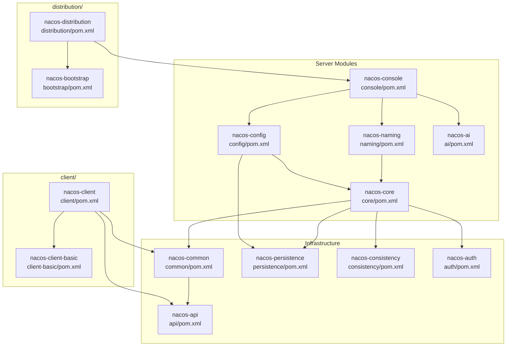
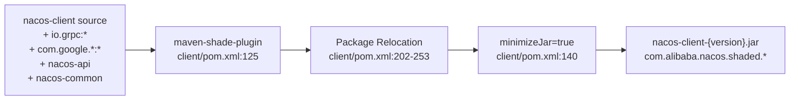
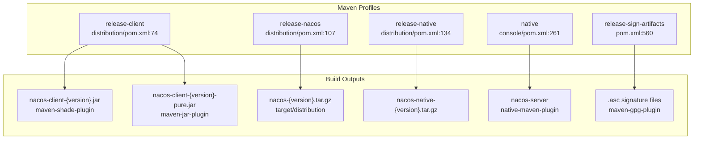
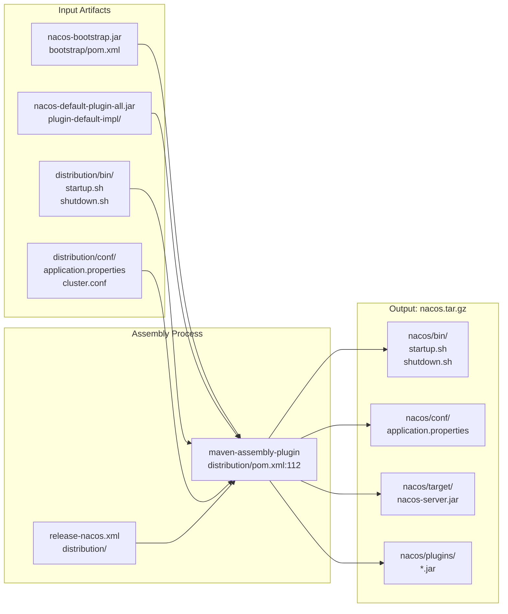

<!-- source: DeepWiki mcp.deepwiki.com · repo alibaba/nacos · page 9.1 Build System and CI/CD · fetched 2026-10-29 -->

# Build System and Module Organization

<details>
<summary>Relevant source files</summary>

The following files were used as context for generating this wiki page:

- [.github/PULL_REQUEST_TEMPLATE.md](.github/PULL_REQUEST_TEMPLATE.md)
- [.github/workflows/ci.yml](.github/workflows/ci.yml)
- [.github/workflows/it.yml](.github/workflows/it.yml)
- [.github/workflows/pr-ci.yml](.github/workflows/pr-ci.yml)
- [.github/workflows/pr-e2e-test.yml](.github/workflows/pr-e2e-test.yml)
- [.github/workflows/push-ci.yaml](.github/workflows/push-ci.yaml)
- [.travis.yml](.travis.yml)
- [api/pom.xml](api/pom.xml)
- [api/src/main/java/com/alibaba/nacos/api/annotation/NacosProperties.java](api/src/main/java/com/alibaba/nacos/api/annotation/NacosProperties.java)
- [api/src/main/java/com/alibaba/nacos/api/common/ResponseCode.java](api/src/main/java/com/alibaba/nacos/api/common/ResponseCode.java)
- [api/src/main/java/com/alibaba/nacos/api/naming/NamingResponseCode.java](api/src/main/java/com/alibaba/nacos/api/naming/NamingResponseCode.java)
- [api/src/main/java/com/alibaba/nacos/api/selector/Selector.java](api/src/main/java/com/alibaba/nacos/api/selector/Selector.java)
- [api/src/main/java/com/alibaba/nacos/api/selector/context/CmdbContext.java](api/src/main/java/com/alibaba/nacos/api/selector/context/CmdbContext.java)
- [api/src/main/java/com/alibaba/nacos/api/selector/context/SelectorContextBuilder.java](api/src/main/java/com/alibaba/nacos/api/selector/context/SelectorContextBuilder.java)
- [client/pom.xml](client/pom.xml)
- [common/pom.xml](common/pom.xml)
- [config/pom.xml](config/pom.xml)
- [console/pom.xml](console/pom.xml)
- [core/pom.xml](core/pom.xml)
- [distribution/pom.xml](distribution/pom.xml)
- [example/pom.xml](example/pom.xml)
- [naming/pom.xml](naming/pom.xml)
- [pom.xml](pom.xml)
- [test/config-test/src/test/java/com/alibaba/nacos/test/base/ConfigCleanUtils.java](test/config-test/src/test/java/com/alibaba/nacos/test/base/ConfigCleanUtils.java)
- [test/pom.xml](test/pom.xml)

</details>


This document describes the Maven-based build system used in Nacos, including the module structure, build profiles, plugin configurations, and packaging strategies. It covers how the project is organized into Maven modules, how different artifacts are built for various deployment scenarios, and the specialized build configurations for client libraries and server distributions.

For information about the system architecture and module relationships at runtime, see [System Architecture](#1.1). For module dependency details from a functional perspective, see [Module Structure and Dependencies](#1.2).

---

## Module Hierarchy

Nacos is organized as a multi-module Maven project with a parent POM at the root. The build hierarchy consists of 26 modules that can be categorized into client libraries, server components, infrastructure modules, and packaging/deployment modules.

### Module Categories

The modules are organized into the following functional categories:

| Category | Modules | Maven Artifact IDs |
|----------|---------|-------------------|
| **Client Libraries** | `client`, `client-basic` | `nacos-client`, `nacos-client-basic` |
| **Server Core** | `core`, `server`, `bootstrap` | `nacos-core`, `nacos-server`, `nacos-bootstrap` |
| **Services** | `config`, `naming`, `ai`, `mcp-registry-adaptor` | `nacos-config`, `nacos-naming`, `nacos-ai`, `nacos-mcp-registry-adaptor` |
| **Infrastructure** | `api`, `common`, `persistence`, `consistency`, `auth`, `lock` | `nacos-api`, `nacos-common`, `nacos-persistence`, `nacos-consistency`, `nacos-auth`, `nacos-lock` |
| **Plugins** | `plugin`, `plugin-default-impl` | `nacos-plugin`, `nacos-default-plugin-all` |
| **Integration** | `istio`, `k8s-sync`, `prometheus`, `cmdb` | `nacos-istio`, `nacos-k8s-sync`, `nacos-prometheus`, `nacos-cmdb` |
| **Packaging** | `distribution`, `console` | `nacos-distribution`, `nacos-console` |
| **Development** | `example`, `test`, `address`, `sys` | `nacos-example`, `nacos-test`, `nacos-address`, `nacos-sys` |
| **Logging** | `logger-adapter-impl` | `nacos-logback-adapter-12`, `nacos-log4j2-adapter` |
| **Maintainer** | `maintainer-client` | `nacos-maintainer-client` |

**Module Dependency Structure**



**Sources:**
- [pom.xml:666-696]()
- [client/pom.xml:40-62]()
- [console/pom.xml:31-65]()
- [core/pom.xml:36-195]()

---

## Java Version Requirements

Nacos uses a dual Java version strategy to maintain backward compatibility for clients while leveraging modern Java features in the server.

### Version Properties

The root POM defines two distinct Java version properties:

| Property | Version | Applied To | Rationale |
|----------|---------|------------|-----------|
| `client.java.version` | 1.8 | `client`, `api`, `common` | Broad compatibility with existing applications |
| `java.version` | 17 | All server modules | Access to modern JVM features and performance improvements |

```xml
<!-- From pom.xml -->
<client.java.version>1.8</client.java.version>
<java.version>17</java.version>
```

### Module-Specific Compiler Configuration

Modules requiring Java 8 compatibility override the compiler configuration:

```xml
<!-- client/pom.xml -->
<properties>
    <maven.compiler.source>${client.java.version}</maven.compiler.source>
    <maven.compiler.target>${client.java.version}</maven.compiler.target>
</properties>
```

**Java 8 Compatible Modules:**
- `nacos-client` [client/pom.xml:36-37]()
- `nacos-api` [api/pom.xml:35-36]()
- `nacos-common` [common/pom.xml:37-38]()

**Java 17 Modules (Default):**
- All server-side modules including `nacos-core`, `nacos-config`, `nacos-naming`, `nacos-console`

**Sources:**
- [pom.xml:95-98]()
- [client/pom.xml:35-38]()
- [api/pom.xml:34-37]()
- [common/pom.xml:36-39]()

---

## Build Plugin Configuration

Nacos uses several Maven plugins to build, package, and quality-check the codebase. The plugins are configured at the root level and selectively activated in individual modules.

### Core Build Plugins

**Maven Compiler Plugin**

The `maven-compiler-plugin` version 3.5.1 compiles with Java 17 by default. The `-parameters` flag preserves parameter names for reflection-based frameworks:

```xml
<!-- pom.xml:236-248 -->
<plugin>
    <artifactId>maven-compiler-plugin</artifactId>
    <configuration>
        <source>${maven.compiler.source}</source>
        <target>${maven.compiler.target}</target>
        <compilerArgs>
            <arg>-parameters</arg>
        </compilerArgs>
    </configuration>
</plugin>
```

Configuration: [pom.xml:110](), [pom.xml:236-248]()

**Maven Shade Plugin (Client Module)**

The `maven-shade-plugin` version 3.6.0 creates `nacos-client.jar` with relocated dependencies to prevent classpath conflicts:

**Shade Plugin Transformation Flow**



Plugin configuration in `client/pom.xml`:
- `<minimizeJar>true</minimizeJar>` removes unused classes [client/pom.xml:140]()
- `<relocations>` section defines package transformations [client/pom.xml:202-253]()
- `<filters>` exclude META-INF signatures and module-info [client/pom.xml:144-180]()
- `<artifactSet>` limits included dependencies [client/pom.xml:183-200]()

**Maven Assembly Plugin**

The `maven-assembly-plugin` version 3.0.0 packages distribution artifacts from assembly descriptors:

| Profile | Descriptor File | Output Artifact | Configuration |
|---------|----------------|-----------------|---------------|
| `release-client` | `release-client.xml` | `nacos-client.tar.gz` | [distribution/pom.xml:74-104]() |
| `release-nacos` | `release-nacos.xml` | `nacos.tar.gz` | [distribution/pom.xml:107-131]() |
| `release-native` | `release-native.xml` | `nacos-native.tar.gz` | [distribution/pom.xml:134-158]() |

**Spring Boot Maven Plugin**

Used for creating executable Spring Boot JARs:

```xml
<spring-boot-maven-plugin>
    <configuration>
        <attach>false</attach>
    </configuration>
</spring-boot-maven-plugin>
```

Configuration: [pom.xml:180-186]()

**Sources:**
- [pom.xml:106-128]() - Plugin version properties
- [pom.xml:172-527]() - Plugin configurations
- [client/pom.xml:121-286]() - Shade plugin configuration
- [distribution/pom.xml:46-160]() - Assembly plugin profiles

---

## Build Profiles

Nacos defines several Maven profiles that control how artifacts are built and packaged. These profiles enable different build scenarios from development to production releases.

### Profile Overview

**Build Profile Activation and Artifacts**



### Key Profiles

**1. release-client Profile**

Creates the client SDK distribution with shaded dependencies:

```xml
<profile>
    <id>release-client</id>
    <dependencies>
        <dependency>
            <groupId>${project.groupId}</groupId>
            <artifactId>nacos-client</artifactId>
        </dependency>
    </dependencies>
</profile>
```

Activates:
- Maven Shade Plugin in `nacos-client` [client/pom.xml:314-338]()
- Creates both shaded and pure (unshaded) JARs
- Assembly descriptor: `release-client.xml` [distribution/pom.xml:95]()

**2. release-nacos Profile**

Builds the complete server distribution:

```xml
<profile>
    <id>release-nacos</id>
    <build>
        <plugins>
            <plugin>
                <groupId>org.apache.maven.plugins</groupId>
                <artifactId>maven-assembly-plugin</artifactId>
                <configuration>
                    <descriptors>
                        <descriptor>release-nacos.xml</descriptor>
                    </descriptors>
                </configuration>
            </plugin>
        </plugins>
        <finalName>nacos</finalName>
    </build>
</profile>
```

Configuration: [distribution/pom.xml:107-131]()

**3. native Profile**

Configures GraalVM native image compilation with extensive runtime initialization hints:

```xml
<profile>
    <id>native</id>
    <build>
        <plugins>
            <plugin>
                <groupId>org.graalvm.buildtools</groupId>
                <artifactId>native-maven-plugin</artifactId>
                <configuration>
                    <imageName>nacos-server</imageName>
                    <buildArgs>
                        --initialize-at-run-time=io.grpc.*
                        --initialize-at-run-time=org.apache.derby.*
                        <!-- Many more runtime initialization hints -->
                    </buildArgs>
                </configuration>
            </plugin>
        </plugins>
    </build>
</profile>
```

Native image configuration includes:
- Runtime initialization for gRPC, Netty, Derby, Protobuf classes [console/pom.xml:290-478]()
- Resource hints for RocksDB and native libraries [console/pom.xml:298-299]()
- Platform-specific profiles for library inclusion [console/pom.xml:161-259]()

**4. release-sign-artifacts Profile**

Activates GPG signing for Maven Central deployment:

```xml
<profile>
    <id>release-sign-artifacts</id>
    <activation>
        <property>
            <name>performRelease</name>
            <value>true</value>
        </property>
    </activation>
    <build>
        <plugins>
            <plugin>
                <artifactId>maven-gpg-plugin</artifactId>
                <executions>
                    <execution>
                        <id>sign-artifacts</id>
                        <phase>verify</phase>
                        <goals>
                            <goal>sign</goal>
                        </goals>
                    </execution>
                </executions>
            </plugin>
        </plugins>
    </build>
</profile>
```

Configuration: [pom.xml:560-589]()

**5. Testing Profiles**

- **cit-test**: Configuration integration tests [pom.xml:591-608]()
- **nit-test**: Naming integration tests [pom.xml:610-627]()

**Sources:**
- [pom.xml:529-654]() - Root POM profiles
- [distribution/pom.xml:46-160]() - Distribution profiles
- [client/pom.xml:288-339]() - Client build profiles
- [console/pom.xml:149-485]() - Console and native image profiles

---

## Packaging Strategies

Nacos employs different packaging strategies depending on the target artifact type and deployment scenario.

### Client Module Packaging (Shaded JAR)

**Shading Strategy**

The `maven-shade-plugin` in `client/pom.xml` relocates dependency packages to prevent classpath conflicts:

**Package Relocation Configuration**

| Original Package | Shaded Package | Configuration Line |
|------------------|----------------|-------------------|
| `io.grpc` | `com.alibaba.nacos.shaded.io.grpc` | [client/pom.xml:203-209]() |
| `com.google` | `com.alibaba.nacos.shaded.com.google` | [client/pom.xml:219-222]() |
| `javax.annotation` | `com.alibaba.nacos.shaded.javax.annotation` | [client/pom.xml:224-227]() |
| `io.perfmark` | `com.alibaba.nacos.shaded.io.perfmark` | [client/pom.xml:229-232]() |
| `io.opencensus` | `com.alibaba.nacos.shaded.io.opencensus` | [client/pom.xml:233-236]() |
| `org.checkerframework` | `com.alibaba.nacos.shaded.org.checkerframework` | [client/pom.xml:241-244]() |

**Artifact Inclusion:**

```xml
<artifactSet>
    <includes>
        <include>com.alibaba.nacos:nacos-api</include>
        <include>com.alibaba.nacos:nacos-common</include>
        <include>io.grpc:*</include>
        <include>com.google.*:*</include>
        <!-- Additional dependencies -->
    </includes>
</artifactSet>
```

Configuration: [client/pom.xml:183-200]()

**Minimization:**

The shade plugin removes unused classes to reduce JAR size:
- `<minimizeJar>true</minimizeJar>` [client/pom.xml:140]()
- Creates sources JAR: `<createSourcesJar>true</createSourcesJar>` [client/pom.xml:141]()

### Server Module Packaging (Spring Boot)

**Console Module**

The console module serves as the main entry point and aggregates all server dependencies:

```xml
<dependencies>
    <dependency>
        <groupId>${project.groupId}</groupId>
        <artifactId>nacos-config</artifactId>
    </dependency>
    <dependency>
        <groupId>${project.groupId}</groupId>
        <artifactId>nacos-naming</artifactId>
    </dependency>
    <dependency>
        <groupId>com.alibaba.nacos</groupId>
        <artifactId>nacos-ai</artifactId>
    </dependency>
    <!-- Additional dependencies -->
</dependencies>
```

Dependencies: [console/pom.xml:31-112]()

**Distribution Assembly**

The distribution module uses assembly descriptors to package the complete server:

**Distribution Assembly Flow**



**Native Image Packaging**

The native profile creates a GraalVM native image with platform-specific libraries:

**Platform-Specific Native Libraries**

The `console/pom.xml` defines OS-specific profiles that set `hints.os.rocksdb` property:

| Profile ID | Activation | Property Value | Configuration |
|-----------|-----------|----------------|---------------|
| `native-win64` | `os.family=windows` | `librocksdbjni-win64.dll` | [console/pom.xml:161-169]() |
| `native-linux32` | `os.name=Linux, arch=x86` | `librocksdbjni-linux32.so` | [console/pom.xml:172-182]() |
| `native-linux64` | `os.name=Linux, arch=x64` | `librocksdbjni-linux64.so` | [console/pom.xml:185-195]() |
| `native-linux-aarch64` | `os.name=Linux, arch=aarch64` | `librocksdbjni-linux-aarch64.so` | [console/pom.xml:198-209]() |
| `native-osx-arm64` | `os.family=mac, arch=arm64` | `librocksdbjni-osx-arm64.jnilib` | [console/pom.xml:237-247]() |
| `native-osx-x86_64` | `os.family=mac, arch=x86_64` | `librocksdbjni-osx-x86_64.jnilib` | [console/pom.xml:249-259]() |

Resource filtering includes platform-specific library:
```xml
<!-- console/pom.xml:122-137 -->
<includes>
    <include>librocksdbjni-${hints.os.rocksdb}</include>
</includes>
```

**Sources:**
- [client/pom.xml:121-264]() - Shade plugin configuration
- [console/pom.xml:114-138]() - Console resource packaging
- [distribution/pom.xml:34-44]() - Distribution dependencies
- [console/pom.xml:261-485]() - Native image configuration

---

## Dependency Management

The root POM uses Maven's dependency management mechanism to control versions across all modules without forcing direct inheritance.

### Dependency Management Strategy

**Bill of Materials (BOM) Imports:**

```xml
<dependencyManagement>
    <dependencies>
        <!-- JUnit BOM -->
        <dependency>
            <groupId>org.junit</groupId>
            <artifactId>junit-bom</artifactId>
            <version>${junit5.version}</version>
            <type>pom</type>
            <scope>import</scope>
        </dependency>
        
        <!-- Mockito BOM -->
        <dependency>
            <groupId>org.mockito</groupId>
            <artifactId>mockito-bom</artifactId>
            <version>${mockito.version}</version>
            <scope>import</scope>
            <type>pom</type>
        </dependency>
        
        <!-- Spring Boot Dependencies -->
        <dependency>
            <groupId>org.springframework.boot</groupId>
            <artifactId>spring-boot-dependencies</artifactId>
            <version>${spring-boot-dependencies.version}</version>
            <type>pom</type>
            <scope>import</scope>
        </dependency>
    </dependencies>
</dependencyManagement>
```

Configuration: [pom.xml:725-748]()

### Version Properties

**Key Dependency Versions in pom.xml**

| Dependency | Maven Coordinates | Property | Version | Line |
|------------|------------------|----------|---------|------|
| Spring Boot | `org.springframework.boot:spring-boot-dependencies` | `spring-boot-dependencies.version` | 3.4.10 | [pom.xml:132]() |
| gRPC | `io.grpc:grpc-*` | `grpc-java.version` | 1.75.0 | [pom.xml:143]() |
| Protobuf | `com.google.protobuf:protobuf-java` | `protobuf-java.version` | 3.25.5 | [pom.xml:145]() |
| JRaft | `com.alipay.sofa:jraft-core` | `jraft-core.version` | 1.4.0 | [pom.xml:150]() |
| MySQL | `com.mysql:mysql-connector-j` | `mysql-connector-java.version` | 8.2.0 | [pom.xml:139]() |
| PostgreSQL | `org.postgresql:postgresql` | `postgresql.version` | 42.7.2 | [pom.xml:140]() |
| Derby | `org.apache.derby:derby` | `derby.version` | 10.14.2.0 | [pom.xml:141]() |
| Logback | `ch.qos.logback:logback-classic` | `logback.version` | 1.5.12 | [pom.xml:136]() |
| Log4j2 | `org.apache.logging.log4j:*` | `log4j.version` | 2.25.3 | [pom.xml:137]() |
| MCP SDK | `io.modelcontextprotocol.sdk:mcp` | `mcp.version` | 0.14.1 | [pom.xml:158]() |

### Internal Module Dependencies

The root POM defines all internal module artifacts for consistent version management:

```xml
<!-- Internal module dependencies -->
<dependency>
    <groupId>${project.groupId}</groupId>
    <artifactId>nacos-config</artifactId>
    <version>${project.version}</version>
</dependency>
<dependency>
    <groupId>${project.groupId}</groupId>
    <artifactId>nacos-core</artifactId>
    <version>${project.version}</version>
</dependency>
<dependency>
    <groupId>${project.groupId}</groupId>
    <artifactId>nacos-naming</artifactId>
    <version>${project.version}</version>
</dependency>
<!-- Additional internal modules -->
```

Internal module definitions: [pom.xml:751-895]()

### Default Test Dependencies

All modules automatically inherit test dependencies:

```xml
<dependencies>
    <dependency>
        <groupId>org.junit.jupiter</groupId>
        <artifactId>junit-jupiter</artifactId>
        <scope>test</scope>
    </dependency>
    <dependency>
        <groupId>org.mockito</groupId>
        <artifactId>mockito-core</artifactId>
        <scope>test</scope>
    </dependency>
    <dependency>
        <groupId>org.mockito</groupId>
        <artifactId>mockito-inline</artifactId>
        <scope>test</scope>
    </dependency>
    <dependency>
        <groupId>org.mockito</groupId>
        <artifactId>mockito-junit-jupiter</artifactId>
        <scope>test</scope>
    </dependency>
</dependencies>
```

Configuration: [pom.xml:699-721]()

**Sources:**
- [pom.xml:725-1052]() - Dependency management section
- [pom.xml:90-168]() - Version properties
- [pom.xml:699-721]() - Default test dependencies

---

## Quality Assurance Plugins

Nacos uses several plugins to maintain code quality and enforce standards across the codebase.

### Code Analysis and Quality Plugins

**Maven Checkstyle Plugin**

Enforces code style standards using a custom configuration:

```xml
<plugin>
    <groupId>org.apache.maven.plugins</groupId>
    <artifactId>maven-checkstyle-plugin</artifactId>
    <version>${maven-checkstyle-plugin.version}</version>
    <configuration>
        <configLocation>style/NacosCheckStyle.xml</configLocation>
        <includeTestSourceDirectory>true</includeTestSourceDirectory>
        <encoding>UTF-8</encoding>
        <consoleOutput>true</consoleOutput>
        <failsOnError>true</failsOnError>
        <excludes>**/consistency/entity/**,**/api/grpc/auto/**,**/istio/**</excludes>
    </configuration>
    <executions>
        <execution>
            <id>validate</id>
            <phase>validate</phase>
            <goals>
                <goal>check</goal>
            </goals>
        </execution>
    </executions>
</plugin>
```

Configuration: [pom.xml:324-352]()

**Maven PMD Plugin (Alibaba P3C)**

Uses Alibaba's P3C coding guidelines for static analysis:

```xml
<plugin>
    <groupId>org.apache.maven.plugins</groupId>
    <artifactId>maven-pmd-plugin</artifactId>
    <version>${maven-pmd-plugin.version}</version>
    <configuration>
        <rulesets>
            <ruleset>rulesets/java/ali-comment.xml</ruleset>
            <ruleset>rulesets/java/ali-concurrent.xml</ruleset>
            <ruleset>rulesets/java/ali-constant.xml</ruleset>
            <ruleset>rulesets/java/ali-exception.xml</ruleset>
            <ruleset>rulesets/java/ali-flowcontrol.xml</ruleset>
            <ruleset>rulesets/java/ali-naming.xml</ruleset>
            <ruleset>rulesets/java/ali-oop.xml</ruleset>
            <ruleset>rulesets/java/ali-orm.xml</ruleset>
            <ruleset>rulesets/java/ali-other.xml</ruleset>
            <ruleset>rulesets/java/ali-set.xml</ruleset>
        </rulesets>
    </configuration>
    <dependencies>
        <dependency>
            <groupId>com.alibaba.p3c</groupId>
            <artifactId>p3c-pmd</artifactId>
            <version>${p3c-pmd.version}</version>
        </dependency>
    </dependencies>
</plugin>
```

Configuration: [pom.xml:277-322]()

**Maven Enforcer Plugin**

Prevents circular dependencies and enforces build rules:

```xml
<plugin>
    <artifactId>maven-enforcer-plugin</artifactId>
    <version>${maven-enforcer-plugin.version}</version>
    <configuration>
        <rules>
            <banCircularDependencies/>
        </rules>
        <fail>true</fail>
    </configuration>
    <dependencies>
        <dependency>
            <groupId>org.codehaus.mojo</groupId>
            <artifactId>extra-enforcer-rules</artifactId>
            <version>${extra-enforcer-rules.version}</version>
        </dependency>
    </dependencies>
</plugin>
```

Configuration: [pom.xml:210-234]()

**Apache RAT Plugin**

Verifies license headers on source files:

```xml
<plugin>
    <groupId>org.apache.rat</groupId>
    <artifactId>apache-rat-plugin</artifactId>
    <version>${apache-rat-plugin.version}</version>
    <configuration>
        <excludes>
            <exclude>.editorconfig</exclude>
            <exclude>*.md</exclude>
            <exclude>console-ui/**</exclude>
            <exclude>**/generated-sources/**</exclude>
            <!-- Many exclusions for build artifacts and generated files -->
        </excludes>
    </configuration>
    <executions>
        <execution>
            <phase>verify</phase>
            <goals>
                <goal>check</goal>
            </goals>
        </execution>
    </executions>
</plugin>
```

Configuration: [pom.xml:353-405]()

**Jacoco Maven Plugin**

Provides code coverage analysis:

```xml
<plugin>
    <groupId>org.jacoco</groupId>
    <artifactId>jacoco-maven-plugin</artifactId>
    <version>${jacoco-maven-plugin.version}</version>
    <configuration>
        <skip>${maven.test.skip}</skip>
        <destFile>${project.build.directory}/coverage-reports/jacoco-unit.exec</destFile>
        <excludes>
            <exclude>**/grpc/auto/**</exclude>
            <exclude>**/packagescan/classreading/**</exclude>
        </excludes>
    </configuration>
    <executions>
        <execution>
            <id>default-prepare-agent</id>
            <goals>
                <goal>prepare-agent</goal>
            </goals>
        </execution>
        <execution>
            <id>default-report</id>
            <phase>test</phase>
            <goals>
                <goal>report</goal>
            </goals>
        </execution>
    </executions>
</plugin>
```

Configuration: [pom.xml:414-446]()

**SpotBugs Maven Plugin**

Static bug detection:

```xml
<plugin>
    <groupId>com.github.spotbugs</groupId>
    <artifactId>spotbugs-maven-plugin</artifactId>
    <version>${soptbugs-maven-plugin.version}</version>
</plugin>
```

Configuration: [pom.xml:461-465]()

**Sources:**
- [pom.xml:105-128]() - Plugin version properties
- [pom.xml:210-527]() - Plugin configurations
- [pom.xml:655-663]() - Reporting plugin configuration

---

## Build Commands and Usage

This section documents common Maven commands for building Nacos artifacts.

### Standard Build Commands

**Full Build (Development):**
```bash
mvn clean install
```

**Skip Tests:**
```bash
mvn clean install -DskipTests
```

**Build Client SDK:**
```bash
mvn clean install -Prelease-client -DskipTests
```

This produces:
- `nacos-client-{version}.jar` - Shaded JAR with relocated dependencies
- `nacos-client-{version}-pure.jar` - Unshaded JAR with original dependencies
- `nacos-client-{version}.tar.gz` - Distribution package

**Build Server Distribution:**
```bash
mvn clean install -Prelease-nacos -DskipTests
```

This produces:
- `nacos-{version}.tar.gz` - Complete server distribution with startup scripts and configuration

**Build Native Image:**
```bash
mvn clean install -Pnative -DskipTests
```

Requires GraalVM to be installed and configured. Produces a native executable optimized for the current platform.

**Run Configuration Integration Tests:**
```bash
mvn test -Pcit-test
```

**Run Naming Integration Tests:**
```bash
mvn test -Pnit-test
```

**Generate Code Coverage Report:**
```bash
mvn clean test jacoco:report
```

Report generated at: `target/site/jacoco/index.html`

**Verify Code Style:**
```bash
mvn checkstyle:check
mvn pmd:check
```

**Build with Signing (for Release):**
```bash
mvn clean deploy -Prelease-nacos,release-sign-artifacts -DperformRelease=true
```

Requires GPG key configuration for artifact signing.

**Sources:**
- [pom.xml:529-654]() - Profile definitions
- [distribution/pom.xml:46-160]() - Distribution profiles
- [pom.xml:447-460]() - Surefire test configuration

---

