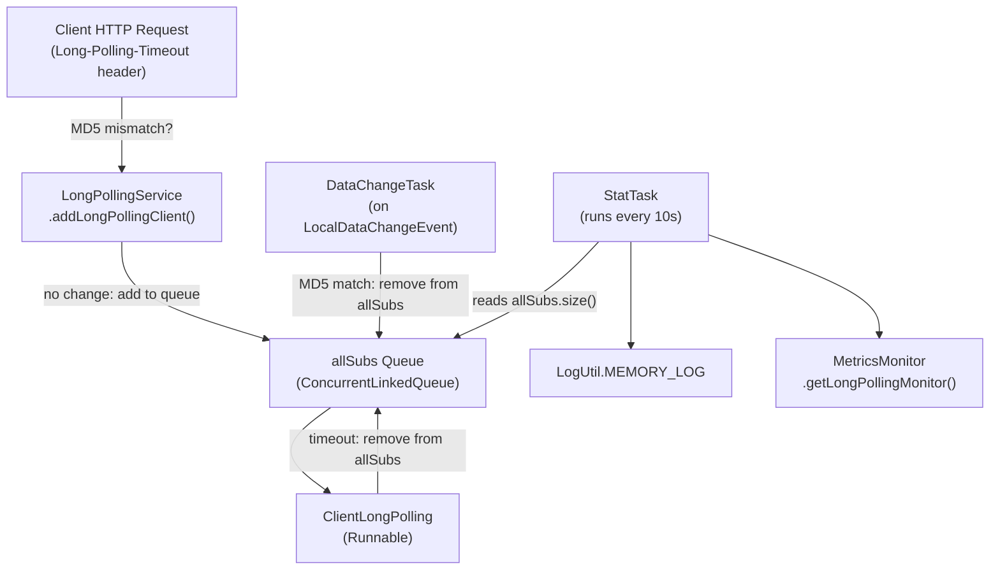
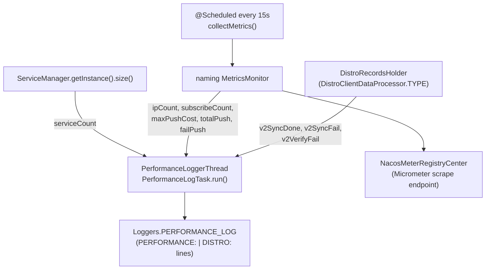
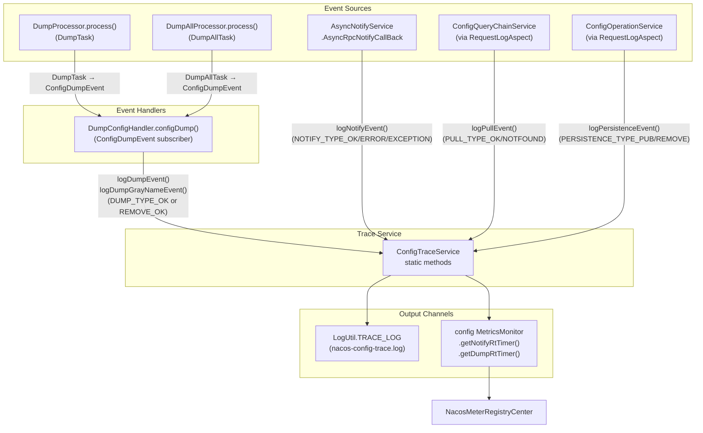
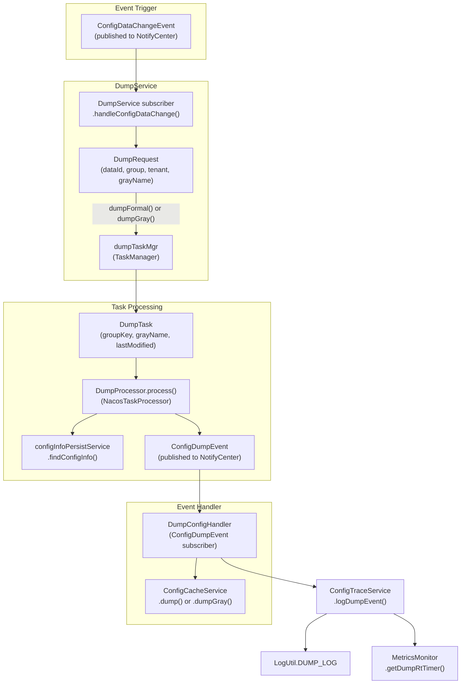
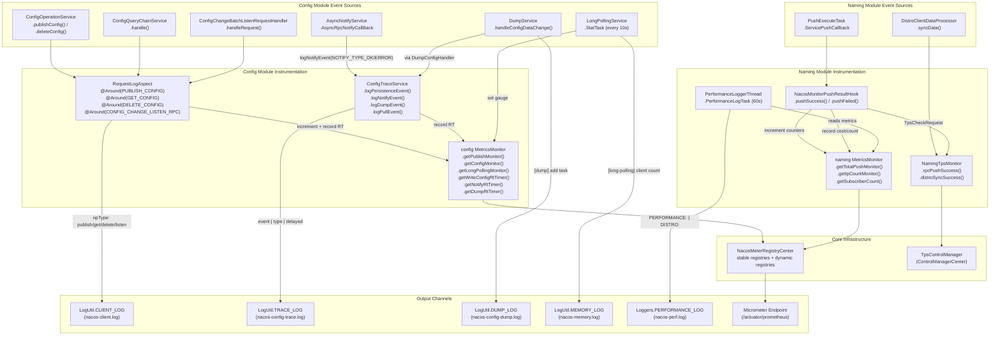

<!-- source: DeepWiki mcp.deepwiki.com · repo alibaba/nacos · page 9.2 Monitoring and Observability · fetched 2026-10-29 -->

# Monitoring and Observability

<details>
<summary>Relevant source files</summary>

The following files were used as context for generating this wiki page:

- [config/src/main/java/com/alibaba/nacos/config/server/aspect/RequestLogAspect.java](config/src/main/java/com/alibaba/nacos/config/server/aspect/RequestLogAspect.java)
- [config/src/main/java/com/alibaba/nacos/config/server/model/event/ConfigDataChangeEvent.java](config/src/main/java/com/alibaba/nacos/config/server/model/event/ConfigDataChangeEvent.java)
- [config/src/main/java/com/alibaba/nacos/config/server/model/event/ConfigDumpEvent.java](config/src/main/java/com/alibaba/nacos/config/server/model/event/ConfigDumpEvent.java)
- [config/src/main/java/com/alibaba/nacos/config/server/model/event/LocalDataChangeEvent.java](config/src/main/java/com/alibaba/nacos/config/server/model/event/LocalDataChangeEvent.java)
- [config/src/main/java/com/alibaba/nacos/config/server/service/LongPollingService.java](config/src/main/java/com/alibaba/nacos/config/server/service/LongPollingService.java)
- [config/src/main/java/com/alibaba/nacos/config/server/service/dump/DumpConfigHandler.java](config/src/main/java/com/alibaba/nacos/config/server/service/dump/DumpConfigHandler.java)
- [config/src/main/java/com/alibaba/nacos/config/server/service/dump/DumpService.java](config/src/main/java/com/alibaba/nacos/config/server/service/dump/DumpService.java)
- [config/src/main/java/com/alibaba/nacos/config/server/service/dump/EmbeddedDumpService.java](config/src/main/java/com/alibaba/nacos/config/server/service/dump/EmbeddedDumpService.java)
- [config/src/main/java/com/alibaba/nacos/config/server/service/dump/ExternalDumpService.java](config/src/main/java/com/alibaba/nacos/config/server/service/dump/ExternalDumpService.java)
- [config/src/main/java/com/alibaba/nacos/config/server/service/dump/processor/DumpAllProcessor.java](config/src/main/java/com/alibaba/nacos/config/server/service/dump/processor/DumpAllProcessor.java)
- [config/src/main/java/com/alibaba/nacos/config/server/service/dump/processor/DumpProcessor.java](config/src/main/java/com/alibaba/nacos/config/server/service/dump/processor/DumpProcessor.java)
- [config/src/main/java/com/alibaba/nacos/config/server/service/dump/task/DumpTask.java](config/src/main/java/com/alibaba/nacos/config/server/service/dump/task/DumpTask.java)
- [config/src/main/java/com/alibaba/nacos/config/server/service/notify/AsyncNotifyService.java](config/src/main/java/com/alibaba/nacos/config/server/service/notify/AsyncNotifyService.java)
- [config/src/main/java/com/alibaba/nacos/config/server/service/trace/ConfigTraceService.java](config/src/main/java/com/alibaba/nacos/config/server/service/trace/ConfigTraceService.java)

</details>


This page covers the runtime monitoring and observability infrastructure built into the Nacos server. It documents metric counters and timers, scheduled performance logging, structured event tracing for the config subsystem, and the AOP-based request log interceptor.

For coverage of how push notifications themselves work end-to-end, see [4.4](#4.4). For the consistency protocol internals those metrics track, see [6.2](#6.2).

---

## Overview

Nacos exposes three distinct observability surfaces:

| Surface | Where | What it covers |
|---|---|---|
| **Micrometer metrics** | `MetricsMonitor` (config + naming) | Counters, gauges, timers exposed via `NacosMeterRegistryCenter` |
| **Structured trace logs** | `ConfigTraceService` | Per-event log lines for persist / notify / dump / pull lifecycle |
| **AOP request logs** | `RequestLogAspect` | Per-request timing and status for publish, get, delete, listen |

The naming module adds a fourth surface: a scheduled performance logger that periodically writes human-readable summary lines to a dedicated log channel.

---

## Micrometer Registry

`NacosMeterRegistryCenter` (located in the `core` module) is the central Micrometer hub. It maintains two registry sets — *stable* registries that persist for the server lifetime and *dynamic* registries that may be added or removed at runtime. All `MetricsMonitor` static methods ultimately bind to meters registered in this hub.

Each module keeps its own `MetricsMonitor` class that registers module-scoped meters on first use:

| Class | Module | Package |
|---|---|---|
| `MetricsMonitor` | `config` | `com.alibaba.nacos.config.server.monitor` |
| `MetricsMonitor` | `naming` | `com.alibaba.nacos.naming.monitor` |

---

## Config Module Metrics

### MetricsMonitor (config)

Called from `AsyncNotifyService`, `ConfigTraceService`, `RequestLogAspect`, and `LongPollingService`. The key meters are:

| Meter | Kind | Incremented by |
|---|---|---|
| `getPublishMonitor()` | `AtomicInteger` counter | `RequestLogAspect.interfacePublishConfig` |
| `getConfigMonitor()` | `AtomicInteger` counter | `RequestLogAspect.interfaceGetConfig`, `interfaceRemoveConfig`, `interfaceListenConfigRpc` |
| `getLongPollingMonitor()` | gauge | `LongPollingService.StatTask` (every 10 seconds) |
| `getWriteConfigRtTimer()` | Micrometer `Timer` | `RequestLogAspect.interfacePublishConfig` |
| `getReadConfigRtTimer()` | Micrometer `Timer` | `RequestLogAspect.interfaceGetConfig`, `interfaceRemoveConfig` |
| `getNotifyRtTimer()` | Micrometer `Timer` | `ConfigTraceService.logNotifyEvent` |
| `getDumpRtTimer()` | Micrometer `Timer` | `ConfigTraceService.logDumpEventInner` |
| `getConfigNotifyException()` | counter | `AsyncNotifyService` on RPC error/exception |
| `incrementConfigChangeCount()` | counter | `AsyncNotifyService.handleConfigDataChangeEvent` |

Sources: [config/src/main/java/com/alibaba/nacos/config/server/service/notify/AsyncNotifyService.java:110-191](), [config/src/main/java/com/alibaba/nacos/config/server/service/trace/ConfigTraceService.java:164-215](), [config/src/main/java/com/alibaba/nacos/config/server/aspect/RequestLogAspect.java:64-180](), [config/src/main/java/com/alibaba/nacos/config/server/service/LongPollingService.java:301-308]()

### LongPollingService Monitoring

`LongPollingService` maintains a queue (`allSubs`) of active `ClientLongPolling` subscribers. A `StatTask` runs every 10 seconds via `ConfigExecutor.scheduleLongPolling` to monitor and log the subscriber count.

**StatTask behavior:**
- Writes to `LogUtil.MEMORY_LOG`: `"[long-pulling] client count " + allSubs.size()`
- Updates `MetricsMonitor.getLongPollingMonitor().set(allSubs.size())`

The `allSubs` queue size reflects the number of HTTP long-polling connections currently waiting for configuration changes. Clients are added when `addLongPollingClient` is called and removed when:
- A configuration change is detected (`DataChangeTask`)
- The timeout expires (`ClientLongPolling.run` scheduled timeout)
- The connection is dropped

**LongPollingService data flow:**



Sources: [config/src/main/java/com/alibaba/nacos/config/server/service/LongPollingService.java:230-256](), [config/src/main/java/com/alibaba/nacos/config/server/service/LongPollingService.java:301-308](), [config/src/main/java/com/alibaba/nacos/config/server/service/LongPollingService.java:267-299]()

---

## Naming Module Metrics

### MetricsMonitor (naming)

The naming module's `MetricsMonitor` class exposes gauges, counters, and push-cost accumulators. Key meters:

| Meter accessor | Kind | Updated by |
|---|---|---|
| `getDomCountMonitor()` | `AtomicInteger` gauge | `PerformanceLoggerThread.collectMetrics` |
| `getIpCountMonitor()` | `AtomicInteger` gauge | instance registration events |
| `getSubscriberCount()` | `AtomicInteger` gauge | subscription events |
| `getTotalPushMonitor()` | `LongAdder` counter | `NacosMonitorPushResultHook.pushSuccess` + `pushFailed` |
| `getFailedPushMonitor()` | `LongAdder` counter | `NacosMonitorPushResultHook.pushFailed` |
| `getTotalPushCostForAvg()` | `AtomicLong` | `NacosMonitorPushResultHook.pushSuccess` |
| `getTotalPushCountForAvg()` | `AtomicInteger` | `NacosMonitorPushResultHook.pushSuccess` |
| `getMaxPushCostMonitor()` | `AtomicLong` | `NacosMonitorPushResultHook.pushSuccess` |
| `getAvgPushCostMonitor()` | gauge | `PerformanceLoggerThread.collectMetrics` |

`resetAll()` is called at midnight by the `@Scheduled` method on `PerformanceLoggerThread`.

Sources: [naming/src/main/java/com/alibaba/nacos/naming/monitor/PerformanceLoggerThread.java:56-68](), [naming/src/main/java/com/alibaba/nacos/naming/push/v2/hook/NacosMonitorPushResultHook.java:30-45]()

### PerformanceLoggerThread

A Spring `@Component` that starts a single-threaded scheduled task via `GlobalExecutor.schedulePerformanceLogger` with a 30-second initial delay and a 60-second period.

**PerformanceLogTask.run()** writes two log lines every 60 seconds to `Loggers.PERFORMANCE_LOG`:

```
PERFORMANCE:|serviceCount|ipCount|subscribeCount|maxPushCost|avgPushCost|totalPushCount|failPushCount
DISTRO:|v2SyncDone|v2SyncFail|v2VerifyFail|
```

Every 10 log cycles (10 minutes), it also reprints a header row. After each cycle it resets `getTotalPushCountForAvg`, `getTotalPushCostForAvg`, and `getMaxPushCostMonitor` to `-1`.

A separate `@Scheduled(cron = "0/15 * * * * ?")` method updates `getDomCountMonitor` and `getAvgPushCostMonitor` every 15 seconds so Micrometer scrapers see a more recent value than the 60-second log cycle.

Sources: [naming/src/main/java/com/alibaba/nacos/naming/monitor/PerformanceLoggerThread.java:39-126](), [naming/src/main/java/com/alibaba/nacos/naming/misc/GlobalExecutor.java:71-126]()

**PerformanceLoggerThread data flow diagram**



Sources: [naming/src/main/java/com/alibaba/nacos/naming/monitor/PerformanceLoggerThread.java:70-118]()

### NamingTpsMonitor and TpsMonitorItem

`NamingTpsMonitor` is a singleton that delegates to `TpsControlManager` from `ControlManagerCenter`. On construction it registers named TPS points for push and Distro operations.

**TpsMonitorItem enum values:**

| Enum constant | Semantics |
|---|---|
| `NAMING_RPC_PUSH` | Every RPC push attempt (success or fail) |
| `NAMING_RPC_PUSH_SUCCESS` | Push acknowledged by client |
| `NAMING_RPC_PUSH_FAIL` | Push returned error |
| `NAMING_DISTRO_SYNC` | Ephemeral-data Distro sync attempt |
| `NAMING_DISTRO_SYNC_SUCCESS` | Sync acknowledged |
| `NAMING_DISTRO_SYNC_FAIL` | Sync failed |
| `NAMING_DISTRO_VERIFY` | Distro verify attempt |
| `NAMING_DISTRO_VERIFY_SUCCESS` | Verify acknowledged |
| `NAMING_DISTRO_VERIFY_FAIL` | Verify failed |

`NacosMonitorPushResultHook` calls `NamingTpsMonitor.rpcPushSuccess` or `rpcPushFail` after every push outcome. Each static method submits two `TpsCheckRequest` objects (one for the `_TOTAL` point, one for the outcome-specific point) so TPS rates can be computed per-point.

Sources: [naming/src/main/java/com/alibaba/nacos/naming/monitor/NamingTpsMonitor.java:29-128](), [naming/src/main/java/com/alibaba/nacos/naming/monitor/TpsMonitorItem.java:24-70](), [naming/src/main/java/com/alibaba/nacos/naming/push/v2/hook/NacosMonitorPushResultHook.java:27-46]()

### NacosMonitorPushResultHook

Implements `PushResultHook` and is registered with `PushResultHookHolder`. It bridges push callback outcomes to both `MetricsMonitor` (for Micrometer) and `NamingTpsMonitor` (for TPS rate tracking).

```
pushSuccess(result)  →  MetricsMonitor.incrementPush()
                     →  MetricsMonitor.incrementPushCost(allCost)
                     →  MetricsMonitor.compareAndSetMaxPushCost(allCost)
                     →  MetricsMonitor.incrementEmptyPush()  [if empty]
                     →  NamingTpsMonitor.rpcPushSuccess(clientId, ip)

pushFailed(result)   →  MetricsMonitor.incrementPush()
                     →  MetricsMonitor.incrementFailPush()
                     →  NamingTpsMonitor.rpcPushFail(clientId, ip)
```

Sources: [naming/src/main/java/com/alibaba/nacos/naming/push/v2/hook/NacosMonitorPushResultHook.java:30-46]()

---

## Config Trace Service

`ConfigTraceService` provides structured event logging for the config change lifecycle. Each log line is written to `LogUtil.TRACE_LOG` at `INFO` level (gated by `isInfoEnabled()`). The format is pipe-delimited to allow external log parsers to segment fields.

### Event Types and Fields

| Event category | Constants | Log fields |
|---|---|---|
| **Persistence** | `PERSISTENCE_EVENT`, `PERSISTENCE_EVENT_BETA`, `PERSISTENCE_EVENT_TAG`, `PERSISTENCE_EVENT_METADATA` | `localIp \| dataId \| group \| tenant \| requestIpAppName \| ts \| handleIp \| event \| type \| -1 \| md5` |
| **Notify** | `NOTIFY_EVENT`, `NOTIFY_EVENT_BETA`, `NOTIFY_EVENT_BATCH`, `NOTIFY_EVENT_TAG` | `localIp \| dataId \| group \| tenant \| requestIpAppName \| ts \| handleIp \| event \| type \| delayed \| targetIp` |
| **Dump** | `DUMP_EVENT`, `DUMP_EVENT_BETA`, `DUMP_EVENT_BATCH`, `DUMP_EVENT_TAG` | `localIp \| dataId \| group \| tenant \| requestIpAppName \| ts \| handleIp \| event \| type \| delayed \| length` |
| **Pull** | `PULL_EVENT` | `localIp \| dataId \| group \| tenant \| requestIpAppName \| ts \| event \| type \| delayed \| clientIp \| isNotify \| mode` |

### Type values per category

| Category | Type constants |
|---|---|
| Persistence | `PERSISTENCE_TYPE_PUB`, `PERSISTENCE_TYPE_REMOVE`, `PERSISTENCE_TYPE_MERGE` |
| Notify | `NOTIFY_TYPE_OK`, `NOTIFY_TYPE_ERROR`, `NOTIFY_TYPE_UNHEALTH`, `NOTIFY_TYPE_EXCEPTION` |
| Dump | `DUMP_TYPE_OK`, `DUMP_TYPE_REMOVE_OK`, `DUMP_TYPE_ERROR` |
| Pull | `PULL_TYPE_OK`, `PULL_TYPE_NOTFOUND`, `PULL_TYPE_CONFLICT`, `PULL_TYPE_ERROR` |

### Side-effects on Micrometer

`logNotifyEvent` also records the delay into `MetricsMonitor.getNotifyRtTimer()`. `logDumpEventInner` records into `MetricsMonitor.getDumpRtTimer()`. This means every trace-log call also updates the Micrometer timer even if the log line itself is discarded when `TRACE_LOG` is below `INFO`.

### ConfigTraceService invocation patterns

The trace service is called from multiple points in the configuration lifecycle:

| Caller | Method | Event type | When |
|---|---|---|---|
| `DumpConfigHandler.configDump` | `logDumpEvent` / `logDumpGrayNameEvent` | `DUMP_EVENT` | After successfully dumping config to local disk |
| `DumpConfigHandler.configDump` | `logDumpEvent` / `logDumpGrayNameEvent` | `DUMP_EVENT` + `DUMP_TYPE_REMOVE_OK` | After successfully removing config from disk |
| `AsyncNotifyService` callbacks | `logNotifyEvent` | `NOTIFY_EVENT` | After RPC notification success/failure to cluster member |
| `ConfigOperationService` (via aspect) | `logPersistenceEvent` | `PERSISTENCE_EVENT` | After persisting config to database |
| Config query (via aspect) | `logPullEvent` | `PULL_EVENT` | After client pulls config |

Sources: [config/src/main/java/com/alibaba/nacos/config/server/service/trace/ConfigTraceService.java:36-272](), [config/src/main/java/com/alibaba/nacos/config/server/service/dump/DumpConfigHandler.java:41-98](), [config/src/main/java/com/alibaba/nacos/config/server/service/notify/AsyncNotifyService.java:349-391]()

**ConfigTraceService call-site diagram**



Sources: [config/src/main/java/com/alibaba/nacos/config/server/service/trace/ConfigTraceService.java:127-272](), [config/src/main/java/com/alibaba/nacos/config/server/service/notify/AsyncNotifyService.java:179-391](), [config/src/main/java/com/alibaba/nacos/config/server/service/dump/DumpConfigHandler.java:41-98](), [config/src/main/java/com/alibaba/nacos/config/server/service/dump/processor/DumpProcessor.java:52-92]()

---

## Request Log Aspect

`RequestLogAspect` is a Spring AOP `@Aspect` component in the config module. It intercepts four pointcuts and performs two actions per call: update a `MetricsMonitor` counter/timer and write to `LogUtil.CLIENT_LOG`.

### Pointcuts

| Pointcut field | Intercepted target | Log opType |
|---|---|---|
| `PUBLISH_CONFIG` | `ConfigOperationService.publishConfig` | `publish` |
| `GET_CONFIG` | `ConfigQueryChainService.handle` | `get` |
| `DELETE_CONFIG` | `ConfigOperationService.deleteConfig` | `delete` |
| `CONFIG_CHANGE_LISTEN_RPC` | `ConfigChangeBatchListenRequestHandler.handleRequest` | `listen` |

### Log format (CLIENT_LOG)

For publish / get / delete:
```
opType: <type> | rt: <ms>ms | status: success|failure | requestIp: <ip> | dataId: <id> | group: <g> | tenant: <t> | md5: <md5>
```

For listen (gRPC):
```
opType: listen | rt: <ms>ms | status: <code> | requestIp: <ip> | listenSize: <n> | listenOrCancel: <bool> | appName: <app>
```

### Metric updates per pointcut

| Intercepted method | Counter | Timer |
|---|---|---|
| `publishConfig` | `getPublishMonitor().incrementAndGet()` | `getWriteConfigRtTimer().record(rt)` |
| `ConfigQueryChainService.handle` | `getConfigMonitor().incrementAndGet()` | `getReadConfigRtTimer().record(rt)` |
| `deleteConfig` | `getConfigMonitor().incrementAndGet()` | `getReadConfigRtTimer().record(rt)` |
| `handleRequest` (listen) | `getConfigMonitor().incrementAndGet()` | — |

Sources: [config/src/main/java/com/alibaba/nacos/config/server/aspect/RequestLogAspect.java:48-181]()

---

## DumpService Logging

`DumpService` and its subclasses (`EmbeddedDumpService`, `ExternalDumpService`) perform periodic dumps of configuration data from database to local disk cache. The dump process generates extensive logging for monitoring.

### Dump Task Scheduling

| Task | Schedule | Purpose |
|---|---|---|
| `DumpAllProcessorRunner` | Every 6 hours (with random initial delay 10-370 minutes) | Full dump of all configs |
| `DumpAllGrayProcessorRunner` | Every 6 hours (with random initial delay 10-370 minutes) | Full dump of gray configs |
| `DumpChangeConfigWorker` | Interval from `PropertyUtil.getDumpChangeWorkerInterval()` | Incremental dump of changed configs |
| `ConfigHistoryClear` | Every 10 minutes | History cleanup task |

On startup, `dumpOperate()` performs:
1. `dumpAllConfigInfoOnStartup()` - clears all existing disk cache via `ConfigDiskServiceFactory.getInstance().clearAll()`, then dumps all configs
2. `dumpAllGrayConfigInfoOnStartup()` - clears gray cache, then dumps all gray configs

### Logging channels for DumpService

| Log channel | Content |
|---|---|
| `LogUtil.DUMP_LOG` | Individual dump task execution (`"[dump] add formal task"`, `"[dump] add gray task"`) |
| `LogUtil.DEFAULT_LOG` | High-level dump lifecycle events (`"start clear all config-info"`, `"DumpService start"`) |
| `LogUtil.FATAL_LOG` | Dump failures that prevent server startup |

**DumpService event flow:**



Sources: [config/src/main/java/com/alibaba/nacos/config/server/service/dump/DumpService.java:146-349](), [config/src/main/java/com/alibaba/nacos/config/server/service/dump/processor/DumpProcessor.java:52-92](), [config/src/main/java/com/alibaba/nacos/config/server/service/dump/DumpConfigHandler.java:41-98]()

---

## Overall Monitoring Architecture

The diagram below maps the full observability stack from event sources through to output channels.



Sources: [config/src/main/java/com/alibaba/nacos/config/server/aspect/RequestLogAspect.java:48-181](), [config/src/main/java/com/alibaba/nacos/config/server/service/trace/ConfigTraceService.java:127-272](), [config/src/main/java/com/alibaba/nacos/config/server/service/LongPollingService.java:301-308](), [config/src/main/java/com/alibaba/nacos/config/server/service/dump/DumpService.java:146-349](), [naming/src/main/java/com/alibaba/nacos/naming/monitor/PerformanceLoggerThread.java:39-126](), [naming/src/main/java/com/alibaba/nacos/naming/monitor/NamingTpsMonitor.java:29-128](), [naming/src/main/java/com/alibaba/nacos/naming/push/v2/hook/NacosMonitorPushResultHook.java:27-46]()

---

## Log Channels

The monitoring infrastructure writes to several named loggers. These correspond to files under the Nacos log directory.

| Logger / constant | Module | Content |
|---|---|---|
| `LogUtil.CLIENT_LOG` | config | Per-request publish / get / delete / listen audit lines |
| `LogUtil.TRACE_LOG` | config | `ConfigTraceService` event lines (persist, notify, dump, pull) |
| `LogUtil.DUMP_LOG` | config | Dump task debug output |
| `LogUtil.NOTIFY_LOG` | config | Notify retry entries on RPC failure |
| `Loggers.PERFORMANCE_LOG` | naming | `PERFORMANCE:` and `DISTRO:` summary lines every 60 s |
| `Loggers.PUSH` | naming | Per-push PUSH-SUCC / PUSH-FAIL lines from `PushExecuteTask` |
| `Loggers.SRV_LOG` | naming | General server events |

Sources: [config/src/main/java/com/alibaba/nacos/config/server/aspect/RequestLogAspect.java:143-178](), [config/src/main/java/com/alibaba/nacos/config/server/service/trace/ConfigTraceService.java:129-271](), [naming/src/main/java/com/alibaba/nacos/naming/monitor/PerformanceLoggerThread.java:78-118](), [naming/src/main/java/com/alibaba/nacos/naming/push/v2/task/PushExecuteTask.java:135-155]()

---

