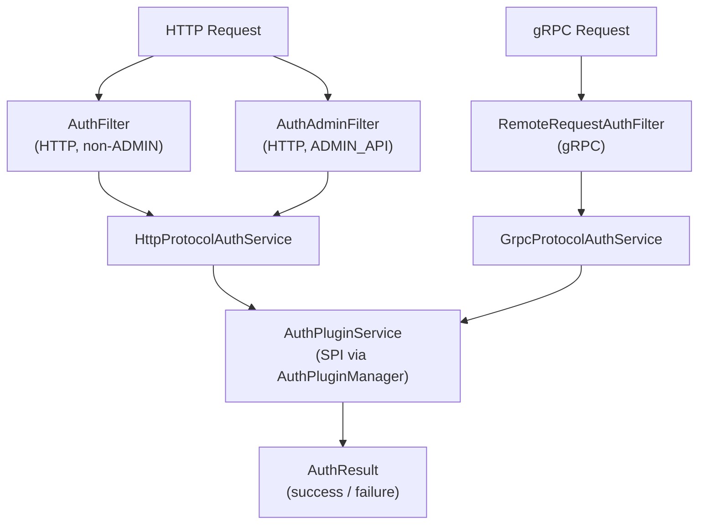
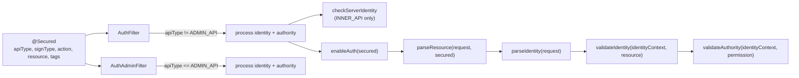
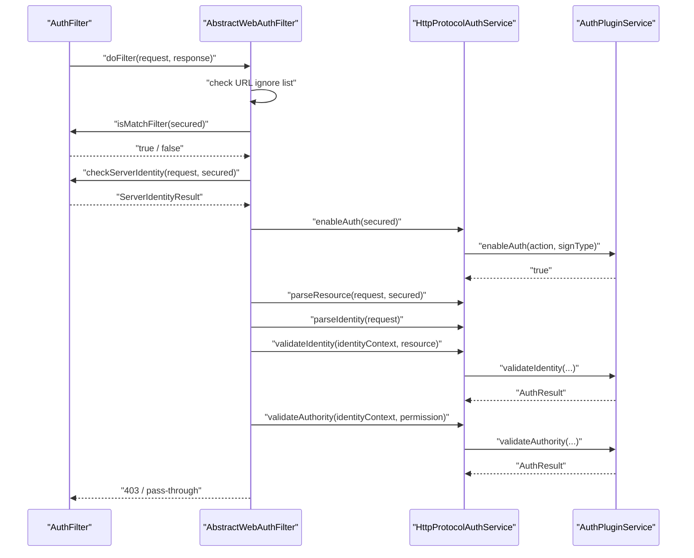
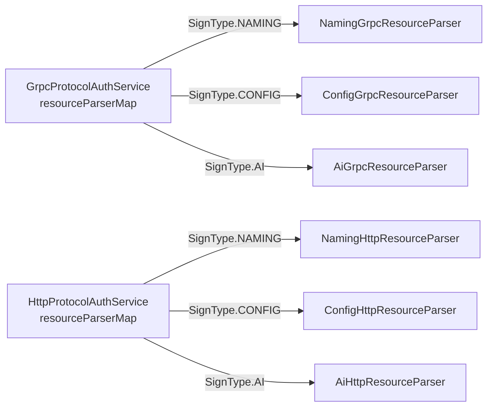
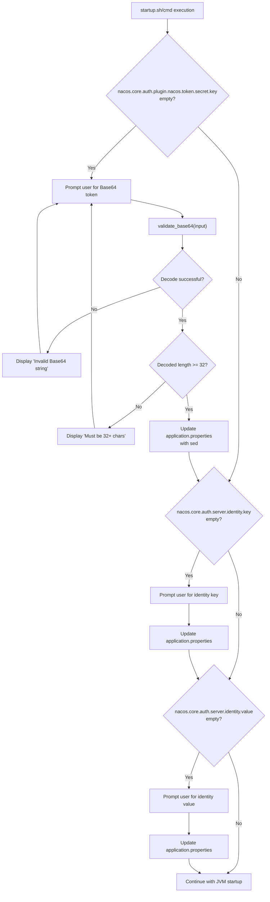

<!-- source: DeepWiki mcp.deepwiki.com · repo alibaba/nacos · page 9.3 Authentication and Security · fetched 2026-10-29 -->

# Authentication and Security

<details>
<summary>Relevant source files</summary>

The following files were used as context for generating this wiki page:

- [.gitignore](.gitignore)
- [console/src/main/resources/META-INF/nacos-default.properties](console/src/main/resources/META-INF/nacos-default.properties)
- [distribution/bin/shutdown.cmd](distribution/bin/shutdown.cmd)
- [distribution/bin/shutdown.sh](distribution/bin/shutdown.sh)
- [distribution/bin/startup.cmd](distribution/bin/startup.cmd)
- [distribution/bin/startup.sh](distribution/bin/startup.sh)
- [distribution/conf/application.properties](distribution/conf/application.properties)

</details>


This document describes the authentication framework in Nacos: how HTTP and gRPC requests are authenticated, how resources are parsed, how the `AuthPluginService` SPI is invoked, and the relevant configuration properties. For plugin development related to authentication, see [Plugin Development](#9.4). For monitoring and observability of authentication events, see [Monitoring and Observability](#9.2).

## Overview

Authentication in Nacos operates through two parallel filter chains — one for HTTP requests and one for gRPC (remote) requests. Both chains use the `@Secured` annotation on handler methods to declare authentication requirements and delegate to a `ProtocolAuthService` implementation for resource parsing, identity validation, and authority checking. The actual authentication logic is provided by an `AuthPluginService` implementation loaded via Java SPI.

**Key code entities:**

| Entity | Role |
|---|---|
| `AuthFilter` | Servlet filter for HTTP requests (excludes `ADMIN_API`) |
| `AuthAdminFilter` | Servlet filter for `ADMIN_API` HTTP requests |
| `RemoteRequestAuthFilter` | gRPC request filter |
| `ProtocolAuthService<R>` | Per-protocol auth interface |
| `AbstractProtocolAuthService<R>` | Template implementation of identity/authority validation |
| `GrpcProtocolAuthService` | gRPC concrete implementation |
| `HttpProtocolAuthService` | HTTP concrete implementation |
| `AuthPluginService` | SPI for custom auth backends |
| `AuthPluginManager` | SPI loader for `AuthPluginService` |
| `@Secured` | Annotation on handler methods declaring auth requirements |

Sources: [core/src/main/java/com/alibaba/nacos/core/auth/AuthFilter.java:1-64](), [core/src/main/java/com/alibaba/nacos/core/auth/RemoteRequestAuthFilter.java:1-134](), [auth/src/main/java/com/alibaba/nacos/auth/ProtocolAuthService.java:1-100](), [auth/src/main/java/com/alibaba/nacos/auth/AbstractProtocolAuthService.java:1-149]()

## Authentication Framework Architecture

**High-level filter and service chain**



Sources: [core/src/main/java/com/alibaba/nacos/core/auth/AuthFilter.java:1-64](), [core/src/main/java/com/alibaba/nacos/core/auth/RemoteRequestAuthFilter.java:1-134](), [auth/src/main/java/com/alibaba/nacos/auth/GrpcProtocolAuthService.java:1-97](), [auth/src/main/java/com/alibaba/nacos/auth/HttpProtocolAuthService.java:1-86]()

**`@Secured` annotation and API type branching**



Sources: [core/src/main/java/com/alibaba/nacos/core/auth/AuthFilter.java:50-63](), [core/src/main/java/com/alibaba/nacos/core/auth/RemoteRequestAuthFilter.java:68-133]()

## Three-Tier Authentication Configuration

Nacos exposes three independent authentication enable/disable flags corresponding to different API surfaces:

| Property | Default | Controls |
|----------|---------|---------|
| `nacos.core.auth.enabled` | `false` | Server API endpoints (`/v1/cs/*`, `/v1/ns/*`) used by client SDKs |
| `nacos.core.auth.admin.enabled` | `true` | Admin API endpoints (cluster management) |
| `nacos.core.auth.console.enabled` | `true` | Console API endpoints (web UI) |

`AuthFilter` handles the non-admin server API. Its `isMatchFilter` method returns `true` only when `apiType != ADMIN_API` [core/src/main/java/com/alibaba/nacos/core/auth/AuthFilter.java:51-54](). A separate `AuthAdminFilter` handles `ADMIN_API` endpoints.

Sources: [core/src/main/java/com/alibaba/nacos/core/auth/AuthFilter.java:46-54](), [plugin/auth/src/main/java/com/alibaba/nacos/plugin/auth/constant/Constants.java:28-33]()

## HTTP Authentication — `AuthFilter`

`AuthFilter` [core/src/main/java/com/alibaba/nacos/core/auth/AuthFilter.java]() is a servlet filter that intercepts all HTTP requests that are **not** of type `ADMIN_API`. It extends `AbstractWebAuthFilter`.

**Decision logic in `AuthFilter`:**

1. `isAuthEnabled()` — returns `authConfig.isAuthEnabled()`. If false, the filter passes the request through unless the endpoint is `INNER_API`.
2. `isMatchFilter(secured)` — returns `true` when `secured.apiType() != ADMIN_API`. `ADMIN_API` endpoints are handled by a separate `AuthAdminFilter`.
3. `checkServerIdentity(request, secured)` — for `INNER_API` endpoints, if `InnerApiAuthEnabled.isEnabled()` is false (cluster upgrade in progress), the check is bypassed and the old-version behavior is preserved. Otherwise delegates to `AbstractWebAuthFilter.checkServerIdentity`.

`InnerApiAuthEnabled` is a Spring bean that tracks whether all cluster members have been upgraded to a version that enforces inner-API authentication.

**Processing flow when a `@Secured` endpoint is matched:**



Sources: [core/src/main/java/com/alibaba/nacos/core/auth/AuthFilter.java:1-64]()

## gRPC Authentication — `RemoteRequestAuthFilter`

`RemoteRequestAuthFilter` [core/src/main/java/com/alibaba/nacos/core/auth/RemoteRequestAuthFilter.java]() is a Spring `@Component` that implements `AbstractRequestFilter`. It intercepts every gRPC request before it reaches its handler.

**Key steps in `filter(request, meta, handlerClazz)`** [core/src/main/java/com/alibaba/nacos/core/auth/RemoteRequestAuthFilter.java:68-133]():

1. Reflect on the handler class to find the `@Secured` annotation on `handle()`.
2. If `apiType == INNER_API` and `InnerApiAuthEnabled.isEnabled()` is false, pass through (upgrade compatibility).
3. If `apiType != INNER_API` and auth is disabled, pass through.
4. Call `GrpcProtocolAuthService.checkServerIdentity(request, secured)`:
   - `FAIL` → return error response with `NacosException.NO_RIGHT`.
   - `MATCHED` → return `null` (pass-through).
5. Call `enableAuth(secured)` on the plugin; if false, pass through.
6. Inject the client IP as `X_REAL_IP` header.
7. Parse resource, parse identity, validate identity, validate authority.
8. Store `IdentityContext`, `Resource`, and `AuthResult` in `RequestContextHolder` for downstream use.

Sources: [core/src/main/java/com/alibaba/nacos/core/auth/RemoteRequestAuthFilter.java:1-134]()

## `ProtocolAuthService` Interface

`ProtocolAuthService<R>` [auth/src/main/java/com/alibaba/nacos/auth/ProtocolAuthService.java]() is the core auth interface, parameterized on the request type (`HttpServletRequest` or `Request`).

| Method | Purpose |
|---|---|
| `initialize()` | Called once at startup to register resource parsers |
| `enableAuth(secured)` | Asks the plugin if this action/type requires auth |
| `parseResource(request, secured)` | Extracts namespace, group, resource name from the request |
| `parseIdentity(request)` | Extracts user identity (token, username, etc.) from the request |
| `validateIdentity(identityContext, resource)` | Delegates to `AuthPluginService.validateIdentity` |
| `validateAuthority(identityContext, permission)` | Delegates to `AuthPluginService.validateAuthority` |
| `checkServerIdentity(request, secured)` | Validates the server identity header for `INNER_API` |

Sources: [auth/src/main/java/com/alibaba/nacos/auth/ProtocolAuthService.java:1-100]()

## `AbstractProtocolAuthService` — Template Implementation

`AbstractProtocolAuthService<R>` [auth/src/main/java/com/alibaba/nacos/auth/AbstractProtocolAuthService.java]() implements `validateIdentity`, `validateAuthority`, `enableAuth`, and `checkServerIdentity` as template methods. Subclasses only need to implement `parseResource`, `parseIdentity`, and `parseServerIdentity`.

**`checkServerIdentity` logic** [auth/src/main/java/com/alibaba/nacos/auth/AbstractProtocolAuthService.java:96-108]():

1. If `nacos.core.auth.server.identity.key` or `nacos.core.auth.server.identity.value` is blank → return `FAIL`.
2. Call `parseServerIdentity(request)` to extract the key/value from request headers.
3. Delegate to `ServerIdentityChecker.check(serverIdentity, secured)`.

`ServerIdentityResult` has three statuses: `MATCHED`, `NOT_MATCHED`, and `FAIL`. `FAIL` immediately rejects the request; `MATCHED` short-circuits the rest of the auth pipeline; `NOT_MATCHED` falls through to the normal plugin-based auth.

**`validateIdentity` and `validateAuthority`** both use `AuthPluginManager.getInstance().findAuthServiceSpiImpl(authConfig.getNacosAuthSystemType())`. If no plugin is registered for the configured type, they return `AuthResult.successResult()` (permissive default).

Sources: [auth/src/main/java/com/alibaba/nacos/auth/AbstractProtocolAuthService.java:1-149]()

## Concrete Implementations

### `GrpcProtocolAuthService`

`GrpcProtocolAuthService` [auth/src/main/java/com/alibaba/nacos/auth/GrpcProtocolAuthService.java]() handles gRPC `Request` objects.

- `initialize()` registers three parsers into `resourceParserMap`: `NamingGrpcResourceParser` (key `SignType.NAMING`), `ConfigGrpcResourceParser` (key `SignType.CONFIG`), `AiGrpcResourceParser` (key `SignType.AI`).
- `parseResource(request, secured)` — if `secured.resource()` is non-blank, uses `parseSpecifiedResource`; otherwise looks up the parser by `secured.signType()`.
- `parseIdentity(request)` — delegates to `GrpcIdentityContextBuilder.build(request)`.
- `checkServerIdentity(request, secured)` — only performs the check when `apiType == INNER_API`; otherwise returns `NOT_MATCHED` immediately.
- `parseServerIdentity(request)` — reads the header keyed by `authConfig.getServerIdentityKey()`.

Sources: [auth/src/main/java/com/alibaba/nacos/auth/GrpcProtocolAuthService.java:1-97]()

### `HttpProtocolAuthService`

`HttpProtocolAuthService` [auth/src/main/java/com/alibaba/nacos/auth/HttpProtocolAuthService.java]() handles `HttpServletRequest` objects.

- `initialize()` registers: `NamingHttpResourceParser`, `ConfigHttpResourceParser`, `AiHttpResourceParser`.
- `parseResource(request, secured)` — same fallback logic as the gRPC variant.
- `parseIdentity(request)` — delegates to `HttpIdentityContextBuilder.build(request)`.
- `parseServerIdentity(request)` — reads `request.getHeader(authConfig.getServerIdentityKey())`.

Sources: [auth/src/main/java/com/alibaba/nacos/auth/HttpProtocolAuthService.java:1-86]()

## Resource Parsers by `SignType`

Resource parsers extract a `Resource` object (namespace, group, name, type, properties) from the inbound request. The parsers are keyed by `SignType` constants.

**Parser registration diagram**



Sources: [auth/src/main/java/com/alibaba/nacos/auth/GrpcProtocolAuthService.java:57-62](), [auth/src/main/java/com/alibaba/nacos/auth/HttpProtocolAuthService.java:55-59]()

### `AiGrpcResourceParser`

`AiGrpcResourceParser` [auth/src/main/java/com/alibaba/nacos/auth/parser/grpc/AiGrpcResourceParser.java]() handles MCP and Agent gRPC requests (`AbstractMcpRequest`, `AbstractAgentRequest`):

- `getNamespaceId` — reads `namespaceId` from the request; falls back to `AiConstants.Mcp.MCP_DEFAULT_NAMESPACE` if blank.
- `getGroup` — always returns `Constants.DEFAULT_GROUP`.
- `getResourceName` — for `AbstractMcpRequest`: reads `mcpName` (special-casing `ReleaseMcpServerRequest` to use `serverSpecification.name`). For `AbstractAgentRequest`: reads `agentName` (special-casing `ReleaseAgentCardRequest` to use `agentCard.name`).

Sources: [auth/src/main/java/com/alibaba/nacos/auth/parser/grpc/AiGrpcResourceParser.java:1-85]()

### `AiHttpResourceParser`

`AiHttpResourceParser` [auth/src/main/java/com/alibaba/nacos/auth/parser/http/AiHttpResourceParser.java]() dispatches based on the request URI:

- URI contains `/ai/mcp` → reads `mcpName` request parameter.
- URI contains `/ai/a2a` → reads `agentName` parameter, or deserializes the `agentCard` JSON parameter to get the name.
- Namespace falls back to `AiConstants.Mcp.MCP_DEFAULT_NAMESPACE` if blank.

Sources: [auth/src/main/java/com/alibaba/nacos/auth/parser/http/AiHttpResourceParser.java:1-92]()

## `AuthPluginService` SPI

`AuthPluginService` [plugin/auth/src/main/java/com/alibaba/nacos/plugin/auth/spi/server/AuthPluginService.java]() is the SPI interface that all authentication backends must implement. It is loaded via `AuthPluginManager` using Java `ServiceLoader`.

| Method | Description |
|---|---|
| `identityNames()` | Returns the set of identity fields the plugin needs (e.g., `accessToken`, `username`) |
| `enableAuth(action, type)` | Returns whether this plugin enforces auth for the given action and `SignType` |
| `validateIdentity(identityContext, resource)` | Validates the extracted identity (e.g., JWT token check) |
| `validateAuthority(identityContext, permission)` | Checks whether the identity has permission for the resource/action |
| `getAuthServiceName()` | The name used to select this plugin via `nacos.core.auth.system.type` |
| `isLoginEnabled()` | Whether this plugin requires a login flow (default: `false`) |
| `isAdminRequest()` | Whether admin role is required (default: `true`) |

`AbstractProtocolAuthService` looks up the active plugin via `AuthPluginManager.getInstance().findAuthServiceSpiImpl(authConfig.getNacosAuthSystemType())`. If no plugin matches the configured type, `validateIdentity` and `validateAuthority` both return success (open access).

Sources: [plugin/auth/src/main/java/com/alibaba/nacos/plugin/auth/spi/server/AuthPluginService.java:1-97](), [auth/src/main/java/com/alibaba/nacos/auth/AbstractProtocolAuthService.java:64-93]()

## Native Nacos Authentication

The built-in auth plugin (`nacos.core.auth.system.type=nacos`) uses JWT tokens. Clients `POST` to `/v1/auth/login` with username/password and receive an `accessToken`, which is sent in subsequent requests.

**Token configuration:**

| Property | Default | Description |
|----------|---------|-------------|
| `nacos.core.auth.plugin.nacos.token.secret.key` | (empty, required) | Base64-encoded JWT secret key; original string must be ≥ 32 characters |
| `nacos.core.auth.plugin.nacos.token.expire.seconds` | `18000` | Token expiry in seconds (5 hours) |
| `nacos.core.auth.plugin.nacos.token.cache.enable` | `false` | Enable token caching |
| `nacos.core.auth.caching.enabled` | `true` | Cache auth results (15-second update delay) |

The startup scripts (`startup.sh`, `startup.cmd`) validate that `token.secret.key`, `server.identity.key`, and `server.identity.value` are all non-empty before the server starts, prompting the operator interactively if any is missing.

Sources: [distribution/conf/application.properties:266-277](), [distribution/bin/startup.sh:30-95]()

## Server Identity for Cluster Communication

Nacos servers authenticate inter-node (`INNER_API`) requests by embedding a shared key/value pair in request headers. This mechanism is handled inside `AbstractProtocolAuthService.checkServerIdentity`.

**`ServerIdentityResult` state machine**

```mermaid
stateDiagram-v2
    [*] --> "FAIL": "identity key or value blank\n(misconfiguration)"
    [*] --> "NOT_MATCHED": "header absent or value mismatch"
    [*] --> "MATCHED": "header key+value match config"

    "FAIL" --> "403 returned immediately"
    "MATCHED" --> "request passes, skips plugin auth"
    "NOT_MATCHED" --> "falls through to plugin auth"
```

Sources: [auth/src/main/java/com/alibaba/nacos/auth/AbstractProtocolAuthService.java:96-108](), [auth/src/main/java/com/alibaba/nacos/auth/GrpcProtocolAuthService.java:84-96]()

**Configuration:**

| Property | Description |
|---|---|
| `nacos.core.auth.server.identity.key` | HTTP header name used to carry the server identity |
| `nacos.core.auth.server.identity.value` | Expected value in that header |

Both properties must be identical across all cluster members and must be non-empty. The startup scripts validate them before the server starts.

Sources: [plugin/auth/src/main/java/com/alibaba/nacos/plugin/auth/constant/Constants.java:37-40](), [distribution/bin/startup.sh:165-167]()

## URL Ignore Lists

`AbstractWebAuthFilter` consults `nacos.security.ignore.urls` before applying authentication logic. Requests matching these patterns bypass all authentication checks, regardless of auth configuration.

**Default ignore list** [distribution/conf/application.properties:254]():

| Pattern | Purpose | Security Implication |
|---------|---------|----------------------|
| `/`, `/error` | Root and error pages | Public landing page, error handling |
| `/**/*.css`, `/**/*.js`, `/**/*.html`, `/**/*.map`, `/**/*.svg`, `/**/*.png`, `/**/*.ico` | Console static assets | Required for UI rendering; no sensitive data |
| `/console-ui/public/**` | Console public directory | Pre-authentication UI resources |
| `/v1/auth/**` | Authentication endpoints | Login/token API must be open to authenticate |
| `/v1/console/health/**` | Health check endpoints | Monitoring integration; no sensitive data exposed |
| `/actuator/**` | Spring Boot Actuator | Metrics and health endpoints (configure separately) |
| `/v1/console/server/**` | Server metadata API | Cluster info; consider removing in production |

**Console Default Ignore List** [console/src/main/resources/META-INF/nacos-default.properties:60]():
```
/,/**/*.css,/**/*.js,/**/*.html,/**/*.map,/**/*.svg,/**/*.png,/**/*.ico,
/console-ui/public/**,/v1/auth/login,/v1/console/health,/v1/cs/**,
/v1/ns/**,/v1/cmdb/**,/actuator/**
```

**Security Considerations:**
- The console default list includes `/v1/cs/**` (config service) and `/v1/ns/**` (naming service) which **bypass authentication**
- In production, override `nacos.security.ignore.urls` to remove sensitive paths
- `/actuator/**` exposes internal metrics; restrict via Spring Boot Actuator security settings
- Custom patterns use Ant-style matching (`*` = single path segment, `**` = multiple segments)

**Sources:** [distribution/conf/application.properties:254](), [console/src/main/resources/META-INF/nacos-default.properties:60]()

## Authentication System Selection (`AuthPluginManager`)

The `nacos.core.auth.system.type` property selects which `AuthPluginService` implementation is active. `AuthPluginManager` uses `ServiceLoader` to find all implementations on the classpath and indexes them by `getAuthServiceName()`.

| `system.type` value | Plugin | Description |
|---|---|---|
| `nacos` | `NacosAuthPluginService` | Built-in JWT auth |
| `ldap` | LDAP plugin | External LDAP directory |
| custom string | Custom `AuthPluginService` | User-provided SPI implementation (see [Plugin Development](#9.4)) |

If the configured type has no matching plugin, `validateIdentity` and `validateAuthority` both return success. This means an unrecognized `system.type` effectively disables auth enforcement without error.

Sources: [auth/src/main/java/com/alibaba/nacos/auth/AbstractProtocolAuthService.java:64-93](), [plugin/auth/src/main/java/com/alibaba/nacos/plugin/auth/spi/server/AuthPluginService.java:77-78]()

## Security Best Practices

### Production Deployment Checklist

**Required Configurations:**
- ✅ Set `nacos.core.auth.enabled=true` for server API protection
- ✅ Generate a strong, unique `nacos.core.auth.plugin.nacos.token.secret.key` (32+ characters, Base64-encoded)
- ✅ Configure `nacos.core.auth.server.identity.key` and `nacos.core.auth.server.identity.value` for cluster deployments
- ✅ Keep admin and console authentication enabled (`nacos.core.auth.admin.enabled=true`, `nacos.core.auth.console.enabled=true`)
- ✅ Review and minimize the URL ignore list to only include necessary public endpoints
- ✅ Use external database (MySQL/PostgreSQL) instead of embedded Derby for multi-node clusters

**Optional Security Enhancements:**
- Enable token caching (`nacos.core.auth.caching.enabled=true`) for better performance
- Configure shorter token expiration times for high-security environments
- Use LDAP integration for centralized user management
- Enable TLS/SSL for all network communication
- Regularly rotate server identity keys and token secret keys
- Monitor authentication failures through access logs (see [Monitoring and Observability](#9.2))

### Key Security Recommendations

**Secret Key Management:**
1. **Never use default or example values** in production
2. **Generate unique keys per cluster** - different Nacos clusters should have different secret keys
3. **Store keys securely** - use environment variables or secret management systems instead of committing to version control
4. **Rotate keys periodically** - implement a key rotation policy

**Cluster Security:**
1. **Isolate cluster networks** - ensure Nacos cluster ports are not exposed to public internet
2. **Use firewalls** - restrict access to Nacos ports to trusted sources only
3. **Enable authentication on all tiers** - don't rely solely on network isolation

**Token Management:**
1. **Configure appropriate expiration** - balance security (shorter) vs. convenience (longer)
2. **Enable caching cautiously** - caching introduces a 15-second delay in auth updates
3. **Monitor token usage** - track authentication events for suspicious activity

**Sources:** [distribution/conf/application.properties:248-287]()

### Startup Security Configuration Validation

The startup scripts (`startup.sh` and `startup.cmd`) enforce mandatory security configuration before server initialization. The validation prevents deployment without proper authentication credentials.

**Validated Properties (in order):**
1. `nacos.core.auth.plugin.nacos.token.secret.key` - JWT secret key with Base64 validation
2. `nacos.core.auth.server.identity.key` - Cluster identity header name
3. `nacos.core.auth.server.identity.value` - Cluster identity header value

**Validation Flow:**



**Base64 Validation Logic (Unix):**

The `validate_base64` function in `startup.sh` [distribution/bin/startup.sh:30-55]() performs:
1. Attempt Base64 decode using `base64 -d` command
2. Check decode exit code (non-zero = invalid Base64)
3. Check decoded content length (macOS compatibility for empty output)
4. Verify decoded length ≥ 32 characters
5. Return error if any check fails, prompting user to re-enter

The `process_required_config` function [distribution/bin/startup.sh:57-95]() uses `sed` with backup (`.bak`) to replace empty property values in-place, handling both GNU and BSD (macOS) sed variants.

**Windows Validation (CMD):**

The Windows script [distribution/bin/startup.cmd:118-153]() implements `Process_required_config` using:
- `findstr` to locate properties with regex patterns
- Token parsing to check for empty values
- Temporary file manipulation to update `application.properties`
- Note: Windows version does **not** validate Base64 encoding or length (security gap)

**Security Implications:**
- Unix deployments enforce 32+ character token secret, preventing weak keys
- Windows deployments accept any non-empty value (potential vulnerability)
- All three properties are required before server starts
- Missing configuration blocks startup entirely (fail-safe design)

**Sources:** [distribution/bin/startup.sh:30-95](), [distribution/bin/startup.sh:162-167](), [distribution/bin/startup.cmd:57-59](), [distribution/bin/startup.cmd:118-153]()

## Configuration Reference Summary

### Authentication Properties Table

| Property | Type | Default | Required | Line | Description |
|----------|------|---------|----------|------|-------------|
| `nacos.core.auth.enabled` | Boolean | `false` | No | 261 | Enable server API authentication |
| `nacos.core.auth.admin.enabled` | Boolean | `true` | No | 263 | Enable admin API authentication |
| `nacos.core.auth.console.enabled` | Boolean | `true` | No | 265 | Enable console API authentication |
| `nacos.core.auth.system.type` | String | `nacos` | Yes | 257 | Authentication system: `nacos`, `ldap`, or custom |
| `nacos.core.auth.caching.enabled` | Boolean | `true` | No | 268 | Enable auth caching (15s delay) |
| `nacos.core.auth.server.identity.key` | String | (empty) | Yes* | 272 | Server identity HTTP header name for cluster auth |
| `nacos.core.auth.server.identity.value` | String | (empty) | Yes* | 273 | Server identity HTTP header value for cluster auth |
| `nacos.core.auth.plugin.nacos.token.secret.key` | String (Base64) | (empty) | Yes** | 281 | JWT secret key (≥32 chars before Base64 encoding) |
| `nacos.core.auth.plugin.nacos.token.expire.seconds` | Integer | `18000` | No | 278 | Token expiration time (seconds, default 5 hours) |
| `nacos.core.auth.plugin.nacos.token.cache.enable` | Boolean | `false` | No | 277 | Enable token caching in memory |
| `nacos.security.ignore.urls` | String (CSV) | See ignore list | No | 254 | Comma-separated URL patterns bypassing auth |

\* Required when `nacos.core.auth.enabled=true` in cluster mode; validated at startup by `startup.sh`/`startup.cmd`  
\*\* Required when `nacos.core.auth.system.type=nacos` or `nacos.core.auth.console.enabled=true`; validated at startup (Unix only)

**Sources:** [distribution/conf/application.properties:254-281]()

### LDAP Properties Table

| Property | Type | Default | Description |
|----------|------|---------|-------------|
| `nacos.core.auth.ldap.url` | String | - | LDAP server URL (e.g., `ldap://localhost:389`) |
| `nacos.core.auth.ldap.basedc` | String | - | Base DN for searches (e.g., `dc=example,dc=org`) |
| `nacos.core.auth.ldap.userDn` | String | - | Admin user DN for binding |
| `nacos.core.auth.ldap.password` | String | - | Admin password |
| `nacos.core.auth.ldap.userdn` | String | - | User DN pattern with `{0}` placeholder |
| `nacos.core.auth.ldap.filter.prefix` | String | `uid` | Attribute for username search |
| `nacos.core.auth.ldap.case.sensitive` | Boolean | `true` | Case-sensitive username matching |
| `nacos.core.auth.ldap.ignore.partial.result.exception` | Boolean | `false` | Ignore LDAP partial results |

**Sources:** [distribution/conf/application.properties:279-287]()

---

