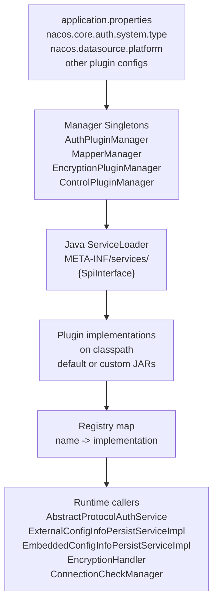
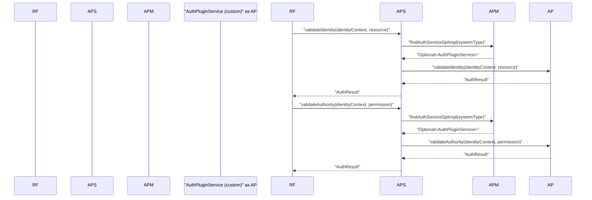
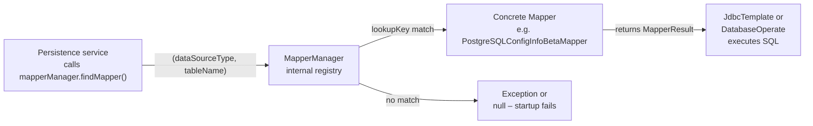

<!-- source: DeepWiki mcp.deepwiki.com · repo alibaba/nacos · page 9.4 Plugin Development · fetched 2026-10-29 -->

# Plugin Development

<details>
<summary>Relevant source files</summary>

The following files were used as context for generating this wiki page:

- [api/pom.xml](api/pom.xml)
- [client/pom.xml](client/pom.xml)
- [common/pom.xml](common/pom.xml)
- [config/pom.xml](config/pom.xml)
- [config/src/main/java/com/alibaba/nacos/config/server/service/repository/embedded/EmbeddedConfigInfoBetaPersistServiceImpl.java](config/src/main/java/com/alibaba/nacos/config/server/service/repository/embedded/EmbeddedConfigInfoBetaPersistServiceImpl.java)
- [config/src/main/java/com/alibaba/nacos/config/server/service/repository/embedded/EmbeddedConfigInfoPersistServiceImpl.java](config/src/main/java/com/alibaba/nacos/config/server/service/repository/embedded/EmbeddedConfigInfoPersistServiceImpl.java)
- [config/src/main/java/com/alibaba/nacos/config/server/service/repository/embedded/EmbeddedConfigInfoTagPersistServiceImpl.java](config/src/main/java/com/alibaba/nacos/config/server/service/repository/embedded/EmbeddedConfigInfoTagPersistServiceImpl.java)
- [config/src/main/java/com/alibaba/nacos/config/server/service/repository/embedded/EmbeddedHistoryConfigInfoPersistServiceImpl.java](config/src/main/java/com/alibaba/nacos/config/server/service/repository/embedded/EmbeddedHistoryConfigInfoPersistServiceImpl.java)
- [config/src/main/java/com/alibaba/nacos/config/server/service/repository/extrnal/ExternalConfigInfoBetaPersistServiceImpl.java](config/src/main/java/com/alibaba/nacos/config/server/service/repository/extrnal/ExternalConfigInfoBetaPersistServiceImpl.java)
- [config/src/main/java/com/alibaba/nacos/config/server/service/repository/extrnal/ExternalConfigInfoPersistServiceImpl.java](config/src/main/java/com/alibaba/nacos/config/server/service/repository/extrnal/ExternalConfigInfoPersistServiceImpl.java)
- [config/src/main/java/com/alibaba/nacos/config/server/service/repository/extrnal/ExternalConfigInfoTagPersistServiceImpl.java](config/src/main/java/com/alibaba/nacos/config/server/service/repository/extrnal/ExternalConfigInfoTagPersistServiceImpl.java)
- [config/src/main/java/com/alibaba/nacos/config/server/service/repository/extrnal/ExternalHistoryConfigInfoPersistServiceImpl.java](config/src/main/java/com/alibaba/nacos/config/server/service/repository/extrnal/ExternalHistoryConfigInfoPersistServiceImpl.java)
- [console/pom.xml](console/pom.xml)
- [core/pom.xml](core/pom.xml)
- [distribution/pom.xml](distribution/pom.xml)
- [example/pom.xml](example/pom.xml)
- [naming/pom.xml](naming/pom.xml)
- [plugin/datasource/src/main/java/com/alibaba/nacos/plugin/datasource/mapper/ConfigInfoAggrMapper.java](plugin/datasource/src/main/java/com/alibaba/nacos/plugin/datasource/mapper/ConfigInfoAggrMapper.java)
- [plugin/datasource/src/main/java/com/alibaba/nacos/plugin/datasource/mapper/ConfigInfoBetaMapper.java](plugin/datasource/src/main/java/com/alibaba/nacos/plugin/datasource/mapper/ConfigInfoBetaMapper.java)
- [plugin/datasource/src/main/java/com/alibaba/nacos/plugin/datasource/model/MapperContext.java](plugin/datasource/src/main/java/com/alibaba/nacos/plugin/datasource/model/MapperContext.java)
- [pom.xml](pom.xml)
- [test/pom.xml](test/pom.xml)

</details>


This page documents the SPI-based extension points that Nacos exposes for custom functionality. Nacos provides plugin mechanisms for authentication, database backends, configuration encryption, flow control, tracing, and custom environment configuration. The plugin system uses Java `ServiceLoader` for discovery and allows extending Nacos capabilities without modifying core code.

For the runtime authentication pipeline that invokes auth plugins, see [Authentication and Security](#9.3). For the persistence layer that datasource mapper plugins integrate with, see [Data Access Layer and Mappers](#5.2).

---

## Plugin System Architecture

Nacos uses the standard Java `ServiceLoader` mechanism as its plugin discovery layer. Each plugin category has a dedicated SPI interface in the `plugin/` Maven module. At startup, the relevant manager class loads all implementations found on the classpath and stores them in an internal registry, indexed by a name string. Callers retrieve an implementation by name at request time.

**Plugin Module Structure**

| Module | Artifact ID | Purpose |
|--------|-------------|---------|
| Auth Plugin | `nacos-auth-plugin` | SPI for custom authentication and authorization |
| Datasource Plugin | `nacos-datasource-plugin` | SPI for database-specific SQL mappers |
| Encryption Plugin | `nacos-encryption-plugin` | SPI for configuration value encryption |
| Control Plugin | `nacos-control-plugin` | SPI for flow control and connection management |
| Config Plugin | `nacos-config-plugin` | SPI for configuration preprocessing |
| Trace Plugin | `nacos-trace-plugin` | SPI for distributed tracing integration |
| Custom Environment Plugin | `nacos-custom-environment-plugin` | SPI for environment-specific configuration |
| Default Plugin All | `nacos-default-plugin-all` | Aggregation module containing default implementations |

**Plugin Loading – Runtime Overview**



Sources: [pom.xml:631-645](), [auth/src/main/java/com/alibaba/nacos/auth/AbstractProtocolAuthService.java:63-93](), [config/src/main/java/com/alibaba/nacos/config/server/service/repository/extrnal/ExternalConfigInfoPersistServiceImpl.java:122-126]()

---

## Auth Plugin

### The `AuthPluginService` Interface

The auth plugin SPI is defined in `plugin/auth/src/main/java/com/alibaba/nacos/plugin/auth/spi/server/AuthPluginService.java`. Every custom auth implementation must implement this interface.

[plugin/auth/src/main/java/com/alibaba/nacos/plugin/auth/spi/server/AuthPluginService.java:34-97]()

| Method | Purpose |
|--------|---------|
| `identityNames()` | Returns the list of keys (e.g., `username`, `accessToken`) that the framework should extract from requests and place into `IdentityContext`. |
| `enableAuth(ActionTypes action, String type)` | Fine-grained switch. The plugin can decline to auth certain action types (read vs. write) or sign types (`NAMING`, `CONFIG`, `AI`). |
| `validateIdentity(IdentityContext, Resource)` | Validates that the identity credentials in the context are authentic. Returns `AuthResult`. |
| `validateAuthority(IdentityContext, Permission)` | Validates that the authenticated identity has permission for the requested resource and action. Returns `AuthResult`. |
| `getAuthServiceName()` | Returns the unique string name for this plugin. Must match the value set in `nacos.core.auth.system.type`. |
| `isLoginEnabled()` | Optional. Return `true` if the plugin manages its own login flow. Defaults to `false`. |
| `isAdminRequest()` | Optional. Return `false` if the plugin does not require an admin role. Defaults to `true`. |

### How `AuthPluginManager` Loads Plugins

`AuthPluginManager` is accessed as a singleton via `AuthPluginManager.getInstance()`. It calls `ServiceLoader.load(AuthPluginService.class)` and indexes each discovered implementation by the string returned from `getAuthServiceName()`.

At request handling time, `AbstractProtocolAuthService` looks up the active plugin by name:

[auth/src/main/java/com/alibaba/nacos/auth/AbstractProtocolAuthService.java:63-93]()

```
AuthPluginManager.getInstance()
    .findAuthServiceSpiImpl(authConfig.getNacosAuthSystemType())
```

`getNacosAuthSystemType()` reads the value of `nacos.core.auth.system.type` from `application.properties` (constant `Constants.Auth.NACOS_CORE_AUTH_SYSTEM_TYPE`). If no matching plugin is found, the framework logs a warning and—depending on the method—either allows the request through (`validateIdentity`, `validateAuthority`) or denies auth (`enableAuth`).

**Auth Plugin Invocation Flow**



Sources: [auth/src/main/java/com/alibaba/nacos/auth/AbstractProtocolAuthService.java:63-93](), [core/src/main/java/com/alibaba/nacos/core/auth/RemoteRequestAuthFilter.java:96-116]()

### Registering an Auth Plugin

1. Create a class that `implements AuthPluginService`.
2. Implement all required methods. `getAuthServiceName()` must return a unique string, e.g. `"my-ldap-auth"`.
3. Create the file `META-INF/services/com.alibaba.nacos.plugin.auth.spi.server.AuthPluginService` in your JAR.
4. Put the fully-qualified class name of your implementation as the file content.
5. Set `nacos.core.auth.system.type=my-ldap-auth` in `application.properties` on the server.
6. Place the plugin JAR on the server classpath.

---

## Datasource Mapper Plugin

The datasource mapper plugin system allows adding support for a new SQL database (e.g. PostgreSQL, Oracle) without modifying core Nacos code. The `plugin/datasource` module defines the mapper interfaces; the built-in Derby and MySQL implementations are registered as the default providers.

### Mapper Interface Hierarchy

```mermaid
classDiagram
    class "Mapper" {
        <<interface>>
        +getDataSourceType() String
        +getTableName() String
        +insert(columns) String
        +update(updateCols, whereCols) String
        +delete(whereCols) String
        +select(selectCols, whereCols) String
        +count(cols) String
        +getFunction(functionName) String
    }

    class "ConfigInfoMapper" {
        <<interface>>
        +findConfigInfoAggrByPageFetchRows(MapperContext) MapperResult
        +updateConfigInfoAtomicCas(MapperContext) MapperResult
        +removeConfigInfoByIdsAtomic(MapperContext) MapperResult
        +findConfigMaxId(MapperContext) MapperResult
    }

    class "ConfigInfoAggrMapper" {
        <<interface>>
        +batchRemoveAggr(MapperContext) MapperResult
        +aggrConfigInfoCount(MapperContext) MapperResult
        +findConfigInfoAggrIsOrdered(MapperContext) MapperResult
        +findConfigInfoAggrByPageFetchRows(MapperContext) MapperResult
        +findAllAggrGroupByDistinct(MapperContext) MapperResult
    }

    class "ConfigInfoBetaMapper" {
        <<interface>>
        +updateConfigInfo4BetaCas(MapperContext) MapperResult
        +findAllConfigInfoBetaForDumpAllFetchRows(MapperContext) MapperResult
    }

    class "ConfigInfoTagMapper" {
        <<interface>>
    }

    class "ConfigTagsRelationMapper" {
        <<interface>>
    }

    class "HistoryConfigInfoMapper" {
        <<interface>>
        +removeConfigHistory(MapperContext) MapperResult
        +findDeletedConfig(MapperContext) MapperResult
        +pageFindConfigHistoryFetchRows(MapperContext) MapperResult
        +detailPreviousConfigHistory(MapperContext) MapperResult
        +findConfigHistoryCountByTime(MapperContext) MapperResult
        +getNextHistoryInfo(MapperContext) MapperResult
    }

    "Mapper" <|-- "ConfigInfoMapper"
    "Mapper" <|-- "ConfigInfoAggrMapper"
    "Mapper" <|-- "ConfigInfoBetaMapper"
    "Mapper" <|-- "ConfigInfoTagMapper"
    "Mapper" <|-- "ConfigTagsRelationMapper"
    "Mapper" <|-- "HistoryConfigInfoMapper"
```

Sources: [plugin/datasource/src/main/java/com/alibaba/nacos/plugin/datasource/mapper/ConfigInfoAggrMapper.java:34-160](), [plugin/datasource/src/main/java/com/alibaba/nacos/plugin/datasource/mapper/ConfigInfoBetaMapper.java:33-86]()

### `MapperContext` and `MapperResult`

Every mapper method that needs non-trivial parameters takes a `MapperContext` and returns a `MapperResult`.

[plugin/datasource/src/main/java/com/alibaba/nacos/plugin/datasource/model/MapperContext.java:28-142]()

| Object | Role |
|--------|------|
| `MapperContext` | Carries WHERE parameters (`putWhereParameter`/`getWhereParameter`), UPDATE parameters (`putUpdateParameter`/`getUpdateParameter`), context metadata, and pagination state (`startRow`, `pageSize`). |
| `MapperResult` | A pair of `(String sql, List<Object> paramList)` ready to hand to `JdbcTemplate.update()` or `queryForObject()`. |

The `Mapper` base interface exposes a `getFunction(String)` hook to let implementations return database-specific SQL function names (e.g., `NOW()` vs `CURRENT_TIMESTAMP`).

### `MapperManager` – The Mapper Registry

`MapperManager` is a singleton accessed via `MapperManager.instance(boolean logEnabled)`. It uses `ServiceLoader` to discover all `Mapper` implementations on the classpath and indexes them by `(dataSourceType, tableName)`.

Callers retrieve a mapper like this:

```
ConfigInfoBetaMapper mapper = mapperManager.findMapper(
    dataSourceService.getDataSourceType(),   // e.g. "mysql" or "derby"
    TableConstant.CONFIG_INFO_BETA           // table constant string
);
```

[config/src/main/java/com/alibaba/nacos/config/server/service/repository/extrnal/ExternalConfigInfoBetaPersistServiceImpl.java:73-80]()
[config/src/main/java/com/alibaba/nacos/config/server/service/repository/embedded/EmbeddedConfigInfoBetaPersistServiceImpl.java:79-85]()

The `isDataSourceLogEnable` flag is read from property `CommonConstant.NACOS_PLUGIN_DATASOURCE_LOG` and enables SQL statement logging when `true`.

### Default Methods vs. Abstract Methods

Most mapper interfaces use Java `default` methods to supply standard ANSI SQL. Only methods that require database-specific syntax (e.g. pagination via `LIMIT`/`ROWNUM`, or CAS updates) are declared abstract and must be implemented per database.

| Pattern | Example |
|---------|---------|
| Default (ANSI SQL) | `ConfigInfoAggrMapper.findConfigInfoAggrIsOrdered` – standard `ORDER BY` query |
| Abstract (DB-specific) | `ConfigInfoAggrMapper.findConfigInfoAggrByPageFetchRows` – requires `LIMIT` (MySQL) or `FETCH FIRST` (Derby) |
| Default (ANSI SQL) | `ConfigInfoBetaMapper.updateConfigInfo4BetaCas` – standard `WHERE md5 = ?` |
| Abstract (DB-specific) | `ConfigInfoBetaMapper.findAllConfigInfoBetaForDumpAllFetchRows` – paged subquery |

Sources: [plugin/datasource/src/main/java/com/alibaba/nacos/plugin/datasource/mapper/ConfigInfoAggrMapper.java:116-160](), [plugin/datasource/src/main/java/com/alibaba/nacos/plugin/datasource/mapper/ConfigInfoBetaMapper.java:44-86]()

### Implementing a New Database Mapper

For each table your new database needs to support, create a class that implements the corresponding interface (e.g. `ConfigInfoBetaMapper`). Override the abstract methods with dialect-specific SQL. Override any default methods where the standard ANSI SQL does not run correctly on your database.

The class must also implement `Mapper.getDataSourceType()` to return a unique string identifying your database (e.g. `"postgresql"`), and `Mapper.getTableName()` to return the appropriate `TableConstant` value.

**Mapper Selection Logic**



Sources: [config/src/main/java/com/alibaba/nacos/config/server/service/repository/extrnal/ExternalConfigInfoPersistServiceImpl.java:260-264]()

### Registering a Datasource Mapper Plugin

1. Create a JAR with your mapper implementations for every `Mapper` sub-interface.
2. Each class must return your database type string from `getDataSourceType()`.
3. Create `META-INF/services/com.alibaba.nacos.plugin.datasource.mapper.Mapper` listing all your implementation class names (one per line).
4. Add the JAR to the server classpath.
5. Set `spring.datasource.platform=<your-type>` (or equivalent `nacos.datasource.platform`) to tell the `DataSourceService` to use your database driver.

---

## Encryption Plugin

The encryption plugin provides transparent encrypt/decrypt of config values at rest. The handler class is `com.alibaba.nacos.plugin.encryption.handler.EncryptionHandler`, located in the `plugin/` module.

Persistence service implementations call `EncryptionHandler` before writing config content to the database and after reading it back. The `encryptedDataKey` column in the `config_info` table stores the encrypted symmetric key, and the plugin manages the key lifecycle.

[config/src/main/java/com/alibaba/nacos/config/server/service/repository/extrnal/ExternalConfigInfoPersistServiceImpl.java:55-56]()

The encryption plugin SPI follows the same `ServiceLoader` pattern. The SPI interface is in `plugin/encryption`. To add a new encryption algorithm:

1. Implement the encryption plugin interface from the `plugin/encryption` module.
2. Register it in `META-INF/services/<EncryptionPluginSpiInterface>`.
3. Configure which algorithm to activate via the relevant `application.properties` property.

---

## General ServiceLoader Registration Pattern

All Nacos plugin types follow the same three-step registration:

| Step | What to do |
|------|-----------|
| **1. Implement** | Create a class implementing the SPI interface (`AuthPluginService`, `Mapper`, or the encryption interface). |
| **2. Declare** | Create a file under `META-INF/services/` named after the fully-qualified SPI interface. Add the fully-qualified name of your implementation class as a line in that file. |
| **3. Activate** | Add a property to `application.properties` that references your plugin by name. For auth: `nacos.core.auth.system.type=<getAuthServiceName()>`. For datasource: `nacos.datasource.platform=<getDataSourceType()>`. |

The manager singletons (`AuthPluginManager`, `MapperManager`) perform `ServiceLoader.load()` during their own initialization. Plugins placed on the classpath before server startup are picked up automatically without code changes to Nacos itself.

Sources: [plugin/auth/src/main/java/com/alibaba/nacos/plugin/auth/spi/server/AuthPluginService.java:34-97](), [auth/src/main/java/com/alibaba/nacos/auth/AbstractProtocolAuthService.java:63-93](), [plugin/datasource/src/main/java/com/alibaba/nacos/plugin/datasource/mapper/ConfigInfoAggrMapper.java:34-160](), [plugin/datasource/src/main/java/com/alibaba/nacos/plugin/datasource/mapper/ConfigInfoBetaMapper.java:33-86](), [plugin/auth/src/main/java/com/alibaba/nacos/plugin/auth/constant/Constants.java:24-76]()