# Page: Overview

# Overview

<details>
<summary>Relevant source files</summary>

The following files were used as context for generating this wiki page:

- [README.md](README.md)
- [api/pom.xml](api/pom.xml)
- [client/pom.xml](client/pom.xml)
- [common/pom.xml](common/pom.xml)
- [config/pom.xml](config/pom.xml)
- [console/pom.xml](console/pom.xml)
- [core/pom.xml](core/pom.xml)
- [distribution/pom.xml](distribution/pom.xml)
- [example/pom.xml](example/pom.xml)
- [naming/pom.xml](naming/pom.xml)
- [pom.xml](pom.xml)
- [test/pom.xml](test/pom.xml)

</details>


This page introduces the Nacos project: what it does, its four core capabilities, the client ecosystems it supports, and a high-level view of how its major runtime components relate. For the detailed architectural breakdown, see [System Architecture](#1.1). For module dependency specifics, see [Module Structure and Dependencies](#1.2).

---

## What Is Nacos

Nacos (**Na**ming and **Co**nfiguration **S**ervice) is a platform for dynamic service discovery, configuration management, and service management in cloud-native and microservice environments. It is developed by Alibaba Group and distributed under the Apache 2.0 license. The current development branch targets version `3.2.0-SNAPSHOT` as declared in [pom.xml:91]().

The name encodes its two primary concerns:

- **Naming** — service registry and discovery
- **Configuration** — centralized, dynamic configuration management

---

## Four Core Capabilities

| Capability | Description |
|---|---|
| **Service Discovery and Health Check** | Services self-register and are discovered via HTTP or DNS. Real-time health checks prevent routing to unhealthy instances. |
| **Dynamic Configuration Management** | Configurations for all services are managed centrally and pushed to clients without application restarts. |
| **Dynamic DNS Service** | Weighted routing and DNS-based service discovery are supported, decoupling applications from vendor-specific discovery APIs. |
| **Service and Metadata Management** | A built-in dashboard manages service metadata, configuration, Kubernetes DNS, health status, and metrics. |

Sources: [README.md:19-36]()

---

## Supported Client Ecosystems

Nacos integrates with three major service frameworks:

| Ecosystem | Protocol | Notes |
|---|---|---|
| **Apache Dubbo** | Dubbo RPC / gRPC | Uses Nacos for service registry and configuration |
| **Spring Cloud** | HTTP REST | Via `spring-cloud-alibaba` / `nacos-spring-project` |
| **Kubernetes** | DNS | Via `nacos-k8s-sync` module and Kubernetes client |

The `nacos-client` artifact ([client/pom.xml]()) targets Java 1.8 (`client.java.version`) to maximize compatibility, while the server-side modules target Java 17 ([pom.xml:96-98]()).

---

## Maven Module Map

The project is structured as a multi-module Maven build rooted at `nacos-all` ([pom.xml:24]()). The modules declared in [pom.xml:618-648]() are:

**Core runtime modules:**

| Maven Artifact ID | Directory | Role |
|---|---|---|
| `nacos-api` | `api/` | gRPC stubs, public POJOs, client-facing interfaces |
| `nacos-common` | `common/` | HTTP utils, event bus, lifecycle, remote client base |
| `nacos-consistency` | `consistency/` | `ConsistencyProtocol`, `LogProcessor` interfaces |
| `nacos-core` | `core/` | Cluster management, gRPC server, JRaft, auth filter chain |
| `nacos-config` | `config/` | Configuration management server-side logic |
| `nacos-naming` | `naming/` | Service discovery server-side logic |
| `nacos-persistence` | `persistence/` | Storage abstraction, Derby and MySQL DAL |
| `nacos-auth` | `auth/` | Authentication framework |
| `nacos-console` | `console/` | REST controllers + React SPA host |
| `nacos-client` | `client/` | Config + Naming client library (shaded fat jar) |
| `nacos-bootstrap` | `bootstrap/` | Spring Boot application entry point |
| `nacos-server` | `server/` | Server assembly wiring |
| `nacos-distribution` | `distribution/` | Packages the final server tar/zip artifact |
| `nacos-ai` | `ai/` | MCP (Model Context Protocol) registry and AI endpoints |

**Plugin modules** (under `plugin/` and `plugin-default-impl/`):

| Maven Artifact ID | Purpose |
|---|---|
| `nacos-auth-plugin` | Auth SPI interface |
| `nacos-datasource-plugin` | Datasource SPI interface |
| `nacos-encryption-plugin` | Encryption SPI interface |
| `nacos-config-plugin` | Config type extension SPI |
| `nacos-trace-plugin` | Tracing SPI |
| `nacos-control-plugin` | Rate control SPI |
| `default-auth-plugin` | Default JWT-based auth implementation |

Sources: [pom.xml:618-648](), [pom.xml:700-870]()

---

## Module Dependency Diagram

**Maven inter-module dependencies with key classes**

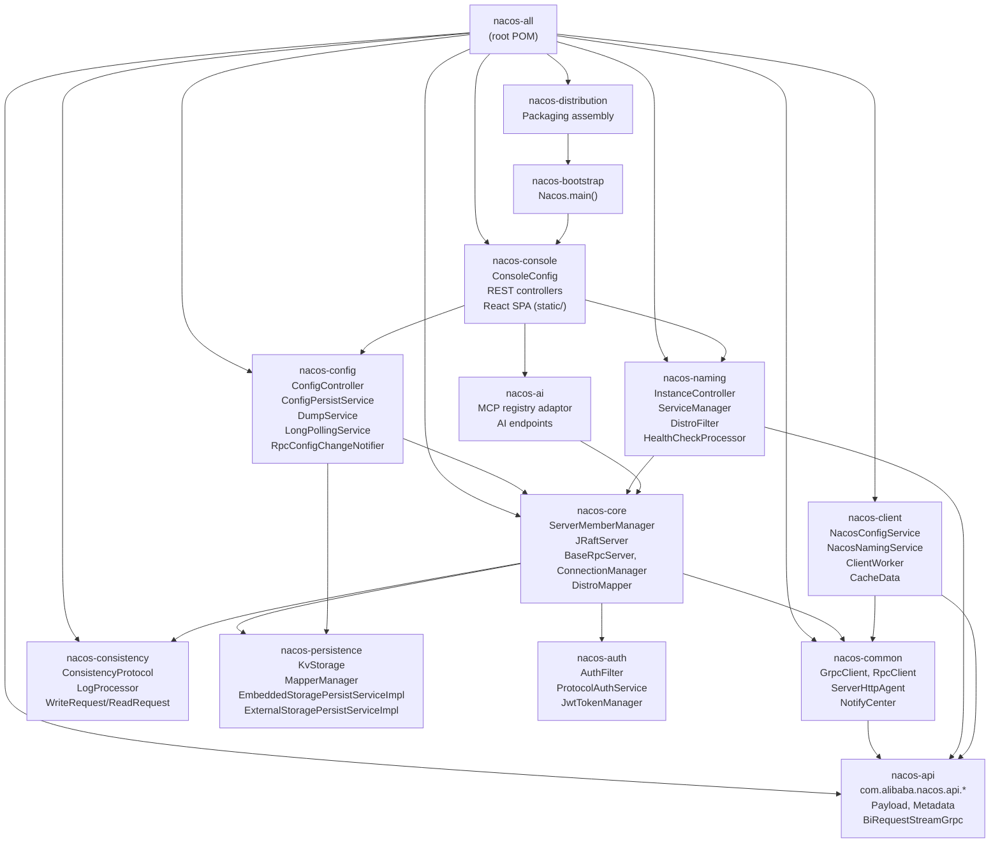

Sources: [pom.xml:618-648](), [core/pom.xml:36-196](), [config/pom.xml:34-140](), [naming/pom.xml:36-130](), [console/pom.xml:31-112](), [client/pom.xml:40-119](), [distribution/pom.xml:34-44]()

---

## Runtime Architecture Overview

At runtime, Nacos exposes two primary subsystems — **Config** and **Naming** — both accessible over gRPC and HTTP. The `console` module sits above both and also hosts the management UI. The system operates in a three-tier architecture: client layer, server layer, and persistence layer.

**High-level system architecture**

```mermaid
graph TB
    subgraph "Client Layer"
        SDK["Nacos Client SDK\nNacosConfigService\nNacosNamingService\nClientWorker\nJava 8 compatible"]
        UI["Console UI\nReact Frontend\nstatic/console-ui/"]
    end
    
    subgraph "Server Layer"
        CONSOLE["nacos-console\nConsole controllers\nFunctionMode handler"]
        CONFIG["nacos-config\nConfigController\nConfigPersistService\nRpcConfigChangeNotifier"]
        NAMING["nacos-naming\nInstanceController\nServiceManager\nDistroFilter"]
        CORE["nacos-core\nServerMemberManager\nConnectionManager\nBaseRpcServer\nAuthSystem"]
    end
    
    subgraph "Communication Layer"
        RPC["gRPC Layer\nBaseRpcServer :9848\nGrpcClusterServer :9849\nPayload/Metadata"]
        HTTP["HTTP Layer\nSpring MVC :8848\nTomcat Embedded"]
    end
    
    subgraph "Persistence Layer"
        EMBEDDED["Embedded Storage\nDerby\nEmbeddedStoragePersistServiceImpl"]
        EXTERNAL["External DB\nMySQL/PostgreSQL\nExternalStoragePersistServiceImpl"]
    end
    
    subgraph "Cluster Management"
        MEMBER["ServerMemberManager\nCluster membership\nHealth checks"]
        DISTRO["DistroMapper\nConsistent hashing\nAP protocol"]
        RAFT["JRaftServer\nRaft consensus\nCP protocol"]
    end
    
    SDK -->|"gRPC/HTTP"| RPC
    UI -->|"HTTP API"| CONSOLE
    
    RPC --> CONFIG
    RPC --> NAMING
    HTTP --> CONSOLE
    
    CONSOLE --> CONFIG
    CONSOLE --> NAMING
    CONSOLE --> CORE
    
    CONFIG --> CORE
    NAMING --> CORE
    
    CONFIG --> EMBEDDED
    CONFIG --> EXTERNAL
    NAMING --> EMBEDDED
    NAMING --> EXTERNAL
    
    CORE --> MEMBER
    NAMING --> DISTRO
    CONFIG --> RAFT
    
    MEMBER -.."cluster coordination"..-> MEMBER
    DISTRO -.."uses"..-> MEMBER
    RAFT -.."uses"..-> MEMBER
```

Sources: [README.md:1-257](), [pom.xml:618-648](), [console/pom.xml:31-112](), [config/pom.xml:34-140](), [naming/pom.xml:36-130](), [core/pom.xml:36-196](), [client/pom.xml:35-38]()

---

**Detailed runtime component interaction**

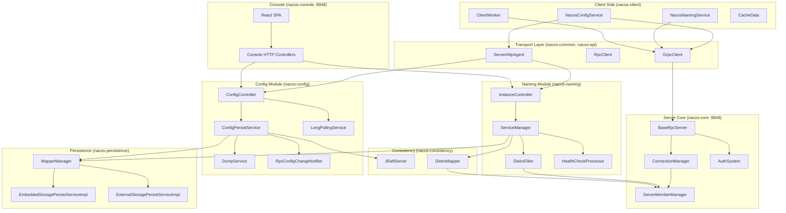

Sources: [console/pom.xml:31-112](), [config/pom.xml:34-140](), [naming/pom.xml:36-130](), [core/pom.xml:36-196](), [client/pom.xml:40-119]()

---

## Key Technology Stack

| Concern | Technology | Version in pom.xml |
|---|---|---|
| RPC transport | gRPC (grpc-netty-shaded) | `1.75.0` |
| Serialization | Protocol Buffers | `3.25.5` |
| CP consistency | SOFAJRaft (jraft-core) | `1.4.0` |
| Embedded DB | Apache Derby | `10.14.2.0` |
| External DB | MySQL Connector/J | `8.2.0` |
| Metrics | Micrometer | `1.12.8` |
| Auth tokens | JJWT | `0.11.2` |
| Server framework | Spring Boot | `3.4.10` |
| Kubernetes client | Official Java client | `22.0.0` |
| AI/MCP | MCP SDK | `0.14.1` |

Sources: [pom.xml:130-167]()

---

## Where to Go Next

| Topic | Wiki Page |
|---|---|
| Runtime port topology, auth filter chain, protocol details | [System Architecture](#1.1) |
| Maven module layering in depth | [Module Structure and Dependencies](#1.2) |
| Deployment modes, startup scripts | [Installation and Deployment](#2) |
| Configuration service client SDK and server API | [Configuration Service](#3) |
| Service discovery client SDK and server | [Naming Service](#4) |
| Persistence layer (KvStorage, Derby, MySQL) | [Data Persistence](#5) |
| JRaft CP + Distro AP protocols | [Consistency Protocols](#6.2) |
| gRPC server and client implementation | [Communication Framework](#7) |
| Management console (React + Spring controllers) | [Console and Management UI](#8) |
| Auth plugin SPI, build system, monitoring | [Development and Operations](#9) |

---

# Page: System Architecture

# System Architecture

<details>
<summary>Relevant source files</summary>

The following files were used as context for generating this wiki page:

- [.gitignore](.gitignore)
- [README.md](README.md)
- [api/pom.xml](api/pom.xml)
- [client/pom.xml](client/pom.xml)
- [common/pom.xml](common/pom.xml)
- [config/pom.xml](config/pom.xml)
- [console/pom.xml](console/pom.xml)
- [console/src/main/resources/META-INF/nacos-default.properties](console/src/main/resources/META-INF/nacos-default.properties)
- [core/pom.xml](core/pom.xml)
- [distribution/bin/shutdown.cmd](distribution/bin/shutdown.cmd)
- [distribution/bin/shutdown.sh](distribution/bin/shutdown.sh)
- [distribution/bin/startup.cmd](distribution/bin/startup.cmd)
- [distribution/bin/startup.sh](distribution/bin/startup.sh)
- [distribution/conf/application.properties](distribution/conf/application.properties)
- [distribution/pom.xml](distribution/pom.xml)
- [example/pom.xml](example/pom.xml)
- [naming/pom.xml](naming/pom.xml)
- [pom.xml](pom.xml)
- [test/pom.xml](test/pom.xml)

</details>


## Overview

Nacos implements a client-server architecture with a dual-protocol consistency model: **Raft (CP)** for configuration data requiring strong consistency, and **Distro (AP)** for service discovery prioritizing availability. The system supports multi-protocol communication (gRPC and HTTP) and can be deployed in standalone or cluster modes.

This page explains the overall system design, major components, and how they interact. For detailed subsystem documentation:
- Module dependencies: Page 1.2 Module Structure and Dependencies
- Configuration service: Page 3 Configuration Service
- Naming service: Page 4 Naming Service
- Cluster management: Page 6 Cluster Management
- RPC framework: Page 7 Communication Framework

---

## High-Level Architecture

Nacos separates concerns across four primary layers: Client Layer (SDK and UI), Server Layer (service modules), Communication Layer (gRPC/HTTP), and Storage Layer (embedded or external databases). The system uses two distinct consistency protocols based on data characteristics.

### System Layers and Components

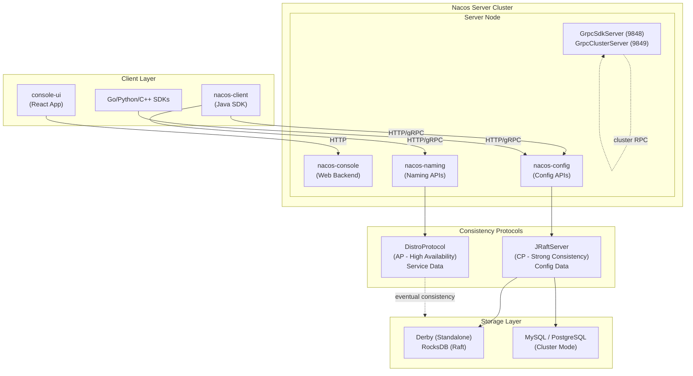

**Layer Responsibilities:**

| Layer | Key Components | Purpose |
|-------|----------------|---------|
| **Client Layer** | `NacosConfigService`, `NacosNamingService`, `ClientWorker` | SDK for application integration, local caching, long polling |
| **Server Layer** | `ConfigController`, `InstanceController`, `BaseGrpcServer` | REST APIs, gRPC services, request routing |
| **Consistency Layer** | `JRaftServer`, `DistroProtocol`, `ServerMemberManager` | Data replication, cluster coordination |
| **Storage Layer** | `EmbeddedStoragePersistServiceImpl`, `ExternalStoragePersistServiceImpl` | Data persistence, dual-storage strategy |

**Sources:** [pom.xml:614-645](), [core/src/main/java/com/alibaba/nacos/core/remote/grpc/BaseGrpcServer.java:64](), [core/src/main/java/com/alibaba/nacos/core/remote/grpc/GrpcSdkServer.java](), [consistency/src/main/java/com/alibaba/nacos/consistency/cp/CPProtocol.java]()

---

## Dual-Protocol Consistency Model

Nacos uses **two distinct consistency protocols** based on data characteristics: Raft for configuration data (CP in CAP theorem) and Distro for service discovery data (AP in CAP theorem).

### Raft Protocol for Configuration (CP)

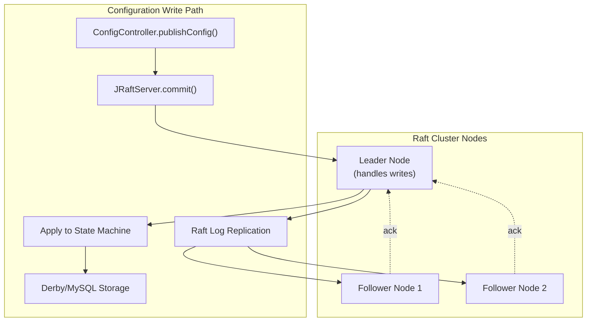

**Raft Implementation Details:**

- **Library**: Uses Alibaba JRaft (SOFAJRaft) library from `jraft-core` dependency
- **Leader Election**: Implements Raft leader election with configurable timeout (default: 5 seconds)
- **Log Replication**: Writes replicate to majority of nodes before commit
- **Snapshot**: Periodic snapshots (default: 30 minutes) via `nacos.core.protocol.raft.data.snapshot_interval_secs`
- **Read Strategy**: Supports `ReadOnlySafe` (leader tenure confirmation) and `ReadOnlyLeaseBased`
- **Key Classes**: `JRaftServer`, `JRaftProtocol`, `NacosStateMachine`, `LogProcessor4CP`

**Sources:** [core/pom.xml:114-123](), [consistency/src/main/java/com/alibaba/nacos/consistency/cp/CPProtocol.java](), [distribution/conf/application.properties:107-122]()

### Distro Protocol for Service Discovery (AP)

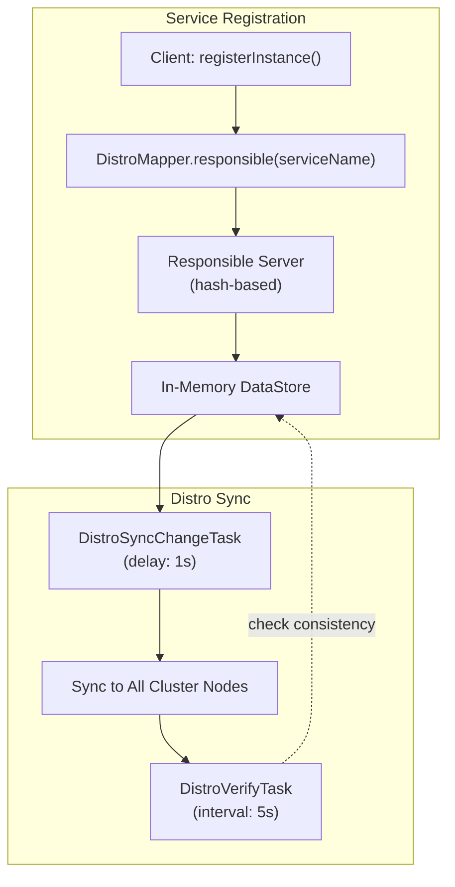

**Distro Implementation Details:**

- **Hash-Based Distribution**: `DistroMapper` calculates responsible server using consistent hashing on service name
- **Eventual Consistency**: Data propagates asynchronously to all nodes (default sync delay: 1 second)
- **Memory Storage**: Ephemeral service instances stored in `DataStore` (not persisted)
- **Verification**: `DistroVerifyTask` periodically checks data consistency across nodes (default: 5 seconds)
- **Retry Logic**: Failed syncs retry with exponential backoff (default retry delay: 3 seconds)
- **Key Classes**: `DistroProtocol`, `DistroMapper`, `DistroSyncChangeTask`, `DistroVerifyTask`, `DataStore`

**Configuration Properties:**

```properties
# Distro sync delay (default: 1000ms)
nacos.core.protocol.distro.data.sync.delayMs=1000

# Distro sync timeout (default: 3000ms)
nacos.core.protocol.distro.data.sync.timeoutMs=3000

# Distro verify interval (default: 5000ms)
nacos.core.protocol.distro.data.verify.intervalMs=5000
```

**Sources:** [naming/src/main/java/com/alibaba/nacos/naming/consistency/ephemeral/distro/DistroProtocol.java](), [naming/src/main/java/com/alibaba/nacos/naming/consistency/ephemeral/distro/DistroMapper.java](), [distribution/conf/application.properties:124-139]()

---

## Client-Server Communication

### Client Architecture

The `nacos-client` module provides programmatic APIs for configuration and naming services. Both use a shared `RpcClient` infrastructure for gRPC communication with automatic failover and reconnection.

#### Client Component Hierarchy

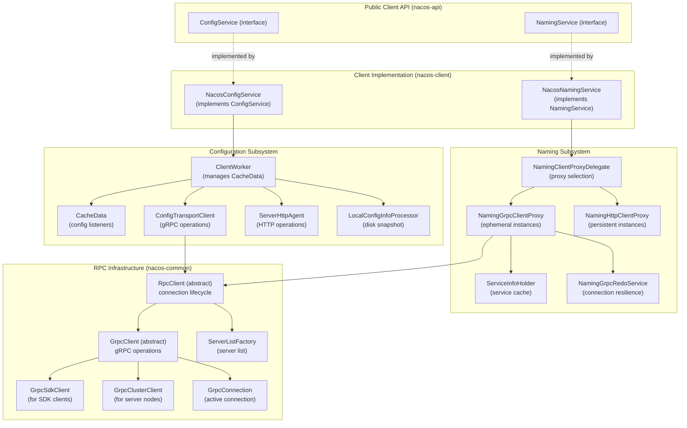

**Key Client Classes:**

| Component | Module | Responsibility |
|-----------|--------|----------------|
| `NacosConfigService` | nacos-client | Public API for config operations (get, publish, listen) |
| `NacosNamingService` | nacos-client | Public API for naming operations (register, subscribe, deregister) |
| `ClientWorker` | nacos-client | Config long polling, local cache (`CacheData`), listener notification |
| `ConfigTransportClient` | nacos-client | gRPC-based config queries and batch listen |
| `NamingClientProxyDelegate` | nacos-client | Routes to gRPC (ephemeral) or HTTP (persistent) proxies |
| `NamingGrpcClientProxy` | nacos-client | Handles ephemeral instance registration via gRPC |
| `NamingGrpcRedoService` | nacos-client | Connection resilience, automatic re-registration on reconnect |
| `ServiceInfoHolder` | nacos-client | Local cache for service instance lists with scheduled refresh |
| `RpcClient` | nacos-common | Base class with connection lifecycle, health checks, reconnection |
| `GrpcClient` | nacos-common | gRPC implementation with bidirectional streaming |
| `GrpcSdkClient` | nacos-common | SDK-specific gRPC client (port: server+1000) |
```

**RpcClient Architecture:**

The `RpcClient` abstract class ([common/src/main/java/com/alibaba/nacos/common/remote/client/RpcClient.java:69]()) provides:

- **Connection Lifecycle**: Methods `start()`, `shutdown()`, automatic reconnection via `reconnectionSignal` queue
- **Server Selection**: `ServerListFactory` integration for dynamic server list updates
- **Health Monitoring**: Periodic `HealthCheckRequest` sent via `healthCheck()` method
- **Client States**: `WAIT_INIT`, `INITIALIZED`, `STARTING`, `RUNNING`, `UNHEALTHY`, `SHUTDOWN`
- **Event Handling**: `eventLinkedBlockingQueue` publishes `ConnectionEvent` notifications
```

**Sources:** [client/src/main/java/com/alibaba/nacos/client/config/NacosConfigService.java](), [client/src/main/java/com/alibaba/nacos/client/naming/NacosNamingService.java](), [client/src/main/java/com/alibaba/nacos/client/config/impl/ClientWorker.java](), [common/src/main/java/com/alibaba/nacos/common/remote/client/RpcClient.java:69-450](), [common/src/main/java/com/alibaba/nacos/common/remote/client/grpc/GrpcClient.java:79-600]()

**RpcClient Architecture:**

The `RpcClient` abstract class ([common/src/main/java/com/alibaba/nacos/common/remote/client/RpcClient.java:69]()) provides the foundation for all client-server communication:

- **Connection Lifecycle**: Automatic connection establishment, health monitoring, and reconnection
- **Server Selection**: `ServerListFactory` integration for dynamic server list updates
- **Health Checking**: Periodic `HealthCheckRequest` sent via `healthCheck()` method
- **Reconnection Signal**: `BlockingQueue<ReconnectContext> reconnectionSignal` triggers reconnect operations
- **Event Handling**: `BlockingQueue<ConnectionEvent> eventLinkedBlockingQueue` notifies connection state changes
- **RpcClientStatus**: Tracks client state: `WAIT_INIT`, `INITIALIZED`, `STARTING`, `RUNNING`, `UNHEALTHY`, `SHUTDOWN`

The `GrpcClient` implementation ([common/src/main/java/com/alibaba/nacos/common/remote/client/grpc/GrpcClient.java:79]()) extends `RpcClient` for gRPC protocol:

- **Bidirectional Streaming**: `BiRequestStreamGrpc.BiRequestStreamStub` for server push capability
- **Unary Requests**: `RequestGrpc.RequestFutureStub` for request-response pattern
- **Channel Management**: Creates `ManagedChannel` via `createNewManagedChannel(serverIp, port)`
- **Ability Negotiation**: `RecAbilityContext` coordinates capability exchange with `SetupRequestHandler`
- **TLS Support**: Optional `RpcClientTlsConfig` for encrypted connections
- **Thread Pool**: Dedicated `grpcExecutor` created via `createGrpcExecutor(serverIp)`

**Sources:** [common/src/main/java/com/alibaba/nacos/common/remote/client/RpcClient.java:69-450](), [common/src/main/java/com/alibaba/nacos/common/remote/client/grpc/GrpcClient.java:79-600](), [common/src/main/java/com/alibaba/nacos/common/remote/client/grpc/GrpcSdkClient.java:31](), [common/src/main/java/com/alibaba/nacos/common/remote/client/grpc/GrpcClusterClient.java:32]()

### Server Architecture

The server uses a dual gRPC server design: `GrpcSdkServer` (port 9848) for client connections and `GrpcClusterServer` (port 9849) for inter-node cluster communication. Each server runs independently with separate connection pools and policies.

#### Server Component Architecture

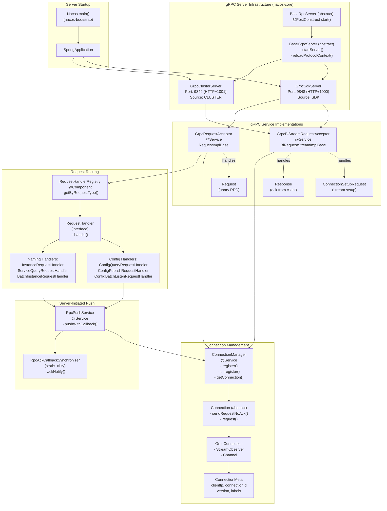

**Key Server Classes:**

| Component | Module | Port | Responsibility |
|-----------|--------|------|----------------|
| `BaseGrpcServer` | nacos-core | - | Abstract base with `startServer()`, `addServices()`, interceptors |
| `GrpcSdkServer` | nacos-core | 9848 | Handles SDK client connections (HTTP port + 1000) |
| `GrpcClusterServer` | nacos-core | 9849 | Inter-node cluster communication (HTTP port + 1001) |
| `GrpcBiStreamRequestAcceptor` | nacos-core | - | Implements `BiRequestStreamImplBase` for bidirectional streaming |
| `GrpcRequestAcceptor` | nacos-core | - | Implements `RequestImplBase` for unary RPC |
| `ConnectionManager` | nacos-core | - | Connection registration, tracking, health monitoring, ejection |
| `RequestHandlerRegistry` | nacos-core | - | Routes incoming requests to appropriate `RequestHandler` implementations |
| `RpcPushService` | nacos-core | - | Server-initiated push notifications to connected clients |
```

**BaseGrpcServer Implementation:**

The `BaseGrpcServer` ([core/src/main/java/com/alibaba/nacos/core/remote/grpc/BaseGrpcServer.java:64]()) provides:

- **Server Startup**: `startServer()` creates `NettyServerBuilder` with `getServicePort()`
- **Service Registration**: `addServices()` registers gRPC stubs with interceptors (`GrpcConnectionInterceptor`)
- **Keep-Alive**: Configurable via `getKeepAliveTime()`, `getKeepAliveTimeout()`, `getPermitKeepAliveTime()`
- **Message Limits**: `getMaxInboundMessageSize()` defaults to 10MB
- **TLS Support**: Optional `newProtocolNegotiator()` for encrypted connections
```

**Sources:** [core/src/main/java/com/alibaba/nacos/core/remote/grpc/BaseGrpcServer.java:64-188](), [core/src/main/java/com/alibaba/nacos/core/remote/grpc/GrpcSdkServer.java](), [core/src/main/java/com/alibaba/nacos/core/remote/grpc/GrpcClusterServer.java](), [core/src/main/java/com/alibaba/nacos/core/remote/ConnectionManager.java:57-370]()

**BaseGrpcServer Implementation:**

The `BaseGrpcServer` abstract class ([core/src/main/java/com/alibaba/nacos/core/remote/grpc/BaseGrpcServer.java:64]()) provides core server functionality:

- **Server Startup**: `startServer()` creates `NettyServerBuilder` with configured port via `getServicePort()`
- **Service Registration**: `addServices()` registers gRPC service implementations with interceptors
- **Protocol Negotiation**: Optional `newProtocolNegotiator()` for TLS/proxy protocol support
- **Keep-Alive Configuration**: Methods `getKeepAliveTime()`, `getKeepAliveTimeout()`, `getPermitKeepAliveTime()`
- **Message Size Limits**: `getMaxInboundMessageSize()` defaults to 10MB
- **Interceptors**: `getSeverInterceptors()` returns `GrpcConnectionInterceptor` for connection tracking
- **Transport Filters**: `getServerTransportFilters()` returns `AddressTransportFilter` for IP extraction

**ConnectionManager Responsibilities:**

The `ConnectionManager` service ([core/src/main/java/com/alibaba/nacos/core/remote/ConnectionManager.java:57]()) manages connection lifecycle:

- **Registration**: `register(connectionId, connection)` validates and stores new connections
- **Connection Limits**: `checkLimit()` enforces per-IP and per-app connection quotas via `ControlManagerCenter`
- **Validation**: `checkValid(connectionId)` verifies connection is still registered
- **Retrieval**: `getConnection(connectionId)` and `getConnectionByIp(clientIp)` for connection lookup
- **Unregistration**: `unregister(connectionId)` removes connection and notifies listeners
- **Health Monitoring**: Integrates with `RuntimeConnectionEjector` for periodic health checks
- **Event Notification**: `ClientConnectionEventListenerRegistry` notifies on connect/disconnect events

**Sources:** [core/src/main/java/com/alibaba/nacos/core/remote/grpc/BaseGrpcServer.java:64-188](), [core/src/main/java/com/alibaba/nacos/core/remote/grpc/GrpcSdkServer.java:1-80](), [core/src/main/java/com/alibaba/nacos/core/remote/grpc/GrpcClusterServer.java:1-80](), [core/src/main/java/com/alibaba/nacos/core/remote/grpc/GrpcBiStreamRequestAcceptor.java:52-213](), [core/src/main/java/com/alibaba/nacos/core/remote/grpc/GrpcRequestAcceptor.java:56-220](), [core/src/main/java/com/alibaba/nacos/core/remote/ConnectionManager.java:57-370]()

### Communication Protocols

Nacos supports dual communication protocols: **gRPC** for efficient bidirectional streaming and **HTTP** for backward compatibility. gRPC is the primary protocol using Protobuf serialization.

#### gRPC Protocol Implementation

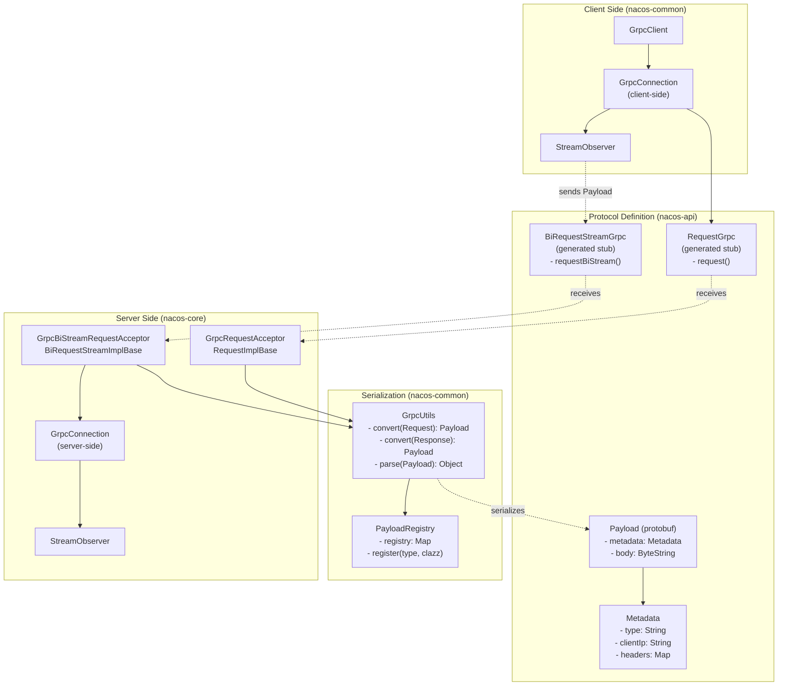

**Protobuf Message Structure:**

The `Payload` message ([api/src/main/proto/nacos_grpc_service.proto]()) wraps all gRPC communication:

```protobuf
message Payload {
    Metadata metadata = 1;    // Request type, client IP, headers
    google.protobuf.Any body = 2;  // Serialized request/response
}

message Metadata {
    string type = 1;         // e.g., "ConfigQueryRequest"
    string clientIp = 2;     // Client IP address
    map<string, string> headers = 3;  // Custom headers
}
```

**Serialization:**

`GrpcUtils` ([common/src/main/java/com/alibaba/nacos/common/remote/client/grpc/GrpcUtils.java]()) handles serialization:
- `convert(Request)`: Serializes request to `Payload` using JSON
- `parse(Payload)`: Deserializes `Payload` using `PayloadRegistry` type mapping
- `PayloadRegistry`: Maps request type strings (e.g., "ConfigQueryRequest") to Java classes

**gRPC Services:**

- `BiRequestStreamGrpc.requestBiStream()`: Bidirectional streaming for server push
- `RequestGrpc.request()`: Unary RPC for request-response patterns
```

**Sources:** [api/src/main/proto/nacos_grpc_service.proto](), [common/src/main/java/com/alibaba/nacos/common/remote/client/grpc/GrpcUtils.java]()

### Interaction Patterns

Nacos implements three primary interaction patterns: service registration (push), configuration queries (pull with caching), and change notifications (server push via long polling).

#### Service Registration and Configuration Query Flow

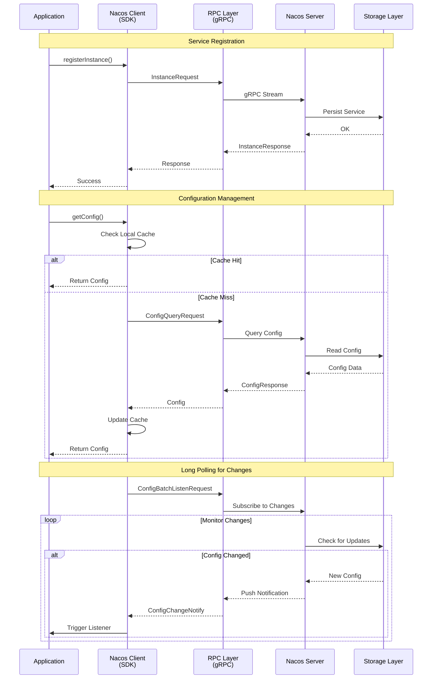

**Interaction Patterns Explained:**

1. **Service Registration (Push)**:
   - Client calls `NamingService.registerInstance()`
   - `NamingGrpcClientProxy` creates `InstanceRequest` and sends via gRPC stream
   - `InstanceRequestHandler` on server processes request
   - `DistroProtocol` distributes registration to responsible node
   - `NamingGrpcRedoService` caches registration for automatic retry on reconnection

2. **Configuration Query (Pull with Cache)**:
   - Client calls `ConfigService.getConfig()`
   - `ClientWorker` checks local `CacheData` first
   - On cache miss, `ConfigTransportClient` sends `ConfigQueryRequest`
   - Server `ConfigQueryRequestHandler` reads from storage (via Raft)
   - Client updates `CacheData` and returns to application

3. **Long Polling (Server Push)**:
   - `ClientWorker` sends `ConfigBatchListenRequest` for monitored configs
   - Server tracks listeners in `ConfigChangeListenContext`
   - On config change, `RpcConfigChangeNotifier` publishes `LocalDataChangeEvent`
   - `RpcPushService` sends `ConfigChangeNotifyRequest` via bidirectional stream
   - Client `ClientWorker` triggers registered `Listener.receiveConfigInfo()` callbacks

**Sources:** [client/src/main/java/com/alibaba/nacos/client/config/impl/ClientWorker.java](), [client/src/main/java/com/alibaba/nacos/client/naming/remote/NamingClientProxyDelegate.java](), [config/src/main/java/com/alibaba/nacos/config/server/remote/RpcConfigChangeNotifier.java]()

### Connection Establishment

The connection setup involves server capability check, bidirectional stream creation, and ability negotiation between client and server.

#### Connection Setup Sequence

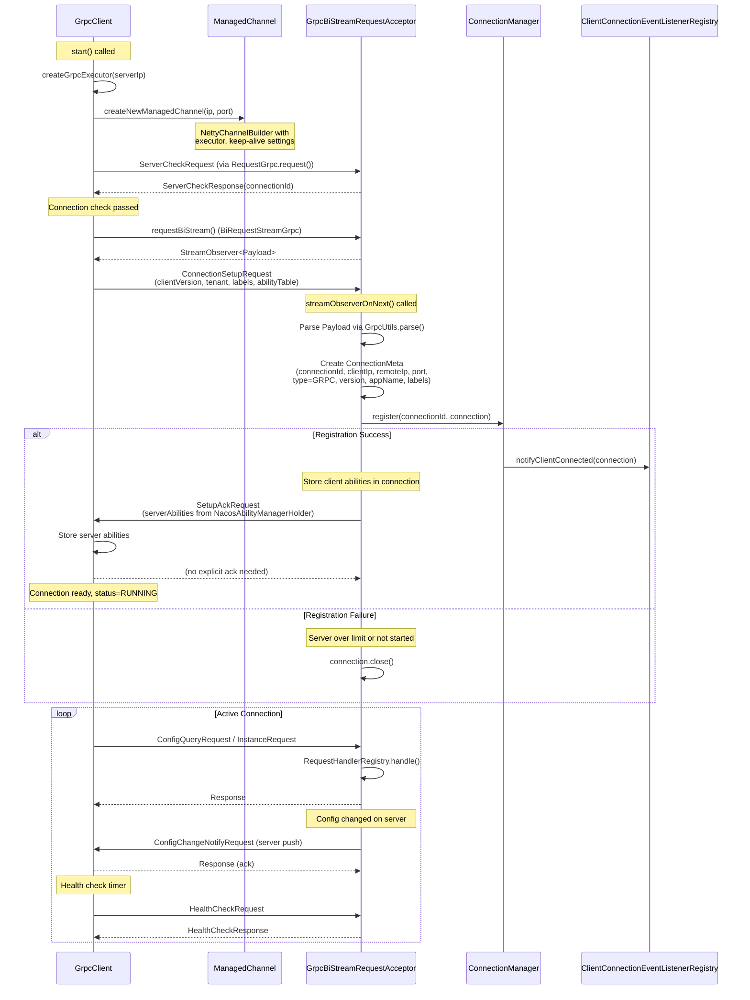

**Connection Establishment Steps:**

1. **Channel Creation**: `GrpcClient.createNewManagedChannel()` builds `NettyChannelBuilder` with TLS, keep-alive, and executor configuration

2. **Server Check**: Client sends `ServerCheckRequest` via unary RPC to verify server availability and get connection ID

3. **Stream Setup**: `bindRequestStream()` establishes bidirectional stream using `BiRequestStreamGrpc.requestBiStream()`

4. **Setup Request**: Client sends `ConnectionSetupRequest` with client version, labels, and ability table

5. **Connection Registration**: Server creates `ConnectionMeta`, validates limits via `ConnectionManager.checkLimit()`, and registers connection

6. **Setup Ack**: Server responds with `SetupAckRequest` containing server ability table

7. **Ready State**: Client transitions to `RUNNING` state and begins sending requests

**Connection Resilience:**

- **Health Checks**: Periodic `HealthCheckRequest` every 3 seconds (configurable)
- **Reconnection**: Automatic reconnection on failure via `reconnectionSignal` queue
- **Connection Ejection**: Server ejects unhealthy connections via `RuntimeConnectionEjector`
- **Retry Logic**: Exponential backoff for failed connection attempts

**Sources:** [common/src/main/java/com/alibaba/nacos/common/remote/client/grpc/GrpcClient.java:199-450](), [core/src/main/java/com/alibaba/nacos/core/remote/grpc/GrpcBiStreamRequestAcceptor.java:74-212](), [core/src/main/java/com/alibaba/nacos/core/remote/ConnectionManager.java:102-162]()

### Server Push Mechanism

Configuration changes trigger server-initiated push notifications to connected clients through an event-driven architecture using `NotifyCenter` and registered subscribers.

#### Server Push Architecture

```mermaid
graph TB
    subgraph EventSource["Event Sources (nacos-common)"]
        LocalDataChangeEvent["LocalDataChangeEvent<br/>(extends Event)<br/>groupKey, isBeta"]
        ServiceChangeEvent["ServiceChangeEvent<br/>serviceName, namespace"]
        NotifyCenter["NotifyCenter<br/>- publishEvent()<br/>- registerSubscriber()"]
    end
    
    subgraph Subscribers["Event Subscribers (nacos-config, nacos-naming)"]
        RpcConfigChangeNotifier["RpcConfigChangeNotifier<br/>extends Subscriber<LocalDataChangeEvent><br/>@Component"]
        ConfigChangeListenContext["ConfigChangeListenContext<br/>- getListeners(groupKey)<br/>- getConfigListenState()"]
        NamingSubscriberService["NamingSubscriberService<br/>(for naming events)"]
    end
    
    subgraph PushInfra["Push Infrastructure (nacos-core)"]
        RpcPushService["RpcPushService<br/>@Service<br/>- pushWithCallback()"]
        RpcPushTask["RpcPushTask<br/>- request: Request<br/>- retryTimes: int<br/>- connectionId: String"]
        RpcAckCallbackSynchronizer["RpcAckCallbackSynchronizer<br/>- ackNotify()<br/>- ConcurrentHashMap callbacks"]
    end
    
    subgraph ConnectionInfra["Connection Infrastructure (nacos-core)"]
        ConnectionManager["ConnectionManager<br/>- getConnection()<br/>- connections: Map"]
        GrpcConnection["GrpcConnection<br/>- sendRequestNoAck()<br/>- request(timeout)<br/>- streamObserver"]
        StreamObserver["StreamObserver<Payload><br/>- onNext()"]
    end
    
    subgraph CallbackHandling["Callback Handling"]
        AbstractPushCallBack["AbstractPushCallBack<br/>- onSuccess()<br/>- onFail()<br/>- onTimeout()"]
        ConfigPushCallback["Custom callbacks:<br/>- retry logic<br/>- metrics recording"]
    end
    
    LocalDataChangeEvent --> NotifyCenter
    NotifyCenter --> RpcConfigChangeNotifier
    RpcConfigChangeNotifier --> ConfigChangeListenContext
    
    Note over RpcConfigChangeNotifier: onEvent() called
    RpcConfigChangeNotifier --> RpcPushService
    RpcPushService --> RpcPushTask
    
    RpcPushTask --> ConnectionManager
    ConnectionManager --> GrpcConnection
    GrpcConnection --> StreamObserver
    
    Note over StreamObserver: Sends Payload via gRPC
    StreamObserver -.client ack.-> RpcAckCallbackSynchronizer
    RpcAckCallbackSynchronizer --> AbstractPushCallBack
    AbstractPushCallBack --> ConfigPushCallback
```

**Server Push Components:**

| Component | Module | Key Method | Responsibility |
|-----------|--------|------------|----------------|
| `NotifyCenter` | nacos-common | `publishEvent()` | Event bus for internal events |
| `RpcConfigChangeNotifier` | nacos-config | `configDataChanged()` | Subscribes to `LocalDataChangeEvent` |
| `ConfigChangeListenContext` | nacos-config | `getListeners(groupKey)` | Tracks which connections listen to which configs |
| `RpcPushService` | nacos-core | `pushWithCallback()` | Executes push with async callback |
| `RpcPushTask` | nacos-config | `run()` | Retry logic for failed pushes |
| `GrpcConnection` | nacos-core | `request(timeout)` | Sends via `StreamObserver.onNext()` |
| `RpcAckCallbackSynchronizer` | nacos-core | `ackNotify()` | Routes client acknowledgment to callback |
```

**Push Notification Flow:**

1. **Event Publication**: Configuration change triggers `LocalDataChangeEvent` published via `NotifyCenter.publishEvent()`

2. **Event Handling**: `RpcConfigChangeNotifier.configDataChanged()` receives event, queries `ConfigChangeListenContext.getListeners()` for interested connection IDs

3. **Push Request Creation**: Creates `ConfigChangeNotifyRequest` with dataId, group, tenant, and wraps in `RpcPushTask`

4. **Push Execution**: `RpcPushService.pushWithCallback()` retrieves `GrpcConnection`, calls `connection.request()`, registers callback in `RpcAckCallbackSynchronizer`

5. **Client Acknowledgment**: Client sends `Response`, server `GrpcBiStreamRequestAcceptor.onNext()` receives it, `RpcAckCallbackSynchronizer.ackNotify()` triggers callback

6. **Retry on Failure**: `RpcPushTask` tracks retry count, re-queues via `ConfigExecutor.scheduleConfigTask()` if push fails, respects max retries

**Sources:** [config/src/main/java/com/alibaba/nacos/config/server/remote/RpcConfigChangeNotifier.java:51-180](), [core/src/main/java/com/alibaba/nacos/core/remote/RpcPushService.java](), [core/src/main/java/com/alibaba/nacos/core/remote/RpcAckCallbackSynchronizer.java]()


---

## Deployment Modes

Nacos supports standalone (single-node) and cluster (multi-node) deployment modes with configurable function modes and storage backends.

### Deployment Configuration

| Mode | Configuration | Database | Use Case |
|------|---------------|----------|----------|
| **Standalone** | `nacos.standalone=true` | Embedded Derby | Development, testing, small-scale production |
| **Cluster** | `nacos.standalone=false` | External MySQL/PostgreSQL | Production HA environments |
| **Function: all** | `nacos.functionMode=all` | - | Both config and naming services enabled (default) |
| **Function: config** | `nacos.functionMode=config` | - | Configuration service only |
| **Function: naming** | `nacos.functionMode=naming` | - | Service discovery only |

### Startup and Module Loading

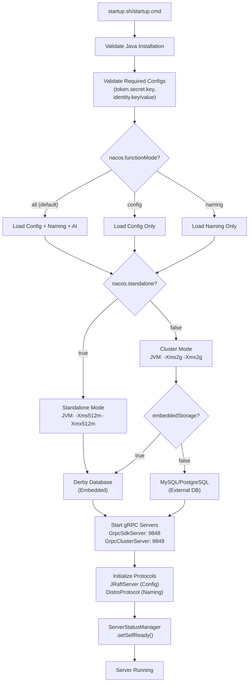

**Function Modes:**

| Mode | Property | Modules Loaded | Use Case |
|------|----------|----------------|----------|
| **All** | `nacos.functionMode=all` (default) | Config + Naming + AI | Full-featured deployment |
| **Config** | `nacos.functionMode=config` | Config only (read-only naming stubs) | Dedicated config management |
| **Naming** | `nacos.functionMode=naming` | Naming only (read-only config stubs) | Dedicated service registry |

**Storage Selection:**

- **Standalone**: Uses Derby embedded database with Raft for local consensus
- **Cluster + Embedded**: Uses RocksDB with Raft for distributed consensus (not recommended for production)
- **Cluster + External**: Uses MySQL or PostgreSQL shared database (recommended for production)

**Startup Commands:**

```bash
# Standalone (development)
sh startup.sh -m standalone

# Cluster with external DB (production)
sh startup.sh -m cluster

# Config-only mode
sh startup.sh -f config -m cluster

# Windows standalone
startup.cmd -m standalone
```

**Key Configuration Properties:**

```properties
# Deployment mode
nacos.standalone=true|false

# Function mode
nacos.functionMode=all|config|naming

# HTTP server port (default: 8848)
server.port=8848

# External database (cluster mode)
db.num=1
db.url.0=jdbc:mysql://localhost:3306/nacos
db.user.0=nacos
db.password.0=nacos

# Authentication
nacos.core.auth.enabled=true
nacos.core.auth.plugin.nacos.token.secret.key=<Base64-encoded-key>
```

**Sources:** [distribution/bin/startup.sh:57-211](), [distribution/bin/startup.cmd:26-113](), [distribution/conf/application.properties:17-330]()

### Port Allocation

Nacos uses three ports per server instance:

| Service | Port | Formula | Purpose |
|---------|------|---------|---------|
| HTTP/Console | 8848 | Configurable via `server.port` | REST APIs, web console |
| gRPC SDK | 9848 | `server.port + 1000` | Client SDK connections |
| gRPC Cluster | 9849 | `server.port + 1001` | Inter-node cluster communication |

The `BaseGrpcServer.rpcPortOffset()` method calculates gRPC ports:
- `GrpcSdkServer.getServicePort()` returns HTTP port + 1000
- `GrpcClusterServer.getServicePort()` returns HTTP port + 1001

**Sources:** [core/src/main/java/com/alibaba/nacos/core/remote/grpc/BaseGrpcServer.java:90-116](), [core/src/main/java/com/alibaba/nacos/core/remote/grpc/GrpcSdkServer.java](), [core/src/main/java/com/alibaba/nacos/core/remote/grpc/GrpcClusterServer.java]()

### Storage Architecture

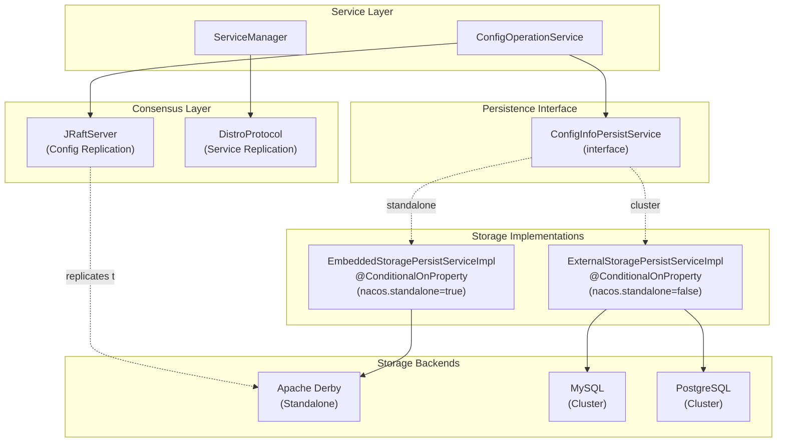

**Storage Selection:**

- **Standalone Mode**: `EmbeddedStoragePersistServiceImpl` with Derby, Raft replication within embedded DB
- **Cluster Mode**: `ExternalStoragePersistServiceImpl` with MySQL/PostgreSQL, Raft replication via shared DB

Spring `@ConditionalOnProperty` annotations control which implementation loads based on `nacos.standalone` property.

**Sources:** [persistence/src/main/java/com/alibaba/nacos/persistence/configuration/DatasourceConfiguration.java](), [config/pom.xml:34-50](), [core/pom.xml:114-123]()

---

## Cross-Cutting Concerns

### Connection Lifecycle Management

The `ConnectionManager` ([core/src/main/java/com/alibaba/nacos/core/remote/ConnectionManager.java:57]()) tracks all active connections and manages their lifecycle:

1. **Registration**: New connections are registered with validation ([core/src/main/java/com/alibaba/nacos/core/remote/ConnectionManager.java:102-127]())
2. **Health Monitoring**: Periodic health checks detect stale connections
3. **Connection Limits**: Per-IP connection limits prevent abuse ([core/src/main/java/com/alibaba/nacos/core/remote/ConnectionManager.java:129-140]())
4. **Ejection**: Unhealthy connections are automatically removed ([core/src/main/java/com/alibaba/nacos/core/remote/ConnectionManager.java:147-162]())

### Ability Negotiation

Clients and servers negotiate capabilities during connection setup to enable feature compatibility:

1. Client sends `ConnectionSetupRequest` with its ability table ([api/src/main/java/com/alibaba/nacos/api/remote/request/ConnectionSetupRequest.java:28]())
2. Server validates and stores client abilities in `Connection.abilityTable` ([core/src/main/java/com/alibaba/nacos/core/remote/Connection.java:60-66]())
3. Server responds with `SetupAckRequest` containing server abilities ([core/src/main/java/com/alibaba/nacos/core/remote/grpc/GrpcBiStreamRequestAcceptor.java:186-198]())
4. Client stores server abilities for feature detection

This enables graceful degradation when clients and servers have different versions.

### Error Handling and Resilience

The system implements multiple resilience patterns:

- **Client-side retry**: `RpcClient` automatically retries failed requests with exponential backoff ([common/src/main/java/com/alibaba/nacos/common/remote/client/RpcClient.java:338-357]())
- **Server push retry**: `RpcPushTask` retries failed push operations ([config/src/main/java/com/alibaba/nacos/config/server/remote/RpcConfigChangeNotifier.java:108-111]())
- **Connection failover**: Clients automatically switch servers on connection failure ([common/src/main/java/com/alibaba/nacos/common/remote/client/RpcClient.java:216-234]())
- **Local failover**: Configuration client uses disk snapshots when server is unavailable

**Sources:** [core/src/main/java/com/alibaba/nacos/core/remote/ConnectionManager.java:57-370](), [core/src/main/java/com/alibaba/nacos/core/remote/Connection.java:32-103](), [core/src/main/java/com/alibaba/nacos/core/remote/grpc/GrpcBiStreamRequestAcceptor.java:151-199](), [common/src/main/java/com/alibaba/nacos/common/remote/client/RpcClient.java:338-382]()

---

# Page: Module Structure and Dependencies

# Module Structure and Dependencies

<details>
<summary>Relevant source files</summary>

The following files were used as context for generating this wiki page:

- [api/pom.xml](api/pom.xml)
- [client/pom.xml](client/pom.xml)
- [common/pom.xml](common/pom.xml)
- [config/pom.xml](config/pom.xml)
- [console/pom.xml](console/pom.xml)
- [core/pom.xml](core/pom.xml)
- [distribution/pom.xml](distribution/pom.xml)
- [example/pom.xml](example/pom.xml)
- [naming/pom.xml](naming/pom.xml)
- [pom.xml](pom.xml)
- [test/pom.xml](test/pom.xml)

</details>


This document describes the Maven module structure of the Nacos codebase, the layered architecture that organizes these modules, and the inter-module dependency relationships. For information about the overall system architecture and component interactions, see [System Architecture](#1.1). For deployment-specific configurations, see [Deployment Modes and Requirements](#2.1).

## Purpose and Scope

Nacos is organized as a multi-module Maven project with 30+ modules that follow a layered architecture pattern. This document explains:

- The complete module inventory and their purposes
- The layered organization (Foundation, Core, Service, Client, Deployment, Extension)
- Inter-module dependencies and dependency flow
- Maven dependency management strategy
- Build configuration and compilation order

## Module Inventory

The Nacos project consists of the following modules, declared in [pom.xml:614-645]():

| Module | Artifact ID | Purpose |
|--------|-------------|---------|
| **Foundation Modules** | | |
| api | nacos-api | Core interfaces, data models, and gRPC definitions |
| common | nacos-common | Shared utilities, RPC framework, and helper classes |
| **Core Infrastructure** | | |
| core | nacos-core | Cluster management, remote communication, distributed protocols |
| consistency | nacos-consistency | Consensus protocol abstractions (Raft, Distro) |
| auth | nacos-auth | Authentication and authorization framework |
| persistence | nacos-persistence | Data access layer and storage abstractions |
| sys | nacos-sys | System management utilities |
| lock | nacos-lock | Distributed locking support |
| **Service Modules** | | |
| config | nacos-config | Configuration management service |
| naming | nacos-naming | Service discovery and registration |
| ai | nacos-ai | AI-powered features |
| copilot | nacos-copilot | AI copilot integration |
| mcp-registry-adaptor | nacos-mcp-registry-adaptor | Model Context Protocol adaptor |
| **Client Modules** | | |
| client | nacos-client | Java SDK for configuration and naming clients |
| client-basic | nacos-client-basic | Basic client utilities and shared code |
| maintainer-client | nacos-maintainer-client | Maintainer-specific client tools |
| **Deployment & Console** | | |
| console | nacos-console | Web-based management UI |
| bootstrap | nacos-bootstrap | Server startup and initialization |
| distribution | nacos-distribution | Package assembly and release artifacts |
| server | nacos-server | Server runtime aggregation |
| **Extension & Integration** | | |
| plugin | nacos-plugin | Plugin SPI definitions |
| plugin-default-impl | nacos-default-plugin-all | Default plugin implementations |
| cmdb | nacos-cmdb | CMDB integration |
| istio | nacos-istio | Istio service mesh integration |
| k8s-sync | nacos-k8s-sync | Kubernetes synchronization |
| prometheus | nacos-prometheus | Prometheus metrics integration |
| address | nacos-address | Address server for cluster discovery |
| **Logging Adapters** | | |
| logger-adapter-impl | logger adapters | Logback and Log4j2 adapters |
| **Testing** | | |
| test | nacos-test | Integration and E2E test modules |
| example | nacos-example | Sample applications and examples |

**Sources:** [pom.xml:614-645]()

## Layered Architecture

The modules are organized into a layered architecture where dependencies flow from upper layers to lower layers, preventing circular dependencies.

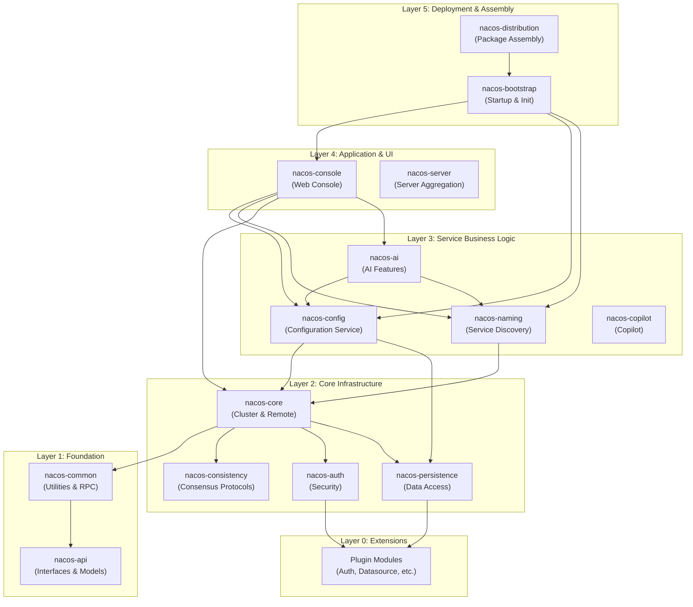

**Sources:** [pom.xml:614-645](), [console/pom.xml:31-73](), [config/pom.xml:34-68](), [core/pom.xml:36-57](), [naming/pom.xml:36-117]()

## Foundation Layer

### nacos-api Module

The `nacos-api` module provides core interfaces and data models that are consumed by both client and server components. It has minimal dependencies and is compiled with Java 8 compatibility for client usage.

**Key contents:**
- Configuration API: `ConfigService`, `ConfigRequest`, `ConfigResponse`
- Naming API: `NamingService`, `Instance`, service-related POJOs
- gRPC protocol definitions: `Payload`, `Metadata`, auto-generated stubs
- Remote communication models: request/response abstractions

**Dependencies:**
- External: Jackson, gRPC libraries, Protobuf
- Internal: None (foundation layer)

**Sources:** [api/pom.xml:1-131](), [pom.xml:732-734]()

### nacos-common Module

The `nacos-common` module provides shared utilities and the RPC framework used across all server-side modules.

**Key contents:**
- RPC client/server framework
- Utility classes for HTTP, IO, encryption
- Version information and constants
- Shared data structures

**Dependencies:**
- Internal: `nacos-api`
- External: SLF4J, Commons IO, Jackson, Apache HttpClient5

**Compilation:** Java 8 compatible for client usage.

**Sources:** [common/pom.xml:1-120](), [pom.xml:767-769]()

## Core Infrastructure Layer

### nacos-core Module

The `nacos-core` module is the central infrastructure component providing cluster management, remote communication, and distributed protocol coordination.

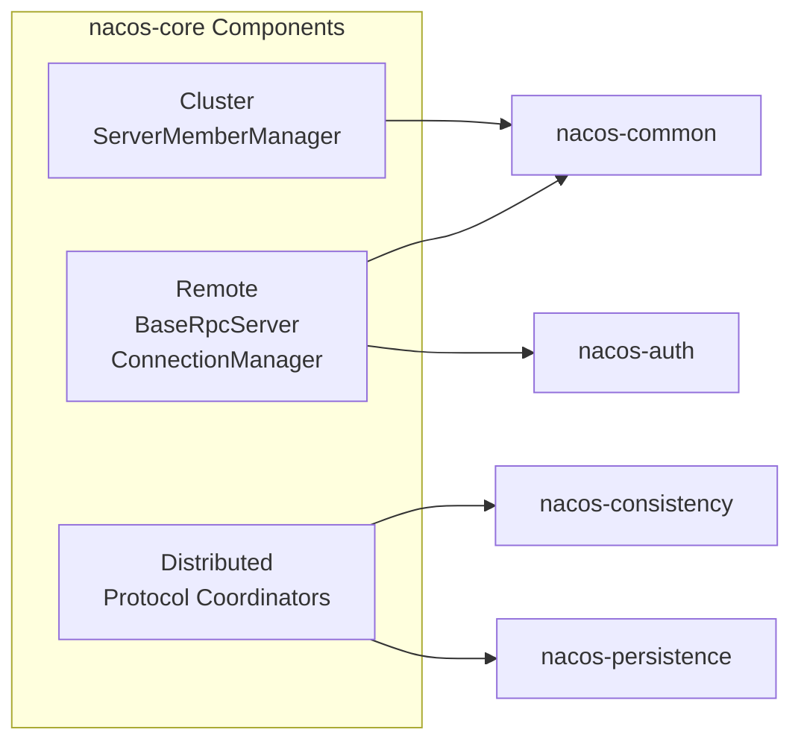

**Key dependencies:**

```xml
<!-- From core/pom.xml:36-57 -->
<dependency>
    <groupId>com.alibaba.nacos</groupId>
    <artifactId>nacos-common</artifactId>
</dependency>
<dependency>
    <groupId>com.alibaba.nacos</groupId>
    <artifactId>nacos-consistency</artifactId>
</dependency>
<dependency>
    <groupId>com.alibaba.nacos</groupId>
    <artifactId>nacos-persistence</artifactId>
</dependency>
<dependency>
    <groupId>com.alibaba.nacos</groupId>
    <artifactId>nacos-auth</artifactId>
</dependency>
```

**External dependencies:**
- Spring Boot (starter, security, actuator, AOP)
- JRaft (jraft-core, rpc-grpc-impl)
- Apache HttpClient5
- Micrometer (Prometheus, Influx, Elastic registries)

**Sources:** [core/pom.xml:36-196](), [pom.xml:707-709]()

### nacos-consistency Module

The `nacos-consistency` module provides abstractions for distributed consensus protocols.

**Key contents:**
- `ConsistencyProtocol` interface
- Raft protocol implementation using JRaft
- Distro protocol implementation for AP scenarios
- Protocol entity definitions (WriteRequest, ReadRequest, Response)

**Sources:** [core/pom.xml:42-44](), [pom.xml:828-830]()

### nacos-persistence Module

The `nacos-persistence` module abstracts the data access layer with support for multiple storage backends.

**Key contents:**
- `PersistService` interface
- Dual implementations: `EmbeddedStoragePersistServiceImpl` (Derby) and `ExternalStoragePersistServiceImpl` (MySQL/PostgreSQL)
- `MapperManager` factory pattern for database-specific SQL
- Conditional loading via Spring `@ConditionalOnProperty`

**Sources:** [core/pom.xml:46-48](), [config/pom.xml:48-50](), [pom.xml:716-719]()

### nacos-auth Module

The `nacos-auth` module provides the authentication and authorization framework.

**Key contents:**
- Auth plugin SPI
- Identity verification
- Permission management
- Security configuration handlers

**Sources:** [core/pom.xml:51-53](), [pom.xml:868-870]()

## Service Layer

### nacos-config Module

The `nacos-config` module implements the configuration management service.

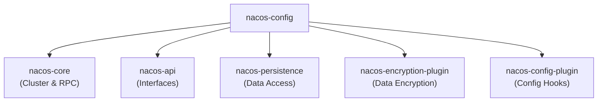

**Key dependencies from [config/pom.xml:34-68]():**

```xml
<dependency>
    <groupId>com.alibaba.nacos</groupId>
    <artifactId>nacos-api</artifactId>
</dependency>
<dependency>
    <groupId>com.alibaba.nacos</groupId>
    <artifactId>nacos-core</artifactId>
</dependency>
<dependency>
    <groupId>com.alibaba.nacos</groupId>
    <artifactId>nacos-persistence</artifactId>
</dependency>
<dependency>
    <groupId>com.alibaba.nacos</groupId>
    <artifactId>nacos-encryption-plugin</artifactId>
</dependency>
<dependency>
    <groupId>com.alibaba.nacos</groupId>
    <artifactId>nacos-config-plugin</artifactId>
</dependency>
```

**External dependencies:**
- Spring Boot Web
- Apache HttpClient5
- Commons IO
- Micrometer registries

**Sources:** [config/pom.xml:34-140](), [pom.xml:702-704]()

### nacos-naming Module

The `nacos-naming` module implements the service discovery and registration service.

**Key dependencies from [naming/pom.xml:36-117]():**

```xml
<dependency>
    <groupId>com.alibaba.nacos</groupId>
    <artifactId>nacos-core</artifactId>
</dependency>
<dependency>
    <groupId>com.alibaba.nacos</groupId>
    <artifactId>nacos-api</artifactId>
</dependency>
<dependency>
    <groupId>com.alibaba.nacos</groupId>
    <artifactId>nacos-cmdb</artifactId>
</dependency>
```

**External dependencies:**
- Spring Boot Web
- Apache HttpClient5
- MySQL JDBC driver
- Micrometer registries

**Sources:** [naming/pom.xml:36-130](), [pom.xml:721-724]()

### nacos-ai Module

The `nacos-ai` module provides AI-powered features built on top of configuration and naming services.

**Dependencies:** Depends on both `nacos-config` and `nacos-naming` as shown in the high-level architecture diagram.

**Sources:** [console/pom.xml:50-52](), [pom.xml:727-729]()

## Client Layer

### nacos-client Module

The `nacos-client` module is the Java SDK distributed to application developers.

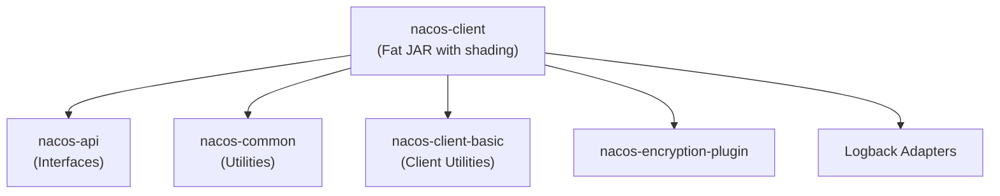

**Special build configuration:** The client module uses `maven-shade-plugin` to create a fat JAR with relocated dependencies to avoid conflicts.

**Shading configuration from [client/pom.xml:202-253]():**
- gRPC packages relocated to `com.alibaba.nacos.shaded.io.grpc`
- Google packages relocated to `com.alibaba.nacos.shaded.com.google`
- Minimized JAR excludes unused classes

**Key dependencies from [client/pom.xml:40-82]():**

```xml
<dependency>
    <groupId>com.alibaba.nacos</groupId>
    <artifactId>nacos-api</artifactId>
    <optional>true</optional>
</dependency>
<dependency>
    <groupId>com.alibaba.nacos</groupId>
    <artifactId>nacos-common</artifactId>
    <optional>true</optional>
</dependency>
<dependency>
    <groupId>com.alibaba.nacos</groupId>
    <artifactId>nacos-client-basic</artifactId>
</dependency>
```

**Compilation:** Java 8 compatible (`client.java.version=1.8`).

**Sources:** [client/pom.xml:1-340](), [pom.xml:737-739]()

### nacos-client-basic Module

Provides basic client utilities shared between the main client and other client-related modules.

**Sources:** [client/pom.xml:60-62]()

## Deployment Layer

### nacos-console Module

The `nacos-console` module aggregates all server-side services and provides the web-based management UI.

**Comprehensive dependencies from [console/pom.xml:31-73]():**

```xml
<!-- Service Dependencies -->
<dependency>
    <groupId>com.alibaba.nacos</groupId>
    <artifactId>nacos-config</artifactId>
</dependency>
<dependency>
    <groupId>com.alibaba.nacos</groupId>
    <artifactId>nacos-naming</artifactId>
</dependency>
<dependency>
    <groupId>com.alibaba.nacos</groupId>
    <artifactId>nacos-core</artifactId>
</dependency>
<dependency>
    <groupId>com.alibaba.nacos</groupId>
    <artifactId>nacos-ai</artifactId>
</dependency>
<dependency>
    <groupId>com.alibaba.nacos</groupId>
    <artifactId>nacos-copilot</artifactId>
</dependency>

<!-- Integration Dependencies -->
<dependency>
    <groupId>com.alibaba.nacos</groupId>
    <artifactId>nacos-istio</artifactId>
</dependency>
<dependency>
    <groupId>com.alibaba.nacos</groupId>
    <artifactId>nacos-prometheus</artifactId>
</dependency>
<dependency>
    <groupId>com.alibaba.nacos</groupId>
    <artifactId>nacos-k8s-sync</artifactId>
</dependency>
```

**External dependencies:**
- Spring Boot Security
- Model Context Protocol SDK
- Logging bridges (log4j-over-slf4j, jcl-over-slf4j, jul-to-slf4j)

**Development profile:** Includes `nacos-default-plugin-all` in dev mode [console/pom.xml:159-171]().

**Sources:** [console/pom.xml:31-121](), [pom.xml:776-779]()

### nacos-bootstrap Module

The `nacos-bootstrap` module handles server startup and initialization, loading all necessary components.

**Sources:** [distribution/pom.xml:36-38](), [pom.xml:791-794]()

### nacos-distribution Module

The `nacos-distribution` module assembles the final distribution packages using Maven Assembly Plugin.

**Build profiles:**
- `release-address`: Packages the address server
- `release-client`: Packages the client SDK
- `release-nacos`: Packages the full server distribution
- `release-native`: Packages GraalVM native image distribution

**Sources:** [distribution/pom.xml:1-161](), [pom.xml:797-799]()

## Extension & Plugin Layer

### Plugin Architecture

Nacos provides several plugin points for extensibility:

| Plugin Type | Module | Purpose |
|-------------|--------|---------|
| Auth Plugin | nacos-auth-plugin | Custom authentication mechanisms |
| Datasource Plugin | nacos-datasource-plugin | Custom data storage backends |
| Encryption Plugin | nacos-encryption-plugin | Data encryption/decryption |
| Config Plugin | nacos-config-plugin | Configuration lifecycle hooks |
| Control Plugin | nacos-control-plugin | Access control and rate limiting |
| Trace Plugin | nacos-trace-plugin | Distributed tracing integration |
| Custom Environment Plugin | nacos-custom-environment-plugin | Environment customization |

**Default implementations:** The `nacos-default-plugin-all` module aggregates default implementations of all plugin types.

**Sources:** [pom.xml:832-875](), [console/pom.xml:164-170](), [distribution/pom.xml:40-43]()

### Integration Modules

Additional modules provide integration with external systems:

- **nacos-istio:** Service mesh integration [pom.xml:812-815]()
- **nacos-k8s-sync:** Kubernetes service synchronization [pom.xml:817-820]()
- **nacos-prometheus:** Metrics export for Prometheus [pom.xml:822-825]()
- **nacos-cmdb:** Configuration management database integration [pom.xml:771-774]()

**Sources:** [pom.xml:812-825](), [console/pom.xml:62-73]()

## Dependency Management Strategy

### Version Management

All module versions are managed centrally using the `${revision}` property defined in [pom.xml:91]():

```xml
<revision>3.2.0-BETA</revision>
```

### Dependency Declarations

The parent POM uses `<dependencyManagement>` to declare versions without forcing inclusion. Modules explicitly declare their dependencies.

**Example from [pom.xml:674-875]():**

```xml
<dependencyManagement>
    <dependencies>
        <!-- Internal module versions -->
        <dependency>
            <groupId>com.alibaba.nacos</groupId>
            <artifactId>nacos-config</artifactId>
            <version>${project.version}</version>
        </dependency>
        <dependency>
            <groupId>com.alibaba.nacos</groupId>
            <artifactId>nacos-core</artifactId>
            <version>${project.version}</version>
        </dependency>
        <!-- External dependency versions imported from Spring Boot BOM -->
        <dependency>
            <groupId>org.springframework.boot</groupId>
            <artifactId>spring-boot-dependencies</artifactId>
            <version>${spring-boot-dependencies.version}</version>
            <type>pom</type>
            <scope>import</scope>
        </dependency>
    </dependencies>
</dependencyManagement>
```

**Sources:** [pom.xml:674-875]()

### Circular Dependency Prevention

The `maven-enforcer-plugin` is configured to detect and prevent circular dependencies [pom.xml:210-234]():

```xml
<plugin>
    <artifactId>maven-enforcer-plugin</artifactId>
    <configuration>
        <rules>
            <banCircularDependencies/>
        </rules>
        <fail>true</fail>
    </configuration>
</plugin>
```

**Sources:** [pom.xml:210-234]()

## Build Configuration

### Multi-Java Version Support

The project supports two compilation targets:

| Component | Java Version | Property |
|-----------|--------------|----------|
| Server modules | Java 17 | `java.version=17` |
| Client modules (api, common, client) | Java 8 | `client.java.version=1.8` |

**Configuration in [pom.xml:95-98]():**

```xml
<client.java.version>1.8</client.java.version>
<java.version>17</java.version>
<maven.compiler.source>${java.version}</maven.compiler.source>
<maven.compiler.target>${java.version}</maven.compiler.target>
```

Client modules override this with:

```xml
<maven.compiler.source>${client.java.version}</maven.compiler.source>
<maven.compiler.target>${client.java.version}</maven.compiler.target>
```

**Sources:** [pom.xml:95-98](), [client/pom.xml:35-38](), [api/pom.xml:34-37](), [common/pom.xml:36-39]()

### Test Configuration

Test modules are disabled by default and can be run separately:

- **Unit tests:** Included in individual modules
- **Integration tests:** `nacos-test` parent with `config-test`, `naming-test`, `core-test` submodules
- **CIT profile:** `mvn test -Pcit-test` runs config integration tests
- **NIT profile:** `mvn test -Pnit-test` runs naming integration tests

**Sources:** [test/pom.xml:1-113](), [pom.xml:538-575]()

### Build Plugins

Key build plugins configured in the parent POM:

| Plugin | Purpose | Configuration |
|--------|---------|---------------|
| maven-compiler-plugin | Java compilation | Source/target version, parameter preservation |
| maven-enforcer-plugin | Dependency validation | Ban circular dependencies |
| maven-assembly-plugin | Distribution packaging | Used by distribution module |
| maven-shade-plugin | Fat JAR creation | Used by client module for dependency relocation |
| spring-boot-maven-plugin | Spring Boot packaging | Used by bootstrap module |
| jacoco-maven-plugin | Code coverage | Integrated with tests |
| maven-checkstyle-plugin | Code style validation | NacosCheckStyle.xml rules |
| apache-rat-plugin | License header verification | Apache License 2.0 enforcement |

**Sources:** [pom.xml:172-488](), [client/pom.xml:121-286]()

## Module Compilation Order

Maven automatically determines the compilation order based on dependency relationships. The typical order is:

1. **Foundation:** `nacos-api`, `nacos-common`
2. **Plugins:** Plugin SPI and default implementations
3. **Core Infrastructure:** `nacos-consistency`, `nacos-auth`, `nacos-persistence`, `nacos-core`
4. **Services:** `nacos-config`, `nacos-naming`, `nacos-ai`
5. **Integrations:** `nacos-istio`, `nacos-k8s-sync`, `nacos-prometheus`, `nacos-cmdb`
6. **Client:** `nacos-client-basic`, `nacos-client`
7. **Console & Server:** `nacos-console`, `nacos-server`
8. **Bootstrap & Distribution:** `nacos-bootstrap`, `nacos-distribution`

**Sources:** [pom.xml:614-645]()

---

# Page: Installation and Deployment

# Installation and Deployment

<details>
<summary>Relevant source files</summary>

The following files were used as context for generating this wiki page:

- [.gitignore](.gitignore)
- [README.md](README.md)
- [console/src/main/resources/META-INF/nacos-default.properties](console/src/main/resources/META-INF/nacos-default.properties)
- [distribution/bin/shutdown.cmd](distribution/bin/shutdown.cmd)
- [distribution/bin/shutdown.sh](distribution/bin/shutdown.sh)
- [distribution/bin/startup.cmd](distribution/bin/startup.cmd)
- [distribution/bin/startup.sh](distribution/bin/startup.sh)
- [distribution/conf/application.properties](distribution/conf/application.properties)

</details>


This document provides comprehensive guidance for installing and deploying Nacos server instances. It covers the binary package installation process, system prerequisites, deployment architecture options, and basic startup procedures. 

For detailed information on specific aspects of deployment:
- For deployment mode selection and system requirements, see [Deployment Modes and Requirements](#2.1)
- For configuration property details, see [Server Configuration](#2.2)
- For startup procedures and lifecycle management, see [Startup and Lifecycle Management](#2.3)

## Prerequisites

### Java Environment

Nacos requires a Java runtime environment to operate. The startup scripts validate Java availability and compatibility:

| Requirement | Details |
|-------------|---------|
| Minimum Java Version | JDK 8 |
| Recommended Version | JDK 8 or later |
| Architecture | x64 |
| Environment Variable | `JAVA_HOME` must be set |

The startup script [distribution/bin/startup.sh:97-128]() performs Java discovery by checking multiple standard locations and validating the Java executable exists. On Windows, [distribution/bin/startup.cmd:14]() validates Java availability before proceeding.

### System Resources

Memory allocation varies by deployment mode:

| Mode | Heap Memory | Young Generation | Metaspace |
|------|-------------|------------------|-----------|
| Standalone | 512 MB (default) | 256 MB | N/A |
| Cluster | 2 GB (default) | 1 GB | 128-320 MB |

Sources: [distribution/bin/startup.sh:172-182](), [distribution/bin/startup.cmd:62-77]()

## Installation Process

### Download and Extract

Download the binary distribution package from the official release:

```
nacos-server-${version}.zip
```

Extract the package to obtain the following directory structure:

```
nacos/
├── bin/              # Startup and shutdown scripts
├── conf/             # Configuration files
├── target/           # Nacos server JAR file
├── logs/             # Runtime logs (created on first start)
└── plugins/          # Plugin directories
```

The base directory is automatically detected by startup scripts at [distribution/bin/startup.sh:159]() and [distribution/bin/startup.cmd:19-22]().

Sources: [README.md:50-58](), [distribution/bin/startup.sh:159]()

## Deployment Architecture Options

### Deployment Architecture Overview

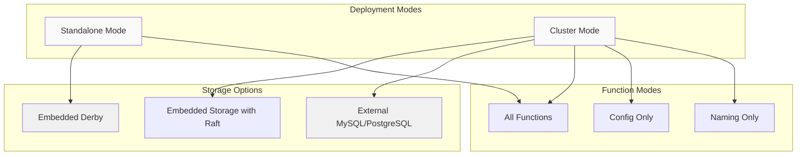

Sources: [distribution/bin/startup.sh:131-155](), [distribution/conf/application.properties:32-39]()

### Mode Selection

Nacos supports three orthogonal deployment dimensions controlled by startup script parameters:

**Deployment Mode** (`-m` parameter):
- `standalone`: Single server for development/testing
- `cluster`: Multi-server for production with high availability

**Function Mode** (`-f` parameter):
- `all`: Both configuration and naming services (default)
- `config`: Configuration service only
- `naming`: Naming service only

**Storage Mode** (`-p` parameter):
- (empty): External database required for cluster
- `embedded`: Use embedded storage with Raft consensus

Sources: [distribution/bin/startup.sh:136-155](), [distribution/bin/startup.cmd:26-55]()

## Startup Command Reference

### Linux/Unix/Mac Platforms

```bash
# Standalone mode (development)
sh startup.sh -m standalone

# Cluster mode with external database
sh startup.sh -m cluster

# Cluster mode with embedded storage
sh startup.sh -m cluster -p embedded

# Config service only
sh startup.sh -m cluster -f config

# Naming service only
sh startup.sh -m cluster -f naming
```

The startup script sets the deployment mode via JVM system properties at [distribution/bin/startup.sh:172-188]().

### Windows Platform

```cmd
# Standalone mode
startup.cmd -m standalone

# Cluster mode
startup.cmd -m cluster

# Cluster mode with embedded storage
startup.cmd -m cluster -p embedded
```

Sources: [README.md:62-70](), [distribution/bin/startup.sh:136-155](), [distribution/bin/startup.cmd:36-86]()

## Configuration Initialization

### Security Configuration Requirements

Starting from recent versions, Nacos enforces mandatory security configurations. The startup scripts validate and prompt for three required properties:

| Property | Purpose | Validation |
|----------|---------|------------|
| `nacos.core.auth.plugin.nacos.token.secret.key` | JWT token generation secret | Must be Base64-encoded, original string ≥32 characters |
| `nacos.core.auth.server.identity.key` | Server identity authentication key | Required for cluster communication |
| `nacos.core.auth.server.identity.value` | Server identity authentication value | Required for cluster communication |

The validation logic is implemented at [distribution/bin/startup.sh:30-95]() with Base64 validation and length checking.

### Configuration Initialization Flow

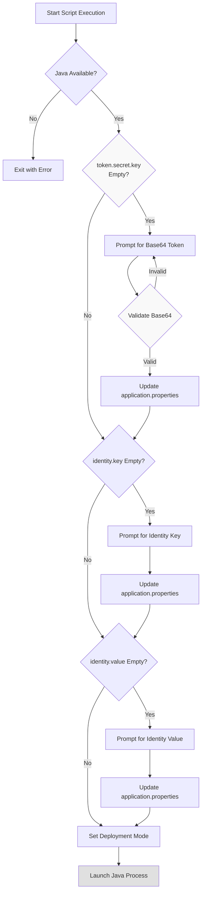

Sources: [distribution/bin/startup.sh:57-95](), [distribution/bin/startup.sh:165-167](), [distribution/bin/startup.cmd:57-59]()

### Configuration File Processing

The `process_required_config` function at [distribution/bin/startup.sh:57-95]() performs:
1. Pattern matching for empty configuration values
2. User input prompting with validation hints
3. Base64 validation for cryptographic keys (≥32 characters when decoded)
4. In-place file update using `sed`
5. Confirmation output of updated values

The Windows equivalent is implemented at [distribution/bin/startup.cmd:118-153]().

Sources: [distribution/bin/startup.sh:57-95](), [distribution/bin/startup.cmd:118-153]()

## JVM Configuration

### Memory Allocation Strategy

```mermaid
graph LR
    subgraph "Standalone Mode"
        SM["-m standalone"] --> SMM["-Xms512m -Xmx512m -Xmn256m"]
        SMM --> SMFLAG["-Dnacos.standalone=true"]
    end
    
    subgraph "Cluster Mode"
        CM["-m cluster"] --> CMM["-Xms2g -Xmx2g -Xmn1g"]
        CMM --> CMMS["-XX:MetaspaceSize=128m<br/>-XX:MaxMetaspaceSize=320m"]
        CMMS --> CMFLAGS["Heap Dump on OOM<br/>Large Pages Disabled"]
    end
    
    subgraph "Embedded Storage"
        ES["-p embedded"] --> ESFLAG["-DembeddedStorage=true"]
    end
    
    style SMM fill:#f9f9f9
    style CMM fill:#f9f9f9
```

Sources: [distribution/bin/startup.sh:172-182](), [distribution/bin/startup.cmd:62-77]()

### Java Version-Specific Settings

The startup scripts detect Java major version and apply version-specific flags:

**Java 9+ Settings** [distribution/bin/startup.sh:193-197]():
- Garbage collection logging: `-Xlog:gc*:file=${BASE_DIR}/logs/nacos_gc.log`
- Module access flags: `--add-opens=java.base/java.lang=ALL-UNNAMED`
- Additional module opens for reflection and utilities

**Java 8 Settings** [distribution/bin/startup.sh:199-202]():
- CMS garbage collector configuration
- Traditional GC logging: `-Xloggc:${BASE_DIR}/logs/nacos_gc.log`
- Extension directories: `-Djava.ext.dirs=${JAVA_HOME}/jre/lib/ext`

Sources: [distribution/bin/startup.sh:192-202](), [distribution/bin/startup.cmd:89-94]()

### Complete JVM Options Assembly

The final Java command includes [distribution/bin/startup.sh:204-211]():

| Option Type | Example Value | Purpose |
|-------------|---------------|---------|
| Deployment Type | `-Dnacos.deployment.type=merged` | Deployment configuration mode |
| Plugin Loader Path | `-Dloader.path=${BASE_DIR}/plugins,...` | Plugin discovery directories |
| Nacos Home | `-Dnacos.home=${BASE_DIR}` | Base directory reference |
| Main JAR | `-jar ${BASE_DIR}/target/nacos-server.jar` | Application entry point |
| Spring Config | `--spring.config.additional-location=...` | External configuration location |
| Logging Config | `--logging.config=${BASE_DIR}/conf/nacos-logback.xml` | Logback configuration file |
| HTTP Header Size | `--server.max-http-request-header-size=524288` | Maximum header size (512KB) |

Sources: [distribution/bin/startup.sh:204-211](), [distribution/bin/startup.cmd:97-107]()

## Process Lifecycle

### Startup Process Execution

The startup script executes the Java process in background mode:

```mermaid
flowchart LR
    Assemble["Assemble JVM Options"] --> CreateLogs["Create logs/ Directory"]
    CreateLogs --> WriteCmd["Write Command to startup.log"]
    WriteCmd --> Launch["Execute nohup java ..."]
    Launch --> Background["Process Runs in Background"]
    Background --> LogOutput["Output to startup.log"]
    
    style Launch fill:#f0f0f0
    style Background fill:#e0e0e0
```

The process launch occurs at [distribution/bin/startup.sh:232-236]() using `nohup` to detach from the terminal session.

### Shutdown Process

The shutdown scripts terminate the running Nacos process:

**Linux/Unix/Mac** [distribution/bin/shutdown.sh:18-28]():
```bash
pid=`pgrep -f nacos.nacos | xargs`
kill ${pid}
```

**Windows** [distribution/bin/shutdown.cmd:29-32]():
```cmd
for /f "tokens=1" %%i in ('jps -m ^| find "nacos.nacos"') do (
    taskkill /F /PID %%i
)
```

The process identifier is located by searching for the unique argument `nacos.nacos` passed to the Java command.

Sources: [distribution/bin/shutdown.sh:18-28](), [distribution/bin/shutdown.cmd:29-38]()

## Network Ports

### Default Port Configuration

Nacos uses multiple ports for different services as defined in [distribution/conf/application.properties:20-225]():

| Service | Default Port | Configuration Property | Purpose |
|---------|--------------|------------------------|---------|
| Nacos Server | 8848 | `nacos.server.main.port` | Main HTTP/gRPC endpoint |
| Console | 8080 | `nacos.console.port` | Web UI and management API |
| gRPC SDK | 9848 (8848+1000) | Offset from main port | Client SDK communication |
| gRPC Cluster | 9849 (8848+1001) | Offset from main port | Inter-node communication |
| MCP Registry | 9080 | `nacos.ai.mcp.registry.port` | AI MCP registry server (optional) |

The gRPC ports are automatically calculated as offsets from the main port.

Sources: [distribution/conf/application.properties:20-21](), [distribution/conf/application.properties:188-189](), [distribution/conf/application.properties:224-225]()

## Deployment Type Configuration

### Deployment Type Matrix

The `-d` parameter controls deployment architecture [distribution/bin/startup.sh:149-150]():

| Type | Description | Use Case |
|------|-------------|----------|
| `merged` | Default unified deployment | All services in single process (default) |
| `console` | Separate console deployment | Console UI deployed separately from server |

This is set via JVM property at [distribution/bin/startup.sh:204]():
```bash
-Dnacos.deployment.type=${DEPLOYMENT}
```

When `deployment=console`, the console references the server context path via `nacos.console.remote.server.context-path` at [distribution/conf/application.properties:230]().

Sources: [distribution/bin/startup.sh:135-155](), [distribution/conf/application.properties:228-230]()

## Log Files

### Log Directory Structure

The startup process creates and uses the following log files:

| File | Purpose | Configuration |
|------|---------|---------------|
| `logs/startup.log` | Startup command and console output | Created at [distribution/bin/startup.sh:225-236]() |
| `logs/nacos_gc.log` | JVM garbage collection logs | Configured at [distribution/bin/startup.sh:194-201]() |
| `logs/java_heapdump.hprof` | Heap dump on OOM | Configured at [distribution/bin/startup.sh:180]() |
| Tomcat access logs | HTTP access logs | Configured at [distribution/conf/application.properties:199-208]() |

The logs directory is created automatically if it doesn't exist at [distribution/bin/startup.sh:213-215]().

Sources: [distribution/bin/startup.sh:213-236](), [distribution/conf/application.properties:197-208]()

## Cluster Member Configuration

### Member List Specification

For cluster deployments, member nodes can be specified using the `-c` parameter [distribution/bin/startup.sh:145-146]():

```bash
sh startup.sh -m cluster -c "192.168.1.1:8848,192.168.1.2:8848,192.168.1.3:8848"
```

This is passed to the JVM as [distribution/bin/startup.sh:190]():
```bash
-Dnacos.member.list=${MEMBER_LIST}
```

Alternatively, members can be configured in:
- `conf/cluster.conf` file (file-based lookup)
- Address server URL (dynamic lookup)
- `nacos.member.list` property in [distribution/conf/application.properties:95]()

The member lookup strategy is selected based on `nacos.core.member.lookup.type` at [distribution/conf/application.properties:92]().

Sources: [distribution/bin/startup.sh:133-190](), [distribution/conf/application.properties:92-105]()

## Quick Start Examples

### Development Deployment (Standalone)

```bash
# Linux/Unix/Mac
cd nacos/bin
sh startup.sh -m standalone

# Windows
cd nacos\bin
startup.cmd -m standalone
```

Access the console at: `http://localhost:8080/nacos`

### Production Deployment (Cluster with External Database)

1. Configure database connection in `conf/application.properties` [distribution/conf/application.properties:32-39]():
```properties
spring.sql.init.platform=mysql
db.num=1
db.url.0=jdbc:mysql://127.0.0.1:3306/nacos?...
db.user=nacos
db.password=nacos
```

2. Start each cluster node:
```bash
sh startup.sh -m cluster
```

### Production Deployment (Cluster with Embedded Storage)

```bash
sh startup.sh -m cluster -p embedded
```

This uses JRaft for data replication without requiring external database configuration.

Sources: [README.md:62-72](), [distribution/bin/startup.sh:176-178]()

## Verification

After startup, verify the deployment:

1. Check the startup log:
```bash
tail -f logs/startup.log
```

2. Access the console UI at the configured port (default: `http://localhost:8080/nacos`)

3. Verify process is running:
```bash
# Linux/Unix/Mac
pgrep -f nacos.nacos

# Windows
jps -m | find "nacos.nacos"
```

These are the same process identification methods used by shutdown scripts at [distribution/bin/shutdown.sh:18]() and [distribution/bin/shutdown.cmd:29]().

Sources: [distribution/bin/shutdown.sh:18-24](), [distribution/bin/shutdown.cmd:29-32]()

---

# Page: Deployment Modes and Requirements

# Deployment Modes and Requirements

<details>
<summary>Relevant source files</summary>

The following files were used as context for generating this wiki page:

- [.gitignore](.gitignore)
- [console/src/main/resources/META-INF/nacos-default.properties](console/src/main/resources/META-INF/nacos-default.properties)
- [distribution/bin/shutdown.cmd](distribution/bin/shutdown.cmd)
- [distribution/bin/shutdown.sh](distribution/bin/shutdown.sh)
- [distribution/bin/startup.cmd](distribution/bin/startup.cmd)
- [distribution/bin/startup.sh](distribution/bin/startup.sh)
- [distribution/conf/application.properties](distribution/conf/application.properties)

</details>


## Purpose and Scope

This document describes the various deployment configurations available in Nacos, including standalone vs cluster modes, function modes (config/naming/all), storage backends, and their respective system requirements. It explains how these modes are configured through startup scripts and application properties, enabling operators to deploy Nacos in configurations optimized for different use cases.

For detailed configuration properties and their values, see [Server Configuration](#2.2). For the actual startup process and lifecycle management, see [Startup and Lifecycle Management](#2.3).

## Deployment Mode Overview

Nacos supports multiple deployment dimensions configured via startup script parameters and system properties:

```mermaid
graph TB
    Start["startup.sh/cmd"]
    
    Start --> RunMode{"-m parameter"}
    RunMode -->|"standalone"| Standalone["MODE=standalone<br/>-Dnacos.standalone=true<br/>StandaloneMemberLookup"]
    RunMode -->|"cluster (default)"| Cluster["MODE=cluster<br/>ServerMemberManager<br/>FileConfigMemberLookup"]
    
    Start --> FuncMode{"-f parameter"}
    FuncMode -->|"all (default)"| AllFunc["FUNCTION_MODE=all<br/>ConfigService + NamingService<br/>AI Module enabled"]
    FuncMode -->|"config"| ConfigFunc["FUNCTION_MODE=config<br/>-Dnacos.functionMode=config<br/>NamingService read-only"]
    FuncMode -->|"naming"| NamingFunc["FUNCTION_MODE=naming<br/>-Dnacos.functionMode=naming<br/>ConfigService read-only"]
    
    Start --> StorageMode{"-p parameter"}
    StorageMode -->|"embedded"| EmbeddedDB["EMBEDDED_STORAGE=embedded<br/>-DembeddedStorage=true<br/>EmbeddedStoragePersistServiceImpl"]
    StorageMode -->|"(unset)"| ExternalDB["ExternalStoragePersistServiceImpl<br/>spring.sql.init.platform"]
    
    Start --> DeployType{"-d parameter"}
    DeployType -->|"merged (default)"| Merged["DEPLOYMENT=merged<br/>-Dnacos.deployment.type=merged<br/>Server + Console combined"]
    DeployType -->|"console"| Console["DEPLOYMENT=console<br/>Console-only process<br/>nacos.console.remote.server.context-path"]
```

**Sources:** [distribution/bin/startup.sh:130-155](), [distribution/bin/startup.cmd:26-55](), [distribution/bin/startup.sh:172-190]()

## Standalone vs Cluster Mode

### Standalone Mode

Standalone mode deploys a single Nacos server instance using `StandaloneMemberLookup` for member discovery.

**Startup Configuration:**

```bash
# Linux/Mac
./startup.sh -m standalone

# Windows
startup.cmd -m standalone
```

**JVM Memory Configuration:**
```bash
# From startup.sh:172-174
if [[ "${MODE}" == "standalone" ]]; then
    JAVA_OPT="${JAVA_OPT} ${CUSTOM_NACOS_MEMORY:- -Xms512m -Xmx512m -Xmn256m}"
    JAVA_OPT="${JAVA_OPT} -Dnacos.standalone=true"
fi
```

- Default heap: `-Xms512m -Xmx512m -Xmn256m`
- Young generation: `-Xmn256m`
- Override via `CUSTOM_NACOS_MEMORY` environment variable
- System property: `-Dnacos.standalone=true`

**Member Lookup Implementation:**
- Class: `com.alibaba.nacos.core.cluster.lookup.StandaloneMemberLookup`
- Returns single local member
- No cluster configuration required

**Storage:**
- `EmbeddedStoragePersistServiceImpl` with Derby database
- Data directory: `${nacos.home}/data/derby-data`
- Auto-initialized on startup
- Property: `spring.sql.init.platform` not required

**Sources:** [distribution/bin/startup.sh:172-174](), [distribution/bin/startup.cmd:62-67]()

### Cluster Mode

Cluster mode deploys multiple Nacos server instances coordinated via `ServerMemberManager` using JRaft and Distro protocols.

**Startup Configuration:**

```bash
# Linux/Mac (default mode)
./startup.sh -m cluster -c "node1:8848,node2:8848,node3:8848"

# Windows
startup.cmd -m cluster
```

**JVM Memory Configuration:**
```bash
# From startup.sh:176-182
JAVA_OPT="${JAVA_OPT} -server ${CUSTOM_NACOS_MEMORY:- -Xms2g -Xmx2g -Xmn1g -XX:MetaspaceSize=128m -XX:MaxMetaspaceSize=320m}"
JAVA_OPT="${JAVA_OPT} -XX:-OmitStackTraceInFastThrow -XX:+HeapDumpOnOutOfMemoryError -XX:HeapDumpPath=${BASE_DIR}/logs/java_heapdump.hprof"
JAVA_OPT="${JAVA_OPT} -XX:-UseLargePages"
```

- Default heap: `-Xms2g -Xmx2g -Xmn1g`
- Metaspace: `-XX:MetaspaceSize=128m -XX:MaxMetaspaceSize=320m`
- Heap dump on OOM: `java_heapdump.hprof` in logs directory
- Override via `CUSTOM_NACOS_MEMORY` environment variable

**Storage Options:**
- External: `ExternalStoragePersistServiceImpl` (recommended for production)
- Embedded: `EmbeddedStoragePersistServiceImpl` with `-p embedded` flag

**Cluster Membership Discovery:**

```mermaid
graph TB
    StartupScript["startup.sh -c parameter<br/>MEMBER_LIST variable"]
    ClusterConf["cluster.conf file<br/>conf/cluster.conf"]
    PropertyFile["application.properties<br/>nacos.member.list"]
    AddressServerUrl["Address Server URL<br/>address.server.domain"]
    
    StartupScript --> SetProperty["-Dnacos.member.list=${MEMBER_LIST}"]
    ClusterConf --> FileConfigMLookup["FileConfigMemberLookup"]
    PropertyFile --> FileConfigMLookup
    AddressServerUrl --> AddressServerMLookup["AddressServerMemberLookup"]
    
    SetProperty --> ServerMemberManager["ServerMemberManager.init()"]
    FileConfigMLookup --> ServerMemberManager
    AddressServerMLookup --> ServerMemberManager
    
    ServerMemberManager --> LookupType{"nacos.core.member<br/>.lookup.type"}
    LookupType -->|"file"| UseFCML["Use FileConfigMemberLookup"]
    LookupType -->|"address-server"| UseASML["Use AddressServerMemberLookup"]
    LookupType -->|"(unset)"| AutoDetect["Auto-detect based on<br/>cluster.conf existence"]
    
    UseFCML --> MemberList["ServerMemberManager<br/>member list"]
    UseASML --> MemberList
    AutoDetect --> MemberList
```

**Member Lookup Configuration:**

| Property | Purpose | Default |
|----------|---------|---------|
| `nacos.core.member.lookup.type` | Force lookup type | Auto-detect |
| `nacos.member.list` | Direct member list | Empty |
| `address.server.domain` | Address server domain | jmenv.tbsite.net |
| `address.server.port` | Address server port | 8080 |
| `address.server.url` | Address server URL path | /nacos/serverlist |
| `nacos.core.address-server.retry` | Max retries on init | 5 |

**Sources:** [distribution/bin/startup.sh:176-182](), [distribution/bin/startup.sh:190](), [distribution/bin/startup.cmd:70-77](), [distribution/conf/application.properties:90-105]()

## Function Modes

Function modes allow Nacos to run with a subset of features enabled, optimizing resource usage and security boundaries.

### Function Mode Configuration

| Function Mode | Config Module | Naming Module | AI Module | Use Case |
|--------------|---------------|---------------|-----------|----------|
| `all` (default) | Full | Full | Enabled | Complete feature set |
| `config` | Full | Read-only | Disabled | Configuration management only |
| `naming` | Read-only | Full | Disabled | Service discovery only |

**Startup Configuration:**

```bash
# Config mode only
./startup.sh -f config

# Naming mode only  
./startup.sh -f naming

# All features (default)
./startup.sh -f all
```

**System Properties:**
- `-Dnacos.functionMode=config`
- `-Dnacos.functionMode=naming`

**Sources:** [distribution/bin/startup.sh:184-188](), [distribution/bin/startup.cmd:79-86]()

### AI Module Dependency

The AI module has specific requirements and is conditionally loaded:

```mermaid
flowchart TD
    AIModule["AI Module Loading"]
    
    AIModule --> CheckFunctionMode{Function Mode Check}
    CheckFunctionMode -->|config or naming| Disabled1["AI Disabled<br/>Requires both modules"]
    CheckFunctionMode -->|all or empty| CheckProperty{Check Property}
    
    CheckProperty -->|"nacos.extension.ai.enabled=false"| Disabled2["AI Disabled<br/>Explicitly disabled"]
    CheckProperty -->|"true or missing"| Enabled["AI Module Enabled"]
    
    Disabled1 --> AiEnabledFilter["AiEnabledFilter.isExcluded()<br/>returns true"]
    Disabled2 --> AiEnabledFilter
    Enabled --> AiModuleLoaded["AI Module Components<br/>Loaded"]
```

**Implementation Details:**
- Filter class: `com.alibaba.nacos.ai.config.AiEnabledFilter`
- Property key: `nacos.extension.ai.enabled` (default: true)
- Package prefix: `com.alibaba.nacos.ai`
- Dependency: Requires both config and naming modules enabled

**Sources:** [ai/src/main/java/com/alibaba/nacos/ai/config/AiEnabledFilter.java:32-58](), [console/src/main/java/com/alibaba/nacos/console/handler/ai/EnabledAiHandler.java:33-38]()

### Console Function Conditional Loading

When function modes restrict module availability, the console adapts:

```mermaid
graph TB
    ConsoleBoot["Console Startup"]
    
    ConsoleBoot --> FunctionCheck{Check Function Mode}
    
    FunctionCheck -->|"all"| LoadAll["Load All Handlers<br/>Config + Naming + AI"]
    FunctionCheck -->|"config"| LoadConfig["Load Config Handlers<br/>Fallback Naming Beans"]
    FunctionCheck -->|"naming"| LoadNaming["Load Naming Handlers<br/>Fallback Config Beans"]
    
    LoadConfig --> SelectorManager["Create SelectorManager<br/>@ConditionalOnMissingBean"]
    LoadNaming --> ConfigFallback["Create Config Fallback<br/>Beans"]
    
    LoadAll --> FullFunctionality["Full Console Features"]
    SelectorManager --> LimitedConsole["Limited Console<br/>Read-only for disabled module"]
    ConfigFallback --> LimitedConsole
```

**Conditional Bean Loading:**
- Class: `com.alibaba.nacos.console.config.ConsoleFunctionEnabledConfig`
- Condition implementation: `com.alibaba.nacos.console.handler.impl.ConditionFunctionEnabled`
- Provides fallback beans when modules are disabled

**Sources:** [console/src/main/java/com/alibaba/nacos/console/config/ConsoleFunctionEnabledConfig.java:29-43](), [console/src/main/java/com/alibaba/nacos/console/handler/impl/ConditionFunctionEnabled.java:32-71]()

## Storage Modes

### Embedded Storage

Nacos uses `EmbeddedStoragePersistServiceImpl` when embedded storage is enabled.

**Derby Database (Standalone Mode):**
- Implementation class: `com.alibaba.nacos.config.server.service.repository.embedded.EmbeddedStoragePersistServiceImpl`
- Conditional loading: `@ConditionalOnProperty(name = "nacos.standalone", matchIfMissing = false)`
- JDBC driver: `org.apache.derby.jdbc.EmbeddedDriver`
- Data directory: `${nacos.home}/data/derby-data`
- URL pattern: `jdbc:derby:${nacos.home}/data/derby-data;create=true`
- Auto-initialization via SQL scripts

**Embedded Storage with Raft (Cluster Mode):**
```bash
# Startup with embedded storage
./startup.sh -m cluster -p embedded

# Sets system property
-DembeddedStorage=true
```

- Activated by: `EMBEDDED_STORAGE="embedded"` from `-p` parameter
- System property: `-DembeddedStorage=true` (startup.sh:177)
- Implementation: `EmbeddedStoragePersistServiceImpl` (cluster mode)
- Consensus: JRaft protocol for data replication
- Data directory: `${nacos.home}/data/protocol/raft`
- Snapshot directory: `${nacos.home}/data/protocol/raft/snapshot`

**Configuration Properties:**

```properties
# No database configuration required
# Embedded storage auto-detected via system properties
# nacos.standalone=true (standalone) or
# -DembeddedStorage=true (cluster embedded)
```

**Sources:** [distribution/bin/startup.sh:176-178](), [distribution/bin/startup.cmd:72-74]()

## External Storage

External storage uses `ExternalStoragePersistServiceImpl` for production cluster deployments.

**Implementation Details:**
- Class: `com.alibaba.nacos.config.server.service.repository.extrnal.ExternalStoragePersistServiceImpl`
- Conditional loading: `@ConditionalOnProperty` excludes when `nacos.standalone=true` or `embeddedStorage=true`
- Database selection: `spring.sql.init.platform` property
- Mapper factory: `MapperManager` for database-specific SQL

**Supported Database Platforms:**

| Platform | spring.sql.init.platform | Driver Class | JDBC URL Format |
|----------|--------------------------|--------------|-----------------|
| MySQL | mysql | com.mysql.cj.jdbc.Driver | jdbc:mysql://host:port/nacos |
| PostgreSQL | postgresql | org.postgresql.Driver | jdbc:postgresql://host:port/nacos |

**Configuration Properties:**

```properties
# Database Platform Selection
spring.sql.init.platform=mysql

# Database Instances
db.num=1

# Connection URL (example for MySQL)
db.url.0=jdbc:mysql://127.0.0.1:3306/nacos?characterEncoding=utf8&connectTimeout=1000&socketTimeout=3000&autoReconnect=true&useUnicode=true&useSSL=false&serverTimezone=UTC

# Credentials
db.user=nacos
db.password=nacos

# Pool Configuration (optional)
db.pool.config.driverClassName=com.mysql.cj.jdbc.Driver
```

**MySQL Example Configuration:**

```properties
spring.sql.init.platform=mysql
db.num=1
db.url.0=jdbc:mysql://127.0.0.1:3306/nacos?characterEncoding=utf8&connectTimeout=1000&socketTimeout=3000&autoReconnect=true&useUnicode=true&useSSL=false&serverTimezone=UTC
db.user=nacos
db.password=nacos
```

**PostgreSQL Example Configuration:**

```properties
spring.sql.init.platform=postgresql
db.num=1
db.url.0=jdbc:postgresql://127.0.0.1:5432/nacos
db.user=nacos
db.password=nacos
db.pool.config.driverClassName=org.postgresql.Driver
```

**Multi-Database Configuration:**

```properties
# For read/write splitting or sharding
db.num=2
db.url.0=jdbc:mysql://primary:3306/nacos
db.url.1=jdbc:mysql://replica:3306/nacos
db.user=nacos
db.password=nacos
```

The `MapperManager` class dynamically selects SQL mappers based on `spring.sql.init.platform`:
- MySQL mappers: Package `com.alibaba.nacos.config.server.service.repository.extrnal.mysql`
- PostgreSQL mappers: Package `com.alibaba.nacos.config.server.service.repository.extrnal.postgresql`

**Sources:** [distribution/conf/application.properties:30-40]()

## Deployment Types

### Merged Deployment

The default deployment type where server and console run in the same process.

**Configuration:**

```bash
./startup.sh -d merged  # Default
```

**Characteristics:**
- System property: `-Dnacos.deployment.type=merged`
- Server port: `nacos.server.main.port=8848` (default)
- Console port: Same as server port
- Context path: `nacos.server.contextPath=/nacos`

**Sources:** [distribution/bin/startup.sh:204](), [distribution/conf/application.properties:194-195]()

### Console-Only Deployment

Deploys only the console UI that connects to a separate Nacos server cluster.

**Configuration:**

```bash
./startup.sh -d console
```

**Characteristics:**
- System property: `-Dnacos.deployment.type=console`
- Console port: `nacos.console.port=8080` (default)
- Console context: `nacos.console.contextPath=/` (empty by default)
- Remote server context: `nacos.console.remote.server.context-path=/nacos`

**Properties:**

```properties
# Console-only deployment configuration
nacos.console.port=8080
nacos.console.contextPath=
nacos.console.remote.server.context-path=/nacos
```

**Sources:** [distribution/conf/application.properties:224-230](), [bootstrap/src/main/resources/application.properties:214-223]()

## System Requirements

### Hardware Requirements

**Minimum Requirements:**

| Component | Standalone | Cluster (per node) |
|-----------|-----------|-------------------|
| CPU | 1 core | 2 cores |
| Memory | 512 MB | 2 GB |
| Disk | 1 GB | 10 GB |
| Network | - | Low latency (<10ms inter-node) |

**Production Recommendations:**

| Component | Cluster (per node) | Notes |
|-----------|-------------------|-------|
| CPU | 4+ cores | 8 cores for high load |
| Memory | 8 GB | 16+ GB for large datasets |
| Disk | 50+ GB SSD | SSD recommended for database |
| Network | 1 Gbps | Low latency critical for Raft |

### Software Requirements

**Java Runtime:**

```bash
# Minimum: Java 8
# Recommended: Java 11 or later
# Java 9+ features:
# - Enhanced GC logging: -Xlog:gc*
# - Module system opens: --add-opens
```

**Java Version Detection:**

```bash
# From startup.sh
JAVA_MAJOR_VERSION=$($JAVA -version 2>&1 | sed -E -n 's/.* version "([0-9]*).*$/\1/p')
if [[ "$JAVA_MAJOR_VERSION" -ge "9" ]] ; then
  # Java 9+ specific options
  JAVA_OPT="${JAVA_OPT} -Xlog:gc*:file=${BASE_DIR}/logs/nacos_gc.log:time,tags:filecount=10,filesize=100m"
  JAVA_OPT="${JAVA_OPT} --add-opens=java.base/java.lang=ALL-UNNAMED"
else
  # Java 8 specific options
  JAVA_OPT="${JAVA_OPT} -XX:+UseConcMarkSweepGC"
fi
```

**Sources:** [distribution/bin/startup.sh:192-202](), [distribution/bin/startup.cmd:88-94]()

**Database Requirements (External Storage):**
- MySQL 5.6.5+ or 8.0+
- PostgreSQL 9.6+ or 12+
- Properly sized for data volume
- Regular backups configured

### Network Requirements

**Port Configuration:**

| Port | Purpose | Configuration Property | Calculation | Required For |
|------|---------|------------------------|-------------|--------------|
| 8848 | Main HTTP/gRPC server | `nacos.server.main.port` | Direct | All modes |
| 8080 | Console UI | `nacos.console.port` | Direct | Console deployment type |
| 9080 | MCP Registry | `nacos.ai.mcp.registry.port` | Direct | AI module when `nacos.ai.mcp.registry.enabled=true` |
| 9848 | Client gRPC (SDK) | Calculated | main.port + 1000 | Client SDK connections |
| 9849 | Cluster gRPC | Calculated | main.port + 1001 | Inter-node cluster communication |
| 7848 | Raft protocol | Calculated | main.port - 1000 | JRaft consensus in cluster mode |

**Port Offset Calculation:**

The gRPC server implementations use port offsets:
- `GrpcSdkServer`: `nacos.server.main.port` + 1000 (default 9848)
- `GrpcClusterServer`: `nacos.server.main.port` + 1001 (default 9849)
- Raft port: `nacos.server.main.port` - 1000 (default 7848)

**Firewall Requirements:**

For cluster deployments:
- Inbound TCP 8848: HTTP API from clients and other nodes
- Inbound TCP 9848: gRPC SDK connections from client SDKs
- Inbound TCP 9849: gRPC cluster connections from other nodes
- Inbound TCP 7848: JRaft consensus traffic (cluster nodes only)
- Outbound TCP 3306/5432: External database (MySQL/PostgreSQL)

For console-only deployment:
- Inbound TCP 8080: Console UI access
- Outbound TCP 8848: Connects to Nacos server cluster

**Sources:** [distribution/conf/application.properties:19-21](), [distribution/conf/application.properties:189](), [distribution/conf/application.properties:224-230]()

## Security Configuration Requirements

### Authentication Setup

Startup scripts validate required security properties via `process_required_config()` function.

**Validation Flow:**

```mermaid
graph TB
    StartupSh["startup.sh line 165-167"]
    
    StartupSh --> ProcessConfig["process_required_config()"]
    
    ProcessConfig --> CheckToken["grep '^nacos.core.auth.plugin.nacos.token.secret.key=$'<br/>application.properties"]
    CheckToken -->|"Empty"| PromptToken["read -p 'please set with Base64 string'"]
    CheckToken -->|"Set"| CheckIdentityKey
    
    PromptToken --> ValidateBase64["validate_base64()<br/>line 30-55"]
    ValidateBase64 --> DecodeCheck["echo $input_str | base64 -d"]
    DecodeCheck --> LengthCheck["[ decoded_content_length -lt 32 ]"]
    
    LengthCheck -->|"< 32 chars"| PromptToken
    LengthCheck -->|">= 32 chars"| SedUpdate["sed -i 's/^(key=)$/\1${input_val}/'"]
    
    SedUpdate --> CheckIdentityKey["Check identity.key"]
    CheckIdentityKey -->|"Empty"| PromptKey["Prompt for identity.key"]
    CheckIdentityKey -->|"Set"| CheckIdentityValue
    
    PromptKey --> UpdateKey["Update application.properties"]
    UpdateKey --> CheckIdentityValue["Check identity.value"]
    
    CheckIdentityValue -->|"Empty"| PromptValue["Prompt for identity.value"]
    CheckIdentityValue -->|"Set"| StartServer["Continue startup"]
    
    PromptValue --> UpdateValue["Update application.properties"]
    UpdateValue --> StartServer
```

**Required Properties:**

```properties
# JWT Token Secret - Base64 encoded string
# Original string must be >= 32 characters before encoding
nacos.core.auth.plugin.nacos.token.secret.key=

# Server Identity - for inter-server authentication
# Used in cluster mode to verify requests between nodes
nacos.core.auth.server.identity.key=
nacos.core.auth.server.identity.value=
```

**Validation Implementation:**

The `validate_base64()` function in startup.sh performs:

1. Base64 decoding: `echo "$input_str" | base64 -d`
2. Check decode success: `[ $decoded_result -ne 0 ]`
3. Check length: `[ ${decoded_content_length} -lt 32 ]`
4. Return validation result

**Implementation Location:**
- Function: `validate_base64()` at [distribution/bin/startup.sh:30-55]()
- Function: `process_required_config()` at [distribution/bin/startup.sh:57-95]()
- Invocation: [distribution/bin/startup.sh:165-167]()
- Windows: `Process_required_config` subroutine at [distribution/bin/startup.cmd:118-154]()

**Sources:** [distribution/bin/startup.sh:30-95](), [distribution/bin/startup.sh:165-167](), [distribution/bin/startup.cmd:57-59](), [distribution/conf/application.properties:270-282]()

### Authentication Configuration Options

```properties
# Enable/disable auth systems
nacos.core.auth.enabled=false              # Server API auth
nacos.core.auth.admin.enabled=true         # Admin API auth  
nacos.core.auth.console.enabled=true       # Console API auth

# Auth system type: nacos or ldap
nacos.core.auth.system.type=nacos

# Token configuration
nacos.core.auth.plugin.nacos.token.cache.enable=false
nacos.core.auth.plugin.nacos.token.expire.seconds=18000

# LDAP configuration (when system.type=ldap)
nacos.core.auth.ldap.url=ldap://localhost:389
nacos.core.auth.ldap.basedc=dc=example,dc=org
nacos.core.auth.ldap.userDn=cn=admin,${nacos.core.auth.ldap.basedc}
```

**Sources:** [distribution/conf/application.properties:252-291]()

## Configuration File Locations

Directory structure for Nacos deployment:

```mermaid
graph TB
    BaseDir["${BASE_DIR}<br/>-Dnacos.home<br/>startup.sh:206"]
    
    BaseDir --> ConfDir["conf/"]
    BaseDir --> TargetDir["target/"]
    BaseDir --> LogsDir["logs/"]
    BaseDir --> DataDir["data/"]
    BaseDir --> PluginsDir["plugins/"]
    
    ConfDir --> AppProps["application.properties<br/>--spring.config.additional-location"]
    ConfDir --> LogbackXml["nacos-logback.xml<br/>--logging.config"]
    ConfDir --> ClusterConf["cluster.conf<br/>FileConfigMemberLookup"]
    
    TargetDir --> ServerJar["nacos-server.jar<br/>-jar ${BASE_DIR}/target/nacos-server.jar"]
    
    LogsDir --> StartupLog["startup.log<br/>startup.sh:225"]
    LogsDir --> NacosLog["nacos.log<br/>nacos-logback.xml"]
    LogsDir --> GcLog["nacos_gc.log<br/>-Xlog:gc* or -Xloggc"]
    LogsDir --> HeapDump["java_heapdump.hprof<br/>-XX:HeapDumpPath"]
    
    DataDir --> DerbyData["derby-data/<br/>EmbeddedStoragePersistServiceImpl"]
    DataDir --> ProtocolData["protocol/raft/<br/>JRaft snapshots and logs"]
    DataDir --> DistroData["protocol/distro/<br/>Distro verification data"]
    
    PluginsDir --> HealthPlugin["health/<br/>Health check plugins<br/>-Dloader.path"]
    PluginsDir --> CmdbPlugin["cmdb/<br/>CMDB plugins"]
    PluginsDir --> SelectorPlugin["selector/<br/>Selector plugins"]
```

**Configuration Loading Order:**

1. Defaults: `META-INF/nacos-default.properties` (Spring Boot embedded)
2. Main: `${BASE_DIR}/conf/application.properties` (via `--spring.config.additional-location`)
3. System properties: `-Dproperty=value` from startup script
4. Command-line args: `--property=value` passed to JAR

**System Properties from Startup Script:**

| Property | Source Line | Value | Purpose |
|----------|-------------|-------|---------|
| `-Dnacos.home` | startup.sh:206 | `${BASE_DIR}` | Base directory path |
| `-Dnacos.standalone` | startup.sh:174 | `true` (standalone only) | Mode flag |
| `-Dnacos.functionMode` | startup.sh:185-187 | `config` or `naming` | Function mode |
| `-DembeddedStorage` | startup.sh:177 | `true` (when `-p embedded`) | Storage type |
| `-Dnacos.member.list` | startup.sh:190 | Member list from `-c` | Cluster members |
| `-Dnacos.deployment.type` | startup.sh:204 | `merged` or `console` | Deployment type |
| `-Dloader.path` | startup.sh:205 | `${BASE_DIR}/plugins,...` | Plugin directories |

**Spring Boot Configuration Arguments:**

| Argument | Source Line | Value | Purpose |
|----------|-------------|-------|---------|
| `--spring.config.additional-location` | startup.sh:209 | `file:${BASE_DIR}/conf/` | Config file location |
| `--logging.config` | startup.sh:210 | `${BASE_DIR}/conf/nacos-logback.xml` | Logging configuration |
| `--server.max-http-request-header-size` | startup.sh:211 | `524288` | Max HTTP header size (512KB) |

**Sources:** [distribution/bin/startup.sh:159-211](), [distribution/bin/startup.sh:225-230](), [console/src/main/resources/META-INF/nacos-default.properties:17-78]()

## Startup Parameters Reference

### Command-Line Options

```bash
# Linux/Mac: startup.sh
# Windows: startup.cmd

Options:
  -m <mode>        Run mode: standalone | cluster (default: cluster)
  -f <function>    Function mode: all | config | naming (default: all)
  -s <server>      Server jar name (default: nacos-server)
  -c <members>     Cluster member list (format: host:port,host:port)
  -p <storage>     Storage type: embedded (use embedded storage in cluster)
  -d <deployment>  Deployment type: merged | console (default: merged)
```

**Examples:**

```bash
# Standalone with all features
./startup.sh -m standalone

# Cluster with config-only
./startup.sh -m cluster -f config

# Cluster with embedded storage
./startup.sh -m cluster -p embedded

# Console-only deployment
./startup.sh -d console

# Combined options
./startup.sh -m cluster -f naming -c "192.168.1.10:8848,192.168.1.11:8848,192.168.1.12:8848"
```

**Sources:** [distribution/bin/startup.sh:136-155](), [distribution/bin/startup.cmd:26-55]()

### Environment Variables

| Variable | Purpose | Default |
|----------|---------|---------|
| `JAVA_HOME` | Java installation path | Auto-detected |
| `CUSTOM_NACOS_MEMORY` | JVM memory settings | Mode-dependent |
| `JAVA_OPT_EXT` | Additional JVM options | Empty |

**Custom Memory Example:**

```bash
export CUSTOM_NACOS_MEMORY="-Xms4g -Xmx4g -Xmn2g"
./startup.sh -m cluster
```

**Sources:** [distribution/bin/startup.sh:97-128](), [distribution/bin/startup.sh:173](), [distribution/bin/startup.sh:179]()

## Summary of Mode Combinations

Common deployment scenarios:

| Scenario | Mode | Function | Storage | Deployment | Use Case |
|----------|------|----------|---------|------------|----------|
| Development | standalone | all | embedded Derby | merged | Local development |
| Config Server | cluster | config | external MySQL | merged | Centralized configuration |
| Service Registry | cluster | naming | external MySQL | merged | Service discovery only |
| Production All-in-One | cluster | all | external MySQL | merged | Full-featured production |
| Embedded Raft | cluster | all | embedded RocksDB | merged | No external DB dependency |
| Separate Console | cluster | all | external MySQL | console | Dedicated management UI |

**Sources:** All startup and configuration files referenced throughout this document.

---

# Page: Server Configuration

# Server Configuration

<details>
<summary>Relevant source files</summary>

The following files were used as context for generating this wiki page:

- [.gitignore](.gitignore)
- [console/src/main/resources/META-INF/nacos-default.properties](console/src/main/resources/META-INF/nacos-default.properties)
- [distribution/bin/shutdown.cmd](distribution/bin/shutdown.cmd)
- [distribution/bin/shutdown.sh](distribution/bin/shutdown.sh)
- [distribution/bin/startup.cmd](distribution/bin/startup.cmd)
- [distribution/bin/startup.sh](distribution/bin/startup.sh)
- [distribution/conf/application.properties](distribution/conf/application.properties)

</details>


This page documents the configuration properties available to a Nacos server operator. It covers the configuration layering model, the primary configuration file (`application.properties`), and the categories of settings within it — including database connections, authentication, gRPC tuning, cluster peer discovery, and the MCP registry.

For information about choosing a deployment mode or understanding port assignments, see [Deployment Modes and Requirements](#2.1). For startup script arguments and JVM heap tuning, see [Startup and Lifecycle Management](#2.3).

---

## Configuration Layering Model

Nacos resolves configuration from three layers, in ascending priority order:

**Configuration layering (lowest to highest priority)**

```mermaid
flowchart LR
    A["nacos-default.properties\n(bundled in JAR)"] -->|"overridden by"| B["application.properties\n(conf/ directory)"]
    B -->|"overridden by"| C["JVM -D flags\n(set in startup script)"]
```

| Layer | File / Mechanism | Location |
|---|---|---|
| Defaults | `nacos-default.properties` | Bundled in `console` module JAR |
| Operator config | `application.properties` | `conf/application.properties` at runtime |
| JVM overrides | `-Dkey=value` flags | Passed on the `java` command line |

**Sources:**
- [console/src/main/resources/META-INF/nacos-default.properties:1-78]()
- [distribution/conf/application.properties:1-326]()
- [distribution/bin/startup.sh:209]()

The startup script adds `--spring.config.additional-location=${CUSTOM_SEARCH_LOCATIONS}` to the `java` command [distribution/bin/startup.sh:209](), where `CUSTOM_SEARCH_LOCATIONS` resolves to `file:${BASE_DIR}/conf/`. This causes Spring Boot to read `conf/application.properties` from the distribution directory and merge it with the bundled defaults.

---

## application.properties Reference

The authoritative operator configuration file is [distribution/conf/application.properties:1-326](). The file is organized into named sections. The descriptions below follow those sections.

---

### Port Configuration

| Property | Default | Description |
|---|---|---|
| `nacos.server.main.port` | `8848` | Main HTTP/gRPC plane port |
| `nacos.console.port` | `8080` | Console web plane port |
| `nacos.ai.mcp.registry.port` | `9080` | MCP registry server port (when enabled) |
| `nacos.server.contextPath` | `/nacos` | Context path for the server API |
| `nacos.console.contextPath` | _(empty)_ | Context path for the console |

Sources: [distribution/conf/application.properties:21-22](), [distribution/conf/application.properties:221-223](), [distribution/conf/application.properties:185](), [distribution/conf/application.properties:191]()

---

### Database Connection

By default, Nacos uses an embedded Derby database. To switch to MySQL, uncomment and populate the following properties:

| Property | Example value | Description |
|---|---|---|
| `spring.sql.init.platform` | `mysql` | Activates the MySQL datasource path |
| `db.num` | `1` | Number of database instances |
| `db.url.0` | `jdbc:mysql://127.0.0.1:3306/nacos?...` | JDBC URL for the first DB instance |
| `db.user` | `nacos` | Database username |
| `db.password` | `nacos` | Database password |

Additional instances are declared as `db.url.1`, `db.url.2`, etc., with `db.num` set accordingly.

Sources: [distribution/conf/application.properties:32-39]()

---

### Authentication

The authentication subsystem is controlled by the `nacos.core.auth.*` namespace.

#### Enable/Disable Auth

| Property | Default | Description |
|---|---|---|
| `nacos.core.auth.enabled` | `false` | Enable auth for the server (data plane) API |
| `nacos.core.auth.admin.enabled` | `true` | Enable auth for admin APIs |
| `nacos.core.auth.console.enabled` | `true` | Enable auth for the console API |
| `nacos.core.auth.system.type` | `nacos` | Auth plugin type; `nacos` or `ldap` |
| `nacos.core.auth.caching.enabled` | `true` | Cache auth lookups (15-second stale window) |

#### Server Identity (Inter-Node Auth)

When `nacos.core.auth.enabled=true`, cluster nodes authenticate internal calls using a shared identity key/value pair. Both properties **must** be set; the startup script (`process_required_config`) will block launch and prompt for values if either is empty.

| Property | Default | Description |
|---|---|---|
| `nacos.core.auth.server.identity.key` | _(empty)_ | Identity header key name |
| `nacos.core.auth.server.identity.value` | _(empty)_ | Identity header value |

#### Token Settings (Nacos auth plugin)

| Property | Default | Description |
|---|---|---|
| `nacos.core.auth.plugin.nacos.token.secret.key` | _(empty)_ | Base64-encoded JWT signing key (decoded string ≥ 32 chars) |
| `nacos.core.auth.plugin.nacos.token.expire.seconds` | `18000` | JWT token TTL in seconds |
| `nacos.core.auth.plugin.nacos.token.cache.enable` | `false` | Enable in-memory token cache |

The `token.secret.key` is a **required** field. The startup script [distribution/bin/startup.sh:165]() calls `process_required_config` for it with `isBase64=true`, meaning it validates the input is a valid Base64 string encoding a string of at least 32 characters. If the property is blank in `application.properties`, the server will not start without interactive input.

#### LDAP Settings (when `system.type=ldap`)

| Property | Example | Description |
|---|---|---|
| `nacos.core.auth.ldap.url` | `ldap://localhost:389` | LDAP server URL |
| `nacos.core.auth.ldap.basedc` | `dc=example,dc=org` | Base distinguished name |
| `nacos.core.auth.ldap.userDn` | `cn=admin,...` | Admin bind DN |
| `nacos.core.auth.ldap.password` | `admin` | Admin bind password |
| `nacos.core.auth.ldap.userdn` | `cn={0},dc=...` | User DN template; `{0}` = login username |

Sources: [distribution/conf/application.properties:248-287](), [distribution/bin/startup.sh:165-167]()

---

### gRPC Tuning

Nacos runs two gRPC servers: an SDK-facing server and an intra-cluster server. Both expose separate tuning knobs.

**gRPC configuration flow**

```mermaid
flowchart TD
    AP["application.properties"] --> SDK["SDK gRPC Server\nnacos.remote.server.grpc.sdk.*"]
    AP --> CLU["Cluster gRPC Server\nnacos.remote.server.grpc.cluster.*"]
    SDK --> S1["max-inbound-message-size\nDefault: 10 MiB"]
    SDK --> S2["keep-alive-time\nDefault: 7200000 ms"]
    SDK --> S3["keep-alive-timeout\nDefault: 20000 ms"]
    SDK --> S4["permit-keep-alive-time\nDefault: 300000 ms"]
    CLU --> C1["max-inbound-message-size\nDefault: 10 MiB"]
    CLU --> C2["keep-alive-time\nDefault: 7200000 ms"]
    CLU --> C3["keep-alive-timeout\nDefault: 20000 ms"]
    CLU --> C4["permit-keep-alive-time\nDefault: 300000 ms"]
```

| Property | Default | Description |
|---|---|---|
| `nacos.remote.server.grpc.sdk.max-inbound-message-size` | `10485760` (10 MiB) | Maximum inbound message size for SDK connections |
| `nacos.remote.server.grpc.sdk.keep-alive-time` | `7200000` ms | Idle time before server sends a keepalive ping to SDK clients |
| `nacos.remote.server.grpc.sdk.keep-alive-timeout` | `20000` ms | Time to wait for a keepalive ping ACK before closing |
| `nacos.remote.server.grpc.sdk.permit-keep-alive-time` | `300000` ms | Minimum keep-alive interval permitted from clients |
| `nacos.remote.server.grpc.cluster.max-inbound-message-size` | `10485760` (10 MiB) | Maximum inbound message size for cluster connections |
| `nacos.remote.server.grpc.cluster.keep-alive-time` | `7200000` ms | Idle time before server sends a keepalive ping to peer nodes |
| `nacos.remote.server.grpc.cluster.keep-alive-timeout` | `20000` ms | Time to wait for a keepalive ping ACK before closing (cluster) |
| `nacos.remote.server.grpc.cluster.permit-keep-alive-time` | `300000` ms | Minimum keep-alive interval permitted from cluster peers |

All gRPC properties are commented out in the shipped `application.properties`; the defaults listed above are the compiled-in gRPC defaults described in the file comments.

Sources: [distribution/conf/application.properties:137-154]()

---

### Cluster Peer Configuration

Nacos discovers cluster members through a `MemberLookup` strategy. The relevant properties are:

| Property | Values | Description |
|---|---|---|
| `nacos.core.member.lookup.type` | `file`, `address-server` | Lookup strategy; overrides auto-detection if set |
| `nacos.member.list` | Comma-separated `host:port?raft_port=N` | Inline peer list (highest priority when set via `-D`) |

**`file` lookup** reads member addresses from `conf/cluster.conf`. **`address-server` lookup** polls a remote HTTP endpoint.

#### Address Server Properties (when `lookup.type=address-server`)

| Property | Default | Description |
|---|---|---|
| `nacos.core.address-server.retry` | `5` | Retry attempts on startup |
| `address.server.domain` | `jmenv.tbsite.net` | Domain of the address server |
| `address.server.port` | `8080` | Port of the address server |
| `address.server.url` | `/nacos/serverlist` | URL path returning the server list |

#### Network Interface Preferences

| Property | Default | Description |
|---|---|---|
| `nacos.inetutils.prefer-hostname-over-ip` | `false` | Use hostname instead of IP in cluster addresses |
| `nacos.inetutils.ip-address` | _(empty)_ | Force a specific local IP address |

Sources: [distribution/conf/application.properties:24-101]()

---

### JRaft (CP Protocol) Settings

These settings control the Raft consensus engine used for configuration data. See [Consistency Protocols](#6.2) for background.

| Property | Default | Description |
|---|---|---|
| `nacos.core.protocol.raft.data.election_timeout_ms` | `5000` | Leader election timeout in milliseconds |
| `nacos.core.protocol.raft.data.snapshot_interval_secs` | `30` (minutes) | How frequently Raft snapshots are written |
| `nacos.core.protocol.raft.data.core_thread_num` | `8` | Raft internal worker threads |
| `nacos.core.protocol.raft.data.cli_service_thread_num` | `4` | Business request processing threads |
| `nacos.core.protocol.raft.data.read_index_type` | `ReadOnlySafe` | Linear read strategy |
| `nacos.core.protocol.raft.data.rpc_request_timeout_ms` | `5000` | Raft RPC timeout in milliseconds |

Sources: [distribution/conf/application.properties:103-116]()

---

### Distro (AP Protocol) Settings

These settings control the Distro protocol used for ephemeral naming data. See [Consistency Protocols](#6.2) for background.

| Property | Default | Description |
|---|---|---|
| `nacos.core.protocol.distro.data.sync.delayMs` | `1000` | Delay before dispatching a sync task; same-key tasks merge during this window |
| `nacos.core.protocol.distro.data.sync.timeoutMs` | `3000` | Timeout per individual sync operation |
| `nacos.core.protocol.distro.data.sync.retryDelayMs` | `3000` | Delay before retrying a failed sync |
| `nacos.core.protocol.distro.data.verify.intervalMs` | `5000` | Interval for verifying synced data freshness |
| `nacos.core.protocol.distro.data.verify.timeoutMs` | `3000` | Timeout per individual verify operation |
| `nacos.core.protocol.distro.data.load.retryDelayMs` | `30000` | Delay before retrying a failed snapshot load |

Sources: [distribution/conf/application.properties:120-133]()

---

### MCP Registry

The MCP registry is a separate server process for AI/Model Context Protocol integrations. See [AI and MCP Management System](#8.3) for the UI component.

| Property | Default | Description |
|---|---|---|
| `nacos.extension.ai.enabled` | `true` | Enable the AI module (requires both config and naming modules) |
| `nacos.ai.mcp.registry.enabled` | `false` | Start the MCP registry server |
| `nacos.ai.mcp.registry.port` | `9080` | Port on which the MCP registry listens |

Sources: [distribution/conf/application.properties:175-185]()

---

### Console CORS

| Property | Default | Description |
|---|---|---|
| `nacos.console.cors.allow-credentials` | `true` | Allow cookies and auth headers in cross-origin requests |
| `nacos.console.cors.allowed-headers` | _(empty = all)_ | Comma-separated list of allowed headers |
| `nacos.console.cors.allowed-methods` | _(empty = all)_ | Comma-separated list of allowed HTTP methods |
| `nacos.console.cors.allowed-origins` | _(empty = all)_ | Comma-separated allowed origin patterns |
| `nacos.console.cors.max-age` | `18000` | Preflight cache duration in seconds |

Sources: [distribution/conf/application.properties:59-74]()

---

### Metrics / Observability

| Property | Default | Description |
|---|---|---|
| `management.endpoints.web.exposure.include` | _(not set)_ | Set to `prometheus` to expose the Prometheus scrape endpoint |
| `management.metrics.export.elastic.enabled` | `false` | Enable Elasticsearch metrics export |
| `management.metrics.export.influx.enabled` | `false` | Enable InfluxDB metrics export |
| `nacos.prometheus.metrics.enabled` | _(not set)_ | Enable Prometheus-based service discovery metadata |

Sources: [distribution/conf/application.properties:41-55](), [distribution/conf/application.properties:117-118]()

---

### Access Log

| Property | Default | Description |
|---|---|---|
| `server.tomcat.accesslog.enabled` | `true` | Enable Tomcat access logging |
| `server.tomcat.accesslog.max-days` | `30` | Days to retain access log files |
| `server.tomcat.accesslog.pattern` | `%h %l %u %t "%r" %s %b %D ...` | Log line format |
| `server.tomcat.basedir` | `file:.` | Base directory for log file output |

Sources: [distribution/conf/application.properties:193-204]()

---

## Startup-Time Config Validation

The startup scripts enforce that three security-critical properties are non-empty before the JVM is launched. If any of these properties has an empty value in `application.properties`, the script prompts the operator interactively and writes the supplied value back into the file.

**Required config gate (`process_required_config`)**

```mermaid
flowchart TD
    START["startup.sh / startup.cmd\nbegins"] --> C1["Check\nnacos.core.auth.plugin.nacos\n.token.secret.key"]
    C1 -->|"empty"| P1["Prompt operator\nValidate Base64 length >= 32\nWrite back to application.properties"]
    C1 -->|"set"| C2["Check\nnacos.core.auth.server\n.identity.key"]
    P1 --> C2
    C2 -->|"empty"| P2["Prompt operator\nWrite back to application.properties"]
    C2 -->|"set"| C3["Check\nnacos.core.auth.server\n.identity.value"]
    P2 --> C3
    C3 -->|"empty"| P3["Prompt operator\nWrite back to application.properties"]
    C3 -->|"set"| JVM["Launch JVM"]
    P3 --> JVM
```

The `process_required_config` function is defined at [distribution/bin/startup.sh:57-95]() and called three times at [distribution/bin/startup.sh:165-167](). The Windows equivalent is the `:Process_required_config` subroutine in [distribution/bin/startup.cmd:118-153]().

Sources: [distribution/bin/startup.sh:57-167](), [distribution/bin/startup.cmd:57-59](), [distribution/bin/startup.cmd:118-153]()

---

## Complete Property-to-Subsystem Map

The diagram below maps each configuration section to the server subsystem that consumes it.

```mermaid
flowchart LR
    AP["application.properties"] --> AUTH["Auth Subsystem\nnacos.core.auth.*\nAuthFilter\nRemoteRequestAuthFilter"]
    AP --> DB["Data Persistence\nspring.sql.init.platform\ndb.num / db.url.* / db.user / db.password\nExternalStoragePersistServiceImpl\nEmbeddedStoragePersistServiceImpl"]
    AP --> GRPC["gRPC Servers\nnacos.remote.server.grpc.*\nGrpcSdkServer\nGrpcClusterServer"]
    AP --> RAFT["JRaft CP Protocol\nnacos.core.protocol.raft.*\nJRaftServer\nNacosStateMachine"]
    AP --> DISTRO["Distro AP Protocol\nnacos.core.protocol.distro.*\nDataSyncer\nTaskDispatcher"]
    AP --> CLUSTER["Cluster Member Discovery\nnacos.core.member.*\nServerMemberManager\nMemberLookup"]
    AP --> MCP["MCP Registry\nnacos.ai.mcp.registry.*\nnacos.extension.ai.enabled"]
    AP --> PORT["Port Binding\nnacos.server.main.port\nnacos.console.port"]
    AP --> METRICS["Observability\nmanagement.metrics.*\nNacosMeterRegistryCenter"]
```

Sources: [distribution/conf/application.properties:1-326]()

---

# Page: Startup and Lifecycle Management

# Startup and Lifecycle Management

<details>
<summary>Relevant source files</summary>

The following files were used as context for generating this wiki page:

- [.gitignore](.gitignore)
- [common/src/main/java/com/alibaba/nacos/common/utils/LoggerUtils.java](common/src/main/java/com/alibaba/nacos/common/utils/LoggerUtils.java)
- [console/src/main/resources/META-INF/nacos-default.properties](console/src/main/resources/META-INF/nacos-default.properties)
- [core/src/main/java/com/alibaba/nacos/core/cluster/Member.java](core/src/main/java/com/alibaba/nacos/core/cluster/Member.java)
- [core/src/main/java/com/alibaba/nacos/core/cluster/MemberChangeListener.java](core/src/main/java/com/alibaba/nacos/core/cluster/MemberChangeListener.java)
- [core/src/main/java/com/alibaba/nacos/core/cluster/MemberMetaDataConstants.java](core/src/main/java/com/alibaba/nacos/core/cluster/MemberMetaDataConstants.java)
- [core/src/main/java/com/alibaba/nacos/core/cluster/MemberUtil.java](core/src/main/java/com/alibaba/nacos/core/cluster/MemberUtil.java)
- [core/src/main/java/com/alibaba/nacos/core/cluster/MembersChangeEvent.java](core/src/main/java/com/alibaba/nacos/core/cluster/MembersChangeEvent.java)
- [core/src/main/java/com/alibaba/nacos/core/cluster/ServerMemberManager.java](core/src/main/java/com/alibaba/nacos/core/cluster/ServerMemberManager.java)
- [core/src/main/java/com/alibaba/nacos/core/cluster/lookup/AddressServerMemberLookup.java](core/src/main/java/com/alibaba/nacos/core/cluster/lookup/AddressServerMemberLookup.java)
- [core/src/main/java/com/alibaba/nacos/core/cluster/lookup/FileConfigMemberLookup.java](core/src/main/java/com/alibaba/nacos/core/cluster/lookup/FileConfigMemberLookup.java)
- [core/src/main/java/com/alibaba/nacos/core/cluster/lookup/LookupFactory.java](core/src/main/java/com/alibaba/nacos/core/cluster/lookup/LookupFactory.java)
- [core/src/main/java/com/alibaba/nacos/core/cluster/lookup/StandaloneMemberLookup.java](core/src/main/java/com/alibaba/nacos/core/cluster/lookup/StandaloneMemberLookup.java)
- [distribution/bin/shutdown.cmd](distribution/bin/shutdown.cmd)
- [distribution/bin/shutdown.sh](distribution/bin/shutdown.sh)
- [distribution/bin/startup.cmd](distribution/bin/startup.cmd)
- [distribution/bin/startup.sh](distribution/bin/startup.sh)
- [distribution/conf/application.properties](distribution/conf/application.properties)

</details>


This page documents the startup and shutdown scripts distributed with Nacos: how the Java runtime is located, which CLI flags are accepted, the pre-flight configuration gate that runs before the JVM is launched, how JVM heap and GC flags are chosen, and how the server process is terminated. For configuration properties that are validated during startup see [Server Configuration](#2.2). For deployment mode selection (standalone vs. cluster) see [Deployment Modes and Requirements](#2.1).

---

## Script Locations

Nacos ships two startup scripts and two shutdown scripts inside the `distribution/bin/` directory:

| Platform | Startup | Shutdown |
|---|---|---|
| Linux / macOS | `distribution/bin/startup.sh` | `distribution/bin/shutdown.sh` |
| Windows | `distribution/bin/startup.cmd` | `distribution/bin/shutdown.cmd` |

Both platform variants implement the same logical pipeline. The sections below describe the shared logic, noting platform differences where they exist.

---

## Startup Pipeline Overview

**Startup Script Execution Flow**

```mermaid
flowchart TD
    A["OS detection\n(cygwin / darwin / os400)"] --> B["JAVA_HOME resolution"]
    B --> C["CLI argument parsing\n(-m -f -s -c -p -d)"]
    C --> D["process_required_config gate\n(auth properties)"]
    D --> E{"MODE==standalone?"}
    E -- "yes" --> F["-Xms512m -Xmx512m -Xmn256m\n-Dnacos.standalone=true"]
    E -- "no" --> G["-server -Xms2g -Xmx2g -Xmn1g\n+HeapDumpOnOutOfMemoryError"]
    F --> H{"JAVA_MAJOR_VERSION >= 9?"}
    G --> H
    H -- "yes" --> I["--add-opens flags\n-Xlog:gc*"]
    H -- "no" --> J["CMS GC flags\n-Djava.ext.dirs\n-Xloggc verbose"]
    I --> K["Assemble JAVA_OPT\n(loader.path, nacos.home,\ndeployment.type, member.list)"]
    J --> K
    K --> L["nohup java ... nacos.nacos >> startup.log &\n(Unix)\nDirect execution (Windows)"]
```

Sources: [distribution/bin/startup.sh:1-239](), [distribution/bin/startup.cmd:1-154]()

---

## Java Detection and JAVA_HOME Resolution

`startup.sh` probes four candidate paths before falling back to the system PATH:

```
$HOME/jdk/java
/usr/java
/opt/taobao/java
(unset, proceed to auto-detect)
```

[distribution/bin/startup.sh:97-128]()

If `JAVA_HOME` is still unset after those probes, the script performs OS-specific resolution:

- **macOS (`darwin=true`)**: calls `/usr/libexec/java_home`, then falls back to the legacy framework path `/System/Library/Frameworks/JavaVM.framework/Versions/CurrentJDK/Home`.
- **Other Unix**: derives the path from `readlink -f $(which javac)` or from `which java`.

If no Java binary can be found after all probes, `error_exit` is called and the script aborts.

`startup.cmd` is simpler: it requires `%JAVA_HOME%\bin\java.exe` to already exist and exits immediately with an error message if it does not. [distribution/bin/startup.cmd:14-15]()

---

## CLI Argument Parsing

**Argument Flags and Their Defaults**

| Flag | Variable | Default | Purpose |
|---|---|---|---|
| `-m` | `MODE` | `cluster` | Deployment mode: `standalone` or `cluster` |
| `-f` | `FUNCTION_MODE` | `all` | Functional subset: `all`, `config`, or `naming` |
| `-s` | `SERVER` | `nacos-server` | JAR file base name |
| `-c` | `MEMBER_LIST` | *(empty)* | Comma-separated peer list, passed as `-Dnacos.member.list` |
| `-p` | `EMBEDDED_STORAGE` | *(empty)* | Set to `embedded` to force Derby storage in cluster mode |
| `-d` | `DEPLOYMENT` | `merged` | Deployment type, passed as `-Dnacos.deployment.type` |

Sources: [distribution/bin/startup.sh:136-155](), [distribution/bin/startup.cmd:37-55]()

`startup.sh` uses `getopts` for parsing. `startup.cmd` performs two sequential `for` loop passes over `%*` to locate flag positions and then read values, since `cmd.exe` has no `getopts` equivalent.

---

## Pre-flight Configuration Gate (`process_required_config`)

Before any JVM option is assembled, the script checks three required properties in `conf/application.properties`. If a property line exists but its value is empty, the operator is prompted to supply a value interactively; the file is then updated in-place before startup continues.

**Properties Checked**

| Property | Description | Validation |
|---|---|---|
| `nacos.core.auth.plugin.nacos.token.secret.key` | JWT signing key (Base64-encoded string) | Must be valid Base64; decoded value must be ≥ 32 bytes |
| `nacos.core.auth.server.identity.key` | Server identity header key | Non-empty string |
| `nacos.core.auth.server.identity.value` | Server identity header value | Non-empty string |

[distribution/bin/startup.sh:57-95](), [distribution/bin/startup.sh:165-167]()

The `validate_base64` function decodes the supplied string with the system `base64` utility and rejects it if decoding fails or if the decoded length is less than 32 characters. The loop in `process_required_config` repeats the prompt until valid input is provided.

The `startup.cmd` equivalent is the `:Process_required_config` subroutine, which uses `findstr` and a `for /f` loop to locate and patch the property file. [distribution/bin/startup.cmd:118-153]()

**Pre-flight Gate Diagram**

```mermaid
flowchart LR
    C1["nacos.core.auth.plugin.nacos\n.token.secret.key"] --> V1{"value empty?"}
    V1 -- "yes" --> P1["prompt operator\nvalidate_base64 loop\npatch application.properties"]
    V1 -- "no" --> NEXT1["continue"]

    C2["nacos.core.auth.server\n.identity.key"] --> V2{"value empty?"}
    V2 -- "yes" --> P2["prompt operator\npatch application.properties"]
    V2 -- "no" --> NEXT2["continue"]

    C3["nacos.core.auth.server\n.identity.value"] --> V3{"value empty?"}
    V3 -- "yes" --> P3["prompt operator\npatch application.properties"]
    V3 -- "no" --> NEXT3["JVM assembly"]
```

Sources: [distribution/bin/startup.sh:30-95](), [distribution/bin/startup.sh:165-167](), [distribution/bin/startup.cmd:118-153]()

---

## JVM Heap Sizing by Mode

Heap parameters differ significantly between standalone and cluster mode. The `CUSTOM_NACOS_MEMORY` environment variable can override the defaults for either mode.

**Standalone Mode**

```
-Xms512m -Xmx512m -Xmn256m
-Dnacos.standalone=true
```

**Cluster Mode**

```
-server -Xms2g -Xmx2g -Xmn1g
-XX:MetaspaceSize=128m -XX:MaxMetaspaceSize=320m
-XX:-OmitStackTraceInFastThrow
-XX:+HeapDumpOnOutOfMemoryError -XX:HeapDumpPath=<BASE_DIR>/logs/java_heapdump.hprof
-XX:-UseLargePages
```

When `-p embedded` is supplied in cluster mode, the flag `-DembeddedStorage=true` is also added.

Sources: [distribution/bin/startup.sh:172-182](), [distribution/bin/startup.cmd:62-77]()

---

## Java Version Branching for GC and Module Flags

The script detects the running JVM major version by parsing the output of `java -version`:

```bash
JAVA_MAJOR_VERSION=$($JAVA -version 2>&1 | sed -E -n 's/.* version "([0-9]*).*$/\1/p')
```

[distribution/bin/startup.sh:192]()

**JVM flags applied per version**

| Java Version | GC Configuration | Module Flags |
|---|---|---|
| ≥ 9 | `-Xlog:gc*:file=<logs>/nacos_gc.log:time,tags:filecount=10,filesize=100m` | `--add-opens=java.base/java.lang=ALL-UNNAMED`<br>`--add-opens=java.base/java.lang.reflect=ALL-UNNAMED`<br>`--add-opens=java.base/java.util=ALL-UNNAMED` |
| < 9 | `-XX:+UseConcMarkSweepGC -XX:+UseCMSCompactAtFullCollection`<br>`-XX:CMSInitiatingOccupancyFraction=70 -XX:+CMSParallelRemarkEnabled`<br>`-Xloggc:<logs>/nacos_gc.log -verbose:gc -XX:+PrintGCDetails` | `-Djava.ext.dirs=<JAVA_HOME>/jre/lib/ext:<JAVA_HOME>/lib/ext` |

The `--add-opens` flags are required because Nacos's reflection-heavy internals (Spring Boot, gRPC generated code, JRaft) access JDK internal APIs that are encapsulated by the Java 9+ module system.

Sources: [distribution/bin/startup.sh:192-202](), [distribution/bin/startup.cmd:89-94]()

---

## Full JVM Option Assembly

After mode and version branching, the following options are always appended regardless of mode or version:

| JVM / Spring Option | Value | Purpose |
|---|---|---|
| `-Dnacos.deployment.type` | `${DEPLOYMENT}` | Signals deployment topology to the application |
| `-Dloader.path` | `<BASE_DIR>/plugins,<BASE_DIR>/plugins/health,<BASE_DIR>/plugins/cmdb,<BASE_DIR>/plugins/selector` | Plugin classpath roots for `PropertiesLauncher` |
| `-Dnacos.home` | `<BASE_DIR>` | Root directory used internally for data, logs, conf paths |
| `-jar` | `<BASE_DIR>/target/<SERVER>.jar` | Application JAR |
| `--spring.config.additional-location` | `file:<BASE_DIR>/conf/` | Loads `application.properties` from the conf directory |
| `--logging.config` | `<BASE_DIR>/conf/nacos-logback.xml` | Logback configuration |
| `--server.max-http-request-header-size` | `524288` | 512 KB HTTP header limit |

Sources: [distribution/bin/startup.sh:204-211](), [distribution/bin/startup.cmd:97-107]()

---

## Process Launch

**Unix (`startup.sh`)**

The server is launched as a background daemon using `nohup`. Output is redirected to `logs/startup.log`:

```bash
nohup "$JAVA" ${JAVA_OPT} nacos.nacos >> <BASE_DIR>/logs/startup.log 2>&1 &
```

The argument `nacos.nacos` is passed as the Spring Boot application name marker (it appears in the process name for `pgrep` matching).

If `JAVA_OPT_EXT_FIX` is non-empty (set only for Java < 9 to supply `-Djava.ext.dirs`), it is passed as a separate argument before `JAVA_OPT` to preserve word splitting semantics.

The `logs` directory is created if it does not exist. [distribution/bin/startup.sh:213-215]()

[distribution/bin/startup.sh:232-236]()

**Windows (`startup.cmd`)**

The process runs in the foreground within the same `cmd.exe` window. A `pause` statement at the end keeps the window open:

```cmd
%JAVA%" %NACOS_JVM_OPTS% %NACOS_OPTS% %NACOS_CONFIG_OPTS% %NACOS_LOG4J_OPTS% nacos.nacos %*
pause
```

[distribution/bin/startup.cmd:109-114]()

---

## Server Initialization and Lifecycle

Once the JVM process launches, Spring Boot initializes the application context and Nacos server components follow a specific lifecycle sequence.

**Server Lifecycle Phases**

```mermaid
stateDiagram-v2
    [*] --> JVMLaunch: startup.sh/cmd
    JVMLaunch --> SpringBoot: Spring Boot initialization
    SpringBoot --> CoreInit: ServerMemberManager.init()
    CoreInit --> MemberLookup: initAndStartLookup()
    MemberLookup --> ConsensusInit: Initialize Raft/Distro protocols
    ConsensusInit --> ServiceInit: Config/Naming service modules
    ServiceInit --> Ready: ServerMemberManager.setSelfReady()
    Ready --> Running: Node state = UP
    Running --> Shutdown: SIGTERM / taskkill
    Shutdown --> Cleanup: ServerMemberManager.shutdown()
    Cleanup --> [*]
```

Sources: [core/src/main/java/com/alibaba/nacos/core/cluster/ServerMemberManager.java:151-173](), [core/src/main/java/com/alibaba/nacos/core/cluster/ServerMemberManager.java:469-478](), [core/src/main/java/com/alibaba/nacos/core/cluster/ServerMemberManager.java:485-491]()

### Initialization (`ServerMemberManager.init`)

The `ServerMemberManager` component is instantiated early in the Spring context lifecycle and performs cluster resource initialization:

1. **Server Port Resolution**: Reads `nacos.server.main.port` (default `8848`) from environment properties
2. **Local Address Discovery**: Constructs `localAddress` as `<IP>:<PORT>` using `InetUtils.getSelfIP()`
3. **Self Member Creation**: Creates a `Member` object representing this node with:
   - Version metadata from `VersionUtils.version`
   - Default abilities initialized via `ServerAbilityInitializer`
   - gRPC reporting enabled by default
4. **Event Registration**: Registers `MembersChangeEvent` publisher to `NotifyCenter`
5. **Member Lookup Initialization**: Calls `initAndStartLookup()` to select and start a `MemberLookup` strategy

[core/src/main/java/com/alibaba/nacos/core/cluster/ServerMemberManager.java:151-173]()

### Member Lookup Strategies

The `LookupFactory` selects one of three addressing strategies based on configuration and file presence:

| Strategy Class | Trigger | Behavior |
|---|---|---|
| `StandaloneMemberLookup` | `-Dnacos.standalone=true` | Single-node mode, uses local address only |
| `FileConfigMemberLookup` | `cluster.conf` file exists or `nacos.member.list` property set | Reads member list from file, watches for changes using `WatchFileCenter` |
| `AddressServerMemberLookup` | Neither of above | Polls external address server at configured URL to retrieve member list |

The selected strategy is started by calling its `start()` method, which triggers an initial member list sync. [core/src/main/java/com/alibaba/nacos/core/cluster/lookup/LookupFactory.java:50-73]()

**FileConfigMemberLookup** registers a `FileWatcher` that monitors the `conf/` directory and automatically re-reads `cluster.conf` when it changes. [core/src/main/java/com/alibaba/nacos/core/cluster/lookup/FileConfigMemberLookup.java:54-65]()

**AddressServerMemberLookup** schedules an `AddressServerSyncTask` that runs every 5 seconds to poll the address server. The address server URL is constructed from properties:
- `address.server.domain` (default: `jmenv.tbsite.net`)
- `address.server.port` (default: `8080`)
- `address.server.url` (default: `/nacos/serverlist`)

[core/src/main/java/com/alibaba/nacos/core/cluster/lookup/AddressServerMemberLookup.java:96-154]()

### Ready State Transition

After all modules complete initialization, `ServerMemberManager.setSelfReady(int port)` is called to signal that this node is ready to serve requests:

1. Sets the node's `Member.state` to `NodeState.UP`
2. In cluster mode, schedules two periodic reporting tasks:
   - `MemberInfoReportTask`: Reports this node's metadata to one peer every 2 seconds
   - `UnhealthyMemberInfoReportTask`: Reports to all unhealthy peers every 5 seconds
3. Updates environment properties with the final port and local address

[core/src/main/java/com/alibaba/nacos/core/cluster/ServerMemberManager.java:469-478]()

The `MemberInfoReportTask` cycles through the peer list (`allMembersWithoutSelf()`) and sends a `MemberReportRequest` via gRPC (or HTTP for legacy nodes) to exactly one peer per execution. This design distributes the reporting load across the cluster. [core/src/main/java/com/alibaba/nacos/core/cluster/ServerMemberManager.java:511-651]()

### Monitoring Startup Progress

Startup logs are written to:
- **Console output**: `logs/startup.log` (Unix) or console window (Windows)
- **Application logs**: `logs/nacos.log` (configured via `conf/nacos-logback.xml`)

Key log messages to monitor:

| Logger | Message Pattern | Significance |
|---|---|---|
| `com.alibaba.nacos.core.cluster.ServerMemberManager` | `"Nacos-related cluster resource initialization"` | Cluster init started |
| `com.alibaba.nacos.core.cluster.ServerMemberManager` | `"The cluster resource is initialized"` | Cluster init completed |
| `com.alibaba.nacos.core.cluster.ServerMemberManager` | `"This node is ready to provide external services"` | Server is UP |
| `com.alibaba.nacos.core.cluster.ServerMemberManager` | `"[serverlist] changed to : {}"` | Member list updated |

Sources: [core/src/main/java/com/alibaba/nacos/core/cluster/ServerMemberManager.java:152](), [core/src/main/java/com/alibaba/nacos/core/cluster/ServerMemberManager.java:172](), [core/src/main/java/com/alibaba/nacos/core/cluster/ServerMemberManager.java:477](), [core/src/main/java/com/alibaba/nacos/core/cluster/ServerMemberManager.java:395]()

---

## Shutdown

**Shutdown Script Behavior**

```mermaid
flowchart TD
    SH["shutdown.sh"] --> PG["pgrep -f nacos.nacos"]
    PG -- "no match" --> E1["exit -1\n'No nacosServer running'"]
    PG -- "PID found" --> K1["kill PID\n(SIGTERM)"]
    K1 --> Hook["Spring Boot\nshutdown hook"]
    Hook --> SSM["ServerMemberManager.shutdown()"]
    SSM --> M1["print confirmation"]

    CMD["shutdown.cmd"] --> JPS["jps -m | find nacos.nacos"]
    JPS -- "no match" --> E2["print not running"]
    JPS -- "PID found" --> K2["taskkill /F /PID"]
    K2 --> M2["print stopped"]
```

Sources: [distribution/bin/shutdown.sh:15-28](), [distribution/bin/shutdown.cmd:15-40]()

### Unix Graceful Shutdown (`shutdown.sh`)

`shutdown.sh` locates the Nacos process using `pgrep -f nacos.nacos` and sends `SIGTERM` (`kill <PID>`) to initiate graceful shutdown. The Spring Boot shutdown hook triggers cleanup of server components.

[distribution/bin/shutdown.sh:18-26]()

**ServerMemberManager Cleanup Sequence**

The `@PreDestroy` annotation on `ServerMemberManager.shutdown()` ensures it is called during application context destruction:

1. **Clear Member Lists**: Removes all entries from `serverList` and `memberAddressInfos` collections
2. **Stop Reporting Tasks**: Calls `infoReportTask.shutdown()` to cancel scheduled member reporting
3. **Destroy Lookup**: Calls `LookupFactory.destroy()` to stop the active `MemberLookup` strategy (e.g., stops the address server polling task or deregisters file watchers)

[core/src/main/java/com/alibaba/nacos/core/cluster/ServerMemberManager.java:485-491]()

### Windows Forced Shutdown (`shutdown.cmd`)

`shutdown.cmd` uses `jps -m | find "nacos.nacos"` to locate the process and calls `taskkill /F /PID` to forcibly terminate it. This does **not** trigger Spring shutdown hooks, so cleanup logic in `@PreDestroy` methods will not execute. Administrators should use CTRL+C or close the console window to perform graceful shutdown on Windows.

[distribution/bin/shutdown.cmd:27-32]()

---

## Environment Variable Reference

| Variable | Used By | Effect |
|---|---|---|
| `JAVA_HOME` | Both scripts | Base path for the Java binary |
| `CUSTOM_NACOS_MEMORY` | `startup.sh`, `startup.cmd` | Overrides default heap flags (e.g., `-Xms1g -Xmx1g`) |
| `JAVA_OPT_EXT` | `startup.sh` | Appended verbatim to `JAVA_OPT` after all other options are set |

Sources: [distribution/bin/startup.sh:172-173](), [distribution/bin/startup.sh:208](), [distribution/bin/startup.cmd:65-66]()

---

# Page: Configuration Service

# Configuration Service

<details>
<summary>Relevant source files</summary>

The following files were used as context for generating this wiki page:

- [api/src/main/java/com/alibaba/nacos/api/PropertyKeyConst.java](api/src/main/java/com/alibaba/nacos/api/PropertyKeyConst.java)
- [api/src/main/java/com/alibaba/nacos/api/common/Constants.java](api/src/main/java/com/alibaba/nacos/api/common/Constants.java)
- [api/src/main/java/com/alibaba/nacos/api/config/ConfigService.java](api/src/main/java/com/alibaba/nacos/api/config/ConfigService.java)
- [client/src/main/java/com/alibaba/nacos/client/config/NacosConfigService.java](client/src/main/java/com/alibaba/nacos/client/config/NacosConfigService.java)
- [client/src/main/java/com/alibaba/nacos/client/config/http/ServerHttpAgent.java](client/src/main/java/com/alibaba/nacos/client/config/http/ServerHttpAgent.java)
- [client/src/main/java/com/alibaba/nacos/client/config/impl/CacheData.java](client/src/main/java/com/alibaba/nacos/client/config/impl/CacheData.java)
- [client/src/main/java/com/alibaba/nacos/client/config/impl/ClientWorker.java](client/src/main/java/com/alibaba/nacos/client/config/impl/ClientWorker.java)
- [client/src/main/java/com/alibaba/nacos/client/naming/NacosNamingService.java](client/src/main/java/com/alibaba/nacos/client/naming/NacosNamingService.java)
- [client/src/main/java/com/alibaba/nacos/client/naming/backups/FailoverReactor.java](client/src/main/java/com/alibaba/nacos/client/naming/backups/FailoverReactor.java)
- [client/src/main/java/com/alibaba/nacos/client/naming/cache/DiskCache.java](client/src/main/java/com/alibaba/nacos/client/naming/cache/DiskCache.java)
- [client/src/main/java/com/alibaba/nacos/client/naming/core/Balancer.java](client/src/main/java/com/alibaba/nacos/client/naming/core/Balancer.java)
- [client/src/main/java/com/alibaba/nacos/client/naming/utils/UtilAndComs.java](client/src/main/java/com/alibaba/nacos/client/naming/utils/UtilAndComs.java)
- [client/src/test/java/com/alibaba/nacos/client/config/NacosConfigServiceTest.java](client/src/test/java/com/alibaba/nacos/client/config/NacosConfigServiceTest.java)
- [client/src/test/java/com/alibaba/nacos/client/config/impl/CacheDataTest.java](client/src/test/java/com/alibaba/nacos/client/config/impl/CacheDataTest.java)
- [client/src/test/java/com/alibaba/nacos/client/config/impl/ClientWorkerTest.java](client/src/test/java/com/alibaba/nacos/client/config/impl/ClientWorkerTest.java)
- [config/src/main/java/com/alibaba/nacos/config/server/enums/FileTypeEnum.java](config/src/main/java/com/alibaba/nacos/config/server/enums/FileTypeEnum.java)
- [config/src/main/java/com/alibaba/nacos/config/server/service/dump/disk/ConfigRawDiskService.java](config/src/main/java/com/alibaba/nacos/config/server/service/dump/disk/ConfigRawDiskService.java)
- [config/src/main/java/com/alibaba/nacos/config/server/utils/ParamUtils.java](config/src/main/java/com/alibaba/nacos/config/server/utils/ParamUtils.java)
- [config/src/main/java/com/alibaba/nacos/config/server/utils/ZipUtils.java](config/src/main/java/com/alibaba/nacos/config/server/utils/ZipUtils.java)
- [config/src/test/java/com/alibaba/nacos/config/server/service/dump/disk/ConfigRawDiskServiceTest.java](config/src/test/java/com/alibaba/nacos/config/server/service/dump/disk/ConfigRawDiskServiceTest.java)
- [config/src/test/java/com/alibaba/nacos/config/server/utils/ParamUtilsTest.java](config/src/test/java/com/alibaba/nacos/config/server/utils/ParamUtilsTest.java)
- [config/src/test/java/com/alibaba/nacos/config/server/utils/PropertyUtilTest.java](config/src/test/java/com/alibaba/nacos/config/server/utils/PropertyUtilTest.java)
- [config/src/test/java/com/alibaba/nacos/config/server/utils/ProtocolTest.java](config/src/test/java/com/alibaba/nacos/config/server/utils/ProtocolTest.java)

</details>


The configuration service provides centralized storage and dynamic distribution of application configuration data. It enables applications to externalize properties, YAML files, JSON, XML, and other configuration formats, allowing runtime updates without redeployment.

This page provides an overview of configuration management capabilities, including storage, retrieval, modification, and distribution mechanisms. For client API details, see [Configuration Client SDK](#3.1). For server implementation, see [Configuration Server API](#3.2).

---

## Core Capabilities

The configuration service manages *config items* — uniquely identified text blobs that are stored, versioned, and distributed to subscribed applications.

| Capability | Description | Implementation |
|---|---|---|
| **Storage** | Persist configurations in database (MySQL/Derby) and local disk cache | `ConfigOperationService`, `ConfigRawDiskService` |
| **Retrieval** | Fetch config by `dataId + group + namespace`, with local cache and failover | `NacosConfigService.getConfig`, `ClientWorker.getServerConfig` |
| **Publication** | Create, update, or delete configuration items | `NacosConfigService.publishConfig`, `ConfigPublishRequest` |
| **Change Notification** | Push-based updates via gRPC or HTTP long-polling | `ConfigChangeNotifyRequest`, `LongPollingService` |
| **Listener Pattern** | Subscribe to specific config changes with callbacks | `CacheData`, `Listener` interface |
| **Fuzzy Watch** | Pattern-based subscriptions (wildcards for `dataId`/`group`) | `ConfigFuzzyWatchGroupKeyHolder`, `FuzzyWatchEventWatcher` |
| **Gray Release** | Targeted content delivery to specific client groups (beta IPs, tags) | Server-side filtering in `ConfigServletInner` |
| **Import/Export** | Bulk transfer of config sets as ZIP archives | `ZipUtils` |

Sources: [api/src/main/java/com/alibaba/nacos/api/config/ConfigService.java:32-265](), [client/src/main/java/com/alibaba/nacos/client/config/NacosConfigService.java:57-375](), [config/src/main/java/com/alibaba/nacos/config/server/utils/ZipUtils.java:39-157]()

---

## Configuration Identity

Every configuration item is uniquely identified by three coordinates:

| Field | Default | Description | Validation |
|---|---|---|---|
| `dataId` | (required) | Logical identifier, e.g., `application.properties` | Letters, digits, `_`, `-`, `.`, `:` only |
| `group` | `DEFAULT_GROUP` | Grouping dimension for organization | Same character restrictions |
| `namespace` (or `tenant`) | `public` | Isolation boundary for multi-tenancy | Max 128 characters |

These three fields are combined into a *group key* string (format: `dataId+group+namespace`) that serves as the primary cache and index key throughout the system.

Sources: [api/src/main/java/com/alibaba/nacos/api/common/Constants.java:32-56](), [client/src/main/java/com/alibaba/nacos/client/config/common/GroupKey.java](), [config/src/main/java/com/alibaba/nacos/config/server/utils/ParamUtils.java:34-238]()

---

## Architecture Overview

The configuration service comprises client-side and server-side components that work together to provide reliable configuration management.

**Configuration Service — System Architecture**

```mermaid
graph TB
    subgraph "Application Layer"
        App["Application Code"]
    end

    subgraph "Client SDK (nacos-client)"
        ConfigService["ConfigService Interface"]
        NacosConfigService["NacosConfigService"]
        ClientWorker["ClientWorker"]
        CacheData["CacheData\n(local cache + listeners)"]
        ConfigRpcTransportClient["ConfigRpcTransportClient\n(gRPC)"]
    end

    subgraph "Server (nacos-config)"
        API["ConfigController\nConfigControllerV2"]
        COS["ConfigOperationService\n(business logic)"]
        Persist["PersistService\n(MySQL / Derby)"]
        DumpService["DumpService\n(cache sync)"]
        Notify["LongPollingService\nAsyncNotifyService"]
        DiskCache["ConfigRawDiskService\n(local files)"]
        MemCache["ConfigCacheService\n(MD5 cache)"]
    end

    App -->|"getConfig, publishConfig, addListener"| ConfigService
    ConfigService --> NacosConfigService
    NacosConfigService --> ClientWorker
    ClientWorker --> CacheData
    ClientWorker --> ConfigRpcTransportClient

    ConfigRpcTransportClient -->|"ConfigQueryRequest\nConfigPublishRequest\nConfigBatchListenRequest"| API
    API --> COS
    COS --> Persist
    COS -->|"ConfigDataChangeEvent"| DumpService
    DumpService --> DiskCache
    DumpService --> MemCache
    DumpService -->|"LocalDataChangeEvent"| Notify
    Notify -->|"ConfigChangeNotifyRequest (push)"| ConfigRpcTransportClient
    ConfigRpcTransportClient -->|"trigger"| CacheData
    CacheData -->|"receiveConfigInfo"| App
```

Sources: [client/src/main/java/com/alibaba/nacos/client/config/NacosConfigService.java:57-87](), [client/src/main/java/com/alibaba/nacos/client/config/impl/ClientWorker.java:115-650](), [client/src/main/java/com/alibaba/nacos/client/config/impl/CacheData.java:55-180]()

---

## Configuration Lifecycle

### Publishing a Configuration

**Configuration Publish Flow**

```mermaid
sequenceDiagram
    participant App as "Application"
    participant NCS as "NacosConfigService"
    participant CW as "ClientWorker"
    participant RPC as "ConfigRpcTransportClient"
    participant Server as "ConfigOperationService"
    participant DB as "PersistService"

    App->>NCS: "publishConfig(dataId, group, content)"
    NCS->>NCS: "validate params"
    NCS->>CW: "publishConfig(...)"
    CW->>RPC: "publishConfig(...)"
    RPC->>Server: "ConfigPublishRequest (gRPC)"
    Server->>Server: "validate + filter"
    Server->>DB: "insertOrUpdate(ConfigInfo)"
    DB-->>Server: "success"
    Server-->>RPC: "ConfigPublishResponse"
    RPC-->>CW: "boolean result"
    CW-->>NCS: "return"
    NCS-->>App: "true / false"
```

Sources: [client/src/main/java/com/alibaba/nacos/client/config/NacosConfigService.java:175-194](), [client/src/main/java/com/alibaba/nacos/client/config/impl/ClientWorker.java:368-372]()

### Retrieving a Configuration

Configuration retrieval follows a three-tier fallback strategy to ensure availability:

**Configuration Retrieval Priority**

```mermaid
flowchart TD
    Start["Application calls getConfig"] --> CheckFailover["Check Local Failover File"]
    CheckFailover -->|"exists"| ReturnFailover["Return Failover Content"]
    CheckFailover -->|"not found"| QueryServer["Query Server via ConfigQueryRequest"]
    QueryServer -->|"success"| SaveSnapshot["Save to Local Snapshot"]
    SaveSnapshot --> ReturnServer["Return Server Content"]
    QueryServer -->|"server error / unavailable"| CheckSnapshot["Check Local Snapshot"]
    CheckSnapshot -->|"exists"| ReturnSnapshot["Return Snapshot Content"]
    CheckSnapshot -->|"not found"| ReturnNull["Return null"]
```

1. **Local Failover**: Manually-placed files in `${nacos.home}/config-data/failover/` (highest priority)
2. **Remote Server**: Query via gRPC `ConfigQueryRequest` 
3. **Local Snapshot**: Automatically-cached files from previous successful fetches (fallback)

Sources: [client/src/main/java/com/alibaba/nacos/client/config/NacosConfigService.java:206-260](), [client/src/main/java/com/alibaba/nacos/client/config/impl/LocalConfigInfoProcessor.java]()

### Change Notification

**Configuration Change Propagation**

```mermaid
sequenceDiagram
    participant Admin as "Administrator"
    participant Server as "ConfigOperationService"
    participant DS as "DumpService"
    participant Notifier as "RpcConfigChangeNotifier"
    participant Client as "ConfigRpcTransportClient"
    participant Cache as "CacheData"
    participant Listener as "Listener"
    participant App as "Application"

    Admin->>Server: "publish updated config"
    Server->>DS: "ConfigDataChangeEvent"
    DS->>DS: "dump to ConfigRawDiskService"
    DS->>DS: "update ConfigCacheService (MD5)"
    DS->>Notifier: "LocalDataChangeEvent"
    Notifier->>Client: "ConfigChangeNotifyRequest (push)"
    Client->>Cache: "setConsistentWithServer(false)"
    Client->>Client: "trigger listenExecutebell"
    Client->>Server: "ConfigBatchListenRequest"
    Server-->>Client: "ConfigChangeBatchListenResponse"
    Client->>Server: "ConfigQueryRequest (fetch new content)"
    Server-->>Client: "ConfigQueryResponse"
    Client->>Cache: "setContent(newContent)"
    Cache->>Cache: "checkListenerMd5()"
    Cache->>Listener: "receiveConfigInfo(content)"
    Listener->>App: "callback with new content"
```

Sources: [client/src/main/java/com/alibaba/nacos/client/config/impl/ClientWorker.java:745-763](), [client/src/main/java/com/alibaba/nacos/client/config/impl/ClientWorker.java:862-947](), [client/src/main/java/com/alibaba/nacos/client/config/impl/CacheData.java:342-510]()

---

## Key Components

### Client Components

| Component | Class | Responsibility |
|---|---|---|
| **Public API** | `ConfigService` | Interface defining `getConfig`, `publishConfig`, `addListener`, `removeListener`, `fuzzyWatch` |
| **Service Implementation** | `NacosConfigService` | Main client entry point; manages `ClientWorker` and filter chain |
| **Worker Thread** | `ClientWorker` | Maintains `CacheData` map, runs gRPC listen loop, dispatches listener callbacks |
| **Local Cache** | `CacheData` | Per-config state: content, MD5, listeners, consistency flag; detects changes via MD5 comparison |
| **Transport Layer** | `ConfigRpcTransportClient` | gRPC client for `ConfigQueryRequest`, `ConfigPublishRequest`, `ConfigBatchListenRequest` |
| **Snapshot Handler** | `LocalConfigInfoProcessor` | Reads/writes local failover and snapshot files for offline access |
| **Fuzzy Watch** | `ConfigFuzzyWatchGroupKeyHolder` | Manages pattern-based subscriptions and synchronization state |

### Server Components

| Component | Class | Responsibility |
|---|---|---|
| **API Endpoints** | `ConfigController`, `ConfigControllerV2` | REST APIs (v1/v2) and gRPC request handlers |
| **Business Logic** | `ConfigOperationService` | Validates, persists, and publishes configuration change events |
| **Persistence** | `PersistService` implementations | Storage backend: `EmbeddedStoragePersistServiceImpl` (Derby+JRaft) or `ExternalStoragePersistServiceImpl` (MySQL) |
| **Cache Sync** | `DumpService` | Subscribes to `ConfigDataChangeEvent`, updates disk and memory caches |
| **Disk Cache** | `ConfigRawDiskService` | Reads/writes config content to local file system (`${nacos.home}/data/config-data/`) |
| **Memory Cache** | `ConfigCacheService` | In-memory MD5 cache for fast change detection |
| **Change Notification** | `LongPollingService`, `AsyncNotifyService` | Push notifications to clients (HTTP long-poll or gRPC) and peer servers |
| **Import/Export** | `ZipUtils` | Compresses/decompresses config sets for bulk transfer |

Detailed API documentation is available in [Configuration Client SDK](#3.1) and [Configuration Server API](#3.2).

Sources: [api/src/main/java/com/alibaba/nacos/api/config/ConfigService.java:32-265](), [client/src/main/java/com/alibaba/nacos/client/config/NacosConfigService.java:57-375](), [client/src/main/java/com/alibaba/nacos/client/config/impl/ClientWorker.java:115-650](), [client/src/main/java/com/alibaba/nacos/client/config/impl/CacheData.java:55-647](), [config/src/main/java/com/alibaba/nacos/config/server/utils/ZipUtils.java:39-157]()

---

## Storage and Caching

### Persistence Layer

The server persists configurations in a relational database and maintains local disk caches for fast access:

| Storage Type | Implementation | Purpose |
|---|---|---|
| **Database** | `EmbeddedStoragePersistServiceImpl` (Derby + JRaft) or `ExternalStoragePersistServiceImpl` (MySQL) | Source of truth; survives server restarts |
| **Disk Cache** | `ConfigRawDiskService` | Local files in `${nacos.home}/data/config-data/` for fast server startup and cluster consistency |
| **Memory Cache** | `ConfigCacheService` | MD5 checksums for change detection without disk I/O |

### Client-Side Caching

The client maintains a three-tier cache hierarchy to ensure availability even when the server is unreachable:

| Cache Tier | Location | Purpose | Populated By |
|---|---|---|---|
| **Failover File** | `${nacos.home}/config-data/failover/` | Manual override by operators | Administrator |
| **Memory Cache** | `CacheData` objects in `ClientWorker.cacheMap` | Runtime performance | Server responses |
| **Snapshot File** | `${nacos.home}/config-data/snapshot/` | Automatic backup for offline access | Every successful `getConfig` |

The retrieval order is: Failover → Server → Snapshot. This ensures high availability and allows emergency configuration changes when the server is down.

Sources: [client/src/main/java/com/alibaba/nacos/client/config/NacosConfigService.java:206-260](), [client/src/main/java/com/alibaba/nacos/client/config/impl/LocalConfigInfoProcessor.java](), [config/src/main/java/com/alibaba/nacos/config/server/service/dump/disk/ConfigRawDiskService.java:41-157]()

---

## Change Notification Mechanisms

### Listener Pattern

Applications register `Listener` callbacks via `ConfigService.addListener`. Each `CacheData` maintains a list of listeners and uses MD5-based change detection:

**Listener Notification Flow**

```mermaid
flowchart LR
    Server["Server"] -->|"ConfigChangeNotifyRequest"| ClientWorker["ClientWorker"]
    ClientWorker --> CacheData["CacheData"]
    CacheData -->|"setConsistentWithServer(false)"| CacheData
    ClientWorker -->|"executeConfigListen"| FetchNew["Fetch New Content"]
    FetchNew --> CompareMD5["Compare MD5"]
    CompareMD5 -->|"changed"| InvokeListener["Invoke Listener.receiveConfigInfo"]
    CompareMD5 -->|"unchanged"| Skip["Skip Notification"]
    InvokeListener --> AppCallback["Application Callback"]
```

**Key behaviors:**
- MD5 comparison: Each listener tracks `lastCallMd5` to avoid redundant callbacks
- Thread safety: Listeners registered via `CopyOnWriteArrayList` for concurrent access
- Custom executors: Listeners can provide their own `Executor` for async processing
- Block detection: Callbacks exceeding `nacos.listener.notify.warn.timeout` (default 60s) trigger a `ChangeNotifyBlockEvent`

### Notification Protocols

| Protocol | Class | Use Case |
|---|---|---|
| **gRPC Push** | `ConfigChangeNotifyRequest` | Modern clients using gRPC connection |
| **HTTP Long-Polling** | `LongPollingService` | Legacy clients or HTTP-only environments |
| **Peer Notification** | `AsyncNotifyService` | Cluster node synchronization |

Sources: [client/src/main/java/com/alibaba/nacos/client/config/impl/CacheData.java:238-510](), [client/src/main/java/com/alibaba/nacos/client/config/impl/ClientWorker.java:745-763](), [client/src/main/java/com/alibaba/nacos/client/config/impl/ClientWorker.java:862-947]()

---

## Advanced Features

### Fuzzy Watch (Pattern-Based Subscriptions)

Since version 3.0, applications can subscribe to multiple configurations using wildcard patterns:

| Method | Pattern Scope | Returns |
|---|---|---|
| `fuzzyWatch(groupPattern, watcher)` | All `dataId`s in matching groups | `void` |
| `fuzzyWatch(dataIdPattern, groupPattern, watcher)` | Specific `dataId` and `group` patterns | `void` |
| `fuzzyWatchWithGroupKeys(...)` | Same as above | `Future<Set<String>>` of matching keys |

**Example patterns:**
- `groupPattern = "app.*"` — matches groups like `app.service1`, `app.service2`
- `dataIdPattern = ".*\\.properties"` — matches any `dataId` ending in `.properties`

Pattern matching is handled by `ConfigFuzzyWatchGroupKeyHolder` and synchronized with the server via dedicated gRPC requests.

### Gray Release

The server supports targeted configuration delivery to specific client subsets:

| Filter Type | Parameter | Description |
|---|---|---|
| **Beta IPs** | `betaIps` | Comma-separated IP addresses receive beta content |
| **Tag** | `tag` | Clients with matching tag receive tagged content |

This enables gradual rollouts and A/B testing without affecting all clients.

### Import and Export

`ZipUtils` provides bulk configuration transfer:

- **Export**: Compress multiple configs into a ZIP archive
- **Import**: Extract and validate configs from ZIP, including metadata verification

This is useful for environment migration and backup/restore operations.

Sources: [api/src/main/java/com/alibaba/nacos/api/config/ConfigService.java:188-264](), [client/src/main/java/com/alibaba/nacos/client/config/NacosConfigService.java:126-172](), [config/src/main/java/com/alibaba/nacos/config/server/utils/ZipUtils.java:39-157]()

---

## Validation and Security

### Parameter Validation

Both client and server validate configuration parameters:

| Field | Constraints | Enforced By |
|---|---|---|
| `dataId` / `group` | Letters, digits, `_`, `-`, `.`, `:` only | `ParamUtils.isValid` |
| `namespace` | Max 128 characters | `ParamUtils.checkTenantV2` |
| `tag` | Max 16 characters | `ParamUtils.checkParamV2` |
| `content` | Max 10 MB (configurable) | `PropertyUtil.getMaxContent` |

### Path Traversal Prevention

`ConfigRawDiskService` uses `PathEncoderManager` to sanitize file paths, preventing directory traversal attacks when storing configurations to disk.

Sources: [config/src/main/java/com/alibaba/nacos/config/server/utils/ParamUtils.java:34-238](), [config/src/main/java/com/alibaba/nacos/config/server/service/dump/disk/ConfigRawDiskService.java:54-82]()

---

## Sub-pages

| Page | Contents |
|---|---|
| [Configuration Client SDK](#3.1) | `NacosConfigService`, `ClientWorker`, `CacheData`, transport clients, listener lifecycle |
| [Configuration Server API](#3.2) | `ConfigController`, `ConfigControllerV2`, gRPC handlers, `ConfigOperationService`, gray release |
| [Configuration Change Notification](#3.3) | `ConfigDataChangeEvent` → `DumpService` → `LocalDataChangeEvent` → `LongPollingService` / `AsyncNotifyService` |
| [Configuration Persistence and Storage](#3.4) | Derby/JRaft embedded backend, MySQL external backend, `ConfigRawDiskService`, `ConfigCacheService` |
| [Configuration Import, Export, and Validation](#3.5) | `ParamUtils`, `ZipUtils`, `FileTypeEnum`, path traversal prevention |

---

# Page: Configuration Client SDK

# Configuration Client SDK

<details>
<summary>Relevant source files</summary>

The following files were used as context for generating this wiki page:

- [api/src/main/java/com/alibaba/nacos/api/PropertyKeyConst.java](api/src/main/java/com/alibaba/nacos/api/PropertyKeyConst.java)
- [api/src/main/java/com/alibaba/nacos/api/common/Constants.java](api/src/main/java/com/alibaba/nacos/api/common/Constants.java)
- [api/src/main/java/com/alibaba/nacos/api/config/ConfigService.java](api/src/main/java/com/alibaba/nacos/api/config/ConfigService.java)
- [client/src/main/java/com/alibaba/nacos/client/config/NacosConfigService.java](client/src/main/java/com/alibaba/nacos/client/config/NacosConfigService.java)
- [client/src/main/java/com/alibaba/nacos/client/config/http/ServerHttpAgent.java](client/src/main/java/com/alibaba/nacos/client/config/http/ServerHttpAgent.java)
- [client/src/main/java/com/alibaba/nacos/client/config/impl/CacheData.java](client/src/main/java/com/alibaba/nacos/client/config/impl/CacheData.java)
- [client/src/main/java/com/alibaba/nacos/client/config/impl/ClientWorker.java](client/src/main/java/com/alibaba/nacos/client/config/impl/ClientWorker.java)
- [client/src/main/java/com/alibaba/nacos/client/naming/NacosNamingService.java](client/src/main/java/com/alibaba/nacos/client/naming/NacosNamingService.java)
- [client/src/main/java/com/alibaba/nacos/client/naming/backups/FailoverReactor.java](client/src/main/java/com/alibaba/nacos/client/naming/backups/FailoverReactor.java)
- [client/src/main/java/com/alibaba/nacos/client/naming/cache/DiskCache.java](client/src/main/java/com/alibaba/nacos/client/naming/cache/DiskCache.java)
- [client/src/main/java/com/alibaba/nacos/client/naming/core/Balancer.java](client/src/main/java/com/alibaba/nacos/client/naming/core/Balancer.java)
- [client/src/main/java/com/alibaba/nacos/client/naming/utils/UtilAndComs.java](client/src/main/java/com/alibaba/nacos/client/naming/utils/UtilAndComs.java)
- [client/src/test/java/com/alibaba/nacos/client/config/NacosConfigServiceTest.java](client/src/test/java/com/alibaba/nacos/client/config/NacosConfigServiceTest.java)
- [client/src/test/java/com/alibaba/nacos/client/config/impl/CacheDataTest.java](client/src/test/java/com/alibaba/nacos/client/config/impl/CacheDataTest.java)
- [client/src/test/java/com/alibaba/nacos/client/config/impl/ClientWorkerTest.java](client/src/test/java/com/alibaba/nacos/client/config/impl/ClientWorkerTest.java)

</details>


## Purpose and Scope

This document describes the configuration client SDK for Nacos, which provides APIs for applications to retrieve, publish, and listen to configuration changes from Nacos servers. The SDK handles communication with the server, local caching, failover mechanisms, and change notification to application listeners.

For server-side configuration APIs and storage, see [Configuration Server API](#3.2). For configuration change notification mechanisms on the server side, see [Configuration Change Notification](#3.3).

---

## SDK Architecture Overview

The Configuration Client SDK is organized around three primary components: `NacosConfigService` (the main API entry point), `ClientWorker` (manages server communication and long polling), and `CacheData` (manages individual configuration items and their listeners).

```mermaid
graph TB
    subgraph "Application Layer"
        App["Application Code"]
    end
    
    subgraph "Client SDK - api/config"
        ConfigService["ConfigService Interface<br/>[api/ConfigService.java]"]
    end
    
    subgraph "Client SDK - client/config"
        NacosConfigService["NacosConfigService<br/>[client/config/NacosConfigService.java]"]
        ClientWorker["ClientWorker<br/>[client/config/impl/ClientWorker.java]"]
        CacheData["CacheData<br/>[client/config/impl/CacheData.java]"]
        ConfigFilterChainManager["ConfigFilterChainManager<br/>[client/config/filter/impl/ConfigFilterChainManager.java]"]
        LocalConfigInfoProcessor["LocalConfigInfoProcessor<br/>[client/config/impl/LocalConfigInfoProcessor.java]"]
    end
    
    subgraph "Transport Layer"
        ConfigRpcTransportClient["ConfigRpcTransportClient<br/>[ClientWorker:652-1591]()"]
        ServerHttpAgent["ServerHttpAgent<br/>[client/config/http/ServerHttpAgent.java]"]
    end
    
    subgraph "Server Communication"
        Server["Nacos Server"]
    end
    
    App -->|"uses"| ConfigService
    ConfigService -->|"implemented by"| NacosConfigService
    NacosConfigService -->|"delegates to"| ClientWorker
    ClientWorker -->|"manages"| CacheData
    ClientWorker -->|"uses"| ConfigRpcTransportClient
    ClientWorker -->|"uses"| ConfigFilterChainManager
    NacosConfigService -->|"uses"| LocalConfigInfoProcessor
    ConfigRpcTransportClient -->|"gRPC/HTTP"| Server
    ServerHttpAgent -->|"HTTP"| Server
    CacheData -->|"notifies"| App
```

**Sources**: [client/src/main/java/com/alibaba/nacos/client/config/NacosConfigService.java:1-377](), [client/src/main/java/com/alibaba/nacos/client/config/impl/ClientWorker.java:1-115]()

---

## Core Components

### NacosConfigService

`NacosConfigService` is the main implementation of the `ConfigService` interface and serves as the primary entry point for all configuration operations. It is initialized with connection properties and creates a `ClientWorker` to handle the actual communication and caching.

**Key responsibilities**:
- Provides public API methods (`getConfig`, `publishConfig`, `addListener`, etc.)
- Manages namespace configuration
- Delegates operations to `ClientWorker`
- Applies configuration filters via `ConfigFilterChainManager`

**Initialization**:

```mermaid
sequenceDiagram
    participant App as "Application"
    participant NCS as "NacosConfigService"
    participant CSLM as "ConfigServerListManager"
    participant CW as "ClientWorker"
    participant CFCM as "ConfigFilterChainManager"
    
    App->>NCS: new NacosConfigService(properties)
    NCS->>NCS: initNamespace(properties)
    NCS->>CFCM: new ConfigFilterChainManager(properties)
    NCS->>CSLM: new ConfigServerListManager(properties)
    CSLM->>CSLM: start()
    NCS->>CW: new ClientWorker(filterChainManager, serverListManager, properties)
    CW->>CW: init(properties)
    CW->>CW: instantiateClientExecutor()
    CW-->>NCS: return worker
    NCS-->>App: return service
```

**Sources**: [client/src/main/java/com/alibaba/nacos/client/config/NacosConfigService.java:74-87](), [client/src/main/java/com/alibaba/nacos/client/config/NacosConfigService.java:89-92]()

### ClientWorker

`ClientWorker` is the core orchestrator that manages communication with Nacos servers, maintains configuration cache, and coordinates long polling for configuration changes.

**Key data structures**:
- `cacheMap`: `AtomicReference<Map<String, CacheData>>` - Thread-safe map of all cached configurations indexed by `GroupKey` (dataId + group + tenant)
- `taskIdCacheCountList`: `List<AtomicInteger>` - Tracks cache count per task ID for load distribution
- `agent`: `ConfigRpcTransportClient` - Handles actual RPC communication with server

**Key methods**:

| Method | Purpose | Returns |
|--------|---------|---------|
| `addTenantListeners()` | Adds listeners for a configuration | void |
| `removeTenantListener()` | Removes a listener | void |
| `getServerConfig()` | Fetches configuration from server | ConfigResponse |
| `publishConfig()` | Publishes configuration to server | boolean |
| `removeConfig()` | Deletes configuration from server | boolean |
| `addCacheDataIfAbsent()` | Creates or retrieves CacheData | CacheData |

**Sources**: [client/src/main/java/com/alibaba/nacos/client/config/impl/ClientWorker.java:115-641](), [client/src/main/java/com/alibaba/nacos/client/config/impl/ClientWorker.java:134](), [client/src/main/java/com/alibaba/nacos/client/config/impl/ClientWorker.java:161]()

### CacheData

`CacheData` represents a single configuration item with its content, MD5 hash, and registered listeners. Each `CacheData` instance tracks whether it is synchronized with the server and manages listener notifications.

**Key fields**:

| Field | Type | Purpose |
|-------|------|---------|
| `dataId` | String | Configuration data identifier |
| `group` | String | Configuration group |
| `tenant` | String | Namespace/tenant identifier |
| `content` | String | Configuration content |
| `md5` | String | MD5 hash of content |
| `listeners` | CopyOnWriteArrayList<ManagerListenerWrap> | Registered listeners |
| `isConsistentWithServer` | AtomicBoolean | Server synchronization status |
| `receiveNotifyChanged` | AtomicBoolean | Change notification flag |
| `taskId` | int | Task ID for load distribution |

**Sources**: [client/src/main/java/com/alibaba/nacos/client/config/impl/CacheData.java:55-647](), [client/src/main/java/com/alibaba/nacos/client/config/impl/CacheData.java:123-176]()

---

## Configuration Operations

### Getting Configuration

The configuration retrieval flow follows a three-tier fallback strategy: local failover → server → local snapshot.

```mermaid
flowchart TD
    Start["getConfig(dataId, group, timeout)"]
    CheckFailover{"LocalConfigInfoProcessor<br/>getFailover()"}
    HasFailover{"failover<br/>exists?"}
    ReturnFailover["Return failover content"]
    
    QueryServer["worker.getServerConfig()<br/>(via gRPC/HTTP)"]
    ServerSuccess{"server<br/>response OK?"}
    FilterServer["Apply ConfigFilterChain"]
    ReturnServer["Return server content"]
    
    CheckSnapshot["LocalConfigInfoProcessor<br/>getSnapshot()"]
    HasSnapshot{"snapshot<br/>exists?"}
    FilterSnapshot["Apply ConfigFilterChain"]
    ReturnSnapshot["Return snapshot content"]
    ReturnNull["Return null"]
    
    Start --> CheckFailover
    CheckFailover --> HasFailover
    HasFailover -->|"yes"| FilterServer
    FilterServer --> ReturnFailover
    HasFailover -->|"no"| QueryServer
    QueryServer --> ServerSuccess
    ServerSuccess -->|"yes"| FilterServer
    FilterServer --> ReturnServer
    ServerSuccess -->|"no (403 throws)"| CheckSnapshot
    CheckSnapshot --> HasSnapshot
    HasSnapshot -->|"yes"| FilterSnapshot
    FilterSnapshot --> ReturnSnapshot
    HasSnapshot -->|"no"| ReturnNull
```

**Implementation details**:

The `getConfigInner()` method in `NacosConfigService` implements this flow:

1. **Failover check** [client/src/main/java/com/alibaba/nacos/client/config/NacosConfigService.java:220-231](): Checks for manually maintained failover content in local disk
2. **Server query** [client/src/main/java/com/alibaba/nacos/client/config/NacosConfigService.java:233-247](): Requests configuration from server via `worker.getServerConfig()`
3. **Snapshot fallback** [client/src/main/java/com/alibaba/nacos/client/config/NacosConfigService.java:249-260](): Retrieves cached snapshot if server is unavailable

**Sources**: [client/src/main/java/com/alibaba/nacos/client/config/NacosConfigService.java:206-261]()

### Publishing Configuration

Publishing configurations supports both standard publish and CAS (Compare-And-Swap) operations for optimistic locking.

**API signatures**:
- `publishConfig(dataId, group, content)` - Standard publish
- `publishConfig(dataId, group, content, type)` - With content type
- `publishConfigCas(dataId, group, content, casMd5)` - CAS with MD5 check
- `publishConfigCas(dataId, group, content, casMd5, type)` - CAS with type

**Flow**:

```mermaid
sequenceDiagram
    participant App as "Application"
    participant NCS as "NacosConfigService"
    participant CFCM as "ConfigFilterChainManager"
    participant CW as "ClientWorker"
    participant Agent as "ConfigRpcTransportClient"
    participant Server as "Nacos Server"
    
    App->>NCS: publishConfig(dataId, group, content, type)
    NCS->>NCS: publishConfigInner()
    NCS->>NCS: ParamUtils.checkParam()
    NCS->>CFCM: doFilter(ConfigRequest)
    CFCM-->>NCS: filtered content + encryptedDataKey
    NCS->>CW: publishConfig(...)
    CW->>Agent: request(ConfigPublishRequest)
    Agent->>Server: gRPC/HTTP POST
    Server-->>Agent: ConfigPublishResponse
    Agent-->>CW: response
    CW-->>NCS: boolean success
    NCS-->>App: boolean result
```

**Sources**: [client/src/main/java/com/alibaba/nacos/client/config/NacosConfigService.java:175-194](), [client/src/main/java/com/alibaba/nacos/client/config/NacosConfigService.java:339-356]()

### Removing Configuration

Configuration removal is straightforward and delegates directly to the worker.

**Implementation**: [client/src/main/java/com/alibaba/nacos/client/config/NacosConfigService.java:197-199](), [client/src/main/java/com/alibaba/nacos/client/config/NacosConfigService.java:333-337]()

---

## Listener Management

The SDK supports attaching listeners to configurations to receive change notifications. Listeners can be either simple callback listeners or more advanced listeners that track configuration changes.

### Listener Types

```mermaid
classDiagram
    class Listener {
        <<interface>>
        +getExecutor() Executor
        +receiveConfigInfo(String)
    }
    
    class AbstractSharedListener {
        <<abstract>>
        -dataId String
        -group String
        +fillContext(dataId, group)
        +innerReceive(dataId, group, content)*
        +receiveConfigInfo(content)
    }
    
    class AbstractConfigChangeListener {
        <<abstract>>
        +receiveConfigChange(ConfigChangeEvent)*
        +receiveConfigInfo(content)
    }
    
    class FuzzyWatchEventWatcher {
        <<interface>>
        +receiveEvent(FuzzyWatchEvent)
    }
    
    Listener <|-- AbstractSharedListener
    Listener <|-- AbstractConfigChangeListener
```

**Listener types**:
1. **Listener**: Basic interface for receiving configuration content
2. **AbstractSharedListener**: Listener that receives dataId and group context [client/src/main/java/com/alibaba/nacos/client/config/impl/CacheData.java:438-443]()
3. **AbstractConfigChangeListener**: Listener that receives detailed change events (added/modified/deleted) [client/src/main/java/com/alibaba/nacos/client/config/impl/CacheData.java:463-469]()
4. **FuzzyWatchEventWatcher**: Listener for fuzzy/pattern-based watching

**Sources**: [api/src/main/java/com/alibaba/nacos/api/config/ConfigService.java:84-94]()

### Adding and Removing Listeners

```mermaid
sequenceDiagram
    participant App as "Application"
    participant NCS as "NacosConfigService"
    participant CW as "ClientWorker"
    participant CD as "CacheData"
    participant Agent as "ConfigRpcTransportClient"
    
    App->>NCS: addListener(dataId, group, listener)
    NCS->>CW: addTenantListeners(dataId, group, [listener])
    CW->>CW: addCacheDataIfAbsent(dataId, group, tenant)
    CW->>CD: new CacheData() if absent
    activate CD
    CD->>CD: load snapshot from disk (if initSnapshot=true)
    deactivate CD
    CW->>CD: addListener(listener)
    CD->>CD: listeners.addIfAbsent(wrap)
    CW->>CD: setDiscard(false)
    CW->>CD: setConsistentWithServer(false)
    CW->>Agent: notifyListenConfig()
    Note over Agent: Triggers batch listen request
```

**Key implementation details**:

1. **CacheData creation** [client/src/main/java/com/alibaba/nacos/client/config/impl/ClientWorker.java:430-473](): When a listener is first added for a dataId+group+tenant combination, a `CacheData` is created
2. **Task ID assignment** [client/src/main/java/com/alibaba/nacos/client/config/impl/ClientWorker.java:497-506](): Each `CacheData` is assigned a task ID for load distribution across polling tasks
3. **Listener wrapping** [client/src/main/java/com/alibaba/nacos/client/config/impl/CacheData.java:238-260](): Listeners are wrapped in `ManagerListenerWrap` which tracks the last MD5 seen by that listener

**Sources**: [client/src/main/java/com/alibaba/nacos/client/config/NacosConfigService.java:121-123](), [client/src/main/java/com/alibaba/nacos/client/config/impl/ClientWorker.java:195-213]()

---

## Long Polling Mechanism

Long polling is the core mechanism for efficiently detecting configuration changes without constant server requests. The SDK maintains a persistent connection to poll for changes at regular intervals (default: 3 minutes).

### Long Polling Architecture

```mermaid
graph TB
    subgraph "ClientWorker"
        ListenExecutor["listenExecutor<br/>(Single Thread)"]
        ListenBell["listenExecutebell<br/>(ArrayBlockingQueue)"]
        ExecuteConfigListen["executeConfigListen()"]
        CheckAllSync["Check ALL_SYNC_INTERNAL<br/>(3 minutes)"]
    end
    
    subgraph "Task Distribution"
        TaskMap["Map<taskId, List<CacheData>>"]
        Task0["Task 0 CacheData"]
        Task1["Task 1 CacheData"]
        TaskN["Task N CacheData"]
    end
    
    subgraph "ConfigRpcTransportClient"
        BatchRequest["ConfigBatchListenRequest"]
        SendToServer["RpcClient.request()"]
    end
    
    subgraph "Response Handling"
        ParseResponse["ConfigChangeBatchListenResponse"]
        UpdateCache["Update CacheData"]
        NotifyListeners["checkListenerMd5()"]
    end
    
    ListenBell -->|"poll(5s)"| ListenExecutor
    ListenExecutor --> ExecuteConfigListen
    ExecuteConfigListen --> CheckAllSync
    CheckAllSync -->|"needAllSync=true<br/>OR notified"| TaskMap
    TaskMap --> Task0
    TaskMap --> Task1
    TaskMap --> TaskN
    Task0 --> BatchRequest
    Task1 --> BatchRequest
    TaskN --> BatchRequest
    BatchRequest --> SendToServer
    SendToServer --> ParseResponse
    ParseResponse --> UpdateCache
    UpdateCache --> NotifyListeners
```

**Sources**: [client/src/main/java/com/alibaba/nacos/client/config/impl/ClientWorker.java:652-894](), [client/src/main/java/com/alibaba/nacos/client/config/impl/ClientWorker.java:897-1591]()

### Listen Execution Flow

The `executeConfigListen()` method in `ConfigRpcTransportClient` implements the long polling logic:

```mermaid
sequenceDiagram
    participant LE as "listenExecutor"
    participant CW as "ClientWorker"
    participant RT as "ConfigRpcTransportClient"
    participant CD as "CacheData"
    participant RC as "RpcClient"
    participant Server as "Nacos Server"
    
    loop Every notification or 3 minutes
        LE->>RT: executeConfigListen()
        RT->>RT: Build listenCachesMap by taskId
        RT->>RT: Check needAllSync (lastAllSyncTime + 3min)
        
        loop For each taskId
            RT->>CD: Collect listen configs (dataId, group, md5)
            RT->>RC: request(ConfigBatchListenRequest)
            RC->>Server: gRPC/HTTP long poll
            Note over Server: Server holds request<br/>until change or timeout
            Server-->>RC: ConfigChangeBatchListenResponse<br/>(changed configs list)
            RC-->>RT: response
            
            loop For each changed config
                RT->>RT: Query full config content
                RT->>CD: setContent(newContent)
                RT->>CD: checkListenerMd5()
                CD->>CD: Notify all listeners
            end
        end
    end
```

**Key timeouts**:
- `ALL_SYNC_INTERNAL`: 3 minutes [client/src/main/java/com/alibaba/nacos/client/config/impl/ClientWorker.java:669]() - Interval to check all listening configurations
- Long poll timeout: Configured via `CONFIG_LONG_POLL_TIMEOUT` (default 30 seconds) [api/src/main/java/com/alibaba/nacos/api/common/Constants.java:129]()

**Sources**: [client/src/main/java/com/alibaba/nacos/client/config/impl/ClientWorker.java:897-1147]()

### Server Push Notifications

In addition to long polling, the server can proactively push configuration changes via gRPC streaming:

```mermaid
sequenceDiagram
    participant Server as "Nacos Server"
    participant RC as "RpcClient"
    participant Handler as "ServerRequestHandler"
    participant CW as "ClientWorker"
    participant CD as "CacheData"
    
    Server->>RC: ConfigChangeNotifyRequest<br/>(dataId, group, tenant)
    RC->>Handler: handle request
    Handler->>CW: handleConfigChangeNotifyRequest()
    CW->>CD: Find CacheData by GroupKey
    CW->>CD: receiveNotifyChanged.set(true)
    CW->>CD: setConsistentWithServer(false)
    CW->>CW: notifyListenConfig()
    Note over CW: Triggers immediate poll
    Handler-->>RC: ConfigChangeNotifyResponse
    RC-->>Server: ACK
```

**Sources**: [client/src/main/java/com/alibaba/nacos/client/config/impl/ClientWorker.java:745-763]()

---

## Local Caching and Failover

The SDK maintains local disk caches to enable operation even when the Nacos server is unavailable. There are two types of local storage:

### Storage Types

1. **Snapshot**: Automatically saved cache of server configurations [client/src/main/java/com/alibaba/nacos/client/config/impl/LocalConfigInfoProcessor.java]()
2. **Failover**: Manually maintained local configuration for emergency scenarios

**Directory structure**:
```
${user.home}/nacos/config/
├── fixed-${serverAddr}_${port}_${namespace}/    # Snapshot directory
│   ├── config/
│   │   ├── {dataId}@{group}@{tenant}           # Snapshot file
│   │   └── ...
│   └── snapshot-tenant/
└── config-data/                                 # Failover directory
    └── {dataId}@{group}@{tenant}               # Failover file
```

### Snapshot Management

```mermaid
flowchart LR
    subgraph "CacheData Initialization"
        Init["CacheData constructor"]
        CheckInit{"initSnapshot<br/>property?"}
        LoadSnapshot["loadCacheContentFromDiskLocal()"]
        SetContent["this.content = snapshot<br/>this.md5 = getMd5String()"]
    end
    
    subgraph "Configuration Update"
        ServerUpdate["Server returns new config"]
        SaveSnapshot["LocalConfigInfoProcessor<br/>.saveSnapshot()"]
        UpdateMd5["Update CacheData md5"]
    end
    
    Init --> CheckInit
    CheckInit -->|"true (default)"| LoadSnapshot
    LoadSnapshot --> SetContent
    CheckInit -->|"false"| SetContent
    
    ServerUpdate --> SaveSnapshot
    ServerUpdate --> UpdateMd5
```

**Snapshot behavior**:
- Controlled by `nacos.cache.data.init.snapshot` property (default: true) [client/src/main/java/com/alibaba/nacos/client/config/impl/CacheData.java:119-121]()
- On `CacheData` creation, snapshot is loaded if available [client/src/main/java/com/alibaba/nacos/client/config/impl/CacheData.java:574-578]()
- Snapshots are updated whenever server returns new configuration content

**Sources**: [client/src/main/java/com/alibaba/nacos/client/config/impl/CacheData.java:530-534](), [client/src/main/java/com/alibaba/nacos/client/config/impl/CacheData.java:558-579]()

### Failover Priority

Failover configurations have the highest priority in the retrieval hierarchy. This allows operators to manually place configuration files on disk for emergency use when the server is unavailable or behaving incorrectly.

**Priority order** (from `getConfigInner()` in NacosConfigService):
1. Failover (if exists) → return immediately
2. Server query (if successful) → return
3. Snapshot (if exists) → return
4. null

**Sources**: [client/src/main/java/com/alibaba/nacos/client/config/NacosConfigService.java:215-231]()

---

## Fuzzy Watch Feature

Fuzzy watch enables pattern-based subscription to multiple configurations using wildcards, introduced in Nacos 3.0.

### Fuzzy Watch API

**API methods**:

| Method | Pattern Support | Returns |
|--------|----------------|---------|
| `fuzzyWatch(groupPattern, watcher)` | Matches all dataIds in group | void |
| `fuzzyWatch(dataIdPattern, groupPattern, watcher)` | Matches dataId and group patterns | void |
| `fuzzyWatchWithGroupKeys(groupPattern, watcher)` | Returns matched keys | Future<Set<String>> |
| `fuzzyWatchWithGroupKeys(dataIdPattern, groupPattern, watcher)` | Returns matched keys | Future<Set<String>> |
| `cancelFuzzyWatch(...)` | Cancels pattern subscription | void |

**Pattern syntax**:
- `*` (ALL_PATTERN): Matches any sequence of characters
- `.*` (ANY_PATTERN): Regex-style wildcard [api/src/main/java/com/alibaba/nacos/api/common/Constants.java:205-213]()

**Sources**: [api/src/main/java/com/alibaba/nacos/api/config/ConfigService.java:189-265](), [client/src/main/java/com/alibaba/nacos/client/config/NacosConfigService.java:126-172]()

### Fuzzy Watch Architecture

```mermaid
graph TB
    subgraph "Application"
        App["Application"]
        FuzzyWatcher["FuzzyWatchEventWatcher"]
    end
    
    subgraph "NacosConfigService"
        DoAddFuzzyWatch["doAddFuzzyWatch()"]
        PatternGen["FuzzyGroupKeyPattern<br/>.generatePattern()"]
    end
    
    subgraph "ClientWorker"
        AddFuzzyWatcher["addTenantFuzzyWatcher()"]
        CFWGKH["ConfigFuzzyWatchGroupKeyHolder"]
    end
    
    subgraph "ConfigFuzzyWatchGroupKeyHolder"
        RegisterFuzzy["registerFuzzyWatcher()"]
        ContextMap["Map<pattern, ConfigFuzzyWatchContext>"]
        SyncTask["notifyFuzzyWatchSync()"]
    end
    
    subgraph "Server Interaction"
        WatchRequest["ConfigWatchRequest"]
        NotifyResponse["ClientConfigWatchNotifyRequest"]
    end
    
    App -->|"fuzzyWatch()"| DoAddFuzzyWatch
    FuzzyWatcher --> DoAddFuzzyWatch
    DoAddFuzzyWatch --> PatternGen
    PatternGen --> AddFuzzyWatcher
    AddFuzzyWatcher --> CFWGKH
    CFWGKH --> RegisterFuzzy
    RegisterFuzzy --> ContextMap
    ContextMap --> SyncTask
    SyncTask --> WatchRequest
    NotifyResponse --> ContextMap
    ContextMap -->|"notify"| FuzzyWatcher
```

**Key components**:
- `ConfigFuzzyWatchGroupKeyHolder` [client/src/main/java/com/alibaba/nacos/client/config/impl/ClientWorker.java:138](): Manages all fuzzy watch patterns
- `ConfigFuzzyWatchContext` [client/src/main/java/com/alibaba/nacos/client/config/impl/ConfigFuzzyWatchContext.java](): Tracks individual pattern subscription state
- Pattern format: `{dataIdPattern}>>{groupPattern}>>{namespace}` [api/src/main/java/com/alibaba/nacos/api/common/Constants.java:283]()

**Sources**: [client/src/main/java/com/alibaba/nacos/client/config/impl/ClientWorker.java:301-316](), [client/src/main/java/com/alibaba/nacos/client/config/NacosConfigService.java:148-153]()

---

## Configuration Filters

Configuration filters allow transformation of configuration content during publish and retrieval operations. Filters are applied via `ConfigFilterChainManager`.

### Filter Chain Architecture

```mermaid
graph LR
    subgraph "Request Flow (Publish)"
        AppContent["App Content"]
        ReqFilter["doFilter(ConfigRequest, null)"]
        Encrypted["Encrypted Content"]
        ToServer["To Server"]
    end
    
    subgraph "Response Flow (Get)"
        FromServer["From Server"]
        RespFilter["doFilter(null, ConfigResponse)"]
        Decrypted["Decrypted Content"]
        ToApp["To App"]
    end
    
    subgraph "Filter Chain"
        Filter1["IConfigFilter 1"]
        Filter2["IConfigFilter 2"]
        FilterN["IConfigFilter N"]
    end
    
    AppContent --> ReqFilter
    ReqFilter --> Filter1
    Filter1 --> Filter2
    Filter2 --> FilterN
    FilterN --> Encrypted
    Encrypted --> ToServer
    
    FromServer --> RespFilter
    RespFilter --> Filter1
    Filter1 --> Filter2
    Filter2 --> FilterN
    FilterN --> Decrypted
    Decrypted --> ToApp
```

**Filter application points**:

1. **Publish**: [client/src/main/java/com/alibaba/nacos/client/config/NacosConfigService.java:344-352]()
   - Before sending to server
   - `ConfigRequest` contains content to be filtered
   - May set `encryptedDataKey` for encryption

2. **Get**: [client/src/main/java/com/alibaba/nacos/client/config/NacosConfigService.java:228](), [client/src/main/java/com/alibaba/nacos/client/config/NacosConfigService.java:237-238]()
   - After receiving from server
   - After loading from failover/snapshot
   - `ConfigResponse` contains content to be filtered

3. **Listener notification**: [client/src/main/java/com/alibaba/nacos/client/config/impl/CacheData.java:449-455]()
   - Before invoking listener callback
   - Ensures listeners receive processed content

**Adding custom filters**:
```java
nacosConfigService.addConfigFilter(customFilter);
```

**Sources**: [client/src/main/java/com/alibaba/nacos/client/config/filter/impl/ConfigFilterChainManager.java](), [api/src/main/java/com/alibaba/nacos/api/config/ConfigService.java:172-179]()

---

## Thread Management and Executors

The SDK uses multiple thread pools for different responsibilities:

### Executor Structure

```mermaid
graph TB
    subgraph "ClientWorker Executors"
        ClientExecutor["Client Executor<br/>(ThreadPoolExecutor)<br/>Core: getSuitableThreadCount()<br/>Max: core * 2<br/>Queue: SynchronousQueue"]
    end
    
    subgraph "ConfigRpcTransportClient Executors"
        ListenExecutor["Listen Executor<br/>(SingleThread)<br/>Polls listenExecutebell"]
        MultiTaskExecutor["Multi-Task Executor Map<br/>Map<taskId, ExecutorService>"]
    end
    
    subgraph "CacheData Executors"
        ListenerExecutor["Listener Custom Executor<br/>(Optional per Listener)"]
        NotifyBlockMonitor["Notify Block Monitor<br/>(ScheduledThreadPoolExecutor)<br/>Size: 1"]
    end
    
    ClientExecutor -.->|"processes"| ListenerExecutor
    ListenExecutor -.->|"triggers"| MultiTaskExecutor
    MultiTaskExecutor -.->|"notifies"| ListenerExecutor
    NotifyBlockMonitor -.->|"monitors"| ListenerExecutor
```

**Executor details**:

1. **Client Executor** [client/src/main/java/com/alibaba/nacos/client/config/impl/ClientWorker.java:553-565]():
   - Created in `ClientWorker` constructor
   - Uses `SynchronousQueue` to avoid task buffering (creates threads on demand)
   - `CallerRunsPolicy` ensures no task is lost

2. **Listen Executor** [client/src/main/java/com/alibaba/nacos/client/config/impl/ClientWorker.java:863-883]():
   - Single-threaded executor for configuration listening
   - Polls `listenExecutebell` queue every 5 seconds
   - Executes `executeConfigListen()` method

3. **Listener Custom Executor** [client/src/main/java/com/alibaba/nacos/client/config/impl/CacheData.java:493-505]():
   - Provided by individual `Listener.getExecutor()`
   - If null, notification runs in Nacos thread
   - Recommended for async processing

4. **Notify Block Monitor** [client/src/main/java/com/alibaba/nacos/client/config/impl/CacheData.java:85-99]():
   - Monitors listener execution time
   - Logs warning if listener blocks > `notifyWarnTimeout` (default 60s)
   - Can be configured via `nacos.listener.notify.warn.timeout` system property

**Sources**: [client/src/main/java/com/alibaba/nacos/client/config/impl/ClientWorker.java:541-575](), [client/src/main/java/com/alibaba/nacos/client/config/impl/CacheData.java:456-460]()

---

## Configuration Properties

Key configuration properties for the client SDK:

| Property | Default | Description |
|----------|---------|-------------|
| `serverAddr` | (required) | Nacos server address(es) |
| `namespace` | "public" | Namespace/tenant identifier |
| `configLongPollTimeout` | 30000 ms | Long polling timeout |
| `configRetryTime` | 2000 ms | Retry interval on failure |
| `configRequestTimeout` | -1 | Request timeout (-1 = no timeout) |
| `clientWorkerThreadCount` | auto | Number of worker threads |
| `enableRemoteSyncConfig` | false | Sync from server on listener add |
| `enableClientMetrics` | true | Enable client metrics collection |
| `nacos.cache.data.init.snapshot` | true | Load snapshot on CacheData init |

**Sources**: [api/src/main/java/com/alibaba/nacos/api/PropertyKeyConst.java:76-88](), [client/src/main/java/com/alibaba/nacos/client/config/impl/ClientWorker.java:577-586]()

---

## Error Handling and Resilience

### Connection Handling

```mermaid
sequenceDiagram
    participant CD as "CacheData"
    participant Agent as "ConfigRpcTransportClient"
    participant RC as "RpcClient"
    participant Server as "Nacos Server"
    
    Note over RC,Server: Connection Established
    RC->>Agent: onConnected()
    Agent->>Agent: notifyListenConfig()
    Note over Agent: Triggers listen sync
    
    Note over RC,Server: Connection Lost
    RC->>Agent: onDisConnect()
    loop For all CacheData with taskId
        Agent->>CD: setConsistentWithServer(false)
    end
    Note over CD: All configs marked<br/>as needing resync
    
    Note over RC,Server: Reconnection
    RC->>Agent: onConnected()
    Agent->>Agent: notifyListenConfig()
    Agent->>Server: Re-send all listen requests
```

**Reconnection behavior** [client/src/main/java/com/alibaba/nacos/client/config/impl/ClientWorker.java:794-825]():
- On disconnect: All `CacheData` marked as inconsistent with server
- On reconnect: Immediate listen notification triggers full resync
- Fuzzy watch contexts also reset [client/src/main/java/com/alibaba/nacos/client/config/impl/ClientWorker.java:821-822]()

### Retry Mechanisms

**Server-side retry**: `ServerHttpAgent` retries failed requests up to `maxRetry` times (default: 3) with server rotation [client/src/main/java/com/alibaba/nacos/client/config/http/ServerHttpAgent.java:53-110]()

**Failover to snapshot**: When server is unavailable, the SDK automatically falls back to local snapshot [client/src/main/java/com/alibaba/nacos/client/config/NacosConfigService.java:241-260]()

**Sources**: [client/src/main/java/com/alibaba/nacos/client/config/impl/ClientWorker.java:794-825](), [client/src/main/java/com/alibaba/nacos/client/config/http/ServerHttpAgent.java:58-110]()

---

# Page: Configuration Server API

# Configuration Server API

<details>
<summary>Relevant source files</summary>

The following files were used as context for generating this wiki page:

- [config/src/main/java/com/alibaba/nacos/config/server/enums/FileTypeEnum.java](config/src/main/java/com/alibaba/nacos/config/server/enums/FileTypeEnum.java)
- [config/src/main/java/com/alibaba/nacos/config/server/service/dump/disk/ConfigRawDiskService.java](config/src/main/java/com/alibaba/nacos/config/server/service/dump/disk/ConfigRawDiskService.java)
- [config/src/main/java/com/alibaba/nacos/config/server/utils/ParamUtils.java](config/src/main/java/com/alibaba/nacos/config/server/utils/ParamUtils.java)
- [config/src/main/java/com/alibaba/nacos/config/server/utils/ZipUtils.java](config/src/main/java/com/alibaba/nacos/config/server/utils/ZipUtils.java)
- [config/src/test/java/com/alibaba/nacos/config/server/service/dump/disk/ConfigRawDiskServiceTest.java](config/src/test/java/com/alibaba/nacos/config/server/service/dump/disk/ConfigRawDiskServiceTest.java)
- [config/src/test/java/com/alibaba/nacos/config/server/utils/ParamUtilsTest.java](config/src/test/java/com/alibaba/nacos/config/server/utils/ParamUtilsTest.java)
- [config/src/test/java/com/alibaba/nacos/config/server/utils/PropertyUtilTest.java](config/src/test/java/com/alibaba/nacos/config/server/utils/PropertyUtilTest.java)
- [config/src/test/java/com/alibaba/nacos/config/server/utils/ProtocolTest.java](config/src/test/java/com/alibaba/nacos/config/server/utils/ProtocolTest.java)

</details>


## Purpose and Scope

This document describes the server-side REST API layer for Nacos configuration management. The Configuration Server API provides HTTP endpoints for publishing, retrieving, updating, and deleting configuration data, as well as bulk import/export operations. These APIs are exposed by the `ConfigController` and related controller classes in the server module.

For client-side configuration operations, see [Configuration Client SDK](#3.1). For the internal change notification mechanism that propagates updates to clients, see [Configuration Change Notification](#3.3).

---

## API Architecture Overview

The Configuration Server API follows a layered request processing architecture where incoming HTTP requests pass through validation, processing, and persistence layers before returning responses to clients.

```mermaid
graph TB
    Client["Client Application"]
    
    subgraph "API Layer"
        ConfigController["ConfigController<br/>(REST Endpoints)"]
        ParamUtils["ParamUtils<br/>(Validation)"]
        FileTypeEnum["FileTypeEnum<br/>(Content Type)"]
    end
    
    subgraph "Service Layer"
        ConfigService["ConfigOperationService"]
        ImportExport["Import/Export Service"]
        ZipUtils["ZipUtils<br/>(Compression)"]
    end
    
    subgraph "Persistence Layer"
        PersistService["PersistService"]
        ConfigDiskService["ConfigRawDiskService"]
    end
    
    Client -->|"HTTP Request"| ConfigController
    ConfigController --> ParamUtils
    ParamUtils -->|"Validated"| ConfigService
    ConfigController --> FileTypeEnum
    ConfigController --> ImportExport
    ImportExport --> ZipUtils
    ConfigService --> PersistService
    PersistService --> ConfigDiskService
    
    ConfigDiskService -->|"Response"| Client
```

**Sources:** Based on high-level architecture diagrams and [config/src/main/java/com/alibaba/nacos/config/server/utils/ParamUtils.java](), [config/src/main/java/com/alibaba/nacos/config/server/utils/ZipUtils.java](), [config/src/main/java/com/alibaba/nacos/config/server/enums/FileTypeEnum.java]()

---

## Request Parameter Validation

All configuration API requests undergo strict parameter validation through the `ParamUtils` class to ensure data integrity and prevent path traversal attacks.

### Validation Rules

The `ParamUtils.isValid()` method enforces a whitelist-based validation approach:

| Parameter Type | Validation Rules | Max Length |
|---------------|------------------|------------|
| `dataId` | Letters, digits, `_`, `-`, `.`, `:` only | N/A |
| `group` | Letters, digits, `_`, `-`, `.`, `:` only | N/A |
| `namespaceId` (tenant) | Letters, digits, `_`, `-`, `.`, `:` only | 128 chars |
| `tag` | Letters, digits, `_`, `-`, `.`, `:` only | 16 chars |
| `content` | Any content | 10 MB (configurable) |

**Sources:** [config/src/main/java/com/alibaba/nacos/config/server/utils/ParamUtils.java:58-69]()

### Core Validation Methods

```mermaid
graph LR
    Request["API Request"]
    
    subgraph "ParamUtils Validation Methods"
        checkParam1["checkParam(dataId, group, datumId, content)<br/>V1 API"]
        checkParam2["checkParam(dataId, group, namespaceId)<br/>V2 API"]
        checkParam3["checkParam(tag)<br/>Tag Validation"]
        checkParam4["checkParam(configAdvanceInfo)<br/>Metadata Validation"]
        checkTenant["checkTenant(tenant)<br/>V1 Tenant"]
        checkTenantV2["checkTenantV2(namespaceId)<br/>V2 Namespace"]
    end
    
    Request --> checkParam1
    Request --> checkParam2
    checkParam1 --> checkTenant
    checkParam2 --> checkTenantV2
```

**Sources:** [config/src/main/java/com/alibaba/nacos/config/server/utils/ParamUtils.java:84-101](), [config/src/main/java/com/alibaba/nacos/config/server/utils/ParamUtils.java:110-120]()

### Configuration Metadata Validation

The `checkParam(Map<String, Object>)` method validates advanced configuration metadata fields:

| Field | Purpose | Max Length |
|-------|---------|------------|
| `config_tags` | Configuration tags (comma-separated) | Max 5 tags, 64 chars each |
| `desc` | Description | 128 chars |
| `use` | Usage information | 32 chars |
| `effect` | Effect information | 32 chars |
| `type` | Configuration type | 32 chars |
| `schema` | Configuration schema | 32,768 chars |
| `encryptedDataKey` | Encryption key | No limit |

**Sources:** [config/src/main/java/com/alibaba/nacos/config/server/utils/ParamUtils.java:139-192]()

### Validation Error Handling

Invalid parameters throw `NacosApiException` with HTTP 400 (Bad Request) status:

```mermaid
sequenceDiagram
    participant Client
    participant ConfigController
    participant ParamUtils
    
    Client->>ConfigController: POST /config (invalid dataId="../etc")
    ConfigController->>ParamUtils: checkParam("../etc", "group", "")
    ParamUtils->>ParamUtils: isValid("../etc") = false
    ParamUtils-->>ConfigController: throw NacosApiException(400, "invalid dataId")
    ConfigController-->>Client: HTTP 400 Bad Request
```

**Sources:** [config/src/main/java/com/alibaba/nacos/config/server/utils/ParamUtils.java:84-100](), [config/src/test/java/com/alibaba/nacos/config/server/utils/ParamUtilsTest.java:46-100]()

---

## File Type and Content Type Support

The `FileTypeEnum` enumeration maps file extensions to configuration types and HTTP content types, enabling proper handling of different configuration formats.

### Supported File Types

| File Extension | Type Category | Content-Type |
|----------------|---------------|--------------|
| `yaml`, `yml` | YAML | `text/plain` |
| `txt`, `text` | Plain text | `text/plain` |
| `json` | JSON | `application/json` |
| `xml` | XML | `application/xml` |
| `htm`, `html` | HTML | `text/html` |
| `properties` | Properties | `text/plain` |

**Sources:** [config/src/main/java/com/alibaba/nacos/config/server/enums/FileTypeEnum.java:28-73]()

### File Type Resolution

The API uses `FileTypeEnum.getFileTypeEnumByFileExtensionOrFileType()` to determine the appropriate file type handler based on the file extension or explicit type parameter:

```mermaid
graph LR
    Request["API Request<br/>(type='json')"]
    
    FileTypeEnum["FileTypeEnum.getFileTypeEnumByFileExtensionOrFileType()"]
    
    Check{"Extension/Type<br/>Recognized?"}
    
    JSON["FileTypeEnum.JSON<br/>contentType: application/json"]
    TEXT["FileTypeEnum.TEXT<br/>contentType: text/plain<br/>(default)"]
    
    Request --> FileTypeEnum
    FileTypeEnum --> Check
    Check -->|"Yes"| JSON
    Check -->|"No"| TEXT
```

**Sources:** [config/src/main/java/com/alibaba/nacos/config/server/enums/FileTypeEnum.java:109-119]()

---

## Import and Export Operations

The Configuration Server API supports bulk import/export of configurations using ZIP compression through the `ZipUtils` class.

### Export Operation Structure

Exported configuration data is packaged into a ZIP file with the following structure:

```
exported-configs.zip
├── .metadata.yml              (or .meta.yml - export metadata)
├── {namespace}/{group}/{dataId}
├── {namespace}/{group}/{dataId}
└── ...
```

### ZipUtils Components

```mermaid
classDiagram
    class ZipUtils {
        +zip(List~ZipItem~) byte[]
        +unzip(byte[]) UnZipResult
    }
    
    class ZipItem {
        -String itemName
        -String itemData
        +ZipItem(itemName, itemData)
        +getItemName() String
        +getItemData() String
    }
    
    class UnZipResult {
        -List~ZipItem~ zipItemList
        -ZipItem metaDataItem
        +UnZipResult(zipItemList, metaDataItem)
        +getZipItemList() List~ZipItem~
        +getMetaDataItem() ZipItem
    }
    
    ZipUtils ..> ZipItem : uses
    ZipUtils ..> UnZipResult : returns
    UnZipResult --> ZipItem : contains
```

**Sources:** [config/src/main/java/com/alibaba/nacos/config/server/utils/ZipUtils.java:43-97]()

### ZIP Compression and Decompression Flow

```mermaid
sequenceDiagram
    participant Client
    participant ExportAPI as Export API
    participant ZipUtils
    
    Note over Client,ZipUtils: Export Operation
    Client->>ExportAPI: GET /config/export
    ExportAPI->>ExportAPI: Query configs from DB
    ExportAPI->>ZipUtils: zip(List<ZipItem>)
    ZipUtils->>ZipUtils: Create ZipOutputStream
    loop For each ZipItem
        ZipUtils->>ZipUtils: putNextEntry(itemName)
        ZipUtils->>ZipUtils: write(itemData bytes)
    end
    ZipUtils-->>ExportAPI: byte[] (ZIP data)
    ExportAPI-->>Client: application/zip response
    
    Note over Client,ZipUtils: Import Operation
    Client->>ExportAPI: POST /config/import (ZIP file)
    ExportAPI->>ZipUtils: unzip(byte[])
    ZipUtils->>ZipUtils: Create ZipInputStream
    loop For each ZipEntry
        ZipUtils->>ZipUtils: Read entry content
        ZipUtils->>ZipUtils: Check if metadata (.metadata.yml)
        ZipUtils->>ZipUtils: Add to itemList
    end
    ZipUtils-->>ExportAPI: UnZipResult(itemList, metaDataItem)
    ExportAPI->>ExportAPI: Process and persist each config
    ExportAPI-->>Client: Import success response
```

**Sources:** [config/src/main/java/com/alibaba/nacos/config/server/utils/ZipUtils.java:102-117](), [config/src/main/java/com/alibaba/nacos/config/server/utils/ZipUtils.java:122-154]()

### Metadata File Handling

The ZIP import operation recognizes two metadata file names that contain export information:

- `CONFIG_EXPORT_METADATA` = `.metadata.yml` (legacy format)
- `CONFIG_EXPORT_METADATA_NEW` = `.meta.yml` (new format)

The metadata file is extracted separately in `UnZipResult.metaDataItem` for processing export metadata like version, timestamp, and namespace mappings.

**Sources:** [config/src/main/java/com/alibaba/nacos/config/server/utils/ZipUtils.java:138-145]()

---

## API Operations

The Configuration Server API exposes the following primary operations through REST endpoints:

### Configuration CRUD Operations

| Operation | HTTP Method | Purpose | Key Parameters |
|-----------|-------------|---------|----------------|
| Publish | POST | Create or update configuration | `dataId`, `group`, `tenant`, `content`, `type` |
| Get | GET | Retrieve configuration content | `dataId`, `group`, `tenant`, `tag` (optional) |
| Delete | DELETE | Remove configuration | `dataId`, `group`, `tenant` |
| Query | GET | Search configurations | `dataId`, `group`, `tenant`, `pageNo`, `pageSize` |

### Request Processing Flow

```mermaid
sequenceDiagram
    participant Client
    participant ConfigController
    participant ParamUtils
    participant ConfigService
    participant PersistService
    participant ConfigDiskService
    participant Database
    
    Client->>ConfigController: POST /v1/cs/configs
    ConfigController->>ParamUtils: checkParam(dataId, group, tenant)
    ParamUtils-->>ConfigController: Validation OK
    ConfigController->>ParamUtils: checkParam(configAdvanceInfo)
    ParamUtils-->>ConfigController: Validation OK
    ConfigController->>ConfigService: publishConfig(...)
    ConfigService->>PersistService: insertOrUpdate(...)
    PersistService->>Database: INSERT/UPDATE config_info
    Database-->>PersistService: Success
    PersistService->>PersistService: Publish ConfigDataChangeEvent
    PersistService-->>ConfigService: Success
    ConfigService->>ConfigDiskService: saveToDisk(dataId, group, tenant, content)
    ConfigDiskService-->>ConfigService: Success
    ConfigService-->>ConfigController: Success
    ConfigController-->>Client: HTTP 200 OK
```

**Sources:** [config/src/main/java/com/alibaba/nacos/config/server/utils/ParamUtils.java:84-120](), [config/src/main/java/com/alibaba/nacos/config/server/service/dump/disk/ConfigRawDiskService.java:54-57]()

---

## Disk Storage Operations

The `ConfigRawDiskService` class manages local disk caching of configuration data, which serves as a fast-access layer for the Configuration Server API.

### Disk Storage Directory Structure

```
{NACOS_HOME}/
├── data/
│   ├── config-data/                    # Non-tenant configs
│   │   ├── {group}/
│   │   │   └── {dataId}
│   ├── tenant-config-data/             # Tenant-specific configs
│   │   ├── {tenant}/
│   │   │   ├── {group}/
│   │   │   │   └── {dataId}
│   ├── gray-data/                      # Gray release configs
│   │   ├── {group}/
│   │   │   ├── {dataId}/
│   │   │   │   └── {grayName}
│   └── tenant-gray-data/               # Tenant gray configs
│       ├── {tenant}/
│       │   ├── {group}/
│       │   │   ├── {dataId}/
│       │   │   │   └── {grayName}
```

**Sources:** [config/src/main/java/com/alibaba/nacos/config/server/service/dump/disk/ConfigRawDiskService.java:43-49]()

### ConfigRawDiskService Methods

```mermaid
graph TB
    ConfigRawDiskService["ConfigRawDiskService"]
    
    subgraph "Write Operations"
        saveToDisk["saveToDisk(dataId, group, tenant, content)<br/>Write config to disk"]
        saveGrayToDisk["saveGrayToDisk(dataId, group, tenant, grayName, content)<br/>Write gray config to disk"]
    end
    
    subgraph "Read Operations"
        getContent["getContent(dataId, group, tenant)<br/>Read config from disk"]
        getGrayContent["getGrayContent(dataId, group, tenant, grayName)<br/>Read gray config from disk"]
    end
    
    subgraph "Delete Operations"
        removeConfigInfo["removeConfigInfo(dataId, group, tenant)<br/>Delete config file"]
        removeConfigInfo4Gray["removeConfigInfo4Gray(dataId, group, tenant, grayName)<br/>Delete gray config file"]
    end
    
    subgraph "Maintenance Operations"
        clearAll["clearAll()<br/>Clear all config files"]
        clearAllGray["clearAllGray()<br/>Clear all gray config files"]
    end
    
    ConfigRawDiskService --> saveToDisk
    ConfigRawDiskService --> saveGrayToDisk
    ConfigRawDiskService --> getContent
    ConfigRawDiskService --> getGrayContent
    ConfigRawDiskService --> removeConfigInfo
    ConfigRawDiskService --> removeConfigInfo4Gray
    ConfigRawDiskService --> clearAll
    ConfigRawDiskService --> clearAllGray
```

**Sources:** [config/src/main/java/com/alibaba/nacos/config/server/service/dump/disk/ConfigRawDiskService.java:54-208]()

### Path Encoding for Security

To prevent path traversal attacks, the `ConfigRawDiskService` uses `PathEncoderManager` to encode dataId, group, and tenant values before constructing file paths:

```mermaid
sequenceDiagram
    participant API as Configuration API
    participant Disk as ConfigRawDiskService
    participant ParamUtils
    participant PathEncoder as PathEncoderManager
    participant FileSystem
    
    API->>Disk: saveToDisk("../../etc/passwd", "group", "tenant")
    Disk->>ParamUtils: checkParam("../../etc/passwd", "group", "tenant")
    ParamUtils-->>Disk: throw NacosRuntimeException("invalid dataId")
    
    Note over API,FileSystem: Valid path encoding example
    API->>Disk: saveToDisk("my:config", "my.group", "")
    Disk->>ParamUtils: checkParam("my:config", "my.group", "")
    ParamUtils-->>Disk: Validation OK
    Disk->>PathEncoder: encode("my:config")
    PathEncoder-->>Disk: "my%A5%config"
    Disk->>FileSystem: Write to {NACOS_HOME}/data/config-data/my.group/my%A5%config
```

**Sources:** [config/src/main/java/com/alibaba/nacos/config/server/service/dump/disk/ConfigRawDiskService.java:62-82](), [config/src/test/java/com/alibaba/nacos/config/server/service/dump/disk/ConfigRawDiskServiceTest.java:68-72]()

---

## Error Handling and Validation

### Exception Types

The Configuration Server API uses two primary exception types for error responses:

| Exception Class | HTTP Status | Use Case |
|----------------|-------------|----------|
| `NacosApiException` | 400 (Bad Request) | Parameter validation failures (V2 API) |
| `IllegalArgumentException` | 400 (Bad Request) | Parameter validation failures (V1 API) |
| `NacosException` | Varies | General server-side errors |

**Sources:** [config/src/main/java/com/alibaba/nacos/config/server/utils/ParamUtils.java:86-100]()

### Common Validation Errors

```mermaid
graph TD
    Request["API Request"]
    
    Validation{"Parameter<br/>Validation"}
    
    Error1["NacosApiException<br/>invalid dataId"]
    Error2["NacosApiException<br/>invalid group"]
    Error3["NacosApiException<br/>invalid namespaceId"]
    Error4["NacosApiException<br/>content too large"]
    Error5["NacosApiException<br/>too many tags"]
    
    Success["Process Request"]
    
    Request --> Validation
    Validation -->|"dataId contains '..' or invalid chars"| Error1
    Validation -->|"group contains invalid chars"| Error2
    Validation -->|"tenant/namespace over 128 chars"| Error3
    Validation -->|"content over max size"| Error4
    Validation -->|"config_tags over 5"| Error5
    Validation -->|"All valid"| Success
```

**Sources:** [config/src/main/java/com/alibaba/nacos/config/server/utils/ParamUtils.java:84-120](), [config/src/test/java/com/alibaba/nacos/config/server/utils/ParamUtilsTest.java:164-268]()

### Content Size Limits

The maximum configuration content size is controlled by `PropertyUtil.getMaxContent()`, which defaults to 10 MB but can be configured via system properties. Requests exceeding this limit are rejected with a validation error.

**Sources:** [config/src/main/java/com/alibaba/nacos/config/server/utils/ParamUtils.java:97-100]()

---

## API Versioning

Nacos Configuration Server API supports two API versions with different validation behaviors:

| API Version | Validation Method | Exception Type | Prefix |
|-------------|-------------------|----------------|--------|
| V1 | `checkParam(tag)`, `checkTenant(tenant)` | `IllegalArgumentException` | `/v1/cs/` |
| V2 | `checkParamV2(tag)`, `checkTenantV2(namespaceId)` | `NacosApiException` | `/v2/cs/` |

The V2 API provides more structured error responses through `NacosApiException` with explicit HTTP status codes and error codes defined in `ErrorCode` enum.

**Sources:** [config/src/main/java/com/alibaba/nacos/config/server/utils/ParamUtils.java:125-134](), [config/src/main/java/com/alibaba/nacos/config/server/utils/ParamUtils.java:197-208]()

---

# Page: Configuration Change Notification

# Configuration Change Notification

<details>
<summary>Relevant source files</summary>

The following files were used as context for generating this wiki page:

- [config/src/main/java/com/alibaba/nacos/config/server/aspect/RequestLogAspect.java](config/src/main/java/com/alibaba/nacos/config/server/aspect/RequestLogAspect.java)
- [config/src/main/java/com/alibaba/nacos/config/server/model/event/ConfigDataChangeEvent.java](config/src/main/java/com/alibaba/nacos/config/server/model/event/ConfigDataChangeEvent.java)
- [config/src/main/java/com/alibaba/nacos/config/server/model/event/ConfigDumpEvent.java](config/src/main/java/com/alibaba/nacos/config/server/model/event/ConfigDumpEvent.java)
- [config/src/main/java/com/alibaba/nacos/config/server/model/event/LocalDataChangeEvent.java](config/src/main/java/com/alibaba/nacos/config/server/model/event/LocalDataChangeEvent.java)
- [config/src/main/java/com/alibaba/nacos/config/server/service/LongPollingService.java](config/src/main/java/com/alibaba/nacos/config/server/service/LongPollingService.java)
- [config/src/main/java/com/alibaba/nacos/config/server/service/dump/DumpConfigHandler.java](config/src/main/java/com/alibaba/nacos/config/server/service/dump/DumpConfigHandler.java)
- [config/src/main/java/com/alibaba/nacos/config/server/service/dump/DumpService.java](config/src/main/java/com/alibaba/nacos/config/server/service/dump/DumpService.java)
- [config/src/main/java/com/alibaba/nacos/config/server/service/dump/EmbeddedDumpService.java](config/src/main/java/com/alibaba/nacos/config/server/service/dump/EmbeddedDumpService.java)
- [config/src/main/java/com/alibaba/nacos/config/server/service/dump/ExternalDumpService.java](config/src/main/java/com/alibaba/nacos/config/server/service/dump/ExternalDumpService.java)
- [config/src/main/java/com/alibaba/nacos/config/server/service/dump/processor/DumpAllProcessor.java](config/src/main/java/com/alibaba/nacos/config/server/service/dump/processor/DumpAllProcessor.java)
- [config/src/main/java/com/alibaba/nacos/config/server/service/dump/processor/DumpProcessor.java](config/src/main/java/com/alibaba/nacos/config/server/service/dump/processor/DumpProcessor.java)
- [config/src/main/java/com/alibaba/nacos/config/server/service/dump/task/DumpTask.java](config/src/main/java/com/alibaba/nacos/config/server/service/dump/task/DumpTask.java)
- [config/src/main/java/com/alibaba/nacos/config/server/service/notify/AsyncNotifyService.java](config/src/main/java/com/alibaba/nacos/config/server/service/notify/AsyncNotifyService.java)
- [config/src/main/java/com/alibaba/nacos/config/server/service/trace/ConfigTraceService.java](config/src/main/java/com/alibaba/nacos/config/server/service/trace/ConfigTraceService.java)

</details>


This page documents the event-driven configuration change notification system in Nacos. When a configuration is published, deleted, or modified, the change must be propagated to: (1) the local disk cache, (2) all connected clients (HTTP long-polling and gRPC), and (3) all peer cluster nodes. This is accomplished through a dual-event pattern using `NotifyCenter` as the event bus.

For configuration write APIs, see [3.2](). For persistence layer details, see [3.4](). For client SDK usage, see [3.1]().

---

## Dual-Event Pattern

Configuration change notification uses two cascading events:

| Event Class | Trigger | Publishers | Subscribers |
|---|---|---|---|
| `ConfigDataChangeEvent` | Configuration write completed | `ConfigOperationService` (after DB write)<br/>`ConfigClusterRpcClientProxy` (on peer sync) | `DumpService`<br/>`AsyncNotifyService` |
| `LocalDataChangeEvent` | Local cache updated | `ConfigCacheService` (after disk dump) | `LongPollingService`<br/>`RpcConfigChangeNotifier` |

**Flow**: `ConfigDataChangeEvent` triggers cache refresh via `DumpService`. The cache refresh publishes `LocalDataChangeEvent`, which triggers client notifications. This two-stage pattern decouples database writes from client notifications and ensures the local cache is updated before clients are notified.

**Event registration**: Both event types are registered with `NotifyCenter` during service initialization. `AsyncNotifyService` registers `ConfigDataChangeEvent` at line [config/src/main/java/com/alibaba/nacos/config/server/service/notify/AsyncNotifyService.java:88](), and `LongPollingService` registers `LocalDataChangeEvent` at line [config/src/main/java/com/alibaba/nacos/config/server/service/LongPollingService.java:236]().

Sources: [config/src/main/java/com/alibaba/nacos/config/server/model/event/ConfigDataChangeEvent.java:1-53](), [config/src/main/java/com/alibaba/nacos/config/server/model/event/LocalDataChangeEvent.java:1-35](), [config/src/main/java/com/alibaba/nacos/config/server/service/notify/AsyncNotifyService.java:84-104](), [config/src/main/java/com/alibaba/nacos/config/server/service/LongPollingService.java:230-256]()

---

## End-to-End Notification Flow

**Configuration change propagation sequence**

```mermaid
sequenceDiagram
    participant Client as "Client SDK"
    participant ConfigOps as "ConfigOperationService"
    participant NC as "NotifyCenter"
    participant DumpSvc as "DumpService"
    participant DumpProc as "DumpProcessor"
    participant CacheHandler as "DumpConfigHandler"
    participant CacheSvc as "ConfigCacheService"
    participant LongPoll as "LongPollingService"
    participant RpcNotify as "RpcConfigChangeNotifier"
    participant AsyncNotify as "AsyncNotifyService"
    participant ClusterRpc as "ConfigClusterRpcClientProxy"
    participant Peer as "Peer Node"

    Client->>ConfigOps: "publishConfig(configForm, requestInfo)"
    ConfigOps->>ConfigOps: "persistService.insertOrUpdate()"
    ConfigOps->>NC: "NotifyCenter.publishEvent(ConfigDataChangeEvent)"
    
    par Local Cache Update
        NC->>DumpSvc: "handleConfigDataChange(event)"
        DumpSvc->>DumpSvc: "dumpTaskMgr.addTask(DumpTask)"
        DumpSvc->>DumpProc: "process(DumpTask)"
        DumpProc->>DumpProc: "configInfoPersistService.findConfigInfo()"
        DumpProc->>CacheHandler: "DumpConfigHandler.configDump(ConfigDumpEvent)"
        CacheHandler->>CacheSvc: "ConfigCacheService.dump()"
        CacheSvc->>CacheSvc: "updateMd5(), write to disk"
        CacheSvc->>NC: "NotifyCenter.publishEvent(LocalDataChangeEvent)"
        
        NC->>LongPoll: "onEvent(LocalDataChangeEvent)"
        LongPoll->>LongPoll: "DataChangeTask.run()"
        LongPoll->>LongPoll: "iterate allSubs, sendResponse()"
        
        NC->>RpcNotify: "onEvent(LocalDataChangeEvent)"
        RpcNotify->>RpcNotify: "configChangeListenContext.getListeners(groupKey)"
        RpcNotify->>RpcNotify: "rpcPushService.pushWithCallback(ConfigChangeNotifyRequest)"
    and Cluster Sync
        NC->>AsyncNotify: "handleConfigDataChangeEvent(event)"
        AsyncNotify->>AsyncNotify: "memberManager.allMembersWithoutSelf()"
        AsyncNotify->>AsyncNotify: "executeAsyncRpcTask(NotifySingleRpcTask)"
        AsyncNotify->>ClusterRpc: "syncConfigChange(member, ConfigChangeClusterSyncRequest)"
        ClusterRpc->>Peer: "gRPC ConfigChangeClusterSyncRequest"
        Peer->>Peer: "publish ConfigDataChangeEvent locally"
        Peer->>Peer: "repeat dump + notify flow"
    end
```

Sources: [config/src/main/java/com/alibaba/nacos/config/server/service/dump/DumpService.java:132-155](), [config/src/main/java/com/alibaba/nacos/config/server/service/dump/processor/DumpProcessor.java:53-93](), [config/src/main/java/com/alibaba/nacos/config/server/service/dump/DumpConfigHandler.java:41-98](), [config/src/main/java/com/alibaba/nacos/config/server/service/notify/AsyncNotifyService.java:106-201](), [config/src/main/java/com/alibaba/nacos/config/server/service/LongPollingService.java:267-299]()

---

## Component 1: DumpService — Local Cache Refresh

`DumpService` is an abstract base class responsible for dumping configuration data from the database to the local disk cache. It subscribes to `ConfigDataChangeEvent` and manages asynchronous dump tasks.

### Implementations

| Class | Storage Mode | Leader Check |
|---|---|---|
| `EmbeddedDumpService` | Derby + JRaft | Only Raft leader executes dumps |
| `ExternalDumpService` | External MySQL/PostgreSQL | First IP in cluster executes dumps |

Both implementations are conditionally loaded via Spring `@Conditional` annotations: `@ConditionOnEmbeddedStorage` and `@ConditionOnExternalStorage` respectively.

**DumpService class structure**

```mermaid
classDiagram
    class DumpService {
        <<abstract>>
        #DumpProcessor processor
        #DumpAllProcessor dumpAllProcessor
        #DumpAllGrayProcessor dumpAllGrayProcessor
        #ConfigInfoPersistService configInfoPersistService
        #ConfigInfoGrayPersistService configInfoGrayPersistService
        #TaskManager dumpTaskMgr
        #TaskManager dumpAllTaskMgr
        #ServerMemberManager memberManager
        +DumpService(configInfoPersistService, ...)
        +dump(DumpRequest) void
        #dumpFormal(dataId, group, tenant, lastModified, handleIp) void
        #dumpGray(dataId, group, tenant, grayName, lastModified, handleIp) void
        #dumpOperate() void
        #init() void
        #canExecute() boolean
        -handleConfigDataChange(Event) void
    }
    class EmbeddedDumpService {
        -ProtocolManager protocolManager
        +init() void
        +canExecute() boolean
    }
    class ExternalDumpService {
        +init() void
        +canExecute() boolean
    }
    class TaskManager {
        +addTask(taskKey, task) void
        +setDefaultTaskProcessor(processor) void
    }
    class DumpProcessor {
        +process(NacosTask) boolean
    }
    class DumpTask {
        +String groupKey
        +String grayName
        +long lastModified
        +String handleIp
    }
    
    DumpService <|-- EmbeddedDumpService
    DumpService <|-- ExternalDumpService
    DumpService --> TaskManager : "dumpTaskMgr"
    DumpService --> DumpProcessor : "processor"
    TaskManager --> DumpTask : "manages"
    DumpProcessor --> DumpTask : "processes"
```

Sources: [config/src/main/java/com/alibaba/nacos/config/server/service/dump/DumpService.java:61-349](), [config/src/main/java/com/alibaba/nacos/config/server/service/dump/EmbeddedDumpService.java:51-178](), [config/src/main/java/com/alibaba/nacos/config/server/service/dump/ExternalDumpService.java:37-68]()

### Event Subscription and Task Creation

In the constructor, `DumpService` registers a `Subscriber<ConfigDataChangeEvent>` via `NotifyCenter.registerSubscriber()`. When `ConfigDataChangeEvent` is received:

1. `handleConfigDataChange()` is invoked at [config/src/main/java/com/alibaba/nacos/config/server/service/dump/DumpService.java:146-155]()
2. A `DumpRequest` is created containing `dataId`, `group`, `tenant`, `grayName`, `lastModifiedTs`
3. `dump(dumpRequest)` calls either `dumpFormal()` or `dumpGray()` based on `grayName`
4. A `DumpTask` is created with a unique `taskKey`:
   - Formal: `groupKey = GroupKey2.getKey(dataId, group, tenant)`
   - Gray: `groupKey + "+gray+" + grayName`
5. The task is added to `dumpTaskMgr` via `addTask(taskKey, dumpTask)`

The `TaskManager` (named `"com.alibaba.nacos.server.DumpTaskManager"`) processes tasks asynchronously using `DumpProcessor` as the default processor.

Sources: [config/src/main/java/com/alibaba/nacos/config/server/service/dump/DumpService.java:132-155](), [config/src/main/java/com/alibaba/nacos/config/server/service/dump/DumpService.java:293-337]()

### DumpProcessor Execution

`DumpProcessor.process(NacosTask)` executes the dump:

1. Parses `groupKey` into `dataId`, `group`, `tenant` via `GroupKey2.parseKey()`
2. Queries database:
   - Formal: `configInfoPersistService.findConfigInfo(dataId, group, tenant)`
   - Gray: `configInfoGrayPersistService.findConfigInfo4Gray(dataId, group, tenant, grayName)`
3. Builds `ConfigDumpEvent` with content, type, encryptedDataKey, lastModifiedTs
4. Calls `DumpConfigHandler.configDump(event)` to update cache

Sources: [config/src/main/java/com/alibaba/nacos/config/server/service/dump/processor/DumpProcessor.java:53-93]()

### DumpConfigHandler and Cache Update

`DumpConfigHandler.configDump()` at [config/src/main/java/com/alibaba/nacos/config/server/service/dump/DumpConfigHandler.java:41-98]() performs the actual cache write:

- Formal config: `ConfigCacheService.dump(dataId, group, namespaceId, content, lastModified, type, encryptedDataKey)`
- Gray config: `ConfigCacheService.dumpGray(dataId, group, namespaceId, grayName, grayRule, content, lastModified, encryptedDataKey)`
- Removed config: `ConfigCacheService.remove()` or `ConfigCacheService.removeGray()`

After successful cache update, `ConfigCacheService` publishes `LocalDataChangeEvent(groupKey)` to `NotifyCenter`, triggering the second stage of notification.

Sources: [config/src/main/java/com/alibaba/nacos/config/server/service/dump/DumpConfigHandler.java:41-98]()

---

## Component 2: LongPollingService — HTTP Client Notification

`LongPollingService` handles notification for HTTP clients using long polling. It maintains a queue of pending `ClientLongPolling` objects and wakes them when a matching `LocalDataChangeEvent` arrives.

### Client Registration

HTTP clients indicate long-polling support via the `Long-Pulling-Timeout` request header. When detected, `ConfigServletInner.doPollingConfig()` invokes `LongPollingService.addLongPollingClient(req, rsp, clientMd5Map, probeRequestSize)` at [config/src/main/java/com/alibaba/nacos/config/server/service/LongPollingService.java:172-215]().

**Registration flow**:
1. Compare client MD5s with server MD5s via `MD5Util.compareMd5(req, rsp, clientMd5Map)`
2. If changes detected immediately, call `generateResponse()` and return without blocking
3. If `Long-Pulling-Timeout-No-Hangup` header is set, return without blocking (used for health checks)
4. Otherwise, start async context: `req.startAsync()` with timeout 0 (manual control)
5. Check connection limit via `ControlManagerCenter.getConnectionControlManager().check()`
6. Create `ClientLongPolling` with calculated timeout: `Math.max(minLongPoolingTimeout, requestTimeout - delayTime)`
7. Submit `ClientLongPolling` to `ConfigExecutor.executeLongPolling()`

The `ClientLongPolling` constructor sets up a timeout task scheduled for `timeoutTime` milliseconds. When executed, `run()` adds itself to the `allSubs` queue, which is a `ConcurrentLinkedQueue<ClientLongPolling>`.

Sources: [config/src/main/java/com/alibaba/nacos/config/server/service/LongPollingService.java:172-215](), [config/src/main/java/com/alibaba/nacos/config/server/service/LongPollingService.java:310-411]()

### LocalDataChangeEvent Handling

`LongPollingService` subscribes to `LocalDataChangeEvent` in its constructor at [config/src/main/java/com/alibaba/nacos/config/server/service/LongPollingService.java:239-254](). When an event arrives:

1. `onEvent(LocalDataChangeEvent)` creates `DataChangeTask(evt.groupKey)`
2. `DataChangeTask` is submitted to `ConfigExecutor.executeLongPolling()`
3. `DataChangeTask.run()` iterates all `ClientLongPolling` in `allSubs`
4. For each client with matching `groupKey` in its `clientMd5Map`:
   - Record IP in `retainIps` map
   - Remove from `allSubs` queue
   - Call `clientSub.sendResponse(Collections.singletonMap(groupKey, md5State))`
5. `sendResponse()` cancels the timeout future and writes changed groupKeys to HTTP response

**LongPollingService component interaction**

```mermaid
classDiagram
    class LongPollingService {
        -ConcurrentLinkedQueue~ClientLongPolling~ allSubs
        -Map~String,Long~ retainIps
        +addLongPollingClient(req, rsp, clientMd5Map, probeRequestSize) void
        +getSubscribleInfo(dataId, group, tenant) SampleResult
        +getSubscriberCount() int
    }
    class ClientLongPolling {
        -AsyncContext asyncContext
        -Map~String,ConfigListenState~ clientMd5Map
        -String ip
        -String appName
        -String tag
        -int probeRequestSize
        -long timeoutTime
        -long createTime
        -Future asyncTimeoutFuture
        +run() void
        +sendResponse(changedGroups) void
        -generateResponse(changedGroups) void
    }
    class DataChangeTask {
        -String groupKey
        -long changeTime
        +run() void
    }
    class StatTask {
        +run() void
    }
    
    LongPollingService "1" o-- "*" ClientLongPolling : "allSubs"
    LongPollingService ..> DataChangeTask : "creates on LocalDataChangeEvent"
    LongPollingService ..> StatTask : "schedules every 10s"
    DataChangeTask ..> ClientLongPolling : "wakes matching clients"
```

**Thread executor**: All `DataChangeTask` and `ClientLongPolling` timeout tasks execute on `ConfigExecutor` thread pools. `DataChangeTask` uses the long-polling executor configured in `ConfigExecutor.executeLongPolling()`.

Sources: [config/src/main/java/com/alibaba/nacos/config/server/service/LongPollingService.java:230-256](), [config/src/main/java/com/alibaba/nacos/config/server/service/LongPollingService.java:267-299](), [config/src/main/java/com/alibaba/nacos/config/server/service/LongPollingService.java:310-411]()

---

## Component 3: RpcConfigChangeNotifier — gRPC Client Notification

`RpcConfigChangeNotifier` handles notification for gRPC clients. It subscribes to `LocalDataChangeEvent` and uses `RpcPushService` to push `ConfigChangeNotifyRequest` to connected clients.

### Listener Registration

gRPC clients register interest via `ConfigBatchListenRequest`, handled by `ConfigChangeBatchListenRequestHandler`. The handler invokes `ConfigChangeListenContext.addListen(groupKey, md5, connectionId)` for each listened configuration.

**Immediate response**: At registration time, `ConfigCacheService.isUptodate(groupKey, md5)` is checked. If the client's MD5 differs from the server's MD5, the changed keys are returned immediately in `ConfigChangeBatchListenResponse.changedConfigs` without waiting for a push.

**Data structure**: `ConfigChangeListenContext` maintains:
- `groupKey → Set<String>` mapping where each String is a `connectionId`
- This allows reverse lookup: given a changed `groupKey`, find all interested connections

Sources: [config/src/main/java/com/alibaba/nacos/config/server/remote/ConfigChangeBatchListenRequestHandler.java:58-89]()

### Push Notification on LocalDataChangeEvent

`RpcConfigChangeNotifier` is a Spring component with `@DependsOn("configCacheService")`. It subscribes to `LocalDataChangeEvent` and executes the following on each event:

1. Extract `groupKey` from `LocalDataChangeEvent`
2. Query `ConfigChangeListenContext.getListeners(groupKey)` to get all `connectionId`s
3. For each `connectionId`, create `ConfigChangeNotifyRequest(groupKey)`
4. Call `RpcPushService.pushWithCallback(connectionId, request, callback)`
5. gRPC client receives push and issues `ConfigQueryRequest` to fetch new content

**Bi-directional streaming**: The push mechanism uses gRPC bi-directional streaming established during client connection. See [7.3]() for details on `RpcPushService` and the underlying `ConnectionManager`.

Sources: `RpcConfigChangeNotifier` implementation (not shown in provided files, referenced in [config/src/main/java/com/alibaba/nacos/config/server/service/dump/ExternalDumpService.java:39]())

---

## Component 4: AsyncNotifyService — Peer Cluster Notification

`AsyncNotifyService` propagates configuration changes to peer cluster nodes. It subscribes to `ConfigDataChangeEvent` and sends `ConfigChangeClusterSyncRequest` to each peer via gRPC.

### Event Handling Flow

When `ConfigDataChangeEvent` arrives, `handleConfigDataChangeEvent()` at [config/src/main/java/com/alibaba/nacos/config/server/service/notify/AsyncNotifyService.java:106-129]() executes:

1. Increment `MetricsMonitor.incrementConfigChangeCount(tenant, group, dataId)`
2. Fetch peer list: `memberManager.allMembersWithoutSelf()`
3. Create `NotifySingleRpcTask` for each peer via `generateTask(event, member)`
4. Add all tasks to a `LinkedList<NotifySingleRpcTask>` queue
5. Submit `AsyncRpcTask(queue)` to `ConfigExecutor.executeAsyncNotify()`

**AsyncNotifyService notification flow**

```mermaid
graph TD
    CDC["ConfigDataChangeEvent"] --> HANS["AsyncNotifyService.handleConfigDataChangeEvent()"]
    HANS --> MGR["memberManager.allMembersWithoutSelf()"]
    MGR --> GT["generateTask(event, member) for each peer"]
    GT --> Q["Queue&lt;NotifySingleRpcTask&gt;"]
    Q --> ART["AsyncRpcTask(queue)"]
    ART --> EX["ConfigExecutor.executeAsyncNotify()"]
    EX --> EART["AsyncRpcTask.run()"]
    EART --> LOOP["for each NotifySingleRpcTask"]
    LOOP --> HC{"peer healthy?"}
    HC -->|"unhealthy"| DELAY["asyncTaskExecute() with delay"]
    HC -->|"healthy"| RPC["configClusterRpcClientProxy.syncConfigChange()"]
    RPC --> CB["AsyncRpcNotifyCallBack"]
    CB -->|"success"| LOG["ConfigTraceService.logNotifyEvent()"]
    CB -->|"error/exception"| DELAY
    DELAY --> SCHED["ConfigExecutor.scheduleAsyncNotify()"]
```

Sources: [config/src/main/java/com/alibaba/nacos/config/server/service/notify/AsyncNotifyService.java:106-129](), [config/src/main/java/com/alibaba/nacos/config/server/service/notify/AsyncNotifyService.java:159-201]()

### NotifySingleRpcTask and Retry Mechanism

`NotifySingleRpcTask` extends `AbstractDelayTask` and carries:

| Field | Type | Purpose |
|---|---|---|
| `dataId` | `String` | Configuration data ID |
| `group` | `String` | Configuration group |
| `tenant` | `String` | Namespace/tenant |
| `grayName` | `String` | Gray release name (nullable) |
| `lastModified` | `long` | Modification timestamp |
| `member` | `Member` | Target peer cluster member |
| `failCount` | `int` | Number of failed attempts |

**Retry delay calculation** at [config/src/main/java/com/alibaba/nacos/config/server/service/notify/AsyncNotifyService.java:401-408]():
```
delay = MIN_RETRY_INTERVAL + failCount² × INCREASE_STEPS
      = 500 + failCount² × 1000
```

| Attempt | failCount | Delay (ms) |
|---|---|---|
| 1st retry | 1 | 1,500 |
| 2nd retry | 2 | 4,500 |
| 3rd retry | 3 | 9,500 |
| 4th retry | 4 | 16,500 |
| 5th retry | 5 | 25,500 |
| 6th retry | 6 | 36,500 |
| 7th+ retry | 6 (capped) | 36,500 |

After computing the delay, `asyncTaskExecute(task)` schedules the retry via `ConfigExecutor.scheduleAsyncNotify(asyncTask, delay, TimeUnit.MILLISECONDS)`.

Sources: [config/src/main/java/com/alibaba/nacos/config/server/service/notify/AsyncNotifyService.java:217-313](), [config/src/main/java/com/alibaba/nacos/config/server/service/notify/AsyncNotifyService.java:401-408]()

### RPC Execution and Health Checks

`executeAsyncRpcTask()` processes each `NotifySingleRpcTask`:

1. Build `ConfigChangeClusterSyncRequest` with dataId, group, tenant, grayName, lastModified
2. Check if `memberManager.hasMember(member.address)` (member still in cluster)
3. Check member health: `memberManager.stateCheck(address, [UP, SUSPICIOUS])`
4. If unhealthy: log `NOTIFY_TYPE_UNHEALTH` and call `asyncTaskExecute(task)` to retry
5. If healthy: call `configClusterRpcClientProxy.syncConfigChange(member, syncRequest, callback)`
6. Handle response via `AsyncRpcNotifyCallBack`:
   - `onResponse()`: log success or error, retry on failure
   - `onException()`: log exception, retry

**ConfigClusterRpcClientProxy**: Uses `GrpcClusterClient` to send the RPC. See [7.1]() for RPC client details.

Sources: [config/src/main/java/com/alibaba/nacos/config/server/service/notify/AsyncNotifyService.java:159-201](), [config/src/main/java/com/alibaba/nacos/config/server/service/notify/AsyncNotifyService.java:327-392]()

### Gray Release Backward Compatibility

`generateTask()` at [config/src/main/java/com/alibaba/nacos/config/server/service/notify/AsyncNotifyService.java:131-153]() handles backward compatibility for gray releases:

- If `PropertyUtil.isGrayCompatibleModel() == true` and `grayName` is not blank
- Check peer capability: `member.getExtendInfo().getOrDefault(SUPPORT_GRAY_MODEL, false)`
- If peer does **not** support new gray model:
  - Set `task.setBeta(true)` if `grayName == "beta"`
  - Set `task.setTag(tagName)` if `grayName.startsWith("tag_")`
- This allows new servers to notify old servers using deprecated beta/tag fields

Sources: [config/src/main/java/com/alibaba/nacos/config/server/service/notify/AsyncNotifyService.java:131-153]()

---

## Peer Node Reception

When a peer receives `ConfigChangeClusterSyncRequest` via `ConfigChangeClusterSyncRequestHandler`, it:

1. Extracts `dataId`, `group`, `tenant`, `grayName`, `lastModified` from the request
2. Creates `ConfigDataChangeEvent(dataId, group, tenant, grayName, lastModified)`
3. Publishes the event via `NotifyCenter.publishEvent(event)`
4. Returns `ConfigChangeClusterSyncResponse(success=true)`

This restarts the full notification chain on the peer node:
- `DumpService` dumps to local cache
- `ConfigCacheService` publishes `LocalDataChangeEvent`
- `LongPollingService` and `RpcConfigChangeNotifier` notify connected clients

**Note**: Peer nodes do **not** re-notify other peers when receiving a cluster sync request, avoiding infinite loops. The `AsyncNotifyService` only reacts to `ConfigDataChangeEvent` from local writes, not from peer syncs (though the implementation detail of this loop prevention is not visible in the provided code).

Sources: Inferred from cluster sync request handling pattern

---

## Observability and Tracing

### ConfigTraceService Logging

`ConfigTraceService` provides structured audit logging for all configuration operations. All methods log to `LogUtil.TRACE_LOG` at INFO level with pipe-delimited format:

```
localIp | dataId | group | tenant | requestIpAppName | ts | handleIp | event | type | delayed | ext
```

**Logging methods and their purposes**:

| Method | Event Constant | Usage |
|---|---|---|
| `logPersistenceEvent()` | `PERSISTENCE_EVENT` | Config write/delete to database |
| `logNotifyEvent()` | `NOTIFY_EVENT` | Cluster peer notification |
| `logDumpEvent()` | `DUMP_EVENT` | Cache dump operation |
| `logDumpGrayNameEvent()` | `DUMP_EVENT + "-" + grayName` | Gray config cache dump |
| `logPullEvent()` | `PULL_EVENT` | Client config pull request |

**Type constants for each event**:

| Event | Type Values |
|---|---|
| Persistence | `PERSISTENCE_TYPE_PUB`, `PERSISTENCE_TYPE_REMOVE`, `PERSISTENCE_TYPE_MERGE` |
| Notify | `NOTIFY_TYPE_OK`, `NOTIFY_TYPE_ERROR`, `NOTIFY_TYPE_UNHEALTH`, `NOTIFY_TYPE_EXCEPTION` |
| Dump | `DUMP_TYPE_OK`, `DUMP_TYPE_REMOVE_OK`, `DUMP_TYPE_ERROR` |
| Pull | `PULL_TYPE_OK`, `PULL_TYPE_NOTFOUND`, `PULL_TYPE_CONFLICT`, `PULL_TYPE_ERROR` |

**Example trace log entries**:
```
# Successful cluster notification
192.168.1.10 | example.yaml | DEFAULT_GROUP | public | app1 | 1678901234567 | 192.168.1.10 | notify | ok | 125 | 192.168.1.11

# Failed dump operation
192.168.1.10 | config.properties | APP_GROUP | dev | null | 1678901234567 | 192.168.1.10 | dump | error | 0 | 1024
```

Sources: [config/src/main/java/com/alibaba/nacos/config/server/service/trace/ConfigTraceService.java:29-273]()

### Metrics Collection

`MetricsMonitor` exposes Prometheus-compatible metrics:

| Metric | Type | Updated By | Purpose |
|---|---|---|---|
| `configChangeCount` | Counter | `AsyncNotifyService` | Incremented per config change |
| `notifyRtTimer` | Timer | `ConfigTraceService.logNotifyEvent()` | Records cluster notification latency |
| `dumpRtTimer` | Timer | `ConfigTraceService.logDumpEvent()` | Records dump operation latency |
| `configNotifyException` | Counter | `AsyncNotifyService` | Incremented on notification failure |
| `longPollingMonitor` | Gauge | `LongPollingService.StatTask` | Number of active long-polling connections |

`StatTask` runs every 10 seconds via `ConfigExecutor.scheduleLongPolling()` to update the long-polling gauge.

Sources: [config/src/main/java/com/alibaba/nacos/config/server/service/notify/AsyncNotifyService.java:110](), [config/src/main/java/com/alibaba/nacos/config/server/service/LongPollingService.java:301-308](), [config/src/main/java/com/alibaba/nacos/config/server/service/trace/ConfigTraceService.java:164-216]()

### RequestLogAspect

`RequestLogAspect` uses Spring AOP to log all config API operations. It intercepts:

- `ConfigOperationService.publishConfig()` at [config/src/main/java/com/alibaba/nacos/config/server/aspect/RequestLogAspect.java:63-81]()
- `ConfigQueryChainService.handle()` for GET operations
- `ConfigOperationService.deleteConfig()` for DELETE operations
- `ConfigChangeBatchListenRequestHandler.handleRequest()` for gRPC listen operations

All intercepted methods log to `LogUtil.CLIENT_LOG` with format:
```
opType: {publish|get|delete|listen} | rt: {responseTime}ms | status: {success|failure} | requestIp: {ip} | dataId: {id} | group: {group} | tenant: {tenant} | md5: {md5}
```

Sources: [config/src/main/java/com/alibaba/nacos/config/server/aspect/RequestLogAspect.java:46-181]()

---

## Scheduled Dump Operations

Beyond event-driven incremental dumps, `DumpService` performs scheduled full dumps to ensure cache consistency.

### Startup Full Dump

`dumpOperate()` at [config/src/main/java/com/alibaba/nacos/config/server/service/dump/DumpService.java:214-263]() executes on server startup:

1. `dumpAllConfigInfoOnStartup(dumpAllProcessor)`:
   - Clears all cached configs via `ConfigDiskServiceFactory.getInstance().clearAll()`
   - Calls `dumpAllProcessor.process(new DumpAllTask(isStartUp=true))`
   - Re-dumps every config from database to disk

2. `dumpAllGrayConfigInfoOnStartup(dumpAllGrayProcessor)`:
   - Clears gray configs via `ConfigDiskServiceFactory.getInstance().clearAllGray()`
   - Calls `dumpAllGrayProcessor.process(new DumpAllGrayTask())`

Sources: [config/src/main/java/com/alibaba/nacos/config/server/service/dump/DumpService.java:265-286]()

### Periodic Full Dump (Cluster Mode)

In non-standalone mode, `DumpService` schedules periodic tasks:

**Full dump tasks**:
- Initial delay: `ThreadLocalRandom.current().nextInt(INITIAL_DELAY_IN_MINUTE) + 10` minutes (10-370 minutes)
- Repeat interval: `DUMP_ALL_INTERVAL_IN_MINUTE = 360` minutes (6 hours)
- Tasks: `DumpAllProcessorRunner` and `DumpAllGrayProcessorRunner`
- Executor: `ConfigExecutor.scheduleConfigTask()`

**Incremental change workers**:
- Initial delay: Random milliseconds up to `PropertyUtil.getDumpChangeWorkerInterval()`
- Tasks: `DumpChangeConfigWorker` and `DumpChangeGrayConfigWorker`
- Purpose: Catch configs changed in database but missed by event notifications
- Executor: `ConfigExecutor.scheduleConfigChangeTask()`

**History cleanup**:
- Task: `ConfigHistoryClear`
- Schedule: Every 10 minutes
- Cleaner: Configured via `HistoryConfigCleanerConfig.getActiveHistoryConfigCleaner()`

Sources: [config/src/main/java/com/alibaba/nacos/config/server/service/dump/DumpService.java:232-257]()

### DumpAllProcessor Implementation

`DumpAllProcessor.process()` at [config/src/main/java/com/alibaba/nacos/config/server/service/dump/processor/DumpAllProcessor.java:55-164]() pages through all configs:

1. Query max config ID: `configInfoPersistService.findConfigMaxId()`
2. Create thread pool based on startup flag:
   - Startup: `Runtime.availableProcessors()` threads
   - Periodic: Single thread
3. Page through configs:
   - `findAllConfigInfoFragment(lastMaxId, pageSize, isStartUp)`
   - For non-startup dumps, check if MD5 or lastModified changed before re-dumping
4. For each changed config:
   - Load special configs: `ClientIpWhiteList.CLIENT_IP_WHITELIST_METADATA`, `SwitchService.SWITCH_META_DATA_ID`
   - Call `ConfigCacheService.dumpWithMd5()` asynchronously
5. Wait for all dump tasks to complete before shutdown

**Page size**: Controlled by `PropertyUtil.getAllDumpPageSize()` with default queue size of `pageSize × 2` for startup dumps.

Sources: [config/src/main/java/com/alibaba/nacos/config/server/service/dump/processor/DumpAllProcessor.java:48-167]()

---

## Summary: Event and Component Map

**Event bus participants**

```mermaid
flowchart TD
    WRITE["ConfigOperationService\n.publishConfig()"] -->|"publish"| CDE["ConfigDataChangeEvent\n(NotifyCenter)"]
    CDE -->|"subscriber"| DS["DumpService\n.handleConfigDataChange()"]
    CDE -->|"subscriber"| ANS["AsyncNotifyService\n.handleConfigDataChangeEvent()"]
    DS --> DP["DumpProcessor\n.process()"]
    DP --> DCH["DumpConfigHandler\n.configDump()"]
    DCH --> CCS["ConfigCacheService\n.dump() / .dumpGray()"]
    CCS -->|"publish"| LDCE["LocalDataChangeEvent\n(NotifyCenter)"]
    LDCE -->|"subscriber"| LPS["LongPollingService\nDataChangeTask"]
    LDCE -->|"subscriber"| RPCN["RpcConfigChangeNotifier"]
    LPS --> CLP["ClientLongPolling\n.sendResponse()"]
    RPCN --> GRPCC["gRPC client push\nConfigChangeNotifyRequest"]
    ANS --> NRT["NotifySingleRpcTask\nqueue per peer"]
    NRT --> CCRC["ConfigClusterRpcClientProxy\n.syncConfigChange()"]
    CCRC --> PEER["Peer node\nConfigDataChangeEvent"]
```

Sources: [config/src/main/java/com/alibaba/nacos/config/server/service/dump/DumpService.java](), [config/src/main/java/com/alibaba/nacos/config/server/service/notify/AsyncNotifyService.java](), [config/src/main/java/com/alibaba/nacos/config/server/service/LongPollingService.java](), [config/src/main/java/com/alibaba/nacos/config/server/service/dump/DumpConfigHandler.java]()

---

# Page: Configuration Persistence and Storage

# Configuration Persistence and Storage

<details>
<summary>Relevant source files</summary>

The following files were used as context for generating this wiki page:

- [config/src/main/java/com/alibaba/nacos/config/server/service/repository/embedded/EmbeddedConfigInfoBetaPersistServiceImpl.java](config/src/main/java/com/alibaba/nacos/config/server/service/repository/embedded/EmbeddedConfigInfoBetaPersistServiceImpl.java)
- [config/src/main/java/com/alibaba/nacos/config/server/service/repository/embedded/EmbeddedConfigInfoPersistServiceImpl.java](config/src/main/java/com/alibaba/nacos/config/server/service/repository/embedded/EmbeddedConfigInfoPersistServiceImpl.java)
- [config/src/main/java/com/alibaba/nacos/config/server/service/repository/embedded/EmbeddedConfigInfoTagPersistServiceImpl.java](config/src/main/java/com/alibaba/nacos/config/server/service/repository/embedded/EmbeddedConfigInfoTagPersistServiceImpl.java)
- [config/src/main/java/com/alibaba/nacos/config/server/service/repository/embedded/EmbeddedHistoryConfigInfoPersistServiceImpl.java](config/src/main/java/com/alibaba/nacos/config/server/service/repository/embedded/EmbeddedHistoryConfigInfoPersistServiceImpl.java)
- [config/src/main/java/com/alibaba/nacos/config/server/service/repository/extrnal/ExternalConfigInfoBetaPersistServiceImpl.java](config/src/main/java/com/alibaba/nacos/config/server/service/repository/extrnal/ExternalConfigInfoBetaPersistServiceImpl.java)
- [config/src/main/java/com/alibaba/nacos/config/server/service/repository/extrnal/ExternalConfigInfoPersistServiceImpl.java](config/src/main/java/com/alibaba/nacos/config/server/service/repository/extrnal/ExternalConfigInfoPersistServiceImpl.java)
- [config/src/main/java/com/alibaba/nacos/config/server/service/repository/extrnal/ExternalConfigInfoTagPersistServiceImpl.java](config/src/main/java/com/alibaba/nacos/config/server/service/repository/extrnal/ExternalConfigInfoTagPersistServiceImpl.java)
- [config/src/main/java/com/alibaba/nacos/config/server/service/repository/extrnal/ExternalHistoryConfigInfoPersistServiceImpl.java](config/src/main/java/com/alibaba/nacos/config/server/service/repository/extrnal/ExternalHistoryConfigInfoPersistServiceImpl.java)
- [plugin/datasource/src/main/java/com/alibaba/nacos/plugin/datasource/mapper/ConfigInfoAggrMapper.java](plugin/datasource/src/main/java/com/alibaba/nacos/plugin/datasource/mapper/ConfigInfoAggrMapper.java)
- [plugin/datasource/src/main/java/com/alibaba/nacos/plugin/datasource/mapper/ConfigInfoBetaMapper.java](plugin/datasource/src/main/java/com/alibaba/nacos/plugin/datasource/mapper/ConfigInfoBetaMapper.java)
- [plugin/datasource/src/main/java/com/alibaba/nacos/plugin/datasource/model/MapperContext.java](plugin/datasource/src/main/java/com/alibaba/nacos/plugin/datasource/model/MapperContext.java)

</details>


This document describes the storage architecture for Nacos configuration data, including the dual-storage implementation, data access layer, and persistence service interfaces. It covers how configuration data is stored, retrieved, and managed across different database backends.

For information about configuration change notification and event propagation, see [Configuration Change Notification](#3.3). For details about configuration client APIs and server endpoints, see [Configuration Client SDK](#3.1) and [Configuration Server API](#3.2).

---

## Storage Architecture Overview

Nacos supports two storage modes for configuration data, selectable at deployment time through Spring conditional annotations:

1. **Embedded Storage** - Uses Apache Derby database, suitable for standalone or cluster mode with embedded Raft consensus
2. **External Storage** - Uses MySQL or PostgreSQL, suitable for production cluster deployments

The architecture uses a strategy pattern where different persistence service implementations are loaded based on the deployment configuration.

**Dual Storage Strategy**

```mermaid
graph TB
    subgraph "Configuration Service Layer"
        ConfigService["ConfigInfoPersistService Interface"]
    end
    
    subgraph "Conditional Loading"
        Condition{{"Spring @Conditional"}}
    end
    
    subgraph "Embedded Storage Path"
        EmbeddedImpl["EmbeddedConfigInfoPersistServiceImpl<br/>@Conditional(ConditionOnEmbeddedStorage)"]
        Derby[("Apache Derby<br/>Embedded Database")]
        DatabaseOperate["DatabaseOperate<br/>(Raft-replicated writes)"]
        IdGenerator["IdGeneratorManager<br/>(Snowflake-based IDs)"]
        
        EmbeddedImpl --> DatabaseOperate
        DatabaseOperate --> Derby
        EmbeddedImpl --> IdGenerator
    end
    
    subgraph "External Storage Path"
        ExternalImpl["ExternalConfigInfoPersistServiceImpl<br/>@Conditional(ConditionOnExternalStorage)"]
        MySQL[("MySQL/PostgreSQL<br/>External Database")]
        JdbcTemplate["JdbcTemplate"]
        TransactionTemplate["TransactionTemplate"]
        
        ExternalImpl --> JdbcTemplate
        ExternalImpl --> TransactionTemplate
        JdbcTemplate --> MySQL
        TransactionTemplate --> MySQL
    end
    
    subgraph "Common Components"
        MapperMgr["MapperManager<br/>(Database-specific SQL)"]
        HistoryService["HistoryConfigInfoPersistService"]
    end
    
    ConfigService --> Condition
    Condition -->|"embedded=true"| EmbeddedImpl
    Condition -->|"external DB configured"| ExternalImpl
    
    EmbeddedImpl -.-> MapperMgr
    ExternalImpl -.-> MapperMgr
    
    EmbeddedImpl --> HistoryService
    ExternalImpl --> HistoryService
```

**Sources:** [config/src/main/java/com/alibaba/nacos/config/server/service/repository/embedded/EmbeddedConfigInfoPersistServiceImpl.java:97-99](), [config/src/main/java/com/alibaba/nacos/config/server/service/repository/extrnal/ExternalConfigInfoPersistServiceImpl.java:98-100]()

---

## Persistence Service Implementations

### External Storage Implementation

The `ExternalConfigInfoPersistServiceImpl` handles persistence to external databases (MySQL, PostgreSQL) and is conditionally loaded when external storage is configured.

**Key Components:**

| Component | Type | Purpose |
|-----------|------|---------|
| `JdbcTemplate` | Spring JDBC | Executes SQL statements |
| `TransactionTemplate` | Spring TX | Manages database transactions |
| `MapperManager` | Mapper Factory | Provides database-specific SQL mappers |
| `DataSourceService` | Data Source | Manages connection pool via `DynamicDataSource` |

**Configuration Insert Flow:**

```mermaid
sequenceDiagram
    participant Client as "ConfigController"
    participant Service as "ExternalConfigInfoPersistServiceImpl"
    participant Mapper as "ConfigInfoMapper"
    participant TX as "TransactionTemplate"
    participant JDBC as "JdbcTemplate"
    participant DB as "MySQL/PostgreSQL"
    participant History as "HistoryConfigInfoPersistService"
    
    Client->>Service: addConfigInfo(srcIp, srcUser, configInfo, advanceInfo)
    Service->>TX: execute(TransactionCallback)
    
    TX->>Service: doInTransaction()
    Service->>Service: addConfigInfoAtomic(-1, ...)
    Service->>Mapper: insert(columns)
    Mapper-->>Service: SQL + KeyHolder
    Service->>JDBC: update(PreparedStatement)
    JDBC->>DB: INSERT INTO config_info
    DB-->>JDBC: generated ID
    
    Service->>Service: addConfigTagsRelation(configId, tags, ...)
    Service->>Mapper: insert(tag relation)
    Service->>JDBC: update(SQL)
    JDBC->>DB: INSERT INTO config_tags_relation
    
    Service->>History: insertConfigHistoryAtomic(0, configInfo, ...)
    History->>DB: INSERT INTO his_config_info
    
    Service->>Service: findConfigInfoState(dataId, group, tenant)
    Service-->>Client: ConfigOperateResult(id, lastModified)
```

**Sources:** [config/src/main/java/com/alibaba/nacos/config/server/service/repository/extrnal/ExternalConfigInfoPersistServiceImpl.java:149-176](), [config/src/main/java/com/alibaba/nacos/config/server/service/repository/extrnal/ExternalConfigInfoPersistServiceImpl.java:257-277]()

**PreparedStatement Creation:**

The implementation creates parameterized SQL statements to prevent SQL injection and optimize query execution:

[config/src/main/java/com/alibaba/nacos/config/server/service/repository/extrnal/ExternalConfigInfoPersistServiceImpl.java:279-313]()

Key fields stored include: `data_id`, `group_id`, `tenant_id`, `app_name`, `content`, `md5`, `src_ip`, `src_user`, `c_desc`, `c_use`, `effect`, `type`, `c_schema`, `encrypted_data_key`.

### Embedded Storage Implementation

The `EmbeddedConfigInfoPersistServiceImpl` handles persistence to the embedded Derby database, integrating with Raft consensus for cluster replication.

**Key Components:**

| Component | Type | Purpose |
|-----------|------|---------|
| `DatabaseOperate` | Embedded DB Wrapper | Executes operations on embedded Derby |
| `IdGeneratorManager` | ID Generator | Generates unique IDs using Snowflake algorithm |
| `EmbeddedStorageContextHolder` | Context Manager | Holds SQL context for batch operations |
| `MapperManager` | Mapper Factory | Provides database-specific SQL mappers |

**Configuration Insert with Raft Replication:**

```mermaid
sequenceDiagram
    participant Client as "ConfigController"
    participant Service as "EmbeddedConfigInfoPersistServiceImpl"
    participant IdGen as "IdGeneratorManager"
    participant Context as "EmbeddedStorageContextHolder"
    participant DBOp as "DatabaseOperate"
    participant Raft as "JRaft Protocol"
    participant Derby as "Derby Database"
    participant History as "HistoryConfigInfoPersistService"
    
    Client->>Service: addConfigInfo(srcIp, srcUser, configInfo, advanceInfo)
    Service->>IdGen: nextId("config-info-id")
    IdGen-->>Service: configId (Snowflake)
    Service->>IdGen: nextId("config-history-id")
    IdGen-->>Service: hisId
    
    Service->>Service: addConfigInfoAtomic(configId, ...)
    Service->>Context: addSqlContext(insertSQL, args)
    
    Service->>Service: addConfigTagsRelation(configId, tags, ...)
    Service->>Context: addSqlContext(tagSQL, args)
    
    Service->>History: insertConfigHistoryAtomic(hisId, ...)
    History->>Context: addSqlContext(historySQL, args)
    
    Service->>Context: onModifyConfigInfo(configInfo, srcIp, timestamp)
    Note over Context: Prepares event for propagation
    
    Service->>DBOp: blockUpdate(consumer)
    DBOp->>Raft: Submit log entry
    Raft->>Raft: Replicate to followers
    Raft->>Raft: Wait for majority
    Raft->>Derby: Apply to state machine
    Derby-->>Service: Success
    
    Service->>Context: cleanAllContext()
    Service-->>Client: ConfigOperateResult(id, lastModified)
```

**Sources:** [config/src/main/java/com/alibaba/nacos/config/server/service/repository/embedded/EmbeddedConfigInfoPersistServiceImpl.java:208-245](), [config/src/main/java/com/alibaba/nacos/config/server/service/repository/embedded/EmbeddedConfigInfoPersistServiceImpl.java:302-326]()

**ID Generation Strategy:**

Embedded storage uses `IdGeneratorManager` to pre-generate IDs for all entities:

[config/src/main/java/com/alibaba/nacos/config/server/service/repository/embedded/EmbeddedConfigInfoPersistServiceImpl.java:149-156]()

Registered resource types include: `config-info-id`, `config-history-id`, `config-tag-relation-id`, `app-configdata-relation-subs`, `config-beta-id`, `namespace-id`, `user-id`, `role-id`, `permissions_id`.

---

## Data Access Layer - Mapper Pattern

The persistence layer uses a **Mapper pattern** to abstract database-specific SQL generation. The `MapperManager` factory provides mapper instances based on the database type.

### MapperManager and Database Abstraction

```mermaid
graph LR
    subgraph "Persistence Service"
        Service["ConfigInfoPersistService"]
    end
    
    subgraph "MapperManager Factory"
        MapperMgr["MapperManager.instance()"]
        MapperMgr -->|"findMapper(dbType, table)"| Mapper
    end
    
    subgraph "Mapper Interfaces"
        Mapper["Mapper Interface"]
        ConfigInfoMapper["ConfigInfoMapper"]
        ConfigTagsRelationMapper["ConfigTagsRelationMapper"]
        ConfigInfoBetaMapper["ConfigInfoBetaMapper"]
        ConfigInfoTagMapper["ConfigInfoTagMapper"]
        HistoryConfigInfoMapper["HistoryConfigInfoMapper"]
        ConfigInfoAggrMapper["ConfigInfoAggrMapper"]
        
        Mapper <|-- ConfigInfoMapper
        Mapper <|-- ConfigTagsRelationMapper
        Mapper <|-- ConfigInfoBetaMapper
        Mapper <|-- ConfigInfoTagMapper
        Mapper <|-- HistoryConfigInfoMapper
        Mapper <|-- ConfigInfoAggrMapper
    end
    
    subgraph "Database-Specific Implementations"
        MySQLMapper["MySQL Implementation"]
        PostgreSQLMapper["PostgreSQL Implementation"]
        DerbyMapper["Derby Implementation"]
        
        ConfigInfoMapper -.->|implements| MySQLMapper
        ConfigInfoMapper -.->|implements| PostgreSQLMapper
        ConfigInfoMapper -.->|implements| DerbyMapper
    end
    
    Service --> MapperMgr
```

**Sources:** [config/src/main/java/com/alibaba/nacos/config/server/service/repository/extrnal/ExternalConfigInfoPersistServiceImpl.java:111-125](), [config/src/main/java/com/alibaba/nacos/config/server/service/repository/embedded/EmbeddedConfigInfoPersistServiceImpl.java:137-160]()

### MapperContext - Query Parameter Container

The `MapperContext` class encapsulates query parameters passed to mappers:

| Parameter Type | Method | Purpose |
|---------------|--------|---------|
| WHERE parameters | `putWhereParameter(key, value)` | Conditions in WHERE clause |
| UPDATE parameters | `putUpdateParameter(key, value)` | Values in UPDATE SET clause |
| Context parameters | `putContextParameter(key, value)` | Metadata like pagination |

**Example Usage - CAS Update:**

[config/src/main/java/com/alibaba/nacos/config/server/service/repository/extrnal/ExternalConfigInfoPersistServiceImpl.java:665-688]()

**Sources:** [plugin/datasource/src/main/java/com/alibaba/nacos/plugin/datasource/model/MapperContext.java:28-142]()

### Mapper SQL Generation

Mappers generate database-specific SQL with parameter lists:

**Insert Operation:**

```java
// Example from ConfigInfoMapper usage
ConfigInfoMapper mapper = mapperManager.findMapper(dbType, TableConstant.CONFIG_INFO);
String sql = mapper.insert(
    Arrays.asList("data_id", "group_id", "tenant_id", "app_name", 
                  "content", "md5", "src_ip", "src_user",
                  "gmt_create@NOW()", "gmt_modified@NOW()", 
                  "c_desc", "c_use", "effect", "type", "c_schema",
                  "encrypted_data_key")
);
```

The `@NOW()` suffix indicates the mapper should use database-specific current timestamp functions.

**Update Operation with Conditional Columns:**

[config/src/main/java/com/alibaba/nacos/config/server/service/repository/extrnal/ExternalConfigInfoPersistServiceImpl.java:709-730]()

The implementation dynamically builds column lists, only including `c_desc` when it's not null to preserve existing values.

**Sources:** [config/src/main/java/com/alibaba/nacos/config/server/service/repository/extrnal/ExternalConfigInfoPersistServiceImpl.java:262-277](), [config/src/main/java/com/alibaba/nacos/config/server/service/repository/embedded/EmbeddedConfigInfoPersistServiceImpl.java:315-325]()

---

## Configuration Types and Database Tables

Nacos persists several types of configuration data to different database tables:

### Main Configuration Tables

| Table | Purpose | Persistence Service |
|-------|---------|-------------------|
| `config_info` | Normal production configurations | `ConfigInfoPersistService` |
| `config_info_beta` | Beta/canary configurations for testing | `ConfigInfoBetaPersistService` |
| `config_info_tag` | Tag-based configurations for routing | `ConfigInfoTagPersistService` |
| `config_info_aggr` | Aggregated configuration fragments | Handled by `ConfigInfoAggrMapper` |
| `config_tags_relation` | Many-to-many relation between configs and tags | Embedded in `ConfigInfoPersistService` |
| `his_config_info` | Historical versions of all configurations | `HistoryConfigInfoPersistService` |

### Configuration Type Hierarchy

```mermaid
graph TB
    subgraph "Configuration Publishing Types"
        Normal["Normal Config<br/>(config_info)"]
        Beta["Beta Config<br/>(config_info_beta)"]
        Tag["Tag Config<br/>(config_info_tag)"]
        Aggr["Aggregated Config<br/>(config_info_aggr)"]
    end
    
    subgraph "Common Operations"
        Insert["insert / insertOrUpdate"]
        Update["update / updateCas"]
        Delete["remove"]
        Query["find / findConfigInfo"]
    end
    
    subgraph "Shared Components"
        History["Historical Tracking<br/>(his_config_info)"]
        Tags["Tag Relations<br/>(config_tags_relation)"]
    end
    
    Normal --> Insert
    Beta --> Insert
    Tag --> Insert
    Aggr --> Insert
    
    Insert --> History
    Update --> History
    Delete --> History
    
    Normal -.->|optional| Tags
    
    style Normal fill:#f9f9f9
    style Beta fill:#f9f9f9
    style Tag fill:#f9f9f9
    style Aggr fill:#f9f9f9
```

**Sources:** [config/src/main/java/com/alibaba/nacos/config/server/service/repository/extrnal/ExternalConfigInfoPersistServiceImpl.java:100](), [config/src/main/java/com/alibaba/nacos/config/server/service/repository/extrnal/ExternalConfigInfoBetaPersistServiceImpl.java:63](), [config/src/main/java/com/alibaba/nacos/config/server/service/repository/extrnal/ExternalConfigInfoTagPersistServiceImpl.java:65]()

### Beta Configuration

Beta configurations allow gradual rollout to specific IP addresses before full production deployment:

**Beta Insert Operation:**

[config/src/main/java/com/alibaba/nacos/config/server/service/repository/extrnal/ExternalConfigInfoBetaPersistServiceImpl.java:88-108]()

Key field: `beta_ips` - Comma-separated list of IP addresses that should receive the beta configuration.

**Sources:** [config/src/main/java/com/alibaba/nacos/config/server/service/repository/embedded/EmbeddedConfigInfoBetaPersistServiceImpl.java:118-145]()

### Tag Configuration

Tag configurations enable routing different configuration versions based on client tags:

**Tag Insert Operation:**

[config/src/main/java/com/alibaba/nacos/config/server/service/repository/embedded/EmbeddedConfigInfoTagPersistServiceImpl.java:117-145]()

Tag configurations use the same dataId/group/tenant but differentiated by `tag_id` field.

**Sources:** [config/src/main/java/com/alibaba/nacos/config/server/service/repository/extrnal/ExternalConfigInfoTagPersistServiceImpl.java:117-137]()

### Aggregated Configuration

Aggregated configurations allow splitting large configurations into multiple fragments identified by `datum_id`:

**Aggregated Query Mapper:**

[plugin/datasource/src/main/java/com/alibaba/nacos/plugin/datasource/mapper/ConfigInfoAggrMapper.java:116-126]()

The query returns all fragments ordered by `datum_id`, which can then be concatenated into a single configuration.

**Batch Delete Aggregated Data:**

[plugin/datasource/src/main/java/com/alibaba/nacos/plugin/datasource/mapper/ConfigInfoAggrMapper.java:44-69]()

**Sources:** [plugin/datasource/src/main/java/com/alibaba/nacos/plugin/datasource/mapper/ConfigInfoAggrMapper.java:34-160]()

---

## Transaction Management

Transaction handling differs significantly between external and embedded storage implementations.

### External Storage Transactions

Uses Spring's `TransactionTemplate` for declarative transaction management:

**Transaction Pattern:**

[config/src/main/java/com/alibaba/nacos/config/server/service/repository/extrnal/ExternalConfigInfoPersistServiceImpl.java:149-176]()

The transaction callback pattern ensures atomicity across:
1. Config info insertion
2. Tag relation insertion
3. History record insertion

**Transaction Rollback on Error:**

[config/src/main/java/com/alibaba/nacos/config/server/service/repository/extrnal/ExternalConfigInfoPersistServiceImpl.java:436-459]()

**Sources:** [config/src/main/java/com/alibaba/nacos/config/server/service/repository/extrnal/ExternalConfigInfoPersistServiceImpl.java:109-110]()

### Embedded Storage Transactions

Uses `EmbeddedStorageContextHolder` to accumulate SQL statements for batch Raft submission:

**Context-Based Transaction:**

```mermaid
sequenceDiagram
    participant Service as "PersistService"
    participant Context as "EmbeddedStorageContextHolder"
    participant DBOp as "DatabaseOperate"
    participant Raft as "JRaft"
    
    Service->>Context: addSqlContext(insertSQL, args)
    Note over Context: SQL 1 queued
    
    Service->>Context: addSqlContext(tagSQL, args)
    Note over Context: SQL 2 queued
    
    Service->>Context: addSqlContext(historySQL, args)
    Note over Context: SQL 3 queued
    
    Service->>Context: onModifyConfigInfo(...)
    Note over Context: Event prepared
    
    Service->>DBOp: blockUpdate()
    DBOp->>Context: getCurrentSqlContext()
    Context-->>DBOp: List[SqlContext]
    
    DBOp->>Raft: Submit batch log entry
    Raft-->>Raft: Replicate & Commit
    Raft->>DBOp: Apply success
    
    Service->>Context: cleanAllContext()
    Note over Context: Clear thread-local state
```

**Context Cleanup Pattern:**

All embedded operations use try-finally to ensure context cleanup:

[config/src/main/java/com/alibaba/nacos/config/server/service/repository/embedded/EmbeddedConfigInfoPersistServiceImpl.java:216-244]()

The `finally` block always calls `EmbeddedStorageContextHolder.cleanAllContext()` to prevent thread-local memory leaks.

**Sources:** [config/src/main/java/com/alibaba/nacos/config/server/service/repository/embedded/EmbeddedConfigInfoPersistServiceImpl.java:447-474]()

---

## Historical Configuration Tracking

All configuration changes are tracked in the `his_config_info` table for audit and rollback purposes.

### History Record Structure

History records capture:
- Complete configuration snapshot (`data_id`, `group_id`, `tenant_id`, `content`, `md5`)
- Change metadata (`src_ip`, `src_user`, `gmt_modified`)
- Operation type (`op_type`): "I" (insert), "U" (update), "D" (delete)
- Publish type: "FORMAL", "BETA", "TAG"
- Gray release name (`gray_name`)
- Extended information (`ext_info`)
- Encryption key (`encrypted_data_key`)

### History Insertion

**External Storage:**

[config/src/main/java/com/alibaba/nacos/config/server/service/repository/extrnal/ExternalHistoryConfigInfoPersistServiceImpl.java:90-112]()

**Embedded Storage:**

[config/src/main/java/com/alibaba/nacos/config/server/service/repository/embedded/EmbeddedHistoryConfigInfoPersistServiceImpl.java:92-112]()

Note: History insertion is skipped when `CONFIG_MIGRATE_FLAG` is true, preventing duplicate history during data migration.

### History Queries

**Find Configuration History (Paginated):**

[config/src/main/java/com/alibaba/nacos/config/server/service/repository/extrnal/ExternalHistoryConfigInfoPersistServiceImpl.java:162-188]()

**Find Deleted Configurations:**

Used for cleanup and synchronization:

[config/src/main/java/com/alibaba/nacos/config/server/service/repository/extrnal/ExternalHistoryConfigInfoPersistServiceImpl.java:127-159]()

Returns configurations marked as deleted (`op_type='D'`) after a specific timestamp, useful for propagating deletions to clients.

**Sources:** [config/src/main/java/com/alibaba/nacos/config/server/service/repository/embedded/EmbeddedHistoryConfigInfoPersistServiceImpl.java:64-230]()

---

## Batch Operations and Import

The persistence layer supports batch insertion for configuration import scenarios.

### Batch Insert/Update

**Policy-Based Conflict Handling:**

```mermaid
graph TB
    Start["batchInsertOrUpdate(configList, policy)"]
    
    subgraph "For Each Config"
        Validate["Validate dataId, group, content"]
        Check{"Config Exists?"}
        Policy{{"SameConfigPolicy"}}
        
        Validate --> Check
        Check -->|No| Insert["addConfigInfo()"]
        Check -->|Yes| Policy
        
        Policy -->|ABORT| Fail["Mark as failed<br/>Skip remaining"]
        Policy -->|SKIP| Skip["Mark as skipped<br/>Continue"]
        Policy -->|OVERWRITE| Update["updateConfigInfo()"]
        
        Insert --> Success["succCount++"]
        Update --> Success
        Skip --> SkipCount["skipCount++"]
    end
    
    Start --> Validate
    Success --> Next{"More configs?"}
    SkipCount --> Next
    Next -->|Yes| Validate
    Next -->|No| Result["Return result map"]
    Fail --> Result
```

**Implementation:**

[config/src/main/java/com/alibaba/nacos/config/server/service/repository/extrnal/ExternalConfigInfoPersistServiceImpl.java:340-417]()

The method returns a map containing:
- `succCount`: Number of successfully processed configurations
- `skipCount`: Number of skipped configurations
- `failData`: List of failed configurations (only in ABORT mode)
- `skipData`: List of skipped configurations

**File Type Determination:**

When importing, if the configuration type is not specified, it's inferred from the file extension:

[config/src/main/java/com/alibaba/nacos/config/server/service/repository/extrnal/ExternalConfigInfoPersistServiceImpl.java:419-431]()

**Sources:** [config/src/main/java/com/alibaba/nacos/config/server/service/repository/embedded/EmbeddedConfigInfoPersistServiceImpl.java:348-445]()

---

## Compare-And-Swap (CAS) Operations

Both storage implementations support optimistic locking through CAS operations, preventing concurrent update conflicts.

### CAS Update Flow

**External Storage CAS:**

[config/src/main/java/com/alibaba/nacos/config/server/service/repository/extrnal/ExternalConfigInfoPersistServiceImpl.java:652-693]()

The update includes MD5 in the WHERE clause: `WHERE data_id=? AND group_id=? AND tenant_id=? AND md5=?`

If the MD5 has changed since the client last read it, the update returns 0 rows affected, indicating a conflict.

**CAS Success Check:**

[config/src/main/java/com/alibaba/nacos/config/server/service/repository/extrnal/ExternalConfigInfoPersistServiceImpl.java:599-650]()

If fewer than 1 row is updated, the operation returns `ConfigOperateResult(false)`.

### Embedded Storage CAS

**CAS with Context:**

[config/src/main/java/com/alibaba/nacos/config/server/service/repository/embedded/EmbeddedConfigInfoPersistServiceImpl.java:597-667]()

The embedded version uses the same MD5-based optimistic locking but coordinates through the Raft log.

**Sources:** [plugin/datasource/src/main/java/com/alibaba/nacos/plugin/datasource/mapper/ConfigInfoBetaMapper.java:44-65]()

---

## Integration with Other Subsystems

The persistence layer integrates with several other Nacos components:

### Configuration Encryption

Configurations can store an `encrypted_data_key` field for encrypted content:

[config/src/main/java/com/alibaba/nacos/config/server/service/repository/extrnal/ExternalConfigInfoPersistServiceImpl.java:289-291]()

The encryption is handled by `EncryptionHandler` (see [Authentication and Security](#9.3)).

### Configuration Tags

Configurations can be associated with multiple tags for categorization:

**Tag Relation Insertion:**

[config/src/main/java/com/alibaba/nacos/config/server/service/repository/extrnal/ExternalConfigInfoPersistServiceImpl.java:329-337]()

Tags are stored in the `config_tags_relation` table with a many-to-many relationship.

**Tag Removal:**

[config/src/main/java/com/alibaba/nacos/config/server/service/repository/extrnal/ExternalConfigInfoPersistServiceImpl.java:494-503]()

Tags are deleted atomically when updating or removing configurations.

### Pagination Support

Both implementations provide pagination helpers for large result sets:

**External Storage Pagination:**

[config/src/main/java/com/alibaba/nacos/config/server/service/repository/extrnal/ExternalConfigInfoPersistServiceImpl.java:129-131]()

Uses `ExternalStoragePaginationHelperImpl` with JDBC template.

**Embedded Storage Pagination:**

[config/src/main/java/com/alibaba/nacos/config/server/service/repository/embedded/EmbeddedConfigInfoPersistServiceImpl.java:165-167]()

Uses `EmbeddedPaginationHelperImpl` with database operate abstraction.

**Sources:** [config/src/main/java/com/alibaba/nacos/config/server/service/repository/extrnal/ExternalConfigInfoPersistServiceImpl.java:316-327](), [config/src/main/java/com/alibaba/nacos/config/server/service/repository/embedded/EmbeddedConfigInfoPersistServiceImpl.java:328-346]()

---

## Key Design Patterns

### Strategy Pattern

Different persistence strategies selected at runtime via Spring conditionals:

| Pattern Element | Implementation |
|----------------|----------------|
| Strategy Interface | `ConfigInfoPersistService` |
| Concrete Strategy A | `ExternalConfigInfoPersistServiceImpl` |
| Concrete Strategy B | `EmbeddedConfigInfoPersistServiceImpl` |
| Context Selector | `@Conditional(ConditionOnExternalStorage)` |

### Factory Pattern

`MapperManager` acts as a factory for database-specific mapper implementations:

```java
MapperManager mapperManager = MapperManager.instance(isDataSourceLogEnable);
ConfigInfoMapper mapper = mapperManager.findMapper(dbType, TableConstant.CONFIG_INFO);
```

### Template Method Pattern

Both Beta and Tag configurations follow the same operational template:
1. Check if configuration exists (`findConfigInfo4XXXState`)
2. If not exists: insert (`addConfigInfo4XXX`)
3. If exists: update (`updateConfigInfo4XXX` or `updateConfigInfo4XXXCas`)

This is encapsulated in methods like `insertOrUpdate` and `insertOrUpdateCas`.

**Sources:** [config/src/main/java/com/alibaba/nacos/config/server/service/repository/extrnal/ExternalConfigInfoBetaPersistServiceImpl.java:111-122](), [config/src/main/java/com/alibaba/nacos/config/server/service/repository/embedded/EmbeddedConfigInfoTagPersistServiceImpl.java:147-155]()

---

## Summary

The Nacos configuration persistence layer provides:

1. **Dual Storage Support** - Seamless switching between embedded Derby and external MySQL/PostgreSQL
2. **Database Abstraction** - Mapper pattern for database-specific SQL generation
3. **Multiple Config Types** - Normal, Beta, Tag, and Aggregated configurations with history tracking
4. **Transaction Safety** - Different transaction strategies optimized for each storage type
5. **Optimistic Locking** - CAS operations to prevent concurrent update conflicts
6. **Batch Operations** - Efficient import with configurable conflict policies
7. **Audit Trail** - Complete history tracking for all configuration changes

The architecture is designed to scale from single-node development setups with embedded storage to multi-node production clusters with external databases and Raft-based replication.

---

# Page: Configuration Import, Export, and Validation

# Configuration Import, Export, and Validation

<details>
<summary>Relevant source files</summary>

The following files were used as context for generating this wiki page:

- [config/src/main/java/com/alibaba/nacos/config/server/enums/FileTypeEnum.java](config/src/main/java/com/alibaba/nacos/config/server/enums/FileTypeEnum.java)
- [config/src/main/java/com/alibaba/nacos/config/server/service/dump/disk/ConfigRawDiskService.java](config/src/main/java/com/alibaba/nacos/config/server/service/dump/disk/ConfigRawDiskService.java)
- [config/src/main/java/com/alibaba/nacos/config/server/utils/ParamUtils.java](config/src/main/java/com/alibaba/nacos/config/server/utils/ParamUtils.java)
- [config/src/main/java/com/alibaba/nacos/config/server/utils/ZipUtils.java](config/src/main/java/com/alibaba/nacos/config/server/utils/ZipUtils.java)
- [config/src/test/java/com/alibaba/nacos/config/server/service/dump/disk/ConfigRawDiskServiceTest.java](config/src/test/java/com/alibaba/nacos/config/server/service/dump/disk/ConfigRawDiskServiceTest.java)
- [config/src/test/java/com/alibaba/nacos/config/server/utils/ParamUtilsTest.java](config/src/test/java/com/alibaba/nacos/config/server/utils/ParamUtilsTest.java)
- [config/src/test/java/com/alibaba/nacos/config/server/utils/PropertyUtilTest.java](config/src/test/java/com/alibaba/nacos/config/server/utils/PropertyUtilTest.java)
- [config/src/test/java/com/alibaba/nacos/config/server/utils/ProtocolTest.java](config/src/test/java/com/alibaba/nacos/config/server/utils/ProtocolTest.java)

</details>


This document describes the configuration import, export, and validation mechanisms in Nacos. These utilities ensure configuration data integrity through parameter validation and provide functionality to bulk import/export configurations using ZIP archives.

For information about configuration persistence and storage, see [Configuration Persistence and Storage](#3.4). For details about configuration server APIs that use these utilities, see [Configuration Server API](#3.2).

## Overview

The configuration import, export, and validation system consists of three main components:

- **ParamUtils**: Parameter validation utility that enforces naming conventions, character restrictions, and length limits
- **ZipUtils**: Import/export utility that handles ZIP compression and decompression of configuration data
- **FileTypeEnum**: File type enumeration that maps configuration file extensions to content types

These utilities are used throughout the configuration service to validate input parameters before persistence and to facilitate bulk configuration management operations.

## Parameter Validation System

### Validation Architecture

The `ParamUtils` class provides comprehensive validation for all configuration-related parameters including dataId, group, tenant/namespace, tags, and advanced configuration attributes.

```mermaid
flowchart TD
    Input["Input Parameters"]
    IsValid["ParamUtils.isValid()"]
    CheckBasic["ParamUtils.checkParam()"]
    CheckAdvanced["ParamUtils.checkParam(Map)"]
    CheckTag["ParamUtils.checkParam(tag)"]
    CheckTenant["ParamUtils.checkTenant()"]
    
    Input --> IsValid
    IsValid -->|"Character Validation"| CheckBasic
    CheckBasic -->|"dataId, group, namespace"| Valid["Valid Parameters"]
    CheckBasic -->|"Invalid"| Exception["NacosApiException"]
    
    Input --> CheckAdvanced
    CheckAdvanced -->|"config_tags, desc, use, etc."| Valid
    CheckAdvanced -->|"Invalid"| Exception
    
    Input --> CheckTag
    CheckTag -->|"Tag Length & Format"| Valid
    CheckTag -->|"Invalid"| Exception
    
    Input --> CheckTenant
    CheckTenant -->|"Tenant Format & Length"| Valid
    CheckTenant -->|"Invalid"| Exception
```

**Sources:** [config/src/main/java/com/alibaba/nacos/config/server/utils/ParamUtils.java:1-240]()

### Character Validation

The `isValid()` method enforces a whitelist of allowed characters. Valid parameters can only contain:
- Letters (a-z, A-Z)
- Digits (0-9)
- Special characters: `_`, `-`, `.`, `:`

[config/src/main/java/com/alibaba/nacos/config/server/utils/ParamUtils.java:58-79]()

| Method | Purpose |
|--------|---------|
| `isValid(String param)` | Validates that parameter contains only allowed characters |
| `isValidChar(char ch)` | Checks if a character is in the valid character array |

**Sources:** [config/src/main/java/com/alibaba/nacos/config/server/utils/ParamUtils.java:34-79]()

### Basic Parameter Validation

Multiple `checkParam()` overloads validate different parameter combinations:

```mermaid
classDiagram
    class ParamUtils {
        +isValid(String) boolean
        +checkParam(String dataId, String group, String datumId, String content) void
        +checkParam(String dataId, String group, String namespaceId) void
        +checkParam(String tag) void
        +checkParam(Map configAdvanceInfo) void
        +checkParamV2(String tag) void
        +checkTenant(String tenant) void
        +checkTenantV2(String namespaceId) void
    }
    
    class NacosApiException {
        +HttpStatus status
        +ErrorCode errorCode
        +String message
    }
    
    class PropertyUtil {
        +getMaxContent() int
    }
    
    ParamUtils ..> NacosApiException : throws
    ParamUtils ..> PropertyUtil : uses
```

**Sources:** [config/src/main/java/com/alibaba/nacos/config/server/utils/ParamUtils.java:32-240]()

#### DataId, Group, and Namespace Validation

The primary validation method checks core configuration identifiers:

[config/src/main/java/com/alibaba/nacos/config/server/utils/ParamUtils.java:110-120]()

**Validation Rules:**
- **dataId**: Must not be blank and must contain only valid characters
- **group**: Must not be blank and must contain only valid characters  
- **namespaceId/tenant**: Maximum length of 128 characters, valid characters only

**Sources:** [config/src/main/java/com/alibaba/nacos/config/server/utils/ParamUtils.java:110-120](), [config/src/main/java/com/alibaba/nacos/config/server/utils/ParamUtils.java:227-238]()

#### Content Validation

For V1 API with datumId parameter:

[config/src/main/java/com/alibaba/nacos/config/server/utils/ParamUtils.java:84-101]()

**Validation Rules:**
- All parameters (dataId, group, datumId) must not be blank and must be valid
- Content must not be blank
- Content length must not exceed `PropertyUtil.getMaxContent()` (default: 10MB)

**Sources:** [config/src/main/java/com/alibaba/nacos/config/server/utils/ParamUtils.java:84-101]()

### Advanced Configuration Validation

The `checkParam(Map<String, Object> configAdvanceInfo)` method validates additional configuration metadata:

```mermaid
flowchart LR
    AdvancedInfo["Advanced Config Info Map"]
    
    AdvancedInfo --> ConfigTags["config_tags"]
    AdvancedInfo --> Desc["desc"]
    AdvancedInfo --> Use["use"]
    AdvancedInfo --> Effect["effect"]
    AdvancedInfo --> Type["type"]
    AdvancedInfo --> Schema["schema"]
    AdvancedInfo --> EncryptedKey["encryptedDataKey"]
    
    ConfigTags -->|"Max 5 tags<br/>Max 64 chars each"| Validated
    Desc -->|"Max 128 chars"| Validated
    Use -->|"Max 32 chars"| Validated
    Effect -->|"Max 32 chars"| Validated
    Type -->|"Max 32 chars"| Validated
    Schema -->|"Max 32768 chars"| Validated
    EncryptedKey -->|"No validation"| Validated
    
    Validated["Validated Config"]
```

**Sources:** [config/src/main/java/com/alibaba/nacos/config/server/utils/ParamUtils.java:139-192]()

#### Field Length Limits

| Field | Maximum Length | Additional Rules |
|-------|----------------|------------------|
| `config_tags` | 64 chars per tag | Maximum 5 tags total |
| `desc` | 128 characters | Description field |
| `use` | 32 characters | Usage field |
| `effect` | 32 characters | Effect field |
| `type` | 32 characters | Configuration type |
| `schema` | 32768 characters | Schema definition |
| `encryptedDataKey` | No limit | Encryption key (no validation) |
| `tag` | 16 characters | Single tag parameter |
| `tenant` / `namespaceId` | 128 characters | Namespace identifier |

**Sources:** [config/src/main/java/com/alibaba/nacos/config/server/utils/ParamUtils.java:36-50](), [config/src/main/java/com/alibaba/nacos/config/server/utils/ParamUtils.java:139-192]()

### API Version Differences

ParamUtils provides separate validation methods for V1 and V2 APIs:

| Method | API Version | Exception Type |
|--------|-------------|----------------|
| `checkParam(String tag)` | V1 | `IllegalArgumentException` |
| `checkParamV2(String tag)` | V2 | `NacosApiException` |
| `checkTenant(String tenant)` | V1 | `IllegalArgumentException` |
| `checkTenantV2(String namespaceId)` | V2 | `NacosApiException` |

The V2 methods throw `NacosApiException` with proper HTTP status codes (`HttpStatus.BAD_REQUEST`) and error codes (`ErrorCode.PARAMETER_VALIDATE_ERROR`), while V1 methods throw standard `IllegalArgumentException`.

**Sources:** [config/src/main/java/com/alibaba/nacos/config/server/utils/ParamUtils.java:125-134](), [config/src/main/java/com/alibaba/nacos/config/server/utils/ParamUtils.java:197-208](), [config/src/main/java/com/alibaba/nacos/config/server/utils/ParamUtils.java:213-222](), [config/src/main/java/com/alibaba/nacos/config/server/utils/ParamUtils.java:227-238]()

## Configuration Import/Export System

### ZipUtils Architecture

The `ZipUtils` class provides methods for compressing and decompressing configuration data into ZIP archives for bulk import/export operations.

```mermaid
classDiagram
    class ZipUtils {
        +zip(List~ZipItem~) byte[]
        +unzip(byte[]) UnZipResult
    }
    
    class ZipItem {
        -String itemName
        -String itemData
        +ZipItem(String, String)
        +getItemName() String
        +getItemData() String
    }
    
    class UnZipResult {
        -List~ZipItem~ zipItemList
        -ZipItem metaDataItem
        +UnZipResult(List, ZipItem)
        +getZipItemList() List~ZipItem~
        +getMetaDataItem() ZipItem
    }
    
    class Constants {
        +CONFIG_EXPORT_METADATA String
        +CONFIG_EXPORT_METADATA_NEW String
    }
    
    ZipUtils ..> ZipItem : uses
    ZipUtils ..> UnZipResult : returns
    UnZipResult "1" *-- "*" ZipItem : contains
    UnZipResult "1" *-- "0..1" ZipItem : metadata
    ZipUtils ..> Constants : references
```

**Sources:** [config/src/main/java/com/alibaba/nacos/config/server/utils/ZipUtils.java:39-157]()

### Export Process

The `zip()` method compresses a list of configuration items into a ZIP archive:

```mermaid
sequenceDiagram
    participant Caller
    participant ZipUtils
    participant ZipOutputStream
    participant ByteArrayOutputStream
    
    Caller->>ZipUtils: zip(List<ZipItem> source)
    ZipUtils->>ByteArrayOutputStream: new()
    ZipUtils->>ZipOutputStream: new(byteOut)
    
    loop For each ZipItem
        ZipUtils->>ZipOutputStream: putNextEntry(ZipEntry)
        Note over ZipUtils,ZipOutputStream: Entry name = item.getItemName()
        ZipUtils->>ZipOutputStream: write(itemData.getBytes(UTF-8))
    end
    
    ZipUtils->>ZipOutputStream: flush()
    ZipUtils->>ZipOutputStream: finish()
    ZipUtils->>ByteArrayOutputStream: toByteArray()
    ByteArrayOutputStream-->>ZipUtils: byte[]
    ZipUtils-->>Caller: byte[] result
```

**Sources:** [config/src/main/java/com/alibaba/nacos/config/server/utils/ZipUtils.java:102-117]()

#### Implementation Details

[config/src/main/java/com/alibaba/nacos/config/server/utils/ZipUtils.java:102-117]()

**Key Features:**
- Encodes all data in UTF-8 encoding
- Uses try-with-resources for automatic stream cleanup
- Logs errors if compression fails but doesn't throw exceptions
- Returns `null` on error

**Sources:** [config/src/main/java/com/alibaba/nacos/config/server/utils/ZipUtils.java:102-117]()

### Import Process

The `unzip()` method extracts configuration items from a ZIP archive:

```mermaid
sequenceDiagram
    participant Caller
    participant ZipUtils
    participant ZipInputStream
    participant ByteArrayInputStream
    
    Caller->>ZipUtils: unzip(byte[] source)
    ZipUtils->>ByteArrayInputStream: new(source)
    ZipUtils->>ZipInputStream: new(byteIn)
    
    loop While entries exist
        ZipUtils->>ZipInputStream: getNextEntry()
        ZipInputStream-->>ZipUtils: ZipEntry
        
        alt Is directory
            Note over ZipUtils: Skip
        else Is file
            ZipUtils->>ZipUtils: Read entry data
            
            alt Entry name matches metadata
                Note over ZipUtils: Store as metaDataItem
            else Regular entry
                Note over ZipUtils: Add to itemList
            end
        end
    end
    
    ZipUtils->>UnZipResult: new(itemList, metaDataItem)
    ZipUtils-->>Caller: UnZipResult
```

**Sources:** [config/src/main/java/com/alibaba/nacos/config/server/utils/ZipUtils.java:122-155]()

#### Metadata Handling

The unzip process recognizes special metadata files:

[config/src/main/java/com/alibaba/nacos/config/server/utils/ZipUtils.java:138-145]()

**Metadata File Names:**
- `Constants.CONFIG_EXPORT_METADATA` - Legacy metadata file name
- `Constants.CONFIG_EXPORT_METADATA_NEW` - New metadata file name

When a ZIP entry name matches either metadata constant, it is stored separately in the `metaDataItem` field of `UnZipResult` rather than being added to the regular item list. This allows the caller to distinguish metadata from actual configuration data.

**Sources:** [config/src/main/java/com/alibaba/nacos/config/server/utils/ZipUtils.java:122-155]()

### Data Structures

#### ZipItem

[config/src/main/java/com/alibaba/nacos/config/server/utils/ZipUtils.java:43-69]()

Represents a single configuration item within a ZIP archive:
- `itemName`: The name/path of the item in the ZIP
- `itemData`: The content of the configuration as a string

#### UnZipResult

[config/src/main/java/com/alibaba/nacos/config/server/utils/ZipUtils.java:71-97]()

Encapsulates the result of an unzip operation:
- `zipItemList`: List of regular configuration items
- `metaDataItem`: Optional metadata item (if present in the archive)

**Sources:** [config/src/main/java/com/alibaba/nacos/config/server/utils/ZipUtils.java:43-97]()

## File Type Handling

### FileTypeEnum Definition

The `FileTypeEnum` enumeration maps file extensions to configuration types and content types for HTTP responses:

```mermaid
classDiagram
    class FileTypeEnum {
        <<enumeration>>
        YML
        YAML
        TXT
        TEXT
        JSON
        XML
        HTM
        HTML
        PROPERTIES
        -String fileType
        -String contentType
        +getFileType() String
        +getContentType() String
        +getFileTypeEnumByFileExtensionOrFileType(String) FileTypeEnum
    }
    
    class MediaType {
        +TEXT_PLAIN String
        +APPLICATION_JSON String
        +APPLICATION_XML String
        +TEXT_HTML String
    }
    
    FileTypeEnum ..> MediaType : uses
```

**Sources:** [config/src/main/java/com/alibaba/nacos/config/server/enums/FileTypeEnum.java:28-122]()

### Supported File Types

| Enum Value | File Type | Content Type |
|------------|-----------|--------------|
| `YML` | yaml | text/plain |
| `YAML` | yaml | text/plain |
| `TXT` | text | text/plain |
| `TEXT` | text | text/plain |
| `JSON` | json | application/json |
| `XML` | xml | application/xml |
| `HTM` | html | text/html |
| `HTML` | html | text/html |
| `PROPERTIES` | properties | text/plain |

**Sources:** [config/src/main/java/com/alibaba/nacos/config/server/enums/FileTypeEnum.java:33-73]()

### Type Resolution

The `getFileTypeEnumByFileExtensionOrFileType()` method resolves file types from extensions:

[config/src/main/java/com/alibaba/nacos/config/server/enums/FileTypeEnum.java:109-119]()

**Resolution Process:**
1. Trim and convert input to uppercase
2. Match against enum constant names
3. Return matching `FileTypeEnum`
4. Default to `FileTypeEnum.TEXT` if no match found

This case-insensitive matching allows flexible file type specification from various sources (file extensions, user input, etc.).

**Sources:** [config/src/main/java/com/alibaba/nacos/config/server/enums/FileTypeEnum.java:109-119]()

## Integration with Storage Layer

### Validation in ConfigRawDiskService

The validation utilities are integrated throughout the configuration service. For example, `ConfigRawDiskService` validates parameters before disk operations:

```mermaid
flowchart TD
    SaveRequest["saveToDisk(dataId, group, tenant, content)"]
    Validate["ParamUtils.checkParam(dataId, group, tenant)"]
    Encode["PathEncoderManager.encode()"]
    TargetFile["targetFile() - Compute file path"]
    WriteFile["FileUtils.writeStringToFile()"]
    
    SaveRequest --> Validate
    Validate -->|"Valid"| Encode
    Validate -->|"Invalid"| Exception["NacosRuntimeException"]
    Encode --> TargetFile
    TargetFile --> WriteFile
    
    GetRequest["getContent(dataId, group, tenant)"]
    ValidateGet["Implicit validation via targetFile()"]
    ReadFile["FileInputStream + IoUtils.toString()"]
    
    GetRequest --> ValidateGet
    ValidateGet --> ReadFile
```

**Sources:** [config/src/main/java/com/alibaba/nacos/config/server/service/dump/disk/ConfigRawDiskService.java:54-171]()

### Parameter Validation Flow

[config/src/main/java/com/alibaba/nacos/config/server/service/dump/disk/ConfigRawDiskService.java:62-67]()

When determining the target file path:
1. `ParamUtils.checkParam(dataId, group, tenant)` validates all three identifiers
2. If validation fails, throws `NacosRuntimeException` with `NacosException.CLIENT_INVALID_PARAM`
3. After validation, parameters are encoded using `PathEncoderManager` to handle special characters safely
4. The encoded parameters are used to construct the file path

This ensures that all configuration data written to disk has been properly validated and encoded.

**Sources:** [config/src/main/java/com/alibaba/nacos/config/server/service/dump/disk/ConfigRawDiskService.java:62-82]()

## Testing and Validation Examples

### ParamUtils Test Coverage

The test suite demonstrates comprehensive validation scenarios:

[config/src/test/java/com/alibaba/nacos/config/server/utils/ParamUtilsTest.java:1-304]()

**Test Categories:**
- Character validation: Valid characters (letters, digits, `_`, `-`, `.`, `:`) vs invalid characters (`!`, `~`)
- Empty/blank parameter handling
- Parameter length limits (tags, descriptions, schemas)
- V1 vs V2 API exception types
- Advanced configuration info validation

**Sources:** [config/src/test/java/com/alibaba/nacos/config/server/utils/ParamUtilsTest.java:35-303]()

### Common Validation Patterns

```mermaid
flowchart LR
    Input["User Input"]
    
    Input --> BasicCheck{"Basic Validation"}
    BasicCheck -->|"Not blank"| CharCheck{"Character Check"}
    BasicCheck -->|"Blank"| Error1["NacosApiException:<br/>Parameter is blank"]
    
    CharCheck -->|"Valid chars only"| LengthCheck{"Length Check"}
    CharCheck -->|"Invalid chars"| Error2["NacosApiException:<br/>Invalid characters"]
    
    LengthCheck -->|"Within limit"| Success["Validated Parameter"]
    LengthCheck -->|"Too long"| Error3["NacosApiException:<br/>Over length limit"]
```

**Sources:** [config/src/test/java/com/alibaba/nacos/config/server/utils/ParamUtilsTest.java:1-304]()

---

# Page: Naming Service

# Naming Service

<details>
<summary>Relevant source files</summary>

The following files were used as context for generating this wiki page:

- [api/src/main/java/com/alibaba/nacos/api/naming/NamingService.java](api/src/main/java/com/alibaba/nacos/api/naming/NamingService.java)
- [client/src/main/java/com/alibaba/nacos/client/naming/NacosNamingMaintainService.java](client/src/main/java/com/alibaba/nacos/client/naming/NacosNamingMaintainService.java)
- [client/src/main/java/com/alibaba/nacos/client/naming/remote/AbstractNamingClientProxy.java](client/src/main/java/com/alibaba/nacos/client/naming/remote/AbstractNamingClientProxy.java)
- [client/src/main/java/com/alibaba/nacos/client/naming/remote/NamingClientProxy.java](client/src/main/java/com/alibaba/nacos/client/naming/remote/NamingClientProxy.java)
- [client/src/main/java/com/alibaba/nacos/client/naming/remote/NamingClientProxyDelegate.java](client/src/main/java/com/alibaba/nacos/client/naming/remote/NamingClientProxyDelegate.java)
- [client/src/main/java/com/alibaba/nacos/client/naming/remote/gprc/NamingGrpcClientProxy.java](client/src/main/java/com/alibaba/nacos/client/naming/remote/gprc/NamingGrpcClientProxy.java)
- [client/src/main/java/com/alibaba/nacos/client/naming/remote/gprc/redo/NamingGrpcRedoService.java](client/src/main/java/com/alibaba/nacos/client/naming/remote/gprc/redo/NamingGrpcRedoService.java)
- [client/src/main/java/com/alibaba/nacos/client/naming/remote/gprc/redo/RedoScheduledTask.java](client/src/main/java/com/alibaba/nacos/client/naming/remote/gprc/redo/RedoScheduledTask.java)
- [client/src/main/java/com/alibaba/nacos/client/naming/remote/gprc/redo/data/BatchInstanceRedoData.java](client/src/main/java/com/alibaba/nacos/client/naming/remote/gprc/redo/data/BatchInstanceRedoData.java)
- [client/src/main/java/com/alibaba/nacos/client/naming/remote/gprc/redo/data/InstanceRedoData.java](client/src/main/java/com/alibaba/nacos/client/naming/remote/gprc/redo/data/InstanceRedoData.java)
- [client/src/main/java/com/alibaba/nacos/client/naming/remote/gprc/redo/data/SubscriberRedoData.java](client/src/main/java/com/alibaba/nacos/client/naming/remote/gprc/redo/data/SubscriberRedoData.java)
- [client/src/main/java/com/alibaba/nacos/client/naming/remote/http/NamingHttpClientProxy.java](client/src/main/java/com/alibaba/nacos/client/naming/remote/http/NamingHttpClientProxy.java)
- [client/src/test/java/com/alibaba/nacos/client/naming/NacosNamingServiceTest.java](client/src/test/java/com/alibaba/nacos/client/naming/NacosNamingServiceTest.java)
- [client/src/test/java/com/alibaba/nacos/client/naming/remote/AbstractNamingClientProxyTest.java](client/src/test/java/com/alibaba/nacos/client/naming/remote/AbstractNamingClientProxyTest.java)
- [client/src/test/java/com/alibaba/nacos/client/naming/remote/NamingClientProxyDelegateTest.java](client/src/test/java/com/alibaba/nacos/client/naming/remote/NamingClientProxyDelegateTest.java)
- [client/src/test/java/com/alibaba/nacos/client/naming/remote/gprc/NamingGrpcClientProxyTest.java](client/src/test/java/com/alibaba/nacos/client/naming/remote/gprc/NamingGrpcClientProxyTest.java)
- [client/src/test/java/com/alibaba/nacos/client/naming/remote/gprc/redo/NamingGrpcRedoServiceTest.java](client/src/test/java/com/alibaba/nacos/client/naming/remote/gprc/redo/NamingGrpcRedoServiceTest.java)
- [client/src/test/java/com/alibaba/nacos/client/naming/remote/gprc/redo/RedoScheduledTaskTest.java](client/src/test/java/com/alibaba/nacos/client/naming/remote/gprc/redo/RedoScheduledTaskTest.java)
- [client/src/test/java/com/alibaba/nacos/client/naming/remote/gprc/redo/data/BatchInstanceRedoDataTest.java](client/src/test/java/com/alibaba/nacos/client/naming/remote/gprc/redo/data/BatchInstanceRedoDataTest.java)
- [client/src/test/java/com/alibaba/nacos/client/naming/remote/http/NamingHttpClientProxyTest.java](client/src/test/java/com/alibaba/nacos/client/naming/remote/http/NamingHttpClientProxyTest.java)
- [console/src/main/java/com/alibaba/nacos/Nacos.java](console/src/main/java/com/alibaba/nacos/Nacos.java)
- [naming/src/main/java/com/alibaba/nacos/naming/misc/HttpClient.java](naming/src/main/java/com/alibaba/nacos/naming/misc/HttpClient.java)
- [naming/src/main/java/com/alibaba/nacos/naming/misc/SwitchDomain.java](naming/src/main/java/com/alibaba/nacos/naming/misc/SwitchDomain.java)
- [naming/src/main/java/com/alibaba/nacos/naming/misc/SwitchEntry.java](naming/src/main/java/com/alibaba/nacos/naming/misc/SwitchEntry.java)
- [naming/src/main/java/com/alibaba/nacos/naming/misc/SwitchManager.java](naming/src/main/java/com/alibaba/nacos/naming/misc/SwitchManager.java)
- [naming/src/main/java/com/alibaba/nacos/naming/misc/UtilsAndCommons.java](naming/src/main/java/com/alibaba/nacos/naming/misc/UtilsAndCommons.java)
- [naming/src/main/java/com/alibaba/nacos/naming/web/DistroFilter.java](naming/src/main/java/com/alibaba/nacos/naming/web/DistroFilter.java)

</details>


This page describes the purpose, core concepts, and component structure of Nacos's service discovery subsystem. It is an orientation document — detailed mechanics for each component are covered in the sub-pages:

- Client SDK: [Naming Client SDK](#4.1)
- Server-side instance management: [Naming Server and Instance Management](#4.2)
- Client proxy and reconnect behavior: [Naming Client Proxy and Redo Service](#4.3)
- Caching and push notifications: [Service Information Caching and Push Notifications](#4.4)

For the related configuration subsystem, see [Configuration Service](#3).

---

## What the Naming Service Does

The naming service implements dynamic service registration and discovery. Applications register themselves as named **instances** and query the registry to find other services. The server maintains this registry and pushes changes to subscribed clients in near-real-time.

The model has three participants:

| Participant | Role |
|---|---|
| **Provider** | Registers an `Instance` with a service name, group, namespace, IP, port, and metadata |
| **Consumer** | Subscribes to a service name and receives push updates when the instance list changes |
| **Naming server** | Stores the registry, drives health checks, and pushes updates to subscribers |

---

## Ephemeral vs Persistent Instances

Every `Instance` is either **ephemeral** or **persistent**. This is the most fundamental design decision in the naming model.

| Property | Ephemeral | Persistent |
|---|---|---|
| Consistency protocol | Distro (AP) | JRaft (CP) |
| Transport | gRPC | HTTP |
| Health model | Client keeps connection alive; server removes instance on disconnect | Server actively health-checks; instance remains until explicitly deregistered |
| Typical use | Microservice processes | Static endpoints, middleware |
| Key constant | `UtilsAndCommons.EPHEMERAL = "ephemeral"` | `UtilsAndCommons.PERSIST = "persist"` |

The `ephemeral` field on `Instance` controls which path is taken. `NamingClientProxyDelegate` reads this field to decide whether to route through `NamingGrpcClientProxy` (ephemeral) or `NamingHttpClientProxy` (persistent). See [Naming Client Proxy and Redo Service](#4.3) for details.

Sources: [naming/src/main/java/com/alibaba/nacos/naming/misc/UtilsAndCommons.java:137-139]()

---

## High-Level Component Map

**Diagram: Naming Service Major Components**

```mermaid
graph TD
    subgraph "Client (nacos-client)"
        NNS["NacosNamingService\n(NamingService interface)"]
        NCPD["NamingClientProxyDelegate"]
        SIH["ServiceInfoHolder\n(in-memory cache)"]
        ICN["InstancesChangeNotifier"]
        FR["FailoverReactor"]
        DC["DiskCache\n(local file cache)"]
        NFWSLH["NamingFuzzyWatchServiceListHolder"]
        BAL["Balancer.RandomByWeight"]
    end

    subgraph "Server (nacos-naming)"
        IC["InstanceController\n(HTTP endpoints)"]
        SC["ServiceController\n(HTTP endpoints)"]
        IOP["InstanceOperatorClientImpl"]
        DF["DistroFilter\n(cluster routing)"]
        PE["PushExecuteTask\n(push delivery)"]
        SM["ServiceManager / DomainsManager"]
    end

    NNS --> NCPD
    NNS --> SIH
    NNS --> ICN
    NNS --> NFWSLH
    SIH --> FR
    FR --> DC
    NCPD -->|"gRPC (ephemeral)"| IC
    NCPD -->|"HTTP (persistent)"| IC
    IC --> IOP
    SC --> SM
    IOP --> SM
    DF -->|"proxy if not responsible"| IC
    PE -->|"push ServiceInfo"| SIH
    SIH --> BAL
```

Sources: [client/src/main/java/com/alibaba/nacos/client/naming/NacosNamingService.java:74-131](), [client/src/main/java/com/alibaba/nacos/client/naming/backups/FailoverReactor.java:52-82](), [naming/src/main/java/com/alibaba/nacos/naming/web/DistroFilter.java:57-157]()

---

## Client Entry Point: `NacosNamingService`

`NacosNamingService` in [client/src/main/java/com/alibaba/nacos/client/naming/NacosNamingService.java]() implements the `NamingService` interface. It is the single class applications interact with directly.

On construction it initializes:

1. `namespace` — resolved via `InitUtils.initNamespaceForNaming`.
2. `InstancesChangeNotifier` — receives and dispatches `InstancesChangeEvent` to registered `EventListener`s.
3. `ServiceInfoHolder` — holds the in-memory service-info cache and owns `FailoverReactor`.
4. `NamingFuzzyWatchServiceListHolder` — manages pattern-based watch contexts.
5. `NamingClientProxyDelegate` — the actual transport layer; selects gRPC or HTTP per instance type.

[client/src/main/java/com/alibaba/nacos/client/naming/NacosNamingService.java:110-131]()

### Key API Operations

| Method | Description |
|---|---|
| `registerInstance(serviceName, groupName, instance)` | Validates instance, strips group prefix, delegates to `clientProxy.registerService` |
| `deregisterInstance(serviceName, groupName, instance)` | Same validation path, delegates to `clientProxy.deregisterService` |
| `batchRegisterInstance` / `batchDeregisterInstance` | Bulk variants; delegate to `clientProxy.batchRegisterService` / `batchDeregisterService` |
| `getAllInstances(serviceName, ...)` | Returns all instances from cache or server query |
| `selectInstances(serviceName, ..., healthy)` | Filters by `healthy`, `enabled`, and `weight > 0` |
| `selectOneHealthyInstance(serviceName, ...)` | Uses `Balancer.RandomByWeight.selectHost` for weighted random selection |
| `subscribe(serviceName, groupName, listener)` | Registers listener in `InstancesChangeNotifier`, calls `clientProxy.subscribe` |
| `unsubscribe(serviceName, groupName, listener)` | Removes listener; calls `clientProxy.unsubscribe` if no listeners remain |
| `fuzzyWatch(serviceNamePattern, groupNamePattern, watcher)` | Pattern-based watch via `NamingFuzzyWatchServiceListHolder` |
| `getServicesOfServer(pageNo, pageSize, groupName)` | Paginated service list from server |
| `shutDown()` | Shuts down `ServiceInfoHolder`, `clientProxy`, `NamingFuzzyWatchServiceListHolder`, deregisters notifier |

Sources: [client/src/main/java/com/alibaba/nacos/client/naming/NacosNamingService.java:138-639]()

---

## Instance Lookup Flow

When a consumer calls `getAllInstances` or `selectInstances`, the following resolution order applies:

**Diagram: Instance Lookup Decision Flow**

```mermaid
flowchart TD
    A["getAllInstances / selectInstances"] --> B{"failoverSwitch\nenabled?"}
    B -->|"Yes"| C["getFailoverServiceInfo\n(FailoverReactor.serviceMap)"]
    C --> D{"failover data\nnon-empty?"}
    D -->|"Yes"| E["return filtered instances"]
    D -->|"No"| F["getServiceInfoBySubscribe"]
    B -->|"No"| F
    F --> G{"subscribe=true?"}
    G -->|"Yes"| H["ServiceInfoHolder.getServiceInfo\n(in-memory cache)"]
    H --> I{"cached?"}
    I -->|"No"| J["clientProxy.subscribe\n(server round-trip)"]
    I -->|"Yes, subscribed"| K["return cached"]
    I -->|"Yes, not subscribed"| J
    J --> K
    G -->|"No"| L["clientProxy.queryInstancesOfService\n(direct server query)"]
    K --> M["doSelectInstance\n(NamingSelector cluster filter)"]
    L --> M
    M --> E
```

Sources: [client/src/main/java/com/alibaba/nacos/client/naming/NacosNamingService.java:342-405](), [client/src/main/java/com/alibaba/nacos/client/naming/backups/FailoverReactor.java:155-172]()

---

## Subscription and Event Notification

**Diagram: Subscribe and Push Path (class-level)**

```mermaid
sequenceDiagram
    participant App as "Application"
    participant NNS as "NacosNamingService"
    participant ICN as "InstancesChangeNotifier"
    participant NCPD as "NamingClientProxyDelegate"
    participant Server as "Naming Server"
    participant SIH as "ServiceInfoHolder"
    participant NC as "NotifyCenter"

    App->>NNS: "subscribe(serviceName, listener)"
    NNS->>ICN: "registerListener(groupName, serviceName, wrapper)"
    NNS->>NCPD: "subscribe(serviceName, groupName, clusters)"
    NCPD->>Server: "gRPC SubscribeServiceRequest"
    Server-->>NCPD: "ServiceInfo push (PushExecuteTask)"
    NCPD->>SIH: "processServiceInfo(ServiceInfo)"
    SIH->>NC: "publishEvent(InstancesChangeEvent)"
    NC->>ICN: "onEvent(InstancesChangeEvent)"
    ICN->>App: "EventListener.onEvent(NamingEvent)"
```

The `InstancesChangeNotifier` is keyed by `(groupName, serviceName)`. Each listener is wrapped in a `NamingSelectorWrapper` that applies any cluster or custom `NamingSelector` filter before delivering the event to the application's `EventListener`.

Sources: [client/src/main/java/com/alibaba/nacos/client/naming/NacosNamingService.java:453-538]()

---

## Fuzzy Watch API

Beyond exact service subscriptions, Nacos supports **pattern-based watching** via `fuzzyWatch`. This allows a consumer to watch all services matching a name pattern within a group.

```
fuzzyWatch(serviceNamePattern, groupNamePattern, FuzzyWatchEventWatcher)
```

Internally, `doFuzzyWatch` generates a `groupKeyPattern` string using `FuzzyGroupKeyPattern.generatePattern` and registers the watcher in a `NamingFuzzyWatchContext` managed by `NamingFuzzyWatchServiceListHolder`. The method returns a `Future<ListView<String>>` that resolves to the initial matching service list.

`cancelFuzzyWatch` removes the watcher from the context. If the last watcher is removed, the context is cleaned up.

Sources: [client/src/main/java/com/alibaba/nacos/client/naming/NacosNamingService.java:541-598]()

---

## Failover and Local Disk Cache

`FailoverReactor` runs a background thread (`FailoverSwitchRefresher`) every 5 seconds. When enabled via `FailoverDataSource`, it loads `ServiceInfo` objects from the failover data source (typically the local disk) and publishes `InstancesChangeEvent`s for any differences detected by `InstancesDiffer`.

`DiskCache` handles reading and writing `ServiceInfo` to the filesystem. Each file is named using the URL-encoded service key. `ConcurrentDiskUtil` provides file-locking primitives to prevent data corruption under concurrent access.

When failover switches back off, `FailoverReactor` compares the failover cache to the live `ServiceInfoHolder` map and fires change events so that consumers receive up-to-date data.

Sources: [client/src/main/java/com/alibaba/nacos/client/naming/backups/FailoverReactor.java:52-207](), [client/src/main/java/com/alibaba/nacos/client/naming/cache/DiskCache.java:46-181]()

---

## Server-Side Request Routing: `DistroFilter`

On the server, `DistroFilter` sits in the web filter chain and enforces that each service instance request is handled by the cluster node **responsible** for that service key. The responsibility mapping is done by `DistroMapper` using consistent hashing.

If the current node is not responsible:
- The request is proxied to the target server over HTTP.
- If the incoming request already carries the `Nacos-Server` user-agent header (i.e., it is a peer-to-peer forward), an HTTP 400 is returned to prevent forwarding loops.

Only methods annotated with `@CanDistro` are subject to this check. Methods without the annotation pass through unchanged.

Sources: [naming/src/main/java/com/alibaba/nacos/naming/web/DistroFilter.java:57-157]()

---

## HTTP URL Structure

The naming module exposes three API versions.

| API Version | Base Path | Purpose |
|---|---|---|
| v1 | `/nacos/v1/ns` | Legacy HTTP API |
| v2 | `/nacos/v2/ns` | Current HTTP API |
| v3 admin | `/nacos/v3/admin/ns` | Admin/operator endpoints |
| v3 client | `/nacos/v3/client/ns` | Client-facing endpoints |

Key sub-paths:
- `/instance` — instance registration, deregistration, heartbeat
- `/service` — service CRUD
- `/cluster` — cluster metadata
- `/health` — health-check reporting
- `/client` — client connection info
- `/operator` — operational controls

Sources: [naming/src/main/java/com/alibaba/nacos/naming/misc/UtilsAndCommons.java:45-94]()

---

## Naming Keys and Identifiers

Service registry keys are structured as:

```
<namespaceId>##<groupName>@@<serviceName>
```

`KeyBuilder.buildServiceMetaKey` produces:

```
com.alibaba.nacos.naming.domains.meta.<namespaceId>##<serviceName>
```

`UtilsAndCommons.assembleFullServiceName` produces:

```
<namespaceId>##<serviceName>
```

The `CACHE_KEY_SPLITTER` constant (`@@@@`) separates components in some cache file names.

Sources: [naming/src/main/java/com/alibaba/nacos/naming/consistency/KeyBuilder.java:27-44](), [naming/src/main/java/com/alibaba/nacos/naming/misc/UtilsAndCommons.java:115-127]()

---

## Sub-page Overview

| Sub-page | Topic |
|---|---|
| [4.1 Naming Client SDK](#4.1) | `NacosNamingService`, `NamingClientProxyDelegate`, `FailoverReactor`, `DiskCache`, `Balancer.RandomByWeight`, `ServiceInfoHolder`, `InstancesChangeNotifier`, Fuzzy Watch |
| [4.2 Naming Server and Instance Management](#4.2) | `ServiceManager`, `InstanceController`, `ServiceController`, `InstanceOperatorClientImpl`, filter chain, `GlobalExecutor` |
| [4.3 Naming Client Proxy and Redo Service](#4.3) | `NamingGrpcClientProxy`, `NamingHttpClientProxy`, `NamingGrpcRedoService`, redo data types, reconnect handling |
| [4.4 Service Information Caching and Push Notifications](#4.4) | `ServiceInfoHolder`, `PushExecuteTask`, `PushExecutorDelegate`, `SubscribeManager`, `NamingPushCallback`, metrics |

---

# Page: Naming Client SDK

# Naming Client SDK

<details>
<summary>Relevant source files</summary>

The following files were used as context for generating this wiki page:

- [api/src/main/java/com/alibaba/nacos/api/naming/NamingService.java](api/src/main/java/com/alibaba/nacos/api/naming/NamingService.java)
- [client/src/main/java/com/alibaba/nacos/client/naming/NacosNamingMaintainService.java](client/src/main/java/com/alibaba/nacos/client/naming/NacosNamingMaintainService.java)
- [client/src/main/java/com/alibaba/nacos/client/naming/remote/AbstractNamingClientProxy.java](client/src/main/java/com/alibaba/nacos/client/naming/remote/AbstractNamingClientProxy.java)
- [client/src/main/java/com/alibaba/nacos/client/naming/remote/NamingClientProxy.java](client/src/main/java/com/alibaba/nacos/client/naming/remote/NamingClientProxy.java)
- [client/src/main/java/com/alibaba/nacos/client/naming/remote/NamingClientProxyDelegate.java](client/src/main/java/com/alibaba/nacos/client/naming/remote/NamingClientProxyDelegate.java)
- [client/src/main/java/com/alibaba/nacos/client/naming/remote/gprc/NamingGrpcClientProxy.java](client/src/main/java/com/alibaba/nacos/client/naming/remote/gprc/NamingGrpcClientProxy.java)
- [client/src/main/java/com/alibaba/nacos/client/naming/remote/gprc/redo/NamingGrpcRedoService.java](client/src/main/java/com/alibaba/nacos/client/naming/remote/gprc/redo/NamingGrpcRedoService.java)
- [client/src/main/java/com/alibaba/nacos/client/naming/remote/gprc/redo/RedoScheduledTask.java](client/src/main/java/com/alibaba/nacos/client/naming/remote/gprc/redo/RedoScheduledTask.java)
- [client/src/main/java/com/alibaba/nacos/client/naming/remote/gprc/redo/data/BatchInstanceRedoData.java](client/src/main/java/com/alibaba/nacos/client/naming/remote/gprc/redo/data/BatchInstanceRedoData.java)
- [client/src/main/java/com/alibaba/nacos/client/naming/remote/gprc/redo/data/InstanceRedoData.java](client/src/main/java/com/alibaba/nacos/client/naming/remote/gprc/redo/data/InstanceRedoData.java)
- [client/src/main/java/com/alibaba/nacos/client/naming/remote/gprc/redo/data/SubscriberRedoData.java](client/src/main/java/com/alibaba/nacos/client/naming/remote/gprc/redo/data/SubscriberRedoData.java)
- [client/src/main/java/com/alibaba/nacos/client/naming/remote/http/NamingHttpClientProxy.java](client/src/main/java/com/alibaba/nacos/client/naming/remote/http/NamingHttpClientProxy.java)
- [client/src/test/java/com/alibaba/nacos/client/naming/NacosNamingServiceTest.java](client/src/test/java/com/alibaba/nacos/client/naming/NacosNamingServiceTest.java)
- [client/src/test/java/com/alibaba/nacos/client/naming/remote/AbstractNamingClientProxyTest.java](client/src/test/java/com/alibaba/nacos/client/naming/remote/AbstractNamingClientProxyTest.java)
- [client/src/test/java/com/alibaba/nacos/client/naming/remote/NamingClientProxyDelegateTest.java](client/src/test/java/com/alibaba/nacos/client/naming/remote/NamingClientProxyDelegateTest.java)
- [client/src/test/java/com/alibaba/nacos/client/naming/remote/gprc/NamingGrpcClientProxyTest.java](client/src/test/java/com/alibaba/nacos/client/naming/remote/gprc/NamingGrpcClientProxyTest.java)
- [client/src/test/java/com/alibaba/nacos/client/naming/remote/gprc/redo/NamingGrpcRedoServiceTest.java](client/src/test/java/com/alibaba/nacos/client/naming/remote/gprc/redo/NamingGrpcRedoServiceTest.java)
- [client/src/test/java/com/alibaba/nacos/client/naming/remote/gprc/redo/RedoScheduledTaskTest.java](client/src/test/java/com/alibaba/nacos/client/naming/remote/gprc/redo/RedoScheduledTaskTest.java)
- [client/src/test/java/com/alibaba/nacos/client/naming/remote/gprc/redo/data/BatchInstanceRedoDataTest.java](client/src/test/java/com/alibaba/nacos/client/naming/remote/gprc/redo/data/BatchInstanceRedoDataTest.java)
- [client/src/test/java/com/alibaba/nacos/client/naming/remote/http/NamingHttpClientProxyTest.java](client/src/test/java/com/alibaba/nacos/client/naming/remote/http/NamingHttpClientProxyTest.java)

</details>


## Purpose and Scope

This document describes the client-side API for Nacos's service discovery capabilities. The Naming Client SDK allows applications to register service instances, discover other services, subscribe to service changes, and perform load-balanced instance selection. It provides local caching, failover mechanisms, and pattern-based service watching.

For server-side naming implementation, see [Naming Server and Instance Management](#4.2). For configuration management client features, see [Configuration Client SDK](#3.1).

---

## Architecture Overview

The Naming Client SDK is centered around `NacosNamingService`, which implements the `NamingService` interface and provides all client-side service discovery operations.

```mermaid
graph TB
    subgraph "Application Layer"
        App[Application Code]
    end
    
    subgraph "Naming Client SDK"
        NNS[NacosNamingService]
        SIH[ServiceInfoHolder<br/>Local Cache]
        ICN[InstancesChangeNotifier<br/>Event Publisher]
        NCP[NamingClientProxyDelegate<br/>RPC/HTTP Proxy]
        FR[FailoverReactor<br/>Failover Handler]
        NFWSLH[NamingFuzzyWatchServiceListHolder<br/>Pattern Watch Manager]
    end
    
    subgraph "Transport Layer"
        GrpcClient[gRPC Client]
        HttpClient[HTTP Client]
    end
    
    subgraph "Storage"
        DiskCache[DiskCache<br/>File System]
        FailoverData[Failover Data<br/>Local Files]
    end
    
    App -->|register/discover/subscribe| NNS
    NNS --> SIH
    NNS --> ICN
    NNS --> NCP
    NNS --> NFWSLH
    SIH --> FR
    SIH --> DiskCache
    FR --> FailoverData
    NCP --> GrpcClient
    NCP --> HttpClient
    GrpcClient -->|Server Push| NCP
    NCP -->|Update Cache| SIH
    SIH -->|Publish Events| ICN
    ICN -->|Notify| App
```

**Sources:** [client/src/main/java/com/alibaba/nacos/client/naming/NacosNamingService.java:74-131]()

---

## Client Initialization

### Creating a NacosNamingService

The client is initialized with a `Properties` object containing connection and configuration parameters:

```java
Properties properties = new Properties();
properties.put(PropertyKeyConst.SERVER_ADDR, "127.0.0.1:8848");
properties.put(PropertyKeyConst.NAMESPACE, "dev");
NacosNamingService namingService = new NacosNamingService(properties);
```

### Initialization Process

```mermaid
sequenceDiagram
    participant App
    participant NNS as NacosNamingService
    participant Properties as NacosClientProperties
    participant SIH as ServiceInfoHolder
    participant NCP as NamingClientProxyDelegate
    participant NC as NotifyCenter
    
    App->>NNS: new NacosNamingService(props)
    NNS->>Properties: derive(properties)
    NNS->>NNS: initNamespace()
    NNS->>NNS: generate notifierEventScope UUID
    NNS->>NC: registerToPublisher(InstancesChangeEvent)
    NNS->>NNS: new InstancesChangeNotifier()
    NC->>NC: registerSubscriber(changeNotifier)
    NNS->>SIH: new ServiceInfoHolder()
    NNS->>NC: registerToPublisher(NamingFuzzyWatchNotifyEvent)
    NNS->>NNS: new NamingFuzzyWatchServiceListHolder()
    NNS->>NCP: new NamingClientProxyDelegate()
    NCP->>NCP: Start gRPC/HTTP clients
    NNS-->>App: namingService
```

**Key Configuration Properties:**

| Property | Description | Default |
|----------|-------------|---------|
| `PropertyKeyConst.SERVER_ADDR` | Nacos server addresses (comma-separated) | Required |
| `PropertyKeyConst.NAMESPACE` | Namespace ID for isolation | `public` |
| `PropertyKeyConst.NAMING_LOAD_CACHE_AT_START` | Load cached data on startup | `true` |
| `PropertyKeyConst.NAMING_CACHE_REGISTRY_DIR` | Cache directory path | System-dependent |
| `PropertyKeyConst.USERNAME` | Authentication username | None |
| `PropertyKeyConst.PASSWORD` | Authentication password | None |

**Sources:** [client/src/main/java/com/alibaba/nacos/client/naming/NacosNamingService.java:100-131](), [api/src/main/java/com/alibaba/nacos/api/PropertyKeyConst.java:90-109]()

---

## Service Registration

### Registering Service Instances

Applications register themselves as service instances using the `registerInstance()` methods:

```mermaid
graph LR
    App[Application]
    NNS[NacosNamingService]
    NCP[NamingClientProxy]
    Server[Nacos Server]
    
    App -->|"registerInstance(serviceName, ip, port)"| NNS
    NNS -->|"Validate Instance"| NNS
    NNS -->|"registerService(serviceName, group, instance)"| NCP
    NCP -->|"gRPC InstanceRequest"| Server
    Server -->|"Store Instance"| Server
    Server -->|"Success Response"| NCP
```

### Registration Methods

The `NacosNamingService` provides multiple overloaded registration methods:

- `registerInstance(String serviceName, String ip, int port)`
- `registerInstance(String serviceName, String groupName, String ip, int port)`
- `registerInstance(String serviceName, String ip, int port, String clusterName)`
- `registerInstance(String serviceName, String groupName, Instance instance)`
- `batchRegisterInstance(String serviceName, String groupName, List<Instance> instances)`

### Instance Model

An `Instance` object contains:

| Field | Type | Description |
|-------|------|-------------|
| `ip` | String | IP address of the instance |
| `port` | int | Port number |
| `weight` | double | Weight for load balancing (default: 1.0) |
| `healthy` | boolean | Health status |
| `enabled` | boolean | Whether instance is enabled |
| `ephemeral` | boolean | Whether instance is ephemeral (temporary) |
| `clusterName` | String | Cluster name (default: "DEFAULT") |
| `serviceName` | String | Service name |
| `metadata` | Map<String, String> | Custom metadata |

**Sources:** [client/src/main/java/com/alibaba/nacos/client/naming/NacosNamingService.java:138-182]()

---

## Service Discovery

### Querying Service Instances

Applications discover other services by querying for instances:

```mermaid
flowchart TD
    Start[Query Request] --> CheckFailover{Failover<br/>Switch On?}
    CheckFailover -->|Yes| FailoverCache[Get from Failover Cache]
    FailoverCache --> HasFailover{Has Failover<br/>Data?}
    HasFailover -->|Yes| ReturnFailover[Return Failover Instances]
    HasFailover -->|No| CheckSubscribe
    CheckFailover -->|No| CheckSubscribe{Subscribe<br/>Parameter?}
    CheckSubscribe -->|true| CheckCache[Check ServiceInfoHolder Cache]
    CheckCache --> CacheExists{Cache<br/>Exists?}
    CacheExists -->|Yes| CheckSubStatus{Already<br/>Subscribed?}
    CacheExists -->|No| Subscribe[Subscribe to Service]
    Subscribe --> ReturnFromServer[Return from Server]
    CheckSubStatus -->|Yes| ReturnCached[Return Cached Data]
    CheckSubStatus -->|No| Subscribe
    CheckSubscribe -->|false| QueryServer[Direct Server Query]
    QueryServer --> ReturnFromServer
    ReturnFailover --> End[Return Instances]
    ReturnCached --> End
    ReturnFromServer --> End
```

### Discovery Methods

- `getAllInstances(String serviceName)` - Get all instances (healthy + unhealthy)
- `getAllInstances(String serviceName, String groupName, List<String> clusters, boolean subscribe)` - Full control
- `selectInstances(String serviceName, boolean healthy)` - Filter by health status
- `selectInstances(String serviceName, String groupName, List<String> clusters, boolean healthy, boolean subscribe)` - Full filtering

### Instance Selection with Load Balancing

The `selectOneHealthyInstance()` methods use weighted random load balancing:

```java
public Instance selectOneHealthyInstance(String serviceName, String groupName, 
        List<String> clusters, boolean subscribe) throws NacosException {
    ServiceInfo serviceInfo = getServiceInfo(serviceName, groupName, clusters, subscribe);
    return Balancer.RandomByWeight.selectHost(serviceInfo);
}
```

The `Balancer.RandomByWeight` class implements weighted random selection:

1. Filters instances to include only healthy instances with `enabled=true` and `weight>0`
2. Creates weighted pairs of instances
3. Uses `Chooser` utility to perform weighted random selection based on instance weights

**Sources:** [client/src/main/java/com/alibaba/nacos/client/naming/NacosNamingService.java:230-450](), [client/src/main/java/com/alibaba/nacos/client/naming/core/Balancer.java:37-88]()

---

## Service Subscription

### Subscribing to Service Changes

Applications can subscribe to service instance changes to receive real-time notifications:

```mermaid
sequenceDiagram
    participant App
    participant NNS as NacosNamingService
    participant ICN as InstancesChangeNotifier
    participant NCP as NamingClientProxy
    participant SIH as ServiceInfoHolder
    
    App->>NNS: subscribe(serviceName, listener)
    NNS->>NNS: Create NamingSelectorWrapper
    NNS->>ICN: registerListener(wrapper)
    NNS->>SIH: getServiceInfo(serviceName)
    alt Already Subscribed
        SIH-->>NNS: Return cached ServiceInfo
        NNS->>NNS: Notify listener immediately
    else Not Subscribed
        NNS->>NCP: subscribe(serviceName)
        NCP->>NCP: Send gRPC subscription
    end
    
    Note over NCP: Server sends push notifications
    NCP->>SIH: Update cache on change
    SIH->>ICN: Publish InstancesChangeEvent
    ICN->>App: Trigger EventListener callback
```

### Subscription API

- `subscribe(String serviceName, EventListener listener)` - Subscribe to default group
- `subscribe(String serviceName, String groupName, List<String> clusters, EventListener listener)` - Subscribe with filtering
- `subscribe(String serviceName, String groupName, NamingSelector selector, EventListener listener)` - Subscribe with custom selector
- `unsubscribe()` methods - Remove subscriptions

### Event Listener Interface

```java
public interface EventListener {
    void onEvent(Event event);
}
```

The `Event` is typically an `InstancesChangeEvent` containing:
- Service name and group
- List of current instances
- `InstancesDiff` object showing added, removed, and modified instances

**Sources:** [client/src/main/java/com/alibaba/nacos/client/naming/NacosNamingService.java:453-539]()

---

## Fuzzy Watch (Pattern-Based Subscription)

### Overview

Fuzzy watch allows subscribing to multiple services matching a pattern, rather than individual services:

```mermaid
graph TB
    App[Application]
    NNS[NacosNamingService]
    NFWSLH[NamingFuzzyWatchServiceListHolder]
    NFWC[NamingFuzzyWatchContext]
    Server[Nacos Server]
    
    App -->|"fuzzyWatch(pattern, watcher)"| NNS
    NNS -->|Generate Pattern| Pattern["FuzzyGroupKeyPattern<br/>e.g., 'user-*@@dev@@*'"]
    NNS -->|registerFuzzyWatcher| NFWSLH
    NFWSLH -->|Create Context| NFWC
    NFWC -->|Subscribe to Server| Server
    Server -->|Push Matching Services| NFWC
    NFWC -->|Notify| App
```

### Fuzzy Watch API

- `fuzzyWatch(String fixedGroupName, FuzzyWatchEventWatcher watcher)` - Watch all services in a group (pattern: `*`)
- `fuzzyWatch(String serviceNamePattern, String groupNamePattern, FuzzyWatchEventWatcher watcher)` - Watch with patterns
- `fuzzyWatchWithServiceKeys()` - Returns `Future<ListView<String>>` with matching service keys
- `cancelFuzzyWatch()` - Stop watching

### Pattern Syntax

The pattern uses `FuzzyGroupKeyPattern` format:
- Service name pattern `>>` Group name pattern `>>` Namespace
- `*` matches any characters
- Example: `user-*>>dev-group>>my-namespace` matches services like `user-service`, `user-api` in `dev-group`

### Event Notification

The `FuzzyWatchEventWatcher` receives `ConfigFuzzyWatchChangeEvent` (note: naming shares event structure with config):

| Event Type | Description |
|------------|-------------|
| `ADD_SERVICE` | New service matching pattern |
| `DELETE_SERVICE` | Service removed |
| `INSTANCE_CHANGED` | Instance list changed |
| `HEART_BEAT` | Periodic heartbeat |

**Sources:** [client/src/main/java/com/alibaba/nacos/client/naming/NacosNamingService.java:542-599](), [api/src/main/java/com/alibaba/nacos/api/common/Constants.java:331-341]()

---

## Local Caching and Failover

### ServiceInfoHolder - Primary Cache

The `ServiceInfoHolder` maintains in-memory cache of service information:

```mermaid
graph TB
    subgraph ServiceInfoHolder
        MemCache[In-Memory Cache<br/>ConcurrentMap]
        DiskCache[DiskCache<br/>File System]
        FailoverReactor[FailoverReactor]
    end
    
    subgraph Operations
        Query[Query Operation]
        Update[Update Operation]
        Startup[Startup Load]
    end
    
    Query -->|1. Check| FailoverReactor
    FailoverReactor -->|Failover Active?| Query
    Query -->|2. Check| MemCache
    MemCache -->|Cache Hit| Return[Return ServiceInfo]
    MemCache -->|Cache Miss| Server[Query Server]
    Server --> Update
    Update -->|Save| MemCache
    Update -->|Persist| DiskCache
    Startup -->|Load| DiskCache
    DiskCache -->|Restore| MemCache
```

### Cache Storage Structure

Service information is cached in files named by service key:
- Filename format: `{serviceName}@@{groupName}@@{clusters}` (URL-encoded)
- Content: JSON serialized `ServiceInfo` object
- Location: Configured cache directory (default: OS-specific temp directory)

### Failover Mechanism

The `FailoverReactor` provides automatic failover capability:

1. **Failover Data Source**: Monitors failover switch and data files via `FailoverDataSource` SPI
2. **Switch Refresh**: Checks failover status every 5 seconds
3. **Priority**: When failover is active, failover data takes precedence over server data
4. **Automatic Recovery**: When failover is disabled, automatically reverts to server data

### Failover Switch Lifecycle

```mermaid
stateDiagram-v2
    [*] --> Normal: Server Healthy
    Normal --> FailoverActive: Switch Enabled
    FailoverActive --> Normal: Switch Disabled
    
    state FailoverActive {
        [*] --> LoadFailoverData
        LoadFailoverData --> PublishEvents: Data Changed
        PublishEvents --> MonitorChanges
        MonitorChanges --> LoadFailoverData: Refresh (5s)
    }
    
    state Normal {
        [*] --> UseServerData
        UseServerData --> SubscribeServer
    }
```

**Sources:** [client/src/main/java/com/alibaba/nacos/client/naming/backups/FailoverReactor.java:52-208](), [client/src/main/java/com/alibaba/nacos/client/naming/cache/DiskCache.java:46-181]()

---

## Client-Server Communication

### NamingClientProxyDelegate

The `NamingClientProxyDelegate` abstracts communication with the Nacos server, supporting both gRPC (default) and HTTP protocols:

```mermaid
graph TB
    subgraph NamingClientProxyDelegate
        Delegate[Proxy Selector]
        GrpcProxy[GrpcNamingClientProxy<br/>gRPC Communication]
        HttpProxy[HttpNamingClientProxy<br/>HTTP Communication]
    end
    
    App[Application] -->|API Call| Delegate
    Delegate -->|Default| GrpcProxy
    Delegate -->|Fallback| HttpProxy
    GrpcProxy -->|Bi-directional Stream| GrpcServer[gRPC Server]
    HttpProxy -->|REST API| HttpServer[HTTP Server]
    
    GrpcServer -->|Push Notifications| GrpcProxy
    GrpcProxy -->|Update| ServiceInfoHolder[ServiceInfoHolder]
    ServiceInfoHolder -->|Trigger| Notifier[InstancesChangeNotifier]
```

### Key Operations

| Operation | gRPC Request Type | Purpose |
|-----------|------------------|---------|
| Register | `InstanceRequest` | Register service instance |
| Deregister | `InstanceRequest` (deregister) | Remove instance |
| Subscribe | `SubscribeServiceRequest` | Subscribe to service changes |
| Unsubscribe | `SubscribeServiceRequest` (unsubscribe) | Stop subscription |
| Query | `ServiceQueryRequest` | Query service instances |
| Batch Register | `BatchInstanceRequest` | Register multiple instances |

### Server Push Mechanism

When subscribed to a service:
1. Client establishes gRPC bi-directional stream
2. Server pushes `NotifySubscriberRequest` when instances change
3. Client updates `ServiceInfoHolder` cache
4. `InstancesChangeEvent` published to `NotifyCenter`
5. Registered listeners receive callbacks

**Sources:** [client/src/main/java/com/alibaba/nacos/client/naming/NacosNamingService.java:96-97,129-130]()

---

## Deregistration and Cleanup

### Deregistering Instances

```java
// Deregister by IP and port
namingService.deregisterInstance(serviceName, ip, port);

// Deregister with Instance object
namingService.deregisterInstance(serviceName, groupName, instance);

// Batch deregister
namingService.batchDeregisterInstance(serviceName, groupName, instances);
```

### Shutdown Process

```mermaid
sequenceDiagram
    participant App
    participant NNS as NacosNamingService
    participant SIH as ServiceInfoHolder
    participant NCP as NamingClientProxy
    participant NFWSLH as NamingFuzzyWatchServiceListHolder
    participant NC as NotifyCenter
    
    App->>NNS: shutDown()
    NNS->>SIH: shutdown()
    SIH->>SIH: Stop scheduled tasks
    NNS->>NCP: shutdown()
    NCP->>NCP: Close gRPC clients
    NCP->>NCP: Stop HTTP clients
    NNS->>NFWSLH: shutdown()
    NFWSLH->>NFWSLH: Clear watchers
    NNS->>NC: deregisterSubscriber(changeNotifier)
```

The shutdown process ensures:
- All service instances are properly deregistered (if ephemeral)
- Background threads and scheduled tasks are stopped
- Network connections are closed
- Event subscriptions are cleaned up
- Resources are released

**Sources:** [client/src/main/java/com/alibaba/nacos/client/naming/NacosNamingService.java:184-227,634-639]()

---

## Error Handling and Retry

### Exception Types

The SDK throws `NacosException` for various error conditions:

| Error Code | Constant | Description |
|------------|----------|-------------|
| 400 | `CLIENT_INVALID_PARAM` | Invalid parameters |
| 403 | `NO_RIGHT` | Authentication/authorization failure |
| 404 | `NOT_FOUND` | Service or instance not found |
| 500 | `SERVER_ERROR` | Server-side error |
| 503 | `SERVICE_UNAVAILABLE` | Server unavailable |

### Retry Strategy

The client automatically retries failed operations:
- Configurable retry count via `PropertyKeyConst.MAX_RETRY` (default: 3)
- Exponential backoff between retries
- Automatic server failover in cluster deployments

### Graceful Degradation

When server communication fails:
1. **Use Local Cache**: Return cached service information if available
2. **Use Failover Data**: If failover is configured, use failover data source
3. **Throw Exception**: Only throw if no fallback data exists

**Sources:** [api/src/main/java/com/alibaba/nacos/api/PropertyKeyConst.java:86](), [api/src/main/java/com/alibaba/nacos/api/common/Constants.java:144]()

---

## Example Usage Patterns

### Basic Service Registration and Discovery

```java
// Initialize client
Properties props = new Properties();
props.put("serverAddr", "127.0.0.1:8848");
NamingService naming = new NacosNamingService(props);

// Register instance
naming.registerInstance("user-service", "192.168.1.10", 8080);

// Discover instances
List<Instance> instances = naming.getAllInstances("user-service");

// Select one healthy instance with load balancing
Instance instance = naming.selectOneHealthyInstance("user-service");
```

### Service Subscription with Listener

```java
naming.subscribe("user-service", new EventListener() {
    @Override
    public void onEvent(Event event) {
        InstancesChangeEvent changeEvent = (InstancesChangeEvent) event;
        List<Instance> instances = changeEvent.getHosts();
        // Handle instance changes
    }
});
```

### Fuzzy Watch for Dynamic Services

```java
// Watch all services matching pattern
naming.fuzzyWatch("user-*", "dev-group", new FuzzyWatchEventWatcher() {
    @Override
    public void onEvent(ConfigFuzzyWatchChangeEvent event) {
        // Handle matching service changes
    }
    
    @Override
    public Executor getExecutor() {
        return executor; // Custom executor for async processing
    }
});
```

**Sources:** [client/src/main/java/com/alibaba/nacos/client/naming/NacosNamingService.java:100-108,138-182,453-472,542-562]()

---

# Page: Naming Server and Instance Management

# Naming Server and Instance Management

<details>
<summary>Relevant source files</summary>

The following files were used as context for generating this wiki page:

- [console/src/main/java/com/alibaba/nacos/Nacos.java](console/src/main/java/com/alibaba/nacos/Nacos.java)
- [naming/src/main/java/com/alibaba/nacos/naming/misc/HttpClient.java](naming/src/main/java/com/alibaba/nacos/naming/misc/HttpClient.java)
- [naming/src/main/java/com/alibaba/nacos/naming/misc/SwitchDomain.java](naming/src/main/java/com/alibaba/nacos/naming/misc/SwitchDomain.java)
- [naming/src/main/java/com/alibaba/nacos/naming/misc/SwitchEntry.java](naming/src/main/java/com/alibaba/nacos/naming/misc/SwitchEntry.java)
- [naming/src/main/java/com/alibaba/nacos/naming/misc/SwitchManager.java](naming/src/main/java/com/alibaba/nacos/naming/misc/SwitchManager.java)
- [naming/src/main/java/com/alibaba/nacos/naming/misc/UtilsAndCommons.java](naming/src/main/java/com/alibaba/nacos/naming/misc/UtilsAndCommons.java)
- [naming/src/main/java/com/alibaba/nacos/naming/web/DistroFilter.java](naming/src/main/java/com/alibaba/nacos/naming/web/DistroFilter.java)

</details>


This document describes the server-side management of service instances in Nacos naming service, including instance registration and deregistration, service metadata management, and the configuration switches that control instance behavior. For client-side naming operations, see [Naming Client SDK](#4.1). For details on how requests are distributed across the cluster, see [Request Distribution and Service Discovery](#4.3). For health check mechanisms, see [Service Health Checks](#4.4).

## Overview

The Nacos naming server manages service instances through a dual-protocol architecture:
- **Ephemeral instances** use the Distro protocol (AP mode) for high availability
- **Persistent instances** use the Raft protocol (CP mode) for strong consistency

The server handles instance lifecycle operations (registration, deregistration, metadata updates), maintains service metadata, and ensures data is properly distributed across the cluster based on the instance type and the responsible server determined by hash-based distribution.

## Instance Management Architecture

The naming server processes instance operations through a layered architecture where requests are first filtered by `DistroFilter` to determine server responsibility, then routed to the appropriate storage backend based on instance type.

```mermaid
graph TB
    Client["Client Request"]
    DistroFilter["DistroFilter"]
    DistroMapper["DistroMapper"]
    LocalProcess["Process Locally"]
    ProxyRequest["Proxy to Responsible Server"]
    
    subgraph "Instance Type Determination"
        EphemeralCheck{"Instance Type?"}
        EphemeralPath["Ephemeral Instance<br/>Distro Protocol"]
        PersistentPath["Persistent Instance<br/>Raft Protocol"]
    end
    
    subgraph "Data Storage"
        MemoryStore["In-Memory DataStore<br/>(Distro)"]
        RaftStore["Raft State Machine<br/>(Derby/MySQL)"]
    end
    
    Client --> DistroFilter
    DistroFilter --> DistroMapper
    DistroMapper -->|"responsible(tag)"| LocalProcess
    DistroMapper -->|"not responsible"| ProxyRequest
    
    LocalProcess --> EphemeralCheck
    EphemeralCheck -->|"ephemeral=true"| EphemeralPath
    EphemeralCheck -->|"ephemeral=false"| PersistentPath
    
    EphemeralPath --> MemoryStore
    PersistentPath --> RaftStore
    
    ProxyRequest -.->|"HTTP request"| DistroFilter
```

Sources: [naming/src/main/java/com/alibaba/nacos/naming/web/DistroFilter.java:77-151]()

## Request Routing with DistroFilter

The `DistroFilter` intercepts HTTP requests to naming service endpoints and determines whether the current server should process the request or proxy it to the responsible server.

### DistroFilter Decision Flow

```mermaid
sequenceDiagram
    participant Client
    participant DistroFilter
    participant MethodCache as ControllerMethodsCache
    participant TagGen as DistroTagGenerator
    participant Mapper as DistroMapper
    participant Controller
    participant TargetServer as Responsible Server
    
    Client->>DistroFilter: HTTP Request
    DistroFilter->>MethodCache: getMethod(request)
    MethodCache-->>DistroFilter: Controller method
    
    alt Method has @CanDistro annotation
        DistroFilter->>TagGen: getResponsibleTag(request)
        TagGen-->>DistroFilter: distroTag (e.g., serviceName)
        DistroFilter->>Mapper: responsible(distroTag)
        
        alt Current server is responsible
            Mapper-->>DistroFilter: true
            DistroFilter->>Controller: Continue filter chain
            Controller-->>Client: Response
        else Not responsible
            Mapper-->>DistroFilter: false
            DistroFilter->>Mapper: mapSrv(distroTag)
            Mapper-->>DistroFilter: targetServer IP
            DistroFilter->>TargetServer: Proxy HTTP request
            TargetServer-->>DistroFilter: Response
            DistroFilter-->>Client: Proxied response
        end
    else No @CanDistro annotation
        DistroFilter->>Controller: Continue filter chain
        Controller-->>Client: Response
    end
```

**Key Components:**

| Component | Purpose | File Reference |
|-----------|---------|----------------|
| `DistroFilter` | Servlet filter that intercepts requests and routes them | [naming/src/main/java/com/alibaba/nacos/naming/web/DistroFilter.java]() |
| `DistroMapper` | Determines which server is responsible for a given tag | Referenced in [naming/src/main/java/com/alibaba/nacos/naming/web/DistroFilter.java:64,102,118]() |
| `DistroTagGenerator` | Extracts the distribution tag from the request | [naming/src/main/java/com/alibaba/nacos/naming/web/DistroFilter.java:70,100]() |
| `@CanDistro` | Annotation marking methods that support distributed routing | [naming/src/main/java/com/alibaba/nacos/naming/web/DistroFilter.java:96]() |

**Request Proxying Logic:**

When a request needs to be proxied, `DistroFilter` performs the following:
1. Checks the `User-Agent` header to prevent infinite redirect loops (servers identify each other via the `Nacos-Server` user agent)
2. Collects all request headers and parameters
3. Uses `HttpClient` to forward the request to the responsible server
4. Returns the proxied response to the original client

Sources: [naming/src/main/java/com/alibaba/nacos/naming/web/DistroFilter.java:77-151](), [naming/src/main/java/com/alibaba/nacos/naming/misc/UtilsAndCommons.java:97,111]()

## Instance Types and Storage

Nacos supports two types of service instances with different consistency guarantees and storage mechanisms.

### Ephemeral vs Persistent Instances

| Aspect | Ephemeral Instances | Persistent Instances |
|--------|---------------------|---------------------|
| **Default Type** | Yes (configurable via `defaultInstanceEphemeral` switch) | No |
| **Consistency Model** | AP (Available, Partition-tolerant) | CP (Consistent, Partition-tolerant) |
| **Storage** | In-memory only | Persisted to database (Derby/MySQL) |
| **Health Check** | Client heartbeat-based | Server-side active probing |
| **Data Sync** | Distro protocol (eventually consistent) | Raft consensus (strongly consistent) |
| **Network Partition Behavior** | Instances may become stale but remain available | May become unavailable until quorum restored |
| **Use Case** | Microservices with dynamic scaling | Stateful services requiring consistency |

**Instance Type Determination:**

The instance type is specified during registration via the `ephemeral` parameter. The default value is controlled by the `defaultInstanceEphemeral` switch in `SwitchDomain`.

Sources: [naming/src/main/java/com/alibaba/nacos/naming/misc/UtilsAndCommons.java:137-139](), [naming/src/main/java/com/alibaba/nacos/naming/misc/SwitchDomain.java:107,376-382](), [naming/src/main/java/com/alibaba/nacos/naming/misc/SwitchEntry.java:102]()

## API Endpoints and Context Paths

The naming service exposes REST APIs under specific context paths for instance and service management operations.

### API Context Path Structure

```mermaid
graph LR
    Root["/nacos"]
    V1["/v1"]
    V2["/v2"]
    V3["/v3"]
    
    NamingV1["/ns"]
    NamingV2["/ns"]
    AdminV3["/admin/ns"]
    
    Instance["/instance"]
    Service["/service"]
    Cluster["/cluster"]
    Health["/health"]
    Client["/client"]
    Operator["/operator"]
    
    Root --> V1
    Root --> V2
    Root --> V3
    
    V1 --> NamingV1
    V2 --> NamingV2
    V3 --> AdminV3
    
    NamingV1 --> Instance
    NamingV1 --> Service
    NamingV1 --> Cluster
    NamingV1 --> Health
    NamingV1 --> Client
    NamingV1 --> Operator
    
    Instance -.->|"PUT/DELETE"| InstanceOps["Register/Deregister<br/>Update Metadata"]
    Service -.->|"GET/POST"| ServiceOps["Query/Create Service<br/>Update Metadata"]
    Cluster -.->|"GET/PUT"| ClusterOps["Cluster Management"]
    Health -.->|"GET"| HealthOps["Health Status Query"]
```

**Key Constants:**

| Constant | Value | Purpose |
|----------|-------|---------|
| `NACOS_SERVER_CONTEXT` | `/nacos` | Root context for all Nacos APIs |
| `DEFAULT_NACOS_NAMING_CONTEXT` | `/v1/ns` | Base path for naming v1 APIs |
| `DEFAULT_NACOS_NAMING_CONTEXT_V2` | `/v2/ns` | Base path for naming v2 APIs |
| `DEFAULT_NACOS_NAMING_ADMIN_CONTEXT_V3` | `/v3/admin/ns` | Base path for naming admin v3 APIs |
| `NACOS_NAMING_INSTANCE_CONTEXT` | `/instance` | Instance-related operations |
| `NACOS_NAMING_SERVICE_CONTEXT` | `/service` | Service-related operations |
| `NACOS_NAMING_CLUSTER_CONTEXT` | `/cluster` | Cluster-related operations |

Sources: [naming/src/main/java/com/alibaba/nacos/naming/misc/UtilsAndCommons.java:47-89]()

## Instance Metadata Management

Instance metadata is stored as key-value pairs and can be updated independently of instance registration. Nacos supports parsing metadata from both JSON format and comma-separated key=value format.

### Metadata Parsing

The `parseMetadata` utility function handles two formats:

**Format 1: JSON Object**
```json
{"version":"1.0","region":"us-east"}
```

**Format 2: Comma-Separated Pairs**
```
version=1.0,region=us-east
```

**Metadata Operations:**

| Action | Constant | Usage |
|--------|----------|-------|
| Update metadata | `UPDATE_INSTANCE_METADATA_ACTION_UPDATE` | Merge new metadata with existing |
| Remove metadata keys | `UPDATE_INSTANCE_METADATA_ACTION_REMOVE` | Delete specific metadata keys |
| Add instance | `UPDATE_INSTANCE_ACTION_ADD` | Register new instance |
| Remove instance | `UPDATE_INSTANCE_ACTION_REMOVE` | Deregister instance |

Sources: [naming/src/main/java/com/alibaba/nacos/naming/misc/UtilsAndCommons.java:129-135,179-205]()

## Service Naming and Namespaces

Services are identified by a combination of namespace and service name, separated by a specific delimiter.

### Service Name Construction

```mermaid
graph LR
    NamespaceId["Namespace ID<br/>(e.g., 'dev')"]
    ServiceName["Service Name<br/>(e.g., 'userService')"]
    Connector["##<br/>(NAMESPACE_SERVICE_CONNECTOR)"]
    FullName["Full Service Name<br/>'dev##userService'"]
    
    NamespaceId --> Connector
    ServiceName --> Connector
    Connector --> FullName
```

The `assembleFullServiceName` method constructs the full service identifier:

```
fullServiceName = namespaceId + "##" + serviceName
```

**Default Values:**

| Parameter | Default | Constant |
|-----------|---------|----------|
| Cluster name | `DEFAULT` | `DEFAULT_CLUSTER_NAME` |
| Namespace connector | `##` | `NAMESPACE_SERVICE_CONNECTOR` |
| Cache key splitter | `@@@@` | `CACHE_KEY_SPLITTER` |

Sources: [naming/src/main/java/com/alibaba/nacos/naming/misc/UtilsAndCommons.java:107,115,127,207-209]()

## Switch Domain Configuration

The `SwitchDomain` component manages global configuration switches that control naming service behavior. These switches are persisted using Raft consensus to ensure cluster-wide consistency.

### Core Configuration Switches

```mermaid
graph TB
    subgraph "Instance Behavior"
        DistroThreshold["distroThreshold<br/>Default: 0.7<br/>Protection threshold"]
        ClientBeat["clientBeatInterval<br/>Default: 5000ms<br/>Heartbeat frequency"]
        DefaultEphemeral["defaultInstanceEphemeral<br/>Default: true<br/>New instance type"]
    end
    
    subgraph "Health Checking"
        HealthCheck["healthCheckEnabled<br/>Default: true<br/>Global health check"]
        AutoChange["autoChangeHealthCheckEnabled<br/>Default: true<br/>Auto-adjust checks"]
        CheckTimes["checkTimes<br/>Default: 3<br/>Failure threshold"]
        LightBeat["lightBeatEnabled<br/>Default: true<br/>Lightweight heartbeat"]
    end
    
    subgraph "Protocol Control"
        DistroEnabled["distroEnabled<br/>Default: true<br/>Enable Distro sync"]
        PushEnabled["pushEnabled<br/>Default: true<br/>UDP push to clients"]
    end
    
    subgraph "Timing Parameters"
        PushCache["defaultPushCacheMillis<br/>Default: 10000ms<br/>Push cache duration"]
        DefaultCache["defaultCacheMillis<br/>Default: 3000ms<br/>Client cache duration"]
        ServiceSync["serviceStatusSynchronizationPeriodMillis<br/>Default: 5000ms"]
        ServerSync["serverStatusSynchronizationPeriodMillis<br/>Default: 2000ms"]
    end
```

**Switch Domain Storage and Replication:**

The `SwitchManager` class implements `RequestProcessor4CP`, meaning it uses the Raft consensus protocol to replicate switch configuration changes across the cluster. When a switch is updated:

1. The new `SwitchDomain` state is serialized into a `Datum`
2. A `BatchWriteRequest` is created with the serialized data
3. The request is submitted to the Raft protocol via `protocolManager.getCpProtocol().write()`
4. After consensus is reached, the change is applied to all cluster nodes
5. The switch data is persisted to disk at the path: `${NACOS_HOME}/data/naming/data/switch-domain`

Sources: [naming/src/main/java/com/alibaba/nacos/naming/misc/SwitchManager.java:68-98,384-398](), [naming/src/main/java/com/alibaba/nacos/naming/misc/SwitchDomain.java:37-107](), [naming/src/main/java/com/alibaba/nacos/naming/misc/UtilsAndCommons.java:141-142]()

### Health Check Parameters

The switch domain defines health check timing parameters for different protocols:

| Protocol | Min RT | Max RT | Factor | Usage |
|----------|--------|--------|--------|-------|
| **HTTP** | 500ms | 5000ms | 0.85 | HTTP endpoint checks |
| **TCP** | 1000ms | 5000ms | 0.75 | TCP port checks |
| **MySQL** | 2000ms | 3000ms | 0.65 | MySQL health checks |

The `factor` parameter is used to exponentially back off or speed up health check intervals based on instance health trends.

**Validation Rules:**

- Minimum health check interval must be >= 500ms
- Maximum health check interval must be >= 3000ms
- Factor must be between 0 and 1

Sources: [naming/src/main/java/com/alibaba/nacos/naming/misc/SwitchDomain.java:431-541](), [naming/src/main/java/com/alibaba/nacos/naming/misc/SwitchManager.java:368-382](), [naming/src/main/java/com/alibaba/nacos/naming/misc/SwitchEntry.java:70-74]()

## Switch Management Operations

The `SwitchManager` provides methods to update switch configuration with validation and consistency guarantees.

### Switch Update Flow

```mermaid
sequenceDiagram
    participant Admin as Administrator
    participant Manager as SwitchManager
    participant Lock as RequestLock
    participant Validator
    participant Raft as Raft Protocol
    participant Disk
    participant Cluster as Cluster Nodes
    
    Admin->>Manager: update(entry, value, debug=false)
    Manager->>Lock: lock()
    Manager->>Manager: Clone current SwitchDomain
    Manager->>Validator: Validate and apply change
    
    alt Validation fails
        Validator-->>Manager: IllegalArgumentException
        Manager-->>Admin: Error response
    end
    
    alt Debug mode
        Manager->>Manager: update(newSwitchDomain) - local only
    else Production mode
        Manager->>Manager: updateWithConsistency()
        Manager->>Manager: Create BatchWriteRequest
        Manager->>Raft: write(operationLog)
        Raft->>Raft: Replicate to followers
        Raft->>Disk: Persist to data file
        Raft->>Cluster: Apply to all nodes
        Cluster-->>Manager: Success
    end
    
    Manager->>Lock: unlock()
    Manager-->>Admin: Success
```

**Update Methods:**

| Method | Purpose | Consistency |
|--------|---------|-------------|
| `update(entry, value, debug)` | Update a specific switch entry | Optional (based on debug flag) |
| `update(SwitchDomain)` | Direct local update of switch domain | None (local only) |
| `updateWithConsistency(SwitchDomain)` | Update via Raft consensus | Strong consistency |

**Common Switch Entries:**

| Entry Name | Switch Constant | Type | Description |
|------------|----------------|------|-------------|
| Distro Threshold | `DISTRO_THRESHOLD` | float | Protection threshold for Distro protocol |
| Client Beat Interval | `CLIENT_BEAT_INTERVAL` | long | Milliseconds between client heartbeats |
| Push Enabled | `PUSH_ENABLED` | boolean | Enable UDP push to clients |
| Health Check | `CHECK` | boolean | Enable health checking |
| Default Instance Type | `DEFAULT_INSTANCE_EPHEMERAL` | boolean | New instances ephemeral by default |
| Light Beat | `LIGHT_BEAT_ENABLED` | boolean | Enable lightweight heartbeat mode |

Sources: [naming/src/main/java/com/alibaba/nacos/naming/misc/SwitchManager.java:108-320,327-361,384-398](), [naming/src/main/java/com/alibaba/nacos/naming/misc/SwitchEntry.java:24-109]()

## Data Persistence and Snapshots

The `SwitchManager` implements snapshot operations for disaster recovery and cluster initialization.

### Snapshot Operations

The switch domain state is persisted to disk and can be saved/restored via snapshots:

**Snapshot Storage Path:**
```
${NACOS_HOME}/data/naming/data/switch-domain
```

**Snapshot Operations:**

| Operation | Method | Purpose |
|-----------|--------|---------|
| Save snapshot | `dumpSnapshot(backupPath)` | Copy switch data to snapshot directory |
| Load snapshot | `loadSnapshot(snapshotPath)` | Restore switch data from snapshot |
| Apply log | `onApply(WriteRequest)` | Apply Raft log entry to switch state |
| Read current state | `onRequest(ReadRequest)` | Return current switch domain as Datum |

**Snapshot Workflow:**

1. **During normal operation:** Switch changes are written to `${NACOS_HOME}/data/naming/data/switch-domain`
2. **During snapshot:** The data file is copied to the Raft snapshot directory
3. **During recovery:** The snapshot directory is copied back to the data directory
4. **After recovery:** Switch domain is deserialized and applied via `update(SwitchDomain)`

Sources: [naming/src/main/java/com/alibaba/nacos/naming/misc/SwitchManager.java:80-97,404-459,461-507](), [naming/src/main/java/com/alibaba/nacos/naming/misc/UtilsAndCommons.java:141-144]()

## HTTP Client for Inter-Server Communication

When `DistroFilter` needs to proxy requests to the responsible server, it uses the `HttpClient` utility which provides synchronous and asynchronous HTTP methods.

### Request Forwarding

The proxy mechanism adds server identification headers to prevent redirect loops:

**Standard Headers Added:**

| Header | Value | Purpose |
|--------|-------|---------|
| `Client-Version` | `VersionUtils.version` | Nacos version identification |
| `User-Agent` | `Nacos-Server:{version}` | Identifies request from another server |
| `Request-Source` | Local server IP | Tracks request origin |
| `Accept-Charset` | `UTF-8` | Character encoding |

**Common Parameters:**

| Parameter | Value | Purpose |
|-----------|-------|---------|
| `encoding` | `UTF-8` | Request/response encoding |
| `nofix` | `1` | Internal parameter flag |

**Proxy Detection:**

When a server receives a request with `User-Agent` containing `Nacos-Server`, it knows the request came from a peer server and rejects further proxying to prevent infinite loops.

Sources: [naming/src/main/java/com/alibaba/nacos/naming/misc/HttpClient.java:102-128](), [naming/src/main/java/com/alibaba/nacos/naming/web/DistroFilter.java:108-116](), [naming/src/main/java/com/alibaba/nacos/naming/misc/UtilsAndCommons.java:97,111]()

## Utility Functions

The `UtilsAndCommons` class provides several utility functions for instance management operations.

### Hash-Based Load Balancing

The `shakeUp` method provides consistent hashing for distributing requests:

```
index = (string.hashCode() & Integer.MAX_VALUE) % upperLimit
```

This function is used for:
- Selecting a server from an array of available servers
- Client-side load balancing
- Deterministic distribution based on caller identity

**Example Usage Pattern:**
```java
String[] serverIps = getAvailableServers();
int index = UtilsAndCommons.shakeUp(callerName, serverIps.length);
String targetServer = serverIps[index];
```

Sources: [naming/src/main/java/com/alibaba/nacos/naming/misc/UtilsAndCommons.java:212-238]()

## Configuration Constants Summary

Key constants used throughout instance management:

| Category | Constant | Value | Usage |
|----------|----------|-------|-------|
| **Paths** | `DATA_BASE_DIR` | `${NACOS_HOME}/data/naming` | Base directory for naming data |
| **Keys** | `RAFT_CACHE_FILE_PREFIX` | `com.alibaba.nacos.naming` | Prefix for Raft cache files |
| **Patterns** | `CIDR_REGEX` | IP/subnet pattern | CIDR notation validation |
| **Patterns** | `NUMBER_PATTERN` | `^\d+$` | Numeric string validation |
| **Patterns** | `VERSION_STRING_SYNTAX` | `[0-9]+\.[0-9]+\.[0-9]+` | Version format validation |
| **Defaults** | `UNKNOWN_SITE` | `unknown` | Default site identifier |
| **Timeouts** | `MAX_PUBLISH_WAIT_TIME_MILLIS` | 5000 | Maximum wait for publish operation |

Sources: [naming/src/main/java/com/alibaba/nacos/naming/misc/UtilsAndCommons.java:103-147]()

---

# Page: Request Distribution and Service Discovery

# Request Distribution and Service Discovery

<details>
<summary>Relevant source files</summary>

The following files were used as context for generating this wiki page:

- [naming/src/main/java/com/alibaba/nacos/naming/cluster/ServerStatus.java](naming/src/main/java/com/alibaba/nacos/naming/cluster/ServerStatus.java)
- [naming/src/main/java/com/alibaba/nacos/naming/cluster/ServerStatusManager.java](naming/src/main/java/com/alibaba/nacos/naming/cluster/ServerStatusManager.java)
- [naming/src/main/java/com/alibaba/nacos/naming/consistency/KeyBuilder.java](naming/src/main/java/com/alibaba/nacos/naming/consistency/KeyBuilder.java)
- [naming/src/main/java/com/alibaba/nacos/naming/core/DistroMapper.java](naming/src/main/java/com/alibaba/nacos/naming/core/DistroMapper.java)
- [naming/src/main/java/com/alibaba/nacos/naming/web/TrafficReviseFilter.java](naming/src/main/java/com/alibaba/nacos/naming/web/TrafficReviseFilter.java)

</details>


## Purpose and Scope

This document explains how Nacos distributes incoming service registration and discovery requests across cluster nodes using the Distro protocol. It covers the request routing mechanism, consistent hashing algorithm, responsibility determination, and request proxying to ensure each service instance is managed by a single authoritative node in the cluster.

For information about the Distro protocol's data synchronization mechanism, see [Consistency Protocols](#6.2). For details on service instance management and storage, see [Naming Server and Instance Management](#4.2).

## Overview

In a Nacos cluster, service instance data is partitioned across nodes using a consistent hashing algorithm. Each node is responsible for a subset of services, determined by hashing the service name (for v1 API) or client IP:port (for v2 API). When a request arrives at any node, the system determines whether the local node should handle it or proxy it to the responsible node.

```mermaid
graph LR
    Client[Client Request] --> LB[Load Balancer]
    LB --> N1[Nacos Node 1]
    LB --> N2[Nacos Node 2]
    LB --> N3[Nacos Node 3]
    
    N1 --> DF1[DistroFilter]
    N2 --> DF2[DistroFilter]
    N3 --> DF3[DistroFilter]
    
    DF1 --> DM1[DistroMapper]
    DF2 --> DM2[DistroMapper]
    DF3 --> DM3[DistroMapper]
    
    DM1 --> Decision1{Responsible?}
    DM2 --> Decision2{Responsible?}
    DM3 --> Decision3{Responsible?}
    
    Decision1 -->|Yes| Local1[Handle Locally]
    Decision1 -->|No| Proxy1[Proxy to Responsible Node]
    
    Decision2 -->|Yes| Local2[Handle Locally]
    Decision2 -->|No| Proxy2[Proxy to Responsible Node]
    
    Decision3 -->|Yes| Local3[Handle Locally]
    Decision3 -->|No| Proxy3[Proxy to Responsible Node]
```

**Request Distribution Flow**

Sources: [naming/src/main/java/com/alibaba/nacos/naming/web/DistroFilter.java](), [naming/src/main/java/com/alibaba/nacos/naming/core/DistroMapper.java]()

## Distro Protocol and Consistent Hashing

The Distro protocol uses consistent hashing to partition service instance data across cluster nodes. Each node maintains a sorted list of healthy cluster members and uses the same hash function to determine responsibility.

### Hash Algorithm

The `DistroMapper` class implements the consistent hashing algorithm:

- **Hash Function**: `Math.abs(responsibleTag.hashCode() % Integer.MAX_VALUE)` [naming/src/main/java/com/alibaba/nacos/naming/core/DistroMapper.java:124-126]()
- **Responsible Tag**: 
  - For v1 API: service name
  - For v2 API: client IP:port
- **Index Calculation**: `hash % servers.size()` [naming/src/main/java/com/alibaba/nacos/naming/core/DistroMapper.java:115-116]()

### Cluster Member List Synchronization

All nodes maintain an identical, sorted list of healthy members to ensure consistent hash results across the cluster:

```mermaid
sequenceDiagram
    participant SMM as ServerMemberManager
    participant DM as DistroMapper
    participant MC as MemberChangeListener
    participant NC as NotifyCenter
    
    Note over SMM: Cluster membership changes
    SMM->>NC: publishEvent(MembersChangeEvent)
    NC->>MC: notify(MembersChangeEvent)
    MC->>DM: onEvent(MembersChangeEvent)
    DM->>DM: Filter UP and SUSPICIOUS members
    DM->>DM: Sort member list
    DM->>DM: Update healthyList
    
    Note over DM: All nodes now have<br/>identical sorted list
```

**Member List Synchronization**

Sources: [naming/src/main/java/com/alibaba/nacos/naming/core/DistroMapper.java:128-138](), [core/src/main/java/com/alibaba/nacos/core/cluster/ServerMemberManager.java:189-220](), [core/src/main/java/com/alibaba/nacos/core/cluster/MembersChangeEvent.java]()

The `DistroMapper` subscribes to `MembersChangeEvent` and maintains a `healthyList` that includes only nodes in `UP` or `SUSPICIOUS` state. This list is sorted to ensure all nodes use the same ordering [naming/src/main/java/com/alibaba/nacos/naming/core/DistroMapper.java:132-136]().

## DistroFilter: Request Interception

The `DistroFilter` is a servlet filter that intercepts HTTP requests annotated with `@CanDistro` and determines whether to handle them locally or proxy them to another node.

### Filter Workflow

```mermaid
flowchart TD
    Start[HTTP Request] --> ReuseReq[Wrap in ReuseHttpServletRequest]
    ReuseReq --> GetMethod[Get Controller Method]
    GetMethod --> HasCanDistro{Has @CanDistro?}
    
    HasCanDistro -->|No| PassThrough[Pass to FilterChain]
    HasCanDistro -->|Yes| GetTag[Get Responsible Tag]
    
    GetTag --> CheckResp{Local Node<br/>Responsible?}
    
    CheckResp -->|Yes| PassThrough
    CheckResp -->|No| CheckUserAgent{Request from<br/>Peer Server?}
    
    CheckUserAgent -->|Yes| Error[Return 400 Error]
    CheckUserAgent -->|No| GetTarget[Get Target Server Address]
    
    GetTarget --> CollectHeaders[Collect Request Headers]
    CollectHeaders --> ReadBody[Read Request Body]
    ReadBody --> ProxyRequest[Proxy to Target Server]
    ProxyRequest --> ReturnResponse[Return Response to Client]
```

**DistroFilter Processing Flow**

Sources: [naming/src/main/java/com/alibaba/nacos/naming/web/DistroFilter.java:76-151]()

### Key Components

| Component | Purpose | Code Reference |
|-----------|---------|----------------|
| `ControllerMethodsCache` | Caches controller methods to determine if `@CanDistro` is present | [naming/src/main/java/com/alibaba/nacos/naming/web/DistroFilter.java:89]() |
| `DistroTagGenerator` | Extracts the responsible tag from the request | [naming/src/main/java/com/alibaba/nacos/naming/web/DistroFilter.java:100]() |
| `DistroMapper` | Determines if local node is responsible and gets target server | [naming/src/main/java/com/alibaba/nacos/naming/web/DistroFilter.java:102-118]() |

### Loop Detection

To prevent infinite proxy loops, the filter checks if the request originates from another Nacos server by examining the `User-Agent` header:

```java
String userAgent = req.getHeader(HttpHeaderConsts.USER_AGENT_HEADER);
if (StringUtils.isNotBlank(userAgent) && userAgent.contains(UtilsAndCommons.NACOS_SERVER_HEADER)) {
    // This request is sent from peer server, should not be redirected again
    resp.sendError(HttpServletResponse.SC_BAD_REQUEST, "receive invalid redirect request from peer");
    return;
}
```

Sources: [naming/src/main/java/com/alibaba/nacos/naming/web/DistroFilter.java:108-116]()

## DistroMapper: Responsibility Determination

The `DistroMapper` class determines which cluster node is responsible for handling a particular service or client connection.

### Responsibility Check

The `responsible(String responsibleTag)` method determines if the local node should handle a request:

```mermaid
flowchart TD
    Start[responsible tag] --> DistroEnabled{Distro Enabled<br/>and Not Standalone?}
    
    DistroEnabled -->|No| ReturnTrue[Return true]
    DistroEnabled -->|Yes| HasServers{Server List<br/>Not Empty?}
    
    HasServers -->|No| ReturnFalse[Return false]
    HasServers -->|Yes| FindLocal[Find Local Address in List]
    
    FindLocal --> LocalFound{Local Address<br/>Found?}
    LocalFound -->|No| ReturnTrue
    LocalFound -->|Yes| CalcHash[Calculate Hash Index]
    
    CalcHash --> CalcTarget[target = hash % servers.size]
    CalcTarget --> CheckRange{target >= index<br/>AND<br/>target <= lastIndex?}
    
    CheckRange -->|Yes| ReturnTrue
    CheckRange -->|No| ReturnFalse
```

**Responsibility Determination Algorithm**

Sources: [naming/src/main/java/com/alibaba/nacos/naming/core/DistroMapper.java:78-99]()

The algorithm allows a local node to appear multiple times in the server list (for weighted distribution). If the calculated target index falls within any range where the local address appears, the node is considered responsible [naming/src/main/java/com/alibaba/nacos/naming/core/DistroMapper.java:91-98]().

### Target Server Resolution

The `mapSrv(String responsibleTag)` method identifies which server should handle a request:

```java
int index = distroHash(responsibleTag) % servers.size();
return servers.get(index);
```

Sources: [naming/src/main/java/com/alibaba/nacos/naming/core/DistroMapper.java:107-122]()

### Configuration Options

| Property | Type | Default | Description |
|----------|------|---------|-------------|
| `distroEnabled` | boolean | true | Enables/disables distro protocol | 
| `distroThreshold` | float | 0.7 | Threshold for distro synchronization |

The distro feature can be controlled via `SwitchDomain`:

Sources: [naming/src/main/java/com/alibaba/nacos/naming/misc/SwitchDomain.java:51-57](), [naming/src/main/java/com/alibaba/nacos/naming/misc/SwitchEntry.java:50]()

## Request Proxying

When a node determines it is not responsible for a request, it proxies the request to the responsible node using the `HttpClient` utility class.

### Proxy Request Flow

```mermaid
sequenceDiagram
    participant C as Client
    participant N1 as Node 1<br/>(Receiver)
    participant DF as DistroFilter
    participant DM as DistroMapper
    participant HC as HttpClient
    participant N2 as Node 2<br/>(Responsible)
    
    C->>N1: HTTP Request<br/>(service registration)
    N1->>DF: doFilter()
    DF->>DM: responsible(tag)?
    DM-->>DF: false
    
    DF->>DM: mapSrv(tag)
    DM-->>DF: Node 2 address
    
    DF->>DF: Collect headers and body
    DF->>HC: request(url, headers, params, body)
    HC->>HC: Add authentication headers
    HC->>HC: Set User-Agent header
    HC->>N2: Forward HTTP Request
    
    N2->>N2: Process request locally
    N2-->>HC: Response
    HC-->>DF: RestResult
    DF-->>N1: Response
    N1-->>C: Response
```

**Request Proxying Sequence**

Sources: [naming/src/main/java/com/alibaba/nacos/naming/web/DistroFilter.java:118-139](), [naming/src/main/java/com/alibaba/nacos/naming/misc/HttpClient.java:102-128]()

### Proxy Implementation Details

The `DistroFilter` prepares the proxy request:

1. **Collect Headers**: All original request headers are collected [naming/src/main/java/com/alibaba/nacos/naming/web/DistroFilter.java:120-126]()
2. **Read Body**: The request body is read and preserved [naming/src/main/java/com/alibaba/nacos/naming/web/DistroFilter.java:128]()
3. **Translate Parameters**: Query parameters are extracted [naming/src/main/java/com/alibaba/nacos/naming/web/DistroFilter.java:129]()
4. **Send Request**: The request is forwarded to the target server [naming/src/main/java/com/alibaba/nacos/naming/web/DistroFilter.java:131-133]()

The `HttpClient` adds additional headers:

- `User-Agent`: Set to `UtilsAndCommons.SERVER_VERSION` [naming/src/main/java/com/alibaba/nacos/naming/misc/HttpClient.java:110]()
- `Request-Source`: Set to local address [naming/src/main/java/com/alibaba/nacos/naming/misc/HttpClient.java:111]()
- Authentication headers: Added via `AuthHeaderUtil` [naming/src/main/java/com/alibaba/nacos/naming/misc/HttpClient.java:113-114]()

Sources: [naming/src/main/java/com/alibaba/nacos/naming/misc/HttpClient.java:102-128]()

### Proxy Timeouts

| Timeout Type | Value | Configuration |
|--------------|-------|---------------|
| Connection Timeout | 2000ms | `PROXY_CONNECT_TIMEOUT` |
| Read Timeout | 2000ms | `PROXY_READ_TIMEOUT` |

Sources: [naming/src/main/java/com/alibaba/nacos/naming/web/DistroFilter.java:59-61]()

## Cluster Member Management

The `ServerMemberManager` maintains the authoritative list of cluster members and their health states, which the `DistroMapper` uses for request distribution.

### Member Discovery

Nacos supports three member discovery modes:

```mermaid
graph TB
    Start[Server Startup] --> CheckMode{Standalone<br/>Mode?}
    
    CheckMode -->|Yes| Standalone[StandaloneMemberLookup]
    CheckMode -->|No| CheckFile{cluster.conf<br/>exists?}
    
    CheckFile -->|Yes| FileConfig[FileConfigMemberLookup]
    CheckFile -->|No| AddressServer[AddressServerMemberLookup]
    
    Standalone --> Register[Register with ServerMemberManager]
    FileConfig --> Register
    AddressServer --> Register
    
    Register --> InitList[Initialize healthyList]
    InitList --> Ready[Ready for Request Distribution]
```

**Member Discovery Modes**

Sources: [core/src/main/java/com/alibaba/nacos/core/cluster/lookup/LookupFactory.java:50-73](), [core/src/main/java/com/alibaba/nacos/core/cluster/ServerMemberManager.java:222-226]()

### Member Lookup Strategies

| Strategy | Class | Use Case | Configuration |
|----------|-------|----------|---------------|
| Standalone | `StandaloneMemberLookup` | Single-node deployment | `nacos.standalone=true` |
| File-based | `FileConfigMemberLookup` | Static cluster configuration | `cluster.conf` file exists |
| Address Server | `AddressServerMemberLookup` | Dynamic cluster membership | Default if no file |

Sources: [core/src/main/java/com/alibaba/nacos/core/cluster/lookup/StandaloneMemberLookup.java](), [core/src/main/java/com/alibaba/nacos/core/cluster/lookup/FileConfigMemberLookup.java](), [core/src/main/java/com/alibaba/nacos/core/cluster/lookup/AddressServerMemberLookup.java]()

### Member State Management

Each member has a state that affects its inclusion in request distribution:

| State | Description | Included in Distribution |
|-------|-------------|-------------------------|
| `UP` | Healthy and responsive | Yes |
| `SUSPICIOUS` | Recently failed health checks | Yes (for some time) |
| `DOWN` | Failed multiple health checks | No |

The `DistroMapper` includes both `UP` and `SUSPICIOUS` nodes in the healthy list to provide gradual degradation during transient failures [naming/src/main/java/com/alibaba/nacos/naming/core/DistroMapper.java:132-133]().

Sources: [naming/src/main/java/com/alibaba/nacos/naming/core/DistroMapper.java:128-138](), [core/src/main/java/com/alibaba/nacos/core/cluster/Member.java]()

### Member Metadata

Each `Member` object contains metadata used for request routing and health management:

```mermaid
classDiagram
    class Member {
        -String ip
        -int port
        -String address
        -NodeState state
        -Map extendInfo
        -ServerAbilities abilities
        -int failAccessCnt
        +getAddress() String
        +getState() NodeState
        +getExtendVal(String) Object
    }
    
    class NodeState {
        <<enumeration>>
        UP
        SUSPICIOUS
        DOWN
    }
    
    class MemberMetaDataConstants {
        +RAFT_PORT String
        +SITE_KEY String
        +WEIGHT String
        +VERSION String
    }
    
    Member --> NodeState
    Member ..> MemberMetaDataConstants : uses
```

**Member Class Structure**

Sources: [core/src/main/java/com/alibaba/nacos/core/cluster/Member.java](), [core/src/main/java/com/alibaba/nacos/core/cluster/MemberMetaDataConstants.java]()

### Member Health Reporting

Cluster nodes periodically report their metadata to each other to maintain current health information:

```mermaid
sequenceDiagram
    participant N1 as Node 1
    participant Task as MemberInfoReportTask
    participant HTTP as HTTP Client
    participant N2 as Node 2
    participant SMM as ServerMemberManager
    
    loop Every 2 seconds
        N1->>Task: Execute task
        Task->>Task: Select target node<br/>(round-robin)
        
        alt Target supports gRPC
            Task->>N2: gRPC MemberReportRequest
        else HTTP fallback
            Task->>HTTP: POST /cluster/report
            HTTP->>N2: HTTP Report Request
        end
        
        N2->>SMM: update(member)
        SMM->>SMM: Update member state
        
        alt Member changed
            SMM->>SMM: publishEvent(MembersChangeEvent)
        end
        
        N2-->>Task: Response with member info
        Task->>SMM: onSuccess(member)
    end
```

**Member Health Reporting**

Sources: [core/src/main/java/com/alibaba/nacos/core/cluster/ServerMemberManager.java:511-651]()

The `MemberInfoReportTask` runs periodically (every 2 seconds by default) and reports the local node's metadata to one other node in a round-robin fashion [core/src/main/java/com/alibaba/nacos/core/cluster/ServerMemberManager.java:523-547]().

### Member List Persistence

The current member list is persisted to disk to enable faster recovery after restarts:

```
# Written to: {nacos.home}/conf/cluster.conf
# Format: one member per line (ip:port)
192.168.1.1:8848
192.168.1.2:8848
192.168.1.3:8848
```

Sources: [core/src/main/java/com/alibaba/nacos/core/cluster/MemberUtil.java:212-223](), [core/src/main/java/com/alibaba/nacos/core/cluster/ServerMemberManager.java:390-404]()

## Configuration and Switches

The request distribution behavior can be controlled through the `SwitchDomain` configuration.

### Distro Configuration

The following switches control request distribution:

| Switch Entry | Type | Default | Description |
|--------------|------|---------|-------------|
| `distro` | boolean | true | Enable/disable distro protocol |
| `distroThreshold` | float | 0.7 | Threshold for distro sync (not used for routing) |
| `enableStandalone` | boolean | true | Allow standalone mode |

Sources: [naming/src/main/java/com/alibaba/nacos/naming/misc/SwitchEntry.java:28-68](), [naming/src/main/java/com/alibaba/nacos/naming/misc/SwitchDomain.java:51-59]()

### Updating Configuration

The switches can be updated through the `SwitchManager`:

```java
// Via SwitchManager.update(String entry, String value, boolean debug)
switchManager.update(SwitchEntry.DISTRO, "false", false);  // Disable distro
```

When distro is disabled:
- All nodes handle all requests (no distribution)
- Useful for debugging or troubleshooting
- Data consistency may be affected

Sources: [naming/src/main/java/com/alibaba/nacos/naming/misc/SwitchManager.java:108-320]()

### Runtime Behavior

When `distroEnabled` is false or in standalone mode:
- The `DistroMapper.responsible()` method always returns `true` [naming/src/main/java/com/alibaba/nacos/naming/core/DistroMapper.java:81-83]()
- The `DistroFilter` passes all requests through to local processing
- No request proxying occurs

Sources: [naming/src/main/java/com/alibaba/nacos/naming/core/DistroMapper.java:78-99]()

## Practical Example

Consider a 3-node cluster where a client registers a service instance:

1. **Client Request**: Client sends registration request to Node 1 (via load balancer)
2. **Tag Extraction**: For service "my-service", the responsible tag is "my-service"
3. **Hash Calculation**: `hash = Math.abs("my-service".hashCode() % Integer.MAX_VALUE)`
4. **Index Calculation**: `index = hash % 3` (assuming 3 healthy nodes)
5. **Responsibility Check**: 
   - If index maps to Node 1: Handle locally
   - If index maps to Node 2: Proxy request to Node 2
6. **Proxy Execution**: Node 1 forwards request to Node 2 with authentication headers
7. **Processing**: Node 2 processes the registration and updates its local storage
8. **Data Sync**: Node 2 synchronizes the instance data to other nodes via Distro protocol
9. **Response**: Response flows back through Node 1 to the client

This ensures that all requests for "my-service" are consistently routed to the same node (Node 2 in this example), which acts as the authoritative source for that service's instance data.

Sources: [naming/src/main/java/com/alibaba/nacos/naming/web/DistroFilter.java](), [naming/src/main/java/com/alibaba/nacos/naming/core/DistroMapper.java]()

---

# Page: Service Health Checks

# Service Health Checks

<details>
<summary>Relevant source files</summary>

The following files were used as context for generating this wiki page:

- [console/src/main/java/com/alibaba/nacos/Nacos.java](console/src/main/java/com/alibaba/nacos/Nacos.java)
- [naming/src/main/java/com/alibaba/nacos/naming/misc/HttpClient.java](naming/src/main/java/com/alibaba/nacos/naming/misc/HttpClient.java)
- [naming/src/main/java/com/alibaba/nacos/naming/misc/SwitchDomain.java](naming/src/main/java/com/alibaba/nacos/naming/misc/SwitchDomain.java)
- [naming/src/main/java/com/alibaba/nacos/naming/misc/SwitchEntry.java](naming/src/main/java/com/alibaba/nacos/naming/misc/SwitchEntry.java)
- [naming/src/main/java/com/alibaba/nacos/naming/misc/SwitchManager.java](naming/src/main/java/com/alibaba/nacos/naming/misc/SwitchManager.java)
- [naming/src/main/java/com/alibaba/nacos/naming/misc/UtilsAndCommons.java](naming/src/main/java/com/alibaba/nacos/naming/misc/UtilsAndCommons.java)
- [naming/src/main/java/com/alibaba/nacos/naming/web/DistroFilter.java](naming/src/main/java/com/alibaba/nacos/naming/web/DistroFilter.java)

</details>


This document describes the health check system in Nacos's Naming Service, which monitors service instance availability and marks instances as healthy or unhealthy based on periodic health checks. For information about service registration and instance management, see [Naming Server and Instance Management](#4.2). For details on service discovery and request distribution, see [Request Distribution and Service Discovery](#4.3).

## Overview

The health check system in Nacos continuously monitors registered service instances to determine their availability. It supports multiple health check protocols (HTTP, TCP, MySQL) and provides configurable parameters for check intervals, timeouts, and retry behavior. The system can be enabled or disabled globally through the Switch Manager and supports per-service configuration overrides.

Health checks serve two primary purposes:
1. **Instance Status Verification** - Periodically probe instances to verify they are responding correctly
2. **Automatic Failover** - Mark unhealthy instances as unavailable so clients exclude them from service discovery results

Sources: [naming/src/main/java/com/alibaba/nacos/naming/misc/SwitchDomain.java:1-543](), [naming/src/main/java/com/alibaba/nacos/naming/misc/SwitchManager.java:1-526]()

## Health Check Protocols

Nacos supports three distinct health check protocols, each designed for different types of services and infrastructure components.

### Protocol Types

| Protocol | Use Case | Configuration Class | Default Min | Default Max | Default Factor |
|----------|----------|-------------------|-------------|-------------|----------------|
| HTTP | RESTful services, web applications | `HttpHealthParams` | 500ms | 5000ms | 0.85 |
| TCP | TCP socket services, generic network services | `TcpHealthParams` | 1000ms | 5000ms | 0.75 |
| MySQL | Database health monitoring | `MysqlHealthParams` | 2000ms | 3000ms | 0.65 |

### Health Check Parameters

Each protocol shares a common parameter structure defined by the `HealthParams` interface:

- **Min** - Minimum health check interval in milliseconds
- **Max** - Maximum health check interval in milliseconds  
- **Factor** - Multiplicative factor (0-1) used to calculate dynamic check intervals based on response times

```mermaid
classDiagram
    class HealthParams {
        <<interface>>
        +getMax() int
        +getMin() int
        +getFactor() float
    }
    
    class HttpHealthParams {
        -int max = 5000
        -int min = 500
        -float factor = 0.85
        +MIN_MAX = 3000
        +MIN_MIN = 500
    }
    
    class TcpHealthParams {
        -int max = 5000
        -int min = 1000
        -float factor = 0.75
    }
    
    class MysqlHealthParams {
        -int max = 3000
        -int min = 2000
        -float factor = 0.65
    }
    
    class SwitchDomain {
        -HttpHealthParams httpHealthParams
        -TcpHealthParams tcpHealthParams
        -MysqlHealthParams mysqlHealthParams
        -boolean healthCheckEnabled
        -int checkTimes
        +isHealthCheckEnabled() boolean
        +isHealthCheckEnabled(String) boolean
    }
    
    HealthParams <|.. HttpHealthParams
    HealthParams <|.. TcpHealthParams
    HealthParams <|.. MysqlHealthParams
    SwitchDomain --> HttpHealthParams
    SwitchDomain --> TcpHealthParams
    SwitchDomain --> MysqlHealthParams
```

**Diagram: Health Check Protocol Parameter Hierarchy**

Sources: [naming/src/main/java/com/alibaba/nacos/naming/misc/SwitchDomain.java:407-541]()

## Health Check Configuration

Health check behavior is controlled through the `SwitchDomain` component, which stores global configuration that can be dynamically updated at runtime.

### Configuration Properties

The `SwitchDomain` class maintains the following health check settings:

| Property | Type | Default | Description |
|----------|------|---------|-------------|
| `healthCheckEnabled` | boolean | true | Global health check enable/disable flag |
| `autoChangeHealthCheckEnabled` | boolean | true | Enables automatic adjustment of health check intervals |
| `checkTimes` | int | 3 | Number of consecutive failed checks before marking instance unhealthy |
| `httpHealthParams` | HttpHealthParams | - | HTTP protocol check parameters |
| `tcpHealthParams` | TcpHealthParams | - | TCP protocol check parameters |
| `mysqlHealthParams` | MysqlHealthParams | - | MySQL protocol check parameters |
| `healthCheckWhiteList` | Set\<String\> | empty | Services that bypass global health check disable setting |

### Health Check Enable Logic

The system determines if health checks are enabled using the following logic:

```mermaid
flowchart TD
    A["isHealthCheckEnabled(serviceName)"] --> B{"Global healthCheckEnabled?"}
    B -->|Yes| C["Return true"]
    B -->|No| D{"Service in healthCheckWhiteList?"}
    D -->|Yes| C
    D -->|No| E["Return false"]
```

**Diagram: Health Check Enable Decision Flow**

This allows services in the whitelist to continue health checking even when global health checks are disabled, useful for critical services during maintenance windows.

Sources: [naming/src/main/java/com/alibaba/nacos/naming/misc/SwitchDomain.java:220-227](), [naming/src/main/java/com/alibaba/nacos/naming/misc/SwitchDomain.java:117-125]()

## Switch Management and Dynamic Configuration

The `SwitchManager` component provides runtime configuration management for health check settings, including persistence through the Raft consensus protocol.

### Switch Entries

Health check configuration can be modified through the following switch entries:

| Switch Entry | Constant | Value Type | Description |
|--------------|----------|------------|-------------|
| `CHECK` | `SwitchEntry.CHECK` | boolean | Enable/disable health checks globally |
| `HEALTH_CHECK_TIMES` | `SwitchEntry.HEALTH_CHECK_TIMES` | int | Number of check retries before marking unhealthy |
| `HTTP_HEALTH_PARAMS` | `SwitchEntry.HTTP_HEALTH_PARAMS` | JSON | HTTP health check parameters |
| `TCP_HEALTH_PARAMS` | `SwitchEntry.TCP_HEALTH_PARAMS` | JSON | TCP health check parameters |
| `MYSQL_HEALTH_PARAMS` | `SwitchEntry.MYSQL_HEALTH_PARAMS` | JSON | MySQL health check parameters |
| `AUTO_CHANGE_HEALTH_CHECK_ENABLED` | `SwitchEntry.AUTO_CHANGE_HEALTH_CHECK_ENABLED` | boolean | Enable dynamic interval adjustment |

### Configuration Update Process

```mermaid
sequenceDiagram
    participant Admin as "Administrator"
    participant SM as "SwitchManager"
    participant SD as "SwitchDomain (temp)"
    participant Raft as "Raft Protocol"
    participant Storage as "Persistent Storage"
    participant Active as "Active SwitchDomain"
    
    Admin->>SM: update(entry, value, debug)
    SM->>SM: requestLock.lock()
    SM->>SD: clone current SwitchDomain
    SM->>SD: Apply parameter updates
    
    alt entry == CHECK
        SD->>SD: setHealthCheckEnabled(boolean)
    else entry == HEALTH_CHECK_TIMES
        SD->>SD: setCheckTimes(int)
    else entry == HTTP_HEALTH_PARAMS
        SD->>SD: setHttpHealthParams(params)
        SM->>SM: validateHealthParams(params)
    end
    
    alt debug == false
        SM->>Raft: updateWithConsistency(tempSwitchDomain)
        Raft->>Storage: Persist switch domain
        Raft-->>SM: Consensus achieved
    else debug == true
        SM->>Active: update(tempSwitchDomain) directly
    end
    
    SM->>SM: requestLock.unlock()
```

**Diagram: Health Check Configuration Update Flow**

Sources: [naming/src/main/java/com/alibaba/nacos/naming/misc/SwitchManager.java:108-320](), [naming/src/main/java/com/alibaba/nacos/naming/misc/SwitchManager.java:384-398]()

### Parameter Validation

When updating health check parameters, the `SwitchManager` validates values to ensure safe operation:

```mermaid
flowchart LR
    A["validateHealthParams(healthParams)"] --> B{"min >= MIN_MIN (500)?"}
    B -->|No| C["Throw: min check time too small"]
    B -->|Yes| D{"max >= MIN_MAX (3000)?"}
    D -->|No| E["Throw: max check time too small"]
    D -->|Yes| F{"0 <= factor <= 1?"}
    F -->|No| G["Throw: malformed factor"]
    F -->|Yes| H["Validation passed"]
```

**Diagram: Health Check Parameter Validation**

Minimum values are enforced to prevent excessive health check frequency that could overload services or the Nacos cluster.

Sources: [naming/src/main/java/com/alibaba/nacos/naming/misc/SwitchManager.java:368-382](), [naming/src/main/java/com/alibaba/nacos/naming/misc/SwitchDomain.java:431-436]()

## Health Check Scheduling

The health check system uses adaptive scheduling based on instance response times and configured parameters. While the actual health check executor implementations are not visible in the provided files, the configuration infrastructure supports the following patterns:

### Dynamic Interval Calculation

When `autoChangeHealthCheckEnabled` is true, the system can adjust health check intervals dynamically:

1. **Initial Interval** - Starts at the configured `min` value
2. **Response-Based Adjustment** - After each successful check, interval is recalculated:
   - `newInterval = currentInterval * factor + responseTime * (1 - factor)`
3. **Bounds Enforcement** - Interval is clamped between `min` and `max` values

### Retry and Failure Handling

The `checkTimes` parameter (default 3) determines how many consecutive failures are required before marking an instance unhealthy:

```mermaid
stateDiagram-v2
    [*] --> Healthy
    Healthy --> CheckFailed1: Health check fails
    CheckFailed1 --> Healthy: Check succeeds
    CheckFailed1 --> CheckFailed2: Check fails (2nd)
    CheckFailed2 --> Healthy: Check succeeds
    CheckFailed2 --> CheckFailed3: Check fails (3rd)
    CheckFailed3 --> Unhealthy: Mark unhealthy
    Unhealthy --> Healthy: Check succeeds
    CheckFailed3 --> Healthy: Check succeeds
```

**Diagram: Health Check State Machine**

This retry mechanism prevents transient network issues from immediately marking instances as unhealthy.

Sources: [naming/src/main/java/com/alibaba/nacos/naming/misc/SwitchDomain.java:256-262](), [naming/src/main/java/com/alibaba/nacos/naming/misc/SwitchManager.java:214-218]()

## Configuration Constants

The following constants define validation limits and default behaviors:

### Switch Entry Constants

From `SwitchEntry`:

| Constant | Value | Purpose |
|----------|-------|---------|
| `CHECK` | "check" | Switch entry name for health check enable/disable |
| `HEALTH_CHECK_TIMES` | "healthCheckTimes" | Switch entry for check retry count |
| `HTTP_HEALTH_PARAMS` | "httpHealthParams" | Switch entry for HTTP parameters |
| `TCP_HEALTH_PARAMS` | "tcpHealthParams" | Switch entry for TCP parameters |
| `MYSQL_HEALTH_PARAMS` | "mysqlHealthParams" | Switch entry for MySQL parameters |
| `AUTO_CHANGE_HEALTH_CHECK_ENABLED` | "autoChangeHealthCheckEnabled" | Switch entry for adaptive intervals |

### Utility Constants

From `UtilsAndCommons`:

| Constant | Value | Purpose |
|----------|-------|---------|
| `ENABLE_HEALTH_CHECK` | "enableHealthCheck" | Parameter name for health check enablement |
| `ENABLE_CLIENT_BEAT` | "enableClientBeat" | Parameter name for client-side heartbeat mode |

Sources: [naming/src/main/java/com/alibaba/nacos/naming/misc/SwitchEntry.java:52-108](), [naming/src/main/java/com/alibaba/nacos/naming/misc/UtilsAndCommons.java:148-150]()

## Integration with Instance Management

Health check results directly affect service instance status and availability:

### Instance Status Impact

- **Healthy Instances** - Included in service discovery query results
- **Unhealthy Instances** - Excluded from query results by default (can be included if explicitly requested)
- **Transitional States** - During the `checkTimes` retry window, instance status may be transitional

### Client Beat vs Server Health Check

Nacos supports two modes for instance health monitoring:

1. **Client Beat (Ephemeral Instances)** - Client sends periodic heartbeats; no server-initiated health checks
2. **Server Health Check (Persistent Instances)** - Server actively probes instances using configured protocols

The `ENABLE_CLIENT_BEAT` constant indicates this mode selection, though the actual implementation details are managed by the instance handler components.

Sources: [naming/src/main/java/com/alibaba/nacos/naming/misc/UtilsAndCommons.java:148-150](), [naming/src/main/java/com/alibaba/nacos/naming/misc/SwitchDomain.java:220-230]()

## Cluster Considerations

In a Nacos cluster deployment, health check responsibilities are distributed according to the Distro protocol:

### Responsibility Distribution

```mermaid
flowchart TB
    subgraph "Cluster"
        N1["Node 1<br/>Health Checks: Services A-F"]
        N2["Node 2<br/>Health Checks: Services G-M"]
        N3["Node 3<br/>Health Checks: Services N-Z"]
    end
    
    subgraph "Service Instances"
        S1["Service A Instance 1"]
        S2["Service A Instance 2"]
        S3["Service K Instance 1"]
    end
    
    N1 -.checks.-> S1
    N1 -.checks.-> S2
    N2 -.checks.-> S3
    
    N1 <-.sync results.-> N2
    N2 <-.sync results.-> N3
    N3 <-.sync results.-> N1
```

**Diagram: Distributed Health Check Responsibility**

Each node is responsible for health checking the service instances assigned to it by the `DistroMapper` consistent hashing algorithm. Health check results are then synchronized to other nodes through the Distro protocol.

Sources: [naming/src/main/java/com/alibaba/nacos/naming/web/DistroFilter.java:1-158]()

## Persistence and Consistency

Health check configuration is persisted through the Raft consensus protocol to ensure cluster-wide consistency:

### Raft Integration

The `SwitchManager` extends `RequestProcessor4CP` and integrates with the CP (Consistency Protocol) layer:

1. **Write Path** - Configuration updates are submitted as `WriteRequest` operations to Raft
2. **Read Path** - Configuration reads are served from local `SwitchDomain` with read lock protection
3. **Snapshot Operations** - Configuration is included in Raft snapshots for recovery

### Data Files

Configuration is persisted to: `{nacos.home}/data/naming/data/com.alibaba.nacos.naming.domains.meta.00-00---000-NACOS_SWITCH_DOMAIN-000---00-00`

Sources: [naming/src/main/java/com/alibaba/nacos/naming/misc/SwitchManager.java:84-98](), [naming/src/main/java/com/alibaba/nacos/naming/misc/SwitchManager.java:414-459](), [naming/src/main/java/com/alibaba/nacos/naming/misc/UtilsAndCommons.java:101]()

## API Surface

While detailed controller implementations are not shown in the provided files, health check configuration is exposed through the Operator API context:

- Base path: `/nacos/v1/ns/operator` (defined by `NACOS_NAMING_OPERATOR_CONTEXT`)
- V3 admin path: `/nacos/v3/admin/ns/ops` (defined by `OPERATOR_CONTROLLER_V3_ADMIN_PATH`)

Switch updates are typically submitted via API calls that invoke `SwitchManager.update()` with the appropriate entry name and value.

Sources: [naming/src/main/java/com/alibaba/nacos/naming/misc/UtilsAndCommons.java:75-87]()

---

# Page: Data Persistence

# Data Persistence

<details>
<summary>Relevant source files</summary>

The following files were used as context for generating this wiki page:

- [config/src/main/java/com/alibaba/nacos/config/server/service/repository/embedded/EmbeddedConfigInfoBetaPersistServiceImpl.java](config/src/main/java/com/alibaba/nacos/config/server/service/repository/embedded/EmbeddedConfigInfoBetaPersistServiceImpl.java)
- [config/src/main/java/com/alibaba/nacos/config/server/service/repository/embedded/EmbeddedConfigInfoPersistServiceImpl.java](config/src/main/java/com/alibaba/nacos/config/server/service/repository/embedded/EmbeddedConfigInfoPersistServiceImpl.java)
- [config/src/main/java/com/alibaba/nacos/config/server/service/repository/embedded/EmbeddedConfigInfoTagPersistServiceImpl.java](config/src/main/java/com/alibaba/nacos/config/server/service/repository/embedded/EmbeddedConfigInfoTagPersistServiceImpl.java)
- [config/src/main/java/com/alibaba/nacos/config/server/service/repository/embedded/EmbeddedHistoryConfigInfoPersistServiceImpl.java](config/src/main/java/com/alibaba/nacos/config/server/service/repository/embedded/EmbeddedHistoryConfigInfoPersistServiceImpl.java)
- [config/src/main/java/com/alibaba/nacos/config/server/service/repository/extrnal/ExternalConfigInfoBetaPersistServiceImpl.java](config/src/main/java/com/alibaba/nacos/config/server/service/repository/extrnal/ExternalConfigInfoBetaPersistServiceImpl.java)
- [config/src/main/java/com/alibaba/nacos/config/server/service/repository/extrnal/ExternalConfigInfoPersistServiceImpl.java](config/src/main/java/com/alibaba/nacos/config/server/service/repository/extrnal/ExternalConfigInfoPersistServiceImpl.java)
- [config/src/main/java/com/alibaba/nacos/config/server/service/repository/extrnal/ExternalConfigInfoTagPersistServiceImpl.java](config/src/main/java/com/alibaba/nacos/config/server/service/repository/extrnal/ExternalConfigInfoTagPersistServiceImpl.java)
- [config/src/main/java/com/alibaba/nacos/config/server/service/repository/extrnal/ExternalHistoryConfigInfoPersistServiceImpl.java](config/src/main/java/com/alibaba/nacos/config/server/service/repository/extrnal/ExternalHistoryConfigInfoPersistServiceImpl.java)
- [plugin/datasource/src/main/java/com/alibaba/nacos/plugin/datasource/mapper/ConfigInfoAggrMapper.java](plugin/datasource/src/main/java/com/alibaba/nacos/plugin/datasource/mapper/ConfigInfoAggrMapper.java)
- [plugin/datasource/src/main/java/com/alibaba/nacos/plugin/datasource/mapper/ConfigInfoBetaMapper.java](plugin/datasource/src/main/java/com/alibaba/nacos/plugin/datasource/mapper/ConfigInfoBetaMapper.java)
- [plugin/datasource/src/main/java/com/alibaba/nacos/plugin/datasource/model/MapperContext.java](plugin/datasource/src/main/java/com/alibaba/nacos/plugin/datasource/model/MapperContext.java)

</details>


The data persistence layer provides storage and retrieval operations for configuration data. It implements a dual storage strategy with pluggable implementations selected at runtime based on deployment configuration. Embedded storage uses Derby (standalone) or RocksDB (cluster with Raft), while external storage supports MySQL and PostgreSQL.

The persistence layer consists of two main components:
- **Storage Architecture**: Dual implementation strategy with Spring conditional loading
- **Data Access Layer**: MapperManager and database-specific SQL generation

## 5.1. Storage Architecture and Implementations

The persistence layer implements a strategy pattern with two storage implementations selected at runtime using Spring's `@Conditional` annotations.

### Dual Storage Strategy

The persistence layer is organized into multiple abstraction levels that separate business logic from database-specific implementations.

```mermaid
graph TB
    subgraph "Service Layer"
        ConfigService["ConfigInfoPersistService"]
        BetaService["ConfigInfoBetaPersistService"]
        TagService["ConfigInfoTagPersistService"]
        HistoryService["HistoryConfigInfoPersistService"]
    end
    
    subgraph "Implementation Layer"
        ExtConfig["ExternalConfigInfoPersistServiceImpl<br/>@Conditional(ConditionOnExternalStorage)"]
        EmbConfig["EmbeddedConfigInfoPersistServiceImpl<br/>@Conditional(ConditionOnEmbeddedStorage)"]
        ExtBeta["ExternalConfigInfoBetaPersistServiceImpl"]
        EmbBeta["EmbeddedConfigInfoBetaPersistServiceImpl"]
        ExtTag["ExternalConfigInfoTagPersistServiceImpl"]
        EmbTag["EmbeddedConfigInfoTagPersistServiceImpl"]
        ExtHistory["ExternalHistoryConfigInfoPersistServiceImpl"]
        EmbHistory["EmbeddedHistoryConfigInfoPersistServiceImpl"]
    end
    
    subgraph "Data Access Layer"
        MapperMgr["MapperManager"]
        ConfigMapper["ConfigInfoMapper"]
        BetaMapper["ConfigInfoBetaMapper"]
        TagMapper["ConfigInfoTagMapper"]
        HistMapper["HistoryConfigInfoMapper"]
    end
    
    subgraph "Database Layer"
        JdbcTemplate["JdbcTemplate<br/>(External)"]
        DatabaseOperate["DatabaseOperate<br/>(Embedded)"]
        MySQL["MySQL/PostgreSQL"]
        Derby["Derby/RocksDB"]
    end
    
    ConfigService --> ExtConfig
    ConfigService --> EmbConfig
    BetaService --> ExtBeta
    BetaService --> EmbBeta
    TagService --> ExtTag
    TagService --> EmbTag
    HistoryService --> ExtHistory
    HistoryService --> EmbHistory
    
    ExtConfig --> MapperMgr
    EmbConfig --> MapperMgr
    ExtBeta --> MapperMgr
    EmbBeta --> MapperMgr
    ExtTag --> MapperMgr
    EmbTag --> MapperMgr
    ExtHistory --> MapperMgr
    EmbHistory --> MapperMgr
    
    MapperMgr --> ConfigMapper
    MapperMgr --> BetaMapper
    MapperMgr --> TagMapper
    MapperMgr --> HistMapper
    
    ExtConfig --> JdbcTemplate
    EmbConfig --> DatabaseOperate
    ExtBeta --> JdbcTemplate
    EmbBeta --> DatabaseOperate
    ExtTag --> JdbcTemplate
    EmbTag --> DatabaseOperate
    ExtHistory --> JdbcTemplate
    EmbHistory --> DatabaseOperate
    
    JdbcTemplate --> MySQL
    DatabaseOperate --> Derby
```

**Sources:**
- [config/src/main/java/com/alibaba/nacos/config/server/service/repository/extrnal/ExternalConfigInfoPersistServiceImpl.java:100-126]()
- [config/src/main/java/com/alibaba/nacos/config/server/service/repository/embedded/EmbeddedConfigInfoPersistServiceImpl.java:99-162]()

### Storage Abstraction Interfaces

The persistence layer defines several service interfaces that abstract configuration data operations. Each interface has two implementations—one for external storage and one for embedded storage—selected at runtime based on deployment configuration.

| Interface | Purpose | External Implementation | Embedded Implementation |
|-----------|---------|------------------------|------------------------|
| `ConfigInfoPersistService` | Main configuration CRUD operations | `ExternalConfigInfoPersistServiceImpl` | `EmbeddedConfigInfoPersistServiceImpl` |
| `ConfigInfoBetaPersistService` | Beta configuration management | `ExternalConfigInfoBetaPersistServiceImpl` | `EmbeddedConfigInfoBetaPersistServiceImpl` |
| `ConfigInfoTagPersistService` | Tagged configuration management | `ExternalConfigInfoTagPersistServiceImpl` | `EmbeddedConfigInfoTagPersistServiceImpl` |
| `HistoryConfigInfoPersistService` | Configuration history tracking | `ExternalHistoryConfigInfoPersistServiceImpl` | `EmbeddedHistoryConfigInfoPersistServiceImpl` |

**Sources:**
- [config/src/main/java/com/alibaba/nacos/config/server/service/repository/extrnal/ExternalConfigInfoPersistServiceImpl.java:97-100]()
- [config/src/main/java/com/alibaba/nacos/config/server/service/repository/embedded/EmbeddedConfigInfoPersistServiceImpl.java:96-99]()
- [config/src/main/java/com/alibaba/nacos/config/server/service/repository/extrnal/ExternalConfigInfoBetaPersistServiceImpl.java:60-63]()
- [config/src/main/java/com/alibaba/nacos/config/server/service/repository/embedded/EmbeddedConfigInfoBetaPersistServiceImpl.java:62-65]()

### Conditional Implementation Selection

Nacos uses Spring's conditional bean loading to select the appropriate persistence implementation based on the `nacos.standalone` and database configuration properties.

```mermaid
flowchart TD
    Start["Application Startup"] --> CheckStorage{"Check Storage<br/>Configuration"}
    
    CheckStorage -->|"External DB<br/>Configured"| LoadExternal["Load External Implementations<br/>@Conditional(ConditionOnExternalStorage)"]
    CheckStorage -->|"No External DB"| LoadEmbedded["Load Embedded Implementations<br/>@Conditional(ConditionOnEmbeddedStorage)"]
    
    LoadExternal --> ExtDeps["Initialize External Dependencies"]
    LoadEmbedded --> EmbDeps["Initialize Embedded Dependencies"]
    
    ExtDeps --> DataSource["DynamicDataSource.getInstance()"]
    EmbDeps --> DataSource
    
    DataSource --> JdbcExt["JdbcTemplate<br/>(for external)"]
    DataSource --> DbOperate["DatabaseOperate<br/>(for embedded)"]
    
    JdbcExt --> MapperMgrExt["MapperManager.instance()"]
    DbOperate --> MapperMgrEmb["MapperManager.instance()"]
    
    MapperMgrExt --> Ready["Persistence Layer Ready"]
    MapperMgrEmb --> Ready
```

**Sources:**
- [config/src/main/java/com/alibaba/nacos/config/server/service/repository/extrnal/ExternalConfigInfoPersistServiceImpl.java:98-99]()
- [config/src/main/java/com/alibaba/nacos/config/server/service/repository/embedded/EmbeddedConfigInfoPersistServiceImpl.java:97-98]()
- [config/src/main/java/com/alibaba/nacos/config/server/service/repository/extrnal/ExternalConfigInfoPersistServiceImpl.java:117-126]()
- [config/src/main/java/com/alibaba/nacos/config/server/service/repository/embedded/EmbeddedConfigInfoPersistServiceImpl.java:149-162]()

### Core Persistence Operations

Both external and embedded implementations provide the same set of operations for configuration management. The following table describes the primary operations:

| Operation | Method | Description |
|-----------|--------|-------------|
| Create | `addConfigInfo()` | Inserts new configuration with history record |
| Read | `findConfigInfo()` | Retrieves configuration by dataId, group, tenant |
| Update | `updateConfigInfo()` | Updates existing configuration with history record |
| Update CAS | `updateConfigInfoCas()` | Conditional update based on MD5 comparison |
| Delete | `removeConfigInfo()` | Deletes configuration with history record |
| Batch Import | `batchInsertOrUpdate()` | Bulk import with conflict resolution policies |

**Sources:**
- [config/src/main/java/com/alibaba/nacos/config/server/service/repository/extrnal/ExternalConfigInfoPersistServiceImpl.java:149-176]()
- [config/src/main/java/com/alibaba/nacos/config/server/service/repository/extrnal/ExternalConfigInfoPersistServiceImpl.java:544-587]()
- [config/src/main/java/com/alibaba/nacos/config/server/service/repository/embedded/EmbeddedConfigInfoPersistServiceImpl.java:208-245]()

### Transaction Management

The persistence layer uses different transaction mechanisms depending on the storage type.

### External Storage Transactions

External implementations use Spring's `TransactionTemplate` for ACID transaction support:

```mermaid
sequenceDiagram
    participant Client
    participant Service as "ExternalConfigInfoPersistServiceImpl"
    participant TxTemplate as "TransactionTemplate"
    participant Mapper as "ConfigInfoMapper"
    participant DB as "External Database"
    
    Client->>Service: updateConfigInfo()
    Service->>TxTemplate: execute(callback)
    activate TxTemplate
    TxTemplate->>TxTemplate: Begin Transaction
    TxTemplate->>Service: doInTransaction()
    Service->>Service: findConfigAllInfo()
    Service->>Mapper: update(columns, conditions)
    Mapper-->>Service: SQL String
    Service->>DB: jt.update(sql, params)
    DB-->>Service: rows affected
    Service->>Service: removeTagByIdAtomic()
    Service->>Service: addConfigTagsRelation()
    Service->>Service: insertConfigHistoryAtomic()
    Service-->>TxTemplate: ConfigOperateResult
    TxTemplate->>TxTemplate: Commit/Rollback
    deactivate TxTemplate
    TxTemplate-->>Service: result
    Service-->>Client: ConfigOperateResult
```

**Sources:**
- [config/src/main/java/com/alibaba/nacos/config/server/service/repository/extrnal/ExternalConfigInfoPersistServiceImpl.java:117-126]()
- [config/src/main/java/com/alibaba/nacos/config/server/service/repository/extrnal/ExternalConfigInfoPersistServiceImpl.java:544-587]()

### Embedded Storage Transactions

Embedded implementations batch SQL operations in a context holder and execute them atomically:

```mermaid
sequenceDiagram
    participant Client
    participant Service as "EmbeddedConfigInfoPersistServiceImpl"
    participant ContextHolder as "EmbeddedStorageContextHolder"
    participant Mapper as "ConfigInfoMapper"
    participant DbOp as "DatabaseOperate"
    participant Derby as "Derby/RocksDB"
    
    Client->>Service: updateConfigInfo()
    activate Service
    Service->>Service: findConfigAllInfo()
    Service->>Mapper: update(columns, conditions)
    Mapper-->>Service: SQL String
    Service->>ContextHolder: addSqlContext(sql, args)
    Service->>Service: removeTagByIdAtomic()
    Service->>ContextHolder: addSqlContext(sql, args)
    Service->>Service: addConfigTagsRelation()
    Service->>ContextHolder: addSqlContext(sql, args)
    Service->>Service: insertConfigHistoryAtomic()
    Service->>ContextHolder: addSqlContext(sql, args)
    Service->>DbOp: blockUpdate()
    DbOp->>ContextHolder: getCurrentSqlContext()
    ContextHolder-->>DbOp: List of SQL statements
    DbOp->>Derby: Execute batch in transaction
    Derby-->>DbOp: result
    DbOp-->>Service: success
    Service->>ContextHolder: cleanAllContext()
    deactivate Service
    Service-->>Client: ConfigOperateResult
```

**Sources:**
- [config/src/main/java/com/alibaba/nacos/config/server/service/repository/embedded/EmbeddedConfigInfoPersistServiceImpl.java:548-594]()
- [config/src/main/java/com/alibaba/nacos/config/server/service/repository/embedded/EmbeddedStorageContextHolder.java]()

### Configuration Data Models

The persistence layer handles several types of configuration data, each with its own table and data model:

| Data Model | Table | Purpose |
|------------|-------|---------|
| `ConfigInfo` | `config_info` | Main configuration data with dataId, group, tenant keys |
| `ConfigInfoBeta` | `config_info_beta` | Beta configurations for gray release testing |
| `ConfigInfoTag` | `config_info_tag` | Tagged configurations for specific environments |
| `ConfigHistoryInfo` | `his_config_info` | Historical records of all configuration changes |
| `ConfigInfoAggr` | `config_info_aggr` | Aggregated configuration data from multiple sources |

Each configuration record includes:
- **Primary Key**: `id` (auto-generated)
- **Business Keys**: `data_id`, `group_id`, `tenant_id`
- **Content**: Configuration content and MD5 hash
- **Metadata**: `app_name`, `src_ip`, `src_user`, timestamps
- **Encryption**: `encrypted_data_key` for encrypted configurations

**Sources:**
- [config/src/main/java/com/alibaba/nacos/config/server/service/repository/extrnal/ExternalConfigInfoPersistServiceImpl.java:279-313]()
- [config/src/main/java/com/alibaba/nacos/config/server/service/repository/embedded/EmbeddedConfigInfoPersistServiceImpl.java:303-326]()

### Pagination Support

Both storage implementations provide pagination helpers for efficient query of large result sets:

- **External Storage**: `ExternalStoragePaginationHelperImpl` wraps `JdbcTemplate`
- **Embedded Storage**: `EmbeddedPaginationHelperImpl` wraps `DatabaseOperate`

Common pagination methods:
- `fetchPage()`: Retrieves a page with total count
- `fetchPageLimit()`: Retrieves a page without total count (more efficient)
- `updateLimit()`: Executes limited UPDATE or DELETE operations

**Sources:**
- [config/src/main/java/com/alibaba/nacos/config/server/service/repository/extrnal/ExternalConfigInfoPersistServiceImpl.java:128-131]()
- [config/src/main/java/com/alibaba/nacos/config/server/service/repository/embedded/EmbeddedConfigInfoPersistServiceImpl.java:164-167]()

### History Tracking

All configuration changes are tracked in the `his_config_info` table through the `HistoryConfigInfoPersistService`. Each CRUD operation on configuration data automatically creates a history record:

- **Insert (I)**: Records new configuration creation
- **Update (U)**: Records configuration modification
- **Delete (D)**: Records configuration removal

History records include operation type (`op_type`), publish type, source IP, source user, and the complete configuration content at the time of change.

**Sources:**
- [config/src/main/java/com/alibaba/nacos/config/server/service/repository/extrnal/ExternalConfigInfoPersistServiceImpl.java:117-126]()
- [config/src/main/java/com/alibaba/nacos/config/server/service/repository/embedded/EmbeddedConfigInfoPersistServiceImpl.java:149-160]()
- [plugin/datasource/src/main/java/com/alibaba/nacos/plugin/datasource/mapper/ConfigInfoBetaMapper.java:44-65]()

## 5.2. Data Access Layer and Mappers

The data access layer uses the `MapperManager` factory pattern to provide database-specific SQL generation through mapper interfaces. This abstraction allows Nacos to support multiple database types without changing business logic.

### MapperManager Factory Pattern

The `MapperManager` is a singleton factory that provides mapper instances based on the database type. It initializes mapper implementations for each supported database and returns the appropriate mapper when requested.

**MapperManager Initialization and Usage**

```mermaid
graph TB
    subgraph "Service Layer"
        ExtConfig["ExternalConfigInfoPersistServiceImpl"]
        EmbConfig["EmbeddedConfigInfoPersistServiceImpl"]
    end
    
    subgraph "Mapper Management"
        MapperMgr["MapperManager.instance()"]
        DataSource["DynamicDataSource.getInstance()"]
    end
    
    subgraph "Mapper Selection"
        FindMapper["mapperManager.findMapper(dataSourceType, tableName)"]
    end
    
    subgraph "Mapper Interfaces"
        ConfigMapper["ConfigInfoMapper"]
        BetaMapper["ConfigInfoBetaMapper"]
        TagMapper["ConfigInfoTagMapper"]
        HistMapper["HistoryConfigInfoMapper"]
        AggrMapper["ConfigInfoAggrMapper"]
    end
    
    subgraph "Database-Specific SQL"
        MySQLImpl["MySQL Implementation"]
        DerbyImpl["Derby Implementation"]
        PostgreSQLImpl["PostgreSQL Implementation"]
    end
    
    ExtConfig -->|"constructor"| DataSource
    EmbConfig -->|"constructor"| DataSource
    ExtConfig -->|"constructor"| MapperMgr
    EmbConfig -->|"constructor"| MapperMgr
    
    ExtConfig -->|"query/update operations"| FindMapper
    EmbConfig -->|"query/update operations"| FindMapper
    
    FindMapper -->|"TableConstant.CONFIG_INFO"| ConfigMapper
    FindMapper -->|"TableConstant.CONFIG_INFO_BETA"| BetaMapper
    FindMapper -->|"TableConstant.CONFIG_INFO_TAG"| TagMapper
    FindMapper -->|"TableConstant.HIS_CONFIG_INFO"| HistMapper
    FindMapper -->|"TableConstant.CONFIG_INFO_AGGR"| AggrMapper
    
    ConfigMapper -.->|"based on DB type"| MySQLImpl
    ConfigMapper -.->|"based on DB type"| DerbyImpl
    ConfigMapper -.->|"based on DB type"| PostgreSQLImpl
```

**Sources:**
- [config/src/main/java/com/alibaba/nacos/config/server/service/repository/extrnal/ExternalConfigInfoPersistServiceImpl.java:111-125]()
- [config/src/main/java/com/alibaba/nacos/config/server/service/repository/extrnal/ExternalConfigInfoPersistServiceImpl.java:262-263]()
- [config/src/main/java/com/alibaba/nacos/config/server/service/repository/embedded/EmbeddedConfigInfoPersistServiceImpl.java:137-160]()

### Database-Specific SQL Generation

Mapper interfaces define methods that return SQL strings or `MapperResult` objects containing SQL and parameters. Each database type has its own implementation that generates dialect-specific SQL.

**Supported Mapper Interfaces**

| Mapper Interface | Table Constant | Purpose |
|------------------|----------------|---------|
| `ConfigInfoMapper` | `TableConstant.CONFIG_INFO` | Main configuration table operations |
| `ConfigInfoBetaMapper` | `TableConstant.CONFIG_INFO_BETA` | Beta configuration operations |
| `ConfigInfoTagMapper` | `TableConstant.CONFIG_INFO_TAG` | Tag-specific configuration operations |
| `HistoryConfigInfoMapper` | `TableConstant.HIS_CONFIG_INFO` | Configuration history operations |
| `ConfigInfoAggrMapper` | `TableConstant.CONFIG_INFO_AGGR` | Aggregated configuration operations |
| `ConfigTagsRelationMapper` | `TableConstant.CONFIG_TAGS_RELATION` | Configuration tag relationship operations |

**Sources:**
- [plugin/datasource/src/main/java/com/alibaba/nacos/plugin/datasource/mapper/ConfigInfoMapper.java]()
- [plugin/datasource/src/main/java/com/alibaba/nacos/plugin/datasource/mapper/ConfigInfoBetaMapper.java:33-34]()
- [plugin/datasource/src/main/java/com/alibaba/nacos/plugin/datasource/mapper/ConfigInfoAggrMapper.java:34]()
- [config/src/main/java/com/alibaba/nacos/config/server/service/repository/extrnal/ExternalConfigInfoPersistServiceImpl.java:46-52]()

### MapperContext for Query Parameters

The `MapperContext` class provides a unified way to pass parameters to mapper methods. It stores three types of parameters:

- **Where Parameters**: Used in SQL WHERE clauses (via `putWhereParameter()` / `getWhereParameter()`)
- **Update Parameters**: Used in SQL UPDATE SET clauses (via `putUpdateParameter()` / `getUpdateParameter()`)  
- **Context Parameters**: Additional metadata (via `putContextParameter()` / `getContextParameter()`)

The mapper uses these parameters to generate a `MapperResult` containing the SQL string and ordered parameter list.

**MapperContext Usage Example**

```mermaid
sequenceDiagram
    participant Service as "Persistence Service"
    participant Context as "MapperContext"
    participant Mapper as "ConfigInfoMapper"
    participant Result as "MapperResult"
    
    Service->>Context: new MapperContext()
    Service->>Context: putUpdateParameter("content", content)
    Service->>Context: putUpdateParameter("md5", md5)
    Service->>Context: putWhereParameter("data_id", dataId)
    Service->>Context: putWhereParameter("group_id", group)
    Service->>Mapper: updateConfigInfoAtomicCas(context)
    Mapper->>Context: getUpdateParameter("content")
    Context-->>Mapper: content value
    Mapper->>Context: getWhereParameter("data_id")
    Context-->>Mapper: dataId value
    Mapper->>Result: new MapperResult(sql, paramList)
    Result-->>Mapper: MapperResult
    Mapper-->>Service: MapperResult
    Service->>Result: getSql()
    Result-->>Service: SQL string
    Service->>Result: getParamList()
    Result-->>Service: List of parameters
    Service->>Service: execute SQL with parameters
```

**Sources:**
- [plugin/datasource/src/main/java/com/alibaba/nacos/plugin/datasource/model/MapperContext.java:28-50]()
- [plugin/datasource/src/main/java/com/alibaba/nacos/plugin/datasource/model/MapperContext.java:58-110]()
- [config/src/main/java/com/alibaba/nacos/config/server/service/repository/extrnal/ExternalConfigInfoPersistServiceImpl.java:665-688]()

### Multi-Database Type Support

The mapper system supports multiple database types through interface implementations. Each database provides its own SQL dialect handling:

**Database Type Detection**

```mermaid
sequenceDiagram
    participant Service as "ConfigInfoPersistServiceImpl"
    participant DataSource as "DynamicDataSource"
    participant DSService as "DataSourceService"
    participant MapperMgr as "MapperManager"
    participant Mapper as "ConfigInfoMapper"
    
    Service->>DataSource: getInstance()
    DataSource-->>Service: DynamicDataSource instance
    Service->>DataSource: getDataSource()
    DataSource-->>Service: DataSourceService
    Service->>DSService: getDataSourceType()
    DSService-->>Service: "mysql" / "derby" / "postgresql"
    Service->>MapperMgr: findMapper(dataSourceType, TableConstant.CONFIG_INFO)
    MapperMgr->>MapperMgr: Lookup mapper for database type
    MapperMgr-->>Service: ConfigInfoMapper implementation
    Service->>Mapper: insert() / update() / select()
    Mapper-->>Service: Database-specific SQL
```

**Common SQL Generation Methods**

Mapper interfaces provide default implementations for common operations:
- `insert(List<String> columns)`: Generate INSERT statement
- `update(List<String> updateColumns, List<String> whereColumns)`: Generate UPDATE statement
- `select(List<String> selectColumns, List<String> whereColumns)`: Generate SELECT statement
- `delete(List<String> whereColumns)`: Generate DELETE statement
- `count(List<String> whereColumns)`: Generate COUNT statement

Database-specific mappers override these methods to handle dialect differences such as:
- Pagination syntax: `LIMIT` vs `OFFSET/FETCH`
- Function names: `NOW()` vs `CURRENT_TIMESTAMP`
- Column escaping: backticks vs double quotes


**Sources:**
- [config/src/main/java/com/alibaba/nacos/config/server/service/repository/extrnal/ExternalHistoryConfigInfoPersistServiceImpl.java:89-112]()
- [config/src/main/java/com/alibaba/nacos/config/server/service/repository/embedded/EmbeddedHistoryConfigInfoPersistServiceImpl.java:91-112]()

---

# Page: Storage Architecture and Implementations

# Storage Architecture and Implementations

<details>
<summary>Relevant source files</summary>

The following files were used as context for generating this wiki page:

- [config/src/main/java/com/alibaba/nacos/config/server/service/repository/embedded/EmbeddedConfigInfoBetaPersistServiceImpl.java](config/src/main/java/com/alibaba/nacos/config/server/service/repository/embedded/EmbeddedConfigInfoBetaPersistServiceImpl.java)
- [config/src/main/java/com/alibaba/nacos/config/server/service/repository/embedded/EmbeddedConfigInfoPersistServiceImpl.java](config/src/main/java/com/alibaba/nacos/config/server/service/repository/embedded/EmbeddedConfigInfoPersistServiceImpl.java)
- [config/src/main/java/com/alibaba/nacos/config/server/service/repository/embedded/EmbeddedConfigInfoTagPersistServiceImpl.java](config/src/main/java/com/alibaba/nacos/config/server/service/repository/embedded/EmbeddedConfigInfoTagPersistServiceImpl.java)
- [config/src/main/java/com/alibaba/nacos/config/server/service/repository/embedded/EmbeddedHistoryConfigInfoPersistServiceImpl.java](config/src/main/java/com/alibaba/nacos/config/server/service/repository/embedded/EmbeddedHistoryConfigInfoPersistServiceImpl.java)
- [config/src/main/java/com/alibaba/nacos/config/server/service/repository/extrnal/ExternalConfigInfoBetaPersistServiceImpl.java](config/src/main/java/com/alibaba/nacos/config/server/service/repository/extrnal/ExternalConfigInfoBetaPersistServiceImpl.java)
- [config/src/main/java/com/alibaba/nacos/config/server/service/repository/extrnal/ExternalConfigInfoPersistServiceImpl.java](config/src/main/java/com/alibaba/nacos/config/server/service/repository/extrnal/ExternalConfigInfoPersistServiceImpl.java)
- [config/src/main/java/com/alibaba/nacos/config/server/service/repository/extrnal/ExternalConfigInfoTagPersistServiceImpl.java](config/src/main/java/com/alibaba/nacos/config/server/service/repository/extrnal/ExternalConfigInfoTagPersistServiceImpl.java)
- [config/src/main/java/com/alibaba/nacos/config/server/service/repository/extrnal/ExternalHistoryConfigInfoPersistServiceImpl.java](config/src/main/java/com/alibaba/nacos/config/server/service/repository/extrnal/ExternalHistoryConfigInfoPersistServiceImpl.java)
- [plugin/datasource/src/main/java/com/alibaba/nacos/plugin/datasource/mapper/ConfigInfoAggrMapper.java](plugin/datasource/src/main/java/com/alibaba/nacos/plugin/datasource/mapper/ConfigInfoAggrMapper.java)
- [plugin/datasource/src/main/java/com/alibaba/nacos/plugin/datasource/mapper/ConfigInfoBetaMapper.java](plugin/datasource/src/main/java/com/alibaba/nacos/plugin/datasource/mapper/ConfigInfoBetaMapper.java)
- [plugin/datasource/src/main/java/com/alibaba/nacos/plugin/datasource/model/MapperContext.java](plugin/datasource/src/main/java/com/alibaba/nacos/plugin/datasource/model/MapperContext.java)

</details>


## Purpose and Scope

This page explains Nacos's dual-mode storage architecture, which supports both embedded Derby database for standalone deployments and external databases (MySQL/PostgreSQL) for production clusters. The page covers storage mode selection, implementation differences, and the execution models for each mode. For details on SQL generation and database-specific mapper implementations, see [Data Access Layer and Mappers](#5.2).

## Dual Storage Mode Architecture

Nacos provides two mutually exclusive storage implementations that share identical persistence service interfaces:

- **Embedded Storage**: Uses in-process Derby database for standalone/development mode
- **External Storage**: Uses external MySQL or PostgreSQL for production cluster mode

```mermaid
graph TB
    subgraph "Persistence Service Interfaces"
        CIPS["ConfigInfoPersistService"]
        CBPS["ConfigInfoBetaPersistService"]
        CTPS["ConfigInfoTagPersistService"]
        HCPS["HistoryConfigInfoPersistService"]
    end
    
    subgraph "Embedded Storage Mode"
        ECIPS["EmbeddedConfigInfoPersistServiceImpl<br/>@ConditionOnEmbeddedStorage"]
        ECBPS["EmbeddedConfigInfoBetaPersistServiceImpl"]
        ECTPS["EmbeddedConfigInfoTagPersistServiceImpl"]
        EHCPS["EmbeddedHistoryConfigInfoPersistServiceImpl"]
        
        DO["DatabaseOperate<br/>Direct Derby Access"]
        ESCH["EmbeddedStorageContextHolder<br/>ThreadLocal SQL Context"]
        ESCU["EmbeddedStorageContextUtils<br/>Event Generation"]
    end
    
    subgraph "External Storage Mode"
        EXCIPS["ExternalConfigInfoPersistServiceImpl<br/>@ConditionOnExternalStorage"]
        EXCBPS["ExternalConfigInfoBetaPersistServiceImpl"]
        EXCTPS["ExternalConfigInfoTagPersistServiceImpl"]
        EXHCPS["ExternalHistoryConfigInfoPersistServiceImpl"]
        
        JT["JdbcTemplate<br/>Spring JDBC"]
        TT["TransactionTemplate<br/>Spring Transaction"]
    end
    
    subgraph "Common Components"
        MM["MapperManager<br/>SQL Generation"]
        DSS["DataSourceService<br/>Connection Pool"]
    end
    
    CIPS -.implements.-> ECIPS
    CIPS -.implements.-> EXCIPS
    CBPS -.implements.-> ECBPS
    CBPS -.implements.-> EXCBPS
    CTPS -.implements.-> ECTPS
    CTPS -.implements.-> EXCTPS
    HCPS -.implements.-> EHCPS
    HCPS -.implements.-> EXHCPS
    
    ECIPS --> DO
    ECIPS --> ESCH
    ECIPS --> ESCU
    ECIPS --> MM
    
    EXCIPS --> JT
    EXCIPS --> TT
    EXCIPS --> MM
    
    DO --> DSS
    JT --> DSS
    TT --> DSS
    
    style ECIPS fill:#f9f9f9
    style EXCIPS fill:#f9f9f9
```

**Sources:** [config/src/main/java/com/alibaba/nacos/config/server/service/repository/embedded/EmbeddedConfigInfoPersistServiceImpl.java:97-99](), [config/src/main/java/com/alibaba/nacos/config/server/service/repository/extrnal/ExternalConfigInfoPersistServiceImpl.java:98-100]()

### Conditional Activation

Storage mode is selected at application startup via Spring conditional annotations:

| Annotation | Implementation | Activation Condition |
|------------|---------------|---------------------|
| `@Conditional(value = ConditionOnEmbeddedStorage.class)` | Embedded implementations | `nacos.standalone=true` |
| `@Conditional(value = ConditionOnExternalStorage.class)` | External implementations | `nacos.standalone=false` or external DB configured |

Only one set of implementations is instantiated at runtime. The condition classes check system properties and database configuration to determine which mode to activate.

**Sources:** [config/src/main/java/com/alibaba/nacos/config/server/service/repository/embedded/EmbeddedConfigInfoPersistServiceImpl.java:97-98](), [config/src/main/java/com/alibaba/nacos/config/server/service/repository/extrnal/ExternalConfigInfoPersistServiceImpl.java:98-99]()

## Embedded Storage Mode

### Architecture and Components

```mermaid
sequenceDiagram
    participant Service as "Service Layer"
    participant Impl as "EmbeddedConfigInfoPersistServiceImpl"
    participant Context as "EmbeddedStorageContextHolder<br/>(ThreadLocal)"
    participant Utils as "EmbeddedStorageContextUtils"
    participant DO as "DatabaseOperate"
    participant Derby as "Derby Database"
    
    Service->>Impl: addConfigInfo(configInfo)
    
    Note over Impl: Generate SQL statements
    Impl->>Context: addSqlContext(insertSql, args)
    Impl->>Context: addSqlContext(tagSql, args)
    Impl->>Context: addSqlContext(historySql, args)
    
    Note over Context: Accumulate all SQL<br/>in ThreadLocal
    
    Impl->>Utils: onModifyConfigInfo(configInfo, srcIp, time)
    Note over Utils: Generate data change event<br/>stored in context
    
    Impl->>DO: blockUpdate()
    DO->>Derby: BEGIN TRANSACTION
    DO->>Derby: Execute SQL batch
    Derby-->>DO: Success/Failure
    DO->>DO: Publish accumulated events
    DO-->>Impl: Boolean result
    
    Impl->>Context: cleanAllContext()
    Note over Context: Clear ThreadLocal<br/>to prevent leaks
    
    Impl-->>Service: ConfigOperateResult
```

**Sources:** [config/src/main/java/com/alibaba/nacos/config/server/service/repository/embedded/EmbeddedConfigInfoPersistServiceImpl.java:208-245]()

### Context-Based Execution Model

The embedded mode uses a **deferred execution pattern** where SQL statements are accumulated in thread-local context before batch execution:

**Step 1: SQL Accumulation**
```java
// From EmbeddedConfigInfoPersistServiceImpl.java:324
final String sql = configInfoMapper.insert(...);
final Object[] args = new Object[] {...};
EmbeddedStorageContextHolder.addSqlContext(sql, args);
```

All database operations within a logical transaction add their SQL to `EmbeddedStorageContextHolder`, which maintains a `ThreadLocal<List<ModifyRequest>>`.

**Step 2: Event Generation**
```java
// From EmbeddedConfigInfoPersistServiceImpl.java:235
EmbeddedStorageContextUtils.onModifyConfigInfo(configInfo, srcIp, now);
```

Data change events are also stored in the context and will be published after successful commit.

**Step 3: Batch Execution**
```java
// From EmbeddedConfigInfoPersistServiceImpl.java:236
boolean result = databaseOperate.blockUpdate(consumer);
```

The `blockUpdate()` method executes all accumulated SQL as a single atomic batch. If any statement fails, the entire batch is rolled back.

**Step 4: Context Cleanup**
```java
// From EmbeddedConfigInfoPersistServiceImpl.java:242-244
finally {
    EmbeddedStorageContextHolder.cleanAllContext();
}
```

The cleanup must occur in a finally block to prevent `ThreadLocal` memory leaks.

**Sources:** [config/src/main/java/com/alibaba/nacos/config/server/service/repository/embedded/EmbeddedConfigInfoPersistServiceImpl.java:213-244]()

### Transaction Semantics

Embedded mode provides implicit ACID guarantees through batch execution:

- **Atomicity**: All SQL in context executes as single batch; partial failures roll back everything
- **Consistency**: Events generated only after successful commit
- **Isolation**: Thread-local context ensures no cross-thread interference
- **Durability**: Derby WAL (Write-Ahead Logging) ensures persistence

**Sources:** [config/src/main/java/com/alibaba/nacos/config/server/service/repository/embedded/EmbeddedConfigInfoPersistServiceImpl.java:236-240]()

### ID Generation

Embedded mode uses `IdGeneratorManager` for distributed ID generation:

```java
// From EmbeddedConfigInfoPersistServiceImpl.java:153-155
idGeneratorManager.register(RESOURCE_CONFIG_INFO_ID, RESOURCE_CONFIG_HISTORY_ID,
        RESOURCE_CONFIG_TAG_RELATION_ID, ...);

// From EmbeddedConfigInfoPersistServiceImpl.java:221-222
long configId = idGeneratorManager.nextId(RESOURCE_CONFIG_INFO_ID);
long hisId = idGeneratorManager.nextId(RESOURCE_CONFIG_HISTORY_ID);
```

This provides consistent, non-conflicting IDs even in standalone mode, preparing for potential migration to cluster mode.

**Sources:** [config/src/main/java/com/alibaba/nacos/config/server/service/repository/embedded/EmbeddedConfigInfoPersistServiceImpl.java:149-155](), [config/src/main/java/com/alibaba/nacos/config/server/service/repository/embedded/EmbeddedConfigInfoPersistServiceImpl.java:221-222]()

## External Storage Mode

### Architecture and Components

```mermaid
sequenceDiagram
    participant Service as "Service Layer"
    participant Impl as "ExternalConfigInfoPersistServiceImpl"
    participant TJT as "TransactionTemplate"
    participant JT as "JdbcTemplate"
    participant MySQL as "MySQL Database"
    participant History as "HistoryConfigInfoPersistService"
    
    Service->>Impl: addConfigInfo(configInfo)
    
    Impl->>TJT: execute(TransactionCallback)
    TJT->>MySQL: BEGIN TRANSACTION
    
    Note over Impl,MySQL: Direct SQL Execution
    
    Impl->>JT: update(insertSql, args)
    JT->>MySQL: INSERT INTO config_info
    MySQL-->>JT: Generated ID
    
    Impl->>JT: update(tagSql, args)
    JT->>MySQL: INSERT INTO config_tags_relation
    MySQL-->>JT: Success
    
    Impl->>History: insertConfigHistoryAtomic(...)
    History->>JT: update(historySql, args)
    JT->>MySQL: INSERT INTO his_config_info
    MySQL-->>History: Success
    
    Impl->>Impl: findConfigInfoState(dataId, group, tenant)
    Impl->>JT: queryForObject(selectSql, args)
    JT->>MySQL: SELECT id, gmt_modified
    MySQL-->>JT: Result
    
    TJT->>MySQL: COMMIT TRANSACTION
    TJT-->>Impl: ConfigOperateResult
    
    Impl-->>Service: ConfigOperateResult
```

**Sources:** [config/src/main/java/com/alibaba/nacos/config/server/service/repository/extrnal/ExternalConfigInfoPersistServiceImpl.java:149-176]()

### Direct Execution Model

External mode uses **immediate execution** with explicit transaction boundaries:

**Transaction Declaration**
```java
// From ExternalConfigInfoPersistServiceImpl.java:151
return tjt.execute(status -> {
    try {
        // Transaction body
    } catch (CannotGetJdbcConnectionException e) {
        LogUtil.FATAL_LOG.error("[db-error] " + e, e);
        throw e;
    }
});
```

The `TransactionTemplate` manages transaction lifecycle: begin, commit, or rollback.

**Immediate SQL Execution**
```java
// From ExternalConfigInfoPersistServiceImpl.java:153
long configId = addConfigInfoAtomic(-1, srcIp, srcUser, configInfo, configAdvanceInfo);

// From ExternalConfigInfoPersistServiceImpl.java:265-267
jt.update(connection -> createPsForInsertConfigInfo(...), keyHolder);
```

Each database operation executes immediately within the transaction. `JdbcTemplate` provides exception translation and resource management.

**History Recording**
```java
// From ExternalConfigInfoPersistServiceImpl.java:160-162
historyConfigInfoPersistService.insertConfigHistoryAtomic(0, configInfo, srcIp, srcUser, 
        now, "I", Constants.FORMAL, null, ...);
```

History records are inserted in the same transaction, ensuring atomicity with the main operation.

**Sources:** [config/src/main/java/com/alibaba/nacos/config/server/service/repository/extrnal/ExternalConfigInfoPersistServiceImpl.java:149-176]()

### Transaction Semantics

External mode provides explicit ACID guarantees through Spring's transaction management:

- **Atomicity**: `TransactionTemplate` ensures all-or-nothing execution
- **Consistency**: Explicit transaction boundaries with rollback on exceptions
- **Isolation**: Database-level isolation (configurable, typically READ_COMMITTED)
- **Durability**: Database guarantees persistence after commit

**Sources:** [config/src/main/java/com/alibaba/nacos/config/server/service/repository/extrnal/ExternalConfigInfoPersistServiceImpl.java:151-175]()

### Auto-Generated Keys

External mode relies on database auto-increment for ID generation:

```java
// From ExternalConfigInfoPersistServiceImpl.java:260
KeyHolder keyHolder = ExternalStorageUtils.createKeyHolder();

// From ExternalConfigInfoPersistServiceImpl.java:265-267
jt.update(connection -> createPsForInsertConfigInfo(...), keyHolder);
Number nu = keyHolder.getKey();
return nu.longValue();
```

The `KeyHolder` retrieves database-generated primary keys after insert. This approach works with MySQL's `AUTO_INCREMENT` and PostgreSQL's `SERIAL`.

**Sources:** [config/src/main/java/com/alibaba/nacos/config/server/service/repository/extrnal/ExternalConfigInfoPersistServiceImpl.java:257-277]()

## Persistence Service Hierarchy

```mermaid
classDiagram
    class ConfigInfoPersistService {
        <<interface>>
        +addConfigInfo() ConfigOperateResult
        +updateConfigInfo() ConfigOperateResult
        +removeConfigInfo() void
        +findConfigInfo() ConfigInfoWrapper
        +insertOrUpdate() ConfigOperateResult
        +batchInsertOrUpdate() Map
    }
    
    class ConfigInfoBetaPersistService {
        <<interface>>
        +addConfigInfo4Beta() ConfigOperateResult
        +updateConfigInfo4Beta() ConfigOperateResult
        +removeConfigInfo4Beta() void
        +findConfigInfo4Beta() ConfigInfoBetaWrapper
    }
    
    class ConfigInfoTagPersistService {
        <<interface>>
        +addConfigInfo4Tag() ConfigOperateResult
        +updateConfigInfo4Tag() ConfigOperateResult
        +removeConfigInfoTag() void
        +findConfigInfo4Tag() ConfigInfoTagWrapper
    }
    
    class HistoryConfigInfoPersistService {
        <<interface>>
        +insertConfigHistoryAtomic() void
        +removeConfigHistory() void
        +findConfigHistory() Page
        +detailConfigHistory() ConfigHistoryInfo
    }
    
    class EmbeddedConfigInfoPersistServiceImpl {
        -DatabaseOperate databaseOperate
        -IdGeneratorManager idGeneratorManager
        -MapperManager mapperManager
    }
    
    class ExternalConfigInfoPersistServiceImpl {
        -JdbcTemplate jt
        -TransactionTemplate tjt
        -MapperManager mapperManager
    }
    
    ConfigInfoPersistService <|.. EmbeddedConfigInfoPersistServiceImpl
    ConfigInfoPersistService <|.. ExternalConfigInfoPersistServiceImpl
    ConfigInfoBetaPersistService <|.. EmbeddedConfigInfoBetaPersistServiceImpl
    ConfigInfoBetaPersistService <|.. ExternalConfigInfoBetaPersistServiceImpl
    ConfigInfoTagPersistService <|.. EmbeddedConfigInfoTagPersistServiceImpl
    ConfigInfoTagPersistService <|.. ExternalConfigInfoTagPersistServiceImpl
    HistoryConfigInfoPersistService <|.. EmbeddedHistoryConfigInfoPersistServiceImpl
    HistoryConfigInfoPersistService <|.. ExternalHistoryConfigInfoPersistServiceImpl
```

**Sources:** [config/src/main/java/com/alibaba/nacos/config/server/service/repository/embedded/EmbeddedConfigInfoPersistServiceImpl.java:99](), [config/src/main/java/com/alibaba/nacos/config/server/service/repository/extrnal/ExternalConfigInfoPersistServiceImpl.java:100]()

### Configuration Types

Nacos maintains separate persistence services for different configuration types:

| Service Interface | Purpose | Table(s) |
|------------------|---------|---------|
| `ConfigInfoPersistService` | Main configuration data | `config_info`, `config_tags_relation` |
| `ConfigInfoBetaPersistService` | Beta/gray release configurations | `config_info_beta` |
| `ConfigInfoTagPersistService` | Tag-specific configurations | `config_info_tag` |
| `HistoryConfigInfoPersistService` | Configuration change audit trail | `his_config_info` |

Each service interface defines operations specific to that config type. All services have both embedded and external implementations that follow the same execution patterns described above.

**Sources:** [config/src/main/java/com/alibaba/nacos/config/server/service/repository/embedded/EmbeddedConfigInfoBetaPersistServiceImpl.java:64](), [config/src/main/java/com/alibaba/nacos/config/server/service/repository/embedded/EmbeddedConfigInfoTagPersistServiceImpl.java:64](), [config/src/main/java/com/alibaba/nacos/config/server/service/repository/embedded/EmbeddedHistoryConfigInfoPersistServiceImpl.java:63]()

### Common Operations

All persistence services provide:

**CRUD Operations**
- Insert: `addConfigInfo()`, `addConfigInfo4Beta()`, `addConfigInfo4Tag()`
- Update: `updateConfigInfo()`, `updateConfigInfo4Beta()`, `updateConfigInfo4Tag()`
- Delete: `removeConfigInfo()`, `removeConfigInfo4Beta()`, `removeConfigInfoTag()`
- Query: `findConfigInfo()`, `findConfigInfo4Beta()`, `findConfigInfo4Tag()`

**Compare-And-Swap (CAS) Operations**
- `insertOrUpdateCas()`: CAS-based upsert using MD5 hash for optimistic locking
- `updateConfigInfoCas()`: Update only if MD5 matches current value
- Prevents lost updates in concurrent scenarios

**Batch Operations**
- `batchInsertOrUpdate()`: Bulk import with configurable conflict policy
- Policies: `ABORT` (stop on first conflict), `SKIP` (skip conflicts), `OVERWRITE` (replace conflicts)

**Pagination**
- `createPaginationHelper()`: Creates mode-specific pagination helper
- Embedded: `EmbeddedPaginationHelperImpl`
- External: `ExternalStoragePaginationHelperImpl`

**Sources:** [config/src/main/java/com/alibaba/nacos/config/server/service/repository/embedded/EmbeddedConfigInfoPersistServiceImpl.java:281-289](), [config/src/main/java/com/alibaba/nacos/config/server/service/repository/embedded/EmbeddedConfigInfoPersistServiceImpl.java:348-445]()

## Implementation Comparison

### Feature Comparison

| Feature | Embedded Storage | External Storage |
|---------|-----------------|------------------|
| **Database** | Derby (in-process) | MySQL, PostgreSQL (external) |
| **Deployment** | Standalone only | Multi-node cluster |
| **Transaction Model** | Deferred batch execution | Immediate execution |
| **Context Management** | `EmbeddedStorageContextHolder` (ThreadLocal) | `TransactionTemplate` (Spring) |
| **SQL Execution** | `DatabaseOperate.blockUpdate()` | `JdbcTemplate.update()` |
| **ID Generation** | `IdGeneratorManager.nextId()` | Database auto-increment |
| **Event Generation** | `EmbeddedStorageContextUtils` | Manual `NotifyCenter.publishEvent()` |
| **Transaction API** | Implicit (batch boundary) | Explicit (`TransactionTemplate`) |
| **Connection Pool** | Single embedded connection | HikariCP connection pool |
| **Latency** | Lower (in-process) | Higher (network I/O) |
| **Setup Complexity** | Zero (bundled) | Requires database installation |
| **Data Capacity** | Limited by JVM heap | Limited by database capacity |

**Sources:** [config/src/main/java/com/alibaba/nacos/config/server/service/repository/embedded/EmbeddedConfigInfoPersistServiceImpl.java:133-162](), [config/src/main/java/com/alibaba/nacos/config/server/service/repository/extrnal/ExternalConfigInfoPersistServiceImpl.java:117-126]()

### Code Organization

**Embedded Implementations:**
- Package: `com.alibaba.nacos.config.server.service.repository.embedded`
- Files: `EmbeddedConfigInfoPersistServiceImpl`, `EmbeddedConfigInfoBetaPersistServiceImpl`, `EmbeddedConfigInfoTagPersistServiceImpl`, `EmbeddedHistoryConfigInfoPersistServiceImpl`
- Dependencies: `DatabaseOperate`, `EmbeddedStorageContextHolder`, `IdGeneratorManager`

**External Implementations:**
- Package: `com.alibaba.nacos.config.server.service.repository.extrnal` (note: package name has typo)
- Files: `ExternalConfigInfoPersistServiceImpl`, `ExternalConfigInfoBetaPersistServiceImpl`, `ExternalConfigInfoTagPersistServiceImpl`, `ExternalHistoryConfigInfoPersistServiceImpl`
- Dependencies: `JdbcTemplate`, `TransactionTemplate`, `DataSourceService`

**Sources:** [config/src/main/java/com/alibaba/nacos/config/server/service/repository/embedded/EmbeddedConfigInfoPersistServiceImpl.java:17](), [config/src/main/java/com/alibaba/nacos/config/server/service/repository/extrnal/ExternalConfigInfoPersistServiceImpl.java:17]()

## Data Change Event Propagation

### Embedded Mode Event Generation

```mermaid
sequenceDiagram
    participant App as "Application Code"
    participant Persist as "EmbeddedConfigInfoPersistServiceImpl"
    participant Context as "EmbeddedStorageContextHolder"
    participant Utils as "EmbeddedStorageContextUtils"
    participant DO as "DatabaseOperate"
    participant NC as "NotifyCenter"
    
    App->>Persist: updateConfigInfo(configInfo)
    
    Note over Persist: Prepare SQL statements
    Persist->>Context: addSqlContext(updateSql, args)
    Persist->>Context: addSqlContext(tagSql, args)
    Persist->>Context: addSqlContext(historySql, args)
    
    Note over Persist: Generate event in context
    Persist->>Utils: onModifyConfigInfo(configInfo, srcIp, time)
    Utils->>Context: Store ConfigDataChangeEvent in context
    
    Persist->>DO: blockUpdate()
    
    Note over DO: Execute batch atomically
    DO->>DO: Execute all SQL statements
    DO->>DO: If success, extract events from context
    DO->>NC: publishEvent(ConfigDataChangeEvent)
    
    DO-->>Persist: Boolean (success/failure)
    
    Persist->>Context: cleanAllContext()
```

**Event Generation Methods:**
- `EmbeddedStorageContextUtils.onModifyConfigInfo()`: Config insert/update
- `EmbeddedStorageContextUtils.onDeleteConfigInfo()`: Config deletion
- `EmbeddedStorageContextUtils.onModifyConfigBetaInfo()`: Beta config changes
- `EmbeddedStorageContextUtils.onModifyConfigTagInfo()`: Tag config changes
- `EmbeddedStorageContextUtils.onBatchDeleteConfigInfo()`: Batch deletions

Events are stored in the `EmbeddedStorageContextHolder` and published only after successful database commit, ensuring consistency between database state and notifications.

**Sources:** [config/src/main/java/com/alibaba/nacos/config/server/service/repository/embedded/EmbeddedConfigInfoPersistServiceImpl.java:235-236](), [config/src/main/java/com/alibaba/nacos/config/server/service/repository/embedded/EmbeddedConfigInfoPersistServiceImpl.java:588]()

### External Mode Event Generation

External mode does not have automatic event generation like embedded mode. Event propagation relies on:

1. **History Records**: All operations insert history records in the same transaction
2. **Timestamp Tracking**: `gmt_modified` column updated on changes
3. **Manual Notifications**: Services layer responsible for triggering notifications

The history records provide an audit trail and can be used by dump services to detect changes and notify clients.

**Sources:** [config/src/main/java/com/alibaba/nacos/config/server/service/repository/extrnal/ExternalConfigInfoPersistServiceImpl.java:160-162]()

## Storage Context Management

### Thread-Local Context (Embedded)

The `EmbeddedStorageContextHolder` maintains thread-local SQL context:

```java
// Thread-local storage structure
ThreadLocal<List<ModifyRequest>> currentSqlContext;
ThreadLocal<List<Event>> currentEventList;
```

**Context Lifecycle:**
1. **Initialization**: Implicitly created on first `addSqlContext()` call
2. **Accumulation**: Multiple operations add SQL to the same context
3. **Execution**: `blockUpdate()` processes all accumulated SQL
4. **Cleanup**: `cleanAllContext()` removes thread-local data

**Memory Leak Prevention:**
```java
// From EmbeddedConfigInfoPersistServiceImpl.java:242-244
finally {
    EmbeddedStorageContextHolder.cleanAllContext();
}
```

Every operation **must** clean up context in a finally block. Failure to do so causes `ThreadLocal` memory leaks, especially problematic in thread pool environments.

**Sources:** [config/src/main/java/com/alibaba/nacos/config/server/service/repository/embedded/EmbeddedConfigInfoPersistServiceImpl.java:242-244](), [config/src/main/java/com/alibaba/nacos/config/server/service/repository/embedded/EmbeddedConfigInfoPersistServiceImpl.java:324]()

### Connection Pool (External)

The `DataSourceService` provides connection pooling for external storage:

**Initialization:**
```java
// From ExternalConfigInfoPersistServiceImpl.java:119-121
this.dataSourceService = DynamicDataSource.getInstance().getDataSource();
this.jt = dataSourceService.getJdbcTemplate();
this.tjt = dataSourceService.getTransactionTemplate();
```

**Connection Pool Features:**
- HikariCP connection pool (Spring Boot default)
- Configurable pool size via `spring.datasource.hikari.*` properties
- Connection validation on borrow
- Prepared statement caching
- Connection timeout handling

**Transaction Management:**
- `TransactionTemplate` manages connections per transaction
- Connections returned to pool after commit/rollback
- Thread-safe: different threads get different connections

**Sources:** [config/src/main/java/com/alibaba/nacos/config/server/service/repository/extrnal/ExternalConfigInfoPersistServiceImpl.java:117-126]()

## Mapper Integration

Both storage modes use the same `MapperManager` for database-agnostic SQL generation:

```java
// From EmbeddedConfigInfoPersistServiceImpl.java:157-159
Boolean isDataSourceLogEnable = EnvUtil.getProperty(CommonConstant.NACOS_PLUGIN_DATASOURCE_LOG, 
        Boolean.class, false);
this.mapperManager = MapperManager.instance(isDataSourceLogEnable);

// From EmbeddedConfigInfoPersistServiceImpl.java:187-188
ConfigInfoMapper configInfoMapper = mapperManager.findMapper(
        dataSourceService.getDataSourceType(), TableConstant.CONFIG_INFO);
```

The `MapperManager`:
- Selects appropriate mapper based on database type (Derby, MySQL, PostgreSQL)
- Provides abstract SQL generation methods
- Handles database-specific syntax differences (pagination, functions)
- Uses `MapperContext` for parameter passing

For detailed mapper implementation, see [Data Access Layer and Mappers](#5.2).

**Sources:** [config/src/main/java/com/alibaba/nacos/config/server/service/repository/embedded/EmbeddedConfigInfoPersistServiceImpl.java:157-159](), [config/src/main/java/com/alibaba/nacos/config/server/service/repository/embedded/EmbeddedConfigInfoPersistServiceImpl.java:187-188]()

## Configuration and Initialization

### Embedded Mode Initialization

```java
// From EmbeddedConfigInfoPersistServiceImpl.java:149-162
public EmbeddedConfigInfoPersistServiceImpl(DatabaseOperate databaseOperate, 
        IdGeneratorManager idGeneratorManager,
        @Qualifier("embeddedHistoryConfigInfoPersistServiceImpl") 
        HistoryConfigInfoPersistService historyConfigInfoPersistService) {
    this.databaseOperate = databaseOperate;
    this.idGeneratorManager = idGeneratorManager;
    
    // Register ID generators for all entity types
    idGeneratorManager.register(RESOURCE_CONFIG_INFO_ID, RESOURCE_CONFIG_HISTORY_ID,
            RESOURCE_CONFIG_TAG_RELATION_ID, RESOURCE_APP_CONFIGDATA_RELATION_SUBS, 
            RESOURCE_CONFIG_BETA_ID, RESOURCE_NAMESPACE_ID, RESOURCE_USER_ID, 
            RESOURCE_ROLE_ID, RESOURCE_PERMISSIONS_ID);
    
    this.dataSourceService = DynamicDataSource.getInstance().getDataSource();
    Boolean isDataSourceLogEnable = EnvUtil.getProperty(
            CommonConstant.NACOS_PLUGIN_DATASOURCE_LOG, Boolean.class, false);
    this.mapperManager = MapperManager.instance(isDataSourceLogEnable);
    this.historyConfigInfoPersistService = historyConfigInfoPersistService;
    
    NotifyCenter.registerToSharePublisher(DerbyImportEvent.class);
}
```

**Key Initialization Steps:**
1. Inject `DatabaseOperate` for Derby access
2. Register ID generators for each entity type
3. Initialize `MapperManager` with Derby-specific mappers
4. Register for Derby import events (data migration support)

**Sources:** [config/src/main/java/com/alibaba/nacos/config/server/service/repository/embedded/EmbeddedConfigInfoPersistServiceImpl.java:149-162]()

### External Mode Initialization

```java
// From ExternalConfigInfoPersistServiceImpl.java:117-126
public ExternalConfigInfoPersistServiceImpl(
        @Qualifier("externalHistoryConfigInfoPersistServiceImpl") 
        HistoryConfigInfoPersistService historyConfigInfoPersistService) {
    this.dataSourceService = DynamicDataSource.getInstance().getDataSource();
    this.jt = dataSourceService.getJdbcTemplate();
    this.tjt = dataSourceService.getTransactionTemplate();
    
    Boolean isDataSourceLogEnable = EnvUtil.getProperty(
            CommonConstant.NACOS_PLUGIN_DATASOURCE_LOG, Boolean.class, false);
    this.mapperManager = MapperManager.instance(isDataSourceLogEnable);
    this.historyConfigInfoPersistService = historyConfigInfoPersistService;
}
```

**Key Initialization Steps:**
1. Get `DataSourceService` from `DynamicDataSource` singleton
2. Create `JdbcTemplate` for query/update operations
3. Create `TransactionTemplate` for transaction management
4. Initialize `MapperManager` with database-specific mappers (MySQL/PostgreSQL)
5. No ID generator needed (database auto-increment)

**Sources:** [config/src/main/java/com/alibaba/nacos/config/server/service/repository/extrnal/ExternalConfigInfoPersistServiceImpl.java:117-126]()

## Error Handling and Resilience

### Embedded Mode Error Handling

**Transaction Rollback:**
```java
// From EmbeddedConfigInfoPersistServiceImpl.java:236-240
boolean result = databaseOperate.blockUpdate(consumer);
if (!result) {
    return new ConfigOperateResult(false);
}
return getConfigInfoOperateResult(configInfo.getDataId(), configInfo.getGroup(), tenantTmp);
```

If any SQL in the batch fails, `blockUpdate()` returns `false` and no data changes are persisted.

**Context Cleanup:**
```java
// From EmbeddedConfigInfoPersistServiceImpl.java:242-244
finally {
    EmbeddedStorageContextHolder.cleanAllContext();
}
```

Cleanup always occurs, preventing context corruption even if exceptions are thrown.

**Exception Types:**
- `NacosConfigException`: Wrapped database errors
- `IllegalArgumentException`: Invalid parameters or missing data

**Sources:** [config/src/main/java/com/alibaba/nacos/config/server/service/repository/embedded/EmbeddedConfigInfoPersistServiceImpl.java:236-244](), [config/src/main/java/com/alibaba/nacos/config/server/service/repository/embedded/EmbeddedConfigInfoPersistServiceImpl.java:467-470]()

### External Mode Error Handling

**Connection Failures:**
```java
// From ExternalConfigInfoPersistServiceImpl.java:171-175
} catch (CannotGetJdbcConnectionException e) {
    LogUtil.FATAL_LOG.error("[db-error] " + e, e);
    throw e;
}
```

`CannotGetJdbcConnectionException` indicates connection pool exhaustion or database unavailability. The exception is logged and propagated for retry by upper layers.

**Constraint Violations:**
```java
// From ExternalConfigInfoPersistServiceImpl.java:370-372
} catch (DataIntegrityViolationException ive) {
    success = false;
}
```

Duplicate key or foreign key violations are caught during batch operations, allowing policy-based handling (abort, skip, or overwrite).

**Empty Results:**
```java
// From ExternalConfigInfoPersistServiceImpl.java:742-744
} catch (EmptyResultDataAccessException e) {
    return null;
}
```

Query operations return `null` for missing data instead of throwing exceptions.

**Transaction Rollback:**
The `TransactionTemplate` automatically rolls back on any uncaught exception within the transaction callback.

**Sources:** [config/src/main/java/com/alibaba/nacos/config/server/service/repository/extrnal/ExternalConfigInfoPersistServiceImpl.java:171-175](), [config/src/main/java/com/alibaba/nacos/config/server/service/repository/extrnal/ExternalConfigInfoPersistServiceImpl.java:370-372](), [config/src/main/java/com/alibaba/nacos/config/server/service/repository/extrnal/ExternalConfigInfoPersistServiceImpl.java:742-744]()

## Migration Considerations

### Embedded to External Migration

The `CONFIG_MIGRATE_FLAG` controls behavior during migration:

```java
// From EmbeddedConfigInfoPersistServiceImpl.java:230-234
if (!CONFIG_MIGRATE_FLAG.get()) {
    historyConfigInfoPersistService.insertConfigHistoryAtomic(hisId, configInfo, 
            srcIp, srcUser, now, "I", Constants.FORMAL, null,
            ConfigExtInfoUtil.getExtraInfoFromAdvanceInfoMap(configAdvanceInfo, srcUser));
}
```

When `CONFIG_MIGRATE_FLAG` is `true`:
- History record insertion is skipped
- Prevents duplicate history during data export
- Set via system property during migration process

**Migration Process:**
1. Set `CONFIG_MIGRATE_FLAG=true` on source system
2. Export configuration data from embedded Derby
3. Import into external database
4. Deploy cluster nodes with external database configuration
5. Gradually redirect traffic to cluster
6. Retire standalone node

**Sources:** [config/src/main/java/com/alibaba/nacos/config/server/service/repository/embedded/EmbeddedConfigInfoPersistServiceImpl.java:230-234]()

### Zero-Downtime Migration

External mode's multi-node support enables zero-downtime migration:

1. **Parallel Deployment**: Deploy new cluster nodes with external database while standalone node runs
2. **Traffic Shift**: Use load balancer to gradually shift traffic to cluster
3. **Data Synchronization**: Initial data import completed before traffic shift
4. **Node Retirement**: Remove standalone node after full traffic migration

No code changes required—same persistence interfaces work with both modes.

**Sources:** [config/src/main/java/com/alibaba/nacos/config/server/service/repository/extrnal/ExternalConfigInfoPersistServiceImpl.java:98-100]()

---

# Page: Data Access Layer and Mappers

# Data Access Layer and Mappers

<details>
<summary>Relevant source files</summary>

The following files were used as context for generating this wiki page:

- [config/src/main/java/com/alibaba/nacos/config/server/service/repository/embedded/EmbeddedConfigInfoBetaPersistServiceImpl.java](config/src/main/java/com/alibaba/nacos/config/server/service/repository/embedded/EmbeddedConfigInfoBetaPersistServiceImpl.java)
- [config/src/main/java/com/alibaba/nacos/config/server/service/repository/embedded/EmbeddedConfigInfoPersistServiceImpl.java](config/src/main/java/com/alibaba/nacos/config/server/service/repository/embedded/EmbeddedConfigInfoPersistServiceImpl.java)
- [config/src/main/java/com/alibaba/nacos/config/server/service/repository/embedded/EmbeddedConfigInfoTagPersistServiceImpl.java](config/src/main/java/com/alibaba/nacos/config/server/service/repository/embedded/EmbeddedConfigInfoTagPersistServiceImpl.java)
- [config/src/main/java/com/alibaba/nacos/config/server/service/repository/embedded/EmbeddedHistoryConfigInfoPersistServiceImpl.java](config/src/main/java/com/alibaba/nacos/config/server/service/repository/embedded/EmbeddedHistoryConfigInfoPersistServiceImpl.java)
- [config/src/main/java/com/alibaba/nacos/config/server/service/repository/extrnal/ExternalConfigInfoBetaPersistServiceImpl.java](config/src/main/java/com/alibaba/nacos/config/server/service/repository/extrnal/ExternalConfigInfoBetaPersistServiceImpl.java)
- [config/src/main/java/com/alibaba/nacos/config/server/service/repository/extrnal/ExternalConfigInfoPersistServiceImpl.java](config/src/main/java/com/alibaba/nacos/config/server/service/repository/extrnal/ExternalConfigInfoPersistServiceImpl.java)
- [config/src/main/java/com/alibaba/nacos/config/server/service/repository/extrnal/ExternalConfigInfoTagPersistServiceImpl.java](config/src/main/java/com/alibaba/nacos/config/server/service/repository/extrnal/ExternalConfigInfoTagPersistServiceImpl.java)
- [config/src/main/java/com/alibaba/nacos/config/server/service/repository/extrnal/ExternalHistoryConfigInfoPersistServiceImpl.java](config/src/main/java/com/alibaba/nacos/config/server/service/repository/extrnal/ExternalHistoryConfigInfoPersistServiceImpl.java)
- [plugin/datasource/src/main/java/com/alibaba/nacos/plugin/datasource/mapper/ConfigInfoAggrMapper.java](plugin/datasource/src/main/java/com/alibaba/nacos/plugin/datasource/mapper/ConfigInfoAggrMapper.java)
- [plugin/datasource/src/main/java/com/alibaba/nacos/plugin/datasource/mapper/ConfigInfoBetaMapper.java](plugin/datasource/src/main/java/com/alibaba/nacos/plugin/datasource/mapper/ConfigInfoBetaMapper.java)
- [plugin/datasource/src/main/java/com/alibaba/nacos/plugin/datasource/model/MapperContext.java](plugin/datasource/src/main/java/com/alibaba/nacos/plugin/datasource/model/MapperContext.java)

</details>


The Data Access Layer provides an abstraction for database operations through a mapper pattern that generates database-specific SQL statements. This layer sits between the persistence service implementations (covered in [Storage Architecture and Implementations](#5.1)) and the underlying database, enabling Nacos to support multiple database types (Derby, MySQL, PostgreSQL) with a single codebase.

For information about the higher-level persistence service interfaces and their dual implementations, see [Storage Architecture and Implementations](#5.1).

## Overview

The mapper system provides:
- **Database-agnostic SQL generation** through the `Mapper` interface hierarchy
- **Dynamic mapper selection** via `MapperManager` factory based on database type
- **Parameterized query building** using `MapperContext` for type-safe SQL construction
- **Table-specific operations** through dedicated mapper interfaces for each database table

The key abstraction allows the same persistence service code to work with both embedded Derby and external MySQL/PostgreSQL databases without conditional logic.

## MapperManager Factory Pattern

`MapperManager` acts as a singleton factory that provides the appropriate mapper implementation based on the database type. Each persistence service obtains mappers through this central registry.

**Sources:** [config/src/main/java/com/alibaba/nacos/config/server/service/repository/extrnal/ExternalConfigInfoPersistServiceImpl.java:111-126](), [plugin/datasource/src/main/java/com/alibaba/nacos/plugin/datasource/model/MapperContext.java:1-142]()

### Mapper Factory Initialization

```mermaid
graph TB
    PersistService["ExternalConfigInfoPersistServiceImpl<br/>or EmbeddedConfigInfoPersistServiceImpl"]
    PersistService -->|constructor| GetDataSource["DynamicDataSource.getInstance()<br/>.getDataSource()"]
    GetDataSource --> DataSourceService["DataSourceService"]
    PersistService -->|reads| LogProperty["EnvUtil.getProperty<br/>(NACOS_PLUGIN_DATASOURCE_LOG)"]
    LogProperty --> CreateManager["MapperManager.instance<br/>(isDataSourceLogEnable)"]
    CreateManager --> MapperManager["MapperManager<br/>(Singleton)"]
    
    DataSourceService -->|provides| DBType["Database Type<br/>(Derby/MySQL/PostgreSQL)"]
    
    PersistService -->|stores| ManagerRef["mapperManager field"]
    PersistService -->|stores| DSRef["dataSourceService field"]
    
    subgraph "Runtime Mapper Lookup"
        ManagerRef -->|findMapper call| FindMapper["mapperManager.findMapper<br/>(dataSourceType, tableConstant)"]
        DBType --> FindMapper
        FindMapper -->|returns| SpecificMapper["ConfigInfoMapper<br/>or ConfigInfoBetaMapper<br/>or HistoryConfigInfoMapper<br/>etc."]
    end
```

**Sources:** [config/src/main/java/com/alibaba/nacos/config/server/service/repository/extrnal/ExternalConfigInfoPersistServiceImpl.java:117-125](), [config/src/main/java/com/alibaba/nacos/config/server/service/repository/embedded/EmbeddedConfigInfoPersistServiceImpl.java:156-159]()

### Mapper Retrieval Pattern

The standard pattern for obtaining a mapper:

```java
// Get the appropriate mapper for the current database type
ConfigInfoMapper configInfoMapper = mapperManager.findMapper(
    dataSourceService.getDataSourceType(),
    TableConstant.CONFIG_INFO
);
```

This pattern appears throughout the persistence implementations. The `findMapper()` method returns a database-specific implementation (e.g., `MySqlConfigInfoMapper`, `PostgresqlConfigInfoMapper`, or `DerbyConfigInfoMapper`).

**Sources:** [config/src/main/java/com/alibaba/nacos/config/server/service/repository/extrnal/ExternalConfigInfoPersistServiceImpl.java:262-263](), [config/src/main/java/com/alibaba/nacos/config/server/service/repository/embedded/EmbeddedConfigInfoPersistServiceImpl.java:187-188]()

## Mapper Interface Hierarchy

Each database table has a corresponding mapper interface that defines SQL generation methods for that table. All mapper interfaces extend the base `Mapper` interface.

### Core Mapper Interfaces by Table

| Mapper Interface | Table Constant | Primary Responsibility |
|-----------------|----------------|----------------------|
| `ConfigInfoMapper` | `TableConstant.CONFIG_INFO` | Main configuration data CRUD operations |
| `ConfigInfoBetaMapper` | `TableConstant.CONFIG_INFO_BETA` | Beta configuration management |
| `ConfigInfoTagMapper` | `TableConstant.CONFIG_INFO_TAG` | Tagged configuration operations |
| `ConfigInfoAggrMapper` | `TableConstant.CONFIG_INFO_AGGR` | Aggregated configuration data |
| `HistoryConfigInfoMapper` | `TableConstant.HIS_CONFIG_INFO` | Configuration history tracking |
| `ConfigTagsRelationMapper` | `TableConstant.CONFIG_TAGS_RELATION` | Configuration-to-tag associations |

**Sources:** [config/src/main/java/com/alibaba/nacos/config/server/service/repository/extrnal/ExternalConfigInfoPersistServiceImpl.java:51-52](), [plugin/datasource/src/main/java/com/alibaba/nacos/plugin/datasource/mapper/ConfigInfoAggrMapper.java:34](), [plugin/datasource/src/main/java/com/alibaba/nacos/plugin/datasource/mapper/ConfigInfoBetaMapper.java:33]()

### Mapper Method Categories

Mappers provide methods that fall into these categories:

1. **Basic CRUD**: `insert()`, `select()`, `update()`, `delete()` with column lists
2. **Complex Queries**: Custom methods like `findConfigMaxId()`, `findAllConfigInfoFragment()`
3. **Conditional Operations**: CAS operations like `updateConfigInfoAtomicCas()`
4. **Pagination**: Methods accepting `MapperContext` with `startRow` and `pageSize`
5. **Aggregation**: Count and grouping operations

**Sources:** [plugin/datasource/src/main/java/com/alibaba/nacos/plugin/datasource/mapper/ConfigInfoAggrMapper.java:44-149]()

## MapperContext: Query Parameter Container

`MapperContext` serves as a type-safe container for building SQL queries. It separates WHERE clause parameters, UPDATE clause parameters, and pagination settings.

```mermaid
graph LR
    MapperContext["MapperContext"]
    MapperContext --> WhereParams["whereParamMap<br/>Map&lt;String, Object&gt;"]
    MapperContext --> UpdateParams["updateParamMap<br/>Map&lt;String, Object&gt;"]
    MapperContext --> ContextParams["contextParamMap<br/>Map&lt;String, String&gt;"]
    MapperContext --> Pagination["startRow: int<br/>pageSize: int"]
    
    WhereParams -.->|used in| WhereClause["WHERE clause<br/>generation"]
    UpdateParams -.->|used in| UpdateClause["UPDATE/SET<br/>clause generation"]
    ContextParams -.->|used in| Metadata["Query metadata<br/>or hints"]
    Pagination -.->|used in| LimitOffset["LIMIT/OFFSET<br/>generation"]
```

**Sources:** [plugin/datasource/src/main/java/com/alibaba/nacos/plugin/datasource/model/MapperContext.java:28-142]()

### MapperContext Usage Pattern

The typical usage pattern for building a parameterized query:

```java
MapperContext context = new MapperContext();

// WHERE clause parameters
context.putWhereParameter(FieldConstant.DATA_ID, configInfo.getDataId());
context.putWhereParameter(FieldConstant.GROUP_ID, configInfo.getGroup());
context.putWhereParameter(FieldConstant.TENANT_ID, tenantTmp);
context.putWhereParameter(FieldConstant.MD5, configInfo.getMd5());

// UPDATE clause parameters
context.putUpdateParameter(FieldConstant.CONTENT, configInfo.getContent());
context.putUpdateParameter(FieldConstant.MD5, md5Tmp);
context.putUpdateParameter(FieldConstant.SRC_IP, srcIp);

// Generate SQL
MapperResult result = configInfoMapper.updateConfigInfoAtomicCas(context);
```

**Sources:** [config/src/main/java/com/alibaba/nacos/config/server/service/repository/extrnal/ExternalConfigInfoPersistServiceImpl.java:665-687](), [config/src/main/java/com/alibaba/nacos/config/server/service/repository/embedded/EmbeddedConfigInfoBetaPersistServiceImpl.java:237-249]()

### FieldConstant for Type Safety

All field names are defined as constants in `FieldConstant` to avoid string literals:

- `FieldConstant.DATA_ID` - "data_id"
- `FieldConstant.GROUP_ID` - "group_id"
- `FieldConstant.TENANT_ID` - "tenant_id"
- `FieldConstant.CONTENT` - "content"
- `FieldConstant.MD5` - "md5"
- `FieldConstant.IDS` - "ids" (for batch operations)

**Sources:** [config/src/main/java/com/alibaba/nacos/config/server/service/repository/extrnal/ExternalConfigInfoPersistServiceImpl.java:47-56]()

## MapperResult: SQL and Parameters

The `MapperResult` class encapsulates the generated SQL statement along with its bound parameters as an ordered list.

```mermaid
graph TB
    Mapper["Mapper Interface Method<br/>e.g., updateConfigInfoAtomicCas()"]
    Mapper -->|accepts| Context["MapperContext"]
    Mapper -->|returns| Result["MapperResult"]
    
    Result --> SQL["sql: String<br/>Generated SQL with ? placeholders"]
    Result --> Params["paramList: List&lt;Object&gt;<br/>Parameters in order"]
    
    SQL -->|used by| JdbcExec["JdbcTemplate.update()<br/>or DatabaseOperate.queryOne()"]
    Params -->|used by| JdbcExec
    
    JdbcExec -->|executes| DB["Database<br/>(Derby/MySQL/PostgreSQL)"]
```

**Sources:** [config/src/main/java/com/alibaba/nacos/config/server/service/repository/extrnal/ExternalConfigInfoPersistServiceImpl.java:534-536](), [config/src/main/java/com/alibaba/nacos/config/server/service/repository/embedded/EmbeddedHistoryConfigInfoPersistServiceImpl.java:137-139]()

### MapperResult Execution Pattern

**External Storage (JdbcTemplate):**
```java
MapperResult result = configInfoMapper.removeConfigInfoByIdsAtomic(context);
jt.update(result.getSql(), result.getParamList().toArray());
```

**Embedded Storage (DatabaseOperate):**
```java
MapperResult mapperResult = historyConfigInfoMapper.findDeletedConfig(context);
List<ConfigHistoryInfo> infos = databaseOperate.queryMany(
    mapperResult.getSql(),
    mapperResult.getParamList().toArray(),
    HISTORY_DETAIL_ROW_MAPPER
);
```

**Sources:** [config/src/main/java/com/alibaba/nacos/config/server/service/repository/extrnal/ExternalConfigInfoPersistServiceImpl.java:535-536](), [config/src/main/java/com/alibaba/nacos/config/server/service/repository/embedded/EmbeddedHistoryConfigInfoPersistServiceImpl.java:137-139]()

## Database-Specific SQL Generation

Mappers provide default implementations for common operations, but database-specific implementations can override these methods to generate optimized SQL for each database type.

### Common Mapper Methods

The base `Mapper` interface provides utility methods for common SQL operations:

**`insert(List<String> columns)`** - Generates INSERT statements:
```sql
INSERT INTO table_name (col1, col2, col3) VALUES (?, ?, ?)
```

**`select(List<String> columns, List<String> where)`** - Generates SELECT statements:
```sql
SELECT col1, col2, col3 FROM table_name WHERE where1 = ? AND where2 = ?
```

**`update(List<String> columns, List<String> where)`** - Generates UPDATE statements:
```sql
UPDATE table_name SET col1 = ?, col2 = ? WHERE where1 = ? AND where2 = ?
```

**`delete(List<String> where)`** - Generates DELETE statements:
```sql
DELETE FROM table_name WHERE where1 = ? AND where2 = ?
```

**Sources:** [config/src/main/java/com/alibaba/nacos/config/server/service/repository/extrnal/ExternalConfigInfoPersistServiceImpl.java:293-296](), [config/src/main/java/com/alibaba/nacos/config/server/service/repository/embedded/EmbeddedConfigInfoPersistServiceImpl.java:318-321]()

### Special Column Syntax

Columns can include functions by appending `@FUNCTION_NAME()`:

- `"gmt_modified@NOW()"` - Sets column to `NOW()` function
- `"gmt_create@NOW()"` - Sets column to `NOW()` function

This syntax is parsed by the mapper to generate appropriate SQL like:
```sql
INSERT INTO config_info (..., gmt_create, gmt_modified) 
VALUES (..., NOW(), NOW())
```

**Sources:** [config/src/main/java/com/alibaba/nacos/config/server/service/repository/extrnal/ExternalConfigInfoPersistServiceImpl.java:294-295](), [config/src/main/java/com/alibaba/nacos/config/server/service/repository/embedded/EmbeddedConfigInfoBetaPersistServiceImpl.java:129-131]()

### Database-Specific Optimizations

Different databases require different SQL syntax for operations like pagination:

**MySQL/PostgreSQL:**
```sql
SELECT ... FROM table LIMIT ? OFFSET ?
```

**Derby:**
```sql
SELECT ... FROM table OFFSET ? ROWS FETCH NEXT ? ROWS ONLY
```

The mapper implementation for each database type handles these differences transparently.

**Sources:** [plugin/datasource/src/main/java/com/alibaba/nacos/plugin/datasource/mapper/ConfigInfoBetaMapper.java:69-76]()

## Integration with Persistence Services

The mapper layer integrates seamlessly with both external and embedded persistence service implementations.

```mermaid
graph TB
    subgraph "External Storage Flow"
        ExtService["ExternalConfigInfoPersistServiceImpl"]
        ExtService -->|1. Get mapper| ExtMapper["mapperManager.findMapper<br/>(MySQL/PostgreSQL, TABLE)"]
        ExtMapper -->|2. Returns| MySQLMapper["MySqlConfigInfoMapper<br/>or PostgresqlConfigInfoMapper"]
        MySQLMapper -->|3. Generate SQL| ExtSQL["MapperResult<br/>(SQL + params)"]
        ExtSQL -->|4. Execute| JdbcTemplate["JdbcTemplate.update()<br/>or .queryForObject()"]
        JdbcTemplate -->|5. Execute| ExternalDB["External MySQL/PostgreSQL"]
    end
    
    subgraph "Embedded Storage Flow"
        EmbService["EmbeddedConfigInfoPersistServiceImpl"]
        EmbService -->|1. Get mapper| EmbMapper["mapperManager.findMapper<br/>(Derby, TABLE)"]
        EmbMapper -->|2. Returns| DerbyMapper["DerbyConfigInfoMapper"]
        DerbyMapper -->|3. Generate SQL| EmbSQL["MapperResult<br/>(SQL + params)"]
        EmbSQL -->|4. Add to context| ContextHolder["EmbeddedStorageContextHolder<br/>.addSqlContext()"]
        ContextHolder -->|5. Batch execute| DBOperate["DatabaseOperate<br/>.blockUpdate()"]
        DBOperate -->|6. Execute| EmbeddedDB["Embedded Derby"]
    end
```

**Sources:** [config/src/main/java/com/alibaba/nacos/config/server/service/repository/extrnal/ExternalConfigInfoPersistServiceImpl.java:262-267](), [config/src/main/java/com/alibaba/nacos/config/server/service/repository/embedded/EmbeddedConfigInfoPersistServiceImpl.java:315-324]()

### Example: Insert Configuration

**External Storage Implementation:**
```java
// 1. Get mapper
ConfigInfoMapper configInfoMapper = mapperManager.findMapper(
    dataSourceService.getDataSourceType(),
    TableConstant.CONFIG_INFO
);

// 2. Generate SQL with mapper
String insertSql = configInfoMapper.insert(
    Arrays.asList("data_id", "group_id", "tenant_id", "app_name", "content", 
                  "md5", "src_ip", "src_user", "gmt_create@NOW()", 
                  "gmt_modified@NOW()", "c_desc", "c_use", "effect", "type", 
                  "c_schema", "encrypted_data_key")
);

// 3. Execute with JdbcTemplate
PreparedStatement ps = connection.prepareStatement(insertSql, 
                       configInfoMapper.getPrimaryKeyGeneratedKeys());
// ... set parameters ...
jt.update(ps);
```

**Embedded Storage Implementation:**
```java
// 1. Get mapper
ConfigInfoMapper configInfoMapper = mapperManager.findMapper(
    dataSourceService.getDataSourceType(),
    TableConstant.CONFIG_INFO
);

// 2. Generate SQL with mapper
final String sql = configInfoMapper.insert(
    Arrays.asList("id", "data_id", "group_id", "tenant_id", "app_name", 
                  "content", "md5", "src_ip", "src_user", "gmt_create@NOW()", 
                  "gmt_modified@NOW()", "c_desc", "c_use", "effect", "type", 
                  "c_schema", "encrypted_data_key")
);

// 3. Add to transaction context
final Object[] args = new Object[] {id, configInfo.getDataId(), ...};
EmbeddedStorageContextHolder.addSqlContext(sql, args);

// 4. Execute as part of transaction
databaseOperate.blockUpdate();
```

**Sources:** [config/src/main/java/com/alibaba/nacos/config/server/service/repository/extrnal/ExternalConfigInfoPersistServiceImpl.java:279-313](), [config/src/main/java/com/alibaba/nacos/config/server/service/repository/embedded/EmbeddedConfigInfoPersistServiceImpl.java:315-326]()

## Complex Query Example: CAS Update

The Compare-And-Set (CAS) update operation demonstrates how `MapperContext` enables complex conditional queries with type safety.

```mermaid
sequenceDiagram
    participant Service as "Persistence Service"
    participant Context as "MapperContext"
    participant Mapper as "ConfigInfoMapper"
    participant Result as "MapperResult"
    participant DB as "Database"
    
    Service->>Context: new MapperContext()
    Service->>Context: putUpdateParameter(CONTENT, content)
    Service->>Context: putUpdateParameter(MD5, newMd5)
    Service->>Context: putUpdateParameter(SRC_IP, srcIp)
    Service->>Context: putWhereParameter(DATA_ID, dataId)
    Service->>Context: putWhereParameter(GROUP_ID, group)
    Service->>Context: putWhereParameter(TENANT_ID, tenant)
    Service->>Context: putWhereParameter(MD5, oldMd5)
    
    Service->>Mapper: updateConfigInfoAtomicCas(context)
    Mapper->>Mapper: Extract parameters from context
    Mapper->>Mapper: Build SQL with WHERE md5=?
    Mapper->>Result: new MapperResult(sql, paramList)
    Mapper-->>Service: return MapperResult
    
    Service->>DB: execute(result.getSql(), result.getParamList())
    DB-->>Service: rowsAffected (0 if MD5 changed)
```

**Sources:** [config/src/main/java/com/alibaba/nacos/config/server/service/repository/extrnal/ExternalConfigInfoPersistServiceImpl.java:652-693]()

### CAS Update Implementation

The CAS operation ensures the configuration hasn't changed since it was read by checking the MD5 hash:

```java
// Build context with both UPDATE and WHERE parameters
MapperContext context = new MapperContext();

// What to update
context.putUpdateParameter(FieldConstant.CONTENT, configInfo.getContent());
context.putUpdateParameter(FieldConstant.MD5, md5Tmp);
context.putUpdateParameter(FieldConstant.SRC_IP, srcIp);
context.putUpdateParameter(FieldConstant.SRC_USER, srcUser);
// ... more update parameters ...

// Conditions (including old MD5 for CAS)
context.putWhereParameter(FieldConstant.DATA_ID, configInfo.getDataId());
context.putWhereParameter(FieldConstant.GROUP_ID, configInfo.getGroup());
context.putWhereParameter(FieldConstant.TENANT_ID, tenantTmp);
context.putWhereParameter(FieldConstant.MD5, configInfo.getMd5()); // Old MD5

// Generate SQL
ConfigInfoMapper mapper = mapperManager.findMapper(...);
MapperResult result = mapper.updateConfigInfoAtomicCas(context);

// Execute and check result
int rows = jt.update(result.getSql(), result.getParamList().toArray());
if (rows < 1) {
    return new ConfigOperateResult(false); // CAS failed
}
```

The generated SQL includes a WHERE clause like:
```sql
UPDATE config_info SET content=?, md5=?, ... 
WHERE data_id=? AND group_id=? AND tenant_id=? 
  AND (md5=? OR md5 IS NULL OR md5='')
```

**Sources:** [config/src/main/java/com/alibaba/nacos/config/server/service/repository/extrnal/ExternalConfigInfoPersistServiceImpl.java:665-688](), [plugin/datasource/src/main/java/com/alibaba/nacos/plugin/datasource/mapper/ConfigInfoBetaMapper.java:44-65]()

## Pagination with MapperContext

Pagination is handled through `MapperContext` fields `startRow` and `pageSize`, which mappers use to generate database-specific LIMIT/OFFSET clauses.

### Pagination Pattern

```java
final int startRow = (pageNo - 1) * pageSize;

// Create context with pagination
MapperContext context = new MapperContext();
context.setStartRow(startRow);
context.setPageSize(pageSize);

// Optionally add WHERE parameters
context.putWhereParameter(FieldConstant.DATA_ID, dataId);
context.putWhereParameter(FieldConstant.GROUP_ID, group);

// Get paginated SQL
ConfigInfoBetaMapper mapper = mapperManager.findMapper(...);
MapperResult result = mapper.findAllConfigInfoBetaForDumpAllFetchRows(context);

// Execute with PaginationHelper
PaginationHelper<ConfigInfoBetaWrapper> helper = createPaginationHelper();
Page<ConfigInfoBetaWrapper> page = helper.fetchPageLimit(
    countSql, 
    result.getSql(), 
    result.getParamList().toArray(), 
    pageNo, 
    pageSize, 
    ROW_MAPPER
);
```

**Sources:** [config/src/main/java/com/alibaba/nacos/config/server/service/repository/extrnal/ExternalConfigInfoBetaPersistServiceImpl.java:273-289](), [config/src/main/java/com/alibaba/nacos/config/server/service/repository/embedded/EmbeddedConfigInfoBetaPersistServiceImpl.java:297-314]()

## Aggregation Queries

The `ConfigInfoAggrMapper` demonstrates how mappers handle complex aggregation operations with dynamic IN clauses.

### Batch Delete with IN Clause

```java
// Build context with list of datum IDs to delete
MapperContext context = new MapperContext();
context.putWhereParameter(FieldConstant.DATUM_ID, datumList); // List<String>
context.putWhereParameter(FieldConstant.DATA_ID, dataId);
context.putWhereParameter(FieldConstant.GROUP_ID, group);
context.putWhereParameter(FieldConstant.TENANT_ID, tenantTmp);

// Mapper generates SQL with dynamic placeholders
MapperResult result = configInfoAggrMapper.batchRemoveAggr(context);
// Result SQL: DELETE FROM config_info_aggr 
//             WHERE data_id=? AND group_id=? AND tenant_id=? 
//               AND datum_id IN (?, ?, ?, ...)
```

The mapper dynamically builds the IN clause based on the list size:

```java
// From ConfigInfoAggrMapper.batchRemoveAggr()
final List<String> datumList = (List<String>) context.getWhereParameter(FieldConstant.DATUM_ID);
final StringBuilder placeholderString = new StringBuilder();
for (int i = 0; i < datumList.size(); i++) {
    if (i != 0) {
        placeholderString.append(", ");
    }
    placeholderString.append('?');
    paramList.add(datumList.get(i));
}
```

**Sources:** [plugin/datasource/src/main/java/com/alibaba/nacos/plugin/datasource/mapper/ConfigInfoAggrMapper.java:44-69](), [plugin/datasource/src/main/java/com/alibaba/nacos/plugin/datasource/mapper/ConfigInfoAggrMapper.java:79-105]()

## TableConstant for Table Names

All table names are defined in `TableConstant` to ensure consistency:

- `TableConstant.CONFIG_INFO` - "config_info"
- `TableConstant.CONFIG_INFO_BETA` - "config_info_beta"
- `TableConstant.CONFIG_INFO_TAG` - "config_info_tag"
- `TableConstant.CONFIG_INFO_AGGR` - "config_info_aggr"
- `TableConstant.HIS_CONFIG_INFO` - "his_config_info"
- `TableConstant.CONFIG_TAGS_RELATION` - "config_tags_relation"

Each mapper interface provides a `getTableName()` method that returns the corresponding constant.

**Sources:** [plugin/datasource/src/main/java/com/alibaba/nacos/plugin/datasource/mapper/ConfigInfoAggrMapper.java:157-159](), [plugin/datasource/src/main/java/com/alibaba/nacos/plugin/datasource/mapper/ConfigInfoBetaMapper.java:83-85]()

## Summary

The mapper layer provides:

1. **Database abstraction** through `MapperManager` factory selecting appropriate implementations
2. **Type-safe query building** via `MapperContext` for WHERE, UPDATE, and pagination parameters
3. **SQL generation** producing `MapperResult` with SQL strings and ordered parameter lists
4. **Table-specific operations** through dedicated mapper interfaces per database table
5. **Multi-database support** with database-specific SQL optimizations

This architecture enables Nacos to support both embedded Derby (for standalone mode) and external MySQL/PostgreSQL (for cluster mode) without duplicating business logic in the persistence service layer.

---

# Page: Cluster Management

# Cluster Management

<details>
<summary>Relevant source files</summary>

The following files were used as context for generating this wiki page:

- [common/src/main/java/com/alibaba/nacos/common/utils/LoggerUtils.java](common/src/main/java/com/alibaba/nacos/common/utils/LoggerUtils.java)
- [core/src/main/java/com/alibaba/nacos/core/cluster/Member.java](core/src/main/java/com/alibaba/nacos/core/cluster/Member.java)
- [core/src/main/java/com/alibaba/nacos/core/cluster/MemberChangeListener.java](core/src/main/java/com/alibaba/nacos/core/cluster/MemberChangeListener.java)
- [core/src/main/java/com/alibaba/nacos/core/cluster/MemberMetaDataConstants.java](core/src/main/java/com/alibaba/nacos/core/cluster/MemberMetaDataConstants.java)
- [core/src/main/java/com/alibaba/nacos/core/cluster/MemberUtil.java](core/src/main/java/com/alibaba/nacos/core/cluster/MemberUtil.java)
- [core/src/main/java/com/alibaba/nacos/core/cluster/MembersChangeEvent.java](core/src/main/java/com/alibaba/nacos/core/cluster/MembersChangeEvent.java)
- [core/src/main/java/com/alibaba/nacos/core/cluster/ServerMemberManager.java](core/src/main/java/com/alibaba/nacos/core/cluster/ServerMemberManager.java)
- [core/src/main/java/com/alibaba/nacos/core/cluster/lookup/AddressServerMemberLookup.java](core/src/main/java/com/alibaba/nacos/core/cluster/lookup/AddressServerMemberLookup.java)
- [core/src/main/java/com/alibaba/nacos/core/cluster/lookup/FileConfigMemberLookup.java](core/src/main/java/com/alibaba/nacos/core/cluster/lookup/FileConfigMemberLookup.java)
- [core/src/main/java/com/alibaba/nacos/core/cluster/lookup/LookupFactory.java](core/src/main/java/com/alibaba/nacos/core/cluster/lookup/LookupFactory.java)
- [core/src/main/java/com/alibaba/nacos/core/cluster/lookup/StandaloneMemberLookup.java](core/src/main/java/com/alibaba/nacos/core/cluster/lookup/StandaloneMemberLookup.java)
- [naming/src/main/java/com/alibaba/nacos/naming/cluster/ServerStatus.java](naming/src/main/java/com/alibaba/nacos/naming/cluster/ServerStatus.java)
- [naming/src/main/java/com/alibaba/nacos/naming/cluster/ServerStatusManager.java](naming/src/main/java/com/alibaba/nacos/naming/cluster/ServerStatusManager.java)
- [naming/src/main/java/com/alibaba/nacos/naming/consistency/KeyBuilder.java](naming/src/main/java/com/alibaba/nacos/naming/consistency/KeyBuilder.java)
- [naming/src/main/java/com/alibaba/nacos/naming/core/DistroMapper.java](naming/src/main/java/com/alibaba/nacos/naming/core/DistroMapper.java)
- [naming/src/main/java/com/alibaba/nacos/naming/web/TrafficReviseFilter.java](naming/src/main/java/com/alibaba/nacos/naming/web/TrafficReviseFilter.java)

</details>


## Purpose and Scope

Cluster Management in Nacos coordinates server nodes in a distributed deployment. It handles member discovery, health monitoring, metadata synchronization, and integration with consistency protocols. The cluster layer, implemented primarily in the `core` module, provides the foundation for Configuration and Naming services to operate across multiple nodes with appropriate consistency guarantees.

- **Member Discovery and Health** (page 6.1): How nodes find each other via file-based or address-server strategies, and how `ServerMemberManager` monitors health through periodic report tasks.
- **Consistency Protocols** (page 6.2): JRaft for CP (strong consistency) and Distro for AP (eventual consistency), and how both protocols react to membership changes.

## Core Architecture

The cluster management system is centered around `ServerMemberManager`, which maintains the member list and coordinates health monitoring. Each cluster node is represented by a `Member` object containing addressing information, health state, and metadata about node capabilities.

**Cluster Management Components and Their Relationships**

```mermaid
graph TB
    subgraph "Member Discovery (core/cluster/lookup)"
        LookupFactory["LookupFactory\n(chooseLookup)"]
        AddressServer["AddressServerMemberLookup\n(HTTP periodic sync)"]
        FileConfig["FileConfigMemberLookup\n(cluster.conf + FileWatcher)"]
        Standalone["StandaloneMemberLookup\n(self only)"]
    end

    subgraph "Cluster Core (core/cluster)"
        SMM["ServerMemberManager\n@Component"]
        MemberList["serverList\nConcurrentSkipListMap"]
        HealthyAddrs["memberAddressInfos\nSet of UP addresses"]
        MCE["MembersChangeEvent\n(NotifyCenter)"]
    end

    subgraph "Health Monitoring (inner classes)"
        InfoReport["MemberInfoReportTask\nevery 2s"]
        UnhealthyReport["UnhealthyMemberInfoReportTask\nevery 5s"]
        RpcProxy["ClusterRpcClientProxy\nMemberReportRequest"]
    end

    subgraph "Consumers"
        ProtocolMgr["ProtocolManager\n(JRaft + Distro)"]
        DistroMapper["DistroMapper\n(naming)"]
    end

    LookupFactory --> AddressServer & FileConfig & Standalone
    AddressServer & FileConfig & Standalone -.afterLookup.-> SMM
    SMM --> MemberList & HealthyAddrs
    SMM --> InfoReport & UnhealthyReport
    InfoReport & UnhealthyReport --> RpcProxy
    RpcProxy -.MemberUtil.onSuccess/onFail.-> SMM
    SMM -.publishEvent.-> MCE
    MCE -.onEvent.-> ProtocolMgr & DistroMapper
```

Sources: [core/src/main/java/com/alibaba/nacos/core/cluster/ServerMemberManager.java:92-154](), [core/src/main/java/com/alibaba/nacos/core/cluster/lookup/LookupFactory.java:35-191](), [naming/src/main/java/com/alibaba/nacos/naming/core/DistroMapper.java:43-144]()

## Member Representation and State

The `Member` class ([core/src/main/java/com/alibaba/nacos/core/cluster/Member.java:41-190]()) represents a cluster node with the following key attributes:

| Attribute | Type | Description |
|-----------|------|-------------|
| `ip` | `String` | Node IP address |
| `port` | `int` | Main server port (default 8848) |
| `state` | `NodeState` | Health state: `UP`, `SUSPICIOUS`, or `DOWN` |
| `extendInfo` | `Map<String, Object>` | Metadata keyed by `MemberMetaDataConstants` (version, raftPort, weight, etc.) |
| `abilities` | `ServerAbilities` | Node capability flags (gRPC support, remote connection) |
| `failAccessCnt` | `int` | Consecutive health check failures (transient, not serialized) |

`MemberMetaDataConstants` defines the standard metadata keys:

| Constant | Key | Description |
|----------|-----|-------------|
| `VERSION` | `"version"` | Nacos server version string |
| `RAFT_PORT` | `"raftPort"` | Raft consensus port (main port − 1000) |
| `WEIGHT` | `"weight"` | Load balancing weight |
| `AD_WEIGHT` | `"adWeight"` | Administrative weight override |
| `SITE_KEY` | `"site"` | Deployment site identifier |
| `READY_TO_UPGRADE` | `"readyToUpgrade"` | Upgrade compatibility flag |

`ServerMemberManager` maintains two key data structures:
- `ConcurrentSkipListMap<String, Member> serverList`: All known cluster members indexed by `"ip:port"`
- `Set<String> memberAddressInfos`: Addresses of only `UP` members, used for request routing decisions

Sources: [core/src/main/java/com/alibaba/nacos/core/cluster/Member.java:41-190](), [core/src/main/java/com/alibaba/nacos/core/cluster/MemberMetaDataConstants.java:24-49](), [core/src/main/java/com/alibaba/nacos/core/cluster/ServerMemberManager.java:108-142]()

## Member Discovery and Health Monitoring

Nacos selects one of three member lookup strategies via `LookupFactory.createLookUp()`:

| Strategy Class | `LookupType` | Trigger | Use Case |
|----------------|--------------|---------|----------|
| `StandaloneMemberLookup` | — | On startup | Standalone mode (self only) |
| `FileConfigMemberLookup` | `FILE_CONFIG` | `cluster.conf` file + `WatchFileCenter` | Static cluster configuration |
| `AddressServerMemberLookup` | `ADDRESS_SERVER` | Periodic HTTP GET every 5 seconds | Dynamic clusters via external address server |

Selection logic in `LookupFactory.chooseLookup()`: if `nacos.core.member.lookup.type` is set, use it; otherwise use `FILE_CONFIG` if `cluster.conf` exists or `nacos.member.list` is set; otherwise fall back to `ADDRESS_SERVER`.

Health is maintained by two inner classes in `ServerMemberManager`:

| Task | Interval | Behavior |
|------|----------|----------|
| `MemberInfoReportTask` | 2 seconds | Round-robins peers; sends `MemberReportRequest` via gRPC (`ClusterRpcClientProxy`) or HTTP fallback |
| `UnhealthyMemberInfoReportTask` | 5 seconds | Reports to all non-`UP` members to attempt recovery |

`MemberUtil.onSuccess()` resets `failAccessCnt` to 0 and sets state to `UP`. `MemberUtil.onFail()` increments the counter and transitions to `SUSPICIOUS`, then to `DOWN` when the count exceeds `nacos.core.member.fail-access-cnt` (default: 3), or immediately on connection refused.

These tasks are started by `setSelfReady()`, which is called after the server has finished initializing its services.

For full details on each lookup implementation, see page 6.1.

Sources: [core/src/main/java/com/alibaba/nacos/core/cluster/ServerMemberManager.java:231-247](), [core/src/main/java/com/alibaba/nacos/core/cluster/ServerMemberManager.java:481-490](), [core/src/main/java/com/alibaba/nacos/core/cluster/ServerMemberManager.java:530-698](), [core/src/main/java/com/alibaba/nacos/core/cluster/MemberUtil.java:143-205](), [core/src/main/java/com/alibaba/nacos/core/cluster/lookup/LookupFactory.java:119-131]()

## Member Change Events and Propagation

The cluster uses an event-driven model to propagate membership changes. `MembersChangeEvent` is the central event published via `NotifyCenter` whenever the member list changes.

**Member Change Event Flow**

```mermaid
sequenceDiagram
    participant Lookup as "MemberLookup\n(afterLookup)"
    participant SMM as "ServerMemberManager\n(memberChange)"
    participant MUtil as "MemberUtil\n(syncToFile)"
    participant NC as "NotifyCenter\n(publishEvent)"
    participant PM as "ProtocolManager\n(MemberChangeListener)"
    participant DM as "DistroMapper\n(MemberChangeListener)"

    Lookup->>SMM: "afterLookup(Collection<Member>)"
    SMM->>SMM: "validate self in list"
    SMM->>SMM: "compute diff (hasChange)"
    alt "hasChange == true"
        SMM->>MUtil: "syncToFile(finalMembers)"
        SMM->>NC: "publishEvent(MembersChangeEvent)"
        NC->>PM: "onEvent(MembersChangeEvent)"
        NC->>DM: "onEvent(MembersChangeEvent)"
    end
```

**Initialization Sequence**

`ServerMemberManager.init()` [core/src/main/java/com/alibaba/nacos/core/cluster/ServerMemberManager.java:156-182]() performs these steps in order:

1. Reads port from `nacos.server.main.port` (default: `8848`)
2. Creates local `Member` via `MemberUtil.singleParse(localAddress)`
3. Sets version and capabilities on `self`
4. Registers `MembersChangeEvent` publisher to `NotifyCenter`
5. Subscribes to `InetUtils.IPChangeEvent` to handle local IP changes
6. Calls `LookupFactory.createLookUp(this)` to initialize member discovery

Health tasks (`MemberInfoReportTask`, `UnhealthyMemberInfoReportTask`) start only after `setSelfReady()` is called [core/src/main/java/com/alibaba/nacos/core/cluster/ServerMemberManager.java:481-490]() and only when not in standalone mode.

**Member Change Processing**

`memberChange(Collection<Member>)` [core/src/main/java/com/alibaba/nacos/core/cluster/ServerMemberManager.java:356-418]() follows this logic:

1. Ensures self is in the list (adds self with a warning if missing; sets `isInIpList = false`)
2. Compares old and new sizes; iterates to detect any new addresses
3. Retains existing member metadata (abilities, extendInfo) for known addresses
4. Replaces `serverList` atomically
5. Calls `MemberUtil.syncToFile()` to persist the updated list to `cluster.conf`
6. Publishes `MembersChangeEvent` to all registered `MemberChangeListener` subscribers

`MembersChangeEvent` carries the full member list and optional trigger members. Subscribers like `DistroMapper` use it to rebuild their sorted healthy-node lists.

Sources: [core/src/main/java/com/alibaba/nacos/core/cluster/ServerMemberManager.java:156-235](), [core/src/main/java/com/alibaba/nacos/core/cluster/ServerMemberManager.java:356-418](), [core/src/main/java/com/alibaba/nacos/core/cluster/MembersChangeEvent.java:36-106](), [core/src/main/java/com/alibaba/nacos/core/cluster/MemberUtil.java:212-224](), [naming/src/main/java/com/alibaba/nacos/naming/core/DistroMapper.java:128-138]()

## Integration with Consistency Protocols

The cluster layer integrates with two consistency protocols that subscribe to `MembersChangeEvent`:

| Protocol | Consistency | Use Case |
|----------|-------------|----------|
| JRaft (CP) | Strong (Raft consensus) | Configuration data, persistent service instances |
| Distro (AP) | Eventual | Ephemeral service instances |

When `ServerMemberManager` publishes `MembersChangeEvent`, `ProtocolManager` (a `MemberChangeListener`) forwards the updated peer list to both protocols. This ensures Raft groups update their peer sets when nodes join or leave, and the Distro protocol adjusts its data ownership partitions.

`DistroMapper` in the naming module also subscribes to `MembersChangeEvent` and rebuilds its sorted healthy-node list to recalculate hash-based service ownership (`responsible(String responsibleTag)`).

See page 6.2 for detailed coverage of JRaft server setup, Raft group management, `NacosStateMachine`, Distro `DataSyncer`, and `TaskDispatcher`.

Sources: [naming/src/main/java/com/alibaba/nacos/naming/core/DistroMapper.java:43-144](), [core/src/main/java/com/alibaba/nacos/core/cluster/MemberChangeListener.java:27-48]()

## Key Configuration Properties

The following properties control cluster management behavior:

| Property | Default | Description |
|----------|---------|-------------|
| `nacos.server.main.port` | 8848 | Main server port |
| `nacos.member-change-event.queue.size` | 128 | Event queue capacity for member changes |
| `nacos.core.member.fail-access-cnt` | 3 | Failed access threshold before marking DOWN |
| `nacos.core.protocol.raft.data.election_timeout_ms` | 5000 | Raft election timeout |
| `nacos.core.protocol.raft.data.snapshot_interval_secs` | 1800 | Snapshot interval (30 minutes) |
| `nacos.core.address-server.retry` | 5 | Address server retry attempts on startup |

The Raft port is calculated as main port minus 1000 (e.g., 7848 for default configuration) and stored in member metadata as `MemberMetaDataConstants.RAFT_PORT`.

Sources: [core/src/main/java/com/alibaba/nacos/core/cluster/ServerMemberManager.java:97-106](), [core/src/main/java/com/alibaba/nacos/core/distributed/raft/JRaftServer.java:167-168](), [core/src/main/java/com/alibaba/nacos/core/cluster/MemberUtil.java:120-122]()

---

# Page: Member Discovery and Cluster Configuration

# Member Discovery and Cluster Configuration

<details>
<summary>Relevant source files</summary>

The following files were used as context for generating this wiki page:

- [common/src/main/java/com/alibaba/nacos/common/utils/LoggerUtils.java](common/src/main/java/com/alibaba/nacos/common/utils/LoggerUtils.java)
- [core/src/main/java/com/alibaba/nacos/core/cluster/Member.java](core/src/main/java/com/alibaba/nacos/core/cluster/Member.java)
- [core/src/main/java/com/alibaba/nacos/core/cluster/MemberChangeListener.java](core/src/main/java/com/alibaba/nacos/core/cluster/MemberChangeListener.java)
- [core/src/main/java/com/alibaba/nacos/core/cluster/MemberMetaDataConstants.java](core/src/main/java/com/alibaba/nacos/core/cluster/MemberMetaDataConstants.java)
- [core/src/main/java/com/alibaba/nacos/core/cluster/MemberUtil.java](core/src/main/java/com/alibaba/nacos/core/cluster/MemberUtil.java)
- [core/src/main/java/com/alibaba/nacos/core/cluster/MembersChangeEvent.java](core/src/main/java/com/alibaba/nacos/core/cluster/MembersChangeEvent.java)
- [core/src/main/java/com/alibaba/nacos/core/cluster/ServerMemberManager.java](core/src/main/java/com/alibaba/nacos/core/cluster/ServerMemberManager.java)
- [core/src/main/java/com/alibaba/nacos/core/cluster/lookup/AddressServerMemberLookup.java](core/src/main/java/com/alibaba/nacos/core/cluster/lookup/AddressServerMemberLookup.java)
- [core/src/main/java/com/alibaba/nacos/core/cluster/lookup/FileConfigMemberLookup.java](core/src/main/java/com/alibaba/nacos/core/cluster/lookup/FileConfigMemberLookup.java)
- [core/src/main/java/com/alibaba/nacos/core/cluster/lookup/LookupFactory.java](core/src/main/java/com/alibaba/nacos/core/cluster/lookup/LookupFactory.java)
- [core/src/main/java/com/alibaba/nacos/core/cluster/lookup/StandaloneMemberLookup.java](core/src/main/java/com/alibaba/nacos/core/cluster/lookup/StandaloneMemberLookup.java)

</details>


This document describes how Nacos discovers and manages cluster member nodes, including the various addressing strategies, health monitoring, and state synchronization mechanisms. The `ServerMemberManager` is the core component responsible for maintaining the cluster topology and ensuring all nodes have a consistent view of cluster membership.

For information about how cluster member data is used for service instance distribution, see [Request Distribution and Service Discovery](#4.3). For details on consistency protocols that rely on cluster membership, see [Consistency Protocols](#6.2).

## Overview

Member discovery and cluster configuration in Nacos provides:

- **Multiple Addressing Strategies**: File-based configuration, address server lookup, and standalone mode
- **Dynamic Member Management**: Automatic detection of member joins, leaves, and state changes
- **Health Monitoring**: Continuous health checking of cluster nodes with state transitions
- **Member Synchronization**: Periodic information exchange between nodes via HTTP or gRPC
- **Event Notification**: Publish-subscribe system for member change events

The system supports both cluster and standalone deployment modes, with the addressing strategy selected automatically or explicitly configured.

## ServerMemberManager

The `ServerMemberManager` class is the central component for cluster membership management. It maintains the list of all cluster members, tracks their health state, and coordinates member information synchronization.

**Key Responsibilities:**

| Responsibility | Description |
|----------------|-------------|
| Member Registry | Maintains a thread-safe map of all cluster members |
| Health Tracking | Monitors member health states (UP, DOWN, SUSPICIOUS) |
| Information Reporting | Periodically reports local member info to other nodes |
| Lookup Management | Initializes and manages the addressing strategy |
| Event Publishing | Notifies subscribers of member changes |

### Member Storage and State

The manager uses a `ConcurrentSkipListMap<String, Member>` to store members, keyed by their address (ip:port). This provides thread-safe access with ordered iteration. A separate `Set<String>` tracks only healthy member addresses for quick access.

[core/src/main/java/com/alibaba/nacos/core/cluster/ServerMemberManager.java:110-137]()

### Initialization Flow

```mermaid
flowchart TB
    Start["ServerMemberManager()"] --> Init["init()"]
    Init --> SetPort["Set port from property<br/>nacos.server.main.port"]
    SetPort --> SetAddress["Set localAddress<br/>(IP:port)"]
    SetAddress --> CreateSelf["Create self Member<br/>MemberUtil.singleParse()"]
    CreateSelf --> InitAbilities["Initialize member abilities<br/>initMemberAbilities()"]
    InitAbilities --> AddToList["Add self to serverList"]
    AddToList --> RegisterEvents["Register cluster events<br/>NotifyCenter"]
    RegisterEvents --> InitLookup["Initialize lookup strategy<br/>initAndStartLookup()"]
    InitLookup --> Complete["Initialization complete"]
    
    InitLookup --> LookupFactory["LookupFactory.createLookUp()"]
    LookupFactory --> ChooseStrategy{Choose Strategy}
    ChooseStrategy -->|"Standalone mode"| Standalone["StandaloneMemberLookup"]
    ChooseStrategy -->|"cluster.conf exists"| FileConfig["FileConfigMemberLookup"]
    ChooseStrategy -->|"Otherwise"| AddressServer["AddressServerMemberLookup"]
    
    Standalone --> StartLookup["lookup.start()"]
    FileConfig --> StartLookup
    AddressServer --> StartLookup
```

**Sources:** [core/src/main/java/com/alibaba/nacos/core/cluster/ServerMemberManager.java:146-173](), [core/src/main/java/com/alibaba/nacos/core/cluster/lookup/LookupFactory.java:64-73]()

## Member Entity and Metadata

The `Member` class represents a single cluster node with its IP, port, state, and extensible metadata.

### Member Structure

```mermaid
classDiagram
    class Member {
        -String ip
        -int port
        -NodeState state
        -Map~String,Object~ extendInfo
        -ServerAbilities abilities
        -int failAccessCnt
        -boolean grpcReportEnabled
        +getAddress() String
        +getExtendVal(key) Object
        +setExtendVal(key, value)
        +check() boolean
    }
    
    class NodeState {
        <<enumeration>>
        UP
        DOWN
        SUSPICIOUS
    }
    
    class MemberMetaDataConstants {
        +RAFT_PORT: String
        +SITE_KEY: String
        +WEIGHT: String
        +VERSION: String
        +LAST_REFRESH_TIME: String
        +READY_TO_UPGRADE: String
        +SUPPORT_GRAY_MODEL: String
    }
    
    Member --> NodeState
    Member --> MemberMetaDataConstants : uses metadata keys
```

**Sources:** [core/src/main/java/com/alibaba/nacos/core/cluster/Member.java:41-190](), [core/src/main/java/com/alibaba/nacos/core/cluster/MemberMetaDataConstants.java:24-49]()

### Member State Lifecycle

| State | Description | Transition Conditions |
|-------|-------------|----------------------|
| UP | Member is healthy and operational | Successful health check or report |
| SUSPICIOUS | Member failed to respond but not yet marked down | Single health check failure |
| DOWN | Member is unreachable | Multiple consecutive failures (>3) or connection refused |

State transitions are managed by `MemberUtil.onSuccess()` and `MemberUtil.onFail()` methods, which update the member's state and trigger change notifications.

[core/src/main/java/com/alibaba/nacos/core/cluster/MemberUtil.java:143-205]()

## Member Lookup Strategies

Nacos supports three addressing strategies for discovering cluster members, selected via the `nacos.core.member.lookup.type` property or automatically based on deployment configuration.

### Lookup Strategy Architecture

```mermaid
classDiagram
    class MemberLookup {
        <<interface>>
        +start()
        +destroy()
        +useAddressServer() boolean
    }
    
    class AbstractMemberLookup {
        <<abstract>>
        #ServerMemberManager memberManager
        +start()
        +destroy()
        #afterLookup(members)
        #doStart()*
        #doDestroy()*
    }
    
    class FileConfigMemberLookup {
        -FileWatcher watcher
        -readClusterConfFromDisk()
        +doStart()
    }
    
    class AddressServerMemberLookup {
        -String addressServerUrl
        -boolean isAddressServerHealth
        -int addressServerFailCount
        -syncFromAddressUrl()
        +doStart()
    }
    
    class StandaloneMemberLookup {
        +doStart()
    }
    
    class LookupFactory {
        -MemberLookup LOOK_UP
        +createLookUp() MemberLookup
        +switchLookup(name) MemberLookup
        -chooseLookup(type) LookupType
    }
    
    MemberLookup <|.. AbstractMemberLookup
    AbstractMemberLookup <|-- FileConfigMemberLookup
    AbstractMemberLookup <|-- AddressServerMemberLookup
    AbstractMemberLookup <|-- StandaloneMemberLookup
    LookupFactory ..> MemberLookup : creates
```

**Sources:** [core/src/main/java/com/alibaba/nacos/core/cluster/lookup/LookupFactory.java:35-191]()

### File-Based Configuration Lookup

`FileConfigMemberLookup` reads cluster member addresses from the `cluster.conf` file located in the Nacos configuration directory.

**Configuration File Format:**
```
# cluster.conf
192.168.1.1:8848
192.168.1.2:8848
192.168.1.3:8848
```

The lookup monitors the file for changes using `WatchFileCenter` and automatically reloads the member list when the file is modified.

**Key Properties:**
- **File Path**: `{nacos.home}/conf/cluster.conf`
- **Watch Mechanism**: File system notifications via `FileWatcher`
- **Reload Trigger**: File modification events

[core/src/main/java/com/alibaba/nacos/core/cluster/lookup/FileConfigMemberLookup.java:38-89]()

### Address Server Lookup

`AddressServerMemberLookup` retrieves cluster member addresses from a centralized address server via HTTP requests. This is useful for dynamic environments where member addresses change frequently.

**Configuration Properties:**

| Property | Environment Variable | Default | Description |
|----------|---------------------|---------|-------------|
| `address.server.domain` | `address_server_domain` | `jmenv.tbsite.net` | Address server domain |
| `address.server.port` | `address_server_port` | `8080` | Address server port |
| `address.server.url` | `address_server_url` | `/serverlist` | Server list endpoint |
| `nacos.core.address-server.retry` | - | `5` | Startup retry attempts |
| `maxHealthCheckFailCount` | - | `12` | Max failures before unhealthy |

**Synchronization Process:**

```mermaid
sequenceDiagram
    participant Lookup as AddressServerMemberLookup
    participant Server as Address Server
    participant Manager as ServerMemberManager
    
    Note over Lookup: Startup: retry up to 5 times
    loop Initial Sync
        Lookup->>Server: GET addressServerUrl
        Server-->>Lookup: Member list (text)
        Lookup->>Lookup: Parse member addresses
        Lookup->>Manager: afterLookup(members)
        Manager->>Manager: memberChange(members)
    end
    
    Note over Lookup: Schedule periodic sync (5s)
    loop Every 5 seconds
        Lookup->>Server: GET addressServerUrl
        alt Success
            Server-->>Lookup: Member list
            Lookup->>Lookup: addressServerFailCount = 0
            Lookup->>Lookup: isAddressServerHealth = true
            Lookup->>Manager: afterLookup(members)
        else Failure
            Server-->>Lookup: Error
            Lookup->>Lookup: addressServerFailCount++
            alt failCount >= 12
                Lookup->>Lookup: isAddressServerHealth = false
            end
        end
    end
```

**Sources:** [core/src/main/java/com/alibaba/nacos/core/cluster/lookup/AddressServerMemberLookup.java:45-213]()

### Standalone Mode Lookup

`StandaloneMemberLookup` is used when Nacos runs in standalone mode. It creates a single-member cluster containing only the local node.

[core/src/main/java/com/alibaba/nacos/core/cluster/lookup/StandaloneMemberLookup.java:30-47]()

### Lookup Selection Logic

```mermaid
flowchart TD
    Start["Select Lookup Strategy"] --> CheckStandalone{Standalone Mode?}
    CheckStandalone -->|Yes| UseStandalone["StandaloneMemberLookup"]
    CheckStandalone -->|No| CheckProperty{nacos.core.member<br/>.lookup.type set?}
    CheckProperty -->|Yes| UseProperty["Use specified type"]
    CheckProperty -->|No| CheckFile{cluster.conf<br/>exists?}
    CheckFile -->|Yes| UseFile["FileConfigMemberLookup"]
    CheckFile -->|No| CheckMemberList{nacos.member.list<br/>property set?}
    CheckMemberList -->|Yes| UseFile2["FileConfigMemberLookup"]
    CheckMemberList -->|No| UseAddressServer["AddressServerMemberLookup"]
    
    UseStandalone --> End["Lookup initialized"]
    UseProperty --> End
    UseFile --> End
    UseFile2 --> End
    UseAddressServer --> End
```

**Sources:** [core/src/main/java/com/alibaba/nacos/core/cluster/lookup/LookupFactory.java:119-131]()

## Member Information Reporting

In cluster mode, each Nacos server periodically reports its member information to other nodes to maintain cluster health awareness and synchronize metadata.

### Reporting Architecture

The `ServerMemberManager` uses two internal tasks for member information reporting:

1. **MemberInfoReportTask**: Reports to one healthy node per cycle (round-robin)
2. **UnhealthyMemberInfoReportTask**: Specifically targets unhealthy nodes to attempt recovery

[core/src/main/java/com/alibaba/nacos/core/cluster/ServerMemberManager.java:511-679]()

### Report Flow

```mermaid
sequenceDiagram
    participant Task as MemberInfoReportTask
    participant Manager as ServerMemberManager
    participant Target as Target Member
    
    Note over Task: Scheduled every 2 seconds
    Task->>Manager: allMembersWithoutSelf()
    Manager-->>Task: List of members
    Task->>Task: Select next member (round-robin)
    
    alt Target supports gRPC
        Task->>Target: MemberReportRequest (gRPC)
        Target-->>Task: MemberReportResponse
        alt Success
            Task->>Manager: MemberUtil.onSuccess(target)
            Manager->>Manager: Update member state to UP
            Manager->>Manager: Publish MembersChangeEvent
        else Failure
            Task->>Manager: MemberUtil.onFail(target)
            Manager->>Manager: Update state to SUSPICIOUS/DOWN
        end
    else Target uses HTTP
        Task->>Target: POST /cluster/report (HTTP)
        Target-->>Task: Member data
        alt Success
            Task->>Manager: MemberUtil.onSuccess(target)
        else Failure
            Task->>Manager: MemberUtil.onFail(target)
            Task->>Task: Enable gRPC for next attempt
        end
    end
```

**Sources:** [core/src/main/java/com/alibaba/nacos/core/cluster/ServerMemberManager.java:511-651]()

### Report Intervals

| Task | Interval | Purpose |
|------|----------|---------|
| MemberInfoReportTask | 2 seconds | Report to one healthy node per cycle |
| UnhealthyMemberInfoReportTask | 5 seconds | Attempt to recover unhealthy nodes |
| Member count logging | 50 seconds | Log total member count |

The round-robin cursor ensures all members are contacted over time, distributing the reporting load evenly.

[core/src/main/java/com/alibaba/nacos/core/cluster/ServerMemberManager.java:520-530]()

## Health Checking and State Management

Member health is tracked through multiple mechanisms:

### Health Check Strategies

1. **Active Reporting**: Members actively report to each other, updating health on success/failure
2. **Failure Counting**: Track consecutive failures with configurable threshold
3. **Connection Monitoring**: Detect connection refused errors for immediate DOWN state

### Failure Threshold Configuration

```mermaid
flowchart LR
    Report["Member Report"] --> Check{Success?}
    Check -->|Yes| Reset["failAccessCnt = 0<br/>state = UP"]
    Check -->|No| Increment["failAccessCnt++<br/>state = SUSPICIOUS"]
    Increment --> CheckCount{failAccessCnt ><br/>maxFailAccessCnt?}
    CheckCount -->|Yes| Down["state = DOWN"]
    CheckCount -->|No| Wait["Keep SUSPICIOUS"]
    
    Check -->|Connection Refused| DirectDown["state = DOWN<br/>immediately"]
```

**Configuration:**
- **Property**: `nacos.core.member.fail-access-cnt`
- **Default**: `3` consecutive failures
- **Override**: Connection refused errors bypass the counter

**Sources:** [core/src/main/java/com/alibaba/nacos/core/cluster/MemberUtil.java:177-205]()

### State Update Methods

The `MemberUtil` class provides utility methods for state updates:

| Method | Purpose | State Transition |
|--------|---------|------------------|
| `onSuccess(manager, member)` | Mark member healthy | → UP |
| `onSuccess(manager, member, receivedMember)` | Update health with metadata sync | → UP + metadata update |
| `onFail(manager, member)` | Mark member unhealthy | → SUSPICIOUS |
| `onFail(manager, member, throwable)` | Mark unhealthy with error analysis | → SUSPICIOUS or DOWN |

[core/src/main/java/com/alibaba/nacos/core/cluster/MemberUtil.java:143-205]()

## Member Change Events

The cluster uses a publish-subscribe pattern for member change notifications. When the member list or individual member states change, the `ServerMemberManager` publishes `MembersChangeEvent` instances through the `NotifyCenter`.

### Event Publishing

```mermaid
flowchart TB
    Trigger["Member Change Trigger"] --> Check{What changed?}
    Check -->|"Member join/leave"| MemberChange["memberChange(members)"]
    Check -->|"Member state update"| StateUpdate["update(member)"]
    Check -->|"Member metadata change"| MetaUpdate["onSuccess with metadata"]
    
    MemberChange --> Publish1["NotifyCenter.publishEvent<br/>(MembersChangeEvent)"]
    StateUpdate --> CheckBasic{Basic info<br/>changed?}
    CheckBasic -->|Yes| Publish2["NotifyCenter.publishEvent<br/>(MembersChangeEvent)"]
    CheckBasic -->|No| Skip["No event published"]
    
    MetaUpdate --> Publish3["NotifyCenter.publishEvent<br/>(MembersChangeEvent)"]
    
    Publish1 --> Subscribers["Event Subscribers"]
    Publish2 --> Subscribers
    Publish3 --> Subscribers
    
    Subscribers --> Distro["DistroMapper<br/>Update healthy list"]
    Subscribers --> Protocol["ProtocolManager<br/>Update consensus"]
    Subscribers --> Other["Other listeners..."]
```

**Sources:** [core/src/main/java/com/alibaba/nacos/core/cluster/ServerMemberManager.java:272-274](), [core/src/main/java/com/alibaba/nacos/core/cluster/ServerMemberManager.java:347-406]()

### Event Subscribers

Key components that subscribe to `MembersChangeEvent`:

1. **DistroMapper**: Updates the healthy server list for consistent hashing
2. **ProtocolManager**: Adjusts consensus protocol participants
3. **RaftPeerSet**: Updates Raft cluster configuration

[core/src/main/java/com/alibaba/nacos/core/cluster/MembersChangeEvent.java:25-35]()

### Event Queue Configuration

The member change event queue size is configurable to handle burst scenarios:

- **Property**: `nacos.member-change-event.queue.size`
- **Default**: `128` events

[core/src/main/java/com/alibaba/nacos/core/cluster/ServerMemberManager.java:101-103](), [core/src/main/java/com/alibaba/nacos/core/cluster/ServerMemberManager.java:189-194]()

## Member Operations API

The `ServerMemberManager` provides a comprehensive API for member management:

### Query Operations

| Method | Return Type | Description |
|--------|-------------|-------------|
| `getSelf()` | `Member` | Returns the local node's member object |
| `allMembers()` | `Collection<Member>` | Returns all members including self |
| `allMembersWithoutSelf()` | `List<Member>` | Returns all members excluding self |
| `find(address)` | `Member` | Finds a specific member by address |
| `hasMember(address)` | `boolean` | Checks if member exists (supports fuzzy match) |
| `getServerList()` | `Map<String, Member>` | Returns unmodifiable view of server list |
| `getMemberAddressInfos()` | `Set<String>` | Returns addresses of healthy members only |
| `getServerListUnhealth()` | `List<String>` | Returns list of unhealthy member addresses |

[core/src/main/java/com/alibaba/nacos/core/cluster/ServerMemberManager.java:314-333](), [core/src/main/java/com/alibaba/nacos/core/cluster/ServerMemberManager.java:298-308]()

### Modification Operations

| Method | Description | Synchronized |
|--------|-------------|--------------|
| `memberChange(members)` | Replace entire member list | Yes |
| `memberJoin(members)` | Add members to cluster | Yes |
| `memberLeave(members)` | Remove members from cluster | Yes |
| `update(member)` | Update specific member information | No |

The synchronization ensures thread-safe modifications and atomic event publishing.

[core/src/main/java/com/alibaba/nacos/core/cluster/ServerMemberManager.java:347-430]()

## Configuration Properties

### Core Configuration

| Property | Default | Description |
|----------|---------|-------------|
| `nacos.server.main.port` | `8848` | Main server port |
| `nacos.member-change-event.queue.size` | `128` | Event queue capacity |
| `nacos.core.member.fail-access-cnt` | `3` | Failure threshold for DOWN state |
| `nacos.core.member.lookup.type` | Auto-detect | Lookup strategy: `file` or `address-server` |

### Address Server Configuration

| Property | Environment Variable | Default |
|----------|---------------------|---------|
| `address.server.domain` | `address_server_domain` | `jmenv.tbsite.net` |
| `address.server.port` | `address_server_port` | `8080` |
| `address.server.url` | `address_server_url` | `/serverlist` |
| `nacos.core.address-server.retry` | - | `5` |
| `maxHealthCheckFailCount` | - | `12` |

### Member Metadata Configuration

Member metadata can be configured via properties with prefix `nacos.core.member.meta.`:

| Metadata Key | Property | Default |
|--------------|----------|---------|
| `site` | `nacos.core.member.meta.site` | `unknow` |
| `weight` | `nacos.core.member.meta.weight` | `1` |
| `adWeight` | `nacos.core.member.meta.adWeight` | `0` |

**Sources:** [core/src/main/java/com/alibaba/nacos/core/cluster/Member.java:55-63]()

## Integration with Other Systems

### DistroMapper Integration

The `DistroMapper` subscribes to `MembersChangeEvent` to maintain a sorted list of healthy member addresses for consistent hashing in service discovery.

```mermaid
flowchart LR
    SMM["ServerMemberManager"] -->|"MembersChangeEvent"| Event["NotifyCenter"]
    Event -->|"Subscribe"| DM["DistroMapper"]
    DM --> Filter["Filter UP/SUSPICIOUS members"]
    Filter --> Sort["Sort addresses"]
    Sort --> Update["Update healthyList"]
    Update --> CH["Consistent Hashing<br/>for service distribution"]
```

**Sources:** [naming/src/main/java/com/alibaba/nacos/naming/core/DistroMapper.java:42-144]()

### RPC Connection Management

The member list is used by the `ClusterRpcClientProxy` to establish and maintain gRPC connections between cluster nodes.

[core/src/main/java/com/alibaba/nacos/core/cluster/ServerMemberManager.java:597-626]()

## Lifecycle Management

### Startup Sequence

1. Initialize port and local address from configuration
2. Create self member object with initial metadata and abilities
3. Register cluster event publishers and subscribers
4. Initialize and start the appropriate lookup strategy
5. Schedule member information reporting tasks (cluster mode only)

[core/src/main/java/com/alibaba/nacos/core/cluster/ServerMemberManager.java:151-173]()

### Ready State

Once the server is ready to serve requests, `setSelfReady()` is called to:
- Set self member state to UP
- Start periodic reporting tasks (if not in standalone mode)
- Update environment properties

[core/src/main/java/com/alibaba/nacos/core/cluster/ServerMemberManager.java:469-478]()

### Shutdown

The shutdown process cleans up resources:
1. Clear server list and address info
2. Shutdown reporting tasks
3. Destroy lookup strategy
4. Deregister event subscribers

[core/src/main/java/com/alibaba/nacos/core/cluster/ServerMemberManager.java:485-491]()

## Best Practices

### File-Based Configuration
- Use for stable, manually-managed clusters
- Place `cluster.conf` in `{nacos.home}/conf/`
- Monitor file changes to verify automatic reloads
- Keep addresses in sorted order for consistency

### Address Server Configuration
- Use for dynamic, auto-scaling environments
- Ensure address server high availability
- Monitor `isAddressServerHealth` metric
- Configure appropriate retry and failure thresholds

### Health Monitoring
- Set `nacos.core.member.fail-access-cnt` based on network reliability
- Lower values (1-2) for stable networks with fast failure detection
- Higher values (5-10) for unreliable networks to avoid false positives

### Member Metadata
- Use metadata for custom routing or weight-based load balancing
- Keep metadata keys consistent across cluster
- Monitor `LAST_REFRESH_TIME` to detect stale members

**Sources:** [core/src/main/java/com/alibaba/nacos/core/cluster/ServerMemberManager.java:1-681](), [core/src/main/java/com/alibaba/nacos/core/cluster/lookup/]()

---

# Page: Consistency Protocols

# Consistency Protocols

<details>
<summary>Relevant source files</summary>

The following files were used as context for generating this wiki page:

- [config/src/main/java/com/alibaba/nacos/config/server/service/repository/embedded/EmbeddedConfigInfoBetaPersistServiceImpl.java](config/src/main/java/com/alibaba/nacos/config/server/service/repository/embedded/EmbeddedConfigInfoBetaPersistServiceImpl.java)
- [config/src/main/java/com/alibaba/nacos/config/server/service/repository/embedded/EmbeddedConfigInfoPersistServiceImpl.java](config/src/main/java/com/alibaba/nacos/config/server/service/repository/embedded/EmbeddedConfigInfoPersistServiceImpl.java)
- [config/src/main/java/com/alibaba/nacos/config/server/service/repository/embedded/EmbeddedConfigInfoTagPersistServiceImpl.java](config/src/main/java/com/alibaba/nacos/config/server/service/repository/embedded/EmbeddedConfigInfoTagPersistServiceImpl.java)
- [config/src/main/java/com/alibaba/nacos/config/server/service/repository/embedded/EmbeddedHistoryConfigInfoPersistServiceImpl.java](config/src/main/java/com/alibaba/nacos/config/server/service/repository/embedded/EmbeddedHistoryConfigInfoPersistServiceImpl.java)
- [config/src/main/java/com/alibaba/nacos/config/server/service/repository/extrnal/ExternalConfigInfoBetaPersistServiceImpl.java](config/src/main/java/com/alibaba/nacos/config/server/service/repository/extrnal/ExternalConfigInfoBetaPersistServiceImpl.java)
- [config/src/main/java/com/alibaba/nacos/config/server/service/repository/extrnal/ExternalConfigInfoPersistServiceImpl.java](config/src/main/java/com/alibaba/nacos/config/server/service/repository/extrnal/ExternalConfigInfoPersistServiceImpl.java)
- [config/src/main/java/com/alibaba/nacos/config/server/service/repository/extrnal/ExternalConfigInfoTagPersistServiceImpl.java](config/src/main/java/com/alibaba/nacos/config/server/service/repository/extrnal/ExternalConfigInfoTagPersistServiceImpl.java)
- [config/src/main/java/com/alibaba/nacos/config/server/service/repository/extrnal/ExternalHistoryConfigInfoPersistServiceImpl.java](config/src/main/java/com/alibaba/nacos/config/server/service/repository/extrnal/ExternalHistoryConfigInfoPersistServiceImpl.java)
- [naming/src/main/java/com/alibaba/nacos/naming/cluster/ServerStatus.java](naming/src/main/java/com/alibaba/nacos/naming/cluster/ServerStatus.java)
- [naming/src/main/java/com/alibaba/nacos/naming/cluster/ServerStatusManager.java](naming/src/main/java/com/alibaba/nacos/naming/cluster/ServerStatusManager.java)
- [naming/src/main/java/com/alibaba/nacos/naming/consistency/KeyBuilder.java](naming/src/main/java/com/alibaba/nacos/naming/consistency/KeyBuilder.java)
- [naming/src/main/java/com/alibaba/nacos/naming/core/DistroMapper.java](naming/src/main/java/com/alibaba/nacos/naming/core/DistroMapper.java)
- [naming/src/main/java/com/alibaba/nacos/naming/web/TrafficReviseFilter.java](naming/src/main/java/com/alibaba/nacos/naming/web/TrafficReviseFilter.java)
- [plugin/datasource/src/main/java/com/alibaba/nacos/plugin/datasource/mapper/ConfigInfoAggrMapper.java](plugin/datasource/src/main/java/com/alibaba/nacos/plugin/datasource/mapper/ConfigInfoAggrMapper.java)
- [plugin/datasource/src/main/java/com/alibaba/nacos/plugin/datasource/mapper/ConfigInfoBetaMapper.java](plugin/datasource/src/main/java/com/alibaba/nacos/plugin/datasource/mapper/ConfigInfoBetaMapper.java)
- [plugin/datasource/src/main/java/com/alibaba/nacos/plugin/datasource/model/MapperContext.java](plugin/datasource/src/main/java/com/alibaba/nacos/plugin/datasource/model/MapperContext.java)

</details>


## Purpose and Scope

This document describes the two consistency protocols used in Nacos to achieve different consistency guarantees for different types of data. Nacos employs a **dual-protocol architecture**: the **Raft protocol** for configuration data requiring strong consistency (CP model), and the **Distro protocol** for service instance data prioritizing availability (AP model).

For cluster membership management details, see [Member Discovery and Cluster Configuration](#6.1). For information about RPC communication between cluster nodes, see [RPC Server and Connection Management](#7.2).

---

## Overview of Dual Protocol Architecture

Nacos uses different consistency models for different data types based on their operational requirements:

| Data Type | Protocol | CAP Model | Use Case | Consistency Level |
|-----------|----------|-----------|----------|-------------------|
| Configuration Data | JRaft | CP (Consistency + Partition Tolerance) | Configuration management | Strong consistency |
| Service Instance Data (Ephemeral) | Distro | AP (Availability + Partition Tolerance) | Service discovery | Eventual consistency |
| Service Instance Data (Persistent) | JRaft | CP | Service metadata | Strong consistency |

**Dual Protocol Architecture with Code Entities**

```mermaid
graph TB
    subgraph "Client Requests"
        ConfigReq["ConfigController<br/>Config Publish/Get"]
        ServiceReq["InstanceController<br/>Instance Register"]
    end
    
    subgraph "Nacos Cluster Nodes"
        Node1["Node 1<br/>ProtocolManager"]
        Node2["Node 2<br/>ProtocolManager"]
        Node3["Node 3<br/>ProtocolManager"]
    end
    
    subgraph "CP Protocol - JRaft"
        RaftProtocol["JRaftProtocol<br/>CPProtocol"]
        RaftLeader["Leader Node"]
        RaftFollower1["Follower Node"]
        RaftFollower2["Follower Node"]
    end
    
    subgraph "AP Protocol - Distro"
        DistroProtocol["DistroProtocol<br/>APProtocol"]
        DistroMapper["DistroMapper<br/>Consistent Hashing"]
        DistroData["DataStore<br/>In-Memory Storage"]
    end
    
    subgraph "Config Storage"
        EmbeddedImpl["EmbeddedConfigInfoPersistServiceImpl"]
        ExternalImpl["ExternalConfigInfoPersistServiceImpl"]
        Derby["Derby Database"]
        MySQL["MySQL/PostgreSQL"]
    end
    
    ConfigReq --> Node1
    ServiceReq --> Node2
    
    Node1 --> RaftProtocol
    Node2 --> RaftProtocol
    Node3 --> RaftProtocol
    
    Node1 --> DistroProtocol
    Node2 --> DistroProtocol
    Node3 --> DistroProtocol
    
    RaftProtocol --> RaftLeader
    RaftLeader --> RaftFollower1
    RaftLeader --> RaftFollower2
    
    DistroProtocol --> DistroMapper
    DistroMapper --> DistroData
    
    RaftLeader --> EmbeddedImpl
    RaftLeader --> ExternalImpl
    EmbeddedImpl --> Derby
    ExternalImpl --> MySQL
```

**Sources:** [naming/src/main/java/com/alibaba/nacos/naming/cluster/ServerStatusManager.java:75-83](), [config/src/main/java/com/alibaba/nacos/config/server/service/repository/embedded/EmbeddedConfigInfoPersistServiceImpl.java:97-99](), [config/src/main/java/com/alibaba/nacos/config/server/service/repository/extrnal/ExternalConfigInfoPersistServiceImpl.java:98-100]()

---

## JRaft Protocol (CP Model)

### Overview

Nacos uses the **JRaft** library implementation of the Raft consensus protocol to provide **strong consistency** for configuration data. When a configuration is written, the change must be replicated to a majority of nodes before being acknowledged. This ensures that configuration reads always return the most recent committed value, even in the presence of network partitions.

### Key Characteristics

- **Leader Election**: One node is elected as the leader and handles all write operations
- **Log Replication**: Configuration changes are written to a replicated log before being applied through the state machine
- **Majority Quorum**: Writes require acknowledgment from a majority of nodes (N/2 + 1)
- **Strong Consistency**: All reads reflect the most recent committed write
- **Partition Tolerance**: System remains consistent during network partitions but may become unavailable if no majority exists
- **Implementation**: Uses SOFAJRaft (JRaft) library with embedded Derby or external database as storage backend

```mermaid
sequenceDiagram
    participant Client as "Client"
    participant Leader as "Leader Node"
    participant Follower1 as "Follower 1"
    participant Follower2 as "Follower 2"
    participant Storage as "Storage"
    
    Note over Leader,Follower2: Raft Cluster (3 nodes)
    
    Client->>Leader: Write Config
    Leader->>Leader: Append to Log
    
    par Replicate to Followers
        Leader->>Follower1: AppendEntries RPC
        Leader->>Follower2: AppendEntries RPC
    end
    
    Follower1->>Follower1: Append to Log
    Follower2->>Follower2: Append to Log
    
    Follower1-->>Leader: ACK
    Follower2-->>Leader: ACK
    
    Note over Leader: Majority ACK received<br/>(2 of 3 nodes)
    
    Leader->>Storage: Commit Config
    Leader-->>Client: Success
    
    par Notify Followers
        Leader->>Follower1: Commit Index Update
        Leader->>Follower2: Commit Index Update
    end
    
    Follower1->>Storage: Apply Config
    Follower2->>Storage: Apply Config
```

### Protocol Readiness Check

The Raft protocol must be initialized and ready before the server can handle requests. The `ServerStatusManager` checks both Raft and Distro protocol readiness:

[naming/src/main/java/com/alibaba/nacos/naming/cluster/ServerStatusManager.java:75-83]()

```java
private boolean isReady() {
    if (!globalConfig.isDataWarmup()) {
        return true;
    }
    if (!protocolManager.isCpInit() || protocolManager.getCpProtocol() == null) {
        return false;
    }
    return protocolManager.getCpProtocol().isReady() && distroProtocol.isInitialized();
}
```

The server transitions to `UP` status only when both protocols are ready. If Raft is not ready, error messages indicate that no leader is available.

### Storage Implementation

JRaft-backed configuration data uses two different storage implementations based on deployment mode:

**Embedded Storage Mode**

The `EmbeddedConfigInfoPersistServiceImpl` uses embedded Derby database with JRaft managing replication:

[config/src/main/java/com/alibaba/nacos/config/server/service/repository/embedded/EmbeddedConfigInfoPersistServiceImpl.java:97-99]()

Operations use `EmbeddedStorageContextHolder` to batch SQL statements that are executed through the JRaft state machine:

[config/src/main/java/com/alibaba/nacos/config/server/service/repository/embedded/EmbeddedConfigInfoPersistServiceImpl.java:324]()

```java
EmbeddedStorageContextHolder.addSqlContext(sql, args);
```

Then the database operation executes through the replicated log:

[config/src/main/java/com/alibaba/nacos/config/server/service/repository/embedded/EmbeddedConfigInfoPersistServiceImpl.java:236-240]()

**External Storage Mode**

The `ExternalConfigInfoPersistServiceImpl` uses external MySQL/PostgreSQL with manual transaction management:

[config/src/main/java/com/alibaba/nacos/config/server/service/repository/extrnal/ExternalConfigInfoPersistServiceImpl.java:98-100]()

Operations use Spring's `TransactionTemplate` for ACID guarantees:

[config/src/main/java/com/alibaba/nacos/config/server/service/repository/extrnal/ExternalConfigInfoPersistServiceImpl.java:151]()

```java
return tjt.execute(status -> {
    // Database operations within transaction
});
```

**Sources:** [config/src/main/java/com/alibaba/nacos/config/server/service/repository/embedded/EmbeddedConfigInfoPersistServiceImpl.java:97-245](), [config/src/main/java/com/alibaba/nacos/config/server/service/repository/extrnal/ExternalConfigInfoPersistServiceImpl.java:98-176](), [naming/src/main/java/com/alibaba/nacos/naming/cluster/ServerStatusManager.java:62-99]()

---

## Distro Protocol (AP Model)

### Overview

The Distro protocol is a proprietary **eventually consistent** protocol designed specifically for service discovery scenarios. It prioritizes **availability and partition tolerance** over strong consistency, making it ideal for service instance registration where temporary inconsistency is acceptable.

### Consistent Hashing for Data Distribution

The core of the Distro protocol is the `DistroMapper`, which uses **consistent hashing** to determine data ownership across cluster nodes. Each service instance is mapped to a specific "responsible" node based on its identifier.

```mermaid
graph TB
    subgraph "Hash Ring"
        Node1["Node 1<br/>192.168.1.1:8848"]
        Node2["Node 2<br/>192.168.1.2:8848"]
        Node3["Node 3<br/>192.168.1.3:8848"]
        
        S1["Service A<br/>hash = 100"]
        S2["Service B<br/>hash = 250"]
        S3["Service C<br/>hash = 400"]
    end
    
    S1 --> Node1
    S2 --> Node2
    S3 --> Node3
    
    Note1["Responsible Node<br/>Determined by:<br/>hash(service) % nodeCount"]
```

### DistroMapper Implementation

The `DistroMapper` class implements the consistent hashing logic:

[naming/src/main/java/com/alibaba/nacos/naming/core/DistroMapper.java:78-99]()

```java
public boolean responsible(String responsibleTag) {
    final List<String> servers = healthyList;
    
    if (!switchDomain.isDistroEnabled() || EnvUtil.getStandaloneMode()) {
        return true;  // All data is local in standalone mode
    }
    
    if (CollectionUtils.isEmpty(servers)) {
        return false;  // Cluster not ready
    }
    
    String localAddress = EnvUtil.getLocalAddress();
    int index = servers.indexOf(localAddress);
    int lastIndex = servers.lastIndexOf(localAddress);
    
    if (lastIndex < 0 || index < 0) {
        return true;  // Fail-open: accept if not in list
    }
    
    int target = distroHash(responsibleTag) % servers.size();
    return target >= index && target <= lastIndex;
}
```

The hash function ensures consistent distribution:

[naming/src/main/java/com/alibaba/nacos/naming/core/DistroMapper.java:124-126]()

```java
private int distroHash(String responsibleTag) {
    return Math.abs(responsibleTag.hashCode() % Integer.MAX_VALUE);
}
```

### Determining Responsible Server

When a request arrives, the `mapSrv` method determines which node should handle it:

[naming/src/main/java/com/alibaba/nacos/naming/core/DistroMapper.java:107-122]()

```java
public String mapSrv(String responsibleTag) {
    final List<String> servers = healthyList;
    
    if (CollectionUtils.isEmpty(servers) || !switchDomain.isDistroEnabled()) {
        return EnvUtil.getLocalAddress();
    }
    
    try {
        int index = distroHash(responsibleTag) % servers.size();
        return servers.get(index);
    } catch (Throwable e) {
        Loggers.SRV_LOG.warn("[NACOS-DISTRO] distro mapper failed, return localhost: " 
            + EnvUtil.getLocalAddress(), e);
        return EnvUtil.getLocalAddress();
    }
}
```

### Health List Management

The `DistroMapper` maintains a sorted list of healthy nodes and updates it when cluster membership changes:

[naming/src/main/java/com/alibaba/nacos/naming/core/DistroMapper.java:128-138]()

```java
@Override
public void onEvent(MembersChangeEvent event) {
    // Node list must be sorted to ensure all servers use the same order
    List<String> list = MemberUtil.selectTargetMembers(event.getMembers(),
            member -> NodeState.UP.equals(member.getState()) 
                   || NodeState.SUSPICIOUS.equals(member.getState()));
    Collections.sort(list);
    Collection<String> old = healthyList;
    healthyList = Collections.unmodifiableList(list);
    Loggers.SRV_LOG.info("[NACOS-DISTRO] healthy server list changed, old: {}, new: {}", 
                         old, healthyList);
}
```

**Critical**: The health list must be **sorted identically** on all nodes to ensure consistent hashing produces the same results cluster-wide.

### Distro Data Storage

The Distro protocol stores ephemeral service instance data in-memory using the `DataStore` component. Unlike Raft which uses persistent storage, Distro data is:

- **In-Memory Only**: Stored in concurrent hash maps for fast access
- **Ephemeral**: Lost on server restart, requiring re-registration
- **Partitioned**: Each node owns a subset of data based on consistent hashing
- **Replicated**: Eventually synchronized to all nodes for high-availability reads

**Data Flow**

```mermaid
sequenceDiagram
    participant Client as "NamingGrpcClientProxy"
    participant Filter as "DistroFilter"
    participant Mapper as "DistroMapper"
    participant Local as "Local Node"
    participant Remote as "Responsible Node"
    participant DataStore as "DataStore"
    participant Sync as "DistroSyncTask"
    participant Peers as "Other Nodes"
    
    Client->>Filter: Register Instance
    Filter->>Mapper: mapSrv(serviceName)
    Mapper-->>Filter: Responsible Node Address
    
    alt Is Responsible Node
        Filter->>Local: Handle Locally
        Local->>DataStore: Store Instance
        DataStore->>Sync: Trigger Sync
        Sync->>Peers: Async Sync Data
    else Not Responsible
        Filter->>Remote: Forward Request
        Remote->>DataStore: Store Instance
        Remote->>Sync: Trigger Sync
        Sync->>Local: Sync Back to Requester
        Sync->>Peers: Sync to Others
    end
```

### Distro Protocol Characteristics

| Aspect | Behavior |
|--------|----------|
| **Write Operations** | Written to responsible node only, then asynchronously synchronized |
| **Read Operations** | Can read from any node, may return stale data temporarily |
| **Consistency** | Eventual consistency through periodic synchronization |
| **Availability** | High - continues operation even with network partitions |
| **Partition Handling** | Each partition continues to accept writes independently |
| **Data Ownership** | Determined by `DistroMapper` consistent hashing, changes when membership changes |
| **Storage Backend** | In-memory `DataStore`, no persistent storage |

**Sources:** [naming/src/main/java/com/alibaba/nacos/naming/core/DistroMapper.java:107-122]()

```mermaid
sequenceDiagram
    participant Client1 as "Client 1"
    participant Node1 as "Node 1<br/>(Responsible)"
    participant Node2 as "Node 2"
    participant Node3 as "Node 3"
    participant Client2 as "Client 2"
    
    Note over Node1,Node3: Distro Protocol - AP Model
    
    Client1->>Node2: Register Service A
    Node2->>Node2: Check responsibility<br/>mapSrv("Service A")
    Note over Node2: Not responsible,<br/>forward to Node 1
    Node2->>Node1: Forward Registration
    
    Node1->>Node1: Accept Registration<br/>(Responsible Node)
    Node1-->>Node2: ACK
    Node2-->>Client1: Success
    
    Note over Node1: Asynchronous Sync
    
    par Sync to Other Nodes
        Node1->>Node2: Sync Service A Data
        Node1->>Node3: Sync Service A Data
    end
    
    Node2->>Node2: Update Local Cache
    Node3->>Node3: Update Local Cache
    
    Client2->>Node3: Query Service A
    Node3-->>Client2: Return Cached Data
    
    Note over Node3: May be slightly stale<br/>until sync completes
```

### DistroMapper Health List Update

The `DistroMapper` listens to `MembersChangeEvent` and updates its internal health list to ensure consistent hashing remains stable across the cluster:

[naming/src/main/java/com/alibaba/nacos/naming/core/DistroMapper.java:128-138]()

```java
@Override
public void onEvent(MembersChangeEvent event) {
    // Node list must be sorted to ensure all servers use the same order
    List<String> list = MemberUtil.selectTargetMembers(event.getMembers(),
            member -> NodeState.UP.equals(member.getState()) 
                   || NodeState.SUSPICIOUS.equals(member.getState()));
    Collections.sort(list);
    Collection<String> old = healthyList;
    healthyList = Collections.unmodifiableList(list);
    Loggers.SRV_LOG.info("[NACOS-DISTRO] healthy server list changed, old: {}, new: {}", 
                         old, healthyList);
}
```

**Critical**: The health list must be **sorted identically** on all nodes. If different nodes have different sort orders, the same service will hash to different responsible nodes on different servers, causing data inconsistency.

**Sources:** [naming/src/main/java/com/alibaba/nacos/naming/core/DistroMapper.java:42-144]()

---

## Protocol Selection Strategy

### Decision Matrix

The choice between Raft and Distro protocols is determined by the data type and operational requirements:

```mermaid
flowchart TD
    Start["Data Write Request"] --> Type{Data Type?}
    
    Type -->|"Configuration Data"| ConfigPath["Configuration<br/>Management"]
    Type -->|"Service Instance"| ServicePath["Service<br/>Discovery"]
    
    ConfigPath --> RaftCheck{Require Strong<br/>Consistency?}
    RaftCheck -->|Yes| UseRaft["Use Raft Protocol<br/>(CP Model)"]
    RaftCheck -->|No| ExternalDB["Use External DB<br/>(MySQL/PostgreSQL)"]
    
    ServicePath --> DistroCheck{Require High<br/>Availability?}
    DistroCheck -->|Yes| UseDistro["Use Distro Protocol<br/>(AP Model)"]
    DistroCheck -->|No| UseRaft
    
    UseRaft --> RaftWrite["Leader Election<br/>Log Replication<br/>Majority Quorum"]
    UseDistro --> DistroWrite["Consistent Hashing<br/>Async Sync<br/>Eventual Consistency"]
    ExternalDB --> DBWrite["JDBC Operations<br/>DB Transactions"]
```

### Configuration Data (Raft)

**Use Cases:**
- Configuration publishing and updates
- Namespace management
- Metadata for services
- System switches and feature flags

**Characteristics:**
- Must be strongly consistent across all nodes
- Relatively low write frequency
- Critical correctness requirements
- Can tolerate brief unavailability during elections

### Service Instance Data (Distro)

**Use Cases:**
- Service instance registration
- Instance heartbeat updates
- Instance health status
- Ephemeral service data

**Characteristics:**
- High write frequency (heartbeats every 5 seconds)
- Can tolerate temporary inconsistency
- Must remain available during network partitions
- Read-heavy workload (service discovery queries)

**Sources:** Analysis based on high-level architecture diagrams and [naming/src/main/java/com/alibaba/nacos/naming/core/DistroMapper.java:78-99](), [naming/src/main/java/com/alibaba/nacos/naming/cluster/ServerStatusManager.java:75-83]()

---

## Cluster Membership and Protocol Coordination

### ServerMemberManager Role

The `ServerMemberManager` is the foundation for both consistency protocols. It maintains the cluster membership view that both Raft and Distro rely on:

```mermaid
graph TB
    subgraph "ServerMemberManager"
        ServerList["serverList<br/>ConcurrentSkipListMap<String, Member>"]
        HealthList["memberAddressInfos<br/>Set<String>"]
        Self["self<br/>Member"]
    end
    
    subgraph "Member Discovery"
        Lookup1["FileConfigMemberLookup<br/>cluster.conf"]
        Lookup2["AddressServerMemberLookup<br/>HTTP Endpoint"]
        Lookup3["StandaloneMemberLookup<br/>Single Node"]
    end
    
    subgraph "Health Monitoring"
        InfoReport["MemberInfoReportTask<br/>Every 2 seconds"]
        UnhealthyReport["UnhealthyMemberInfoReportTask<br/>Every 5 seconds"]
    end
    
    subgraph "Protocol Consumers"
        RaftProtocol["Raft Protocol<br/>Uses Member List"]
        DistroMapper["DistroMapper<br/>Uses Healthy List"]
    end
    
    Lookup1 --> ServerList
    Lookup2 --> ServerList
    Lookup3 --> ServerList
    
    InfoReport --> ServerList
    UnhealthyReport --> ServerList
    
    ServerList --> HealthList
    ServerList --> RaftProtocol
    HealthList --> DistroMapper
```

### Member State Management

Each cluster member can be in one of several states, tracked by `ServerMemberManager`:

[core/src/main/java/com/alibaba/nacos/core/cluster/ServerMemberManager.java:246-270]()

```java
public boolean update(Member newMember) {
    String address = newMember.getAddress();
    if (!serverList.containsKey(address)) {
        return false;
    }
    
    serverList.computeIfPresent(address, (s, member) -> {
        if (NodeState.DOWN.equals(newMember.getState())) {
            memberAddressInfos.remove(newMember.getAddress());
        }
        boolean isPublishChangeEvent = MemberUtil.isBasicInfoChanged(newMember, member);
        newMember.setExtendVal(MemberMetaDataConstants.LAST_REFRESH_TIME, System.currentTimeMillis());
        MemberUtil.copy(newMember, member);
        if (isPublishChangeEvent) {
            notifyMemberChange(member);
        }
        return member;
    });
    
    return true;
}
```

### Node States

| State | Description | Impact on Protocols |
|-------|-------------|---------------------|
| `UP` | Node is healthy and operational | Included in Raft quorum and Distro hash ring |
| `SUSPICIOUS` | Node may be experiencing issues | Included in Distro but monitored closely |
| `DOWN` | Node is unavailable | Excluded from both protocols |

### Member Health Checking

The cluster membership foundation is maintained by `ServerMemberManager`, which both protocols rely on for their member lists. This component runs periodic health checks to ensure accurate cluster state. For details on member discovery, health monitoring, and state transitions, see [Member Discovery and Cluster Configuration](#6.1).

Both the JRaft protocol implementation and `DistroMapper` subscribe to `MembersChangeEvent` to update their internal state when cluster membership changes.

**Sources:** Reference to page 6.1 for cluster management details

---

## Standalone vs. Cluster Mode

The consistency protocols behave differently in standalone versus cluster modes:

### Standalone Mode

In standalone mode (single-node deployment), consistency protocols are simplified:

[naming/src/main/java/com/alibaba/nacos/naming/core/DistroMapper.java:78-83]()

```java
public boolean responsible(String responsibleTag) {
    final List<String> servers = healthyList;
    
    if (!switchDomain.isDistroEnabled() || EnvUtil.getStandaloneMode()) {
        return true;  // All data is local in standalone
    }
    // ...
}
```

**Standalone Characteristics:**
- No JRaft leader election needed (single node is implicit leader)
- No Distro synchronization required (all data is local)
- `DistroMapper.responsible()` always returns true
- All requests handled locally
- Uses embedded Derby database by default

### Cluster Mode

In cluster mode, full protocol semantics apply:

**JRaft Cluster:**
- Leader election among nodes using JRaft
- Log replication to followers through Raft state machine
- Majority quorum for writes (N/2 + 1)
- Follower redirection to leader for write operations
- `ProtocolManager` manages JRaft lifecycle

**Distro Cluster:**
- `DistroMapper` uses consistent hashing to distribute data ownership
- Asynchronous peer-to-peer synchronization via `DistroSyncTask`
- Each node handles its responsible services based on hash
- Cross-node forwarding for non-responsible requests via `DistroFilter`
- `DistroProtocol` manages data synchronization

```mermaid
graph LR
    subgraph "Standalone Mode"
        SA["Single Node"]
        SA -->|"All Data"| SLocal["Local Storage"]
        SA -->|"All Protocols Simplified"| SLocal
    end
    
    subgraph "Cluster Mode"
        CA["Node A<br/>Leader"]
        CB["Node B<br/>Follower"]
        CC["Node C<br/>Follower"]
        
        CA <-->|"Raft:<br/>Log Replication"| CB
        CA <-->|"Raft:<br/>Log Replication"| CC
        CB <-->|"Raft:<br/>Heartbeats"| CC
        
        CA <-->|"Distro:<br/>Data Sync"| CB
        CA <-->|"Distro:<br/>Data Sync"| CC
        CB <-->|"Distro:<br/>Data Sync"| CC
    end
```

**Sources:** [naming/src/main/java/com/alibaba/nacos/naming/core/DistroMapper.java:78-99](), [core/src/main/java/com/alibaba/nacos/core/cluster/lookup/StandaloneMemberLookup.java:30-47]()

---

## Protocol Initialization and Readiness

Both JRaft and Distro protocols must complete initialization before the server can accept requests. The `ServerStatusManager` coordinates this by checking readiness of both protocols:

```mermaid
sequenceDiagram
    participant Server as "Nacos Server"
    participant ProtocolMgr as "ProtocolManager"
    participant RaftProto as "Raft Protocol"
    participant DistroProto as "Distro Protocol"
    participant StatusMgr as "ServerStatusManager"
    
    Server->>ProtocolMgr: Initialize
    
    par Protocol Initialization
        ProtocolMgr->>RaftProto: Initialize JRaft CP Protocol
        ProtocolMgr->>DistroProto: Initialize Distro AP Protocol
    end
    
    RaftProto->>RaftProto: JRaft Leader Election
    RaftProto->>RaftProto: Load Raft Snapshot
    RaftProto-->>ProtocolMgr: CPProtocol.isReady() = true
    
    DistroProto->>DistroProto: Load Data from Peers
    DistroProto->>DistroProto: Build DataStore Cache
    DistroProto-->>ProtocolMgr: DistroProtocol.isInitialized() = true
    
    StatusMgr->>ProtocolMgr: isCpInit()?
    ProtocolMgr-->>StatusMgr: true
    
    StatusMgr->>RaftProto: isReady()?
    RaftProto-->>StatusMgr: true
    
    StatusMgr->>DistroProto: isInitialized()?
    DistroProto-->>StatusMgr: true
    
    StatusMgr->>StatusMgr: serverStatus = UP
    
    Note over Server: Ready to Accept Requests
```

The `TrafficReviseFilter` blocks requests until the server is ready:

[naming/src/main/java/com/alibaba/nacos/naming/web/TrafficReviseFilter.java:74-78]()

```java
// if server is UP:
if (serverStatusManager.getServerStatus() == ServerStatus.UP) {
    filterChain.doFilter(req, resp);
    return;
}
```

**Sources:** [naming/src/main/java/com/alibaba/nacos/naming/cluster/ServerStatusManager.java:36-108](), [naming/src/main/java/com/alibaba/nacos/naming/web/TrafficReviseFilter.java:45-110]()

---

## Summary

Nacos's dual-protocol architecture provides optimal consistency guarantees for different data types:

| Protocol | Model | Data Type | Consistency | Availability | Use When |
|----------|-------|-----------|-------------|--------------|----------|
| **Raft** | CP | Configuration | Strong | Medium | Correctness is critical |
| **Distro** | AP | Service Instances | Eventual | High | Speed and availability matter |

The `ServerMemberManager` provides the cluster membership foundation that both protocols depend on, while `DistroMapper` implements the consistent hashing logic that makes Distro's AP model work efficiently. Together, these protocols enable Nacos to handle both configuration management and service discovery at scale with appropriate consistency guarantees for each use case.

---

# Page: Communication Framework

# Communication Framework

<details>
<summary>Relevant source files</summary>

The following files were used as context for generating this wiki page:

- [api/src/main/java/com/alibaba/nacos/api/remote/request/ConnectionSetupRequest.java](api/src/main/java/com/alibaba/nacos/api/remote/request/ConnectionSetupRequest.java)
- [api/src/main/java/com/alibaba/nacos/api/remote/request/RequestMeta.java](api/src/main/java/com/alibaba/nacos/api/remote/request/RequestMeta.java)
- [api/src/main/java/com/alibaba/nacos/api/remote/request/SetupAckRequest.java](api/src/main/java/com/alibaba/nacos/api/remote/request/SetupAckRequest.java)
- [api/src/main/java/com/alibaba/nacos/api/remote/response/ServerCheckResponse.java](api/src/main/java/com/alibaba/nacos/api/remote/response/ServerCheckResponse.java)
- [client/src/test/java/com/alibaba/nacos/client/ability/AbilityTest.java](client/src/test/java/com/alibaba/nacos/client/ability/AbilityTest.java)
- [common/src/main/java/com/alibaba/nacos/common/remote/client/Connection.java](common/src/main/java/com/alibaba/nacos/common/remote/client/Connection.java)
- [common/src/main/java/com/alibaba/nacos/common/remote/client/RpcClient.java](common/src/main/java/com/alibaba/nacos/common/remote/client/RpcClient.java)
- [common/src/main/java/com/alibaba/nacos/common/remote/client/RpcClientConfig.java](common/src/main/java/com/alibaba/nacos/common/remote/client/RpcClientConfig.java)
- [common/src/main/java/com/alibaba/nacos/common/remote/client/RpcClientFactory.java](common/src/main/java/com/alibaba/nacos/common/remote/client/RpcClientFactory.java)
- [common/src/main/java/com/alibaba/nacos/common/remote/client/grpc/GrpcClient.java](common/src/main/java/com/alibaba/nacos/common/remote/client/grpc/GrpcClient.java)
- [common/src/main/java/com/alibaba/nacos/common/remote/client/grpc/GrpcClusterClient.java](common/src/main/java/com/alibaba/nacos/common/remote/client/grpc/GrpcClusterClient.java)
- [common/src/main/java/com/alibaba/nacos/common/remote/client/grpc/GrpcConnection.java](common/src/main/java/com/alibaba/nacos/common/remote/client/grpc/GrpcConnection.java)
- [common/src/main/java/com/alibaba/nacos/common/remote/client/grpc/GrpcSdkClient.java](common/src/main/java/com/alibaba/nacos/common/remote/client/grpc/GrpcSdkClient.java)
- [common/src/test/java/com/alibaba/nacos/common/remote/client/grpc/GrpcClientTest.java](common/src/test/java/com/alibaba/nacos/common/remote/client/grpc/GrpcClientTest.java)
- [config/src/main/java/com/alibaba/nacos/config/server/remote/RpcConfigChangeNotifier.java](config/src/main/java/com/alibaba/nacos/config/server/remote/RpcConfigChangeNotifier.java)
- [core/src/main/java/com/alibaba/nacos/core/remote/BaseRpcServer.java](core/src/main/java/com/alibaba/nacos/core/remote/BaseRpcServer.java)
- [core/src/main/java/com/alibaba/nacos/core/remote/Connection.java](core/src/main/java/com/alibaba/nacos/core/remote/Connection.java)
- [core/src/main/java/com/alibaba/nacos/core/remote/ConnectionManager.java](core/src/main/java/com/alibaba/nacos/core/remote/ConnectionManager.java)
- [core/src/main/java/com/alibaba/nacos/core/remote/RpcPushService.java](core/src/main/java/com/alibaba/nacos/core/remote/RpcPushService.java)
- [core/src/main/java/com/alibaba/nacos/core/remote/grpc/BaseGrpcServer.java](core/src/main/java/com/alibaba/nacos/core/remote/grpc/BaseGrpcServer.java)
- [core/src/main/java/com/alibaba/nacos/core/remote/grpc/GrpcBiStreamRequestAcceptor.java](core/src/main/java/com/alibaba/nacos/core/remote/grpc/GrpcBiStreamRequestAcceptor.java)
- [core/src/main/java/com/alibaba/nacos/core/remote/grpc/GrpcClusterServer.java](core/src/main/java/com/alibaba/nacos/core/remote/grpc/GrpcClusterServer.java)
- [core/src/main/java/com/alibaba/nacos/core/remote/grpc/GrpcConnection.java](core/src/main/java/com/alibaba/nacos/core/remote/grpc/GrpcConnection.java)
- [core/src/main/java/com/alibaba/nacos/core/remote/grpc/GrpcRequestAcceptor.java](core/src/main/java/com/alibaba/nacos/core/remote/grpc/GrpcRequestAcceptor.java)
- [core/src/main/java/com/alibaba/nacos/core/remote/grpc/GrpcSdkServer.java](core/src/main/java/com/alibaba/nacos/core/remote/grpc/GrpcSdkServer.java)
- [core/src/test/java/com/alibaba/nacos/core/remote/grpc/GrpcBiStreamRequestAcceptorTest.java](core/src/test/java/com/alibaba/nacos/core/remote/grpc/GrpcBiStreamRequestAcceptorTest.java)
- [core/src/test/java/com/alibaba/nacos/core/remote/grpc/GrpcRequestAcceptorTest.java](core/src/test/java/com/alibaba/nacos/core/remote/grpc/GrpcRequestAcceptorTest.java)

</details>


The Communication Framework provides the RPC (Remote Procedure Call) layer for all client-server and server-server communication in Nacos. It implements a gRPC-based bidirectional streaming protocol that supports synchronous requests, asynchronous callbacks, server push notifications, and capability negotiation between endpoints.

This page covers the RPC communication infrastructure. For information about how configuration changes are pushed to clients, see [Configuration Change Notification](#3.3). For cluster-to-cluster communication protocols, see [Consistency Protocols](#6.2).

## Architecture Overview

The communication framework consists of three primary layers: the client layer (`RpcClient` and implementations), the server layer (`BaseRpcServer` and request acceptors), and the connection management layer (`ConnectionManager` and `Connection` abstractions).

### Component Hierarchy

```mermaid
graph TB
    subgraph "Client Side"
        RpcClient["RpcClient<br/>(abstract)"]
        GrpcClient["GrpcClient<br/>(abstract)"]
        GrpcSdkClient["GrpcSdkClient"]
        GrpcClusterClient["GrpcClusterClient"]
        
        RpcClient --> GrpcClient
        GrpcClient --> GrpcSdkClient
        GrpcClient --> GrpcClusterClient
    end
    
    subgraph "Connection Layer"
        ClientConnection["Connection<br/>(client-side)"]
        GrpcConnection["GrpcConnection<br/>(client)"]
        ServerConnection["Connection<br/>(server-side)"]
        GrpcServerConnection["GrpcConnection<br/>(server)"]
        
        ClientConnection --> GrpcConnection
        ServerConnection --> GrpcServerConnection
    end
    
    subgraph "Server Side"
        BaseRpcServer["BaseRpcServer<br/>(abstract)"]
        BaseGrpcServer["BaseGrpcServer"]
        GrpcRequestAcceptor["GrpcRequestAcceptor<br/>(unary)"]
        GrpcBiStreamAcceptor["GrpcBiStreamRequestAcceptor<br/>(streaming)"]
        ConnectionManager["ConnectionManager"]
        
        BaseRpcServer --> BaseGrpcServer
        BaseGrpcServer --> GrpcRequestAcceptor
        BaseGrpcServer --> GrpcBiStreamAcceptor
    end
    
    GrpcClient -.uses.-> GrpcConnection
    GrpcRequestAcceptor -.uses.-> ConnectionManager
    GrpcBiStreamAcceptor -.uses.-> ConnectionManager
    ConnectionManager -.manages.-> GrpcServerConnection
```

Sources: [common/src/main/java/com/alibaba/nacos/common/remote/client/RpcClient.java:69](), [common/src/main/java/com/alibaba/nacos/common/remote/client/grpc/GrpcClient.java:79](), [core/src/main/java/com/alibaba/nacos/core/remote/BaseRpcServer.java:34](), [core/src/main/java/com/alibaba/nacos/core/remote/grpc/BaseGrpcServer.java:64]()

## RPC Client Implementation

### Client Class Structure

The `RpcClient` abstract class provides the foundation for all RPC clients. It manages connection lifecycle, server switching, health checks, and retry logic. Two concrete implementations exist: `GrpcSdkClient` for SDK clients and `GrpcClusterClient` for inter-cluster communication.

```mermaid
graph LR
    subgraph "Client Initialization"
        RpcClientConfig["RpcClientConfig<br/>interface"]
        GrpcClientConfig["GrpcClientConfig<br/>extends RpcClientConfig"]
        DefaultGrpcClientConfig["DefaultGrpcClientConfig<br/>implements GrpcClientConfig"]
        
        RpcClientConfig --> GrpcClientConfig
        GrpcClientConfig --> DefaultGrpcClientConfig
    end
    
    subgraph "Client Types"
        RpcClient["RpcClient<br/>abstract class"]
        GrpcClient["GrpcClient<br/>abstract class"]
        GrpcSdkClient["GrpcSdkClient<br/>SDK_CLIENT mode"]
        GrpcClusterClient["GrpcClusterClient<br/>CLUSTER_CLIENT mode"]
        
        RpcClient --> GrpcClient
        GrpcClient --> GrpcSdkClient
        GrpcClient --> GrpcClusterClient
    end
    
    subgraph "Factory"
        RpcClientFactory["RpcClientFactory<br/>createClient()<br/>createClusterClient()"]
    end
    
    DefaultGrpcClientConfig -.configures.-> GrpcClient
    RpcClientFactory -.creates.-> GrpcSdkClient
    RpcClientFactory -.creates.-> GrpcClusterClient
```

Sources: [common/src/main/java/com/alibaba/nacos/common/remote/client/RpcClient.java:69-118](), [common/src/main/java/com/alibaba/nacos/common/remote/client/grpc/GrpcClient.java:79-153](), [common/src/main/java/com/alibaba/nacos/common/remote/client/RpcClientFactory.java:38-230]()

### Client Lifecycle and Connection Management

The `RpcClient` maintains an internal state machine and manages connections through automated reconnection logic:

```mermaid
stateDiagram-v2
    [*] --> WAIT_INIT: new RpcClient()
    WAIT_INIT --> INITIALIZED: serverListFactory()
    INITIALIZED --> STARTING: start()
    STARTING --> RUNNING: connectToServer() success
    STARTING --> STARTING: retry connection
    RUNNING --> UNHEALTHY: health check fail
    RUNNING --> UNHEALTHY: request error
    UNHEALTHY --> RUNNING: reconnect() success
    RUNNING --> SHUTDOWN: shutdown()
    UNHEALTHY --> SHUTDOWN: shutdown()
    SHUTDOWN --> [*]
```

The client uses two background threads for connection management:

1. **Connection Event Consumer** - Processes connection/disconnection events from `eventLinkedBlockingQueue` and notifies registered listeners
2. **Reconnection Handler** - Monitors connection health via `reconnectionSignal` queue and performs automatic reconnection

Sources: [common/src/main/java/com/alibaba/nacos/common/remote/client/RpcClient.java:77-79](), [common/src/main/java/com/alibaba/nacos/common/remote/client/RpcClient.java:238-380](), [common/src/main/java/com/alibaba/nacos/common/remote/client/RpcClient.java:471-579]()

### Request Execution Patterns

The `RpcClient` supports three request patterns with built-in retry and failover logic:

| Method | Return Type | Use Case | Timeout Source |
|--------|-------------|----------|----------------|
| `request(Request, long)` | `Response` | Synchronous blocking call | Parameter or `timeOutMills()` config |
| `asyncRequest(Request, RequestCallBack)` | `void` | Asynchronous with callback | `callback.getTimeout()` |
| `requestFuture(Request)` | `RequestFuture` | Non-blocking future | `timeOutMills()` config |

All methods implement retry logic controlled by `RpcClientConfig.retryTimes()` and automatically trigger reconnection if the connection is unhealthy.

Sources: [common/src/main/java/com/alibaba/nacos/common/remote/client/RpcClient.java:621-699](), [common/src/main/java/com/alibaba/nacos/common/remote/client/RpcClient.java:706-748](), [common/src/main/java/com/alibaba/nacos/common/remote/client/RpcClient.java:756-797]()

### gRPC Client Connection Setup

The `GrpcClient` establishes connections using bidirectional streaming and performs server health checks:

```mermaid
sequenceDiagram
    participant GrpcClient
    participant ManagedChannel
    participant RequestFutureStub
    participant BiStreamStub
    participant GrpcConnection
    participant Server
    
    GrpcClient->>ManagedChannel: createNewManagedChannel()
    GrpcClient->>RequestFutureStub: createNewChannelStub()
    GrpcClient->>Server: ServerCheckRequest
    Server-->>GrpcClient: ServerCheckResponse(connectionId)
    
    alt Support Ability Negotiation
        GrpcClient->>GrpcClient: recAbilityContext.reset()
    end
    
    GrpcClient->>BiStreamStub: requestBiStream()
    BiStreamStub-->>GrpcClient: payloadStreamObserver
    GrpcClient->>GrpcConnection: new GrpcConnection()
    GrpcClient->>GrpcConnection: setPayloadStreamObserver()
    
    GrpcClient->>Server: ConnectionSetupRequest<br/>(version, labels, abilityTable)
    
    alt Ability Negotiation Enabled
        GrpcClient->>GrpcClient: recAbilityContext.await()
        Server-->>GrpcClient: SetupAckRequest(abilityTable)
        GrpcClient->>GrpcConnection: setAbilityTable()
        GrpcClient->>GrpcClient: recAbilityContext.release()
    else No Ability Negotiation
        GrpcClient->>GrpcClient: sleep(100ms)
    end
    
    GrpcClient-->>GrpcClient: return GrpcConnection
```

Sources: [common/src/main/java/com/alibaba/nacos/common/remote/client/grpc/GrpcClient.java:334-404](), [common/src/main/java/com/alibaba/nacos/common/remote/client/grpc/GrpcClient.java:228-246]()

## RPC Server Implementation

### Server Architecture

The `BaseGrpcServer` initializes gRPC services with both unary and bidirectional streaming support:

```mermaid
graph TB
    subgraph "Server Startup"
        BaseRpcServer["BaseRpcServer.start()"]
        BaseGrpcServer["BaseGrpcServer.startServer()"]
        NettyServerBuilder["NettyServerBuilder"]
        MutableHandlerRegistry["MutableHandlerRegistry"]
    end
    
    subgraph "Request Handlers"
        UnaryService["Unary Service<br/>REQUEST_SERVICE_NAME<br/>request()"]
        BiStreamService["BiStream Service<br/>REQUEST_BI_STREAM_SERVICE_NAME<br/>requestBiStream()"]
        
        GrpcRequestAcceptor["GrpcRequestAcceptor<br/>handles unary requests"]
        GrpcBiStreamAcceptor["GrpcBiStreamRequestAcceptor<br/>handles bi-stream"]
    end
    
    subgraph "Interceptors and Filters"
        GrpcConnectionInterceptor["GrpcConnectionInterceptor<br/>injects connection context"]
        AddressTransportFilter["AddressTransportFilter<br/>extracts IP/port"]
    end
    
    BaseRpcServer --> BaseGrpcServer
    BaseGrpcServer --> NettyServerBuilder
    NettyServerBuilder --> MutableHandlerRegistry
    MutableHandlerRegistry --> UnaryService
    MutableHandlerRegistry --> BiStreamService
    
    UnaryService -.delegates to.-> GrpcRequestAcceptor
    BiStreamService -.delegates to.-> GrpcBiStreamAcceptor
    
    NettyServerBuilder -.adds.-> GrpcConnectionInterceptor
    NettyServerBuilder -.adds.-> AddressTransportFilter
```

Sources: [core/src/main/java/com/alibaba/nacos/core/remote/BaseRpcServer.java:43-68](), [core/src/main/java/com/alibaba/nacos/core/remote/grpc/BaseGrpcServer.java:90-117](), [core/src/main/java/com/alibaba/nacos/core/remote/grpc/BaseGrpcServer.java:207-241]()

### Request Processing Flow

The server processes incoming requests through a pipeline that validates connections, parses payloads, and dispatches to registered handlers:

```mermaid
sequenceDiagram
    participant Client
    participant GrpcRequestAcceptor
    participant ConnectionManager
    participant RequestHandlerRegistry
    participant RequestHandler
    participant ResponseObserver
    
    Client->>GrpcRequestAcceptor: Payload (unary request)
    
    alt Server Not Started
        GrpcRequestAcceptor-->>Client: ErrorResponse(INVALID_SERVER_STATUS)
    end
    
    alt ServerCheckRequest
        GrpcRequestAcceptor-->>Client: ServerCheckResponse(connectionId)
    end
    
    GrpcRequestAcceptor->>ConnectionManager: checkValid(connectionId)
    
    alt Connection Invalid
        GrpcRequestAcceptor-->>Client: ErrorResponse(UN_REGISTER)
    end
    
    GrpcRequestAcceptor->>GrpcRequestAcceptor: GrpcUtils.parse(payload)
    GrpcRequestAcceptor->>RequestHandlerRegistry: getByRequestType(type)
    
    alt No Handler Found
        GrpcRequestAcceptor-->>Client: ErrorResponse(NO_HANDLER)
    end
    
    GrpcRequestAcceptor->>ConnectionManager: getConnection(connectionId)
    GrpcRequestAcceptor->>GrpcRequestAcceptor: prepareRequestContext(request, meta)
    GrpcRequestAcceptor->>RequestHandler: handleRequest(request, meta)
    RequestHandler-->>GrpcRequestAcceptor: Response
    GrpcRequestAcceptor->>ResponseObserver: onNext(Payload)
    GrpcRequestAcceptor->>ResponseObserver: onCompleted()
```

Sources: [core/src/main/java/com/alibaba/nacos/core/remote/grpc/GrpcRequestAcceptor.java:82-227]()

### Bidirectional Stream Handling

The `GrpcBiStreamRequestAcceptor` manages long-lived bidirectional streams for connection setup and server push capabilities:

```mermaid
graph TB
    subgraph "Stream Observer"
        onNext["onNext(Payload)"]
        onError["onError(Throwable)"]
        onCompleted["onCompleted()"]
    end
    
    subgraph "Payload Types"
        ConnectionSetupRequest["ConnectionSetupRequest<br/>initial handshake"]
        Response["Response<br/>ack to server push"]
        OtherRequest["Other Requests<br/>handled later"]
    end
    
    subgraph "Actions"
        RegisterConnection["ConnectionManager.register()<br/>create Connection<br/>set ability table"]
        SendSetupAck["connection.sendRequestNoAck()<br/>SetupAckRequest"]
        AckNotify["RpcAckCallbackSynchronizer<br/>.ackNotify()"]
        SwitchServer["rpcClientStatus.set(UNHEALTHY)<br/>trigger reconnect"]
    end
    
    onNext --> ConnectionSetupRequest
    onNext --> Response
    onNext --> OtherRequest
    
    ConnectionSetupRequest --> RegisterConnection
    RegisterConnection --> SendSetupAck
    Response --> AckNotify
    
    onError --> SwitchServer
    onCompleted --> SwitchServer
```

Sources: [core/src/main/java/com/alibaba/nacos/core/remote/grpc/GrpcBiStreamRequestAcceptor.java:73-133](), [core/src/main/java/com/alibaba/nacos/core/remote/grpc/GrpcBiStreamRequestAcceptor.java:135-212]()

## Connection Management

### ConnectionManager Responsibilities

The `ConnectionManager` maintains a registry of active connections and enforces connection limits through control plugins:

```mermaid
graph TB
    subgraph "Connection Registry"
        connections["connections<br/>Map<String, Connection>"]
        connectionForClientIp["connectionForClientIp<br/>Map<String, AtomicInteger>"]
    end
    
    subgraph "Lifecycle Operations"
        register["register(connectionId, connection)<br/>- checkLimit()<br/>- increment client IP counter"]
        unregister["unregister(connectionId)<br/>- decrement client IP counter<br/>- connection.close()"]
        refreshActiveTime["refreshActiveTime(connectionId)<br/>- connection.freshActiveTime()"]
    end
    
    subgraph "Health Management"
        RuntimeConnectionEjector["RuntimeConnectionEjector<br/>periodic ejection task"]
        loadSingle["loadSingle(connectionId)<br/>send ConnectResetRequest"]
    end
    
    subgraph "Event Listeners"
        ClientConnectionEventListenerRegistry["ClientConnectionEventListenerRegistry<br/>- notifyClientConnected()<br/>- notifyClientDisConnected()"]
    end
    
    register --> connections
    register --> connectionForClientIp
    register --> ClientConnectionEventListenerRegistry
    
    unregister --> connections
    unregister --> connectionForClientIp
    unregister --> ClientConnectionEventListenerRegistry
    
    RuntimeConnectionEjector -.runs every 3s.-> unregister
    loadSingle -.force disconnect.-> unregister
```

Sources: [core/src/main/java/com/alibaba/nacos/core/remote/ConnectionManager.java:57-162](), [core/src/main/java/com/alibaba/nacos/core/remote/ConnectionManager.java:244-265]()

### Connection Abstraction

Both client and server sides use `Connection` abstractions that implement the `Requester` interface:

| Class | Location | Purpose |
|-------|----------|---------|
| `Connection` (client) | [common/src/main/java/com/alibaba/nacos/common/remote/client/Connection.java:31]() | Client-side connection wrapping `ManagedChannel` |
| `GrpcConnection` (client) | [common/src/main/java/com/alibaba/nacos/common/remote/client/grpc/GrpcConnection.java:49]() | gRPC implementation with `RequestFutureStub` and `StreamObserver` |
| `Connection` (server) | [core/src/main/java/com/alibaba/nacos/core/remote/Connection.java:31]() | Server-side connection with `ConnectionMeta` |
| `GrpcConnection` (server) | [core/src/main/java/com/alibaba/nacos/core/remote/grpc/GrpcConnection.java:51]() | Server-side gRPC with streaming and queue blocking checks |

The server-side `GrpcConnection` implements flow control by checking `ServerCallStreamObserver.isReady()` before sending, preventing memory exhaustion from fast producers:

Sources: [core/src/main/java/com/alibaba/nacos/core/remote/grpc/GrpcConnection.java:102-128]()

## Request and Response Patterns

### Synchronous Request-Response

Standard request-response uses `RequestFutureStub` for unary calls:

```mermaid
sequenceDiagram
    participant Client
    participant GrpcConnection
    participant RequestFutureStub
    participant Server
    
    Client->>GrpcConnection: request(Request, timeout)
    GrpcConnection->>GrpcConnection: GrpcUtils.convert(request)
    GrpcConnection->>RequestFutureStub: request(Payload)
    RequestFutureStub-->>GrpcConnection: ListenableFuture<Payload>
    
    alt timeout > 0
        GrpcConnection->>GrpcConnection: future.get(timeout, TimeUnit.MILLISECONDS)
    else no timeout
        GrpcConnection->>GrpcConnection: future.get()
    end
    
    Server-->>GrpcConnection: Payload response
    GrpcConnection->>GrpcConnection: GrpcUtils.parse(payload)
    GrpcConnection-->>Client: Response
```

Sources: [common/src/main/java/com/alibaba/nacos/common/remote/client/grpc/GrpcConnection.java:70-86]()

### Asynchronous Request with Callback

Asynchronous requests use `Futures.addCallback()` to handle responses without blocking:

```mermaid
graph LR
    subgraph "Client Call"
        asyncRequest["GrpcConnection.asyncRequest()"]
        convertRequest["GrpcUtils.convert(request)"]
        futureStub["requestFutureStub.request()"]
    end
    
    subgraph "Callback Handler"
        FutureCallback["Futures.addCallback()"]
        onSuccess["onSuccess(Payload)<br/>- parse response<br/>- callback.onResponse()"]
        onFailure["onFailure(Throwable)<br/>- callback.onException()"]
    end
    
    subgraph "Timeout"
        withTimeout["Futures.withTimeout()<br/>RpcScheduledExecutor.TIMEOUT_SCHEDULER"]
    end
    
    asyncRequest --> convertRequest
    convertRequest --> futureStub
    futureStub --> FutureCallback
    FutureCallback --> onSuccess
    FutureCallback --> onFailure
    futureStub --> withTimeout
```

Sources: [common/src/main/java/com/alibaba/nacos/common/remote/client/grpc/GrpcConnection.java:132-172]()

### Server Push Notifications

The `RpcPushService` enables the server to push notifications to clients without client polling:

```mermaid
sequenceDiagram
    participant Server Component
    participant RpcPushService
    participant ConnectionManager
    participant Connection
    participant Client
    
    Server Component->>RpcPushService: pushWithCallback(connectionId, request, callback)
    RpcPushService->>ConnectionManager: getConnection(connectionId)
    ConnectionManager-->>RpcPushService: Connection
    
    RpcPushService->>Connection: asyncRequest(request, AbstractRequestCallBack)
    Connection->>Client: server push notification
    Client-->>Connection: Response
    
    alt Response Success
        Connection->>RpcPushService: callback.onSuccess()
    else Response Error
        Connection->>RpcPushService: callback.onFail(NacosException)
    end
    
    alt Connection Closed
        RpcPushService->>ConnectionManager: unregister(connectionId)
    end
```

The `RpcConfigChangeNotifier` uses this mechanism to push configuration changes to listening clients:

Sources: [core/src/main/java/com/alibaba/nacos/core/remote/RpcPushService.java:38-89](), [config/src/main/java/com/alibaba/nacos/config/server/remote/RpcConfigChangeNotifier.java:87-114]()

## Ability Negotiation

Ability negotiation allows clients and servers to exchange capability information during connection setup, enabling backward and forward compatibility:

### Negotiation Protocol

```mermaid
sequenceDiagram
    participant Client
    participant Server
    participant NacosAbilityManagerHolder
    
    Note over Client,Server: Connection Establishment
    
    Client->>NacosAbilityManagerHolder: getCurrentNodeAbilities(SDK_CLIENT)
    NacosAbilityManagerHolder-->>Client: Map<String, Boolean> clientAbilities
    
    Client->>Server: ConnectionSetupRequest<br/>abilityTable=clientAbilities
    Server->>Server: connection.setAbilityTable(clientAbilities)
    
    Server->>NacosAbilityManagerHolder: getCurrentNodeAbilities(SERVER)
    NacosAbilityManagerHolder-->>Server: Map<String, Boolean> serverAbilities
    
    Server->>Client: SetupAckRequest<br/>abilityTable=serverAbilities
    Client->>Client: recAbilityContext.release(serverAbilities)
    Client->>Client: connection.setAbilityTable(serverAbilities)
    
    Note over Client,Server: Negotiation Complete
```

Sources: [common/src/main/java/com/alibaba/nacos/common/remote/client/grpc/GrpcClient.java:375-391](), [core/src/main/java/com/alibaba/nacos/core/remote/grpc/GrpcBiStreamRequestAcceptor.java:186-198]()

### Ability Context Management

The `RecAbilityContext` in `GrpcClient` manages synchronization during ability negotiation:

| Method | Purpose |
|--------|---------|
| `reset(Connection)` | Marks connection as waiting for abilities, creates new `CountDownLatch` |
| `release(Map<String, Boolean>)` | Sets ability table on connection and counts down latch |
| `await(long, TimeUnit)` | Blocks until abilities received or timeout |
| `check(Connection)` | Validates that ability table was set, closes connection if not |

The client waits up to `capabilityNegotiationTimeout` milliseconds (default 5000) for the server's ability table. If not received, the connection is abandoned:

Sources: [common/src/main/java/com/alibaba/nacos/common/remote/client/grpc/GrpcClient.java:425-514]()

### Ability Usage

Once negotiated, abilities are queried through `Connection.getConnectionAbility(AbilityKey)` which returns `AbilityStatus`:

- `SUPPORTED` - Capability is available
- `NOT_SUPPORTED` - Capability is explicitly not available  
- `UNKNOWN` - No information about capability (treat as not supported for safety)

Sources: [common/src/main/java/com/alibaba/nacos/common/remote/client/Connection.java:53-58](), [api/src/main/java/com/alibaba/nacos/api/remote/request/RequestMeta.java:47-52]()

## Configuration

### Client Configuration

The `GrpcClientConfig` interface extends `RpcClientConfig` with gRPC-specific settings:

| Property Key | Config Method | Default | Description |
|-------------|---------------|---------|-------------|
| `nacos.remote.client.grpc.name` | `name()` | - | Client identifier |
| `nacos.remote.client.grpc.retry.times` | `retryTimes()` | 3 | Request retry count |
| `nacos.remote.client.grpc.timeout` | `timeOutMills()` | 3000 | Request timeout (ms) |
| `nacos.remote.client.grpc.connect.keep.alive` | `connectionKeepAlive()` | 5000 | Connection health check interval (ms) |
| `nacos.remote.client.grpc.pool.core.size` | `threadPoolCoreSize()` | CPU-based | Executor core threads |
| `nacos.remote.client.grpc.pool.max.size` | `threadPoolMaxSize()` | CPU-based | Executor max threads |
| `nacos.remote.client.grpc.pool.alive` | `threadPoolKeepAlive()` | 10000 | Thread keep-alive (ms) |
| `nacos.remote.client.grpc.queue.size` | `threadPoolQueueSize()` | 10000 | Executor queue capacity |
| `nacos.remote.client.grpc.maxinbound.message.size` | `maxInboundMessageSize()` | 10485760 | Max message size (bytes) |
| `nacos.remote.client.grpc.channel.keep.alive` | `channelKeepAlive()` | 360000 | gRPC channel keep-alive (ms) |
| `nacos.remote.client.grpc.channel.keep.alive.timeout` | `channelKeepAliveTimeout()` | 20000 | Keep-alive timeout (ms) |
| `nacos.remote.client.grpc.channel.capability.negotiation.timeout` | `capabilityNegotiationTimeout()` | 5000 | Ability negotiation timeout (ms) |
| `nacos.remote.client.grpc.health.retry` | `healthCheckRetryTimes()` | 3 | Health check retry count |
| `nacos.remote.client.grpc.health.timeout` | `healthCheckTimeOut()` | 3000 | Health check timeout (ms) |

Configuration can be loaded from `Properties` using `DefaultGrpcClientConfig.Builder.fromProperties()`:

Sources: [common/src/main/java/com/alibaba/nacos/common/remote/client/grpc/GrpcClientConfig.java:28-120](), [common/src/main/java/com/alibaba/nacos/common/remote/client/grpc/DefaultGrpcClientConfig.java:264-327](), [common/src/main/java/com/alibaba/nacos/common/remote/client/grpc/GrpcConstants.java:34-115]()

### Server Configuration

Server-side gRPC configuration is controlled through `BaseGrpcServer`:

| Property Key | Method | Default | Description |
|-------------|--------|---------|-------------|
| `nacos.remote.server.grpc.max.inbound.message.size` | `getMaxInboundMessageSize()` | 10485760 | Max inbound message size (bytes) |
| - | `getKeepAliveTime()` | 360000 | Keep-alive time (ms) |
| - | `getKeepAliveTimeout()` | 180000 | Keep-alive timeout (ms) |
| - | `getPermitKeepAliveTime()` | 300000 | Permit keep-alive time (ms) |

Port calculation: The RPC server port is determined by `EnvUtil.getPort() + rpcPortOffset()`:

- SDK clients use offset defined by `Constants.SDK_GRPC_PORT_DEFAULT_OFFSET` (1000)
- Cluster clients use offset defined by `Constants.CLUSTER_GRPC_PORT_DEFAULT_OFFSET` (1001)

Sources: [core/src/main/java/com/alibaba/nacos/core/remote/grpc/BaseGrpcServer.java:150-169](), [core/src/main/java/com/alibaba/nacos/core/remote/BaseRpcServer.java:100-109]()

### TLS Configuration

Both client and server support TLS encryption through `RpcClientTlsConfig`:

| Property | Description |
|----------|-------------|
| `enableTls` | Enable TLS encryption |
| `sslProvider` | SSL provider (OPENSSL, JDK, OPENSSL_REFCNT) |
| `protocols` | TLS protocols (comma-separated) |
| `ciphers` | Cipher suites (comma-separated) |
| `trustAll` | Trust all certificates (insecure) |
| `trustCollectionCertFile` | Path to trust certificate |
| `mutualAuthEnable` | Enable mutual TLS authentication |
| `certChainFile` | Client certificate chain file |
| `certPrivateKey` | Client private key file |
| `certPrivateKeyPassword` | Private key password |

TLS context is built using `GrpcSslContexts` and `SslContextBuilder`:

Sources: [common/src/main/java/com/alibaba/nacos/common/remote/client/grpc/GrpcClient.java:516-558](), [common/src/main/java/com/alibaba/nacos/common/remote/TlsConfig.java:24-149]()

### Factory and Client Creation

The `RpcClientFactory` provides static methods to create and manage RPC clients:

```mermaid
graph TB
    subgraph "Factory Methods"
        createClient["createClient()<br/>SDK client"]
        createClusterClient["createClusterClient()<br/>cluster client"]
        getClient["getClient(name)<br/>retrieve existing"]
        destroyClient["destroyClient(name)<br/>shutdown and remove"]
    end
    
    subgraph "Client Registry"
        CLIENT_MAP["CLIENT_MAP<br/>ConcurrentHashMap"]
    end
    
    subgraph "Created Clients"
        GrpcSdkClient["GrpcSdkClient"]
        GrpcClusterClient["GrpcClusterClient"]
    end
    
    createClient -.creates and caches.-> GrpcSdkClient
    createClusterClient -.creates and caches.-> GrpcClusterClient
    
    GrpcSdkClient --> CLIENT_MAP
    GrpcClusterClient --> CLIENT_MAP
    
    getClient --> CLIENT_MAP
    destroyClient --> CLIENT_MAP
```

Sources: [common/src/main/java/com/alibaba/nacos/common/remote/client/RpcClientFactory.java:38-230]()

---

# Page: RPC Client Architecture

# RPC Client Architecture

<details>
<summary>Relevant source files</summary>

The following files were used as context for generating this wiki page:

- [api/src/main/java/com/alibaba/nacos/api/remote/request/ConnectionSetupRequest.java](api/src/main/java/com/alibaba/nacos/api/remote/request/ConnectionSetupRequest.java)
- [api/src/main/java/com/alibaba/nacos/api/remote/request/RequestMeta.java](api/src/main/java/com/alibaba/nacos/api/remote/request/RequestMeta.java)
- [api/src/main/java/com/alibaba/nacos/api/remote/request/SetupAckRequest.java](api/src/main/java/com/alibaba/nacos/api/remote/request/SetupAckRequest.java)
- [api/src/main/java/com/alibaba/nacos/api/remote/response/ServerCheckResponse.java](api/src/main/java/com/alibaba/nacos/api/remote/response/ServerCheckResponse.java)
- [client/src/test/java/com/alibaba/nacos/client/ability/AbilityTest.java](client/src/test/java/com/alibaba/nacos/client/ability/AbilityTest.java)
- [common/src/main/java/com/alibaba/nacos/common/remote/client/Connection.java](common/src/main/java/com/alibaba/nacos/common/remote/client/Connection.java)
- [common/src/main/java/com/alibaba/nacos/common/remote/client/RpcClient.java](common/src/main/java/com/alibaba/nacos/common/remote/client/RpcClient.java)
- [common/src/main/java/com/alibaba/nacos/common/remote/client/RpcClientConfig.java](common/src/main/java/com/alibaba/nacos/common/remote/client/RpcClientConfig.java)
- [common/src/main/java/com/alibaba/nacos/common/remote/client/RpcClientFactory.java](common/src/main/java/com/alibaba/nacos/common/remote/client/RpcClientFactory.java)
- [common/src/main/java/com/alibaba/nacos/common/remote/client/grpc/GrpcClient.java](common/src/main/java/com/alibaba/nacos/common/remote/client/grpc/GrpcClient.java)
- [common/src/main/java/com/alibaba/nacos/common/remote/client/grpc/GrpcClusterClient.java](common/src/main/java/com/alibaba/nacos/common/remote/client/grpc/GrpcClusterClient.java)
- [common/src/main/java/com/alibaba/nacos/common/remote/client/grpc/GrpcConnection.java](common/src/main/java/com/alibaba/nacos/common/remote/client/grpc/GrpcConnection.java)
- [common/src/main/java/com/alibaba/nacos/common/remote/client/grpc/GrpcSdkClient.java](common/src/main/java/com/alibaba/nacos/common/remote/client/grpc/GrpcSdkClient.java)
- [common/src/test/java/com/alibaba/nacos/common/remote/client/grpc/GrpcClientTest.java](common/src/test/java/com/alibaba/nacos/common/remote/client/grpc/GrpcClientTest.java)
- [config/src/main/java/com/alibaba/nacos/config/server/remote/RpcConfigChangeNotifier.java](config/src/main/java/com/alibaba/nacos/config/server/remote/RpcConfigChangeNotifier.java)
- [core/src/main/java/com/alibaba/nacos/core/remote/BaseRpcServer.java](core/src/main/java/com/alibaba/nacos/core/remote/BaseRpcServer.java)
- [core/src/main/java/com/alibaba/nacos/core/remote/Connection.java](core/src/main/java/com/alibaba/nacos/core/remote/Connection.java)
- [core/src/main/java/com/alibaba/nacos/core/remote/ConnectionManager.java](core/src/main/java/com/alibaba/nacos/core/remote/ConnectionManager.java)
- [core/src/main/java/com/alibaba/nacos/core/remote/RpcPushService.java](core/src/main/java/com/alibaba/nacos/core/remote/RpcPushService.java)
- [core/src/main/java/com/alibaba/nacos/core/remote/grpc/BaseGrpcServer.java](core/src/main/java/com/alibaba/nacos/core/remote/grpc/BaseGrpcServer.java)
- [core/src/main/java/com/alibaba/nacos/core/remote/grpc/GrpcBiStreamRequestAcceptor.java](core/src/main/java/com/alibaba/nacos/core/remote/grpc/GrpcBiStreamRequestAcceptor.java)
- [core/src/main/java/com/alibaba/nacos/core/remote/grpc/GrpcClusterServer.java](core/src/main/java/com/alibaba/nacos/core/remote/grpc/GrpcClusterServer.java)
- [core/src/main/java/com/alibaba/nacos/core/remote/grpc/GrpcConnection.java](core/src/main/java/com/alibaba/nacos/core/remote/grpc/GrpcConnection.java)
- [core/src/main/java/com/alibaba/nacos/core/remote/grpc/GrpcRequestAcceptor.java](core/src/main/java/com/alibaba/nacos/core/remote/grpc/GrpcRequestAcceptor.java)
- [core/src/main/java/com/alibaba/nacos/core/remote/grpc/GrpcSdkServer.java](core/src/main/java/com/alibaba/nacos/core/remote/grpc/GrpcSdkServer.java)
- [core/src/test/java/com/alibaba/nacos/core/remote/grpc/GrpcBiStreamRequestAcceptorTest.java](core/src/test/java/com/alibaba/nacos/core/remote/grpc/GrpcBiStreamRequestAcceptorTest.java)
- [core/src/test/java/com/alibaba/nacos/core/remote/grpc/GrpcRequestAcceptorTest.java](core/src/test/java/com/alibaba/nacos/core/remote/grpc/GrpcRequestAcceptorTest.java)

</details>


This page documents the client-side gRPC communication stack used by Nacos SDK clients to connect to Nacos servers, and by Nacos server nodes to communicate with each other. It covers the class hierarchy, connection lifecycle, request dispatch, serialization, and configuration. For the server-side counterpart (gRPC server startup, acceptors, and `ConnectionManager`), see [RPC Server and Connection Management](#7.2). For the ability negotiation handshake and server-push service, see [Ability Negotiation and Push Service](#7.3).

---

## Class Hierarchy

All client-side RPC functionality is built on two layers: a transport-agnostic base (`RpcClient`) and a gRPC-specific implementation (`GrpcClient`). Two concrete variants cover the two usage scenarios.

**Class hierarchy diagram**

```mermaid
classDiagram
    class RpcClient {
        <<abstract>>
        +RpcClientConfig rpcClientConfig
        +Connection currentConnection
        +AtomicReference~RpcClientStatus~ rpcClientStatus
        +start()
        +shutdown()
        +request(Request, long) Response
        +asyncRequest(Request, RequestCallBack)
        +requestFuture(Request) RequestFuture
        +connectToServer(ServerInfo)* Connection
        +getConnectionType()* ConnectionType
        +rpcPortOffset()* int
        +registerConnectionListener(ConnectionEventListener)
        +registerServerRequestHandler(ServerRequestHandler)
    }

    class GrpcClient {
        <<abstract>>
        +GrpcClientConfig clientConfig
        +ThreadPoolExecutor grpcExecutor
        +connectToServer(ServerInfo) Connection
        +abilityMode()* AbilityMode
    }

    class GrpcSdkClient {
        +abilityMode() SDK_CLIENT
        +rpcPortOffset() SDK_GRPC_PORT_DEFAULT_OFFSET
    }

    class GrpcClusterClient {
        +abilityMode() CLUSTER_CLIENT
        +rpcPortOffset() CLUSTER_GRPC_PORT_DEFAULT_OFFSET
    }

    class Connection {
        <<abstract>>
        +String connectionId
        +RpcClient.ServerInfo serverInfo
        +Map~String,Boolean~ abilityTable
        +request(Request, long)* Response
        +asyncRequest(Request, RequestCallBack)*
        +requestFuture(Request)* RequestFuture
        +close()*
    }

    class GrpcConnection {
        +ManagedChannel channel
        +RequestGrpc.RequestFutureStub grpcFutureServiceStub
        +StreamObserver~Payload~ payloadStreamObserver
        +request(Request, long) Response
        +asyncRequest(Request, RequestCallBack)
        +sendResponse(Response)
        +sendRequest(Request)
        +close()
    }

    RpcClient <|-- GrpcClient
    GrpcClient <|-- GrpcSdkClient
    GrpcClient <|-- GrpcClusterClient
    Connection <|-- GrpcConnection
    RpcClient o-- Connection : "currentConnection"
```

Sources: [common/src/main/java/com/alibaba/nacos/common/remote/client/RpcClient.java:69-120](), [common/src/main/java/com/alibaba/nacos/common/remote/client/grpc/GrpcClient.java:79-133](), [common/src/main/java/com/alibaba/nacos/common/remote/client/grpc/GrpcSdkClient.java:31-80](), [common/src/main/java/com/alibaba/nacos/common/remote/client/grpc/GrpcClusterClient.java:32-88](), [common/src/main/java/com/alibaba/nacos/common/remote/client/Connection.java:31-86](), [common/src/main/java/com/alibaba/nacos/common/remote/client/grpc/GrpcConnection.java:49-240]()

---

## Concrete Client Variants

There are exactly two concrete classes. Their only meaningful differences are the `AbilityMode` they advertise and the port offset they apply when connecting.

| Class | `abilityMode()` | `rpcPortOffset()` | Used by |
|---|---|---|---|
| `GrpcSdkClient` | `AbilityMode.SDK_CLIENT` | `SDK_GRPC_PORT_DEFAULT_OFFSET` (1000) | Nacos Java client SDK (config, naming) |
| `GrpcClusterClient` | `AbilityMode.CLUSTER_CLIENT` | `CLUSTER_GRPC_PORT_DEFAULT_OFFSET` (1001) | Server-to-server cluster communication |

The port offset is added to the base Nacos HTTP port (default 8848) to derive the actual gRPC port at connect time: `GrpcSdkClient` connects to port **9848**, `GrpcClusterClient` connects to **9849**.

Sources: [common/src/main/java/com/alibaba/nacos/common/remote/client/grpc/GrpcSdkClient.java:62-80](), [common/src/main/java/com/alibaba/nacos/common/remote/client/grpc/GrpcClusterClient.java:73-88]()

---

## RpcClient Base Class

`RpcClient` (`common/src/main/java/com/alibaba/nacos/common/remote/client/RpcClient.java`) is the abstract base for all remote clients. It manages the connection lifecycle state machine, a health-check loop, and a reconnect signal queue.

### Client Status State Machine

```mermaid
stateDiagram-v2
    [*] --> WAIT_INIT
    WAIT_INIT --> INITIALIZED : "serverListFactory() called"
    INITIALIZED --> STARTING : "start() called"
    STARTING --> RUNNING : "connectToServer() succeeds"
    STARTING --> UNHEALTHY : "all retries fail → switchServerAsync()"
    RUNNING --> UNHEALTHY : "health check fails or UN_REGISTER response"
    UNHEALTHY --> RUNNING : "reconnect() succeeds"
    RUNNING --> SHUTDOWN : "shutdown()"
    UNHEALTHY --> SHUTDOWN : "shutdown()"
```

Sources: [common/src/main/java/com/alibaba/nacos/common/remote/client/RpcClient.java:238-380](), [common/src/main/java/com/alibaba/nacos/common/remote/client/RpcClient.java:457-580]()

### start() Method

`start()` performs an initial synchronous connection attempt (up to `rpcClientConfig.retryTimes()` tries). It launches two background threads inside a `ScheduledThreadPoolExecutor`:

1. **Event consumer thread** — drains `eventLinkedBlockingQueue`, calls `notifyConnected` or `notifyDisConnected` on all registered `ConnectionEventListener` instances.
2. **Reconnect thread** — polls `reconnectionSignal` (an `ArrayBlockingQueue<ReconnectContext>` of capacity 1). If idle for `connectionKeepAlive` milliseconds without activity, it issues a `HealthCheckRequest`. On failure it transitions the client to `UNHEALTHY` and begins the reconnect loop.

Sources: [common/src/main/java/com/alibaba/nacos/common/remote/client/RpcClient.java:238-380]()

### request / asyncRequest / requestFuture

All three request methods follow the same pattern:

1. Check that `currentConnection != null` and status is `RUNNING`.
2. Delegate to `currentConnection.request(...)`.
3. If the response is an `ErrorResponse` with code `UN_REGISTER`, transition to `UNHEALTHY` and call `switchServerAsync()`.
4. If retries are exhausted, call `switchServerAsyncOnRequestFail()` and throw `NacosException`.

`switchServerAsync` puts a `ReconnectContext` onto `reconnectionSignal`, which the reconnect thread picks up.

Sources: [common/src/main/java/com/alibaba/nacos/common/remote/client/RpcClient.java:622-800]()

### Built-in Server Request Handlers

During `start()`, two `ServerRequestHandler` instances are registered:

| Handler | Trigger | Action |
|---|---|---|
| `ConnectResetRequestHandler` | `ConnectResetRequest` from server | Calls `switchServerAsync()` with optional preferred server |
| Lambda | `ClientDetectionRequest` from server | Returns `ClientDetectionResponse` immediately |

Sources: [common/src/main/java/com/alibaba/nacos/common/remote/client/RpcClient.java:368-410]()

---

## GrpcClient: connectToServer

`GrpcClient.connectToServer(ServerInfo)` is the gRPC-specific implementation of the abstract method declared in `RpcClient`. This is the most complex method in the client stack.

**Connection setup sequence**

```mermaid
sequenceDiagram
    participant GC as "GrpcClient.connectToServer()"
    participant CH as "ManagedChannel (gRPC)"
    participant S as "Nacos Server"
    participant CONN as "GrpcConnection"

    GC->>CH: "createNewManagedChannel(ip, port)"
    GC->>CH: "createNewChannelStub() → RequestFutureStub"
    GC->>S: "serverCheck() → ServerCheckRequest"
    S-->>GC: "ServerCheckResponse (connectionId, supportAbilityNegotiation)"
    GC->>CH: "BiRequestStreamGrpc.newStub(channel)"
    GC->>CONN: "new GrpcConnection(serverInfo, executor)"
    GC->>CH: "bindRequestStream() → payloadStreamObserver"
    CONN->>CONN: "setPayloadStreamObserver / setGrpcFutureServiceStub / setChannel"
    GC->>S: "sendRequest(ConnectionSetupRequest)"
    Note over GC,S: "Carries clientVersion, labels, abilityTable, tenant"
    alt "server supports ability negotiation"
        S-->>GC: "SetupAckRequest (server abilityTable)"
        GC->>CONN: "setAbilityTable(serverAbilities)"
    else "old server"
        GC->>GC: "Thread.sleep(100ms)"
    end
    GC-->>GC: "return GrpcConnection"
```

Sources: [common/src/main/java/com/alibaba/nacos/common/remote/client/grpc/GrpcClient.java:334-404]()

Key steps:

1. **Server check** — Sends a `ServerCheckRequest` via the unary stub. A `ServerCheckResponse` contains the assigned `connectionId` and a `supportAbilityNegotiation` flag.
2. **Bidirectional stream** — `bindRequestStream()` opens a `requestBiStream` stream. The returned `StreamObserver<Payload>` is stored on `GrpcConnection` as `payloadStreamObserver` and is used for all subsequent server-push handling and response sending.
3. **Setup request** — `ConnectionSetupRequest` carries `clientVersion`, `labels`, the client's own `abilityTable`, and `tenant`. It is sent over the bidirectional stream.
4. **Ability negotiation wait** — If the server indicated support, `RecAbilityContext.await()` blocks until a `SetupAckRequest` arrives from the server (via the bidirectional stream). The inner `SetupRequestHandler` receives the `SetupAckRequest` and calls `recAbilityContext.release()` with the server's ability table.

Sources: [common/src/main/java/com/alibaba/nacos/common/remote/client/grpc/GrpcClient.java:248-322](), [common/src/main/java/com/alibaba/nacos/common/remote/client/grpc/GrpcClient.java:425-514]()

### Bidirectional Stream — onNext Routing

When a payload arrives on the server-push stream, `bindRequestStream`'s `onNext` does the following:

1. Parses the payload with `GrpcUtils.parse(payload)`.
2. If it is a `SetupAckRequest`, routes it to `SetupRequestHandler` (which unblocks the ability negotiation latch). No connection-level response is sent.
3. Otherwise, calls `RpcClient.handleServerRequest(request)`, which iterates all registered `ServerRequestHandler` instances and returns the first non-null response.
4. Sends the response back via `GrpcConnection.sendResponse()`.

On stream `onError` or `onCompleted`, if the client is `RUNNING` and the connection is not marked as `abandon`, the client transitions to `UNHEALTHY` and calls `switchServerAsync()`.

Sources: [common/src/main/java/com/alibaba/nacos/common/remote/client/grpc/GrpcClient.java:248-322]()

---

## GrpcConnection (Client Side)

`GrpcConnection` in `common/src/main/java/com/alibaba/nacos/common/remote/client/grpc/GrpcConnection.java` is the client-side connection object. It holds the three gRPC handles and implements the `Requester` contract.

> **Note:** There is a separate, unrelated `GrpcConnection` in `core/src/main/java/com/alibaba/nacos/core/remote/grpc/GrpcConnection.java` which is the **server-side** connection. See [RPC Server and Connection Management](#7.2) for that class.

| Field | Type | Purpose |
|---|---|---|
| `channel` | `ManagedChannel` | The underlying Netty gRPC channel |
| `grpcFutureServiceStub` | `RequestGrpc.RequestFutureStub` | Used for synchronous unary requests |
| `payloadStreamObserver` | `StreamObserver<Payload>` | Used to send responses/requests back to the server over the bidirectional stream |

### Request Methods

```mermaid
flowchart LR
    subgraph "GrpcConnection"
        R["request(Request, timeout)"]
        AR["asyncRequest(Request, callback)"]
        RF["requestFuture(Request)"]
    end

    R -- "GrpcUtils.convert(request)" --> STUB["grpcFutureServiceStub.request(Payload)"]
    AR -- "GrpcUtils.convert(request)" --> STUB
    RF -- "GrpcUtils.convert(request)" --> STUB

    STUB -- "ListenableFuture&lt;Payload&gt;" --> PARSE["GrpcUtils.parse(Payload)"]
    PARSE -- "Response" --> CALLER["Caller"]

    AR -- "Futures.addCallback()" --> CB["RequestCallBack"]
    AR -- "Futures.withTimeout()" --> TO["TimeoutScheduler"]
```

- `request(Request, long)` — Converts the request to a `Payload`, calls the future stub, blocks for the timeout, then parses the response.
- `asyncRequest(Request, RequestCallBack)` — Attaches a `FutureCallback` via Guava's `Futures.addCallback()`. A separate `Futures.withTimeout()` enforces the deadline.
- `requestFuture(Request)` — Returns a `RequestFuture` adapter wrapping the `ListenableFuture`.
- `sendResponse(Response)` — Sends a response **to the server** over `payloadStreamObserver`. Used when handling server-push requests.
- `close()` — Calls `payloadStreamObserver.onCompleted()` then `channel.shutdownNow()`.

Sources: [common/src/main/java/com/alibaba/nacos/common/remote/client/grpc/GrpcConnection.java:71-185]()

---

## GrpcUtils — Payload Serialization

`GrpcUtils` (`common/src/main/java/com/alibaba/nacos/common/remote/client/grpc/GrpcUtils.java`) is the serialization bridge between Nacos Java objects and the protobuf `Payload` type.

| Method | Direction | Mechanism |
|---|---|---|
| `convert(Request)` | Java → Protobuf | JSON-serializes the request body; puts class simple name in `Metadata.type`; puts client IP in `Metadata.clientIp` |
| `convert(Request, RequestMeta)` | Java → Protobuf | Same as above, also copies request headers into `Metadata` |
| `convert(Response)` | Java → Protobuf | JSON-serializes the response; puts class simple name in `Metadata.type` |
| `parse(Payload)` | Protobuf → Java | Looks up the target class from `PayloadRegistry.getClassByType(metadata.type)`; deserializes JSON body |

`PayloadRegistry` is a static registry populated at class-loading time (`PayloadRegistry.init()` is called from `RpcClient`'s static block) and maps type-name strings to `Class` objects. Both the client and the server share this registry.

Sources: [common/src/main/java/com/alibaba/nacos/common/remote/client/grpc/GrpcUtils.java:44-132](), [common/src/main/java/com/alibaba/nacos/common/remote/client/RpcClient.java:106-108]()

---

## Configuration

### RpcClientConfig Interface

`RpcClientConfig` (`common/src/main/java/com/alibaba/nacos/common/remote/client/RpcClientConfig.java`) defines the base configuration contract consumed by `RpcClient`:

| Method | Purpose |
|---|---|
| `name()` | Client identifier for logging |
| `retryTimes()` | Maximum request retry attempts |
| `timeOutMills()` | Default request timeout (ms) |
| `connectionKeepAlive()` | Keep-alive interval; health check fires after this idle time (ms) |
| `healthCheckRetryTimes()` | Health check retry attempts |
| `healthCheckTimeOut()` | Health check request timeout (ms) |
| `labels()` | Labels propagated in `ConnectionSetupRequest` |

### DefaultGrpcClientConfig

`DefaultGrpcClientConfig` extends `RpcClientConfig` with gRPC-specific tuning. Key additional fields:

| Property | Purpose |
|---|---|
| `channelKeepAlive` | gRPC HTTP/2 keep-alive ping interval (ms) |
| `channelKeepAliveTimeout` | Timeout waiting for keep-alive ping ACK (ms) |
| `maxInboundMessageSize` | Maximum gRPC message size in bytes |
| `threadPoolCoreSize` / `threadPoolMaxSize` | Size of the `grpcExecutor` thread pool |
| `serverCheckTimeOut` | Timeout for the initial `ServerCheckRequest` |
| `capabilityNegotiationTimeout` | How long to wait for `SetupAckRequest` after sending `ConnectionSetupRequest` |
| `tlsConfig` | TLS settings (`RpcClientTlsConfig`) |

Sources: [common/src/main/java/com/alibaba/nacos/common/remote/client/RpcClientConfig.java:26-77](), [common/src/main/java/com/alibaba/nacos/common/remote/client/grpc/GrpcClient.java:162-170]()

### TLS Support

`GrpcClient.buildSslContext()` reads `TlsConfig` from `GrpcClientConfig`. If `enableTls` is true, it constructs an `SslContext` via `GrpcSslContexts.forClient()`. Optional mutual-auth (`mutualAuthEnable`) requires `certChainFile` and `certPrivateKey`. If TLS is disabled, `ManagedChannelBuilder.usePlaintext()` is used instead.

Sources: [common/src/main/java/com/alibaba/nacos/common/remote/client/grpc/GrpcClient.java:516-568]()

---

## Channel Construction

`GrpcClient.createNewManagedChannel(serverIp, serverPort)` builds the `ManagedChannel` with these settings applied from `GrpcClientConfig`:

```
NettyChannelBuilder / ManagedChannelBuilder
  .executor(grpcExecutor)
  .compressorRegistry(CompressorRegistry.getDefaultInstance())
  .decompressorRegistry(DecompressorRegistry.getDefaultInstance())
  .maxInboundMessageSize(clientConfig.maxInboundMessageSize())
  .keepAliveTime(clientConfig.channelKeepAlive(), MILLISECONDS)
  .keepAliveTimeout(clientConfig.channelKeepAliveTimeout(), MILLISECONDS)
```

The `grpcExecutor` is a `ThreadPoolExecutor` created per-connection (one per server IP) in `createGrpcExecutor(serverIp)`. Thread names follow the pattern `nacos-grpc-client-executor-<ip>-<n>`.

Sources: [common/src/main/java/com/alibaba/nacos/common/remote/client/grpc/GrpcClient.java:199-209](), [common/src/main/java/com/alibaba/nacos/common/remote/client/grpc/GrpcClient.java:161-171]()

---

## Health Check and Reconnect Loop

**Reconnect loop logic**

```mermaid
flowchart TD
    POLL["Poll reconnectionSignal\n(blocks for connectionKeepAlive ms)"]
    IDLE{"Signal == null?"}
    AGE{"currentTime - lastActiveTimestamp\n>= connectionKeepAlive?"}
    HC["healthCheck()\nSends HealthCheckRequest"]
    HCR{"Response ok?"}
    MARK["lastActiveTimestamp = now\ncontinue"]
    UNHEALTHY["rpcClientStatus → UNHEALTHY\nReconnectContext(null, false)"]
    HASREC{"reconnectContext.serverInfo\nin serverList?"}
    CLEAR["reconnectContext.serverInfo = null"]
    RECONNECT["reconnect(serverInfo, onRequestFail)"]

    POLL --> IDLE
    IDLE -- "yes" --> AGE
    IDLE -- "no (signal received)" --> HASREC
    AGE -- "no" --> POLL
    AGE -- "yes" --> HC
    HC --> HCR
    HCR -- "yes" --> MARK
    HCR -- "no" --> UNHEALTHY
    UNHEALTHY --> RECONNECT
    HASREC -- "yes" --> RECONNECT
    HASREC -- "no" --> CLEAR
    CLEAR --> RECONNECT
```

`reconnect()` loops through the server list calling `connectToServer()`. On each failed attempt it sleeps `min((retryTurns+1), 50) * 100ms`. If a new connection is established, the old `currentConnection` is marked as `abandon = true`, closed, and the new connection takes its place with status `RUNNING`.

Sources: [common/src/main/java/com/alibaba/nacos/common/remote/client/RpcClient.java:265-334](), [common/src/main/java/com/alibaba/nacos/common/remote/client/RpcClient.java:472-580](), [common/src/main/java/com/alibaba/nacos/common/remote/client/RpcClient.java:433-455]()

---

## Extension Points

`RpcClient` exposes two registration APIs for higher-level code to attach behavior:

| Method | Interface | When called |
|---|---|---|
| `registerConnectionListener(ConnectionEventListener)` | `ConnectionEventListener` | On `onConnected(Connection)` or `onDisConnect(Connection)` events |
| `registerServerRequestHandler(ServerRequestHandler)` | `ServerRequestHandler` | On every server-push request received via the bidirectional stream |

`NamingGrpcRedoService` uses `registerConnectionListener` to trigger redo-on-reconnect (see [Naming Client Proxy and Redo Service](#4.3)). Config and naming push handlers register `ServerRequestHandler` implementations to handle server-initiated change notifications (see [Ability Negotiation and Push Service](#7.3)).

Sources: [common/src/main/java/com/alibaba/nacos/common/remote/client/RpcClient.java:844-862]()

---

## Component Map Summary

The following diagram places the key code entities in their module context and shows their relationships.

```mermaid
graph TD
    subgraph "nacos-common (common module)"
        RC["RpcClient\n(common/.../remote/client/RpcClient.java)"]
        CONN["Connection\n(common/.../remote/client/Connection.java)"]
        GC["GrpcClient\n(common/.../remote/client/grpc/GrpcClient.java)"]
        GConn["GrpcConnection\n(common/.../remote/client/grpc/GrpcConnection.java)"]
        GSdk["GrpcSdkClient\n(.../grpc/GrpcSdkClient.java)"]
        GCluster["GrpcClusterClient\n(.../grpc/GrpcClusterClient.java)"]
        GUtils["GrpcUtils\n(.../grpc/GrpcUtils.java)"]
        DGCC["DefaultGrpcClientConfig\n(.../grpc/DefaultGrpcClientConfig.java)"]
    end

    subgraph "nacos-api (api module)"
        CSR["ConnectionSetupRequest"]
        SAR["SetupAckRequest"]
        SCR["ServerCheckRequest"]
        SCRSP["ServerCheckResponse"]
        PR["PayloadRegistry"]
    end

    subgraph "gRPC transport"
        MC["ManagedChannel"]
        STUB["RequestGrpc.RequestFutureStub"]
        BISTREAM["BiRequestStreamGrpc.BiRequestStreamStub"]
        PAYLOAD["Payload (protobuf)"]
    end

    RC --> CONN
    RC <|-- GC
    GC <|-- GSdk
    GC <|-- GCluster
    CONN <|-- GConn

    GC --> GConn
    GConn --> MC
    GConn --> STUB
    GConn --> BISTREAM

    GUtils --> PAYLOAD
    GUtils --> PR
    GC --> GUtils
    GConn --> GUtils

    GC --> CSR
    GC --> SAR
    GC --> SCR
    GC --> SCRSP
    GC --> DGCC
```

Sources: All files listed in this document.

---

# Page: RPC Server and Connection Management

# RPC Server and Connection Management

<details>
<summary>Relevant source files</summary>

The following files were used as context for generating this wiki page:

- [api/src/main/java/com/alibaba/nacos/api/remote/request/ConnectionSetupRequest.java](api/src/main/java/com/alibaba/nacos/api/remote/request/ConnectionSetupRequest.java)
- [api/src/main/java/com/alibaba/nacos/api/remote/request/RequestMeta.java](api/src/main/java/com/alibaba/nacos/api/remote/request/RequestMeta.java)
- [api/src/main/java/com/alibaba/nacos/api/remote/request/SetupAckRequest.java](api/src/main/java/com/alibaba/nacos/api/remote/request/SetupAckRequest.java)
- [api/src/main/java/com/alibaba/nacos/api/remote/response/ServerCheckResponse.java](api/src/main/java/com/alibaba/nacos/api/remote/response/ServerCheckResponse.java)
- [client/src/test/java/com/alibaba/nacos/client/ability/AbilityTest.java](client/src/test/java/com/alibaba/nacos/client/ability/AbilityTest.java)
- [common/src/main/java/com/alibaba/nacos/common/remote/client/Connection.java](common/src/main/java/com/alibaba/nacos/common/remote/client/Connection.java)
- [common/src/main/java/com/alibaba/nacos/common/remote/client/RpcClient.java](common/src/main/java/com/alibaba/nacos/common/remote/client/RpcClient.java)
- [common/src/main/java/com/alibaba/nacos/common/remote/client/RpcClientConfig.java](common/src/main/java/com/alibaba/nacos/common/remote/client/RpcClientConfig.java)
- [common/src/main/java/com/alibaba/nacos/common/remote/client/RpcClientFactory.java](common/src/main/java/com/alibaba/nacos/common/remote/client/RpcClientFactory.java)
- [common/src/main/java/com/alibaba/nacos/common/remote/client/grpc/GrpcClient.java](common/src/main/java/com/alibaba/nacos/common/remote/client/grpc/GrpcClient.java)
- [common/src/main/java/com/alibaba/nacos/common/remote/client/grpc/GrpcClusterClient.java](common/src/main/java/com/alibaba/nacos/common/remote/client/grpc/GrpcClusterClient.java)
- [common/src/main/java/com/alibaba/nacos/common/remote/client/grpc/GrpcConnection.java](common/src/main/java/com/alibaba/nacos/common/remote/client/grpc/GrpcConnection.java)
- [common/src/main/java/com/alibaba/nacos/common/remote/client/grpc/GrpcSdkClient.java](common/src/main/java/com/alibaba/nacos/common/remote/client/grpc/GrpcSdkClient.java)
- [common/src/test/java/com/alibaba/nacos/common/remote/client/grpc/GrpcClientTest.java](common/src/test/java/com/alibaba/nacos/common/remote/client/grpc/GrpcClientTest.java)
- [config/src/main/java/com/alibaba/nacos/config/server/remote/RpcConfigChangeNotifier.java](config/src/main/java/com/alibaba/nacos/config/server/remote/RpcConfigChangeNotifier.java)
- [core/src/main/java/com/alibaba/nacos/core/remote/BaseRpcServer.java](core/src/main/java/com/alibaba/nacos/core/remote/BaseRpcServer.java)
- [core/src/main/java/com/alibaba/nacos/core/remote/Connection.java](core/src/main/java/com/alibaba/nacos/core/remote/Connection.java)
- [core/src/main/java/com/alibaba/nacos/core/remote/ConnectionManager.java](core/src/main/java/com/alibaba/nacos/core/remote/ConnectionManager.java)
- [core/src/main/java/com/alibaba/nacos/core/remote/RpcPushService.java](core/src/main/java/com/alibaba/nacos/core/remote/RpcPushService.java)
- [core/src/main/java/com/alibaba/nacos/core/remote/grpc/BaseGrpcServer.java](core/src/main/java/com/alibaba/nacos/core/remote/grpc/BaseGrpcServer.java)
- [core/src/main/java/com/alibaba/nacos/core/remote/grpc/GrpcBiStreamRequestAcceptor.java](core/src/main/java/com/alibaba/nacos/core/remote/grpc/GrpcBiStreamRequestAcceptor.java)
- [core/src/main/java/com/alibaba/nacos/core/remote/grpc/GrpcClusterServer.java](core/src/main/java/com/alibaba/nacos/core/remote/grpc/GrpcClusterServer.java)
- [core/src/main/java/com/alibaba/nacos/core/remote/grpc/GrpcConnection.java](core/src/main/java/com/alibaba/nacos/core/remote/grpc/GrpcConnection.java)
- [core/src/main/java/com/alibaba/nacos/core/remote/grpc/GrpcRequestAcceptor.java](core/src/main/java/com/alibaba/nacos/core/remote/grpc/GrpcRequestAcceptor.java)
- [core/src/main/java/com/alibaba/nacos/core/remote/grpc/GrpcSdkServer.java](core/src/main/java/com/alibaba/nacos/core/remote/grpc/GrpcSdkServer.java)
- [core/src/test/java/com/alibaba/nacos/core/remote/grpc/GrpcBiStreamRequestAcceptorTest.java](core/src/test/java/com/alibaba/nacos/core/remote/grpc/GrpcBiStreamRequestAcceptorTest.java)
- [core/src/test/java/com/alibaba/nacos/core/remote/grpc/GrpcRequestAcceptorTest.java](core/src/test/java/com/alibaba/nacos/core/remote/grpc/GrpcRequestAcceptorTest.java)

</details>


## Purpose and Scope

This document describes the server-side RPC framework in Nacos, focusing on how the server accepts incoming connections, manages client connections, handles requests, and pushes notifications to clients. It covers the gRPC-based server implementation, connection lifecycle management, and the bidirectional streaming architecture that enables server-to-client communication.

For client-side RPC architecture, see [RPC Client Architecture](#7.1). For details on capability negotiation and push services, see [Ability Negotiation and Push Service](#7.3).

## Server Architecture Overview

The Nacos server implements a gRPC-based RPC framework that supports both unary request-response and bidirectional streaming communication patterns. The architecture consists of several key components:

```mermaid
graph TB
    subgraph "Server Startup"
        BaseRpcServer["BaseRpcServer<br/>(Abstract)"]
        BaseGrpcServer["BaseGrpcServer<br/>(gRPC Implementation)"]
        GrpcSdkServer["GrpcSdkServer<br/>(Port: main+1000)"]
        ClusterGrpcServer["ClusterGrpcServer<br/>(Port: main+1001)"]
    end
    
    subgraph "Request Processing"
        GrpcRequestAcceptor["GrpcRequestAcceptor<br/>(Unary RPC)"]
        GrpcBiStreamRequestAcceptor["GrpcBiStreamRequestAcceptor<br/>(Bi-Stream)"]
        RequestHandlerRegistry["RequestHandlerRegistry<br/>(Route to handlers)"]
    end
    
    subgraph "Connection Management"
        ConnectionManager["ConnectionManager<br/>(Track all connections)"]
        Connection["Connection<br/>(Per-client state)"]
        GrpcConnection["GrpcConnection<br/>(gRPC implementation)"]
    end
    
    subgraph "Server Push"
        RpcPushService["RpcPushService<br/>(Push to clients)"]
        RpcConfigChangeNotifier["RpcConfigChangeNotifier<br/>(Config changes)"]
    end
    
    BaseRpcServer --> BaseGrpcServer
    BaseGrpcServer --> GrpcSdkServer
    BaseGrpcServer --> ClusterGrpcServer
    
    BaseGrpcServer --> GrpcRequestAcceptor
    BaseGrpcServer --> GrpcBiStreamRequestAcceptor
    
    GrpcRequestAcceptor --> RequestHandlerRegistry
    GrpcBiStreamRequestAcceptor --> ConnectionManager
    
    ConnectionManager --> Connection
    Connection --> GrpcConnection
    
    RpcPushService --> ConnectionManager
    RpcConfigChangeNotifier --> RpcPushService
```

**Sources:** [core/src/main/java/com/alibaba/nacos/core/remote/BaseRpcServer.java:1-127](), [core/src/main/java/com/alibaba/nacos/core/remote/grpc/BaseGrpcServer.java:1-258]()

## BaseRpcServer Lifecycle

The `BaseRpcServer` abstract class defines the lifecycle of all RPC servers. Servers are automatically started via the `@PostConstruct` annotation and register shutdown hooks for graceful termination.

| Lifecycle Phase | Method | Description |
|----------------|--------|-------------|
| Initialization | `start()` | Annotated with `@PostConstruct`, called after dependency injection |
| Server Start | `startServer()` | Abstract method implemented by subclasses to start the actual server |
| Protocol Reload | `reloadProtocolContext()` | Reloads protocol contexts (e.g., TLS certificates) without restarting |
| Shutdown | `stopServer()` / `shutdownServer()` | Graceful shutdown via shutdown hook or `@PreDestroy` |

The server calculates its service port by adding a port offset to the main Nacos server port:

```
Service Port = EnvUtil.getPort() + rpcPortOffset()
```

- **GrpcSdkServer**: Offset = 1000 (for SDK clients)
- **ClusterGrpcServer**: Offset = 1001 (for cluster communication)

**Sources:** [core/src/main/java/com/alibaba/nacos/core/remote/BaseRpcServer.java:43-126]()

## gRPC Server Implementation

### Server Initialization

`BaseGrpcServer` initializes the gRPC server using Netty as the transport layer. The initialization process includes:

```mermaid
sequenceDiagram
    participant Spring
    participant BaseGrpcServer
    participant NettyServerBuilder
    participant MutableHandlerRegistry
    participant GrpcServer as "Grpc Server"
    
    Spring->>BaseGrpcServer: @PostConstruct start()
    BaseGrpcServer->>MutableHandlerRegistry: Create registry
    BaseGrpcServer->>BaseGrpcServer: addServices(registry, interceptors)
    Note over BaseGrpcServer: Register unary and bi-stream handlers
    BaseGrpcServer->>NettyServerBuilder: forAddress(ip, port)
    BaseGrpcServer->>NettyServerBuilder: Configure:<br/>- executor(getRpcExecutor())<br/>- maxInboundMessageSize<br/>- keepAlive settings<br/>- compression
    BaseGrpcServer->>NettyServerBuilder: fallbackHandlerRegistry(registry)
    NettyServerBuilder->>GrpcServer: build()
    GrpcServer->>GrpcServer: start()
    BaseGrpcServer-->>Spring: Server started
```

Key configuration parameters in `BaseGrpcServer.startServer()`:

| Configuration | Default Value | Property |
|---------------|---------------|----------|
| Max Inbound Message Size | 10 MB | `nacos.remote.server.grpc.maxinbound.message.size` |
| Keep Alive Time | 6 minutes | N/A |
| Keep Alive Timeout | 20 seconds | N/A |
| Permit Keep Alive Time | 5 seconds | N/A |

**Sources:** [core/src/main/java/com/alibaba/nacos/core/remote/grpc/BaseGrpcServer.java:91-117]()

### Service Registration

The server registers two gRPC service definitions:

1. **Unary Request Service**: `Request/request` - for simple request-response patterns
2. **Bi-directional Stream Service**: `BiRequestStream/requestBiStream` - for streaming and server push

```mermaid
graph LR
    Client["Client"]
    
    subgraph "gRPC Services"
        UnaryService["Request/request<br/>(Unary)"]
        BiStreamService["BiRequestStream/requestBiStream<br/>(Bi-Stream)"]
    end
    
    UnaryService --> GrpcRequestAcceptor
    BiStreamService --> GrpcBiStreamRequestAcceptor
    
    Client -->|"One request<br/>One response"| UnaryService
    Client -->|"Streaming<br/>Server push"| BiStreamService
```

The service registration happens in `addServices()` method which creates `MethodDescriptor` instances for each service type and attaches the appropriate handlers.

**Sources:** [core/src/main/java/com/alibaba/nacos/core/remote/grpc/BaseGrpcServer.java:207-240]()

## Request Handling

### Unary Request Processing

The `GrpcRequestAcceptor` handles synchronous request-response interactions. The request flow includes multiple validation and routing stages:

```mermaid
flowchart TD
    Start["Receive Payload"] --> Trace["Trace if monitored IP"]
    Trace --> CheckStarted{"Server started?"}
    CheckStarted -->|No| ErrorStarting["ErrorResponse:<br/>INVALID_SERVER_STATUS"]
    CheckStarted -->|Yes| CheckServerCheck{"ServerCheckRequest?"}
    
    CheckServerCheck -->|Yes| ReturnCheck["Return ServerCheckResponse<br/>with connectionId"]
    CheckServerCheck -->|No| FindHandler["RequestHandlerRegistry.<br/>getByRequestType()"]
    
    FindHandler --> HasHandler{"Handler found?"}
    HasHandler -->|No| ErrorNoHandler["ErrorResponse:<br/>NO_HANDLER"]
    HasHandler -->|Yes| ValidateConn["ConnectionManager.<br/>checkValid(connectionId)"]
    
    ValidateConn --> IsValid{"Connection valid?"}
    IsValid -->|No| ErrorUnregister["ErrorResponse:<br/>UN_REGISTER"]
    IsValid -->|Yes| ParsePayload["GrpcUtils.parse(payload)"]
    
    ParsePayload --> ParseOk{"Parse success?"}
    ParseOk -->|No| ErrorBadGateway["ErrorResponse:<br/>BAD_GATEWAY"]
    ParseOk -->|Yes| HandleRequest["RequestHandler.<br/>handleRequest()"]
    
    HandleRequest --> CheckThrottle{"Error code =<br/>OVER_THRESHOLD?"}
    CheckThrottle -->|Yes| DelayResponse["Delay response 1s"]
    CheckThrottle -->|No| ImmediateResponse["Immediate response"]
    
    DelayResponse --> SendResponse["responseObserver.onNext()"]
    ImmediateResponse --> SendResponse
    SendResponse --> Complete["responseObserver.onCompleted()"]
```

**Connection Validation**: Before processing any request (except `ServerCheckRequest`), the server validates that the connection is registered in `ConnectionManager`. Unregistered connections receive an `UN_REGISTER` error code, triggering client reconnection.

**Sources:** [core/src/main/java/com/alibaba/nacos/core/remote/grpc/GrpcRequestAcceptor.java:82-227]()

### Bi-directional Stream Processing

The `GrpcBiStreamRequestAcceptor` manages long-lived bidirectional streams for server push and client subscriptions:

```mermaid
sequenceDiagram
    participant Client
    participant StreamObserver as "StreamObserver<br/>(Server Side)"
    participant BiStreamAcceptor as "GrpcBiStreamRequestAcceptor"
    participant ConnMgr as "ConnectionManager"
    participant ConnGen as "ConnectionGeneratorService"
    participant AbilityMgr as "NacosAbilityManager"
    
    Client->>StreamObserver: Open bi-stream
    StreamObserver->>BiStreamAcceptor: requestBiStream(responseObserver)
    BiStreamAcceptor-->>StreamObserver: Return StreamObserver
    
    Client->>StreamObserver: onNext(ConnectionSetupRequest)
    StreamObserver->>BiStreamAcceptor: onNext(payload)
    BiStreamAcceptor->>BiStreamAcceptor: Parse ConnectionSetupRequest
    BiStreamAcceptor->>ConnGen: getConnection(metaInfo, observer, channel)
    ConnGen-->>BiStreamAcceptor: Connection created
    
    alt Has Ability Table
        BiStreamAcceptor->>BiStreamAcceptor: connection.setAbilityTable()
    end
    
    BiStreamAcceptor->>ConnMgr: register(connectionId, connection)
    
    alt Registration Success
        BiStreamAcceptor->>AbilityMgr: getCurrentNodeAbilities()
        BiStreamAcceptor->>Client: sendRequestNoAck(SetupAckRequest)
        Note over Client: Connection established
    else Registration Failed
        BiStreamAcceptor->>Client: close()
    end
    
    loop Active Connection
        Client->>StreamObserver: onNext(Response)
        StreamObserver->>BiStreamAcceptor: Process client response
        BiStreamAcceptor->>ConnMgr: refreshActiveTime(connectionId)
    end
```

The bi-stream handler processes three types of messages:

1. **ConnectionSetupRequest**: Initial handshake to establish connection
2. **Response**: Client responses to server push requests
3. **Other Requests**: Reserved for future extensions

**Sources:** [core/src/main/java/com/alibaba/nacos/core/remote/grpc/GrpcBiStreamRequestAcceptor.java:74-213]()

## Connection Management

### ConnectionManager

The `ConnectionManager` is the central registry for all active client connections. It provides connection tracking, lifecycle management, and health monitoring.

**Data Structures**:

| Structure | Type | Purpose |
|-----------|------|---------|
| `connections` | `ConcurrentHashMap<String, Connection>` | Maps connection ID to Connection object |
| `connectionForClientIp` | `ConcurrentHashMap<String, AtomicInteger>` | Tracks connection count per client IP |
| `runtimeConnectionEjector` | `RuntimeConnectionEjector` | Manages unhealthy connection ejection |

**Core Operations**:

```mermaid
graph TD
    subgraph "Connection Registration"
        Register["register(connectionId, connection)"]
        CheckConnected{"connection.isConnected()?"}
        CheckExists{"connectionId exists?"}
        CheckLimit{"checkLimit(connection)?"}
        AddToMaps["Add to maps:<br/>- connections<br/>- connectionForClientIp"]
        NotifyListeners["Notify ClientConnectionEventListeners"]
    end
    
    subgraph "Connection Unregistration"
        Unregister["unregister(connectionId)"]
        RemoveFromMaps["Remove from maps"]
        CloseConnection["connection.close()"]
        NotifyDisconnect["Notify disconnect listeners"]
    end
    
    subgraph "Connection Lookup"
        GetById["getConnection(connectionId)"]
        GetByIp["getConnectionByIp(clientIp)"]
        ReturnConn["Return Connection(s)"]
    end
    
    Register --> CheckConnected
    CheckConnected -->|No| Fail1["Return false"]
    CheckConnected -->|Yes| CheckExists
    CheckExists -->|Yes| Success1["Return true"]
    CheckExists -->|No| CheckLimit
    CheckLimit -->|Over limit| Fail2["Return false"]
    CheckLimit -->|OK| AddToMaps
    AddToMaps --> NotifyListeners
    NotifyListeners --> Success2["Return true"]
    
    Unregister --> RemoveFromMaps
    RemoveFromMaps --> CloseConnection
    CloseConnection --> NotifyDisconnect
    
    GetById --> ReturnConn
    GetByIp --> ReturnConn
```

**Connection Limits**: The server enforces connection limits through the plugin control system. The `checkLimit()` method consults `ControlManagerCenter` to determine if a new connection should be accepted based on client IP, app name, and labels.

**Sources:** [core/src/main/java/com/alibaba/nacos/core/remote/ConnectionManager.java:102-162]()

### Connection Lifecycle

The server-side `Connection` class represents an established connection to a client. Each connection has:

**Connection Metadata** (`ConnectionMeta`):
- Connection ID (unique identifier)
- Client IP and remote IP
- Local and remote ports
- Connection type (GRPC)
- Client version
- Application name
- Labels (arbitrary key-value pairs)
- Namespace ID
- TLS protection status

**Connection State**:
- Last active timestamp (updated on each request)
- Traced flag (for detailed logging)
- Ability table (client capabilities)

```mermaid
stateDiagram-v2
    [*] --> Created: ConnectionSetupRequest received
    Created --> Registered: ConnectionManager.register()
    Registered --> Active: Bi-stream established
    
    Active --> Active: Request processed<br/>(refreshActiveTime)
    Active --> Unhealthy: Health check failed
    Active --> Closed: Client disconnect
    Active --> Closed: Server unregister
    
    Unhealthy --> Active: Health recovered
    Unhealthy --> Closed: Ejection task
    
    Closed --> [*]
```

**Health Monitoring**: The `ConnectionManager` runs a scheduled task every 3 seconds to check connection health and eject unhealthy connections:

```java
// From ConnectionManager.start()
RpcScheduledExecutor.COMMON_SERVER_EXECUTOR.scheduleWithFixedDelay(() -> {
    runtimeConnectionEjector.doEject();
    MetricsMonitor.getLongConnectionMonitor().set(connections.size());
}, 1000L, 3000L, TimeUnit.MILLISECONDS);
```

**Sources:** [core/src/main/java/com/alibaba/nacos/core/remote/Connection.java:1-103](), [core/src/main/java/com/alibaba/nacos/core/remote/ConnectionManager.java:244-265]()

### GrpcConnection Implementation

`GrpcConnection` implements the server-side gRPC connection, providing bidirectional communication capabilities:

**Request Types Supported**:

| Method | Acknowledgment | Use Case |
|--------|----------------|----------|
| `sendRequestNoAck()` | No | Fire-and-forget notifications |
| `request()` | Yes | Request with timeout waiting for response |
| `requestFuture()` | Yes (async) | Non-blocking request with future |
| `asyncRequest()` | Yes (callback) | Request with callback on response |

**Backpressure Handling**:

The connection implements backpressure control using gRPC's `ServerCallStreamObserver.isReady()` mechanism:

```mermaid
flowchart TD
    SendRequest["Send request to client"] --> CheckQueue{"streamObserver.isReady()?"}
    CheckQueue -->|Yes| ClearBlock["clearPushQueueBlockTimes()"]
    CheckQueue -->|No| RecordBlock["recordPushQueueBlockTimes()"]
    RecordBlock --> RecordTps["Record TPS:<br/>SERVER_PUSH_BLOCK"]
    RecordTps --> ThrowException["Throw ConnectionBusyException"]
    ClearBlock --> SendPayload["streamObserver.onNext(payload)"]
```

The ready threshold is 32KB of queued data. When the queue exceeds this threshold, the connection throws `ConnectionBusyException` and records the event for metrics.

**Thread Safety**: The `sendRequestNoAck()` method synchronizes on `streamObserver` because `StreamObserver.onNext()` is not thread-safe. The actual send is submitted to the channel's event loop to avoid blocking.

**Sources:** [core/src/main/java/com/alibaba/nacos/core/remote/grpc/GrpcConnection.java:71-100](), [core/src/main/java/com/alibaba/nacos/core/remote/grpc/GrpcConnection.java:102-128]()

## Server Push Mechanism

### RpcPushService

The `RpcPushService` provides a high-level API for pushing requests to connected clients:

**Push Methods**:

```mermaid
graph LR
    subgraph "Push Operations"
        PushWithCallback["pushWithCallback()<br/>(Async with callback)"]
        PushWithoutAck["pushWithoutAck()<br/>(Fire-and-forget)"]
    end
    
    subgraph "Connection Resolution"
        GetConnection["ConnectionManager.<br/>getConnection(connectionId)"]
    end
    
    subgraph "Request Execution"
        AsyncRequest["connection.asyncRequest()"]
        SyncRequest["connection.request()"]
    end
    
    PushWithCallback --> GetConnection
    PushWithoutAck --> GetConnection
    GetConnection -->|Connection exists| AsyncRequest
    GetConnection -->|Connection exists| SyncRequest
    GetConnection -->|Connection null| CallbackSuccess["callback.onSuccess()<br/>(Client gone)"]
    
    AsyncRequest -->|Success| OnSuccess["callback.onSuccess()"]
    AsyncRequest -->|Error| OnFail["callback.onFail()"]
    AsyncRequest -->|Already closed| Unregister["ConnectionManager.unregister()"]
    
    SyncRequest -->|Timeout 3s| Done["Done"]
    SyncRequest -->|Already closed| Unregister
```

**Error Handling Philosophy**: When a connection is not found or already closed, `pushWithCallback()` calls `callback.onSuccess()` rather than `onFail()`. This design assumes the client has disconnected and the push is no longer needed, avoiding unnecessary retries.

**Sources:** [core/src/main/java/com/alibaba/nacos/core/remote/RpcPushService.java:50-89]()

### Configuration Change Notifications

The `RpcConfigChangeNotifier` demonstrates how server push is used in practice to notify clients of configuration changes:

```mermaid
sequenceDiagram
    participant Storage as "Config Storage"
    participant Notifier as "RpcConfigChangeNotifier"
    participant ListenContext as "ConfigChangeListenContext"
    participant PushService as "RpcPushService"
    participant ConnMgr as "ConnectionManager"
    participant Client
    
    Storage->>Notifier: LocalDataChangeEvent(groupKey)
    Notifier->>ListenContext: getListeners(groupKey)
    ListenContext-->>Notifier: Set<connectionId>
    
    loop For each listening connection
        Notifier->>ConnMgr: getConnection(connectionId)
        ConnMgr-->>Notifier: Connection
        Notifier->>Notifier: Create ConfigChangeNotifyRequest
        Notifier->>Notifier: Create RpcPushTask<br/>(with retry logic)
        Notifier->>PushService: pushWithCallback(task)
        PushService->>Client: AsyncRequest(ConfigChangeNotifyRequest)
        
        alt Success
            Client-->>PushService: Response
            PushService->>Notifier: callback.onSuccess()
            Notifier->>Notifier: Record TPS: CONFIG_PUSH_SUCCESS
        else Failure
            Client-->>PushService: Error/Timeout
            PushService->>Notifier: callback.onFail()
            Notifier->>Notifier: Record TPS: CONFIG_PUSH_FAIL
            Notifier->>Notifier: Schedule retry<br/>(delay = tryTimes * 2 seconds)
        else Max retries exceeded
            Notifier->>ConnMgr: unregister(connectionId)
        end
    end
```

**Retry Strategy**: The notifier implements exponential backoff:
- 1st retry: Immediate (0s delay)
- 2nd retry: 2s delay
- 3rd retry: 4s delay
- After max retries: Unregister connection

**TPS Monitoring**: The notifier tracks three TPS points:
- `CONFIG_PUSH_COUNT`: Total push attempts
- `CONFIG_PUSH_SUCCESS`: Successful pushes
- `CONFIG_PUSH_FAIL`: Failed pushes

**Sources:** [config/src/main/java/com/alibaba/nacos/config/server/remote/RpcConfigChangeNotifier.java:87-114](), [config/src/main/java/com/alibaba/nacos/config/server/remote/RpcConfigChangeNotifier.java:134-199](), [config/src/main/java/com/alibaba/nacos/config/server/remote/RpcConfigChangeNotifier.java:236-250]()

## Request Context and Metadata

Every request processed by the server has associated context information managed through `RequestContext`:

```mermaid
graph TB
    Request["Request from Client"] --> ExtractMeta["Extract RequestMeta"]
    ExtractMeta --> CreateContext["Create RequestContext"]
    
    subgraph "RequestMeta"
        ConnectionId["connectionId"]
        ClientIp["clientIp"]
        ClientVersion["clientVersion"]
        Labels["labels"]
        AbilityTable["abilityTable"]
    end
    
    subgraph "RequestContext.BasicContext"
        RequestId["requestId"]
        UserAgent["userAgent"]
        Protocol["requestProtocol=GRPC"]
        Target["requestTarget=Request class name"]
        App["app"]
        RemoteInfo["remoteIp, remotePort"]
        SourceInfo["sourceIp"]
    end
    
    CreateContext --> SetInHolder["RequestContextHolder.setContext()"]
    SetInHolder --> HandleRequest["Process Request"]
    HandleRequest --> ClearContext["RequestContextHolder.removeContext()"]
    
    ExtractMeta -.populates.-> ConnectionId
    ExtractMeta -.populates.-> ClientIp
    
    CreateContext -.populates.-> RequestId
    CreateContext -.populates.-> UserAgent
```

The context is stored in a `ThreadLocal` via `RequestContextHolder` and must be cleared in a `finally` block to prevent leaks.

**Sources:** [core/src/main/java/com/alibaba/nacos/core/remote/grpc/GrpcRequestAcceptor.java:229-243](), [core/src/main/java/com/alibaba/nacos/core/remote/grpc/GrpcRequestAcceptor.java:187-226]()

## Key Configuration Properties

| Property | Default | Description |
|----------|---------|-------------|
| `nacos.remote.server.grpc.maxinbound.message.size` | 10 MB | Maximum size of incoming messages |
| `nacos.remote.server.grpc.keep.alive.time` | 6 minutes | Keep-alive time for connections |
| `nacos.remote.server.grpc.keep.alive.timeout` | 20 seconds | Keep-alive timeout |
| `nacos.remote.server.grpc.permit.keep.alive.time` | 5 seconds | Minimum keep-alive interval permitted |
| `nacos.metric.grpc.server.connection.enabled` | true | Enable connection metrics collection |
| `nacos.metric.grpc.server.connection.interval` | 15 seconds | Metrics collection interval |

**Sources:** [core/src/main/java/com/alibaba/nacos/core/remote/grpc/BaseGrpcServer.java:150-169](), [core/src/main/java/com/alibaba/nacos/core/remote/ConnectionManager.java:254-264]()

---

# Page: Ability Negotiation and Push Service

# Ability Negotiation and Push Service

<details>
<summary>Relevant source files</summary>

The following files were used as context for generating this wiki page:

- [api/src/main/java/com/alibaba/nacos/api/remote/request/ConnectionSetupRequest.java](api/src/main/java/com/alibaba/nacos/api/remote/request/ConnectionSetupRequest.java)
- [api/src/main/java/com/alibaba/nacos/api/remote/request/RequestMeta.java](api/src/main/java/com/alibaba/nacos/api/remote/request/RequestMeta.java)
- [api/src/main/java/com/alibaba/nacos/api/remote/request/SetupAckRequest.java](api/src/main/java/com/alibaba/nacos/api/remote/request/SetupAckRequest.java)
- [api/src/main/java/com/alibaba/nacos/api/remote/response/ServerCheckResponse.java](api/src/main/java/com/alibaba/nacos/api/remote/response/ServerCheckResponse.java)
- [client/src/test/java/com/alibaba/nacos/client/ability/AbilityTest.java](client/src/test/java/com/alibaba/nacos/client/ability/AbilityTest.java)
- [common/src/main/java/com/alibaba/nacos/common/remote/client/Connection.java](common/src/main/java/com/alibaba/nacos/common/remote/client/Connection.java)
- [common/src/main/java/com/alibaba/nacos/common/remote/client/RpcClient.java](common/src/main/java/com/alibaba/nacos/common/remote/client/RpcClient.java)
- [common/src/main/java/com/alibaba/nacos/common/remote/client/RpcClientConfig.java](common/src/main/java/com/alibaba/nacos/common/remote/client/RpcClientConfig.java)
- [common/src/main/java/com/alibaba/nacos/common/remote/client/RpcClientFactory.java](common/src/main/java/com/alibaba/nacos/common/remote/client/RpcClientFactory.java)
- [common/src/main/java/com/alibaba/nacos/common/remote/client/grpc/GrpcClient.java](common/src/main/java/com/alibaba/nacos/common/remote/client/grpc/GrpcClient.java)
- [common/src/main/java/com/alibaba/nacos/common/remote/client/grpc/GrpcClusterClient.java](common/src/main/java/com/alibaba/nacos/common/remote/client/grpc/GrpcClusterClient.java)
- [common/src/main/java/com/alibaba/nacos/common/remote/client/grpc/GrpcConnection.java](common/src/main/java/com/alibaba/nacos/common/remote/client/grpc/GrpcConnection.java)
- [common/src/main/java/com/alibaba/nacos/common/remote/client/grpc/GrpcSdkClient.java](common/src/main/java/com/alibaba/nacos/common/remote/client/grpc/GrpcSdkClient.java)
- [common/src/test/java/com/alibaba/nacos/common/remote/client/grpc/GrpcClientTest.java](common/src/test/java/com/alibaba/nacos/common/remote/client/grpc/GrpcClientTest.java)
- [config/src/main/java/com/alibaba/nacos/config/server/remote/RpcConfigChangeNotifier.java](config/src/main/java/com/alibaba/nacos/config/server/remote/RpcConfigChangeNotifier.java)
- [core/src/main/java/com/alibaba/nacos/core/remote/BaseRpcServer.java](core/src/main/java/com/alibaba/nacos/core/remote/BaseRpcServer.java)
- [core/src/main/java/com/alibaba/nacos/core/remote/Connection.java](core/src/main/java/com/alibaba/nacos/core/remote/Connection.java)
- [core/src/main/java/com/alibaba/nacos/core/remote/ConnectionManager.java](core/src/main/java/com/alibaba/nacos/core/remote/ConnectionManager.java)
- [core/src/main/java/com/alibaba/nacos/core/remote/RpcPushService.java](core/src/main/java/com/alibaba/nacos/core/remote/RpcPushService.java)
- [core/src/main/java/com/alibaba/nacos/core/remote/grpc/BaseGrpcServer.java](core/src/main/java/com/alibaba/nacos/core/remote/grpc/BaseGrpcServer.java)
- [core/src/main/java/com/alibaba/nacos/core/remote/grpc/GrpcBiStreamRequestAcceptor.java](core/src/main/java/com/alibaba/nacos/core/remote/grpc/GrpcBiStreamRequestAcceptor.java)
- [core/src/main/java/com/alibaba/nacos/core/remote/grpc/GrpcClusterServer.java](core/src/main/java/com/alibaba/nacos/core/remote/grpc/GrpcClusterServer.java)
- [core/src/main/java/com/alibaba/nacos/core/remote/grpc/GrpcConnection.java](core/src/main/java/com/alibaba/nacos/core/remote/grpc/GrpcConnection.java)
- [core/src/main/java/com/alibaba/nacos/core/remote/grpc/GrpcRequestAcceptor.java](core/src/main/java/com/alibaba/nacos/core/remote/grpc/GrpcRequestAcceptor.java)
- [core/src/main/java/com/alibaba/nacos/core/remote/grpc/GrpcSdkServer.java](core/src/main/java/com/alibaba/nacos/core/remote/grpc/GrpcSdkServer.java)
- [core/src/test/java/com/alibaba/nacos/core/remote/grpc/GrpcBiStreamRequestAcceptorTest.java](core/src/test/java/com/alibaba/nacos/core/remote/grpc/GrpcBiStreamRequestAcceptorTest.java)
- [core/src/test/java/com/alibaba/nacos/core/remote/grpc/GrpcRequestAcceptorTest.java](core/src/test/java/com/alibaba/nacos/core/remote/grpc/GrpcRequestAcceptorTest.java)

</details>


## Purpose and Scope

This page documents the ability negotiation protocol and server push mechanisms in Nacos's gRPC communication framework. Ability negotiation enables clients and servers to exchange capability tables during connection establishment, allowing version-specific feature checks. The push service provides server-initiated notifications to clients for real-time updates.

Related documentation: [RPC Client Architecture](#7.1) and [RPC Server and Connection Management](#7.2).

## Overview

This system consists of two components:

1. **Ability Negotiation**: Handshake protocol during connection setup where `ConnectionSetupRequest` and `SetupAckRequest` exchange ability tables (`Map<String, Boolean>`)
2. **Push Service**: Server-to-client notification mechanism via `RpcPushService`, primarily for configuration change notifications via `RpcConfigChangeNotifier`

Both components use the bidirectional gRPC stream established by `GrpcBiStreamRequestAcceptor` on the server and `GrpcClient.bindRequestStream()` on the client.

## Ability Negotiation Protocol

### Protocol Overview

Ability negotiation occurs during the initial connection setup phase. The process follows these steps:

1. Client performs server health check
2. Client sends `ConnectionSetupRequest` with its ability table
3. Server registers connection and sends `SetupAckRequest` with its ability table
4. Both sides store the peer's abilities for future capability checks

**Connection Setup Sequence Diagram**

```mermaid
sequenceDiagram
    participant GrpcClient
    participant RecAbilityContext
    participant BiRequestStreamStub
    participant GrpcBiStreamRequestAcceptor
    participant ConnectionManager
    participant NacosAbilityManagerHolder

    GrpcClient->>GrpcBiStreamRequestAcceptor: "ServerCheckRequest"
    GrpcBiStreamRequestAcceptor-->>GrpcClient: "ServerCheckResponse(supportAbilityNegotiation=true)"
    
    GrpcClient->>RecAbilityContext: "reset(connection)"
    Note over RecAbilityContext: "needToSync=true, CountDownLatch=1"
    
    GrpcClient->>NacosAbilityManagerHolder: "getCurrentNodeAbilities(SDK_CLIENT)"
    NacosAbilityManagerHolder-->>GrpcClient: "Map<String,Boolean> abilities"
    
    GrpcClient->>BiRequestStreamStub: "ConnectionSetupRequest(clientVersion,labels,abilityTable)"
    
    BiRequestStreamStub->>GrpcBiStreamRequestAcceptor: "onNext(Payload)"
    GrpcBiStreamRequestAcceptor->>GrpcBiStreamRequestAcceptor: "Create ConnectionMeta"
    GrpcBiStreamRequestAcceptor->>ConnectionManager: "register(connectionId, connection)"
    
    alt "abilityTable != null"
        GrpcBiStreamRequestAcceptor->>NacosAbilityManagerHolder: "getCurrentNodeAbilities(AbilityMode.SERVER)"
        NacosAbilityManagerHolder-->>GrpcBiStreamRequestAcceptor: "Map<String,Boolean> serverAbilities"
        GrpcBiStreamRequestAcceptor->>BiRequestStreamStub: "SetupAckRequest(abilityTable)"
        BiRequestStreamStub->>GrpcClient: "onNext(SetupAckRequest)"
        GrpcClient->>RecAbilityContext: "release(serverAbilities)"
        Note over RecAbilityContext: "connection.setAbilityTable(), countDown()"
    end
    
    GrpcClient->>RecAbilityContext: "await(capabilityNegotiationTimeout)"
    RecAbilityContext-->>GrpcClient: "unblocked"
    GrpcClient->>GrpcClient: "Connection ready"
```

Sources: [common/src/main/java/com/alibaba/nacos/common/remote/client/grpc/GrpcClient.java:334-404](), [core/src/main/java/com/alibaba/nacos/core/remote/grpc/GrpcBiStreamRequestAcceptor.java:151-199]()
</str>

<old_str>
**RecAbilityContext State Machine**

```mermaid
stateDiagram-v2
    [*] --> Idle: "new RecAbilityContext(null)"
    Idle --> Waiting: "reset(connection)"
    Note right of Waiting: "needToSync=true<br/>blocker=new CountDownLatch(1)"
    Waiting --> Released: "SetupRequestHandler calls release(abilities)"
    Note right of Released: "connection.setAbilityTable()<br/>blocker.countDown()"
    Waiting --> Timeout: "await() timeout"
    Timeout --> Failed: "check() returns false"
    Note right of Failed: "connection.setAbandon(true)<br/>connection.close()"
    Released --> Success: "check() returns true"
    Note right of Success: "connection.isAbilitiesSet()==true"
    Success --> [*]
    Failed --> [*]
```

Sources: [common/src/main/java/com/alibaba/nacos/common/remote/client/grpc/GrpcClient.java:425-514]()
</old_str>
<new_str>
**Connection Establishment in GrpcClient.connectToServer():**

1. Creates `ManagedChannel` via `createNewManagedChannel()` and performs health check with `ServerCheckRequest` [common/src/main/java/com/alibaba/nacos/common/remote/client/grpc/GrpcClient.java:342-345]()
2. If `ServerCheckResponse.isSupportAbilityNegotiation()` is true, calls `recAbilityContext.reset(grpcConn)` to initialize blocking [common/src/main/java/com/alibaba/nacos/common/remote/client/grpc/GrpcClient.java:360-365]()
3. Retrieves client abilities via `NacosAbilityManagerHolder.getInstance().getCurrentNodeAbilities(abilityMode())` [common/src/main/java/com/alibaba/nacos/common/remote/client/grpc/GrpcClient.java:379-380]()
4. Sends `ConnectionSetupRequest` via `grpcConn.sendRequest(conSetupRequest)` [common/src/main/java/com/alibaba/nacos/common/remote/client/grpc/GrpcClient.java:375-382]()
5. Blocks on `recAbilityContext.await(capabilityNegotiationTimeout)` [common/src/main/java/com/alibaba/nacos/common/remote/client/grpc/GrpcClient.java:386]()
6. Validates abilities received via `recAbilityContext.check(grpcConn)`, which checks `connection.isAbilitiesSet()` [common/src/main/java/com/alibaba/nacos/common/remote/client/grpc/GrpcClient.java:388-390]()

### Client-Side Implementation

The client-side ability negotiation is implemented in `GrpcClient` using the `RecAbilityContext` helper class.

**Key Classes:**
- `GrpcClient` - Main gRPC client implementation
- `GrpcClient.RecAbilityContext` - Context for managing ability reception with blocking
- `ConnectionSetupRequest` - Request containing client abilities
- `SetupAckRequest` - Response containing server abilities

**Connection Establishment Flow:**

When connecting to a server, the client:

1. Creates a managed channel and checks server health using `ServerCheckRequest`
2. If `ServerCheckResponse.isSupportAbilityNegotiation()` returns `true`, initializes `RecAbilityContext` to wait for server abilities
3. Retrieves its own ability table via `NacosAbilityManagerHolder.getInstance().getCurrentNodeAbilities(abilityMode())`
4. Sends `ConnectionSetupRequest` with client version, labels, tenant, and ability table
5. Registers a `SetupRequestHandler` to process incoming `SetupAckRequest`
6. Blocks on `recAbilityContext.await(capabilityNegotiationTimeout)` waiting for server abilities
7. Validates that abilities were received; closes connection if timeout occurs

**Configuration:**

- Timeout: `GrpcClientConfig.capabilityNegotiationTimeout()`, default 5000ms
- System property: `nacos.remote.client.grpc.channel.capability.negotiation.timeout`
- Constant: `GrpcConstants.GRPC_CHANNEL_CAPABILITY_NEGOTIATION_TIMEOUT`

Sources: [common/src/main/java/com/alibaba/nacos/common/remote/client/grpc/GrpcClient.java:386]()

**GrpcBiStreamRequestAcceptor.streamObserverOnNext() Processing:**

When `ConnectionSetupRequest` is received [core/src/main/java/com/alibaba/nacos/core/remote/grpc/GrpcBiStreamRequestAcceptor.java:151-152]():

1. Extract client metadata: `clientIp`, `remoteIp`, `remotePort`, `localPort`, `clientVersion`, `labels`, `tenant`
2. Create `ConnectionMeta(connectionId, clientIp, remoteIp, remotePort, localPort, ConnectionType.GRPC, clientVersion, appName, labels)` [core/src/main/java/com/alibaba/nacos/core/remote/grpc/GrpcBiStreamRequestAcceptor.java:158-160]()
3. Generate `Connection` via `ConnectionGeneratorServiceDelegate.getInstance().getConnection(metaInfo, responseObserver, channel)` [core/src/main/java/com/alibaba/nacos/core/remote/grpc/GrpcBiStreamRequestAcceptor.java:165-166]()
4. Set client ability table: `connection.setAbilityTable(setUpRequest.getAbilityTable())` if not null [core/src/main/java/com/alibaba/nacos/core/remote/grpc/GrpcBiStreamRequestAcceptor.java:168-171]()
5. Register: `connectionManager.register(connectionId, connection)` [core/src/main/java/com/alibaba/nacos/core/remote/grpc/GrpcBiStreamRequestAcceptor.java:173]()
6. If ability table present, send `SetupAckRequest` with server abilities via `connection.sendRequestNoAck()` [core/src/main/java/com/alibaba/nacos/core/remote/grpc/GrpcBiStreamRequestAcceptor.java:190-194]()

Sources: [core/src/main/java/com/alibaba/nacos/core/remote/grpc/GrpcBiStreamRequestAcceptor.java:151-199]()

### Server-Side Implementation

The server-side ability negotiation is handled by `GrpcBiStreamRequestAcceptor` when processing the bidirectional stream.

**GrpcBiStreamRequestAcceptor Request Routing**

```mermaid
flowchart TB
    requestBiStream["requestBiStream()"]
    StreamObserver["StreamObserver.onNext(Payload)"]
    GrpcUtils["GrpcUtils.parse(payload)"]
    
    requestBiStream --> StreamObserver
    StreamObserver --> GrpcUtils
    
    GrpcUtils --> ConnectionSetupRequest
    GrpcUtils --> Response
    GrpcUtils --> OtherRequest["Other Request types"]
    
    ConnectionSetupRequest --> CreateMeta["new ConnectionMeta()"]
    CreateMeta --> GetConnection["ConnectionGeneratorServiceDelegate.getConnection()"]
    GetConnection --> SetAbilities["connection.setAbilityTable()"]
    SetAbilities --> Register["connectionManager.register()"]
    Register --> SendAck["connection.sendRequestNoAck(SetupAckRequest)"]
    
    Response --> Notify["RpcAckCallbackSynchronizer.ackNotify()"]
    
    OtherRequest --> Log["Log and ignore"]
```

Sources: [core/src/main/java/com/alibaba/nacos/core/remote/grpc/GrpcBiStreamRequestAcceptor.java:74-212]()

**Ability Checking APIs:**

| Side | Class | Method | Returns |
|------|-------|--------|---------|
| Client | `Connection` | `getConnectionAbility(AbilityKey)` | `AbilityStatus` (SUPPORTED/NOT_SUPPORTED/UNKNOWN) |
| Server | `RequestMeta` | `getConnectionAbility(AbilityKey)` | `AbilityStatus` (SUPPORTED/NOT_SUPPORTED/UNKNOWN) |

Both methods return `UNKNOWN` if `abilityTable == null` or key not present, otherwise return `SUPPORTED`/`NOT_SUPPORTED` based on boolean value.

Access to ability table:
- Client: `Connection.getAbilityTable()` returns `Map<String, Boolean>`
- Server: `RequestMeta.getAbilityTable()` passed to `RequestHandler.handleRequest()`

Sources: [common/src/main/java/com/alibaba/nacos/common/remote/client/Connection.java:53-66](), [api/src/main/java/com/alibaba/nacos/api/remote/request/RequestMeta.java:47-61]()

### Ability Tables and Usage

Ability tables are `Map<String, Boolean>` structures where:
- **Key**: Ability name (e.g., `AbilityKey` constants)
- **Value**: `true` if supported, `false` if not supported

**RpcPushService Data Flow**

```mermaid
flowchart TB
    RpcConfigChangeNotifier["RpcConfigChangeNotifier"]
    pushWithCallback["RpcPushService.pushWithCallback(connectionId, request, callback)"]
    ConnectionManager["ConnectionManager.getConnection(connectionId)"]
    GrpcConnection["GrpcConnection"]
    asyncRequest["connection.asyncRequest(request, callbackWrapper)"]
    sendRequestNoAck["sendRequestNoAck(request)"]
    EventLoop["channel.eventLoop().submit()"]
    StreamObserver["synchronized(streamObserver) { onNext(payload) }"]
    Client["Client StreamObserver"]
    RpcAckCallbackSynchronizer["RpcAckCallbackSynchronizer.ackNotify()"]
    
    RpcConfigChangeNotifier --> pushWithCallback
    pushWithCallback --> ConnectionManager
    ConnectionManager --> GrpcConnection
    GrpcConnection --> asyncRequest
    asyncRequest --> sendRequestNoAck
    sendRequestNoAck --> EventLoop
    EventLoop --> StreamObserver
    StreamObserver --> Client
    Client --> RpcAckCallbackSynchronizer
    RpcAckCallbackSynchronizer --> pushWithCallback
```

Sources: [core/src/main/java/com/alibaba/nacos/core/remote/RpcPushService.java:50-88](), [core/src/main/java/com/alibaba/nacos/core/remote/grpc/GrpcConnection.java:71-100]()

## Server Push Service

The push service enables the server to proactively send requests to connected clients. This is primarily used for real-time notifications when data changes on the server.

### RpcPushService

`RpcPushService` is the core service responsible for sending push notifications to clients.

**Key Methods:**

| Method | Description | Acknowledgment |
|--------|-------------|----------------|
| `pushWithCallback()` | Sends request with callback handlers for success/failure | Yes - waits for client response |
| `pushWithoutAck()` | Sends request without waiting for acknowledgment | No - fire and forget |

**RpcPushService.pushWithCallback() Flow:**

1. `connectionManager.getConnection(connectionId)` retrieves connection [core/src/main/java/com/alibaba/nacos/core/remote/RpcPushService.java:52]()
2. If connection exists, calls `connection.asyncRequest(request, callbackWrapper)` [core/src/main/java/com/alibaba/nacos/core/remote/RpcPushService.java:55]()
3. Callback wrapper translates `Response.isSuccess()` to `requestCallBack.onSuccess()` or `requestCallBack.onFail()` [core/src/main/java/com/alibaba/nacos/core/remote/RpcPushService.java:63-68]()
4. On `ConnectionAlreadyClosedException`, unregisters connection and calls `onSuccess()` [core/src/main/java/com/alibaba/nacos/core/remote/RpcPushService.java:76-78]()
5. If connection null, immediately calls `onSuccess()` [core/src/main/java/com/alibaba/nacos/core/remote/RpcPushService.java:85-87]()

**Thread Safety in GrpcConnection.sendRequestNoAck():**

To prevent memory leaks, all `StreamObserver.onNext()` calls are:
1. Submitted to `channel.eventLoop()` for serial execution [core/src/main/java/com/alibaba/nacos/core/remote/grpc/GrpcConnection.java:73]()
2. Synchronized on `streamObserver` [core/src/main/java/com/alibaba/nacos/core/remote/grpc/GrpcConnection.java:75]()

This ensures thread-safe access to the gRPC stream observer.

Sources: [core/src/main/java/com/alibaba/nacos/core/remote/RpcPushService.java:50-88](), [core/src/main/java/com/alibaba/nacos/core/remote/grpc/GrpcConnection.java:71-100]()

**RpcConfigChangeNotifier Push Flow**

```mermaid
sequenceDiagram
    participant NotifyCenter
    participant RpcConfigChangeNotifier
    participant ConfigChangeListenContext
    participant RpcPushService
    participant ConnectionManager
    participant GrpcConnection
    participant Client
    
    NotifyCenter->>RpcConfigChangeNotifier: "onEvent(LocalDataChangeEvent)"
    RpcConfigChangeNotifier->>RpcConfigChangeNotifier: "GroupKey.parseKey(groupKey)"
    RpcConfigChangeNotifier->>ConfigChangeListenContext: "getListeners(groupKey)"
    ConfigChangeListenContext-->>RpcConfigChangeNotifier: "Set<connectionId>"
    
    loop "for each connectionId"
        RpcConfigChangeNotifier->>ConnectionManager: "getConnection(connectionId)"
        ConnectionManager-->>RpcConfigChangeNotifier: "Connection"
        
        RpcConfigChangeNotifier->>RpcConfigChangeNotifier: "new RpcPushTask(ConfigChangeNotifyRequest)"
        RpcConfigChangeNotifier->>RpcPushService: "pushWithCallback(connectionId, request, callback)"
        
        RpcPushService->>GrpcConnection: "asyncRequest(request, callback)"
        GrpcConnection->>Client: "StreamObserver.onNext(payload)"
        
        alt "Success"
            Client-->>GrpcConnection: "Response"
            GrpcConnection->>RpcConfigChangeNotifier: "callback.onSuccess()"
            RpcConfigChangeNotifier->>RpcConfigChangeNotifier: "tpsControlManager.check(PUSH_SUCCESS)"
        else "Failure"
            GrpcConnection->>RpcConfigChangeNotifier: "callback.onFail(throwable)"
            RpcConfigChangeNotifier->>RpcConfigChangeNotifier: "tpsControlManager.check(PUSH_FAIL)"
            RpcConfigChangeNotifier->>RpcConfigChangeNotifier: "ConfigExecutor.scheduleClientConfigNotifier(task, delay)"
        end
    end
```

Sources: [config/src/main/java/com/alibaba/nacos/config/server/remote/RpcConfigChangeNotifier.java:87-127](), [config/src/main/java/com/alibaba/nacos/config/server/remote/RpcConfigChangeNotifier.java:186-198]()

### Configuration Change Notifications

`RpcConfigChangeNotifier` uses the push service to notify clients about configuration changes in real-time.

**RpcPushTask Retry Mechanism:**

Retry delay formula: `tryTimes * 2` seconds
- Try 1: immediate
- Try 2: 2s delay
- Try 3: 4s delay  
- Try N: N*2s delay

Scheduled via `ConfigExecutor.scheduleClientConfigNotifier(retryTask, delay, TimeUnit.SECONDS)` [config/src/main/java/com/alibaba/nacos/config/server/remote/RpcConfigChangeNotifier.java:246]()

**Termination Conditions:**

1. `isOverTimes()` returns true: `tryTimes >= maxRetryTimes` - unregister connection [config/src/main/java/com/alibaba/nacos/config/server/remote/RpcConfigChangeNotifier.java:238-243]()
2. `getConnection(connectionId)` returns null: client offline, ignore [config/src/main/java/com/alibaba/nacos/config/server/remote/RpcConfigChangeNotifier.java:247-249]()

**TPS Monitoring:**

Three control points in `TpsControlManager`:
- `CONFIG_PUSH_COUNT`: All push attempts
- `CONFIG_PUSH_SUCCESS`: Successful pushes
- `CONFIG_PUSH_FAIL`: Failed pushes

Sources: [config/src/main/java/com/alibaba/nacos/config/server/remote/RpcConfigChangeNotifier.java:134-251]()

**Retry Mechanism:**

The `RpcPushTask` implements retry logic with exponential backoff:

1. First attempt: immediate
2. Second attempt: 2 seconds delay
3. Third attempt: 4 seconds delay
4. Continues until `maxRetryTimes` is reached

If all retries fail, the connection is unregistered from `ConnectionManager`.

**Configuration:**

- `maxRetryTimes` is configurable via `ConfigCommonConfig.getInstance().getMaxPushRetryTimes()`
- TPS control points: `CONFIG_PUSH_COUNT`, `CONFIG_PUSH_SUCCESS`, `CONFIG_PUSH_FAIL`

Sources: [config/src/main/java/com/alibaba/nacos/config/server/remote/RpcConfigChangeNotifier.java:134-251]()

## Key Classes and Components

**Ability Negotiation:**

| Class | Location | Purpose |
|-------|----------|---------|
| `GrpcClient.RecAbilityContext` | [common/src/main/java/com/alibaba/nacos/common/remote/client/grpc/GrpcClient.java:425-514]() | Manages ability table reception with blocking/timeout |
| `GrpcClient.SetupRequestHandler` | [common/src/main/java/com/alibaba/nacos/common/remote/client/grpc/GrpcClient.java:573-593]() | Handles `SetupAckRequest` from server |
| `ConnectionSetupRequest` | [api/src/main/java/com/alibaba/nacos/api/remote/request/ConnectionSetupRequest.java]() | Client connection setup with ability table |
| `SetupAckRequest` | [api/src/main/java/com/alibaba/nacos/api/remote/request/SetupAckRequest.java]() | Server acknowledgment with ability table |
| `ServerCheckResponse` | [api/src/main/java/com/alibaba/nacos/api/remote/response/ServerCheckResponse.java]() | Indicates if server supports ability negotiation |
| `NacosAbilityManagerHolder` | Referenced in code | Provides ability tables for SDK_CLIENT/SERVER/CLUSTER_CLIENT modes |

**Push Service:**

| Class | Location | Purpose |
|-------|----------|---------|
| `RpcPushService` | [core/src/main/java/com/alibaba/nacos/core/remote/RpcPushService.java]() | Core service for pushing requests to clients |
| `RpcConfigChangeNotifier` | [config/src/main/java/com/alibaba/nacos/config/server/remote/RpcConfigChangeNotifier.java]() | Notifies clients of config changes using push service |
| `ConfigChangeListenContext` | Referenced in code | Tracks which clients are listening to which configs |
| `RpcAckCallbackSynchronizer` | Referenced in code | Synchronizes response callbacks from clients |
| `GrpcConnection` (server) | [core/src/main/java/com/alibaba/nacos/core/remote/grpc/GrpcConnection.java]() | Server-side connection with thread-safe push methods |

**Connection Management:**

| Class | Location | Purpose |
|-------|----------|---------|
| `Connection` (client) | [common/src/main/java/com/alibaba/nacos/common/remote/client/Connection.java]() | Client-side connection with ability table |
| `Connection` (server) | [core/src/main/java/com/alibaba/nacos/core/remote/Connection.java]() | Server-side connection with ability table |
| `ConnectionManager` | [core/src/main/java/com/alibaba/nacos/core/remote/ConnectionManager.java]() | Manages all active connections |
| `GrpcBiStreamRequestAcceptor` | [core/src/main/java/com/alibaba/nacos/core/remote/grpc/GrpcBiStreamRequestAcceptor.java]() | Accepts bidirectional gRPC streams |

Sources: All files listed in table

## Configuration Properties

**Client-Side Properties:**

| Property | Constant | Default | Description |
|----------|----------|---------|-------------|
| `nacos.remote.client.grpc.channel.capability.negotiation.timeout` | `GRPC_CHANNEL_CAPABILITY_NEGOTIATION_TIMEOUT` | 5000ms | Timeout waiting for server abilities |
| `nacos.remote.client.grpc.server.check.timeout` | `GRPC_SERVER_CHECK_TIMEOUT` | 3000ms | Timeout for initial server check |

**Server-Side Properties:**

Configuration change notification retry behavior is controlled by `ConfigCommonConfig.getInstance().getMaxPushRetryTimes()`.

Sources: [common/src/main/java/com/alibaba/nacos/common/remote/client/grpc/GrpcConstants.java:83](), [common/src/main/java/com/alibaba/nacos/common/remote/client/grpc/DefaultGrpcClientConfig.java:237]()

---

# Page: Console and Management UI

# Console and Management UI

<details>
<summary>Relevant source files</summary>

The following files were used as context for generating this wiki page:

- [console-ui/package-lock.json](console-ui/package-lock.json)
- [console-ui/package.json](console-ui/package.json)
- [console-ui/src/components/Page/TotalRender.js](console-ui/src/components/Page/TotalRender.js)
- [console-ui/src/locales/en-US.js](console-ui/src/locales/en-US.js)
- [console-ui/src/locales/zh-CN.js](console-ui/src/locales/zh-CN.js)
- [console-ui/src/pages/AI/McpDetail/CreateTools/DeleteTool.js](console-ui/src/pages/AI/McpDetail/CreateTools/DeleteTool.js)
- [console-ui/src/pages/AI/McpDetail/CreateTools/components.js](console-ui/src/pages/AI/McpDetail/CreateTools/components.js)
- [console-ui/src/pages/AI/McpDetail/CreateTools/index.js](console-ui/src/pages/AI/McpDetail/CreateTools/index.js)
- [console-ui/src/pages/AI/McpDetail/McpDetail.js](console-ui/src/pages/AI/McpDetail/McpDetail.js)
- [console-ui/src/pages/AI/McpDetail/ShowTools.js](console-ui/src/pages/AI/McpDetail/ShowTools.js)
- [console-ui/src/pages/AI/McpManagement/McpManagement.js](console-ui/src/pages/AI/McpManagement/McpManagement.js)
- [console-ui/src/pages/AI/NewMcpServer/NewMcpServer.js](console-ui/src/pages/AI/NewMcpServer/NewMcpServer.js)
- [console-ui/src/pages/ClusterManagement/ClusterNodeList/ClusterNodeList.js](console-ui/src/pages/ClusterManagement/ClusterNodeList/ClusterNodeList.js)
- [console-ui/src/pages/ConfigurationManagement/ConfigurationManagement/ConfigurationManagement.js](console-ui/src/pages/ConfigurationManagement/ConfigurationManagement/ConfigurationManagement.js)
- [console-ui/src/pages/ConfigurationManagement/HistoryRollback/HistoryRollback.js](console-ui/src/pages/ConfigurationManagement/HistoryRollback/HistoryRollback.js)
- [console-ui/src/pages/ConfigurationManagement/ListeningToQuery/ListeningToQuery.js](console-ui/src/pages/ConfigurationManagement/ListeningToQuery/ListeningToQuery.js)
- [console-ui/src/pages/NameSpace/NameSpace.js](console-ui/src/pages/NameSpace/NameSpace.js)
- [console-ui/src/pages/ServiceManagement/ServiceList/ServiceList.js](console-ui/src/pages/ServiceManagement/ServiceList/ServiceList.js)
- [console-ui/src/pages/ServiceManagement/SubscriberList/SubscriberList.js](console-ui/src/pages/ServiceManagement/SubscriberList/SubscriberList.js)
- [console/src/main/resources/static/css/main.css](console/src/main/resources/static/css/main.css)
- [console/src/main/resources/static/index.html](console/src/main/resources/static/index.html)
- [console/src/main/resources/static/js/main.js](console/src/main/resources/static/js/main.js)

</details>


## Purpose and Scope

This document describes the Nacos console web interface - a React-based management UI that provides administrators and operators with graphical tools for managing configurations, services, namespaces, clusters, and AI/MCP features. The console communicates with backend REST APIs to perform operations and display system state.

For information about the underlying configuration service implementation, see [Configuration Service](#3). For details on the naming/service discovery backend, see [Naming Service](#4). This page focuses on the web UI layer and its integration with backend APIs.

---

## System Architecture

The console follows a three-tier web application architecture with a React frontend, REST API backend, and persistence layer.

### Overall Console Architecture

```mermaid
graph TB
    subgraph "Browser Environment"
        Browser["Web Browser"]
        ReactApp["React Application<br/>console-ui/src"]
        StateManagement["Redux Store<br/>State Management"]
    end
    
    subgraph "Static Resources"
        IndexHTML["index.html<br/>console/src/main/resources/static"]
        BundleJS["main.js<br/>Webpack Bundle"]
        BundleCSS["main.css<br/>Styles"]
    end
    
    subgraph "Backend REST APIs"
        ConsoleBackend["Console Backend<br/>nacos-console"]
        ConfigAPI["Config APIs<br/>/v3/console/cs/config"]
        NamingAPI["Naming APIs<br/>/v3/console/ns"]
        NamespaceAPI["Namespace APIs<br/>/v3/console/namespace"]
        MCPAPI["MCP APIs<br/>/v3/console/ai/mcp"]
        AuthAPI["Auth APIs<br/>/v3/console/auth"]
    end
    
    subgraph "Backend Services"
        ConfigService["ConfigService"]
        NamingService["NamingService"]
        AuthService["AuthService"]
    end
    
    Browser -->|"HTTP Request"| IndexHTML
    IndexHTML -->|"Loads"| BundleJS
    IndexHTML -->|"Loads"| BundleCSS
    BundleJS -->|"Initializes"| ReactApp
    ReactApp -->|"Uses"| StateManagement
    
    ReactApp -->|"REST Calls"| ConsoleBackend
    ConsoleBackend --> ConfigAPI
    ConsoleBackend --> NamingAPI
    ConsoleBackend --> NamespaceAPI
    ConsoleBackend --> MCPAPI
    ConsoleBackend --> AuthAPI
    
    ConfigAPI --> ConfigService
    NamingAPI --> NamingService
    AuthAPI --> AuthService
```

**Sources:** [console/src/main/resources/static/index.html:17-61](), [console-ui/package.json:1-90]()

---

## Frontend Architecture

The console UI is built with React 16.12.0 and uses the Alibaba Fusion Design component library (`@alifd/next`). The application follows a component-based architecture with route-based code splitting.

### Component Hierarchy and Routing

```mermaid
graph TB
    App["App Component<br/>Root Application"]
    
    subgraph "Main Layout"
        Header["Header Component<br/>Navigation & Auth"]
        MainContent["MainLayout<br/>Content Area"]
        Footer["Footer Component"]
    end
    
    subgraph "Configuration Pages"
        ConfigList["ConfigurationManagement<br/>Configuration List"]
        NewConfig["NewConfig<br/>Create Configuration"]
        ConfigEditor["ConfigEditor<br/>Edit Configuration"]
        ConfigDetail["ConfigDetail<br/>View Configuration"]
        HistoryRollback["HistoryRollback<br/>Version History"]
    end
    
    subgraph "Service Management Pages"
        ServiceList["ServiceList<br/>Service List"]
        ServiceDetail["ServiceDetail<br/>Service Details"]
        SubscriberList["SubscriberList<br/>Subscribers"]
    end
    
    subgraph "AI Management Pages"
        McpManagement["McpManagement<br/>MCP Server List"]
        McpDetail["McpDetail<br/>MCP Server Details"]
        NewMcpServer["NewMcpServer<br/>Create/Edit MCP Server"]
        ShowTools["ShowTools<br/>Tool Configuration"]
    end
    
    subgraph "Authority Pages"
        UserList["UserManagement<br/>User List"]
        RoleList["RolesManagement<br/>Role Management"]
        PermissionList["PermissionsManagement<br/>Permissions"]
    end
    
    subgraph "Cluster Pages"
        ClusterNodes["ClusterNodeList<br/>Node List"]
        NamespaceList["NameSpace<br/>Namespace Management"]
    end
    
    App --> Header
    App --> MainContent
    App --> Footer
    
    MainContent --> ConfigList
    MainContent --> ServiceList
    MainContent --> McpManagement
    MainContent --> UserList
    MainContent --> ClusterNodes
    
    ConfigList -->|"Create"| NewConfig
    ConfigList -->|"Edit"| ConfigEditor
    ConfigList -->|"View"| ConfigDetail
    ConfigList -->|"History"| HistoryRollback
    
    ServiceList -->|"Details"| ServiceDetail
    ServiceList -->|"Subscribers"| SubscriberList
    
    McpManagement -->|"Create/Edit"| NewMcpServer
    McpManagement -->|"Details"| McpDetail
    NewMcpServer --> ShowTools
    McpDetail --> ShowTools
```

**Sources:** [console-ui/src/locales/zh-CN.js:44-81](), [console-ui/src/locales/en-US.js:46-87]()

### State Management Architecture

The application uses Redux for global state management with specific reducers for different domain entities:

```mermaid
graph LR
    subgraph "Redux Store"
        RootReducer["Root Reducer"]
        ConfigReducer["configuration<br/>Reducer"]
        NamespaceReducer["namespace<br/>Reducer"]
        GlobalReducer["global<br/>Reducer"]
    end
    
    subgraph "Action Creators"
        GetConfigs["getConfigs()<br/>Fetch Configurations"]
        GetConfigsV2["getConfigsV2()<br/>Fetch with Filters"]
    end
    
    subgraph "React Components"
        ConnectedComponent["@connect()<br/>Connected Component"]
        ComponentState["Local Component State<br/>Field, Form State"]
    end
    
    RootReducer --> ConfigReducer
    RootReducer --> NamespaceReducer
    RootReducer --> GlobalReducer
    
    GetConfigs --> ConfigReducer
    GetConfigsV2 --> ConfigReducer
    
    ConnectedComponent -->|"mapStateToProps"| ConfigReducer
    ConnectedComponent -->|"mapDispatchToProps"| GetConfigs
    ConnectedComponent -->|"Local State"| ComponentState
```

**Sources:** [console-ui/src/pages/AI/McpManagement/McpManagement.js:56-62](), [console-ui/package.json:67-88]()

---

## Backend API Structure

The console backend exposes REST APIs under the `/v3/console/` prefix. These APIs handle CRUD operations for configurations, services, namespaces, and other entities.

### API Endpoint Categories

```mermaid
graph TB
    subgraph "API Base Path: /v3/console"
        ConfigAPIs["/cs/config<br/>Configuration APIs"]
        NamingAPIs["/ns<br/>Naming/Service APIs"]
        NamespaceAPIs["/namespace<br/>Namespace APIs"]
        AuthAPIs["/auth<br/>Authentication APIs"]
        MCPAPIs["/ai/mcp<br/>MCP Management APIs"]
        PluginAPIs["/plugin<br/>Plugin Management APIs"]
        ClusterAPIs["/cluster<br/>Cluster Node APIs"]
    end
    
    ConfigAPIs -->|"GET"| ConfigList["List Configurations"]
    ConfigAPIs -->|"POST"| ConfigCreate["Create Configuration"]
    ConfigAPIs -->|"PUT"| ConfigUpdate["Update Configuration"]
    ConfigAPIs -->|"DELETE"| ConfigDelete["Delete Configuration"]
    
    NamingAPIs -->|"GET"| ServiceList["List Services"]
    NamingAPIs -->|"POST"| ServiceCreate["Create Service"]
    NamingAPIs -->|"GET /instance/list"| InstanceList["List Instances"]
    
    NamespaceAPIs -->|"GET"| NamespaceList["List Namespaces"]
    NamespaceAPIs -->|"POST"| NamespaceCreate["Create Namespace"]
    NamespaceAPIs -->|"DELETE"| NamespaceDelete["Delete Namespace"]
    
    MCPAPIs -->|"GET /list"| MCPList["List MCP Servers"]
    MCPAPIs -->|"GET"| MCPDetail["MCP Server Details"]
    MCPAPIs -->|"POST"| MCPCreate["Create MCP Server"]
    MCPAPIs -->|"PUT"| MCPUpdate["Update MCP Server"]
    MCPAPIs -->|"DELETE"| MCPDelete["Delete MCP Server"]
    
    AuthAPIs -->|"POST /login"| Login["User Login"]
    AuthAPIs -->|"POST /users"| UserCreate["Create User"]
    AuthAPIs -->|"GET /users"| UserList["List Users"]
```

### Request Flow with Authentication

```mermaid
sequenceDiagram
    participant UI as React Component
    participant Util as request() Utility
    participant Interceptor as Auth Interceptor
    participant API as Backend API
    participant Service as Backend Service
    
    UI->>Util: request({url, method, data})
    Util->>Util: Extract XSRF-TOKEN from cookie
    Util->>Util: Get Authorization token from localStorage
    Util->>Interceptor: Add headers (Authorization, AccessToken)
    Interceptor->>API: HTTP Request with auth headers
    
    alt Authentication Success
        API->>Service: Process request
        Service->>API: Response data
        API->>Interceptor: 200 OK
        Interceptor->>Util: Parse response
        Util->>UI: Return data
    else Authentication Failed
        API->>Interceptor: 401/403 Unauthorized
        Interceptor->>Interceptor: Detect auth error
        Interceptor->>UI: Redirect to login
        UI->>UI: goLogin() - Clear token & redirect
    end
```

**Sources:** [console/src/main/resources/static/js/main.js:1-1](), [console-ui/src/locales/zh-CN.js:1-1000]()

---

## Configuration Management UI

The Configuration Management UI provides comprehensive tools for creating, editing, searching, importing, exporting, and managing configuration items. It is one of the primary functions of the Nacos console.

### Configuration List Page Components

```mermaid
graph TB
    subgraph "ConfigurationManagement Page"
        SearchPanel["Search Panel<br/>Filters and Query"]
        ConfigTable["Configuration Table<br/>Display Results"]
        Pagination["Pagination Component"]
        BatchActions["Batch Actions Bar<br/>Export, Clone, Delete"]
    end
    
    subgraph "Search Filters"
        DataIdFilter["Data ID Input<br/>Fuzzy Search Support"]
        GroupFilter["Group Input<br/>Fuzzy Search Support"]
        NamespaceFilter["Namespace Selector<br/>Current Namespace"]
        AdvancedFilters["Advanced Filters<br/>App, Tags, Type"]
    end
    
    subgraph "Table Operations Per Row"
        DetailsAction["Details Button<br/>View Configuration"]
        EditAction["Edit Button<br/>Modify Configuration"]
        HistoryAction["History Button<br/>Version History"]
        DeleteAction["Delete Button<br/>Remove Configuration"]
        MoreMenu["More Menu<br/>Listen Query, Sample Code"]
    end
    
    subgraph "Batch Operations"
        ExportSelected["Export Selected<br/>Download as ZIP"]
        CloneSelected["Clone Selected<br/>Copy to Namespace"]
        DeleteSelected["Delete Selected<br/>Bulk Delete"]
        ImportConfigs["Import Configurations<br/>Upload ZIP"]
    end
    
    SearchPanel --> DataIdFilter
    SearchPanel --> GroupFilter
    SearchPanel --> NamespaceFilter
    SearchPanel --> AdvancedFilters
    
    ConfigTable --> DetailsAction
    ConfigTable --> EditAction
    ConfigTable --> HistoryAction
    ConfigTable --> DeleteAction
    ConfigTable --> MoreMenu
    
    BatchActions --> ExportSelected
    BatchActions --> CloneSelected
    BatchActions --> DeleteSelected
    BatchActions --> ImportConfigs
    
    Pagination --> ConfigTable
```

### Configuration Editor Flow

```mermaid
sequenceDiagram
    participant User
    participant Editor as ConfigEditor Component
    participant Monaco as MonacoEditor Component
    participant Validator as Validation Logic
    participant API as Config API
    
    User->>Editor: Open configuration
    Editor->>API: GET /v3/console/cs/config
    API-->>Editor: Configuration data
    Editor->>Monaco: Initialize editor with content
    Monaco-->>Editor: Editor ready
    
    User->>Monaco: Edit configuration content
    Monaco->>Monaco: Syntax highlighting
    User->>Editor: Click "Publish"
    
    Editor->>Validator: Validate dataId, group, content
    alt Validation Failed
        Validator-->>User: Show error message
    else Validation Passed
        Editor->>Monaco: Get edited content
        Monaco-->>Editor: Return content
        Editor->>API: PUT /v3/console/cs/config
        API-->>Editor: Success/Failure response
        alt Success
            Editor-->>User: Show success message
            Editor->>Editor: Redirect to config list
        else Failure
            Editor-->>User: Show error message
        end
    end
```

**Sources:** [console-ui/src/locales/zh-CN.js:349-437](), [console-ui/src/locales/en-US.js:349-445]()

---

## Service Management UI

The Service Management UI allows operators to view, create, edit, and monitor services and their instances. It integrates with the Naming Service backend.

### Service List and Instance Management

```mermaid
graph TB
    subgraph "ServiceList Page"
        ServiceSearch["Service Search Panel<br/>Name & Group Filters"]
        ServiceTable["Service Table<br/>Name, Cluster, Instances"]
        ServiceActions["Service Actions<br/>Create, Detail, Delete"]
    end
    
    subgraph "ServiceDetail Page"
        ServiceInfo["Service Information<br/>Name, Group, Metadata"]
        ClusterTabs["Cluster Tabs<br/>One Tab Per Cluster"]
        InstanceTable["Instance Table<br/>IP, Port, Health, Weight"]
        InstanceFilter["Instance Filter<br/>Metadata Filtering"]
        InstanceActions["Instance Actions<br/>Edit, Online, Offline"]
    end
    
    subgraph "EditInstanceDialog"
        InstanceForm["Instance Form<br/>Port, Weight, Metadata"]
        MetadataEditor["Metadata Editor<br/>Key-Value Pairs"]
        OnlineToggle["Online Toggle<br/>Enable/Disable"]
    end
    
    subgraph "SubscriberList Page"
        SubscriberTable["Subscriber Table<br/>Address, Client Version, App"]
        SubscriberSearch["Subscriber Search<br/>Service Name Filter"]
    end
    
    ServiceList --> ServiceSearch
    ServiceList --> ServiceTable
    ServiceTable --> ServiceActions
    
    ServiceActions -->|"Details"| ServiceDetail
    
    ServiceDetail --> ServiceInfo
    ServiceDetail --> ClusterTabs
    ServiceDetail --> InstanceFilter
    ClusterTabs --> InstanceTable
    InstanceTable --> InstanceActions
    
    InstanceActions -->|"Edit"| EditInstanceDialog
    EditInstanceDialog --> InstanceForm
    InstanceForm --> MetadataEditor
    InstanceForm --> OnlineToggle
    
    ServiceList -->|"Subscribers"| SubscriberList
    SubscriberList --> SubscriberTable
    SubscriberList --> SubscriberSearch
```

### Service-to-Backend Integration

```mermaid
graph LR
    subgraph "UI Components"
        ServiceListComp["ServiceList<br/>React Component"]
        ServiceDetailComp["ServiceDetail<br/>React Component"]
    end
    
    subgraph "API Calls"
        GetServiceList["GET /v3/console/ns/service/list"]
        GetServiceDetail["GET /v3/console/ns/service"]
        GetInstanceList["GET /v3/console/ns/instance/list"]
        UpdateInstance["PUT /v3/console/ns/instance"]
        DeleteService["DELETE /v3/console/ns/service"]
    end
    
    subgraph "Backend Services"
        ServiceManagerClass["ServiceManager<br/>Service Registry"]
        InstanceController["InstanceController<br/>Instance CRUD"]
        DistroFilterClass["DistroFilter<br/>Request Distribution"]
    end
    
    ServiceListComp --> GetServiceList
    GetServiceList --> ServiceManagerClass
    
    ServiceDetailComp --> GetServiceDetail
    ServiceDetailComp --> GetInstanceList
    GetServiceDetail --> ServiceManagerClass
    GetInstanceList --> InstanceController
    
    ServiceDetailComp --> UpdateInstance
    ServiceDetailComp --> DeleteService
    UpdateInstance --> InstanceController
    DeleteService --> ServiceManagerClass
    
    InstanceController --> DistroFilterClass
```

**Sources:** [console-ui/src/locales/zh-CN.js:164-201](), [console-ui/src/locales/en-US.js:170-206]()

---

## AI and MCP Management System

The AI and MCP (Model Context Protocol) Management system is a newer feature that allows users to register, configure, and manage MCP servers and AI agents. This subsystem provides a sophisticated UI for defining tools, security schemes, and runtime configurations.

### MCP Server Management Architecture

```mermaid
graph TB
    subgraph "MCP Management UI Pages"
        McpManagement["McpManagement<br/>MCP Server List Page"]
        NewMcpServer["NewMcpServer<br/>Create/Edit MCP Server"]
        McpDetail["McpDetail<br/>View MCP Server Details"]
        ShowTools["ShowTools<br/>Tool Configuration UI"]
        CreateTools["CreateTools<br/>Tool Editor Dialog"]
    end
    
    subgraph "MCP Server Configuration"
        BasicInfo["Basic Information<br/>Name, Version, Protocol"]
        ServerConfig["Server Configuration<br/>Local or Remote"]
        LocalConfig["LocalServerConfig<br/>Command, Args, Env"]
        RemoteConfig["RemoteServerConfig<br/>Service Ref or Endpoint"]
        ToolSpec["Tool Specification<br/>Tools and Metadata"]
        SecuritySchemes["Security Schemes<br/>Authentication Config"]
    end
    
    subgraph "Tool Configuration Components"
        ToolList["Tool List Display"]
        ToolEditor["Tool Editor<br/>Input/Output Schema"]
        InputSchema["InputSchema Component<br/>Parameter Tree Editor"]
        OutputSchema["OutputSchema Component<br/>Return Value Editor"]
        AdvancedConfig["AdvancedConfig<br/>Templates, Security"]
        MetaEditor["MetaEditor<br/>Custom Metadata"]
        AnnotationsEditor["AnnotationsEditor<br/>Tool Hints"]
    end
    
    McpManagement -->|"Create/Edit"| NewMcpServer
    McpManagement -->|"View"| McpDetail
    
    NewMcpServer --> BasicInfo
    NewMcpServer --> ServerConfig
    ServerConfig --> LocalConfig
    ServerConfig --> RemoteConfig
    NewMcpServer --> ShowTools
    
    ShowTools --> ToolList
    ShowTools --> CreateTools
    
    CreateTools --> ToolEditor
    ToolEditor --> InputSchema
    ToolEditor --> OutputSchema
    ToolEditor --> AdvancedConfig
    ToolEditor --> MetaEditor
    ToolEditor --> AnnotationsEditor
    
    NewMcpServer --> ToolSpec
    NewMcpServer --> SecuritySchemes
    
    McpDetail --> ShowTools
```

### MCP Server Data Flow

```mermaid
sequenceDiagram
    participant User
    participant NewMcpServer as NewMcpServer Page
    participant ShowTools as ShowTools Component
    participant CreateTools as CreateTools Dialog
    participant API as MCP API
    participant Backend as MCP Backend Service
    
    User->>NewMcpServer: Create new MCP server
    NewMcpServer->>NewMcpServer: Initialize form fields
    
    User->>NewMcpServer: Configure basic info (name, version)
    User->>NewMcpServer: Select protocol (stdio/http/https)
    
    alt Local Server
        User->>NewMcpServer: Configure local server (command, args, env)
    else Remote Server
        User->>NewMcpServer: Configure remote server (service ref or endpoint)
    end
    
    User->>ShowTools: Add/Edit tools
    ShowTools->>CreateTools: Open tool editor
    User->>CreateTools: Define tool name, description
    User->>CreateTools: Configure input schema (parameters)
    User->>CreateTools: Configure output schema (return values)
    User->>CreateTools: Set security schemes
    CreateTools->>ShowTools: Return tool specification
    ShowTools->>NewMcpServer: Update tool list
    
    User->>NewMcpServer: Click "Create/Update"
    NewMcpServer->>NewMcpServer: Validate all fields
    NewMcpServer->>API: POST/PUT /v3/console/ai/mcp
    API->>Backend: Process MCP server configuration
    Backend->>API: Success response
    API->>NewMcpServer: Return result
    NewMcpServer->>User: Show success message
    NewMcpServer->>NewMcpServer: Redirect to MCP list
```

### Tool Schema Editor Structure

The tool schema editor uses a tree-based structure to represent nested parameters with support for complex types (objects, arrays).

```mermaid
graph TB
    subgraph "InputSchema Component"
        ArgumentsList["Arguments List<br/>Root Node"]
        ParamTree["Parameter Tree<br/>Nested Structure"]
        ParamEditor["Parameter Editor<br/>Name, Type, Description"]
    end
    
    subgraph "Parameter Types"
        StringType["string<br/>Simple String"]
        NumberType["number<br/>Numeric Value"]
        BooleanType["boolean<br/>True/False"]
        ObjectType["object<br/>Nested Properties"]
        ArrayType["array<br/>List of Items"]
    end
    
    subgraph "Parameter Attributes"
        Required["required<br/>Mandatory Parameter"]
        DefaultValue["defaultValue<br/>Default When Omitted"]
        EnumValues["enum<br/>Allowed Values"]
        Format["format<br/>Value Format"]
    end
    
    ArgumentsList --> ParamTree
    ParamTree --> ParamEditor
    
    ParamEditor --> StringType
    ParamEditor --> NumberType
    ParamEditor --> BooleanType
    ParamEditor --> ObjectType
    ParamEditor --> ArrayType
    
    ParamEditor --> Required
    ParamEditor --> DefaultValue
    ParamEditor --> EnumValues
    ParamEditor --> Format
    
    ObjectType -->|"has properties"| ParamTree
    ArrayType -->|"has items"| ParamTree
```

**Sources:** [console-ui/src/pages/AI/NewMcpServer/NewMcpServer.js:1-1000](), [console-ui/src/pages/AI/McpDetail/ShowTools.js:1-600](), [console-ui/src/pages/AI/McpDetail/CreateTools/index.js:1-400](), [console-ui/src/locales/zh-CN.js:885-1200](), [console-ui/src/locales/en-US.js:875-1150]()

---

## Localization System (i18n)

The console supports multiple languages through a comprehensive internationalization system. All user-facing text is externalized into locale files.

### Localization Architecture

```mermaid
graph LR
    subgraph "Locale Files"
        ZhCN["zh-CN.js<br/>Simplified Chinese"]
        EnUS["en-US.js<br/>English"]
    end
    
    subgraph "Configuration"
        LocaleConfig["I18N_CONF Object<br/>Nested Structure"]
        LanguageKey["LANGUAGE_KEY<br/>localStorage Key"]
    end
    
    subgraph "React Components"
        ConfigProvider["@ConfigProvider.config<br/>Decorator"]
        ComponentProps["props.locale<br/>Injected Locale Object"]
        ComponentRender["render()<br/>Uses locale strings"]
    end
    
    subgraph "User Interaction"
        LanguageSwitch["Language Switch Button<br/>Header Component"]
        LocalStorage["localStorage<br/>Persist Selection"]
    end
    
    ZhCN --> LocaleConfig
    EnUS --> LocaleConfig
    LocaleConfig --> LanguageKey
    
    LanguageSwitch -->|"Toggle Language"| LocalStorage
    LocalStorage -->|"Read"| LanguageKey
    LanguageKey -->|"Select Locale"| ConfigProvider
    ConfigProvider -->|"Inject"| ComponentProps
    ComponentProps --> ComponentRender
```

### Locale Object Structure

The locale files organize translations by functional area:

| Locale Key | Purpose | Example Keys |
|------------|---------|--------------|
| `Header` | Navigation and authentication | `home`, `docs`, `logout`, `changePassword` |
| `Login` | Login page | `login`, `pleaseInputUsername`, `submit` |
| `MainLayout` | Main navigation menu | `configurationManagement`, `serviceManagement`, `namespace` |
| `ConfigurationManagement` | Configuration list page | `createConfiguration`, `export`, `import`, `query` |
| `NewConfig` | Configuration editor | `newListingMain`, `publishFailed`, `dataIdIsNotEmpty` |
| `ServiceList` | Service list page | `serviceList`, `serviceName`, `query`, `detail` |
| `McpManagement` | MCP management | `mcpServerManagement`, `createMcpServer`, `importFromRegistry` |
| `PluginManagement` | Plugin management | `pluginManagement`, `enable`, `disable`, `configure` |

### Usage Pattern in Components

```javascript
// Component decorated with @ConfigProvider.config
@ConfigProvider.config
class MyComponent extends React.Component {
  static propTypes = {
    locale: PropTypes.object, // Injected by ConfigProvider
  };
  
  render() {
    const { locale } = this.props;
    return (
      <div>
        <h1>{locale.pageTitle}</h1>
        <Button>{locale.submitButton}</Button>
        <Message>{locale.successMessage}</Message>
      </div>
    );
  }
}
```

**Sources:** [console-ui/src/locales/zh-CN.js:17-1500](), [console-ui/src/locales/en-US.js:17-1500]()

---

## Namespace and Multi-Tenancy UI

Namespaces provide logical isolation for configurations and services. The console provides a namespace selector and management interface.

### Namespace Selection Flow

```mermaid
graph TB
    subgraph "Header Component"
        NamespaceSelector["Namespace Selector<br/>Dropdown or Tab View"]
        CurrentNamespace["Current Namespace Display<br/>Name and ID"]
    end
    
    subgraph "Namespace Management Page"
        NamespaceList["Namespace List<br/>Table View"]
        CreateButton["Create Namespace Button"]
        NamespaceActions["Actions Per Namespace<br/>Edit, Delete, Details"]
    end
    
    subgraph "Create/Edit Dialog"
        NamespaceForm["Namespace Form"]
        NamespaceId["Namespace ID<br/>Auto-generated or Manual"]
        NamespaceName["Namespace Name<br/>Display Name"]
        NamespaceDesc["Description<br/>Optional Text"]
    end
    
    subgraph "State Management"
        GlobalState["window.nownamespace<br/>Global Namespace Context"]
        URLParams["URL Parameters<br/>namespace=xxx"]
        LocalStorage["localStorage<br/>Persist Selection"]
    end
    
    NamespaceSelector -->|"Select"| GlobalState
    GlobalState --> URLParams
    URLParams -->|"Filter Data"| ConfigAPI["Config API Calls"]
    URLParams -->|"Filter Data"| ServiceAPI["Service API Calls"]
    
    NamespaceList --> NamespaceActions
    CreateButton --> NamespaceForm
    NamespaceActions -->|"Edit"| NamespaceForm
    
    NamespaceForm --> NamespaceId
    NamespaceForm --> NamespaceName
    NamespaceForm --> NamespaceDesc
    
    GlobalState --> LocalStorage
```

### Namespace-Aware API Requests

All API requests include the current namespace context:

```mermaid
sequenceDiagram
    participant UI as React Component
    participant Global as Global State (window.nownamespace)
    participant Request as request() Utility
    participant API as Backend API
    
    UI->>Global: Get current namespace ID
    Global-->>UI: namespace ID
    UI->>Request: request({url, data: {namespaceId}})
    Request->>Request: Append namespace to query params
    Request->>API: GET /v3/console/.../list?namespaceId=xxx
    API->>API: Filter by namespace
    API-->>Request: Namespace-filtered results
    Request-->>UI: Display data
```

**Sources:** [console-ui/src/locales/zh-CN.js:138-163](), [console-ui/src/locales/en-US.js:144-169]()

---

## Authentication and Authorization UI

The console implements a complete authentication and authorization system with user management, role-based access control, and permission management.

### Login Flow

```mermaid
sequenceDiagram
    participant User
    participant LoginPage as Login Page
    participant API as Auth API
    participant Backend as Auth Backend
    participant Storage as localStorage
    
    User->>LoginPage: Navigate to /login
    LoginPage->>LoginPage: Display login form
    User->>LoginPage: Enter username & password
    LoginPage->>API: POST /v3/console/auth/login
    API->>Backend: Validate credentials
    
    alt Authentication Success
        Backend-->>API: JWT token + access token
        API-->>LoginPage: {code: 0, data: {token, accessToken}}
        LoginPage->>Storage: Save tokens to localStorage
        LoginPage->>LoginPage: Redirect to main page
    else Authentication Failed
        Backend-->>API: Error response
        API-->>LoginPage: {code: 401, message: "Invalid credentials"}
        LoginPage->>User: Display error message
    end
```

### Authority Management UI Components

```mermaid
graph TB
    subgraph "User Management"
        UserList["UserManagement<br/>User List Page"]
        CreateUser["NewUser Dialog<br/>Create User Form"]
        ResetPassword["PasswordReset Dialog<br/>Reset User Password"]
    end
    
    subgraph "Role Management"
        RoleList["RolesManagement<br/>Role List Page"]
        BindRole["NewRole Dialog<br/>Bind User to Role"]
    end
    
    subgraph "Permission Management"
        PermissionList["PermissionsManagement<br/>Permission List Page"]
        AddPermission["NewPermissions Dialog<br/>Assign Permission to Role"]
    end
    
    subgraph "Permission Model"
        User["User<br/>Username"]
        Role["Role<br/>Role Name"]
        Resource["Resource<br/>Config/Service/Namespace"]
        Action["Action<br/>Read/Write/Delete"]
    end
    
    UserList --> CreateUser
    UserList --> ResetPassword
    
    RoleList --> BindRole
    BindRole -->|"Assigns"| User
    BindRole -->|"To"| Role
    
    PermissionList --> AddPermission
    AddPermission -->|"Grants"| Role
    AddPermission -->|"Access to"| Resource
    AddPermission -->|"With"| Action
```

### Permission Enforcement

```mermaid
graph LR
    subgraph "Frontend"
        Component["React Component<br/>User Action"]
        AuthCheck["Check localStorage token"]
    end
    
    subgraph "Backend"
        AuthFilter["Auth Filter<br/>Validate JWT"]
        PermissionCheck["Permission Check<br/>Verify RBAC"]
        ResourceAccess["Resource Access<br/>Config/Service Operation"]
    end
    
    Component --> AuthCheck
    AuthCheck -->|"Token Present"| AuthFilter
    AuthCheck -->|"No Token"| LoginRedirect["Redirect to Login"]
    
    AuthFilter -->|"Valid Token"| PermissionCheck
    AuthFilter -->|"Invalid/Expired"| LoginRedirect
    
    PermissionCheck -->|"Has Permission"| ResourceAccess
    PermissionCheck -->|"No Permission"| Forbidden["403 Forbidden"]
```

**Sources:** [console-ui/src/locales/zh-CN.js:647-743](), [console-ui/src/locales/en-US.js:648-743]()

---

## Plugin Management UI

The Plugin Management system allows administrators to view, enable, disable, and configure Nacos plugins at runtime.

### Plugin Management Page Structure

```mermaid
graph TB
    subgraph "PluginManagement Page"
        SearchPanel["Search Panel<br/>Name, Type, Status Filters"]
        PluginTable["Plugin Table<br/>Display All Plugins"]
        PluginActions["Actions Per Plugin<br/>Detail, Enable, Disable, Configure"]
    end
    
    subgraph "Plugin Types"
        AuthPlugin["auth<br/>Authentication Plugin"]
        DatasourcePlugin["datasource-dialect<br/>Database Plugin"]
        ConfigChangePlugin["config-change<br/>Config Change Plugin"]
        EncryptionPlugin["encryption<br/>Encryption Plugin"]
        TracePlugin["trace<br/>Trace Plugin"]
        ControlPlugin["control<br/>Control Plugin"]
        EnvironmentPlugin["environment<br/>Environment Plugin"]
    end
    
    subgraph "PluginDetail Dialog"
        BasicInfo["Basic Information<br/>Name, Type, Status"]
        ConfigItems["Configuration Items<br/>Editable Fields"]
        NodeAvailability["Node Availability<br/>Cluster Status"]
        SaveConfig["Save Configuration Button"]
    end
    
    PluginTable --> PluginActions
    PluginActions -->|"Detail"| PluginDetail
    
    PluginDetail --> BasicInfo
    PluginDetail --> ConfigItems
    PluginDetail --> NodeAvailability
    PluginDetail --> SaveConfig
    
    SearchPanel -->|"Filter by Type"| AuthPlugin
    SearchPanel -->|"Filter by Type"| DatasourcePlugin
    SearchPanel -->|"Filter by Type"| ConfigChangePlugin
    SearchPanel -->|"Filter by Type"| EncryptionPlugin
    SearchPanel -->|"Filter by Type"| TracePlugin
    SearchPanel -->|"Filter by Type"| ControlPlugin
    SearchPanel -->|"Filter by Type"| EnvironmentPlugin
```

### Plugin Lifecycle Operations

```mermaid
sequenceDiagram
    participant Admin
    participant PluginUI as PluginManagement UI
    participant PluginAPI as Plugin API
    participant PluginService as Plugin Service
    participant AllNodes as All Cluster Nodes
    
    Admin->>PluginUI: View plugin list
    PluginUI->>PluginAPI: GET /v3/console/plugin/list
    PluginAPI->>PluginService: Query all plugins
    PluginService-->>PluginAPI: Plugin list with status
    PluginAPI-->>PluginUI: Display plugins
    
    Admin->>PluginUI: Click "Enable" on disabled plugin
    PluginUI->>PluginAPI: POST /v3/console/plugin/enable
    PluginAPI->>PluginService: Enable plugin
    PluginService->>AllNodes: Notify all nodes to load plugin
    AllNodes-->>PluginService: Acknowledgment
    PluginService-->>PluginAPI: Success
    PluginAPI-->>PluginUI: Plugin enabled
    
    Admin->>PluginUI: Click "Configure" on plugin
    PluginUI->>PluginAPI: GET /v3/console/plugin/{pluginName}
    PluginAPI-->>PluginUI: Plugin config schema
    PluginUI->>Admin: Display config dialog
    Admin->>PluginUI: Modify config values
    PluginUI->>PluginAPI: PUT /v3/console/plugin/{pluginName}/config
    PluginAPI->>PluginService: Update plugin config
    PluginService->>AllNodes: Distribute new config
    AllNodes-->>PluginService: Config applied
    PluginService-->>PluginAPI: Success
    PluginAPI-->>PluginUI: Config updated
```

**Sources:** [console-ui/src/locales/zh-CN.js:83-128](), [console-ui/src/locales/en-US.js:88-129]()

---

## Build System and Deployment

The console UI is built using Webpack 4 and deployed as static assets served by the Nacos server.

### Build Process Architecture

```mermaid
graph LR
    subgraph "Source Files"
        ReactComponents["React Components<br/>console-ui/src"]
        SCSS["SCSS Styles<br/>*.scss"]
        Assets["Static Assets<br/>Images, Fonts"]
        LocaleFiles["Locale Files<br/>i18n/*.js"]
    end
    
    subgraph "Build Tools"
        Webpack["Webpack 4<br/>webpack.config.js"]
        BabelLoader["babel-loader<br/>JSX → JS"]
        SASSLoader["sass-loader<br/>SCSS → CSS"]
        MiniCSSExtract["mini-css-extract-plugin<br/>Extract CSS"]
        UglifyJS["uglifyjs-webpack-plugin<br/>Minify JS"]
    end
    
    subgraph "Build Output"
        MainJS["main.js<br/>Bundled JavaScript"]
        MainCSS["main.css<br/>Bundled Styles"]
        IndexHTML["index.html<br/>Entry Point"]
        ChunkJS["Chunk JS Files<br/>Code Split Bundles"]
    end
    
    subgraph "Deployment Target"
        ConsoleStatic["console/src/main/resources/static/<br/>Nacos Server Static Dir"]
        JavaServer["Nacos Server<br/>Serves Static Files"]
    end
    
    ReactComponents --> BabelLoader
    SCSS --> SASSLoader
    LocaleFiles --> BabelLoader
    
    BabelLoader --> Webpack
    SASSLoader --> MiniCSSExtract
    MiniCSSExtract --> Webpack
    Assets --> Webpack
    
    Webpack --> MainJS
    Webpack --> MainCSS
    Webpack --> IndexHTML
    Webpack --> ChunkJS
    
    MainJS --> ConsoleStatic
    MainCSS --> ConsoleStatic
    IndexHTML --> ConsoleStatic
    ChunkJS --> ConsoleStatic
    
    ConsoleStatic --> JavaServer
```

### Build Scripts and Configuration

| npm Script | Purpose | Command |
|------------|---------|---------|
| `start` | Development server with hot reload | `cross-env NODE_ENV=development webpack-dev-server` |
| `build` | Production build with optimization | `cross-env NODE_ENV=production webpack` |
| `eslint` | Run linter on source files | `eslint --ext .js src/` |
| `eslint-fix` | Auto-fix linting issues | `eslint --ext .js --fix src/` |

### Webpack Configuration Highlights

Key features of the Webpack configuration:

1. **Code Splitting**: Lazy loading of route components using dynamic imports
2. **CSS Extraction**: Separate CSS files for better caching
3. **Asset Optimization**: Image and font compression
4. **Source Maps**: Generated for development builds
5. **Bundle Analysis**: Optional plugin to analyze bundle size
6. **Theme Support**: Alibaba Fusion Design theme compilation via `@alifd/next-theme-loader`

**Sources:** [console-ui/package.json:6-11](), [console-ui/package.json:28-70]()

---

## Component Library and UI Framework

The console uses Alibaba's Fusion Design component library (`@alifd/next`) for consistent UI components.

### Core UI Components Used

| Component | Usage | Pages |
|-----------|-------|-------|
| `Table` | Data tables with pagination, sorting, selection | Configuration List, Service List, User List, Plugin List |
| `Form` | Input forms with validation | Configuration Editor, User Management, MCP Server Editor |
| `Dialog` | Modal dialogs for confirmations and forms | Delete confirmations, Create/Edit dialogs |
| `Button` | Action buttons with various styles | All pages |
| `Input` | Text input fields with search support | Search panels, form fields |
| `Select` | Dropdown selectors for filters | Namespace selector, type filters |
| `Message` | Toast notifications for success/error | All CRUD operations |
| `Loading` | Loading spinners for async operations | All data fetching scenarios |
| `Tab` | Tab navigation within pages | Service Detail (clusters), MCP Server Editor (tabs) |
| `Tree` | Hierarchical data display | Parameter schema editors |
| `MonacoEditor` | Code editor with syntax highlighting | Configuration content editor |

### Theme Customization

The console uses `@alifd/theme-design-pro` for a professional look:

```javascript
// Theme is applied via next-theme-loader in webpack config
// Customizes colors, spacing, typography for all @alifd/next components
```

**Sources:** [console-ui/package.json:67-88](), [console/src/main/resources/static/index.html:29-37]()

---

## Error Handling and User Feedback

The console implements comprehensive error handling with user-friendly feedback mechanisms.

### Error Handling Flow

```mermaid
graph TB
    subgraph "User Action"
        UserClick["User Clicks Button<br/>e.g., Save Configuration"]
    end
    
    subgraph "Frontend Validation"
        ClientValidation["Client-Side Validation<br/>Field.validate()"]
        ValidationError["Validation Error"]
        ShowFieldError["Display Field Error<br/>Red Border + Message"]
    end
    
    subgraph "API Call"
        RequestUtil["request() Utility"]
        NetworkError["Network Error<br/>Timeout, Connection Failed"]
        ShowNetworkError["Show Network Error Toast"]
    end
    
    subgraph "Backend Response"
        SuccessResponse["Success (code: 0)"]
        ErrorResponse["Error (code: 401, 403, 500, etc.)"]
        ShowSuccessMsg["Show Success Toast<br/>Message.success()"]
        ShowErrorMsg["Show Error Toast<br/>Message.error()"]
    end
    
    subgraph "Special Error Handling"
        AuthError["401/403 Auth Error"]
        RedirectLogin["Clear Token & Redirect to Login<br/>goLogin()"]
    end
    
    UserClick --> ClientValidation
    ClientValidation -->|"Valid"| RequestUtil
    ClientValidation -->|"Invalid"| ValidationError
    ValidationError --> ShowFieldError
    
    RequestUtil -->|"Network Issue"| NetworkError
    NetworkError --> ShowNetworkError
    
    RequestUtil -->|"Response Received"| SuccessResponse
    RequestUtil -->|"Response Received"| ErrorResponse
    
    SuccessResponse --> ShowSuccessMsg
    ErrorResponse --> ShowErrorMsg
    
    ErrorResponse -->|"401/403"| AuthError
    AuthError --> RedirectLogin
```

### Error Message Localization

Error messages are localized and context-specific:

```javascript
// Example from ConfigEditor
if (result.code === 0) {
  Message.success(locale.publishSuccess);
  this.props.history.push('/configurationManagement');
} else if (result.code === 403) {
  Message.error(locale.publishFailed403); // "Publish failed. No permission"
} else {
  Message.error(result.message || locale.publishFailed); // Generic or server message
}
```

**Sources:** [console/src/main/resources/static/js/main.js:1-1]()

---

## Summary

The Nacos Console and Management UI is a comprehensive React-based web application that provides:

1. **Configuration Management**: Full CRUD operations, version history, import/export, and cloning capabilities
2. **Service Management**: Service and instance registration, health monitoring, and subscriber tracking
3. **AI/MCP Integration**: Advanced MCP server configuration with tool schema editors and security management
4. **Namespace Isolation**: Multi-tenancy support with namespace-based data segregation
5. **Access Control**: User, role, and permission management with RBAC enforcement
6. **Plugin Management**: Runtime plugin configuration and lifecycle management
7. **Internationalization**: Full i18n support for Chinese and English
8. **Modern Build System**: Webpack-based build with code splitting and optimization

The UI communicates with backend REST APIs under `/v3/console/` and maintains authentication state using JWT tokens stored in localStorage. The architecture emphasizes component reusability, type safety via PropTypes, and comprehensive error handling with localized user feedback.

---

# Page: Frontend Architecture

# Frontend Architecture

<details>
<summary>Relevant source files</summary>

The following files were used as context for generating this wiki page:

- [console-ui/package-lock.json](console-ui/package-lock.json)
- [console-ui/package.json](console-ui/package.json)
- [console-ui/src/components/Page/TotalRender.js](console-ui/src/components/Page/TotalRender.js)
- [console-ui/src/locales/en-US.js](console-ui/src/locales/en-US.js)
- [console-ui/src/locales/zh-CN.js](console-ui/src/locales/zh-CN.js)
- [console-ui/src/pages/AI/McpDetail/CreateTools/DeleteTool.js](console-ui/src/pages/AI/McpDetail/CreateTools/DeleteTool.js)
- [console-ui/src/pages/AI/McpDetail/CreateTools/components.js](console-ui/src/pages/AI/McpDetail/CreateTools/components.js)
- [console-ui/src/pages/AI/McpDetail/CreateTools/index.js](console-ui/src/pages/AI/McpDetail/CreateTools/index.js)
- [console-ui/src/pages/AI/McpDetail/McpDetail.js](console-ui/src/pages/AI/McpDetail/McpDetail.js)
- [console-ui/src/pages/AI/McpDetail/ShowTools.js](console-ui/src/pages/AI/McpDetail/ShowTools.js)
- [console-ui/src/pages/AI/McpManagement/McpManagement.js](console-ui/src/pages/AI/McpManagement/McpManagement.js)
- [console-ui/src/pages/AI/NewMcpServer/NewMcpServer.js](console-ui/src/pages/AI/NewMcpServer/NewMcpServer.js)
- [console-ui/src/pages/ClusterManagement/ClusterNodeList/ClusterNodeList.js](console-ui/src/pages/ClusterManagement/ClusterNodeList/ClusterNodeList.js)
- [console-ui/src/pages/ConfigurationManagement/ConfigurationManagement/ConfigurationManagement.js](console-ui/src/pages/ConfigurationManagement/ConfigurationManagement/ConfigurationManagement.js)
- [console-ui/src/pages/ConfigurationManagement/HistoryRollback/HistoryRollback.js](console-ui/src/pages/ConfigurationManagement/HistoryRollback/HistoryRollback.js)
- [console-ui/src/pages/ConfigurationManagement/ListeningToQuery/ListeningToQuery.js](console-ui/src/pages/ConfigurationManagement/ListeningToQuery/ListeningToQuery.js)
- [console-ui/src/pages/NameSpace/NameSpace.js](console-ui/src/pages/NameSpace/NameSpace.js)
- [console-ui/src/pages/ServiceManagement/ServiceList/ServiceList.js](console-ui/src/pages/ServiceManagement/ServiceList/ServiceList.js)
- [console-ui/src/pages/ServiceManagement/SubscriberList/SubscriberList.js](console-ui/src/pages/ServiceManagement/SubscriberList/SubscriberList.js)
- [console/src/main/resources/static/css/main.css](console/src/main/resources/static/css/main.css)
- [console/src/main/resources/static/index.html](console/src/main/resources/static/index.html)
- [console/src/main/resources/static/js/main.js](console/src/main/resources/static/js/main.js)

</details>


## Purpose and Scope

This document describes the frontend architecture of the Nacos Console web application. It covers the React-based UI framework, component structure, state management patterns, localization system, and build toolchain. For backend server configuration and API details, see [Server Configuration](#2.2). For AI/MCP management features specifically, see [AI and MCP Management System](#8.3).

---

## Technology Stack and Dependencies

The Nacos Console frontend is built using the following core technologies:

| Technology | Version | Purpose |
|------------|---------|---------|
| React | 16.12.0 | UI framework |
| @alifd/next | 1.26.24+ | Alibaba Fusion Design component library |
| React Router | 5.1.2 | Client-side routing |
| Redux | 4.0.5 | Global state management |
| Webpack | 4.43.0 | Module bundler |
| Babel | 7.x | JavaScript transpiler |
| SASS | 1.54.0 | CSS preprocessing |
| Monaco Editor | - | Code editing component |
| Moment.js | 2.23.0 | Date/time manipulation |

**Key UI Components**: The application heavily relies on Fusion Design (`@alifd/next`), which provides React components for forms, tables, dialogs, navigation, and data visualization. These components are imported and configured throughout the application.

**State Management**: The application uses both Redux for global state and the `@alifd/field` API for form-level state management, avoiding prop drilling in complex forms.

**Build Tooling**: Webpack handles module bundling, code splitting, and asset optimization. Babel transpiles modern JavaScript (including JSX and decorators) to ES5-compatible code.

Sources: [console-ui/package.json:1-89](), [console-ui/package-lock.json:1-100]()

---

## Application Entry Point and Module Loading

The frontend application bootstrap follows this sequence:

```mermaid
graph TB
    HTML["index.html"]
    ThirdParty["Third-Party Libraries"]
    MainJS["main.js<br/>(Webpack Bundle)"]
    MainCSS["main.css<br/>(Compiled Styles)"]
    ReactRoot["React Root<br/>#root div"]
    
    HTML --> ThirdParty
    HTML --> MainCSS
    HTML --> MainJS
    ThirdParty --> jQuery["jQuery"]
    ThirdParty --> CodeMirror["CodeMirror"]
    ThirdParty --> DiffMatch["diff_match_patch"]
    MainJS --> ReactRoot
    MainCSS --> FusionStyles["Fusion Design Styles"]
    MainCSS --> CustomStyles["Custom Component Styles"]
    
    ReactRoot --> AppComponent["App Component"]
    AppComponent --> Router["React Router"]
    Router --> Pages["Page Components"]
```

The HTML entry point [console/src/main/resources/static/index.html:1-62]() loads resources in this order:

1. **Third-party CSS libraries** [console/src/main/resources/static/index.html:30-37]():
   - Bootstrap CSS
   - Custom console styles (`console1412.css`)
   - CodeMirror and merge tools
   - Font Awesome icons

2. **Third-party JavaScript libraries** [console/src/main/resources/static/index.html:46-58]():
   - jQuery (for legacy code and plugins)
   - CodeMirror (code editor)
   - JavaScript/XML syntax highlighters
   - JSON/YAML linters
   - Diff/merge utilities
   - Loader.js (AMD module loader)

3. **Webpack bundles** [console/src/main/resources/static/index.html:38,59]():
   - `main.css` - Compiled application styles
   - `main.js` - Bundled React application code

The main JavaScript bundle [console/src/main/resources/static/js/main.js:1-6]() uses Webpack's module system with code splitting. It defines a custom module loader that supports dynamic imports via `u.e(moduleId)` and lazy loading of chunks.

**DOM Mount Points**: The HTML defines three mount points [console/src/main/resources/static/index.html:41-43]():
- `#root` - Primary React application container
- `#app` - Secondary mount point (legacy or dialogs)
- `#other` - Additional mount point for overlays

Sources: [console/src/main/resources/static/index.html:1-62](), [console/src/main/resources/static/js/main.js:1-10]()

---

## Component Architecture and Patterns

The Nacos Console uses React class components with several architectural patterns:

### Component Structure Pattern

```mermaid
graph TB
    ConfigProviderDecorator["@ConfigProvider.config<br/>Decorator"]
    ConnectDecorator["@connect<br/>Redux Decorator"]
    NewMcpServer["NewMcpServer extends<br/>React.Component"]
    FieldInstance["new Field(this)"]
    PropTypesValidation["PropTypes<br/>locale, history"]
    
    ConfigProviderDecorator --> NewMcpServer
    ConnectDecorator --> NewMcpServer
    NewMcpServer --> FieldInstance
    NewMcpServer --> PropTypesValidation
    
    NewMcpServer --> LifecycleMethods["Lifecycle Methods"]
    LifecycleMethods --> componentDidMount["componentDidMount()<br/>initEditedData()"]
    LifecycleMethods --> componentWillUnmount["componentWillUnmount()<br/>_mounted = false"]
    
    NewMcpServer --> renderMethod["render()"]
    renderMethod --> FusionComponents["Fusion Components"]
    FusionComponents --> FormComponent["Form<br/>FormItem"]
    FusionComponents --> TableComponent["Table<br/>Table.Column"]
    FusionComponents --> DialogComponent["Dialog"]
    FusionComponents --> ButtonComponent["Button"]
    FusionComponents --> InputComponent["Input"]
    FusionComponents --> SelectComponent["Select"]
```

**Class Component Example - NewMcpServer** [console-ui/src/pages/AI/NewMcpServer/NewMcpServer.js:52-100]():

Components follow this structure:
1. **Decorators** (`@ConfigProvider.config`, `@connect`) for dependency injection and locale support
2. **Constructor** [console-ui/src/pages/AI/NewMcpServer/NewMcpServer.js:60-89]() initializes `Field` instance and local state
3. **Lifecycle methods** [console-ui/src/pages/AI/NewMcpServer/NewMcpServer.js:92-104]() handle data fetching (`componentDidMount`) and cleanup (`componentWillUnmount`)
4. **Event handlers** manage user interactions and form submissions
5. **Render method** returns JSX using Fusion Design components from `@alifd/next`

### Field API for Form Management

The `@alifd/field` API provides declarative form state management:

```mermaid
graph LR
    Constructor["constructor(props)"]
    FieldConstructor["new Field(this, {...})"]
    
    Constructor --> FieldConstructor
    FieldConstructor --> FieldInstance["this.field"]
    
    FieldInstance --> setValues["field.setValues(obj)"]
    FieldInstance --> getValues["field.getValues()"]
    FieldInstance --> validate["field.validate(callback)"]
    
    setValues --> FormState["Form State<br/>serverName, description,<br/>securitySchemes"]
    getValues --> FormState
    validate --> ValidationRules["Validation Rules<br/>required, format"]
    ValidationRules --> FormState
    
    FormState --> FormComponents["Form Components"]
    FormComponents --> InputField["Input<br/>...field.init('name')"]
    FormComponents --> SelectField["Select<br/>...field.init('protocol')"]
    FormComponents --> SwitchField["Switch<br/>...field.init('enabled')"]
```

Field API initialization [console-ui/src/pages/AI/NewMcpServer/NewMcpServer.js:62-72]():
```javascript
this.field = new Field(this, {
  parseName: true,
  values: {
    securitySchemes: [],
    localServerConfig: localServerConfigDesc,
    defaultDownstreamSecurityId: '',
    // ...
  },
});
```

Key features:
- Creates a `Field` instance with `parseName: true` for nested field support (e.g., `securitySchemes[0].id`)
- Initial values set in constructor via `values` property
- Field instance passed to form components via `{...this.field.init('fieldName')}`
- Supports validation, value retrieval, and programmatic updates

**Key Methods**:
- `field.setValues(obj)` - Updates form values programmatically [console-ui/src/pages/AI/NewMcpServer/NewMcpServer.js:182-186]()
- `field.getValues()` - Retrieves current form values [console-ui/src/pages/AI/NewMcpServer/NewMcpServer.js:183]()
- `field.validate(callback)` - Validates form with error handling [console-ui/src/pages/AI/McpDetail/CreateTools/index.js:229]()
- `field.init(name, options)` - Binds form control to field state (used in JSX)

Sources: [console-ui/src/pages/AI/NewMcpServer/NewMcpServer.js:52-100](), [console-ui/src/pages/AI/McpDetail/CreateTools/index.js:23-40]()

---

## State Management Architecture

The application uses a hybrid state management approach:

```mermaid
graph TB
    subgraph "Component State"
        LocalState["this.state"]
        SetState["this.setState()"]
        LocalState --> SetState
    end
    
    subgraph "Form State"
        FieldAPI["Field API"]
        FormValues["Form Values"]
        Validation["Validation State"]
        FieldAPI --> FormValues
        FieldAPI --> Validation
    end
    
    subgraph "Global State"
        ReduxStore["Redux Store"]
        Actions["Actions"]
        Reducers["Reducers"]
        Connect["@connect Decorator"]
        
        Actions --> Reducers
        Reducers --> ReduxStore
        Connect --> ReduxStore
    end
    
    Component["React Component"]
    Component --> LocalState
    Component --> FieldAPI
    Component --> Connect
    
    Props["Props"]
    Connect --> Props
    Props --> Component
```

### Local Component State

Used for UI-specific state [console-ui/src/pages/AI/NewMcpServer/NewMcpServer.js:74-90]():
- Loading indicators (`loading: false`)
- Dialog visibility (`visible: false`) 
- UI toggles (`restToMcpSwitch`, `advancedConfigCollapsed`)
- Temporary data (`currentVersion`, `versionsList`)

### Field API State

Manages form data and validation [console-ui/src/pages/AI/NewMcpServer/NewMcpServer.js:62-72]():
- Form field values (`serverName`, `description`, `version`)
- Nested objects (`securitySchemes`, `invokeContext`)
- Configuration JSON (`localServerConfig`)
- Validation rules via `required` prop on form items

### Redux Global State

Connected via `@connect` decorator [console-ui/src/pages/AI/McpManagement/McpManagement.js:56-62]():

```javascript
@connect(
  state => ({
    configurations: state.configuration.configurations,
  }),
  { getConfigs, getConfigsV2 }
)
```

Maps Redux state to component props and action creators for dispatching. Used for data shared across multiple components (e.g., configuration lists, namespace information).

Sources: [console-ui/src/pages/AI/NewMcpServer/NewMcpServer.js:60-90](), [console-ui/src/pages/AI/McpManagement/McpManagement.js:56-62](), [console-ui/src/pages/AI/McpDetail/CreateTools/index.js:25-37]()

---

## Localization System

The console supports internationalization (i18n) with Chinese (zh-CN) and English (en-US) locales:

```mermaid
graph TB
    LocaleFiles["Locale Files"]
    ZhCN["zh-CN.js"]
    EnUS["en-US.js"]
    
    LocaleFiles --> ZhCN
    LocaleFiles --> EnUS
    
    I18N_CONF["I18N_CONF Object"]
    ZhCN --> I18N_CONF
    EnUS --> I18N_CONF
    
    I18N_CONF --> Sections["Locale Sections"]
    Sections --> Header["Header"]
    Sections --> Login["Login"]
    Sections --> MainLayout["MainLayout"]
    Sections --> ConfigMgmt["ConfigurationManagement"]
    Sections --> ServiceMgmt["ServiceList"]
    Sections --> McpMgmt["McpServerManagement"]
    
    ConfigProvider["ConfigProvider"]
    ConfigProvider --> LocaleProp["locale prop"]
    LocaleProp --> Components["Components"]
    Components --> PropsLocale["props.locale"]
    PropsLocale --> LocaleKeys["locale.keyName"]
```

### Locale File Structure

Both locale files [console-ui/src/locales/zh-CN.js:17-28]() and [console-ui/src/locales/en-US.js:17-30]() export an `I18N_CONF` object organized by feature area:

```javascript
const I18N_CONF = {
  Header: {
    home: '首页',  // or 'HOME' in en-US
    docs: '文档',
    logout: '登出',
    // ...
  },
  Login: {
    login: '登录',
    submit: '提交',
    // ...
  },
  McpServerManagement: {
    mcpManagement8: 'MCP管理',
    addNewMcpServer: '创建 MCP Server',
    // ...
  }
}
```

### Accessing Locale Strings

Components receive locale strings via `props.locale` [console-ui/src/pages/AI/NewMcpServer/NewMcpServer.js:56-57]():

```javascript
static propTypes = {
  locale: PropTypes.object,
  history: PropTypes.object,
};
```

Usage in JSX [console-ui/src/pages/AI/McpDetail/ShowTools.js:328]():

```javascript
Message.error(locale.pleaseSelectFile);
```

The `@ConfigProvider.config` decorator injects the appropriate locale object based on the current language setting stored in `localStorage.getItem(LANGUAGE_KEY)`.

### Locale Coverage

Each locale file contains translations for:
- **Navigation**: Header, menu items [console-ui/src/locales/zh-CN.js:18-28]()
- **Authentication**: Login, password management [console-ui/src/locales/zh-CN.js:29-44]()
- **Core Features**: Configuration, services, namespaces [console-ui/src/locales/zh-CN.js:341-438]()
- **AI/MCP Features**: MCP server management, agents, tools [console-ui/src/locales/zh-CN.js:873-1043]()
- **User Management**: Users, roles, permissions [console-ui/src/locales/zh-CN.js:646-741]()
- **Components**: Common UI messages, errors, confirmations [console-ui/src/locales/zh-CN.js:743-755]()

Sources: [console-ui/src/locales/zh-CN.js:1-1000](), [console-ui/src/locales/en-US.js:1-1000](), [console-ui/src/pages/AI/NewMcpServer/NewMcpServer.js:56-57]()

---

## Component Communication Patterns

The frontend uses several patterns for component communication:

### Parent-Child Communication via Props

```mermaid
graph TB
    ParentComponent["Parent: McpDetail<br/>or NewMcpServer"]
    PropsDown["Props Passed Down"]
    ChildComponent["Child: ShowTools<br/>or CreateTools"]
    CallbackUp["Callback Props"]
    
    ParentComponent -->|"serverConfig<br/>locale<br/>isPreview<br/>getServerDetail()"| PropsDown
    PropsDown --> ChildComponent
    ChildComponent -->|"onChange(_toolSpec)<br/>getServerDetail()"| CallbackUp
    CallbackUp -->|"Update parent state<br/>this.setState()"| ParentComponent
```

**Example: ShowTools Component** [console-ui/src/pages/AI/McpDetail/ShowTools.js:19-34]():

```javascript
const ShowTools = props => {
  const {
    serverConfig,        // Server configuration object
    frontProtocol,       // Protocol type (stdio, http, etc.)
    address,             // Server address
    port,                // Server port
    useExistService,     // Boolean flag
    service,             // Service reference
    locale,              // Localization strings
    isPreview,           // Preview mode flag
    onlyEditRuntimeInfo, // Editing mode flag
  } = props;
  // ...
}
```

**Parent-to-child data flow**: Parent passes configuration and state as props

**Child-to-parent notifications**: Child calls callback props to notify parent [console-ui/src/pages/AI/McpDetail/CreateTools/DeleteTool.js:11]():

```javascript
props?.onChange && props.onChange(_toolSpec, closeDialog);
```

Child also calls parent methods directly via props [console-ui/src/pages/AI/McpDetail/ShowTools.js:50-52]():

```javascript
const getServerDetail = () => {
  props.getServerDetail && props.getServerDetail();
};
```

### Ref-based Communication

**Pattern**: Parent components use React refs to call child component methods directly, bypassing props.

```mermaid
graph LR
    ParentComponent["Parent Component<br/>ShowTools or McpDetail"]
    RefCreation["React.createRef()<br/>or useRef()"]
    RefAttribute["<Child ref={refObj}>"]
    ChildComponent["Child Component<br/>CreateTools"]
    ImperativeHandle["useImperativeHandle"]
    ExposedMethods["Exposed Methods<br/>openVisible()"]
    
    ParentComponent --> RefCreation
    RefCreation --> RefAttribute
    RefAttribute --> ChildComponent
    ChildComponent --> ImperativeHandle
    ImperativeHandle --> ExposedMethods
    ParentComponent -->|"toolsRef.current.openVisible()"| ExposedMethods
```

**Parent creates and uses ref** [console-ui/src/pages/AI/McpDetail/ShowTools.js:40,273]():

```javascript
// Create ref
const toolsRef = useRef(null);

// Call child method via ref
toolsRef?.current?.openVisible && 
  toolsRef.current.openVisible({ type, record, toolsMeta });
```

**Child exposes methods via useImperativeHandle** [console-ui/src/pages/AI/McpDetail/CreateTools/index.js:216-218]():

```javascript
useImperativeHandle(ref, () => ({
  openVisible,
}));
```

This pattern allows parent to trigger child actions (e.g., opening a dialog) without managing state in the parent.

### Event-based Updates

Components trigger parent updates after operations [console-ui/src/pages/AI/McpDetail/ShowTools.js:50-52]():

```javascript
const getServerDetail = () => {
  props.getServerDetail && props.getServerDetail();
};
```

Sources: [console-ui/src/pages/AI/McpDetail/ShowTools.js:19-52](), [console-ui/src/pages/AI/McpDetail/CreateTools/index.js:216-218](), [console-ui/src/pages/AI/McpDetail/CreateTools/DeleteTool.js:6-44]()

---

## Routing and Page Structure

The application uses React Router for client-side navigation:

```mermaid
graph TB
    Router["React Router"]
    Routes["Route Definitions"]
    Pages["Page Components"]
    
    Router --> Routes
    Routes --> ConfigPages["Configuration Pages"]
    Routes --> ServicePages["Service Pages"]
    Routes --> McpPages["MCP Pages"]
    Routes --> AdminPages["Admin Pages"]
    
    ConfigPages --> ConfigList["ConfigurationManagement"]
    ConfigPages --> NewConfig["NewConfig"]
    ConfigPages --> ConfigEditor["ConfigEditor"]
    ConfigPages --> ConfigDetail["ConfigDetail"]
    
    ServicePages --> ServiceList["ServiceList"]
    ServicePages --> ServiceDetail["ServiceDetail"]
    
    McpPages --> McpManagement["McpManagement"]
    McpPages --> NewMcpServer["NewMcpServer"]
    McpPages --> McpDetail["McpDetail"]
    
    AdminPages --> UserList["UserManagement"]
    AdminPages --> RoleManagement["RolesManagement"]
    AdminPages --> PermissionManagement["PermissionsManagement"]
```

### Navigation Utilities

The application provides helper functions for navigation [console/src/main/resources/static/js/main.js:1-6]():

- `setParams(obj)` - Updates URL query parameters
- `getParams(key)` - Retrieves URL parameter values  
- `history.push(url)` - Programmatic navigation

Example navigation with parameters [console-ui/src/pages/AI/McpDetail/McpDetail.js:107-114]():

```javascript
goToServiceDetail = serviceRef => {
  this.props.history.push(
    generateUrl('/serviceDetail', {
      namespaceId: serviceRef.namespaceId,
      groupName: serviceRef.groupName,
      name: serviceRef.serviceName,
    })
  );
}
```

### Route Constants

Page routes are defined as constants [console-ui/src/pages/AI/NewMcpServer/NewMcpServer.js:24]():

```javascript
import { McpServerManagementRoute } from '../../../layouts/menu';
```

Components check route parameters on mount [console-ui/src/pages/AI/NewMcpServer/NewMcpServer.js:92-99]():

```javascript
componentDidMount() {
  this._mounted = true;
  if (!getParams('namespace')) {
    this.props?.history?.push({
      pathname: McpServerManagementRoute,
    });
  }
  this.initEditedData();
}
```

Sources: [console-ui/src/pages/AI/McpDetail/McpDetail.js:107-137](), [console-ui/src/pages/AI/NewMcpServer/NewMcpServer.js:92-99]()

---

## Advanced UI Components

### Monaco Editor Integration

The console integrates Monaco Editor for code editing [console-ui/src/pages/AI/NewMcpServer/NewMcpServer.js:23]():

```javascript
import MonacoEditor from '../../../components/MonacoEditor';
```

Monaco provides syntax highlighting, validation, and formatting for JSON, YAML, and other configuration formats. The editor component is used in configuration and MCP server forms.

### Tree Components for Hierarchical Data

Complex nested data structures use Tree components [console-ui/src/pages/AI/McpDetail/ShowTools.js:54-268]():

The `buildParameterTreeData` function recursively constructs tree nodes from JSON schema:

```javascript
const buildParameterTreeData = (properties, required = [], parentKey = '', mapRef) => {
  // Recursively process object properties and array items
  // Creates tree structure with parameter metadata
  // Handles nested objects, arrays, and primitive types
}
```

Tree data structure [console-ui/src/pages/AI/McpDetail/ShowTools.js:260-267]():

```javascript
{
  key: nodeKey,
  label: paramName,
  children: children.length > 0 ? children : undefined,
  isLeaf: children.length === 0,
}
```

### Table Components with Selection

**Fusion Table** provides built-in row selection for batch operations:

```mermaid
graph TB
    TableComponent["<Table>"]
    RowSelectionProp["rowSelection prop"]
    SelectionState["Component State"]
    OnChangeHandler["onChange handler"]
    
    TableComponent --> RowSelectionProp
    RowSelectionProp -->|"onChange:<br/>configDataTableOnChange"| OnChangeHandler
    RowSelectionProp -->|"selectedRowKeys:<br/>[]"| SelectionState
    
    OnChangeHandler -->|"Update state"| SelectionState
    SelectionState --> SelectedRowKeys["selectedRowKeys: []"]
    SelectionState --> SelectedRows["selectedRows: []"]
    
    SelectionState -->|"Used for batch<br/>operations"| BatchActions["Batch Delete<br/>Batch Export"]
```

**Selection Configuration** [console-ui/src/pages/AI/McpManagement/McpManagement.js:128-132]():

```javascript
rowSelection: {
  onChange: this.configDataTableOnChange.bind(this),
  selectedRowKeys: [],
}
```

**State Management** [console-ui/src/pages/AI/McpManagement/McpManagement.js:132-133]():

```javascript
selectedRowKeys: [],  // Array of selected row keys (IDs)
selectedRows: [],     // Array of selected row objects (full data)
```

The `onChange` callback receives selected keys and row data, which are stored in state and used for batch operations like bulk delete or export.

Sources: [console-ui/src/pages/AI/McpDetail/ShowTools.js:54-268](), [console-ui/src/pages/AI/McpManagement/McpManagement.js:128-133]()

---

## Build System and Development Workflow

The frontend uses Webpack 4 for module bundling and development:

```mermaid
graph LR
    SourceFiles["Source Files<br/>console-ui/src/"]
    WebpackConfig["Webpack Config"]
    DevServerConfig["webpack-dev-server<br/>build/webpack.dev.conf.js"]
    ProductionConfig["Production Build<br/>build/webpack.prod.conf.js"]
    
    SourceFiles --> JSXFiles["JSX/JS Files<br/>pages/**, components/**"]
    SourceFiles --> SCSSFiles["SCSS Files<br/>*.scss, *.css"]
    SourceFiles --> AssetFiles["Assets<br/>images, fonts"]
    
    JSXFiles --> BabelLoader["babel-loader<br/>@babel/preset-env<br/>babel-preset-react-app"]
    SCSSFiles --> SassLoader["sass-loader<br/>css-loader"]
    
    BabelLoader --> WebpackConfig
    SassLoader --> WebpackConfig
    AssetFiles --> FileLoader["file-loader<br/>url-loader"]
    FileLoader --> WebpackConfig
    
    WebpackConfig --> DevServerConfig
    WebpackConfig --> ProductionConfig
    
    DevServerConfig --> HotReload["Hot Module Reload<br/>localhost:3000"]
    ProductionConfig --> Minify["UglifyJS<br/>OptimizeCSSAssets"]
    ProductionConfig --> CodeSplit["Code Splitting<br/>Dynamic imports"]
    ProductionConfig --> OutputDir["Output:<br/>console/src/main/<br/>resources/static/"]
```

### Build Scripts

Package.json defines build commands [console-ui/package.json:6-11]():

| Command | Purpose |
|---------|---------|
| `npm start` | Development server with hot reload |
| `npm run build` | Production build with optimization |
| `npm run eslint` | Lint JavaScript files |
| `npm run eslint-fix` | Auto-fix linting issues |

### Development Configuration

Development mode [console-ui/package.json:7]():
- `webpack-dev-server` provides live reload
- `NODE_ENV=development` enables source maps
- Config in `build/webpack.dev.conf.js`

### Production Configuration

Production build [console-ui/package.json:8]():
- `NODE_ENV=production` enables optimizations
- Config in `build/webpack.prod.conf.js`
- Post-build script `build/copyFile.js` copies assets
- Output directory: `console/src/main/resources/static/`

### Babel Configuration

Babel transpiles modern JavaScript [console-ui/package.json:31-37]():
- `@babel/preset-env` for ES6+ features (async/await, destructuring, etc.)
- `@babel/plugin-proposal-decorators` for decorator syntax (`@ConfigProvider.config`, `@connect`)
- `babel-preset-react-app` for JSX transformation and React optimization
- `babel-plugin-import` for tree shaking Fusion components (imports only used components from `@alifd/next`)

**Example decorator usage** [console-ui/src/pages/AI/NewMcpServer/NewMcpServer.js:51-52]():
```javascript
@ConfigProvider.config
class NewMcpServer extends React.Component {
```

This decorator syntax requires `@babel/plugin-proposal-decorators` to transpile correctly.

### Loader Pipeline

Webpack loaders process different file types [console-ui/package.json:41-62]():

```mermaid
graph LR
    JSFiles[".js/.jsx Files<br/>pages/**, components/**"]
    CSSFiles[".css Files<br/>Third-party styles"]
    SCSSFiles[".scss Files<br/>Component styles"]
    ImageFiles["Images<br/>.png, .jpg, .svg"]
    FontFiles["Fonts<br/>.woff, .ttf"]
    
    JSFiles --> BabelLoaderPkg["babel-loader<br/>Transpile to ES5"]
    CSSFiles --> CSSLoaderPkg["css-loader<br/>Parse @import, url()"]
    SCSSFiles --> SassLoaderPkg["sass-loader<br/>Compile SCSS to CSS"]
    ImageFiles --> URLLoaderPkg["url-loader<br/>Inline if < 10KB"]
    FontFiles --> FileLoaderPkg["file-loader<br/>Copy to output"]
    
    BabelLoaderPkg --> WebpackBundle["main.js<br/>Webpack Bundle"]
    SassLoaderPkg --> CSSLoaderPkg
    CSSLoaderPkg --> StyleLoader["style-loader<br/>(dev) or<br/>MiniCssExtractPlugin<br/>(prod)"]
    StyleLoader --> MainCSS["main.css<br/>Extracted styles"]
    URLLoaderPkg --> WebpackBundle
    FileLoaderPkg --> WebpackBundle
```

### Code Quality Tools

ESLint configuration [console-ui/package.json:43-50]():
- `eslint-config-ali` for Alibaba coding standards
- `eslint-plugin-react` for React best practices
- `eslint-plugin-react-hooks` for hooks rules
- Pre-commit hooks via Husky [console-ui/package.json:12-15]()

### Theme Customization

Fusion Design themes loaded via custom loader [console-ui/package.json:29]():

```json
"@alifd/next-theme-loader": "^1.3.2"
```

Theme customization in `@alifd/theme-design-pro` [console-ui/package.json:69]().

Sources: [console-ui/package.json:1-89](), [console/src/main/resources/static/index.html:38,59]()

---

## Asset Management and Optimization

### Static Asset Structure

The compiled application outputs to [console/src/main/resources/static/]():

```
static/
├── console-ui/           # Console UI assets
│   └── public/
│       ├── css/         # Bootstrap, CodeMirror styles
│       ├── icons/       # Icon fonts
│       ├── img/         # Images
│       └── js/          # Third-party JS libraries
├── css/
│   └── main.css         # Compiled application styles
└── js/
    └── main.js          # Webpack bundle
```

### CSS Organization

Compiled CSS [console/src/main/resources/static/css/main.css:1-31]() includes:
- Icon fonts from Fusion Design
- Component styles from `@alifd/next`
- Custom styles for Nacos-specific features
- Third-party library styles (CodeMirror, etc.)

The CSS is minified and includes source maps for debugging.

### Code Splitting

The main.js bundle [console/src/main/resources/static/js/main.js:1-6]() implements Webpack's code splitting:
- Dynamic `import()` for lazy loading
- Chunk loading via `u.e(moduleId)` function
- Manifest for chunk management
- Error handling for failed chunk loads

Example chunk loading logic [console/src/main/resources/static/js/main.js:1-6]():

```javascript
u.e = function(a) {
  // Load chunk dynamically
  // Handle loading state
  // Return promise for chunk
}
```

### Asset Caching Strategy

Production builds use content hashing [console/src/main/resources/static/index.html:38]():

```html
<link href="./css/main.css?e5df235feb440da81fe1" rel="stylesheet">
<script src="./js/main.js?e5df235feb440da81fe1"></script>
```

Cache-busting query parameters ensure browsers load updated assets after deployments.

Sources: [console/src/main/resources/static/css/main.css:1-31](), [console/src/main/resources/static/index.html:38,59](), [console/src/main/resources/static/js/main.js:1-6]()

---

## Error Handling and Loading States

### Loading Indicators

Components manage loading state [console-ui/src/pages/AI/NewMcpServer/NewMcpServer.js:75]():

```javascript
this.state = {
  loading: false,
  // ...
}
```

Fusion's `Loading` component wraps content [console-ui/src/pages/AI/McpDetail/McpDetail.js:14]():

```javascript
import { Loading } from '@alifd/next';
```

### Error Boundaries

The application includes error boundary support via `@alifd/next` configuration [console-ui/package.json:68]().

### Message Notifications

User feedback via Message component [console-ui/src/pages/AI/McpDetail/ShowTools.js:328]():

```javascript
Message.error(locale.pleaseSelectFile);
Message.success(locale.importSuccess);
```

### Validation Error Handling

Form validation with Field API [console-ui/src/pages/AI/McpDetail/CreateTools/index.js:229-233]():

```javascript
field.validate((error, values) => {
  if (error) {
    return;
  }
  // Process form submission
});
```

### API Error Handling

Request error callbacks [console-ui/src/pages/AI/McpManagement/McpManagement.js:294-301]():

```javascript
const result = await request({
  url: 'v3/console/ai/mcp/list',
  method: 'get',
  data,
  error: () => {
    this.setState({ loading: false });
  },
});
```

Sources: [console-ui/src/pages/AI/NewMcpServer/NewMcpServer.js:75](), [console-ui/src/pages/AI/McpDetail/ShowTools.js:328-352](), [console-ui/src/pages/AI/McpDetail/CreateTools/index.js:229-233]()

---

# Page: Configuration and Naming Management UI

# Configuration and Naming Management UI

<details>
<summary>Relevant source files</summary>

The following files were used as context for generating this wiki page:

- [console-ui/package-lock.json](console-ui/package-lock.json)
- [console-ui/package.json](console-ui/package.json)
- [console-ui/src/components/Page/TotalRender.js](console-ui/src/components/Page/TotalRender.js)
- [console-ui/src/locales/en-US.js](console-ui/src/locales/en-US.js)
- [console-ui/src/locales/zh-CN.js](console-ui/src/locales/zh-CN.js)
- [console-ui/src/pages/AI/McpDetail/CreateTools/DeleteTool.js](console-ui/src/pages/AI/McpDetail/CreateTools/DeleteTool.js)
- [console-ui/src/pages/AI/McpDetail/CreateTools/components.js](console-ui/src/pages/AI/McpDetail/CreateTools/components.js)
- [console-ui/src/pages/AI/McpDetail/CreateTools/index.js](console-ui/src/pages/AI/McpDetail/CreateTools/index.js)
- [console-ui/src/pages/AI/McpDetail/McpDetail.js](console-ui/src/pages/AI/McpDetail/McpDetail.js)
- [console-ui/src/pages/AI/McpDetail/ShowTools.js](console-ui/src/pages/AI/McpDetail/ShowTools.js)
- [console-ui/src/pages/AI/McpManagement/McpManagement.js](console-ui/src/pages/AI/McpManagement/McpManagement.js)
- [console-ui/src/pages/AI/NewMcpServer/NewMcpServer.js](console-ui/src/pages/AI/NewMcpServer/NewMcpServer.js)
- [console-ui/src/pages/ClusterManagement/ClusterNodeList/ClusterNodeList.js](console-ui/src/pages/ClusterManagement/ClusterNodeList/ClusterNodeList.js)
- [console-ui/src/pages/ConfigurationManagement/ConfigurationManagement/ConfigurationManagement.js](console-ui/src/pages/ConfigurationManagement/ConfigurationManagement/ConfigurationManagement.js)
- [console-ui/src/pages/ConfigurationManagement/HistoryRollback/HistoryRollback.js](console-ui/src/pages/ConfigurationManagement/HistoryRollback/HistoryRollback.js)
- [console-ui/src/pages/ConfigurationManagement/ListeningToQuery/ListeningToQuery.js](console-ui/src/pages/ConfigurationManagement/ListeningToQuery/ListeningToQuery.js)
- [console-ui/src/pages/NameSpace/NameSpace.js](console-ui/src/pages/NameSpace/NameSpace.js)
- [console-ui/src/pages/ServiceManagement/ServiceList/ServiceList.js](console-ui/src/pages/ServiceManagement/ServiceList/ServiceList.js)
- [console-ui/src/pages/ServiceManagement/SubscriberList/SubscriberList.js](console-ui/src/pages/ServiceManagement/SubscriberList/SubscriberList.js)
- [console/src/main/resources/static/css/main.css](console/src/main/resources/static/css/main.css)
- [console/src/main/resources/static/index.html](console/src/main/resources/static/index.html)
- [console/src/main/resources/static/js/main.js](console/src/main/resources/static/js/main.js)

</details>


This page documents the management pages rendered within the `console-ui` frontend: configuration listing and bulk operations, history rollback, listener tracking, service discovery management, namespace CRUD, cluster node visibility, and the initial admin registration flow. All of these pages are React components mounted under the `MainLayout` shell described in [8.1](#8.1). For the AI/MCP management pages that share the same shell, see [8.3](#8.3).

---

## Navigation Structure

The left-hand navigation is built from a static data structure in `menu.js` whose shape is interpreted at runtime by `MainLayout`.

**Menu group definitions and their routes**

```mermaid
graph TD
    subgraph "configurationMenu"
        CM["configurationManagement\n/configurationManagement"]
        HR["historyRollback\n/historyRollback"]
        LQ["listeningToQuery\n/listeningToQuery"]
    end
    subgraph "serviceDiscoveryMenu"
        SL["serviceManagement\n/serviceManagement"]
        SUB["subscriberList\n/subscriberList"]
    end
    subgraph "standalone items"
        NS["namespace\n/namespace"]
        CL["clusterManagement\n/clusterManagement"]
        SC["settingCenter\n/settingCenter"]
    end
```

Sources: [console-ui/src/layouts/menu.js:19-48](), [console-ui/src/layouts/menu.js:82-98]()

The `getMenuData(functionMode)` function in `menu.js` accepts the `functionMode` string from the Redux store (sourced from `v3/console/server/state`). When `functionMode` is `"naming"`, only `serviceDiscoveryMenu` is emitted. When `"config"`, only `configurationMenu`. The default `""` emits both, plus the AI and agent menus.

Sources: [console-ui/src/layouts/menu.js:118-139]()

All routes are registered centrally in `index.js` under `<HashRouter>` inside a `<Layout>` wrapper.

**Route-to-component map**

| Hash route | Component | File |
|---|---|---|
| `/configurationManagement` | `ConfigurationManagement` | `pages/ConfigurationManagement/ConfigurationManagement/ConfigurationManagement.js` |
| `/historyRollback` | `HistoryRollback` | `pages/ConfigurationManagement/HistoryRollback/HistoryRollback.js` |
| `/listeningToQuery` | `ListeningToQuery` | `pages/ConfigurationManagement/ListeningToQuery/ListeningToQuery.js` |
| `/configdetail` | `Configdetail` | `pages/ConfigurationManagement/ConfigDetail` |
| `/configeditor` | `Configeditor` | `pages/ConfigurationManagement/ConfigEditor` |
| `/configRollback` | `ConfigRollback` | `pages/ConfigurationManagement/ConfigRollback` |
| `/serviceManagement` | `ServiceList` | `pages/ServiceManagement/ServiceList/ServiceList.js` |
| `/serviceDetail` | `ServiceDetail` | `pages/ServiceManagement/ServiceDetail` |
| `/subscriberList` | `SubscriberList` | `pages/ServiceManagement/SubscriberList/SubscriberList.js` |
| `/namespace` | `Namespace` | `pages/NameSpace/NameSpace.js` |
| `/clusterManagement` | `ClusterNodeList` | `pages/ClusterManagement/ClusterNodeList/ClusterNodeList.js` |
| `/register` | `Register` | `pages/Register/Register.jsx` |

Sources: [console-ui/src/index.js:88-116]()

---

## Configuration Management Page

### Component: `ConfigurationManagement`

`ConfigurationManagement` is the primary list view for configuration data located at [console-ui/src/pages/ConfigurationManagement/ConfigurationManagement/ConfigurationManagement.js](). It uses the React class component pattern with `@ConfigProvider.config` and Redux `connect` decorators for state management.

**UI Component Composition**

The page uses Alibaba Fusion Design components from `@alifd/next`:

```mermaid
graph TD
    CM["ConfigurationManagement"]
    CM --> PT["PageTitle"]
    CM --> RG["RegionGroup\n(namespace selector)"]
    CM --> Form["Form\n(search filters)"]
    CM --> Table["Table\n(config list)"]
    CM --> Pag["Pagination"]
    CM --> BC["BatchHandle\n(bulk operations)"]
    
    Form --> FI1["Input: dataId"]
    Form --> FI2["Input: group"]
    Form --> FI3["Input: appName"]
    Form --> FI4["Select: tags"]
    Form --> FI5["Select: types"]
    Form --> FI6["Input: configDetail"]
    Form --> SW["Switch: defaultFuzzySearch"]
    
    Table --> Col1["Column: Data ID"]
    Table --> Col2["Column: Group"]
    Table --> Col3["Column: Type"]
    Table --> Col4["Column: Operation"]
    
    BC --> Export["Export"]
    BC --> Import["Import"]
    BC --> Clone["Clone"]
    BC --> Delete["Delete"]
```

Sources: [console-ui/src/pages/ConfigurationManagement/ConfigurationManagement/ConfigurationManagement.js:75-76](), [console-ui/src/pages/ConfigurationManagement/ConfigurationManagement/ConfigurationManagement.js:1167-1368]()

**State initialisation**: URL query parameters (`dataId`, `group`, `appName`, `configTags`, `types`, `configDetail`, `pageNo`, `pageSize`) are read via `getParams()` on construction and stored in component state. The constructor also initializes a `Field` instance for form management and a module-level `Map` called `configsTableSelected` for tracking row selections.

Sources: [console-ui/src/pages/ConfigurationManagement/ConfigurationManagement/ConfigurationManagement.js:83-146]()

#### Search and Listing

The component dispatches either `getConfigs` or `getConfigsV2` (from `reducers/configuration`) depending on whether `config_detail` is populated. The `defaultFuzzySearch` state variable (initialized to `true`) controls the search mode through the `changeParamsBySearchType()` method.

**Search mode transformation logic**:
- When `defaultFuzzySearch` is `true`: wraps `dataId` and `groupName` in `*...*` wildcards, sets `search='blur'`
- When `defaultFuzzySearch` is `false`: leaves parameters unchanged, sets `search='accurate'`

The UI provides a `Switch` component labeled with locale strings `fuzzydMode`/`defaultFuzzyd` (Chinese) or `fuzzyd`/`defaultFuzzyg` (English) to toggle this behavior.

Supported filter fields:

| Field | State key | URL param key | API param key | Component |
|---|---|---|---|---|
| Data ID | `dataId` | `dataId` | `dataId` | `Input` |
| Group | `group` | `group` | `groupName` | `Input` |
| App Name | `appName` | `appName` | `appName` | `Input` |
| Tags | `config_tags` | `configTags` | `configTags` | `Select` (multi) |
| File type | `types` | `types` | `type` | `Select` (multi) |
| Content detail | `config_detail` | `configDetail` | `configDetail` | `Input` |

Sources: [console-ui/src/pages/ConfigurationManagement/ConfigurationManagement/ConfigurationManagement.js:258-272](), [console-ui/src/pages/ConfigurationManagement/ConfigurationManagement/ConfigurationManagement.js:274-335]()

#### Row Actions and Table Rendering

Each row exposes inline actions rendered by `renderCol()`. The operation column is built using a combination of `<a>` tags and a `Dropdown` + `Menu` component for secondary actions.

**Row action flow diagram**

```mermaid
graph TD
    Row["Table.Column: operation"]
    Row --> A1["<a> Details"]
    Row --> A2["<a> Sample Code"]
    Row --> A3["<a> Edit"]
    Row --> A4["<a> Delete"]
    Row --> DD["Dropdown: More"]
    
    A1 -->|onClick| GD["goDetail(record)"]
    A2 -->|onClick| SC["showCode(record)"]
    A3 -->|onClick| GE["goEditor(record)"]
    A4 -->|onClick| RC["removeConfig(record)"]
    
    DD --> M1["Menu.Item: nav1"]
    DD --> M2["Menu.Item: nav3"]
    
    M1 -->|onSelect| CN["chooseNav(record, 'nav1')"]
    M2 -->|onSelect| CN
    
    GD --> Nav1["history.push\n/configdetail"]
    GE --> Nav2["history.push\n/configeditor"]
    RC --> Confirm["Dialog.confirm"]
    Confirm --> API["DELETE v3/console/cs/config"]
    
    CN --> NT["navTo(url, record)"]
    NT --> Nav3["history.push\n/historyRollback"]
    NT --> Nav4["history.push\n/listeningToQuery"]
```

Sources: [console-ui/src/pages/ConfigurationManagement/ConfigurationManagement/ConfigurationManagement.js:412-448](), [console-ui/src/pages/ConfigurationManagement/ConfigurationManagement/ConfigurationManagement.js:337-351](), [console-ui/src/pages/ConfigurationManagement/ConfigurationManagement/ConfigurationManagement.js:353-406]()

**State preservation for navigation**: Methods `goDetail()` and `goEditor()` call `setParams()` to save `pageNo`, `pageSize`, `searchDataId`, and `searchGroup` before navigation. This allows the browser back button to restore the exact scroll position and filter state.

The `chooseNav()` method builds specialized URLs for history rollback and listener query pages by prefixing parameter names with `history` or `listening` respectively (e.g., `historyDataId`, `listeningGroup`).

Sources: [console-ui/src/pages/ConfigurationManagement/ConfigurationManagement/ConfigurationManagement.js:450-485](), [console-ui/src/pages/ConfigurationManagement/ConfigurationManagement/ConfigurationManagement.js:202-224]()

#### Batch Operations

Bulk selection is tracked in a module-level `Map` called `configsTableSelected` (defined at file scope) keyed by a compound string `${dataId}@@@${group}@@@${tenant}`. The `BatchHandle` component at the top of the table provides a toolbar with four batch operation buttons that become enabled when rows are selected.

**Selection management**: The `Table` component's `rowSelection` prop is configured with an `onChange` callback (`configDataTableOnChange`) that updates both `configsTableSelected` and `state.rowSelection.selectedRowKeys`. An "Enable full-page selection" checkbox (`state.isCheckAll`) allows selecting all items matching the current filter, not just the current page.

**Batch operation implementations**

**Export**: Two modes available:
1. **Export all/filtered** (`openExport`): Constructs URL `v3/console/cs/config/export2` with current filter params, opens in new window via `openUri()`
2. **Export selected** (`exportSearch`): Same endpoint, but includes `ids` parameter with comma-separated config IDs from `configsTableSelected`

The method constructs the parameter object and calls `openUri()` which generates a signed URL including `accessToken`.

**Import**: Opens `Dialog.confirm` with:
- `Upload` component configured with `action='v3/console/cs/config/import'`, `accept='application/zip'`
- Target namespace `Select` (populated from `v3/console/core/namespace/list`)
- Conflict policy `Select` with options: ABORT, SKIP, OVERWRITE
- The upload `onSuccess` callback parses the response and calls `processImportAndCloneResult()`

**Clone**: Multi-step dialog flow:
1. Show `CloneDialog` component with source namespace, target namespace selector, and conflict policy selector
2. Optionally show `Dialog.alert` with inline editors for modifying Data ID and Group of each selected config
3. POST to `v3/console/cs/config/clone?targetNamespaceId=...&policy=...` with array of `{dataId, group, tenant}` objects
4. Process response via `processImportAndCloneResult()`

**Batch delete**: Shows `Dialog.alert` listing all selected configs, then DELETE to `v3/console/cs/config/batchDelete?ids=...&namespaceId=...`.

**Result processing flow**

```mermaid
graph TD
    API["Import/Clone API Response"]
    API --> PR["processImportAndCloneResult()"]
    
    PR --> Check1{failData exists?}
    Check1 -->|Yes| Show1["Dialog.alert\nFailed entries"]
    Check1 -->|No| Check2{skipData exists?}
    
    Check2 -->|Yes| Show2["Dialog.alert\nSkipped entries"]
    Check2 -->|No| Check3{unrecognizedCount > 0?}
    
    Check3 -->|Yes| Show3["Dialog.alert\nUnrecognized entries"]
    Check3 -->|No| Success["Message.success"]
    
    Show1 --> Refresh["getData()"]
    Show2 --> Refresh
    Show3 --> Refresh
    Success --> Refresh
```

Sources: [console-ui/src/pages/ConfigurationManagement/ConfigurationManagement/ConfigurationManagement.js:614-693](), [console-ui/src/pages/ConfigurationManagement/ConfigurationManagement/ConfigurationManagement.js:695-806](), [console-ui/src/pages/ConfigurationManagement/ConfigurationManagement/ConfigurationManagement.js:808-971](), [console-ui/src/pages/ConfigurationManagement/ConfigurationManagement/ConfigurationManagement.js:973-1069](), [console-ui/src/pages/ConfigurationManagement/ConfigurationManagement/ConfigurationManagement.js:1071-1165]()

**Batch operation API summary**

| Operation | Method | Endpoint | Handler |
|---|---|---|---|
| Export all/filtered | GET (window.open) | `v3/console/cs/config/export2` | `openExport()` |
| Export selected | GET (window.open) | `v3/console/cs/config/export2?ids=...` | `exportSearch()` |
| Import zip | POST (Upload) | `v3/console/cs/config/import` | `Upload.onSuccess` → `processImportAndCloneResult()` |
| Clone to namespace | POST | `v3/console/cs/config/clone` | `cloneConfig()` → `processImportAndCloneResult()` |
| Delete single | DELETE | `v3/console/cs/config` | `removeConfig()` |
| Batch delete | DELETE | `v3/console/cs/config/batchDelete` | `multipleSelectionDeletion()` |

Sources: [console-ui/src/pages/ConfigurationManagement/ConfigurationManagement/ConfigurationManagement.js:614-693](), [console-ui/src/pages/ConfigurationManagement/ConfigurationManagement/ConfigurationManagement.js:1071-1165]()

---

## History Rollback Page

### Component: `HistoryRollback`

`HistoryRollback` lists the modification history for a single configuration identified by Data ID and Group (both are required). Located at [console-ui/src/pages/ConfigurationManagement/HistoryRollback/HistoryRollback.js](), it uses Redux to read `configRetentionDays` from the base store.

**UI Structure**: The page has a two-stage filter:
1. **Configuration selector**: Two cascading `Select` components populate from `v3/console/cs/history/configs?namespaceId=...`. The first `Select` shows available Data IDs, and when one is chosen, the second `Select` shows Groups that have history for that Data ID.
2. **History table**: After both Data ID and Group are selected, clicking "Query" fetches `v3/console/cs/history/list?dataId=...&groupName=...&namespaceId=...&pageNo=...&pageSize=...` and displays the results in a `Table`.

**Table columns**

| Column | `dataIndex` | Renderer |
|---|---|---|---|
| Data ID | `dataId` | Plain text |
| Group | `group` | Plain text |
| Last Update Time | `lastModifiedTime` | `moment(value).format('YYYY-MM-DD HH:mm:ss')` |
| Operator | `srcUser` | Plain text |
| Publish Type | `publishType` | `<Tag>` with color: `publishType==='formal'` → normal, `publishType==='gray'` → blue |
| Operation | - | Custom cell (see below) |

**Operations per history row**

| Action | Implementation | Behaviour |
|---|---|---|
| Details | `<a onClick={() => goDetail(record)}>` | Calls `setParams({...})` then navigates to `/historyDetail?...&nid=<record.id>` |
| Rollback | `<a>` (enabled) or `<span>` (disabled) | Enabled only if `publishType !== 'gray'`. Navigates to `/configRollback?...&nid=<record.id>`. |
| Compare | `<a onClick={() => compareConfig(record)}>` | Async handler: fetches both current config and historical config, opens `DiffEditorDialog` |

**Compare operation data flow**

```mermaid
sequenceDiagram
    participant User
    participant HR as "HistoryRollback"
    participant API as "Server API"
    participant Dialog as "DiffEditorDialog"
    
    User->>HR: "Click Compare on row"
    HR->>HR: "openLoading()"
    
    par Fetch current config
        HR->>API: "GET v3/console/cs/config?show=all&dataId=...&groupName=...&namespaceId=..."
        API-->>HR: "currentConfig content"
    and Fetch historical config
        HR->>API: "GET v3/console/cs/history?nid=..."
        API-->>HR: "selectedConfig content"
    end
    
    HR->>HR: "closeLoading()"
    HR->>Dialog: "diffEditorDialog.current.openDialog(historyCompareTitle, selectedConfig, currentConfig)"
    Dialog-->>User: "Monaco diff editor with side-by-side view"
```

The `DiffEditorDialog` component (referenced via `this.diffEditorDialog = React.createRef()`) receives two content strings and two labels: the selected historical version on the left (`selectedVersion` / `historyCompareSelectedVersion`), and the current published version on the right (`lastVersion` / `historyCompareLastVersion`).

Sources: [console-ui/src/pages/ConfigurationManagement/HistoryRollback/HistoryRollback.js:50-66](), [console-ui/src/pages/ConfigurationManagement/HistoryRollback/HistoryRollback.js:115-138](), [console-ui/src/pages/ConfigurationManagement/HistoryRollback/HistoryRollback.js:140-165](), [console-ui/src/pages/ConfigurationManagement/HistoryRollback/HistoryRollback.js:228-291]()

**History page data flow**

```mermaid
sequenceDiagram
    participant U as "User"
    participant HR as "HistoryRollback"
    participant API as "Server"
    participant DD as "DiffEditorDialog"

    U->>HR: "Select dataId + group, click Query"
    HR->>API: "GET v3/console/cs/history/configs"
    API-->>HR: "dataId/group list"
    HR->>API: "GET v3/console/cs/history/list?dataId=&groupName=&pageNo="
    API-->>HR: "pageItems[]"
    U->>HR: "Click Compare on row"
    HR->>API: "GET v3/console/cs/config (current)"
    HR->>API: "GET v3/console/cs/history?nid="
    API-->>HR: "both config contents"
    HR->>DD: "openDialog(selectedContent, currentContent)"
    DD-->>U: "Side-by-side diff"
```

Sources: [console-ui/src/pages/ConfigurationManagement/HistoryRollback/HistoryRollback.js:115-138](), [console-ui/src/pages/ConfigurationManagement/HistoryRollback/HistoryRollback.js:228-291]()

The `configRetentionDays` value read from the Redux `base` store (populated by `v3/console/server/state`) is shown in the page title to inform users of the retention window.

Sources: [console-ui/src/pages/ConfigurationManagement/HistoryRollback/HistoryRollback.js:39-50](), [console-ui/src/pages/ConfigurationManagement/HistoryRollback/HistoryRollback.js:354-358]()

---

## Listening To Query Page

### Component: `ListeningToQuery`

This page at [console-ui/src/pages/ConfigurationManagement/ListeningToQuery/ListeningToQuery.js]() reveals which SDK clients are currently long-polling (listening to) a configuration item, or which configurations an SDK client IP is watching. It's the operational visibility tool for the configuration push mechanism.

**Query dimension selector**: A `Select` component with `dataSource` set to:
```javascript
[
  { value: 0, label: locale.configuration }, // Query by config
  { value: 1, label: 'IP' }                  // Query by IP
]
```

This controls which API endpoint is called and which form fields are displayed.

**Query modes and API mapping**

| Mode | `type` value | Required fields | API endpoint | Response key format |
|---|---|---|---|---|
| Configuration | `0` | Data ID, Group | `v3/console/cs/config/listener` | `listenersStatus[ip] = md5` |
| IP | `1` | IP address | `v3/console/cs/config/listener/ip` | `listenersStatus["dataId+group"] = md5` |

**Request flow for Configuration mode**

```mermaid
sequenceDiagram
    participant User
    participant LTQ as "ListeningToQuery"
    participant API as "v3/console/cs/config/listener"
    
    User->>LTQ: "Select 'Configuration' mode"
    LTQ->>LTQ: "setState({type: 0})"
    User->>LTQ: "Enter dataId, group, click Query"
    LTQ->>LTQ: "Validate dataId and group not empty"
    LTQ->>API: "GET ?dataId=...&groupName=...&namespaceId=..."
    API-->>LTQ: "{listenersStatus: {\"192.168.1.1\": \"abc123\", ...}}"
    LTQ->>LTQ: "Transform to [{ip, md5}, ...]"
    LTQ->>LTQ: "setState({totalDataSource, dataSource (paginated)})"
```

**Request flow for IP mode**

```mermaid
sequenceDiagram
    participant User
    participant LTQ as "ListeningToQuery"
    participant API as "v3/console/cs/config/listener/ip"
    
    User->>LTQ: "Select 'IP' mode"
    LTQ->>LTQ: "setState({type: 1})"
    User->>LTQ: "Enter IP, click Query"
    LTQ->>LTQ: "Validate IP not empty"
    LTQ->>API: "GET ?ip=...&namespaceId=..."
    API-->>LTQ: "{listenersStatus: {\"dataId+group\": \"def456\", ...}}"
    LTQ->>LTQ: "Parse keys (dataId+group), transform to [{dataId, group, md5}, ...]"
    LTQ->>LTQ: "setState({totalDataSource, dataSource (paginated)})"
```

Sources: [console-ui/src/pages/ConfigurationManagement/ListeningToQuery/ListeningToQuery.js:63-87](), [console-ui/src/pages/ConfigurationManagement/ListeningToQuery/ListeningToQuery.js:89-155]()

**Pagination**: Client-side only. The full result from the API is stored in `state.totalDataSource`, and `state.dataSource` contains only the slice for the current page. The `changePage(currentPage)` method recalculates the slice using array `slice(start, end)`.

**Table rendering**: The table structure is conditional based on `state.type`:

| Mode | Columns displayed |
|---|---|
| Configuration (`type=0`) | IP, MD5 |
| IP (`type=1`) | Data ID, Group, MD5 |

The MD5 column in both cases displays the current content hash that the client expects. This allows operators to verify that clients are synchronized with the server state.

Sources: [console-ui/src/pages/ConfigurationManagement/ListeningToQuery/ListeningToQuery.js:157-167](), [console-ui/src/pages/ConfigurationManagement/ListeningToQuery/ListeningToQuery.js:226-280]()

---

## Service Management Pages

### Component: `ServiceList`

`ServiceList` is the main service registry browser located at [console-ui/src/pages/ServiceManagement/ServiceList/ServiceList.js](). It queries `v3/console/ns/service/list` with search parameters and displays a paginated table of registered services.

**UI Component Structure**

```mermaid
graph TD
    SL["ServiceList"]
    SL --> PT["PageTitle"]
    SL --> RG["RegionGroup"]
    SL --> Form["Form: Search"]
    SL --> Table["Table"]
    SL --> Pag["Pagination"]
    SL --> ESD["EditServiceDialog\n(ref)"]
    SL --> SSC["ShowServiceCodeing\n(ref)"]
    
    Form --> Input1["Input: serviceName"]
    Form --> Input2["Input: groupName"]
    Form --> Switch1["Switch: ignoreEmptyService"]
    
    Table --> C1["Column: Service Name"]
    Table --> C2["Column: Group Name"]
    Table --> C3["Column: Cluster Count"]
    Table --> C4["Column: IP Count"]
    Table --> C5["Column: Healthy Instance Count"]
    Table --> C6["Column: Trigger Protection Flag"]
    Table --> C7["Column: Operation"]
```

Sources: [console-ui/src/pages/ServiceManagement/ServiceList/ServiceList.js:49-74](), [console-ui/src/pages/ServiceManagement/ServiceList/ServiceList.js:296-342]()

**Search functionality**: The `queryServiceList()` method constructs a query string with parameters:
- `serviceName` (from `state.search.serviceName`)
- `groupName` (from `state.search.groupName`)
- `ignoreEmptyService` (boolean, persisted to `localStorage`)
- `withInstances` (hardcoded to `false`)
- `pageNo`, `pageSize` (pagination state)

The **Hide empty services** toggle is a `Switch` component whose value is both stored in component state (`ignoreEmptyService`) and persisted to `localStorage` with key `'ignoreEmptyService'`. The initial value is read from localStorage on mount (defaulting to `true` if key is `'false'` string, otherwise `true`).

**Table row highlighting**: The `Table` component's `getRowClassName` prop is set to a `rowColor(record)` function that returns `'row-bg-red'` CSS class when `record.healthyInstanceCount === 0`, visually highlighting unhealthy services.

**Per-row actions**

| Label | Implementation | Behaviour |
|---|---|---|
| detail | `<Button onClick={() => gotoServiceDetail(record)}>` | `history.push(generateUrl('/serviceDetail', {namespace, name, groupName}))` |
| sampleCode | `<Button onClick={() => showSampleCode(record)}>` | Opens `ShowServiceCodeing` dialog via `showcode.current.getInstance().openDialog(record)` |
| subscriber | `<Button onClick={() => querySubscriber(record)}>` | Navigates to `/subscriberList` with service name and group |
| delete | `<Button onClick={() => deleteService(record)}>` | Shows `Dialog.confirm`, then DELETE `v3/console/ns/service?serviceName=...&groupName=...&namespaceId=...` |

The **Create Service** button in the page toolbar opens `EditServiceDialog` (stored as `this.editServiceDialog = React.createRef()`). The dialog's `onOk` callback is set to `this.getQueryLater` which re-queries the service list after creation.

**Service table columns with data types**

| Column | `dataIndex` | Type | Description |
|---|---|---|---|
| Service Name | `name` | `string` | Service identifier |
| Group Name | `groupName` | `string` | Service group |
| Cluster Count | `clusterCount` | `number` | Number of clusters |
| IP Count | `ipCount` | `number` | Total instance count |
| Healthy Instance Count | `healthyInstanceCount` | `number` | Healthy instance count |
| Trigger Protection Flag | `triggerFlag` | `boolean` | Rendered as `<Icon type={triggerFlag ? 'success' : 'delete'}/>` |

Sources: [console-ui/src/pages/ServiceManagement/ServiceList/ServiceList.js:56-72](), [console-ui/src/pages/ServiceManagement/ServiceList/ServiceList.js:90-122](), [console-ui/src/pages/ServiceManagement/ServiceList/ServiceList.js:124-141](), [console-ui/src/pages/ServiceManagement/ServiceList/ServiceList.js:296-342]()

### Component: `SubscriberList`

`SubscriberList` at [console-ui/src/pages/ServiceManagement/SubscriberList/SubscriberList.js]() lists all SDK clients currently subscribed to a named service. It's a Redux-connected component that reads service name and group from URL parameters and requires at least `serviceName` to be present.

**Component lifecycle**: 
1. On mount (`componentDidMount`), checks for `serviceName` in URL params
2. If missing, shows `Message.error` with locale string `searchServiceNamePrompt`
3. If present, calls `getQuery()` to fetch subscriber data
4. Namespace changes trigger `removeSubscribers()` Redux action to clear stale state before re-query

**Query parameters**

| Parameter | Source | Required |
|---|---|---|
| `serviceName` | `getParams('name')` | Yes |
| `groupName` | `getParams('groupName')` | No (defaults to `''`) |
| `namespaceId` | `state.nowNamespaceId` | Yes |
| `pageNo` | `state.pageNo` | Yes |
| `pageSize` | `state.pageSize` | Yes |

**Redux integration**: Dispatches `getSubscribers(params)` action creator from `reducers/subscribers`, which makes a request to `v3/console/ns/service/subscribers`. The Redux state shape is:

```javascript
state.subscribers = {
  subscribers: [], // Array of subscriber objects
  total: 0         // Total count for pagination
}
```

**Table columns**

| Column Header (en-US) | `dataIndex` | Data Type |
|---|---|---|
| Group Name | `groupName` | `string` |
| Service Name | `serviceName` | `string` |
| Address | `addrStr` | `string` |
| Client Version | `agent` | `string` |
| Application Name | `app` | `string` |

Sources: [console-ui/src/pages/ServiceManagement/SubscriberList/SubscriberList.js:63-84](), [console-ui/src/pages/ServiceManagement/SubscriberList/SubscriberList.js:86-99](), [console-ui/src/pages/ServiceManagement/SubscriberList/SubscriberList.js:101-103](), [console-ui/src/pages/ServiceManagement/SubscriberList/SubscriberList.js:197-228]()

---

## Namespace Management

### Component: `NameSpace` (CRUD page)

`NameSpace` is reached from the menu entry `key: 'namespace'` at route `/namespace`. It shows a full table of all namespaces and supports create, view detail, edit, and delete.

**API surface used**

| Operation | Method | Endpoint |
|---|---|---|
| List | GET | `v3/console/core/namespace/list` |
| Detail | GET | `v3/console/core/namespace?namespaceId=...` |
| Create | (delegated) | `NewNameSpace` dialog component |
| Edit | (delegated) | `EditorNameSpace` dialog component |
| Delete | DELETE | `v3/console/core/namespace?namespaceId=...` |

The `public` namespace (type `0`) has its delete and edit actions rendered as disabled `<span>` elements rather than clickable links.

When a currently-active namespace is deleted, the URL params `namespace` and `namespaceShowName` are reset to the default public namespace to keep the app in a consistent state.

Sources: [console-ui/src/pages/NameSpace/NameSpace.js:52-97](), [console-ui/src/pages/NameSpace/NameSpace.js:160-210](), [console-ui/src/pages/NameSpace/NameSpace.js:237-273]()

### Component: `NameSpaceList` (switcher widget)

`NameSpaceList` is a shared component embedded in each management page via `RegionGroup`. It is not a route-level page but a persistent namespace-context switcher. When the user selects a different namespace:

1. `localStorage.setItem('namespace', ns)` is called.
2. `setParams({ namespace, namespaceShowName })` updates the URL hash query string without a navigation.
3. `window.nownamespace`, `window.namespaceShowName`, and `window.namespaceDesc` global variables are updated.
4. The parent-supplied `namespaceCallBack(needclean)` is invoked, which triggers the parent page to reload its data with the new namespace context.
5. The parent-supplied `setNowNameSpace(name, id, desc)` callback updates the parent's title area.

The display style (tab buttons vs. dropdown `Select`) is controlled by the `NAME_SHOW` localStorage key (`'label'` | `'select'`), configurable from `SettingCenter`.

Sources: [console-ui/src/components/NameSpaceList/NameSpaceList.js:90-112](), [console-ui/src/components/NameSpaceList/NameSpaceList.js:175-218]()

**Namespace context propagation**

```mermaid
sequenceDiagram
    participant U as "User"
    participant NSL as "NameSpaceList"
    participant RG as "RegionGroup"
    participant Page as "ConfigurationManagement\n(or ServiceList etc.)"
    participant W as "window globals"
    participant URL as "URL hash params"

    U->>NSL: "Click namespace tab"
    NSL->>W: "nownamespace, namespaceShowName, namespaceDesc"
    NSL->>URL: "setParams(namespace, namespaceShowName)"
    NSL->>NSL: "localStorage.setItem(namespace)"
    NSL->>RG: "namespaceCallBack(needclean=true)"
    RG->>Page: "namespaceCallBack(true)"
    Page->>Page: "getData() with new namespace"
```

Sources: [console-ui/src/components/NameSpaceList/NameSpaceList.js:90-112]()

---

## Cluster Node List Page

### Component: `ClusterNodeList`

`ClusterNodeList` is accessible at `/clusterManagement`. It fetches the cluster member list from `v3/console/core/cluster/nodes?withInstances=false&pageNo=...&pageSize=...&keyword=...`.

**Node state colouring** is done in the `state` column cell renderer: `UP` → green tag, `DOWN` → red tag, `SUSPICIOUS` → orange tag, any other → turquoise tag.

The `extendInfo` column shows the node's extra metadata in a collapsible `<Collapse>` panel rendered as pretty-printed JSON.

The **Leave** button per row triggers a confirm dialog, then POSTs the node address array to `v3/console/core/cluster/server/leave?accessToken=...` using `axios` directly (rather than the jQuery-backed `request()` utility).

Sources: [console-ui/src/pages/ClusterManagement/ClusterNodeList/ClusterNodeList.js:78-103](), [console-ui/src/pages/ClusterManagement/ClusterNodeList/ClusterNodeList.js:105-131](), [console-ui/src/pages/ClusterManagement/ClusterNodeList/ClusterNodeList.js:220-290]()

---

## Initial Admin Registration Flow

### Component: `Register`

The `Register` component at route `/register` handles the one-time admin password initialisation that is required when a Nacos server starts with `nacos.core.auth.enabled=true` and no admin account exists yet.

**Trigger mechanism**: The `Welcome` component checks the Redux `base.authAdminRequest` field (sourced from `v3/console/server/state` → `auth_admin_request`). When it is `"true"`, `Welcome` redirects to `/register`. The Axios interceptor in `request.js` also calls `goRegister()` when `auth_admin_request === "true"` is present in the server state response.

Sources: [console-ui/src/pages/Welcome/Welcome.js:31-36](), [console-ui/src/utils/request.js:77-89]()

**Registration flow**

```mermaid
sequenceDiagram
    participant B as "Browser"
    participant W as "Welcome"
    participant R as "Register"
    participant API as "v3/auth/user/admin"

    B->>W: "GET v3/console/server/state"
    W->>W: "auth_admin_request === true"
    W->>B: "Redirect to /register"
    B->>R: "Render Register form"
    R->>R: "state().then: check console_ui_enabled"
    note over R: "Form shows username=nacos (readonly)\nPassword field (user-provided)"
    R->>API: "POST v3/auth/user/admin\n{password: generateRandomPassword(10), ...values}"
    API-->>R: "{username, password} or error"
    R->>B: "Dialog.alert with generated password\nPrompt user to save it"
    B->>B: "history.push('/') → Welcome → configurationManagement"
```

Sources: [console-ui/src/pages/Register/Register.jsx:43-108](), [console-ui/src/reducers/base.js:38-39]()

The password shown in the success dialog is the server-generated one returned in `res.data.password`, not the one the user typed (the submitted password is only used as a seed; the server generates the actual credential).

Sources: [console-ui/src/pages/Register/Register.jsx:70-80]()

---

## Cross-Page Patterns

### URL parameter persistence

All list pages use `getParams()` / `setParams()` from `globalLib.js` to read and write the hash portion of the URL. This makes the current search state shareable and back-button-safe without using the React Router `history` object for parameter storage.

Sources: [console-ui/src/globalLib.js:239-312]()

### Namespace context sharing

The active namespace is stored in three places simultaneously: `window.nownamespace` (for synchronous reads), `localStorage['namespace']` (for page reload persistence), and the URL hash param `namespace` (for shareability). Each management page reads the active namespace via `getParams('namespace')` at query time and passes it as `namespaceId` to the server.

### `request()` utility and authentication

All API calls use the jQuery-backed `request()` from `globalLib.js`. It reads `localStorage.token` (a JSON blob containing `accessToken` and `username`) and injects them as the `AccessToken` header and `username` query parameter on every request. On HTTP 401/403 with token-related error messages, it calls `goLogin()` to clear the token and redirect to `#/login`.

Sources: [console-ui/src/globalLib.js:518-567]()

### `RegionGroup` pattern

Every management list page embeds the `RegionGroup` component as a standard header above its filter form. `RegionGroup` internally renders `NameSpaceList`. The page supplies two callbacks:

- `setNowNameSpace(name, id, desc)` — updates the page's `state.nowNamespaceName`, `nowNamespaceId`, `nowNamespaceDesc` for display in `PageTitle`.
- `namespaceCallBack(needclean)` — triggers the page's data-fetch function. If `needclean=true`, search filters are reset first.

**Component relationships across a typical management page**

```mermaid
graph TD
    subgraph "ConfigurationManagement (or ServiceList etc.)"
        PM["PageTitle\n(shows namespace name + desc)"]
        RG["RegionGroup"]
        NSL["NameSpaceList\n(NameSpaceList.js)"]
        FilterForm["Filter Form\n(dataId, group, appName, ...)"]
        DataTable["Table\n(pageItems from Redux)"]
        Pagination["Pagination"]
    end
    RG --> NSL
    NSL -->|"setNowNameSpace()"| PM
    NSL -->|"namespaceCallBack()"| DataTable
    FilterForm -->|"getData()"| DataTable
    Pagination -->|"changePage()"| DataTable
```

Sources: [console-ui/src/components/NameSpaceList/NameSpaceList.js:90-112](), [console-ui/src/pages/ServiceManagement/ServiceList/ServiceList.js:183-188](), [console-ui/src/pages/ConfigurationManagement/ConfigurationManagement/ConfigurationManagement.js:535-541]()

---

# Page: AI and MCP Management System

# AI and MCP Management System

<details>
<summary>Relevant source files</summary>

The following files were used as context for generating this wiki page:

- [console-ui/package-lock.json](console-ui/package-lock.json)
- [console-ui/package.json](console-ui/package.json)
- [console-ui/src/components/Page/TotalRender.js](console-ui/src/components/Page/TotalRender.js)
- [console-ui/src/locales/en-US.js](console-ui/src/locales/en-US.js)
- [console-ui/src/locales/zh-CN.js](console-ui/src/locales/zh-CN.js)
- [console-ui/src/pages/AI/McpDetail/CreateTools/DeleteTool.js](console-ui/src/pages/AI/McpDetail/CreateTools/DeleteTool.js)
- [console-ui/src/pages/AI/McpDetail/CreateTools/components.js](console-ui/src/pages/AI/McpDetail/CreateTools/components.js)
- [console-ui/src/pages/AI/McpDetail/CreateTools/index.js](console-ui/src/pages/AI/McpDetail/CreateTools/index.js)
- [console-ui/src/pages/AI/McpDetail/McpDetail.js](console-ui/src/pages/AI/McpDetail/McpDetail.js)
- [console-ui/src/pages/AI/McpDetail/ShowTools.js](console-ui/src/pages/AI/McpDetail/ShowTools.js)
- [console-ui/src/pages/AI/McpManagement/McpManagement.js](console-ui/src/pages/AI/McpManagement/McpManagement.js)
- [console-ui/src/pages/AI/NewMcpServer/NewMcpServer.js](console-ui/src/pages/AI/NewMcpServer/NewMcpServer.js)
- [console-ui/src/pages/ClusterManagement/ClusterNodeList/ClusterNodeList.js](console-ui/src/pages/ClusterManagement/ClusterNodeList/ClusterNodeList.js)
- [console-ui/src/pages/ConfigurationManagement/ConfigurationManagement/ConfigurationManagement.js](console-ui/src/pages/ConfigurationManagement/ConfigurationManagement/ConfigurationManagement.js)
- [console-ui/src/pages/ConfigurationManagement/HistoryRollback/HistoryRollback.js](console-ui/src/pages/ConfigurationManagement/HistoryRollback/HistoryRollback.js)
- [console-ui/src/pages/ConfigurationManagement/ListeningToQuery/ListeningToQuery.js](console-ui/src/pages/ConfigurationManagement/ListeningToQuery/ListeningToQuery.js)
- [console-ui/src/pages/NameSpace/NameSpace.js](console-ui/src/pages/NameSpace/NameSpace.js)
- [console-ui/src/pages/ServiceManagement/ServiceList/ServiceList.js](console-ui/src/pages/ServiceManagement/ServiceList/ServiceList.js)
- [console-ui/src/pages/ServiceManagement/SubscriberList/SubscriberList.js](console-ui/src/pages/ServiceManagement/SubscriberList/SubscriberList.js)
- [console/src/main/resources/static/css/main.css](console/src/main/resources/static/css/main.css)
- [console/src/main/resources/static/index.html](console/src/main/resources/static/index.html)
- [console/src/main/resources/static/js/main.js](console/src/main/resources/static/js/main.js)

</details>


This page documents the MCP (Model Context Protocol) management user interface introduced in the AI module of the Nacos console. It covers the frontend React components for listing, creating, editing, and inspecting MCP servers and their tools, plus the zh-CN and en-US localization strings. For backend authentication of MCP and Agent endpoints, see [Authentication and Security](#9.3). For the overall console frontend architecture, see [Frontend Architecture](#8.1).

---

## Feature Overview

The AI management section appears in the Nacos console sidebar under a virtual parent menu item. It contains multiple subsystems for managing MCP servers, agents, skills, and prompts:

| Menu key (`MainLayout` locale) | Route | zh-CN label | Purpose |
|---|---|---|---|
| `aiRegistry` | (parent group) | AI Registry | Top-level AI registry group |
| `mcpRegistry` | (sub-group) | MCP Registry | MCP-related entries |
| `mcpServerManagement` | `/mcpServerManagement` | MCP管理 | List and manage MCP servers |
| `credentialManagement` | `/credentialManagement` | Credential管理 | Manage authentication credentials |
| `agentRegistry` | (sub-group) | Agent Registry | Agent-related entries |
| `agentManagement` | `/agentManagement` | Agent管理 | Manage AI agents |
| `skillRegistry` | `/skillRegistry` | Skill Registry | Manage agent skills |
| `promptRegistry` | `/promptRegistry` | Prompt Registry | Manage prompts (coming soon) |

This document focuses on the MCP server management subsystem. Agent management and other registries share the same sidebar group but have their own locale sections.

**Backend Enablement**: The entire AI module is conditionally loaded based on the `nacos.extension.ai.enabled` property (default: `true`). When disabled, all `/v3/console/ai/*` endpoints return 404 via the `AiEnabledFilter` servlet filter. The AI module also requires both config and naming modules to be enabled.

Sources: [console-ui/src/locales/zh-CN.js:71-79](), [console-ui/src/locales/en-US.js:72-82](), [distribution/conf/application.properties:179-189](), [ai/src/main/java/com/alibaba/nacos/ai/config/AiEnabledFilter.java:1-73]()

---

## AI Module Backend Architecture

The AI module uses a conditional loading system that gates access to all AI-related endpoints based on configuration and module availability.

**AI Module Backend Filter Chain**

```mermaid
graph LR
  Request["HTTP Request\n/v3/console/ai/*"]
  AiEnabledFilter["AiEnabledFilter\n(servlet filter)"]
  EnabledAiHandler["EnabledAiHandler\n(checks module state)"]
  ConditionFunctionEnabled["ConditionFunctionEnabled\n(checks nacos.extension.ai.enabled)"]
  ConsoleFunctionEnabledConfig["ConsoleFunctionEnabledConfig\n(reads application.properties)"]
  McpController["MCP Controller\n(handles business logic)"]
  Response404["404 Not Found"]
  ResponseOK["200 OK"]

  Request --> AiEnabledFilter
  AiEnabledFilter --> EnabledAiHandler
  EnabledAiHandler --> ConditionFunctionEnabled
  ConditionFunctionEnabled --> ConsoleFunctionEnabledConfig
  ConsoleFunctionEnabledConfig -->|"enabled=false"| Response404
  ConsoleFunctionEnabledConfig -->|"enabled=true\n+ config + naming enabled"| McpController
  McpController --> ResponseOK
```

**Key Components**:

- **`AiEnabledFilter`** ([ai/src/main/java/com/alibaba/nacos/ai/config/AiEnabledFilter.java]()): Servlet filter registered at `/*` that intercepts all requests matching `/v3/console/ai/*`. Uses `EnabledAiHandler` to determine if the module is enabled.

- **`EnabledAiHandler`** ([console/src/main/java/com/alibaba/nacos/console/handler/ai/EnabledAiHandler.java]()): Implements the `ConsoleFunctionModuleHandler` interface. Returns `false` if AI module is disabled via property or if required modules (config and naming) are unavailable.

- **`ConditionFunctionEnabled`** ([console/src/main/java/com/alibaba/nacos/console/handler/impl/ConditionFunctionEnabled.java]()): Condition evaluator that reads `nacos.extension.ai.enabled` from environment properties. Defaults to `true` if not explicitly set.

- **`ConsoleFunctionEnabledConfig`** ([console/src/main/java/com/alibaba/nacos/console/config/ConsoleFunctionEnabledConfig.java]()): Configuration bean that loads enablement settings from `application.properties`.

**Configuration Properties**:

| Property | Default | Description |
|---|---|---|
| `nacos.extension.ai.enabled` | `true` | Master switch for AI module. When `false`, all AI endpoints return 404. |
| `nacos.ai.mcp.registry.enabled` | `false` | Enables standalone MCP registry server on separate port. |
| `nacos.ai.mcp.registry.port` | `9080` | Port for standalone MCP registry server when enabled. |

Sources: [ai/src/main/java/com/alibaba/nacos/ai/config/AiEnabledFilter.java:1-73](), [console/src/main/java/com/alibaba/nacos/console/handler/ai/EnabledAiHandler.java:1-56](), [console/src/main/java/com/alibaba/nacos/console/handler/impl/ConditionFunctionEnabled.java:1-70](), [console/src/main/java/com/alibaba/nacos/console/config/ConsoleFunctionEnabledConfig.java:1-53](), [distribution/conf/application.properties:179-189]()

---

## Frontend Component Hierarchy

**MCP Management Frontend Component Tree**

```mermaid
graph TD
  McpManagement["McpManagement\nclass component\n@ConfigProvider.config\n@connect(Redux)"]
  NewMcpServer["NewMcpServer\nclass component\n@ConfigProvider.config\nuses Field API"]
  McpDetail["McpDetail\nclass component\n@ConfigProvider.config"]
  ShowTools["ShowTools\nfunctional component\nmanages tool CRUD"]
  CreateTools["CreateTools\nReact.forwardRef\nField.useField\nmulti-tab dialog"]
  DeleteTool["DeleteTool\nfunctional component\nconfirmation dialog"]
  ImportMcpDialog["ImportMcpDialog\nURL/File/JSON import"]
  DashboardCard["DashboardCard\nmarketing banner"]
  BasicInfo["BasicInfo\nname + description"]
  InputSchema["InputSchema\ninputSchema editor"]
  OutputSchema["OutputSchema\noutputSchema editor"]
  AdvancedConfig["AdvancedConfig\ntemplates + security"]
  MetaEditor["MetaEditor\n_meta JSON editor"]
  AnnotationsEditor["AnnotationsEditor\nannotations fields"]
  MonacoEditor["MonacoEditor\nJSON/code editor"]
  Swagger2Tools["extractToolsFromOpenAPI\nSwagger2Tools.js"]
  OpenApiService["OpenApiService\nparseOpenAPI\ntransformToolsFromConfig"]

  McpManagement --> DashboardCard
  McpManagement --> ImportMcpDialog
  McpManagement --> NewMcpServer
  McpManagement --> McpDetail

  NewMcpServer --> ShowTools
  NewMcpServer --> MonacoEditor

  McpDetail --> ShowTools

  ShowTools --> CreateTools
  ShowTools --> DeleteTool
  ShowTools --> Swagger2Tools
  ShowTools --> OpenApiService

  CreateTools --> BasicInfo
  CreateTools --> InputSchema
  CreateTools --> OutputSchema
  CreateTools --> AdvancedConfig
  CreateTools --> MetaEditor
  CreateTools --> AnnotationsEditor
```

Sources: [console-ui/src/pages/AI/McpManagement/McpManagement.js:52-63](), [console-ui/src/pages/AI/NewMcpServer/NewMcpServer.js:52-62](), [console-ui/src/pages/AI/McpDetail/McpDetail.js:25-35](), [console-ui/src/pages/AI/McpDetail/ShowTools.js:19-46](), [console-ui/src/pages/AI/McpDetail/CreateTools/index.js:23-47]()

---

## API Endpoints

All requests use the `request()` utility from `globalLib`, which injects the `Authorization` and `AccessToken` headers. Requests are filtered by `AiEnabledFilter` before reaching controllers.

**MCP Management Endpoints**

| HTTP Method | URL | Component | Purpose | Filter Behavior |
|---|---|---|---|---|
| `GET` | `v3/console/ai/mcp/list` | `McpManagement` | Paginated list of MCP servers. Params: `pageNo`, `pageSize`, `mcpName`, `search` (`blur` for fuzzy) | Returns 404 if `nacos.extension.ai.enabled=false` |
| `GET` | `v3/console/ai/mcp?mcpId={id}&namespaceId={ns}` | `McpDetail`, `NewMcpServer` | Fetch single server (latest version) | Returns 404 if AI module disabled |
| `GET` | `v3/console/ai/mcp?mcpId={id}&version={ver}&namespaceId={ns}` | `McpDetail` | Fetch specific version | Returns 404 if AI module disabled |
| `PUT` | `v3/console/ai/mcp` | `CreateTools` | Update server tool spec. Body: `{ mcpName, serverSpecification, toolSpecification, endpointSpecification }` (all JSON-stringified) | Returns 404 if AI module disabled |
| `GET` | `v3/console/ns/instance/list` | `ShowTools` | Query Nacos service instances for auto-import tool discovery | Not filtered by `AiEnabledFilter` (naming module endpoint) |

**Request Flow Through Filter**:

```mermaid
sequenceDiagram
  participant Client as "Console UI"
  participant request as "request() util"
  participant Filter as "AiEnabledFilter"
  participant Handler as "EnabledAiHandler"
  participant Controller as "MCP Controller"

  Client->>request: "GET /v3/console/ai/mcp/list"
  request->>request: "inject Authorization header"
  request->>Filter: "HTTP request"
  Filter->>Handler: "isEnabled('/v3/console/ai/mcp/list')"
  Handler->>Handler: "check nacos.extension.ai.enabled"
  Handler->>Handler: "check config + naming modules"
  alt "AI module disabled"
    Handler-->>Filter: "false"
    Filter-->>request: "404 Not Found"
    request-->>Client: "error response"
  else "AI module enabled"
    Handler-->>Filter: "true"
    Filter->>Controller: "forward request"
    Controller-->>Filter: "200 OK + data"
    Filter-->>request: "response"
    request-->>Client: "{ code: 0, data: [...] }"
  end
```

Sources: [console-ui/src/pages/AI/McpManagement/McpManagement.js:277-313](), [console-ui/src/pages/AI/McpDetail/McpDetail.js:69-89](), [console-ui/src/pages/AI/NewMcpServer/NewMcpServer.js:107-118](), [ai/src/main/java/com/alibaba/nacos/ai/config/AiEnabledFilter.java:36-56]()

---

## MCP Server List Page — `McpManagement`

**File:** `console-ui/src/pages/AI/McpManagement/McpManagement.js`

`McpManagement` is a class component decorated with `@ConfigProvider.config` and connected to the Redux store via `@connect`. It renders the main MCP server list table with search, pagination, and batch operations.

**Component Decorators and Lifecycle**:

```javascript
@ConfigProvider.config
@connect(state => ({ ...state.locale }), { getConfigs, getConfigsV2 })
class McpManagement extends React.Component {
  componentDidMount() {
    this.getConfigurations();  // Initial data fetch
  }
}
```

**State Management:**

| Field | Type | Purpose |
|---|---|---|
| `configurations` | `{ pageItems, pageNumber, pagesAvailable, totalCount }` | Paginated API result from `v3/console/ai/mcp/list` |
| `loading` | `boolean` | Controls `<Loading>` spinner overlay |
| `selectedRowKeys` | `string[]` | Selected row keys for batch delete via `Table.rowSelection` |
| `mcpName` | `string` | Current search filter value (fuzzy search) |
| `importVisible` | `boolean` | Controls `<ImportMcpDialog>` visibility |
| `defaultFuzzySearch` | `boolean` | Toggles fuzzy search mode display text |
| `isCn` | `boolean` | Derived from `locale`, drives language-specific logic |

**Data Fetching Flow**:

```mermaid
sequenceDiagram
  participant U as "User"
  participant M as "McpManagement"
  participant API as "v3/console/ai/mcp/list"
  participant State as "component.state"

  U->>M: "page load / search / paginate"
  M->>M: "setState({ loading: true })"
  M->>API: "GET ?pageNo={n}&pageSize={s}&mcpName={name}&search=blur"
  API-->>M: "{ code: 0, data: { pageItems, totalCount, ... } }"
  M->>State: "setState({ configurations: data, loading: false })"
  State-->>U: "Table rendered with data"
```

**Navigation Methods:**

| Method | Target Route | Query Params |
|---|---|---|
| `handleCreate()` | `/newMcpServer` | `namespace={ns}` |
| `handleDetail(record)` | `/mcpServerDetail` | `namespace={ns}&id={id}&version={ver}` |
| `handleEdit(record)` | `/newMcpServer` | `namespace={ns}&id={id}&version={ver}&mcptype=edit` |

**Batch Operations:**

- `handleBatchDelete()`: Iterates over `selectedRowKeys`, calls delete endpoint for each, then refreshes list.
- Row selection managed via `Table.rowSelection` prop with `selectedRowKeys` state.

Sources: [console-ui/src/pages/AI/McpManagement/McpManagement.js:52-315]()

---

## MCP Server Creation/Edit Form — `NewMcpServer`

**File:** `console-ui/src/pages/AI/NewMcpServer/NewMcpServer.js`

`NewMcpServer` is a class component decorated with `@ConfigProvider.config`. It uses `@alifd/next`'s `Field` for form state. Edit mode is determined by the `mcptype=edit` URL parameter.

### Form Field Groups

**Basic Fields** (always shown):

| Field key | Control | Notes |
|---|---|---|
| `serverName` | `Input` | MCP server name |
| `description` | `Input.TextArea` | Server description |
| `version` | `Input` | Semantic version string |
| `protocol` | `Select` | Backend protocol (`http`, `https`, `stdio`, `off`) |
| `frontProtocol` | `Select` | Frontend protocol |

**Remote Service Config** (when `restToMcpSwitch = true`):

| Field key | Notes |
|---|---|
| `exportPath` | Path prefix exposed by the MCP server |
| `useExistService` | Toggle: use existing Nacos service vs. manual address |
| `service` | `{groupName}@@{serviceName}` from Nacos service registry |
| `serviceTransportProtocol` | `http` or `https` |
| `mcpServerEndpoint` | Manual endpoint when `protocol === 'off'` |

**Security Schemes** (dynamic list via `securitySchemes[]`):

| Field key | Notes |
|---|---|
| `securitySchemes` | Array; each entry has `id` plus scheme-specific fields |
| `defaultDownstreamSecurityId` | Default security for downstream calls |
| `defaultDownstreamSecurityPassthrough` | Passthrough flag |
| `defaultUpstreamSecurityId` | Default security for upstream |
| `defaultUpstreamSecurityCredential` | Credential for upstream |

**Local Server Config** (for `stdio` type):

Initialized from `localServerConfigDesc`, a JSON template matching the MCP stdio format:

```
{
  "mcpServers": {
    "<server-name>": {
      "command": "npx",
      "args": [...],
      "env": { ... }
    }
  }
}
```

Edited via `MonacoEditor`. On submit, `convertServerConfigToPackages()` parses this JSON into a normalized `packages[]` structure including `registryType`, `identifier`, `version`, `runtimeArguments`, `packageArguments`, and `environmentVariables`.

### Version Management

- `currentVersion`, `isLatestVersion`, `versionsList` stored in component state.
- Edit mode pre-populates from `result.data.allVersions`.
- Only versions up to and including the latest are shown in `versionsList`.

### `initEditedData()` Flow

```mermaid
sequenceDiagram
  participant N as "NewMcpServer"
  participant API as "v3/console/ai/mcp"
  N->>API: "GET ?mcpId={id}&version={ver}"
  API-->>N: "{ name, description, versionDetail, protocol, localServerConfig, remoteServerConfig, toolSpec }"
  N->>N: "field.setValues(initFileData)"
  N->>N: "setState({ securitySchemeIdx, restToMcpSwitch, ... })"
  N->>N: "setDefaultSecurityFields(extensions)"
```

Sources: [console-ui/src/pages/AI/NewMcpServer/NewMcpServer.js:60-230](), [console-ui/src/pages/AI/NewMcpServer/NewMcpServer.js:238-447]()

---

## MCP Server Detail Page — `McpDetail`

**File:** `console-ui/src/pages/AI/McpDetail/McpDetail.js`

`McpDetail` is a class component that fetches and displays a single MCP server's full configuration. It uses `getParams('id')`, `getParams('version')`, and `getParams('namespace')` from the URL.

**Key state:**

| Field | Purpose |
|---|---|
| `serverConfig` | Full server object from API |
| `packageTabsExpanded` | Per-package expand/collapse state (keyed by index) |
| `toolParametersExpanded` | Per-tool expand/collapse state (keyed by index) |
| `parameterContainersExpanded` | Per-container type per-package state |
| `defaultSecurityCollapsed` | `{ downstream, upstream }` collapse state |
| `activeToolIndex` | Currently selected tool in tool list |

**Navigation methods:**

- `goToVersion(version)` — navigates to `/mcpServerDetail?version={ver}` and re-fetches.
- `goToToEditVersion()` — navigates to `/newMcpServer?mcptype=edit` for the current version.
- `goToServiceDetail(serviceRef)` — navigates to `/serviceDetail` for the backing Nacos service.

The detail page renders tool information via `ShowTools` using a `ref` (`this.toolsRef`) to call `openVisible()` imperatively.

Sources: [console-ui/src/pages/AI/McpDetail/McpDetail.js:25-180]()

---

## Tool Management

### `ShowTools` — Tool Listing

**File:** `console-ui/src/pages/AI/McpDetail/ShowTools.js`

A functional component receiving `serverConfig`, `frontProtocol`, `address`, `port`, `useExistService`, `service`, `exportPath`, `restToMcpSwitch`, `locale`, `isPreview`, and `onlyEditRuntimeInfo` as props.

**Core responsibilities:**

- Renders the list of tools from `serverConfig.toolSpec.tools`.
- Opens `CreateTools` (via `toolsRef.current.openVisible()`) for create or edit.
- Opens `DeleteTool` for removal.
- Supports **OpenAPI import**: `importToolsFromOpenApi()` triggers a file-upload dialog. On confirm, calls `parseOpenAPI()` and `transformToolsFromConfig()` from `OpenApiService`, then `extractToolsFromOpenAPI()` from `Swagger2Tools`.
- Supports **auto-import from live server**: `autoImportToolsFromMCPServer()` queries `v3/console/ns/instance/list` to get instance IP/port, then calls the live MCP server's tool list endpoint directly.

**Parameter tree rendering:**

`buildParameterTreeData(properties, required, parentKey, mapRef)` recursively converts a JSON Schema `properties` object into an `@alifd/next` `Tree` compatible structure, handling `object`, `array`, and scalar types. Results are stored in `inputParameterMap` or `outputParameterMap` refs for lookup.

```
properties → buildParameterTreeData() → [{ key, label, children, isLeaf }]
```

Sources: [console-ui/src/pages/AI/McpDetail/ShowTools.js:19-400]()

---

### `CreateTools` — Tool Creation/Edit Dialog

**File:** `console-ui/src/pages/AI/McpDetail/CreateTools/index.js`

A `React.forwardRef` component exposing `openVisible({ record, type, toolsMeta })` via `useImperativeHandle`. Uses `Field.useField` from `@alifd/next`.

**Multi-tab layout:**

| Tab | Component | Data managed |
|---|---|---|
| Basic Info | `BasicInfo` | `name`, `description` |
| Input Schema | `InputSchema` | `toolParams` (properties), `required` |
| Output Schema | `OutputSchema` | `outputToolParams`, `outputRequired` |
| Advanced Config | `AdvancedConfig` | `templates` (json-go-template), `securitySchemeId`, `clientSecuritySchemeId`, `transparentAuth`, `invokeContext[]` |
| Meta | `MetaEditor` | `meta` (raw JSON for `_meta`) |
| Annotations | `AnnotationsEditor` | `annotationsTitle`, `readOnlyHint`, `destructiveHint`, `idempotentHint`, `openWorldHint` |

**Tool data model assembled on submit:**

```mermaid
graph LR
  Field["Field.getValues()"]
  ToolItem["_toolitem\n{ name, description, inputSchema,\noutputSchema, _meta, annotations }"]
  ToolsMeta["_toolsMetaitem\n{ enabled, transparentAuth,\nsecuritySchemeId, clientSecuritySchemeId,\ninvokeContext, templates }"]
  ToolSpec["toolSpec\n{ tools: [...], toolsMeta: {...} }"]

  Field --> ToolItem
  Field --> ToolsMeta
  ToolItem --> ToolSpec
  ToolsMeta --> ToolSpec
```

Input/output schema initialization uses `convertPropertiesToTreeData()` from `CreateTools/utils.js` to convert JSON Schema `properties` into a tree structure. Default empty args are added if the schema has no properties.

The `templates` field supports `json-go-template` format for HTTP-based MCP servers. The security fields (`securitySchemeId`, `clientSecuritySchemeId`) are extracted from or injected into the template's `requestTemplate.security` and `security` sub-objects.

Sources: [console-ui/src/pages/AI/McpDetail/CreateTools/index.js:23-370]()

---

### `DeleteTool` — Deletion Confirmation

**File:** `console-ui/src/pages/AI/McpDetail/CreateTools/DeleteTool.js`

A functional component that renders a text link triggering a confirmation `Dialog`. On confirm it:

1. Deep-copies `serverConfig.toolSpec.toolsMeta` and removes the target key.
2. Calls `props.onChange({ tools: filteredTools, toolsMeta: updatedMeta }, closeDialog)`.
3. The parent (`ShowTools`) is responsible for persisting the updated spec to the API.

Props: `record`, `locale`, `getServerDetail`, `serverConfig`, `onChange`.

Sources: [console-ui/src/pages/AI/McpDetail/CreateTools/DeleteTool.js:1-96]()

---

## MCP Server Data Model

The following shows the shape of the object returned from `v3/console/ai/mcp` and stored in component state as `serverConfig`:

```mermaid
graph TD
  ServerConfig["serverConfig"]
  VersionDetail["versionDetail\n{ version, isLatest }"]
  RemoteServerConfig["remoteServerConfig\n{ exportPath, serviceRef,\nfrontEndpointConfigList }"]
  ServiceRef["serviceRef\n{ namespaceId, groupName,\nserviceName, transportProtocol }"]
  LocalServerConfig["localServerConfig\n{ mcpServers: { ... } }"]
  ToolSpec["toolSpec"]
  Tools["tools[]\n{ name, description,\ninputSchema, outputSchema,\n_meta, annotations }"]
  ToolsMeta["toolsMeta\n{ [name]: { enabled,\ntransparentAuth, securitySchemeId,\ntemplates, invokeContext } }"]
  SecuritySchemes["securitySchemes[]\n{ id, ... }"]
  BackendEndpoints["backendEndpoints[]\n{ address, port, protocol }"]

  ServerConfig --> VersionDetail
  ServerConfig --> RemoteServerConfig
  RemoteServerConfig --> ServiceRef
  ServerConfig --> LocalServerConfig
  ServerConfig --> ToolSpec
  ServerConfig --> BackendEndpoints
  ToolSpec --> Tools
  ToolSpec --> ToolsMeta
  ToolSpec --> SecuritySchemes
```

Sources: [console-ui/src/pages/AI/NewMcpServer/NewMcpServer.js:119-229](), [console-ui/src/pages/AI/McpDetail/McpDetail.js:36-62]()

---

## `convertServerConfigToPackages` — Local Config Normalization

`NewMcpServer.convertServerConfigToPackages(serverConfig)` is called to normalize a `localServerConfig` JSON blob (MCP stdio format) into the server-side package spec. The mapping logic is:

| Source field | Target field | Logic |
|---|---|---|
| `command` | `registryType` | `inferRegistryType(command)` — maps `npx`→`npm`, `pip`→`pypi`, `docker`→`docker`, `java`→`maven` etc. |
| `args` | `identifier` | `extractPackageNameFromArgs()` — finds first non-flag, non-URL arg |
| `args` | `version` | `extractPackageVersionFromArgs()` — finds `@version` suffix or `--version` flag |
| `args` before package | `runtimeArguments` | `separateArguments()` |
| `args` after package | `packageArguments` | `separateArguments()` |
| `env` | `environmentVariables` | `{ name, value, format: 'string' }` array |

Sources: [console-ui/src/pages/AI/NewMcpServer/NewMcpServer.js:237-448]()

---

## Localization

Both `zh-CN.js` and `en-US.js` define locale objects passed to components via `ConfigProvider.config`. The AI management UI locale keys are organized into several namespaces:

**Main Menu Labels** (`MainLayout` namespace):

| Locale key | zh-CN | en-US |
|---|---|---|
| `aiRegistry` | AI Registry | AI Registry |
| `mcpRegistry` | MCP Registry | MCP Registry |
| `mcpServerManagement` | MCP管理 | MCP Management |
| `credentialManagement` | Credential管理 | Credential Management |
| `agentRegistry` | Agent Registry | Agent Registry |
| `agentManagement` | Agent管理 | Agent Management |
| `skillRegistry` | Skill Registry | Skill Registry |
| `promptRegistry` | Prompt Registry | Prompt Registry |
| `promptRegistryComingSoon` | Prompt Registry 功能即将推出... | Prompt Registry is coming soon... |

**MCP Server Management Labels** (`McpServerManagement` namespace):

| Locale key | zh-CN | en-US |
|---|---|---|
| `addNewMcpServer` | 创建 MCP Server | Create MCP Server |
| `mcpServerName` | MCP 服务名 | MCP Server Name |
| `mcpServerGroup` | MCP 服务分组 | MCP Server Group |
| `mcpServerType` | 类型 | Type |
| `mcpServerVersion` | 版本 | Version |
| `capability` | 支持能力 | Capability |
| `online` / `offline` | 启用 / 禁用 | Enable / Disable |
| `deleteMcpServer` | 确定要删除以下 MCP 服务吗？ | Confirm delete MCP server? |
| `importMcpServer` | 导入 MCP Server | Import MCP Server |
| `importSource` | 导入来源 | Import Source |
| `sampleConfig` | 配置示例 | Sample Config |
| `deleteToolTitle` | 删除工具 | Delete Tool |
| `deleteToolContent` | 确定要删除此工具吗？ | Confirm delete this tool? |
| `operationToolDelete` | 删除 | Delete |
| `pleaseEnterIPAndPort` | 请输入IP和端口 | Please enter IP and port |
| `pleaseEnterServiceName` | 请选择服务 | Please select service |
| `importSuccess` | 导入成功 | Import successful |
| `fileInvalidFormat` | 文件格式错误 | File format error |

**Agent Management Labels** (`AgentManagement` namespace):

Separate namespace for agent management UI at [console-ui/src/locales/zh-CN.js:786-871](), including keys like `agentManagement`, `agentName`, `newAgent`, `editAgent`, `deleteConfirm`, etc.

**Usage Pattern in Components**:

```javascript
@ConfigProvider.config
class McpManagement extends React.Component {
  render() {
    const { locale } = this.props;  // Injected by ConfigProvider
    return (
      <Button>{locale.McpServerManagement.addNewMcpServer}</Button>
    );
  }
}
```

Sources: [console-ui/src/locales/zh-CN.js:71-79](), [console-ui/src/locales/zh-CN.js:873-1000](), [console-ui/src/locales/en-US.js:72-82](), [console-ui/src/locales/en-US.js:873-1000]()

---

## Inter-Component Data Flow

**MCP Tool Save Flow (NewMcpServer context)**

```mermaid
sequenceDiagram
  participant U as "User"
  participant ST as "ShowTools"
  participant CT as "CreateTools"
  participant NS as "NewMcpServer"
  participant API as "v3/console/ai/mcp (PUT)"

  U->>ST: "click 'Add Tool'"
  ST->>CT: "toolsRef.current.openVisible({ record, type, toolsMeta })"
  CT-->>U: "Dialog visible; tabs: BasicInfo, InputSchema, OutputSchema, AdvancedConfig"
  U->>CT: "fill form fields, click OK"
  CT->>CT: "field.validate() -> assembles _toolitem + _toolsMetaitem"
  CT->>NS: "props.onChange({ tools, toolsMeta })"
  NS->>API: "PUT v3/console/ai/mcp with full serverSpec + toolSpec"
  API-->>NS: "{ code: 0 }"
  NS->>ST: "getServerDetail() re-fetch"
```

Sources: [console-ui/src/pages/AI/McpDetail/CreateTools/index.js:228-370](), [console-ui/src/pages/AI/McpDetail/ShowTools.js:270-354]()

---

# Page: Development and Operations

# Development and Operations

<details>
<summary>Relevant source files</summary>

The following files were used as context for generating this wiki page:

- [.github/PULL_REQUEST_TEMPLATE.md](.github/PULL_REQUEST_TEMPLATE.md)
- [.github/workflows/ci.yml](.github/workflows/ci.yml)
- [.github/workflows/it.yml](.github/workflows/it.yml)
- [.github/workflows/pr-ci.yml](.github/workflows/pr-ci.yml)
- [.github/workflows/pr-e2e-test.yml](.github/workflows/pr-e2e-test.yml)
- [.github/workflows/push-ci.yaml](.github/workflows/push-ci.yaml)
- [.travis.yml](.travis.yml)
- [api/pom.xml](api/pom.xml)
- [api/src/main/java/com/alibaba/nacos/api/annotation/NacosProperties.java](api/src/main/java/com/alibaba/nacos/api/annotation/NacosProperties.java)
- [api/src/main/java/com/alibaba/nacos/api/common/ResponseCode.java](api/src/main/java/com/alibaba/nacos/api/common/ResponseCode.java)
- [api/src/main/java/com/alibaba/nacos/api/naming/NamingResponseCode.java](api/src/main/java/com/alibaba/nacos/api/naming/NamingResponseCode.java)
- [api/src/main/java/com/alibaba/nacos/api/selector/Selector.java](api/src/main/java/com/alibaba/nacos/api/selector/Selector.java)
- [api/src/main/java/com/alibaba/nacos/api/selector/context/CmdbContext.java](api/src/main/java/com/alibaba/nacos/api/selector/context/CmdbContext.java)
- [api/src/main/java/com/alibaba/nacos/api/selector/context/SelectorContextBuilder.java](api/src/main/java/com/alibaba/nacos/api/selector/context/SelectorContextBuilder.java)
- [client/pom.xml](client/pom.xml)
- [common/pom.xml](common/pom.xml)
- [config/pom.xml](config/pom.xml)
- [console/pom.xml](console/pom.xml)
- [core/pom.xml](core/pom.xml)
- [distribution/pom.xml](distribution/pom.xml)
- [example/pom.xml](example/pom.xml)
- [naming/pom.xml](naming/pom.xml)
- [pom.xml](pom.xml)
- [test/config-test/src/test/java/com/alibaba/nacos/test/base/ConfigCleanUtils.java](test/config-test/src/test/java/com/alibaba/nacos/test/base/ConfigCleanUtils.java)
- [test/pom.xml](test/pom.xml)

</details>


This page provides guidance for developers and operators working with Nacos, covering build processes, continuous integration/delivery, monitoring, security configuration, and plugin development. For information about deploying Nacos in production environments, see [Installation and Deployment](#2). For details on the plugin API contracts, see [Plugin Development](#9.4).

## Build System Structure

Nacos uses a multi-module Maven build managed by a parent POM at the repository root. The build system enforces code quality, dependency management, and packaging across all modules.

### Maven Module Hierarchy

The parent POM [pom.xml:614-645]() defines 25 modules organized in a layered structure:

| Layer | Modules | Purpose |
|-------|---------|---------|
| **API & Common** | `api`, `common` | Interface definitions and shared utilities |
| **Core Infrastructure** | `core`, `consistency`, `auth`, `persistence` | Cluster management, consensus, authentication |
| **Service Modules** | `config`, `naming`, `ai` | Business logic for configuration and service discovery |
| **Client SDKs** | `client`, `client-basic`, `maintainer-client` | Client libraries for different use cases |
| **Extensions** | `plugin`, `plugin-default-impl` | Plugin framework and default implementations |
| **Distribution** | `bootstrap`, `console`, `distribution` | Server assembly and packaging |
| **Testing** | `test`, `example` | Integration tests and examples |

### Build Properties and Profiles

The root POM defines critical properties for build consistency:

```
Java Version Requirements:
- Server modules: Java 17 [pom.xml:96]()
- Client modules: Java 8 [pom.xml:95]()
- Maven requirement: 3.2.5+ [pom.xml:32]()
```

The build supports multiple profiles for different scenarios:

| Profile | Purpose | Activation |
|---------|---------|------------|
| `release-nacos` | Build full distribution package | Manual |
| `release-client` | Build client SDK only | Manual |
| `cit-test` | Run configuration integration tests | Manual |
| `nit-test` | Run naming integration tests | Manual |
| `remove-test-data` | Clean test artifacts | Manual |
| `jdk17` | JDK 17+ specific settings | Auto on JDK 17+ |

**Sources:** [pom.xml:90-168](), [pom.xml:491-602]()

### Build Lifecycle and Plugin Configuration

#### Code Quality Enforcement

The build enforces strict quality gates before compilation:

```mermaid
graph LR
    Start[mvn clean install] --> Validate[Validate Phase]
    Validate --> CheckStyle["maven-checkstyle-plugin<br/>NacosCheckStyle.xml"]
    Validate --> RAT["apache-rat-plugin<br/>License Headers"]
    Validate --> Enforcer["maven-enforcer-plugin<br/>Circular Dependencies"]
    CheckStyle --> Compile[Compilation]
    RAT --> Compile
    Enforcer --> Compile
    Compile --> Test[Test Phase]
    Test --> Jacoco["jacoco-maven-plugin<br/>Coverage Reports"]
    Test --> Spotbugs["spotbugs-maven-plugin<br/>Bug Detection"]
    Jacoco --> Package[Package Phase]
    Spotbugs --> Package
```

The `maven-checkstyle-plugin` [pom.xml:278-305]() validates code style against `style/NacosCheckStyle.xml`, excluding auto-generated protobuf classes and test code. The `apache-rat-plugin` [pom.xml:307-362]() verifies Apache license headers on all source files.

The `maven-enforcer-plugin` [pom.xml:211-234]() prevents circular dependencies between modules using the `banCircularDependencies` rule, ensuring clean architectural boundaries.

#### Test Coverage and Analysis

Test execution uses `maven-surefire-plugin` [pom.xml:405-417]() with JVM arguments to support Java 17 module access:

```
--add-opens java.base/java.lang=ALL-UNNAMED
--add-opens java.base/java.lang.reflect=ALL-UNNAMED
--add-opens java.base/java.util=ALL-UNNAMED
```

Code coverage is collected by `jacoco-maven-plugin` [pom.xml:372-403](), generating reports at `target/coverage-reports/jacoco-unit.exec`. The plugin excludes generated gRPC code and package scanning utilities.

Static analysis runs via `spotbugs-maven-plugin` [pom.xml:419-427]() with exclusions defined in `style/spotbugs-exclude.xml`, using maximum effort and high threshold.

**Sources:** [pom.xml:172-433]()

### Client SDK Packaging

The `nacos-client` module uses specialized packaging to create shaded JARs with relocated dependencies, preventing classpath conflicts in client applications.

#### Dependency Shading Strategy

The `maven-shade-plugin` [client/pom.xml:125-264]() relocates all third-party dependencies under the `com.alibaba.nacos.shaded` package:

| Original Package | Relocated Package | Purpose |
|------------------|-------------------|---------|
| `io.grpc.*` | `com.alibaba.nacos.shaded.io.grpc.*` | gRPC client communication |
| `com.google.*` | `com.alibaba.nacos.shaded.com.google.*` | Protobuf and Guava |
| `javax.annotation` | `com.alibaba.nacos.shaded.javax.annotation.*` | JSR annotations |
| `io.perfmark` | `com.alibaba.nacos.shaded.io.perfmark.*` | Performance markers |

The plugin configuration [client/pom.xml:183-200]() includes only essential artifacts:
- `nacos-api` and `nacos-common` modules
- gRPC and protobuf dependencies
- Google Guava utilities

The `minimizeJar` option [client/pom.xml:140]() removes unused classes to reduce JAR size, while `createSourcesJar` [client/pom.xml:141]() generates source artifacts for IDE debugging.

**Sources:** [client/pom.xml:121-286]()

## Continuous Integration and Delivery

Nacos maintains automated CI/CD pipelines using both GitHub Actions and Travis CI to ensure code quality and facilitate multi-language client testing.

### GitHub Actions Workflows

#### Primary CI Workflow

The main continuous integration workflow [.github/workflows/ci.yml:1-45]() runs on every push to `develop` and `v2.x-develop` branches:

```mermaid
graph TB
    Trigger["Push/PR to develop"] --> Cache["Cache Maven Repos<br/>~/.m2/repository"]
    Cache --> Checkout["Checkout Code"]
    Checkout --> SetupJDK["Setup JDK 17<br/>Zulu Distribution"]
    SetupJDK --> Check["Code Quality Checks"]
    Check --> CheckStyle["mvn checkstyle:check"]
    Check --> RAT["mvn apache-rat:check"]
    Check --> Spotbugs["mvn spotbugs:check"]
    Check --> Build["Build & Test"]
    Build --> Install["mvn -Prelease-nacos<br/>clean install"]
    Install --> Coverage["Upload Coverage<br/>to Codecov"]
    Coverage --> Report["Aggregate 25 Module<br/>Coverage Reports"]
```

The workflow uploads coverage reports for all modules to Codecov [.github/workflows/ci.yml:39-45](), including:
- Core modules: `core`, `config`, `naming`, `auth`
- Plugin modules: `encryption`, `datasource`, `trace`, `control`
- Infrastructure: `consistency`, `persistence`, `common`, `api`

**Sources:** [.github/workflows/ci.yml:1-45]()

#### Multi-Stage E2E Testing Pipeline

The push-based CI workflow [.github/workflows/push-ci.yaml:1-531]() implements a comprehensive multi-stage pipeline for end-to-end testing:

```mermaid
graph TB
    subgraph "Stage 1: Build"
        Build["dist-tar Job<br/>Build nacos-server.tar.gz"]
    end
    
    subgraph "Stage 2: Docker"
        Build --> Docker["docker Job<br/>Build & Push Images"]
        Docker --> Tag1["wuyfeedocker/nacos-ci:TAG"]
        Docker --> Tag2["wuyfeehub/nacos-ci:TAG"]
    end
    
    subgraph "Stage 3: Deploy"
        Docker --> Deploy["deploy Job<br/>3 Modes"]
        Deploy --> Cluster["Cluster Mode<br/>3 Replicas + MySQL"]
        Deploy --> Standalone["Standalone Mode<br/>1 Replica + Embedded"]
        Deploy --> Auth["Standalone Auth<br/>Auth Enabled"]
    end
    
    subgraph "Stage 4: E2E Tests"
        Cluster --> JavaTest["Java E2E<br/>nacos-2X/auth"]
        Cluster --> GoTest["Go E2E<br/>golang tests"]
        Cluster --> CppTest["C++ E2E<br/>nacos-cli tests"]
        Cluster --> CSharpTest["C# E2E<br/>dotnet tests"]
        Cluster --> NodeTest["Node.js E2E<br/>mocha tests"]
        Cluster --> PythonTest["Python E2E<br/>pytest tests"]
    end
    
    subgraph "Stage 5: Cleanup"
        JavaTest --> Clean
        GoTest --> Clean
        CppTest --> Clean
        CSharpTest --> Clean
        NodeTest --> Clean
        PythonTest --> Clean["clean Job<br/>Delete Namespaces"]
    end
```

**Build and Distribution** [.github/workflows/push-ci.yaml:19-45]():
- Builds using Maven with `-Prelease-nacos` profile
- Uploads `nacos-server-*.tar.gz` as workflow artifact
- Preserves distribution for downstream jobs

**Docker Image Creation** [.github/workflows/push-ci.yaml:47-114]():
- Generates unique version tags: `{branch}-{uuid}`
- Pushes to dual Docker Hub repositories for redundancy
- Uses images from `nacos-group/nacos-e2e` repository

**Kubernetes Deployment** [.github/workflows/push-ci.yaml:116-192]():
- Deploys to AWS EKS via `apache/rocketmq-test-tool@java-dev` action
- Creates isolated namespaces: `nacos-{run_id}-{job_index}`
- Configures different modes via Helm values:
  - Cluster: 3 replicas, MySQL, auth disabled
  - Standalone: 1 replica, embedded Derby, auth disabled
  - Standalone Auth: 1 replica, embedded Derby, auth enabled

**Multi-Language Testing** [.github/workflows/push-ci.yaml:194-512]():

| Language | Test Command | Reporter |
|----------|-------------|----------|
| Java | `mvn clean test -B` | Surefire XML |
| Go | `gotestsum --junitfile` | JUnit XML |
| C++ | `g++ ... && ./nacos_test --gtest_output=xml` | GTest XML |
| C# | `dotnet test --logger:junit` | JUnit XML |
| Node.js | `mocha --reporter mocha-junit-reporter` | Mocha JUnit |
| Python | `pytest --junitxml` | Pytest XML |

All tests run in containerized environments using `cloudnativeofalibabacloud/test-runner:v0.0.4` with 2 CPU cores and 2Gi memory limits [.github/workflows/push-ci.yaml:233-239]().

**Sources:** [.github/workflows/push-ci.yaml:1-531]()

#### Pull Request E2E Testing

The PR E2E workflow [.github/workflows/pr-e2e-test.yml:1-510]() mirrors the push workflow but triggers only after the PR-CI workflow completes successfully. It downloads the artifact from the triggering workflow using `actions/github-script` [.github/workflows/pr-e2e-test.yml:34-52]() and follows the same multi-language testing strategy.

**Sources:** [.github/workflows/pr-e2e-test.yml:1-510](), [.github/workflows/pr-ci.yml:1-38]()

### Travis CI Configuration

The Travis CI pipeline [.travis.yml:1-47]() provides complementary testing on multiple platforms:

```mermaid
graph LR
    subgraph "Build Matrix"
        Linux["Linux<br/>OpenJDK 8, 11"]
        ARM["Linux ARM64<br/>Graviton2"]
    end
    
    Linux --> Phase1["Phase 1: Quality"]
    ARM --> Phase1
    Phase1 --> FindBugs["findbugs:findbugs"]
    Phase1 --> Rat["apache-rat:check"]
    
    Phase1 --> Phase2["Phase 2: Build"]
    Phase2 --> Release["mvn -Prelease-nacos<br/>clean install"]
    
    Phase2 --> Phase3["Phase 3: Tests"]
    Phase3 --> CIT["mvn -Pcit-test<br/>Config Integration"]
    Phase3 --> NIT["mvn -Pnit-test<br/>Naming Integration"]
    
    Phase3 --> Phase4["Phase 4: SonarQube"]
    Phase4 --> Sonar["mvn sonar:sonar<br/>-Psonar-apache"]
```

The configuration sets Maven options [.travis.yml:30-31]() to handle memory constraints:
```
MAVEN_OPTS="-Xmx1024m -XX:MaxPermSize=512m -XX:+BytecodeVerificationLocal"
```

Travis runs FindBugs (now SpotBugs) [.travis.yml:36]() and Apache RAT license checks before building. It uses the `remove-test-data` profile [.travis.yml:37-43]() to clean test environments between integration test runs.

The final step uploads analysis to SonarQube at `https://builds.apache.org/analysis` [.travis.yml:44-46]() for code quality tracking.

**Sources:** [.travis.yml:1-47]()

### E2E Test Infrastructure

The E2E testing infrastructure uses a separate repository `nacos-group/nacos-e2e` that contains:

1. **Helm Charts** (`cicd/helm`) for deploying Nacos to Kubernetes
2. **Test Suites** for each language:
   - `java/nacos-2X` - Standard Java tests
   - `java/auth` - Authentication tests
   - `golang`, `cpp`, `csharp`, `nodejs`, `python` - Language-specific suites
3. **Docker Build Files** (`cicd/build/Dockerfile`) for creating test images

The deployment uses `apache/rocketmq-test-tool@java-dev` action [.github/workflows/push-ci.yaml:155-192]() which:
- Creates Kubernetes namespaces
- Deploys Nacos via Helm
- Waits for pods to be ready (up to 2000 retries)
- Executes test pods in the same namespace
- Collects test results and logs

**Sources:** [.github/workflows/push-ci.yaml:155-291]()

## Monitoring and Observability

Nacos provides comprehensive monitoring capabilities through metrics collection, request tracing, and audit logging.

### Metrics Collection

The system uses Micrometer for metrics aggregation with support for multiple backend registries:

| Registry | Module | Purpose |
|----------|--------|---------|
| Prometheus | `micrometer-registry-prometheus` | Pull-based metrics scraping |
| InfluxDB | `micrometer-registry-influx` | Time-series data storage |
| Elasticsearch | `micrometer-registry-elastic` | Log and metric correlation |

These dependencies are declared in both `config` [config/pom.xml:92-101]() and `naming` [naming/pom.xml:119-129]() modules, enabling service-specific metric collection.

The `nacos-prometheus` module [pom.xml:823-825]() provides Prometheus integration, exposing metrics at `/actuator/prometheus` endpoint through Spring Boot Actuator [core/pom.xml:79-80]().

### Request Tracing

The `nacos-trace-plugin` module [core/pom.xml:55-57]() enables operation tracing for debugging and performance analysis. This plugin architecture allows custom trace implementations to be loaded at runtime.

The `RequestLogAspect` component (referenced in the ToC) likely uses Spring AOP [config/pom.xml:104-105](), [core/pom.xml:66-67]() to intercept HTTP requests and log:
- Request parameters
- Response status
- Execution time
- User identity (if authenticated)

### Audit Logging

The `ConfigTraceService` (referenced in the ToC) provides audit trails for configuration changes, tracking:
- Who modified a configuration
- When the change occurred
- What was changed (old vs new values)
- Which client made the request

All modules use SLF4J API [common/pom.xml:43-45]() with Logback as the implementation [config/pom.xml:56-58](), [naming/pom.xml:72-78](). The `nacos-logback-adapter-12` [pom.xml:747-749]() and `nacos-log4j2-adapter` [pom.xml:757-759]() modules provide compatibility layers for different logging frameworks.

### Logging Configuration

The console module configures logging bridges to route all logging frameworks through SLF4J [console/pom.xml:82-95]():
- `log4j-over-slf4j` - Log4j 1.x → SLF4J
- `jcl-over-slf4j` - Apache Commons Logging → SLF4J
- `jul-to-slf4j` - Java Util Logging → SLF4J

This ensures consistent log formatting and centralized log management across all dependencies.

**Sources:** [config/pom.xml:56-58,92-105](), [naming/pom.xml:72-78,119-129](), [core/pom.xml:55-57,66-67,79-80](), [console/pom.xml:82-95](), [pom.xml:747-759,823-825](), [common/pom.xml:43-45]()

## Authentication and Security

Nacos implements a plugin-based authentication system with mandatory security configurations for production deployments.

### Required Security Configuration

The startup process validates two critical security properties that must be set before the server can start:

| Property | Purpose | Validation |
|----------|---------|------------|
| `nacos.core.auth.plugin.nacos.token.secret.key` | JWT token signing key | Must be non-empty in production |
| `nacos.core.auth.server.identity.key` | Server identity for inter-node auth | Required for cluster mode |
| `nacos.core.auth.server.identity.value` | Server identity value | Required for cluster mode |

These properties are documented in the startup flow diagram (Diagram 7 of the high-level architecture), which shows validation happening before core module initialization.

The `token.secret.key` is used by the JWT authentication plugin to sign and verify access tokens. If not configured, the server will prompt for input or refuse to start, depending on the deployment mode.

The `identity.key` and `identity.value` pair enables mutual authentication between cluster nodes, preventing unauthorized servers from joining the cluster.

### Authentication Architecture

```mermaid
graph TB
    Client["Client Request"] --> Filter["Security Filter Chain<br/>Spring Security"]
    Filter --> AuthPlugin["Auth Plugin Loader<br/>nacos-auth-plugin"]
    
    AuthPlugin --> Default["DefaultAuthPluginService"]
    AuthPlugin --> Custom["Custom Auth Plugin"]
    
    Default --> JWT["JWT Token Validation<br/>token.secret.key"]
    Default --> User["User/Role/Permission<br/>Management"]
    
    Custom --> External["External Auth System<br/>LDAP/OAuth2/etc"]
    
    JWT --> Access{Access<br/>Granted?}
    User --> Access
    External --> Access
    
    Access -->|Yes| Controller["API Controller"]
    Access -->|No| Deny["403 Forbidden"]
```

The authentication system is built on Spring Security [core/pom.xml:75-76](), [console/pom.xml:98-99]() with a plugin architecture defined in the `nacos-auth-plugin` module [pom.xml:833-835]().

**Default Authentication Plugin** [pom.xml:782-784]():
- Manages local user database
- Issues JWT tokens signed with `token.secret.key`
- Supports role-based access control (RBAC)
- Stores credentials in Derby/MySQL

**Custom Authentication Plugins**:
- Can integrate external identity providers
- Must implement the `AuthPluginService` interface
- Loaded via SPI from `plugins/auth/` directory

### Security Testing

The console module includes the default auth plugin as a test dependency [console/pom.xml:116-120](), enabling security integration tests. The E2E pipeline [.github/workflows/push-ci.yaml:126-146]() includes a `standalone_auth` mode that validates authentication functionality.

**Sources:** [core/pom.xml:75-76](), [console/pom.xml:98-99,116-120](), [pom.xml:782-784,833-835](), [.github/workflows/push-ci.yaml:126-146]()

## Plugin Development

Nacos provides a comprehensive plugin system that allows customization of authentication, data sources, encryption, configuration management, and control policies.

### Plugin Architecture Overview

```mermaid
graph TB
    subgraph "Plugin Framework"
        API["Plugin API<br/>Interface Definitions"]
        Loader["Plugin Loader<br/>SPI Mechanism"]
        Manager["Plugin Manager<br/>Lifecycle Control"]
    end
    
    subgraph "Core Plugin Types"
        Auth["Auth Plugin<br/>nacos-auth-plugin"]
        DS["Datasource Plugin<br/>nacos-datasource-plugin"]
        Encrypt["Encryption Plugin<br/>nacos-encryption-plugin"]
        Config["Config Plugin<br/>nacos-config-plugin"]
        Control["Control Plugin<br/>nacos-control-plugin"]
        Trace["Trace Plugin<br/>nacos-trace-plugin"]
        Env["Environment Plugin<br/>nacos-custom-environment-plugin"]
    end
    
    subgraph "Default Implementations"
        DefaultAll["nacos-default-plugin-all<br/>Aggregates All Defaults"]
        DefAuth["default-auth-plugin"]
        DefDS["default-datasource-plugin"]
        DefControl["default-control-plugin"]
    end
    
    API --> Loader
    Loader --> Manager
    Manager --> Auth
    Manager --> DS
    Manager --> Encrypt
    Manager --> Config
    Manager --> Control
    Manager --> Trace
    Manager --> Env
    
    DefaultAll --> DefAuth
    DefaultAll --> DefDS
    DefaultAll --> DefControl
```

### Plugin Types and Purposes

| Plugin Type | Module | Purpose | Dependency Sites |
|-------------|--------|---------|-----------------|
| **Auth Plugin** | `nacos-auth-plugin` | Custom authentication/authorization | `core` [core/pom.xml:52-53]() |
| **Datasource Plugin** | `nacos-datasource-plugin` | Custom database connectors | `core` [core/pom.xml:182-185](), `config` [config/pom.xml:116-118]() |
| **Encryption Plugin** | `nacos-encryption-plugin` | Configuration encryption/decryption | `core` [core/pom.xml:177-180](), `config` [config/pom.xml:61-63](), `client` [client/pom.xml:65-67]() |
| **Config Plugin** | `nacos-config-plugin` | Configuration processing extensions | `core` [core/pom.xml:172-175](), `config` [config/pom.xml:66-68]() |
| **Control Plugin** | `nacos-control-plugin` | Traffic control and rate limiting | `core` [core/pom.xml:167-170](), `config` [config/pom.xml:111-114]() |
| **Trace Plugin** | `nacos-trace-plugin` | Distributed tracing integration | `core` [core/pom.xml:55-57]() |
| **Environment Plugin** | `nacos-custom-environment-plugin` | Custom environment variable sources | `core` [core/pom.xml:187-190]() |

### Default Plugin Aggregation

The `nacos-default-plugin-all` module [pom.xml:1461-1464]() aggregates default implementations of all plugins. This aggregation is used in two scenarios:

1. **Development Mode**: Included as dependency in console module's `dev` profile [console/pom.xml:166-170]()
2. **Distribution**: Packaged with the server distribution [distribution/pom.xml:40-43]()

The aggregation pattern ensures all default plugins load together, providing out-of-the-box functionality without manual plugin installation.

### Plugin Development Workflow

**1. Implement Plugin Interface**: Create a class implementing the plugin SPI interface (e.g., `AuthPluginService`, `DatasourcePluginService`).

**2. Package as Module**: Structure as Maven module with dependencies only on:
- `nacos-api` for data models
- `nacos-common` for utilities
- Plugin interface module (e.g., `nacos-auth-plugin`)

**3. Create SPI Descriptor**: Add `META-INF/services/{interface-name}` file listing implementation class(es).

**4. Deploy Plugin**: Copy JAR to server's `plugins/{type}/` directory:
- `plugins/auth/` - Authentication plugins
- `plugins/datasource/` - Database connector plugins
- `plugins/encryption/` - Encryption plugins

**5. Configure Plugin**: Set plugin selection via `application.properties`:
```
nacos.plugin.auth.system={plugin-name}
nacos.plugin.datasource.platform={plugin-name}
```

### Plugin Loading Mechanism

Plugins are loaded using Java SPI (Service Provider Interface) at server startup. The `PluginManager` scans:
1. Classpath for bundled plugins
2. `plugins/` directory for external plugins
3. Validates plugin compatibility
4. Initializes selected plugins based on configuration

Each plugin type has a dedicated manager:
- `AuthPluginManager` [core module]
- `DatasourcePluginManager` [persistence module]
- `EncryptionPluginManager` [core module]

The plugin loading order ensures core infrastructure (datasource, encryption) loads before service modules (config, naming).

### Example: Custom Datasource Plugin

The default datasource plugin [pom.xml:1443-1447]() demonstrates the pattern:

```
Module: plugin-default-impl/nacos-default-datasource-plugin
Implements: DatasourcePluginService
Provides: MySQL, PostgreSQL, Derby connectors
Configuration: nacos.plugin.datasource.platform=mysql
```

A custom Oracle datasource plugin would:
1. Depend on `nacos-datasource-plugin` [pom.xml:858-860]()
2. Implement connection pooling for Oracle
3. Handle Oracle-specific SQL syntax
4. Register via SPI as `oracle` platform

**Sources:** [pom.xml:833-865,1443-1464](), [core/pom.xml:52-53,55-57,167-190](), [config/pom.xml:61-68,111-118](), [client/pom.xml:65-67](), [console/pom.xml:166-170](), [distribution/pom.xml:40-43]()

---

# Page: Build System and CI/CD

# Build System and Module Organization

<details>
<summary>Relevant source files</summary>

The following files were used as context for generating this wiki page:

- [.github/PULL_REQUEST_TEMPLATE.md](.github/PULL_REQUEST_TEMPLATE.md)
- [.github/workflows/ci.yml](.github/workflows/ci.yml)
- [.github/workflows/it.yml](.github/workflows/it.yml)
- [.github/workflows/pr-ci.yml](.github/workflows/pr-ci.yml)
- [.github/workflows/pr-e2e-test.yml](.github/workflows/pr-e2e-test.yml)
- [.github/workflows/push-ci.yaml](.github/workflows/push-ci.yaml)
- [.travis.yml](.travis.yml)
- [api/pom.xml](api/pom.xml)
- [api/src/main/java/com/alibaba/nacos/api/annotation/NacosProperties.java](api/src/main/java/com/alibaba/nacos/api/annotation/NacosProperties.java)
- [api/src/main/java/com/alibaba/nacos/api/common/ResponseCode.java](api/src/main/java/com/alibaba/nacos/api/common/ResponseCode.java)
- [api/src/main/java/com/alibaba/nacos/api/naming/NamingResponseCode.java](api/src/main/java/com/alibaba/nacos/api/naming/NamingResponseCode.java)
- [api/src/main/java/com/alibaba/nacos/api/selector/Selector.java](api/src/main/java/com/alibaba/nacos/api/selector/Selector.java)
- [api/src/main/java/com/alibaba/nacos/api/selector/context/CmdbContext.java](api/src/main/java/com/alibaba/nacos/api/selector/context/CmdbContext.java)
- [api/src/main/java/com/alibaba/nacos/api/selector/context/SelectorContextBuilder.java](api/src/main/java/com/alibaba/nacos/api/selector/context/SelectorContextBuilder.java)
- [client/pom.xml](client/pom.xml)
- [common/pom.xml](common/pom.xml)
- [config/pom.xml](config/pom.xml)
- [console/pom.xml](console/pom.xml)
- [core/pom.xml](core/pom.xml)
- [distribution/pom.xml](distribution/pom.xml)
- [example/pom.xml](example/pom.xml)
- [naming/pom.xml](naming/pom.xml)
- [pom.xml](pom.xml)
- [test/config-test/src/test/java/com/alibaba/nacos/test/base/ConfigCleanUtils.java](test/config-test/src/test/java/com/alibaba/nacos/test/base/ConfigCleanUtils.java)
- [test/pom.xml](test/pom.xml)

</details>


This document describes the Maven-based build system used in Nacos, including the module structure, build profiles, plugin configurations, and packaging strategies. It covers how the project is organized into Maven modules, how different artifacts are built for various deployment scenarios, and the specialized build configurations for client libraries and server distributions.

For information about the system architecture and module relationships at runtime, see [System Architecture](#1.1). For module dependency details from a functional perspective, see [Module Structure and Dependencies](#1.2).

---

## Module Hierarchy

Nacos is organized as a multi-module Maven project with a parent POM at the root. The build hierarchy consists of 26 modules that can be categorized into client libraries, server components, infrastructure modules, and packaging/deployment modules.

### Module Categories

The modules are organized into the following functional categories:

| Category | Modules | Maven Artifact IDs |
|----------|---------|-------------------|
| **Client Libraries** | `client`, `client-basic` | `nacos-client`, `nacos-client-basic` |
| **Server Core** | `core`, `server`, `bootstrap` | `nacos-core`, `nacos-server`, `nacos-bootstrap` |
| **Services** | `config`, `naming`, `ai`, `mcp-registry-adaptor` | `nacos-config`, `nacos-naming`, `nacos-ai`, `nacos-mcp-registry-adaptor` |
| **Infrastructure** | `api`, `common`, `persistence`, `consistency`, `auth`, `lock` | `nacos-api`, `nacos-common`, `nacos-persistence`, `nacos-consistency`, `nacos-auth`, `nacos-lock` |
| **Plugins** | `plugin`, `plugin-default-impl` | `nacos-plugin`, `nacos-default-plugin-all` |
| **Integration** | `istio`, `k8s-sync`, `prometheus`, `cmdb` | `nacos-istio`, `nacos-k8s-sync`, `nacos-prometheus`, `nacos-cmdb` |
| **Packaging** | `distribution`, `console` | `nacos-distribution`, `nacos-console` |
| **Development** | `example`, `test`, `address`, `sys` | `nacos-example`, `nacos-test`, `nacos-address`, `nacos-sys` |
| **Logging** | `logger-adapter-impl` | `nacos-logback-adapter-12`, `nacos-log4j2-adapter` |
| **Maintainer** | `maintainer-client` | `nacos-maintainer-client` |

**Module Dependency Structure**

```mermaid
graph TB
    subgraph "client/"
        nacosClient["nacos-client<br/>client/pom.xml"]
        clientBasic["nacos-client-basic<br/>client-basic/pom.xml"]
    end
    
    subgraph "Server Modules"
        nacosConsole["nacos-console<br/>console/pom.xml"]
        nacosConfig["nacos-config<br/>config/pom.xml"]
        nacosNaming["nacos-naming<br/>naming/pom.xml"]
        nacosAi["nacos-ai<br/>ai/pom.xml"]
        nacosCore["nacos-core<br/>core/pom.xml"]
    end
    
    subgraph "Infrastructure"
        nacosApi["nacos-api<br/>api/pom.xml"]
        nacosCommon["nacos-common<br/>common/pom.xml"]
        nacosPersistence["nacos-persistence<br/>persistence/pom.xml"]
        nacosConsistency["nacos-consistency<br/>consistency/pom.xml"]
        nacosAuth["nacos-auth<br/>auth/pom.xml"]
    end
    
    subgraph "distribution/"
        nacosDistribution["nacos-distribution<br/>distribution/pom.xml"]
        nacosBootstrap["nacos-bootstrap<br/>bootstrap/pom.xml"]
    end
    
    nacosClient --> nacosApi
    nacosClient --> nacosCommon
    nacosClient --> clientBasic
    
    nacosConsole --> nacosConfig
    nacosConsole --> nacosNaming
    nacosConsole --> nacosAi
    
    nacosConfig --> nacosCore
    nacosConfig --> nacosPersistence
    nacosNaming --> nacosCore
    
    nacosCore --> nacosCommon
    nacosCore --> nacosConsistency
    nacosCore --> nacosPersistence
    nacosCore --> nacosAuth
    
    nacosCommon --> nacosApi
    
    nacosDistribution --> nacosBootstrap
    nacosDistribution --> nacosConsole
```

**Sources:**
- [pom.xml:666-696]()
- [client/pom.xml:40-62]()
- [console/pom.xml:31-65]()
- [core/pom.xml:36-195]()

---

## Java Version Requirements

Nacos uses a dual Java version strategy to maintain backward compatibility for clients while leveraging modern Java features in the server.

### Version Properties

The root POM defines two distinct Java version properties:

| Property | Version | Applied To | Rationale |
|----------|---------|------------|-----------|
| `client.java.version` | 1.8 | `client`, `api`, `common` | Broad compatibility with existing applications |
| `java.version` | 17 | All server modules | Access to modern JVM features and performance improvements |

```xml
<!-- From pom.xml -->
<client.java.version>1.8</client.java.version>
<java.version>17</java.version>
```

### Module-Specific Compiler Configuration

Modules requiring Java 8 compatibility override the compiler configuration:

```xml
<!-- client/pom.xml -->
<properties>
    <maven.compiler.source>${client.java.version}</maven.compiler.source>
    <maven.compiler.target>${client.java.version}</maven.compiler.target>
</properties>
```

**Java 8 Compatible Modules:**
- `nacos-client` [client/pom.xml:36-37]()
- `nacos-api` [api/pom.xml:35-36]()
- `nacos-common` [common/pom.xml:37-38]()

**Java 17 Modules (Default):**
- All server-side modules including `nacos-core`, `nacos-config`, `nacos-naming`, `nacos-console`

**Sources:**
- [pom.xml:95-98]()
- [client/pom.xml:35-38]()
- [api/pom.xml:34-37]()
- [common/pom.xml:36-39]()

---

## Build Plugin Configuration

Nacos uses several Maven plugins to build, package, and quality-check the codebase. The plugins are configured at the root level and selectively activated in individual modules.

### Core Build Plugins

**Maven Compiler Plugin**

The `maven-compiler-plugin` version 3.5.1 compiles with Java 17 by default. The `-parameters` flag preserves parameter names for reflection-based frameworks:

```xml
<!-- pom.xml:236-248 -->
<plugin>
    <artifactId>maven-compiler-plugin</artifactId>
    <configuration>
        <source>${maven.compiler.source}</source>
        <target>${maven.compiler.target}</target>
        <compilerArgs>
            <arg>-parameters</arg>
        </compilerArgs>
    </configuration>
</plugin>
```

Configuration: [pom.xml:110](), [pom.xml:236-248]()

**Maven Shade Plugin (Client Module)**

The `maven-shade-plugin` version 3.6.0 creates `nacos-client.jar` with relocated dependencies to prevent classpath conflicts:

**Shade Plugin Transformation Flow**

```mermaid
graph LR
    input["nacos-client source<br/>+ io.grpc:*<br/>+ com.google.*:*<br/>+ nacos-api<br/>+ nacos-common"]
    shade["maven-shade-plugin<br/>client/pom.xml:125"]
    relocation["Package Relocation<br/>client/pom.xml:202-253"]
    minimize["minimizeJar=true<br/>client/pom.xml:140"]
    output["nacos-client-{version}.jar<br/>com.alibaba.nacos.shaded.*"]
    
    input --> shade
    shade --> relocation
    relocation --> minimize
    minimize --> output
```

Plugin configuration in `client/pom.xml`:
- `<minimizeJar>true</minimizeJar>` removes unused classes [client/pom.xml:140]()
- `<relocations>` section defines package transformations [client/pom.xml:202-253]()
- `<filters>` exclude META-INF signatures and module-info [client/pom.xml:144-180]()
- `<artifactSet>` limits included dependencies [client/pom.xml:183-200]()

**Maven Assembly Plugin**

The `maven-assembly-plugin` version 3.0.0 packages distribution artifacts from assembly descriptors:

| Profile | Descriptor File | Output Artifact | Configuration |
|---------|----------------|-----------------|---------------|
| `release-client` | `release-client.xml` | `nacos-client.tar.gz` | [distribution/pom.xml:74-104]() |
| `release-nacos` | `release-nacos.xml` | `nacos.tar.gz` | [distribution/pom.xml:107-131]() |
| `release-native` | `release-native.xml` | `nacos-native.tar.gz` | [distribution/pom.xml:134-158]() |

**Spring Boot Maven Plugin**

Used for creating executable Spring Boot JARs:

```xml
<spring-boot-maven-plugin>
    <configuration>
        <attach>false</attach>
    </configuration>
</spring-boot-maven-plugin>
```

Configuration: [pom.xml:180-186]()

**Sources:**
- [pom.xml:106-128]() - Plugin version properties
- [pom.xml:172-527]() - Plugin configurations
- [client/pom.xml:121-286]() - Shade plugin configuration
- [distribution/pom.xml:46-160]() - Assembly plugin profiles

---

## Build Profiles

Nacos defines several Maven profiles that control how artifacts are built and packaged. These profiles enable different build scenarios from development to production releases.

### Profile Overview

**Build Profile Activation and Artifacts**

```mermaid
graph TB
    subgraph "Maven Profiles"
        releaseClient["release-client<br/>distribution/pom.xml:74"]
        releaseNacos["release-nacos<br/>distribution/pom.xml:107"]
        releaseNative["release-native<br/>distribution/pom.xml:134"]
        releaseSign["release-sign-artifacts<br/>pom.xml:560"]
        native["native<br/>console/pom.xml:261"]
    end
    
    subgraph "Build Outputs"
        clientShaded["nacos-client-{version}.jar<br/>maven-shade-plugin"]
        clientPure["nacos-client-{version}-pure.jar<br/>maven-jar-plugin"]
        nacosDistro["nacos-{version}.tar.gz<br/>target/distribution"]
        nativeDistro["nacos-native-{version}.tar.gz"]
        nativeBinary["nacos-server<br/>native-maven-plugin"]
        signedArtifacts[".asc signature files<br/>maven-gpg-plugin"]
    end
    
    releaseClient --> clientShaded
    releaseClient --> clientPure
    releaseNacos --> nacosDistro
    releaseNative --> nativeDistro
    native --> nativeBinary
    releaseSign --> signedArtifacts
```

### Key Profiles

**1. release-client Profile**

Creates the client SDK distribution with shaded dependencies:

```xml
<profile>
    <id>release-client</id>
    <dependencies>
        <dependency>
            <groupId>${project.groupId}</groupId>
            <artifactId>nacos-client</artifactId>
        </dependency>
    </dependencies>
</profile>
```

Activates:
- Maven Shade Plugin in `nacos-client` [client/pom.xml:314-338]()
- Creates both shaded and pure (unshaded) JARs
- Assembly descriptor: `release-client.xml` [distribution/pom.xml:95]()

**2. release-nacos Profile**

Builds the complete server distribution:

```xml
<profile>
    <id>release-nacos</id>
    <build>
        <plugins>
            <plugin>
                <groupId>org.apache.maven.plugins</groupId>
                <artifactId>maven-assembly-plugin</artifactId>
                <configuration>
                    <descriptors>
                        <descriptor>release-nacos.xml</descriptor>
                    </descriptors>
                </configuration>
            </plugin>
        </plugins>
        <finalName>nacos</finalName>
    </build>
</profile>
```

Configuration: [distribution/pom.xml:107-131]()

**3. native Profile**

Configures GraalVM native image compilation with extensive runtime initialization hints:

```xml
<profile>
    <id>native</id>
    <build>
        <plugins>
            <plugin>
                <groupId>org.graalvm.buildtools</groupId>
                <artifactId>native-maven-plugin</artifactId>
                <configuration>
                    <imageName>nacos-server</imageName>
                    <buildArgs>
                        --initialize-at-run-time=io.grpc.*
                        --initialize-at-run-time=org.apache.derby.*
                        <!-- Many more runtime initialization hints -->
                    </buildArgs>
                </configuration>
            </plugin>
        </plugins>
    </build>
</profile>
```

Native image configuration includes:
- Runtime initialization for gRPC, Netty, Derby, Protobuf classes [console/pom.xml:290-478]()
- Resource hints for RocksDB and native libraries [console/pom.xml:298-299]()
- Platform-specific profiles for library inclusion [console/pom.xml:161-259]()

**4. release-sign-artifacts Profile**

Activates GPG signing for Maven Central deployment:

```xml
<profile>
    <id>release-sign-artifacts</id>
    <activation>
        <property>
            <name>performRelease</name>
            <value>true</value>
        </property>
    </activation>
    <build>
        <plugins>
            <plugin>
                <artifactId>maven-gpg-plugin</artifactId>
                <executions>
                    <execution>
                        <id>sign-artifacts</id>
                        <phase>verify</phase>
                        <goals>
                            <goal>sign</goal>
                        </goals>
                    </execution>
                </executions>
            </plugin>
        </plugins>
    </build>
</profile>
```

Configuration: [pom.xml:560-589]()

**5. Testing Profiles**

- **cit-test**: Configuration integration tests [pom.xml:591-608]()
- **nit-test**: Naming integration tests [pom.xml:610-627]()

**Sources:**
- [pom.xml:529-654]() - Root POM profiles
- [distribution/pom.xml:46-160]() - Distribution profiles
- [client/pom.xml:288-339]() - Client build profiles
- [console/pom.xml:149-485]() - Console and native image profiles

---

## Packaging Strategies

Nacos employs different packaging strategies depending on the target artifact type and deployment scenario.

### Client Module Packaging (Shaded JAR)

**Shading Strategy**

The `maven-shade-plugin` in `client/pom.xml` relocates dependency packages to prevent classpath conflicts:

**Package Relocation Configuration**

| Original Package | Shaded Package | Configuration Line |
|------------------|----------------|-------------------|
| `io.grpc` | `com.alibaba.nacos.shaded.io.grpc` | [client/pom.xml:203-209]() |
| `com.google` | `com.alibaba.nacos.shaded.com.google` | [client/pom.xml:219-222]() |
| `javax.annotation` | `com.alibaba.nacos.shaded.javax.annotation` | [client/pom.xml:224-227]() |
| `io.perfmark` | `com.alibaba.nacos.shaded.io.perfmark` | [client/pom.xml:229-232]() |
| `io.opencensus` | `com.alibaba.nacos.shaded.io.opencensus` | [client/pom.xml:233-236]() |
| `org.checkerframework` | `com.alibaba.nacos.shaded.org.checkerframework` | [client/pom.xml:241-244]() |

**Artifact Inclusion:**

```xml
<artifactSet>
    <includes>
        <include>com.alibaba.nacos:nacos-api</include>
        <include>com.alibaba.nacos:nacos-common</include>
        <include>io.grpc:*</include>
        <include>com.google.*:*</include>
        <!-- Additional dependencies -->
    </includes>
</artifactSet>
```

Configuration: [client/pom.xml:183-200]()

**Minimization:**

The shade plugin removes unused classes to reduce JAR size:
- `<minimizeJar>true</minimizeJar>` [client/pom.xml:140]()
- Creates sources JAR: `<createSourcesJar>true</createSourcesJar>` [client/pom.xml:141]()

### Server Module Packaging (Spring Boot)

**Console Module**

The console module serves as the main entry point and aggregates all server dependencies:

```xml
<dependencies>
    <dependency>
        <groupId>${project.groupId}</groupId>
        <artifactId>nacos-config</artifactId>
    </dependency>
    <dependency>
        <groupId>${project.groupId}</groupId>
        <artifactId>nacos-naming</artifactId>
    </dependency>
    <dependency>
        <groupId>com.alibaba.nacos</groupId>
        <artifactId>nacos-ai</artifactId>
    </dependency>
    <!-- Additional dependencies -->
</dependencies>
```

Dependencies: [console/pom.xml:31-112]()

**Distribution Assembly**

The distribution module uses assembly descriptors to package the complete server:

**Distribution Assembly Flow**

```mermaid
graph LR
    subgraph "Input Artifacts"
        bootstrap["nacos-bootstrap.jar<br/>bootstrap/pom.xml"]
        plugins["nacos-default-plugin-all.jar<br/>plugin-default-impl/"]
        scripts["distribution/bin/<br/>startup.sh<br/>shutdown.sh"]
        config["distribution/conf/<br/>application.properties<br/>cluster.conf"]
    end
    
    subgraph "Assembly Process"
        descriptor["release-nacos.xml<br/>distribution/"]
        assembly["maven-assembly-plugin<br/>distribution/pom.xml:112"]
    end
    
    subgraph "Output: nacos.tar.gz"
        binDir["nacos/bin/<br/>startup.sh<br/>shutdown.sh"]
        confDir["nacos/conf/<br/>application.properties"]
        targetDir["nacos/target/<br/>nacos-server.jar"]
        pluginDir["nacos/plugins/<br/>*.jar"]
    end
    
    bootstrap --> assembly
    plugins --> assembly
    scripts --> assembly
    config --> assembly
    
    descriptor --> assembly
    
    assembly --> binDir
    assembly --> confDir
    assembly --> targetDir
    assembly --> pluginDir
```

**Native Image Packaging**

The native profile creates a GraalVM native image with platform-specific libraries:

**Platform-Specific Native Libraries**

The `console/pom.xml` defines OS-specific profiles that set `hints.os.rocksdb` property:

| Profile ID | Activation | Property Value | Configuration |
|-----------|-----------|----------------|---------------|
| `native-win64` | `os.family=windows` | `librocksdbjni-win64.dll` | [console/pom.xml:161-169]() |
| `native-linux32` | `os.name=Linux, arch=x86` | `librocksdbjni-linux32.so` | [console/pom.xml:172-182]() |
| `native-linux64` | `os.name=Linux, arch=x64` | `librocksdbjni-linux64.so` | [console/pom.xml:185-195]() |
| `native-linux-aarch64` | `os.name=Linux, arch=aarch64` | `librocksdbjni-linux-aarch64.so` | [console/pom.xml:198-209]() |
| `native-osx-arm64` | `os.family=mac, arch=arm64` | `librocksdbjni-osx-arm64.jnilib` | [console/pom.xml:237-247]() |
| `native-osx-x86_64` | `os.family=mac, arch=x86_64` | `librocksdbjni-osx-x86_64.jnilib` | [console/pom.xml:249-259]() |

Resource filtering includes platform-specific library:
```xml
<!-- console/pom.xml:122-137 -->
<includes>
    <include>librocksdbjni-${hints.os.rocksdb}</include>
</includes>
```

**Sources:**
- [client/pom.xml:121-264]() - Shade plugin configuration
- [console/pom.xml:114-138]() - Console resource packaging
- [distribution/pom.xml:34-44]() - Distribution dependencies
- [console/pom.xml:261-485]() - Native image configuration

---

## Dependency Management

The root POM uses Maven's dependency management mechanism to control versions across all modules without forcing direct inheritance.

### Dependency Management Strategy

**Bill of Materials (BOM) Imports:**

```xml
<dependencyManagement>
    <dependencies>
        <!-- JUnit BOM -->
        <dependency>
            <groupId>org.junit</groupId>
            <artifactId>junit-bom</artifactId>
            <version>${junit5.version}</version>
            <type>pom</type>
            <scope>import</scope>
        </dependency>
        
        <!-- Mockito BOM -->
        <dependency>
            <groupId>org.mockito</groupId>
            <artifactId>mockito-bom</artifactId>
            <version>${mockito.version}</version>
            <scope>import</scope>
            <type>pom</type>
        </dependency>
        
        <!-- Spring Boot Dependencies -->
        <dependency>
            <groupId>org.springframework.boot</groupId>
            <artifactId>spring-boot-dependencies</artifactId>
            <version>${spring-boot-dependencies.version}</version>
            <type>pom</type>
            <scope>import</scope>
        </dependency>
    </dependencies>
</dependencyManagement>
```

Configuration: [pom.xml:725-748]()

### Version Properties

**Key Dependency Versions in pom.xml**

| Dependency | Maven Coordinates | Property | Version | Line |
|------------|------------------|----------|---------|------|
| Spring Boot | `org.springframework.boot:spring-boot-dependencies` | `spring-boot-dependencies.version` | 3.4.10 | [pom.xml:132]() |
| gRPC | `io.grpc:grpc-*` | `grpc-java.version` | 1.75.0 | [pom.xml:143]() |
| Protobuf | `com.google.protobuf:protobuf-java` | `protobuf-java.version` | 3.25.5 | [pom.xml:145]() |
| JRaft | `com.alipay.sofa:jraft-core` | `jraft-core.version` | 1.4.0 | [pom.xml:150]() |
| MySQL | `com.mysql:mysql-connector-j` | `mysql-connector-java.version` | 8.2.0 | [pom.xml:139]() |
| PostgreSQL | `org.postgresql:postgresql` | `postgresql.version` | 42.7.2 | [pom.xml:140]() |
| Derby | `org.apache.derby:derby` | `derby.version` | 10.14.2.0 | [pom.xml:141]() |
| Logback | `ch.qos.logback:logback-classic` | `logback.version` | 1.5.12 | [pom.xml:136]() |
| Log4j2 | `org.apache.logging.log4j:*` | `log4j.version` | 2.25.3 | [pom.xml:137]() |
| MCP SDK | `io.modelcontextprotocol.sdk:mcp` | `mcp.version` | 0.14.1 | [pom.xml:158]() |

### Internal Module Dependencies

The root POM defines all internal module artifacts for consistent version management:

```xml
<!-- Internal module dependencies -->
<dependency>
    <groupId>${project.groupId}</groupId>
    <artifactId>nacos-config</artifactId>
    <version>${project.version}</version>
</dependency>
<dependency>
    <groupId>${project.groupId}</groupId>
    <artifactId>nacos-core</artifactId>
    <version>${project.version}</version>
</dependency>
<dependency>
    <groupId>${project.groupId}</groupId>
    <artifactId>nacos-naming</artifactId>
    <version>${project.version}</version>
</dependency>
<!-- Additional internal modules -->
```

Internal module definitions: [pom.xml:751-895]()

### Default Test Dependencies

All modules automatically inherit test dependencies:

```xml
<dependencies>
    <dependency>
        <groupId>org.junit.jupiter</groupId>
        <artifactId>junit-jupiter</artifactId>
        <scope>test</scope>
    </dependency>
    <dependency>
        <groupId>org.mockito</groupId>
        <artifactId>mockito-core</artifactId>
        <scope>test</scope>
    </dependency>
    <dependency>
        <groupId>org.mockito</groupId>
        <artifactId>mockito-inline</artifactId>
        <scope>test</scope>
    </dependency>
    <dependency>
        <groupId>org.mockito</groupId>
        <artifactId>mockito-junit-jupiter</artifactId>
        <scope>test</scope>
    </dependency>
</dependencies>
```

Configuration: [pom.xml:699-721]()

**Sources:**
- [pom.xml:725-1052]() - Dependency management section
- [pom.xml:90-168]() - Version properties
- [pom.xml:699-721]() - Default test dependencies

---

## Quality Assurance Plugins

Nacos uses several plugins to maintain code quality and enforce standards across the codebase.

### Code Analysis and Quality Plugins

**Maven Checkstyle Plugin**

Enforces code style standards using a custom configuration:

```xml
<plugin>
    <groupId>org.apache.maven.plugins</groupId>
    <artifactId>maven-checkstyle-plugin</artifactId>
    <version>${maven-checkstyle-plugin.version}</version>
    <configuration>
        <configLocation>style/NacosCheckStyle.xml</configLocation>
        <includeTestSourceDirectory>true</includeTestSourceDirectory>
        <encoding>UTF-8</encoding>
        <consoleOutput>true</consoleOutput>
        <failsOnError>true</failsOnError>
        <excludes>**/consistency/entity/**,**/api/grpc/auto/**,**/istio/**</excludes>
    </configuration>
    <executions>
        <execution>
            <id>validate</id>
            <phase>validate</phase>
            <goals>
                <goal>check</goal>
            </goals>
        </execution>
    </executions>
</plugin>
```

Configuration: [pom.xml:324-352]()

**Maven PMD Plugin (Alibaba P3C)**

Uses Alibaba's P3C coding guidelines for static analysis:

```xml
<plugin>
    <groupId>org.apache.maven.plugins</groupId>
    <artifactId>maven-pmd-plugin</artifactId>
    <version>${maven-pmd-plugin.version}</version>
    <configuration>
        <rulesets>
            <ruleset>rulesets/java/ali-comment.xml</ruleset>
            <ruleset>rulesets/java/ali-concurrent.xml</ruleset>
            <ruleset>rulesets/java/ali-constant.xml</ruleset>
            <ruleset>rulesets/java/ali-exception.xml</ruleset>
            <ruleset>rulesets/java/ali-flowcontrol.xml</ruleset>
            <ruleset>rulesets/java/ali-naming.xml</ruleset>
            <ruleset>rulesets/java/ali-oop.xml</ruleset>
            <ruleset>rulesets/java/ali-orm.xml</ruleset>
            <ruleset>rulesets/java/ali-other.xml</ruleset>
            <ruleset>rulesets/java/ali-set.xml</ruleset>
        </rulesets>
    </configuration>
    <dependencies>
        <dependency>
            <groupId>com.alibaba.p3c</groupId>
            <artifactId>p3c-pmd</artifactId>
            <version>${p3c-pmd.version}</version>
        </dependency>
    </dependencies>
</plugin>
```

Configuration: [pom.xml:277-322]()

**Maven Enforcer Plugin**

Prevents circular dependencies and enforces build rules:

```xml
<plugin>
    <artifactId>maven-enforcer-plugin</artifactId>
    <version>${maven-enforcer-plugin.version}</version>
    <configuration>
        <rules>
            <banCircularDependencies/>
        </rules>
        <fail>true</fail>
    </configuration>
    <dependencies>
        <dependency>
            <groupId>org.codehaus.mojo</groupId>
            <artifactId>extra-enforcer-rules</artifactId>
            <version>${extra-enforcer-rules.version}</version>
        </dependency>
    </dependencies>
</plugin>
```

Configuration: [pom.xml:210-234]()

**Apache RAT Plugin**

Verifies license headers on source files:

```xml
<plugin>
    <groupId>org.apache.rat</groupId>
    <artifactId>apache-rat-plugin</artifactId>
    <version>${apache-rat-plugin.version}</version>
    <configuration>
        <excludes>
            <exclude>.editorconfig</exclude>
            <exclude>*.md</exclude>
            <exclude>console-ui/**</exclude>
            <exclude>**/generated-sources/**</exclude>
            <!-- Many exclusions for build artifacts and generated files -->
        </excludes>
    </configuration>
    <executions>
        <execution>
            <phase>verify</phase>
            <goals>
                <goal>check</goal>
            </goals>
        </execution>
    </executions>
</plugin>
```

Configuration: [pom.xml:353-405]()

**Jacoco Maven Plugin**

Provides code coverage analysis:

```xml
<plugin>
    <groupId>org.jacoco</groupId>
    <artifactId>jacoco-maven-plugin</artifactId>
    <version>${jacoco-maven-plugin.version}</version>
    <configuration>
        <skip>${maven.test.skip}</skip>
        <destFile>${project.build.directory}/coverage-reports/jacoco-unit.exec</destFile>
        <excludes>
            <exclude>**/grpc/auto/**</exclude>
            <exclude>**/packagescan/classreading/**</exclude>
        </excludes>
    </configuration>
    <executions>
        <execution>
            <id>default-prepare-agent</id>
            <goals>
                <goal>prepare-agent</goal>
            </goals>
        </execution>
        <execution>
            <id>default-report</id>
            <phase>test</phase>
            <goals>
                <goal>report</goal>
            </goals>
        </execution>
    </executions>
</plugin>
```

Configuration: [pom.xml:414-446]()

**SpotBugs Maven Plugin**

Static bug detection:

```xml
<plugin>
    <groupId>com.github.spotbugs</groupId>
    <artifactId>spotbugs-maven-plugin</artifactId>
    <version>${soptbugs-maven-plugin.version}</version>
</plugin>
```

Configuration: [pom.xml:461-465]()

**Sources:**
- [pom.xml:105-128]() - Plugin version properties
- [pom.xml:210-527]() - Plugin configurations
- [pom.xml:655-663]() - Reporting plugin configuration

---

## Build Commands and Usage

This section documents common Maven commands for building Nacos artifacts.

### Standard Build Commands

**Full Build (Development):**
```bash
mvn clean install
```

**Skip Tests:**
```bash
mvn clean install -DskipTests
```

**Build Client SDK:**
```bash
mvn clean install -Prelease-client -DskipTests
```

This produces:
- `nacos-client-{version}.jar` - Shaded JAR with relocated dependencies
- `nacos-client-{version}-pure.jar` - Unshaded JAR with original dependencies
- `nacos-client-{version}.tar.gz` - Distribution package

**Build Server Distribution:**
```bash
mvn clean install -Prelease-nacos -DskipTests
```

This produces:
- `nacos-{version}.tar.gz` - Complete server distribution with startup scripts and configuration

**Build Native Image:**
```bash
mvn clean install -Pnative -DskipTests
```

Requires GraalVM to be installed and configured. Produces a native executable optimized for the current platform.

**Run Configuration Integration Tests:**
```bash
mvn test -Pcit-test
```

**Run Naming Integration Tests:**
```bash
mvn test -Pnit-test
```

**Generate Code Coverage Report:**
```bash
mvn clean test jacoco:report
```

Report generated at: `target/site/jacoco/index.html`

**Verify Code Style:**
```bash
mvn checkstyle:check
mvn pmd:check
```

**Build with Signing (for Release):**
```bash
mvn clean deploy -Prelease-nacos,release-sign-artifacts -DperformRelease=true
```

Requires GPG key configuration for artifact signing.

**Sources:**
- [pom.xml:529-654]() - Profile definitions
- [distribution/pom.xml:46-160]() - Distribution profiles
- [pom.xml:447-460]() - Surefire test configuration

---

# Page: Monitoring and Observability

# Monitoring and Observability

<details>
<summary>Relevant source files</summary>

The following files were used as context for generating this wiki page:

- [config/src/main/java/com/alibaba/nacos/config/server/aspect/RequestLogAspect.java](config/src/main/java/com/alibaba/nacos/config/server/aspect/RequestLogAspect.java)
- [config/src/main/java/com/alibaba/nacos/config/server/model/event/ConfigDataChangeEvent.java](config/src/main/java/com/alibaba/nacos/config/server/model/event/ConfigDataChangeEvent.java)
- [config/src/main/java/com/alibaba/nacos/config/server/model/event/ConfigDumpEvent.java](config/src/main/java/com/alibaba/nacos/config/server/model/event/ConfigDumpEvent.java)
- [config/src/main/java/com/alibaba/nacos/config/server/model/event/LocalDataChangeEvent.java](config/src/main/java/com/alibaba/nacos/config/server/model/event/LocalDataChangeEvent.java)
- [config/src/main/java/com/alibaba/nacos/config/server/service/LongPollingService.java](config/src/main/java/com/alibaba/nacos/config/server/service/LongPollingService.java)
- [config/src/main/java/com/alibaba/nacos/config/server/service/dump/DumpConfigHandler.java](config/src/main/java/com/alibaba/nacos/config/server/service/dump/DumpConfigHandler.java)
- [config/src/main/java/com/alibaba/nacos/config/server/service/dump/DumpService.java](config/src/main/java/com/alibaba/nacos/config/server/service/dump/DumpService.java)
- [config/src/main/java/com/alibaba/nacos/config/server/service/dump/EmbeddedDumpService.java](config/src/main/java/com/alibaba/nacos/config/server/service/dump/EmbeddedDumpService.java)
- [config/src/main/java/com/alibaba/nacos/config/server/service/dump/ExternalDumpService.java](config/src/main/java/com/alibaba/nacos/config/server/service/dump/ExternalDumpService.java)
- [config/src/main/java/com/alibaba/nacos/config/server/service/dump/processor/DumpAllProcessor.java](config/src/main/java/com/alibaba/nacos/config/server/service/dump/processor/DumpAllProcessor.java)
- [config/src/main/java/com/alibaba/nacos/config/server/service/dump/processor/DumpProcessor.java](config/src/main/java/com/alibaba/nacos/config/server/service/dump/processor/DumpProcessor.java)
- [config/src/main/java/com/alibaba/nacos/config/server/service/dump/task/DumpTask.java](config/src/main/java/com/alibaba/nacos/config/server/service/dump/task/DumpTask.java)
- [config/src/main/java/com/alibaba/nacos/config/server/service/notify/AsyncNotifyService.java](config/src/main/java/com/alibaba/nacos/config/server/service/notify/AsyncNotifyService.java)
- [config/src/main/java/com/alibaba/nacos/config/server/service/trace/ConfigTraceService.java](config/src/main/java/com/alibaba/nacos/config/server/service/trace/ConfigTraceService.java)

</details>


This page covers the runtime monitoring and observability infrastructure built into the Nacos server. It documents metric counters and timers, scheduled performance logging, structured event tracing for the config subsystem, and the AOP-based request log interceptor.

For coverage of how push notifications themselves work end-to-end, see [4.4](#4.4). For the consistency protocol internals those metrics track, see [6.2](#6.2).

---

## Overview

Nacos exposes three distinct observability surfaces:

| Surface | Where | What it covers |
|---|---|---|
| **Micrometer metrics** | `MetricsMonitor` (config + naming) | Counters, gauges, timers exposed via `NacosMeterRegistryCenter` |
| **Structured trace logs** | `ConfigTraceService` | Per-event log lines for persist / notify / dump / pull lifecycle |
| **AOP request logs** | `RequestLogAspect` | Per-request timing and status for publish, get, delete, listen |

The naming module adds a fourth surface: a scheduled performance logger that periodically writes human-readable summary lines to a dedicated log channel.

---

## Micrometer Registry

`NacosMeterRegistryCenter` (located in the `core` module) is the central Micrometer hub. It maintains two registry sets — *stable* registries that persist for the server lifetime and *dynamic* registries that may be added or removed at runtime. All `MetricsMonitor` static methods ultimately bind to meters registered in this hub.

Each module keeps its own `MetricsMonitor` class that registers module-scoped meters on first use:

| Class | Module | Package |
|---|---|---|
| `MetricsMonitor` | `config` | `com.alibaba.nacos.config.server.monitor` |
| `MetricsMonitor` | `naming` | `com.alibaba.nacos.naming.monitor` |

---

## Config Module Metrics

### MetricsMonitor (config)

Called from `AsyncNotifyService`, `ConfigTraceService`, `RequestLogAspect`, and `LongPollingService`. The key meters are:

| Meter | Kind | Incremented by |
|---|---|---|
| `getPublishMonitor()` | `AtomicInteger` counter | `RequestLogAspect.interfacePublishConfig` |
| `getConfigMonitor()` | `AtomicInteger` counter | `RequestLogAspect.interfaceGetConfig`, `interfaceRemoveConfig`, `interfaceListenConfigRpc` |
| `getLongPollingMonitor()` | gauge | `LongPollingService.StatTask` (every 10 seconds) |
| `getWriteConfigRtTimer()` | Micrometer `Timer` | `RequestLogAspect.interfacePublishConfig` |
| `getReadConfigRtTimer()` | Micrometer `Timer` | `RequestLogAspect.interfaceGetConfig`, `interfaceRemoveConfig` |
| `getNotifyRtTimer()` | Micrometer `Timer` | `ConfigTraceService.logNotifyEvent` |
| `getDumpRtTimer()` | Micrometer `Timer` | `ConfigTraceService.logDumpEventInner` |
| `getConfigNotifyException()` | counter | `AsyncNotifyService` on RPC error/exception |
| `incrementConfigChangeCount()` | counter | `AsyncNotifyService.handleConfigDataChangeEvent` |

Sources: [config/src/main/java/com/alibaba/nacos/config/server/service/notify/AsyncNotifyService.java:110-191](), [config/src/main/java/com/alibaba/nacos/config/server/service/trace/ConfigTraceService.java:164-215](), [config/src/main/java/com/alibaba/nacos/config/server/aspect/RequestLogAspect.java:64-180](), [config/src/main/java/com/alibaba/nacos/config/server/service/LongPollingService.java:301-308]()

### LongPollingService Monitoring

`LongPollingService` maintains a queue (`allSubs`) of active `ClientLongPolling` subscribers. A `StatTask` runs every 10 seconds via `ConfigExecutor.scheduleLongPolling` to monitor and log the subscriber count.

**StatTask behavior:**
- Writes to `LogUtil.MEMORY_LOG`: `"[long-pulling] client count " + allSubs.size()`
- Updates `MetricsMonitor.getLongPollingMonitor().set(allSubs.size())`

The `allSubs` queue size reflects the number of HTTP long-polling connections currently waiting for configuration changes. Clients are added when `addLongPollingClient` is called and removed when:
- A configuration change is detected (`DataChangeTask`)
- The timeout expires (`ClientLongPolling.run` scheduled timeout)
- The connection is dropped

**LongPollingService data flow:**

```mermaid
flowchart TD
    Client["Client HTTP Request\n(Long-Polling-Timeout header)"]
    LPSC["LongPollingService\n.addLongPollingClient()"]
    AllSubs["allSubs Queue\n(ConcurrentLinkedQueue)"]
    CLP["ClientLongPolling\n(Runnable)"]
    StatTask["StatTask\n(runs every 10s)"]
    DataChangeTask["DataChangeTask\n(on LocalDataChangeEvent)"]
    
    Client -->|"MD5 mismatch?"| LPSC
    LPSC -->|"no change: add to queue"| AllSubs
    AllSubs --> CLP
    CLP -->|"timeout: remove from allSubs"| AllSubs
    DataChangeTask -->|"MD5 match: remove from allSubs"| AllSubs
    
    StatTask -->|"reads allSubs.size()"| AllSubs
    StatTask --> MemLog["LogUtil.MEMORY_LOG"]
    StatTask --> MetMon["MetricsMonitor\n.getLongPollingMonitor()"]
```

Sources: [config/src/main/java/com/alibaba/nacos/config/server/service/LongPollingService.java:230-256](), [config/src/main/java/com/alibaba/nacos/config/server/service/LongPollingService.java:301-308](), [config/src/main/java/com/alibaba/nacos/config/server/service/LongPollingService.java:267-299]()

---

## Naming Module Metrics

### MetricsMonitor (naming)

The naming module's `MetricsMonitor` class exposes gauges, counters, and push-cost accumulators. Key meters:

| Meter accessor | Kind | Updated by |
|---|---|---|
| `getDomCountMonitor()` | `AtomicInteger` gauge | `PerformanceLoggerThread.collectMetrics` |
| `getIpCountMonitor()` | `AtomicInteger` gauge | instance registration events |
| `getSubscriberCount()` | `AtomicInteger` gauge | subscription events |
| `getTotalPushMonitor()` | `LongAdder` counter | `NacosMonitorPushResultHook.pushSuccess` + `pushFailed` |
| `getFailedPushMonitor()` | `LongAdder` counter | `NacosMonitorPushResultHook.pushFailed` |
| `getTotalPushCostForAvg()` | `AtomicLong` | `NacosMonitorPushResultHook.pushSuccess` |
| `getTotalPushCountForAvg()` | `AtomicInteger` | `NacosMonitorPushResultHook.pushSuccess` |
| `getMaxPushCostMonitor()` | `AtomicLong` | `NacosMonitorPushResultHook.pushSuccess` |
| `getAvgPushCostMonitor()` | gauge | `PerformanceLoggerThread.collectMetrics` |

`resetAll()` is called at midnight by the `@Scheduled` method on `PerformanceLoggerThread`.

Sources: [naming/src/main/java/com/alibaba/nacos/naming/monitor/PerformanceLoggerThread.java:56-68](), [naming/src/main/java/com/alibaba/nacos/naming/push/v2/hook/NacosMonitorPushResultHook.java:30-45]()

### PerformanceLoggerThread

A Spring `@Component` that starts a single-threaded scheduled task via `GlobalExecutor.schedulePerformanceLogger` with a 30-second initial delay and a 60-second period.

**PerformanceLogTask.run()** writes two log lines every 60 seconds to `Loggers.PERFORMANCE_LOG`:

```
PERFORMANCE:|serviceCount|ipCount|subscribeCount|maxPushCost|avgPushCost|totalPushCount|failPushCount
DISTRO:|v2SyncDone|v2SyncFail|v2VerifyFail|
```

Every 10 log cycles (10 minutes), it also reprints a header row. After each cycle it resets `getTotalPushCountForAvg`, `getTotalPushCostForAvg`, and `getMaxPushCostMonitor` to `-1`.

A separate `@Scheduled(cron = "0/15 * * * * ?")` method updates `getDomCountMonitor` and `getAvgPushCostMonitor` every 15 seconds so Micrometer scrapers see a more recent value than the 60-second log cycle.

Sources: [naming/src/main/java/com/alibaba/nacos/naming/monitor/PerformanceLoggerThread.java:39-126](), [naming/src/main/java/com/alibaba/nacos/naming/misc/GlobalExecutor.java:71-126]()

**PerformanceLoggerThread data flow diagram**

```mermaid
flowchart TD
    SvcMgr["ServiceManager.getInstance().size()"]
    MetMon["naming MetricsMonitor"]
    DistroRec["DistroRecordsHolder\n(DistroClientDataProcessor.TYPE)"]
    PLT["PerformanceLoggerThread\nPerformanceLogTask.run()"]
    PerfLog["Loggers.PERFORMANCE_LOG\n(PERFORMANCE: | DISTRO: lines)"]
    Sched15["@Scheduled every 15s\ncollectMetrics()"]
    Micrometer["NacosMeterRegistryCenter\n(Micrometer scrape endpoint)"]

    SvcMgr -->|"serviceCount"| PLT
    MetMon -->|"ipCount, subscribeCount,\nmaxPushCost, totalPush, failPush"| PLT
    DistroRec -->|"v2SyncDone, v2SyncFail,\nv2VerifyFail"| PLT
    PLT --> PerfLog

    Sched15 --> MetMon
    MetMon --> Micrometer
```

Sources: [naming/src/main/java/com/alibaba/nacos/naming/monitor/PerformanceLoggerThread.java:70-118]()

### NamingTpsMonitor and TpsMonitorItem

`NamingTpsMonitor` is a singleton that delegates to `TpsControlManager` from `ControlManagerCenter`. On construction it registers named TPS points for push and Distro operations.

**TpsMonitorItem enum values:**

| Enum constant | Semantics |
|---|---|
| `NAMING_RPC_PUSH` | Every RPC push attempt (success or fail) |
| `NAMING_RPC_PUSH_SUCCESS` | Push acknowledged by client |
| `NAMING_RPC_PUSH_FAIL` | Push returned error |
| `NAMING_DISTRO_SYNC` | Ephemeral-data Distro sync attempt |
| `NAMING_DISTRO_SYNC_SUCCESS` | Sync acknowledged |
| `NAMING_DISTRO_SYNC_FAIL` | Sync failed |
| `NAMING_DISTRO_VERIFY` | Distro verify attempt |
| `NAMING_DISTRO_VERIFY_SUCCESS` | Verify acknowledged |
| `NAMING_DISTRO_VERIFY_FAIL` | Verify failed |

`NacosMonitorPushResultHook` calls `NamingTpsMonitor.rpcPushSuccess` or `rpcPushFail` after every push outcome. Each static method submits two `TpsCheckRequest` objects (one for the `_TOTAL` point, one for the outcome-specific point) so TPS rates can be computed per-point.

Sources: [naming/src/main/java/com/alibaba/nacos/naming/monitor/NamingTpsMonitor.java:29-128](), [naming/src/main/java/com/alibaba/nacos/naming/monitor/TpsMonitorItem.java:24-70](), [naming/src/main/java/com/alibaba/nacos/naming/push/v2/hook/NacosMonitorPushResultHook.java:27-46]()

### NacosMonitorPushResultHook

Implements `PushResultHook` and is registered with `PushResultHookHolder`. It bridges push callback outcomes to both `MetricsMonitor` (for Micrometer) and `NamingTpsMonitor` (for TPS rate tracking).

```
pushSuccess(result)  →  MetricsMonitor.incrementPush()
                     →  MetricsMonitor.incrementPushCost(allCost)
                     →  MetricsMonitor.compareAndSetMaxPushCost(allCost)
                     →  MetricsMonitor.incrementEmptyPush()  [if empty]
                     →  NamingTpsMonitor.rpcPushSuccess(clientId, ip)

pushFailed(result)   →  MetricsMonitor.incrementPush()
                     →  MetricsMonitor.incrementFailPush()
                     →  NamingTpsMonitor.rpcPushFail(clientId, ip)
```

Sources: [naming/src/main/java/com/alibaba/nacos/naming/push/v2/hook/NacosMonitorPushResultHook.java:30-46]()

---

## Config Trace Service

`ConfigTraceService` provides structured event logging for the config change lifecycle. Each log line is written to `LogUtil.TRACE_LOG` at `INFO` level (gated by `isInfoEnabled()`). The format is pipe-delimited to allow external log parsers to segment fields.

### Event Types and Fields

| Event category | Constants | Log fields |
|---|---|---|
| **Persistence** | `PERSISTENCE_EVENT`, `PERSISTENCE_EVENT_BETA`, `PERSISTENCE_EVENT_TAG`, `PERSISTENCE_EVENT_METADATA` | `localIp \| dataId \| group \| tenant \| requestIpAppName \| ts \| handleIp \| event \| type \| -1 \| md5` |
| **Notify** | `NOTIFY_EVENT`, `NOTIFY_EVENT_BETA`, `NOTIFY_EVENT_BATCH`, `NOTIFY_EVENT_TAG` | `localIp \| dataId \| group \| tenant \| requestIpAppName \| ts \| handleIp \| event \| type \| delayed \| targetIp` |
| **Dump** | `DUMP_EVENT`, `DUMP_EVENT_BETA`, `DUMP_EVENT_BATCH`, `DUMP_EVENT_TAG` | `localIp \| dataId \| group \| tenant \| requestIpAppName \| ts \| handleIp \| event \| type \| delayed \| length` |
| **Pull** | `PULL_EVENT` | `localIp \| dataId \| group \| tenant \| requestIpAppName \| ts \| event \| type \| delayed \| clientIp \| isNotify \| mode` |

### Type values per category

| Category | Type constants |
|---|---|
| Persistence | `PERSISTENCE_TYPE_PUB`, `PERSISTENCE_TYPE_REMOVE`, `PERSISTENCE_TYPE_MERGE` |
| Notify | `NOTIFY_TYPE_OK`, `NOTIFY_TYPE_ERROR`, `NOTIFY_TYPE_UNHEALTH`, `NOTIFY_TYPE_EXCEPTION` |
| Dump | `DUMP_TYPE_OK`, `DUMP_TYPE_REMOVE_OK`, `DUMP_TYPE_ERROR` |
| Pull | `PULL_TYPE_OK`, `PULL_TYPE_NOTFOUND`, `PULL_TYPE_CONFLICT`, `PULL_TYPE_ERROR` |

### Side-effects on Micrometer

`logNotifyEvent` also records the delay into `MetricsMonitor.getNotifyRtTimer()`. `logDumpEventInner` records into `MetricsMonitor.getDumpRtTimer()`. This means every trace-log call also updates the Micrometer timer even if the log line itself is discarded when `TRACE_LOG` is below `INFO`.

### ConfigTraceService invocation patterns

The trace service is called from multiple points in the configuration lifecycle:

| Caller | Method | Event type | When |
|---|---|---|---|
| `DumpConfigHandler.configDump` | `logDumpEvent` / `logDumpGrayNameEvent` | `DUMP_EVENT` | After successfully dumping config to local disk |
| `DumpConfigHandler.configDump` | `logDumpEvent` / `logDumpGrayNameEvent` | `DUMP_EVENT` + `DUMP_TYPE_REMOVE_OK` | After successfully removing config from disk |
| `AsyncNotifyService` callbacks | `logNotifyEvent` | `NOTIFY_EVENT` | After RPC notification success/failure to cluster member |
| `ConfigOperationService` (via aspect) | `logPersistenceEvent` | `PERSISTENCE_EVENT` | After persisting config to database |
| Config query (via aspect) | `logPullEvent` | `PULL_EVENT` | After client pulls config |

Sources: [config/src/main/java/com/alibaba/nacos/config/server/service/trace/ConfigTraceService.java:36-272](), [config/src/main/java/com/alibaba/nacos/config/server/service/dump/DumpConfigHandler.java:41-98](), [config/src/main/java/com/alibaba/nacos/config/server/service/notify/AsyncNotifyService.java:349-391]()

**ConfigTraceService call-site diagram**

```mermaid
flowchart TB
    subgraph "Event Sources"
        DumpProcessor["DumpProcessor.process()\n(DumpTask)"]
        DumpAllProcessor["DumpAllProcessor.process()\n(DumpAllTask)"]
        AsyncRpcCB["AsyncNotifyService\n.AsyncRpcNotifyCallBack"]
        ConfigQueryChain["ConfigQueryChainService\n(via RequestLogAspect)"]
        ConfigOpSvc["ConfigOperationService\n(via RequestLogAspect)"]
    end

    subgraph "Event Handlers"
        DumpConfigHandler["DumpConfigHandler.configDump()\n(ConfigDumpEvent subscriber)"]
    end

    DumpProcessor -->|"DumpTask → ConfigDumpEvent"| DumpConfigHandler
    DumpAllProcessor -->|"DumpAllTask → ConfigDumpEvent"| DumpConfigHandler

    subgraph "Trace Service"
        CTS["ConfigTraceService\nstatic methods"]
    end

    DumpConfigHandler -->|"logDumpEvent()\nlogDumpGrayNameEvent()\n(DUMP_TYPE_OK or REMOVE_OK)"| CTS
    AsyncRpcCB -->|"logNotifyEvent()\n(NOTIFY_TYPE_OK/ERROR/EXCEPTION)"| CTS
    ConfigQueryChain -->|"logPullEvent()\n(PULL_TYPE_OK/NOTFOUND)"| CTS
    ConfigOpSvc -->|"logPersistenceEvent()\n(PERSISTENCE_TYPE_PUB/REMOVE)"| CTS

    subgraph "Output Channels"
        TRACE_LOG["LogUtil.TRACE_LOG\n(nacos-config-trace.log)"]
        MetricsMonitor["config MetricsMonitor\n.getNotifyRtTimer()\n.getDumpRtTimer()"]
    end

    CTS --> TRACE_LOG
    CTS --> MetricsMonitor
    MetricsMonitor --> NMRC["NacosMeterRegistryCenter"]
```

Sources: [config/src/main/java/com/alibaba/nacos/config/server/service/trace/ConfigTraceService.java:127-272](), [config/src/main/java/com/alibaba/nacos/config/server/service/notify/AsyncNotifyService.java:179-391](), [config/src/main/java/com/alibaba/nacos/config/server/service/dump/DumpConfigHandler.java:41-98](), [config/src/main/java/com/alibaba/nacos/config/server/service/dump/processor/DumpProcessor.java:52-92]()

---

## Request Log Aspect

`RequestLogAspect` is a Spring AOP `@Aspect` component in the config module. It intercepts four pointcuts and performs two actions per call: update a `MetricsMonitor` counter/timer and write to `LogUtil.CLIENT_LOG`.

### Pointcuts

| Pointcut field | Intercepted target | Log opType |
|---|---|---|
| `PUBLISH_CONFIG` | `ConfigOperationService.publishConfig` | `publish` |
| `GET_CONFIG` | `ConfigQueryChainService.handle` | `get` |
| `DELETE_CONFIG` | `ConfigOperationService.deleteConfig` | `delete` |
| `CONFIG_CHANGE_LISTEN_RPC` | `ConfigChangeBatchListenRequestHandler.handleRequest` | `listen` |

### Log format (CLIENT_LOG)

For publish / get / delete:
```
opType: <type> | rt: <ms>ms | status: success|failure | requestIp: <ip> | dataId: <id> | group: <g> | tenant: <t> | md5: <md5>
```

For listen (gRPC):
```
opType: listen | rt: <ms>ms | status: <code> | requestIp: <ip> | listenSize: <n> | listenOrCancel: <bool> | appName: <app>
```

### Metric updates per pointcut

| Intercepted method | Counter | Timer |
|---|---|---|
| `publishConfig` | `getPublishMonitor().incrementAndGet()` | `getWriteConfigRtTimer().record(rt)` |
| `ConfigQueryChainService.handle` | `getConfigMonitor().incrementAndGet()` | `getReadConfigRtTimer().record(rt)` |
| `deleteConfig` | `getConfigMonitor().incrementAndGet()` | `getReadConfigRtTimer().record(rt)` |
| `handleRequest` (listen) | `getConfigMonitor().incrementAndGet()` | — |

Sources: [config/src/main/java/com/alibaba/nacos/config/server/aspect/RequestLogAspect.java:48-181]()

---

## DumpService Logging

`DumpService` and its subclasses (`EmbeddedDumpService`, `ExternalDumpService`) perform periodic dumps of configuration data from database to local disk cache. The dump process generates extensive logging for monitoring.

### Dump Task Scheduling

| Task | Schedule | Purpose |
|---|---|---|
| `DumpAllProcessorRunner` | Every 6 hours (with random initial delay 10-370 minutes) | Full dump of all configs |
| `DumpAllGrayProcessorRunner` | Every 6 hours (with random initial delay 10-370 minutes) | Full dump of gray configs |
| `DumpChangeConfigWorker` | Interval from `PropertyUtil.getDumpChangeWorkerInterval()` | Incremental dump of changed configs |
| `ConfigHistoryClear` | Every 10 minutes | History cleanup task |

On startup, `dumpOperate()` performs:
1. `dumpAllConfigInfoOnStartup()` - clears all existing disk cache via `ConfigDiskServiceFactory.getInstance().clearAll()`, then dumps all configs
2. `dumpAllGrayConfigInfoOnStartup()` - clears gray cache, then dumps all gray configs

### Logging channels for DumpService

| Log channel | Content |
|---|---|
| `LogUtil.DUMP_LOG` | Individual dump task execution (`"[dump] add formal task"`, `"[dump] add gray task"`) |
| `LogUtil.DEFAULT_LOG` | High-level dump lifecycle events (`"start clear all config-info"`, `"DumpService start"`) |
| `LogUtil.FATAL_LOG` | Dump failures that prevent server startup |

**DumpService event flow:**

```mermaid
flowchart TB
    subgraph "Event Trigger"
        CDC["ConfigDataChangeEvent\n(published to NotifyCenter)"]
    end

    subgraph "DumpService"
        DS["DumpService subscriber\n.handleConfigDataChange()"]
        DumpReq["DumpRequest\n(dataId, group, tenant, grayName)"]
        TaskMgr["dumpTaskMgr\n(TaskManager)"]
    end

    subgraph "Task Processing"
        DumpTask["DumpTask\n(groupKey, grayName, lastModified)"]
        DumpProcessor["DumpProcessor.process()\n(NacosTaskProcessor)"]
        PersistSvc["configInfoPersistService\n.findConfigInfo()"]
        DumpEvent["ConfigDumpEvent\n(published to NotifyCenter)"]
    end

    subgraph "Event Handler"
        DumpHandler["DumpConfigHandler\n(ConfigDumpEvent subscriber)"]
        CCS["ConfigCacheService\n.dump() or .dumpGray()"]
    end

    CDC --> DS
    DS --> DumpReq
    DumpReq -->|"dumpFormal() or dumpGray()"| TaskMgr
    TaskMgr --> DumpTask
    DumpTask --> DumpProcessor
    DumpProcessor --> PersistSvc
    DumpProcessor --> DumpEvent
    DumpEvent --> DumpHandler
    DumpHandler --> CCS
    DumpHandler --> CTS["ConfigTraceService\n.logDumpEvent()"]

    CTS --> DUMP_LOG["LogUtil.DUMP_LOG"]
    CTS --> MetMon["MetricsMonitor\n.getDumpRtTimer()"]
```

Sources: [config/src/main/java/com/alibaba/nacos/config/server/service/dump/DumpService.java:146-349](), [config/src/main/java/com/alibaba/nacos/config/server/service/dump/processor/DumpProcessor.java:52-92](), [config/src/main/java/com/alibaba/nacos/config/server/service/dump/DumpConfigHandler.java:41-98]()

---

## Overall Monitoring Architecture

The diagram below maps the full observability stack from event sources through to output channels.

```mermaid
flowchart TD
    subgraph "Config Module Event Sources"
        COS["ConfigOperationService\n.publishConfig() / .deleteConfig()"]
        CQS["ConfigQueryChainService\n.handle()"]
        CBLRH["ConfigChangeBatchListenRequestHandler\n.handleRequest()"]
        ANS["AsyncNotifyService\n.AsyncRpcNotifyCallBack"]
        DumpSvc["DumpService\n.handleConfigDataChange()"]
        LPS["LongPollingService\n.StatTask (every 10s)"]
    end

    subgraph "Config Module Instrumentation"
        RLA["RequestLogAspect\n@Around(PUBLISH_CONFIG)\n@Around(GET_CONFIG)\n@Around(DELETE_CONFIG)\n@Around(CONFIG_CHANGE_LISTEN_RPC)"]
        CTS["ConfigTraceService\n.logPersistenceEvent()\n.logNotifyEvent()\n.logDumpEvent()\n.logPullEvent()"]
        CMM["config MetricsMonitor\n.getPublishMonitor()\n.getConfigMonitor()\n.getLongPollingMonitor()\n.getWriteConfigRtTimer()\n.getNotifyRtTimer()\n.getDumpRtTimer()"]
    end

    subgraph "Naming Module Event Sources"
        PET["PushExecuteTask\n.ServicePushCallback"]
        DistroSync["DistroClientDataProcessor\n.syncData()"]
    end

    subgraph "Naming Module Instrumentation"
        NMH["NacosMonitorPushResultHook\n.pushSuccess() / .pushFailed()"]
        NTM["NamingTpsMonitor\n.rpcPushSuccess()\n.distroSyncSuccess()"]
        NMM["naming MetricsMonitor\n.getTotalPushMonitor()\n.getIpCountMonitor()\n.getSubscriberCount()"]
        PLT["PerformanceLoggerThread\n.PerformanceLogTask (60s)"]
    end

    subgraph "Core Infrastructure"
        NMRC["NacosMeterRegistryCenter\nstable registries + dynamic registries"]
        TCM["TpsControlManager\n(ControlManagerCenter)"]
    end

    subgraph "Output Channels"
        CLLOG["LogUtil.CLIENT_LOG\n(nacos-client.log)"]
        TRACELOG["LogUtil.TRACE_LOG\n(nacos-config-trace.log)"]
        DUMPLOG["LogUtil.DUMP_LOG\n(nacos-config-dump.log)"]
        MEMLOG["LogUtil.MEMORY_LOG\n(nacos-memory.log)"]
        PERFLOG["Loggers.PERFORMANCE_LOG\n(nacos-perf.log)"]
        MICROMETER["Micrometer Endpoint\n(/actuator/prometheus)"]
    end

    COS --> RLA
    CQS --> RLA
    CBLRH --> RLA
    RLA -->|"increment + record RT"| CMM
    RLA -->|"opType: publish/get/delete/listen"| CLLOG
    
    ANS -->|"logNotifyEvent(NOTIFY_TYPE_OK/ERROR)"| CTS
    DumpSvc -->|"via DumpConfigHandler"| CTS
    CTS -->|"event | type | delayed"| TRACELOG
    CTS -->|"record RT"| CMM
    
    DumpSvc -->|"[dump] add task"| DUMPLOG
    
    LPS -->|"[long-pulling] client count"| MEMLOG
    LPS -->|"set gauge"| CMM

    PET --> NMH
    DistroSync --> NTM
    NMH -->|"increment counters"| NMM
    NMH -->|"record cost/count"| NMM
    NMH -->|"TpsCheckRequest"| NTM
    NTM --> TCM

    PLT -->|"reads metrics"| NMM
    PLT -->|"PERFORMANCE: | DISTRO:"| PERFLOG

    CMM --> NMRC
    NMM --> NMRC
    NMRC --> MICROMETER
```

Sources: [config/src/main/java/com/alibaba/nacos/config/server/aspect/RequestLogAspect.java:48-181](), [config/src/main/java/com/alibaba/nacos/config/server/service/trace/ConfigTraceService.java:127-272](), [config/src/main/java/com/alibaba/nacos/config/server/service/LongPollingService.java:301-308](), [config/src/main/java/com/alibaba/nacos/config/server/service/dump/DumpService.java:146-349](), [naming/src/main/java/com/alibaba/nacos/naming/monitor/PerformanceLoggerThread.java:39-126](), [naming/src/main/java/com/alibaba/nacos/naming/monitor/NamingTpsMonitor.java:29-128](), [naming/src/main/java/com/alibaba/nacos/naming/push/v2/hook/NacosMonitorPushResultHook.java:27-46]()

---

## Log Channels

The monitoring infrastructure writes to several named loggers. These correspond to files under the Nacos log directory.

| Logger / constant | Module | Content |
|---|---|---|
| `LogUtil.CLIENT_LOG` | config | Per-request publish / get / delete / listen audit lines |
| `LogUtil.TRACE_LOG` | config | `ConfigTraceService` event lines (persist, notify, dump, pull) |
| `LogUtil.DUMP_LOG` | config | Dump task debug output |
| `LogUtil.NOTIFY_LOG` | config | Notify retry entries on RPC failure |
| `Loggers.PERFORMANCE_LOG` | naming | `PERFORMANCE:` and `DISTRO:` summary lines every 60 s |
| `Loggers.PUSH` | naming | Per-push PUSH-SUCC / PUSH-FAIL lines from `PushExecuteTask` |
| `Loggers.SRV_LOG` | naming | General server events |

Sources: [config/src/main/java/com/alibaba/nacos/config/server/aspect/RequestLogAspect.java:143-178](), [config/src/main/java/com/alibaba/nacos/config/server/service/trace/ConfigTraceService.java:129-271](), [naming/src/main/java/com/alibaba/nacos/naming/monitor/PerformanceLoggerThread.java:78-118](), [naming/src/main/java/com/alibaba/nacos/naming/push/v2/task/PushExecuteTask.java:135-155]()

---

# Page: Authentication and Security

# Authentication and Security

<details>
<summary>Relevant source files</summary>

The following files were used as context for generating this wiki page:

- [.gitignore](.gitignore)
- [console/src/main/resources/META-INF/nacos-default.properties](console/src/main/resources/META-INF/nacos-default.properties)
- [distribution/bin/shutdown.cmd](distribution/bin/shutdown.cmd)
- [distribution/bin/shutdown.sh](distribution/bin/shutdown.sh)
- [distribution/bin/startup.cmd](distribution/bin/startup.cmd)
- [distribution/bin/startup.sh](distribution/bin/startup.sh)
- [distribution/conf/application.properties](distribution/conf/application.properties)

</details>


This document describes the authentication framework in Nacos: how HTTP and gRPC requests are authenticated, how resources are parsed, how the `AuthPluginService` SPI is invoked, and the relevant configuration properties. For plugin development related to authentication, see [Plugin Development](#9.4). For monitoring and observability of authentication events, see [Monitoring and Observability](#9.2).

## Overview

Authentication in Nacos operates through two parallel filter chains — one for HTTP requests and one for gRPC (remote) requests. Both chains use the `@Secured` annotation on handler methods to declare authentication requirements and delegate to a `ProtocolAuthService` implementation for resource parsing, identity validation, and authority checking. The actual authentication logic is provided by an `AuthPluginService` implementation loaded via Java SPI.

**Key code entities:**

| Entity | Role |
|---|---|
| `AuthFilter` | Servlet filter for HTTP requests (excludes `ADMIN_API`) |
| `AuthAdminFilter` | Servlet filter for `ADMIN_API` HTTP requests |
| `RemoteRequestAuthFilter` | gRPC request filter |
| `ProtocolAuthService<R>` | Per-protocol auth interface |
| `AbstractProtocolAuthService<R>` | Template implementation of identity/authority validation |
| `GrpcProtocolAuthService` | gRPC concrete implementation |
| `HttpProtocolAuthService` | HTTP concrete implementation |
| `AuthPluginService` | SPI for custom auth backends |
| `AuthPluginManager` | SPI loader for `AuthPluginService` |
| `@Secured` | Annotation on handler methods declaring auth requirements |

Sources: [core/src/main/java/com/alibaba/nacos/core/auth/AuthFilter.java:1-64](), [core/src/main/java/com/alibaba/nacos/core/auth/RemoteRequestAuthFilter.java:1-134](), [auth/src/main/java/com/alibaba/nacos/auth/ProtocolAuthService.java:1-100](), [auth/src/main/java/com/alibaba/nacos/auth/AbstractProtocolAuthService.java:1-149]()

## Authentication Framework Architecture

**High-level filter and service chain**

```mermaid
graph TD
    HTTP["HTTP Request"]
    GRPC["gRPC Request"]

    AF["AuthFilter\n(HTTP, non-ADMIN)"]
    AAF["AuthAdminFilter\n(HTTP, ADMIN_API)"]
    RRAF["RemoteRequestAuthFilter\n(gRPC)"]

    HPAS["HttpProtocolAuthService"]
    GPAS["GrpcProtocolAuthService"]

    APS["AuthPluginService\n(SPI via AuthPluginManager)"]

    HTTP --> AF
    HTTP --> AAF
    GRPC --> RRAF

    AF --> HPAS
    AAF --> HPAS
    RRAF --> GPAS

    HPAS --> APS
    GPAS --> APS

    APS --> RESULT["AuthResult\n(success / failure)"]
```

Sources: [core/src/main/java/com/alibaba/nacos/core/auth/AuthFilter.java:1-64](), [core/src/main/java/com/alibaba/nacos/core/auth/RemoteRequestAuthFilter.java:1-134](), [auth/src/main/java/com/alibaba/nacos/auth/GrpcProtocolAuthService.java:1-97](), [auth/src/main/java/com/alibaba/nacos/auth/HttpProtocolAuthService.java:1-86]()

**`@Secured` annotation and API type branching**

```mermaid
graph LR
    Secured["@Secured\napiType, signType, action, resource, tags"]
    AF["AuthFilter"]
    AAF["AuthAdminFilter"]

    Secured --> AF
    Secured --> AAF

    AF -->|"apiType != ADMIN_API"| HandleNormal["process identity + authority"]
    AAF -->|"apiType == ADMIN_API"| HandleAdmin["process identity + authority"]

    HandleNormal --> SIT["checkServerIdentity\n(INNER_API only)"]
    HandleNormal --> EPA["enableAuth(secured)"]
    EPA --> PR["parseResource(request, secured)"]
    PR --> PI["parseIdentity(request)"]
    PI --> VI["validateIdentity(identityContext, resource)"]
    VI --> VA["validateAuthority(identityContext, permission)"]
```

Sources: [core/src/main/java/com/alibaba/nacos/core/auth/AuthFilter.java:50-63](), [core/src/main/java/com/alibaba/nacos/core/auth/RemoteRequestAuthFilter.java:68-133]()

## Three-Tier Authentication Configuration

Nacos exposes three independent authentication enable/disable flags corresponding to different API surfaces:

| Property | Default | Controls |
|----------|---------|---------|
| `nacos.core.auth.enabled` | `false` | Server API endpoints (`/v1/cs/*`, `/v1/ns/*`) used by client SDKs |
| `nacos.core.auth.admin.enabled` | `true` | Admin API endpoints (cluster management) |
| `nacos.core.auth.console.enabled` | `true` | Console API endpoints (web UI) |

`AuthFilter` handles the non-admin server API. Its `isMatchFilter` method returns `true` only when `apiType != ADMIN_API` [core/src/main/java/com/alibaba/nacos/core/auth/AuthFilter.java:51-54](). A separate `AuthAdminFilter` handles `ADMIN_API` endpoints.

Sources: [core/src/main/java/com/alibaba/nacos/core/auth/AuthFilter.java:46-54](), [plugin/auth/src/main/java/com/alibaba/nacos/plugin/auth/constant/Constants.java:28-33]()

## HTTP Authentication — `AuthFilter`

`AuthFilter` [core/src/main/java/com/alibaba/nacos/core/auth/AuthFilter.java]() is a servlet filter that intercepts all HTTP requests that are **not** of type `ADMIN_API`. It extends `AbstractWebAuthFilter`.

**Decision logic in `AuthFilter`:**

1. `isAuthEnabled()` — returns `authConfig.isAuthEnabled()`. If false, the filter passes the request through unless the endpoint is `INNER_API`.
2. `isMatchFilter(secured)` — returns `true` when `secured.apiType() != ADMIN_API`. `ADMIN_API` endpoints are handled by a separate `AuthAdminFilter`.
3. `checkServerIdentity(request, secured)` — for `INNER_API` endpoints, if `InnerApiAuthEnabled.isEnabled()` is false (cluster upgrade in progress), the check is bypassed and the old-version behavior is preserved. Otherwise delegates to `AbstractWebAuthFilter.checkServerIdentity`.

`InnerApiAuthEnabled` is a Spring bean that tracks whether all cluster members have been upgraded to a version that enforces inner-API authentication.

**Processing flow when a `@Secured` endpoint is matched:**

```mermaid
sequenceDiagram
    participant F as "AuthFilter"
    participant S as "AbstractWebAuthFilter"
    participant P as "HttpProtocolAuthService"
    participant G as "AuthPluginService"

    F->>S: "doFilter(request, response)"
    S->>S: "check URL ignore list"
    S->>F: "isMatchFilter(secured)"
    F-->>S: "true / false"
    S->>F: "checkServerIdentity(request, secured)"
    F-->>S: "ServerIdentityResult"
    S->>P: "enableAuth(secured)"
    P->>G: "enableAuth(action, signType)"
    G-->>P: "true"
    S->>P: "parseResource(request, secured)"
    S->>P: "parseIdentity(request)"
    S->>P: "validateIdentity(identityContext, resource)"
    P->>G: "validateIdentity(...)"
    G-->>P: "AuthResult"
    S->>P: "validateAuthority(identityContext, permission)"
    P->>G: "validateAuthority(...)"
    G-->>P: "AuthResult"
    S-->>F: "403 / pass-through"
```

Sources: [core/src/main/java/com/alibaba/nacos/core/auth/AuthFilter.java:1-64]()

## gRPC Authentication — `RemoteRequestAuthFilter`

`RemoteRequestAuthFilter` [core/src/main/java/com/alibaba/nacos/core/auth/RemoteRequestAuthFilter.java]() is a Spring `@Component` that implements `AbstractRequestFilter`. It intercepts every gRPC request before it reaches its handler.

**Key steps in `filter(request, meta, handlerClazz)`** [core/src/main/java/com/alibaba/nacos/core/auth/RemoteRequestAuthFilter.java:68-133]():

1. Reflect on the handler class to find the `@Secured` annotation on `handle()`.
2. If `apiType == INNER_API` and `InnerApiAuthEnabled.isEnabled()` is false, pass through (upgrade compatibility).
3. If `apiType != INNER_API` and auth is disabled, pass through.
4. Call `GrpcProtocolAuthService.checkServerIdentity(request, secured)`:
   - `FAIL` → return error response with `NacosException.NO_RIGHT`.
   - `MATCHED` → return `null` (pass-through).
5. Call `enableAuth(secured)` on the plugin; if false, pass through.
6. Inject the client IP as `X_REAL_IP` header.
7. Parse resource, parse identity, validate identity, validate authority.
8. Store `IdentityContext`, `Resource`, and `AuthResult` in `RequestContextHolder` for downstream use.

Sources: [core/src/main/java/com/alibaba/nacos/core/auth/RemoteRequestAuthFilter.java:1-134]()

## `ProtocolAuthService` Interface

`ProtocolAuthService<R>` [auth/src/main/java/com/alibaba/nacos/auth/ProtocolAuthService.java]() is the core auth interface, parameterized on the request type (`HttpServletRequest` or `Request`).

| Method | Purpose |
|---|---|
| `initialize()` | Called once at startup to register resource parsers |
| `enableAuth(secured)` | Asks the plugin if this action/type requires auth |
| `parseResource(request, secured)` | Extracts namespace, group, resource name from the request |
| `parseIdentity(request)` | Extracts user identity (token, username, etc.) from the request |
| `validateIdentity(identityContext, resource)` | Delegates to `AuthPluginService.validateIdentity` |
| `validateAuthority(identityContext, permission)` | Delegates to `AuthPluginService.validateAuthority` |
| `checkServerIdentity(request, secured)` | Validates the server identity header for `INNER_API` |

Sources: [auth/src/main/java/com/alibaba/nacos/auth/ProtocolAuthService.java:1-100]()

## `AbstractProtocolAuthService` — Template Implementation

`AbstractProtocolAuthService<R>` [auth/src/main/java/com/alibaba/nacos/auth/AbstractProtocolAuthService.java]() implements `validateIdentity`, `validateAuthority`, `enableAuth`, and `checkServerIdentity` as template methods. Subclasses only need to implement `parseResource`, `parseIdentity`, and `parseServerIdentity`.

**`checkServerIdentity` logic** [auth/src/main/java/com/alibaba/nacos/auth/AbstractProtocolAuthService.java:96-108]():

1. If `nacos.core.auth.server.identity.key` or `nacos.core.auth.server.identity.value` is blank → return `FAIL`.
2. Call `parseServerIdentity(request)` to extract the key/value from request headers.
3. Delegate to `ServerIdentityChecker.check(serverIdentity, secured)`.

`ServerIdentityResult` has three statuses: `MATCHED`, `NOT_MATCHED`, and `FAIL`. `FAIL` immediately rejects the request; `MATCHED` short-circuits the rest of the auth pipeline; `NOT_MATCHED` falls through to the normal plugin-based auth.

**`validateIdentity` and `validateAuthority`** both use `AuthPluginManager.getInstance().findAuthServiceSpiImpl(authConfig.getNacosAuthSystemType())`. If no plugin is registered for the configured type, they return `AuthResult.successResult()` (permissive default).

Sources: [auth/src/main/java/com/alibaba/nacos/auth/AbstractProtocolAuthService.java:1-149]()

## Concrete Implementations

### `GrpcProtocolAuthService`

`GrpcProtocolAuthService` [auth/src/main/java/com/alibaba/nacos/auth/GrpcProtocolAuthService.java]() handles gRPC `Request` objects.

- `initialize()` registers three parsers into `resourceParserMap`: `NamingGrpcResourceParser` (key `SignType.NAMING`), `ConfigGrpcResourceParser` (key `SignType.CONFIG`), `AiGrpcResourceParser` (key `SignType.AI`).
- `parseResource(request, secured)` — if `secured.resource()` is non-blank, uses `parseSpecifiedResource`; otherwise looks up the parser by `secured.signType()`.
- `parseIdentity(request)` — delegates to `GrpcIdentityContextBuilder.build(request)`.
- `checkServerIdentity(request, secured)` — only performs the check when `apiType == INNER_API`; otherwise returns `NOT_MATCHED` immediately.
- `parseServerIdentity(request)` — reads the header keyed by `authConfig.getServerIdentityKey()`.

Sources: [auth/src/main/java/com/alibaba/nacos/auth/GrpcProtocolAuthService.java:1-97]()

### `HttpProtocolAuthService`

`HttpProtocolAuthService` [auth/src/main/java/com/alibaba/nacos/auth/HttpProtocolAuthService.java]() handles `HttpServletRequest` objects.

- `initialize()` registers: `NamingHttpResourceParser`, `ConfigHttpResourceParser`, `AiHttpResourceParser`.
- `parseResource(request, secured)` — same fallback logic as the gRPC variant.
- `parseIdentity(request)` — delegates to `HttpIdentityContextBuilder.build(request)`.
- `parseServerIdentity(request)` — reads `request.getHeader(authConfig.getServerIdentityKey())`.

Sources: [auth/src/main/java/com/alibaba/nacos/auth/HttpProtocolAuthService.java:1-86]()

## Resource Parsers by `SignType`

Resource parsers extract a `Resource` object (namespace, group, name, type, properties) from the inbound request. The parsers are keyed by `SignType` constants.

**Parser registration diagram**

```mermaid
graph LR
    GPAS["GrpcProtocolAuthService\nresourceParserMap"]
    HPAS["HttpProtocolAuthService\nresourceParserMap"]

    GPAS -->|"SignType.NAMING"| NGP["NamingGrpcResourceParser"]
    GPAS -->|"SignType.CONFIG"| CGP["ConfigGrpcResourceParser"]
    GPAS -->|"SignType.AI"| AGP["AiGrpcResourceParser"]

    HPAS -->|"SignType.NAMING"| NHP["NamingHttpResourceParser"]
    HPAS -->|"SignType.CONFIG"| CHP["ConfigHttpResourceParser"]
    HPAS -->|"SignType.AI"| AHP["AiHttpResourceParser"]
```

Sources: [auth/src/main/java/com/alibaba/nacos/auth/GrpcProtocolAuthService.java:57-62](), [auth/src/main/java/com/alibaba/nacos/auth/HttpProtocolAuthService.java:55-59]()

### `AiGrpcResourceParser`

`AiGrpcResourceParser` [auth/src/main/java/com/alibaba/nacos/auth/parser/grpc/AiGrpcResourceParser.java]() handles MCP and Agent gRPC requests (`AbstractMcpRequest`, `AbstractAgentRequest`):

- `getNamespaceId` — reads `namespaceId` from the request; falls back to `AiConstants.Mcp.MCP_DEFAULT_NAMESPACE` if blank.
- `getGroup` — always returns `Constants.DEFAULT_GROUP`.
- `getResourceName` — for `AbstractMcpRequest`: reads `mcpName` (special-casing `ReleaseMcpServerRequest` to use `serverSpecification.name`). For `AbstractAgentRequest`: reads `agentName` (special-casing `ReleaseAgentCardRequest` to use `agentCard.name`).

Sources: [auth/src/main/java/com/alibaba/nacos/auth/parser/grpc/AiGrpcResourceParser.java:1-85]()

### `AiHttpResourceParser`

`AiHttpResourceParser` [auth/src/main/java/com/alibaba/nacos/auth/parser/http/AiHttpResourceParser.java]() dispatches based on the request URI:

- URI contains `/ai/mcp` → reads `mcpName` request parameter.
- URI contains `/ai/a2a` → reads `agentName` parameter, or deserializes the `agentCard` JSON parameter to get the name.
- Namespace falls back to `AiConstants.Mcp.MCP_DEFAULT_NAMESPACE` if blank.

Sources: [auth/src/main/java/com/alibaba/nacos/auth/parser/http/AiHttpResourceParser.java:1-92]()

## `AuthPluginService` SPI

`AuthPluginService` [plugin/auth/src/main/java/com/alibaba/nacos/plugin/auth/spi/server/AuthPluginService.java]() is the SPI interface that all authentication backends must implement. It is loaded via `AuthPluginManager` using Java `ServiceLoader`.

| Method | Description |
|---|---|
| `identityNames()` | Returns the set of identity fields the plugin needs (e.g., `accessToken`, `username`) |
| `enableAuth(action, type)` | Returns whether this plugin enforces auth for the given action and `SignType` |
| `validateIdentity(identityContext, resource)` | Validates the extracted identity (e.g., JWT token check) |
| `validateAuthority(identityContext, permission)` | Checks whether the identity has permission for the resource/action |
| `getAuthServiceName()` | The name used to select this plugin via `nacos.core.auth.system.type` |
| `isLoginEnabled()` | Whether this plugin requires a login flow (default: `false`) |
| `isAdminRequest()` | Whether admin role is required (default: `true`) |

`AbstractProtocolAuthService` looks up the active plugin via `AuthPluginManager.getInstance().findAuthServiceSpiImpl(authConfig.getNacosAuthSystemType())`. If no plugin matches the configured type, `validateIdentity` and `validateAuthority` both return success (open access).

Sources: [plugin/auth/src/main/java/com/alibaba/nacos/plugin/auth/spi/server/AuthPluginService.java:1-97](), [auth/src/main/java/com/alibaba/nacos/auth/AbstractProtocolAuthService.java:64-93]()

## Native Nacos Authentication

The built-in auth plugin (`nacos.core.auth.system.type=nacos`) uses JWT tokens. Clients `POST` to `/v1/auth/login` with username/password and receive an `accessToken`, which is sent in subsequent requests.

**Token configuration:**

| Property | Default | Description |
|----------|---------|-------------|
| `nacos.core.auth.plugin.nacos.token.secret.key` | (empty, required) | Base64-encoded JWT secret key; original string must be ≥ 32 characters |
| `nacos.core.auth.plugin.nacos.token.expire.seconds` | `18000` | Token expiry in seconds (5 hours) |
| `nacos.core.auth.plugin.nacos.token.cache.enable` | `false` | Enable token caching |
| `nacos.core.auth.caching.enabled` | `true` | Cache auth results (15-second update delay) |

The startup scripts (`startup.sh`, `startup.cmd`) validate that `token.secret.key`, `server.identity.key`, and `server.identity.value` are all non-empty before the server starts, prompting the operator interactively if any is missing.

Sources: [distribution/conf/application.properties:266-277](), [distribution/bin/startup.sh:30-95]()

## Server Identity for Cluster Communication

Nacos servers authenticate inter-node (`INNER_API`) requests by embedding a shared key/value pair in request headers. This mechanism is handled inside `AbstractProtocolAuthService.checkServerIdentity`.

**`ServerIdentityResult` state machine**

```mermaid
stateDiagram-v2
    [*] --> "FAIL": "identity key or value blank\n(misconfiguration)"
    [*] --> "NOT_MATCHED": "header absent or value mismatch"
    [*] --> "MATCHED": "header key+value match config"

    "FAIL" --> "403 returned immediately"
    "MATCHED" --> "request passes, skips plugin auth"
    "NOT_MATCHED" --> "falls through to plugin auth"
```

Sources: [auth/src/main/java/com/alibaba/nacos/auth/AbstractProtocolAuthService.java:96-108](), [auth/src/main/java/com/alibaba/nacos/auth/GrpcProtocolAuthService.java:84-96]()

**Configuration:**

| Property | Description |
|---|---|
| `nacos.core.auth.server.identity.key` | HTTP header name used to carry the server identity |
| `nacos.core.auth.server.identity.value` | Expected value in that header |

Both properties must be identical across all cluster members and must be non-empty. The startup scripts validate them before the server starts.

Sources: [plugin/auth/src/main/java/com/alibaba/nacos/plugin/auth/constant/Constants.java:37-40](), [distribution/bin/startup.sh:165-167]()

## URL Ignore Lists

`AbstractWebAuthFilter` consults `nacos.security.ignore.urls` before applying authentication logic. Requests matching these patterns bypass all authentication checks, regardless of auth configuration.

**Default ignore list** [distribution/conf/application.properties:254]():

| Pattern | Purpose | Security Implication |
|---------|---------|----------------------|
| `/`, `/error` | Root and error pages | Public landing page, error handling |
| `/**/*.css`, `/**/*.js`, `/**/*.html`, `/**/*.map`, `/**/*.svg`, `/**/*.png`, `/**/*.ico` | Console static assets | Required for UI rendering; no sensitive data |
| `/console-ui/public/**` | Console public directory | Pre-authentication UI resources |
| `/v1/auth/**` | Authentication endpoints | Login/token API must be open to authenticate |
| `/v1/console/health/**` | Health check endpoints | Monitoring integration; no sensitive data exposed |
| `/actuator/**` | Spring Boot Actuator | Metrics and health endpoints (configure separately) |
| `/v1/console/server/**` | Server metadata API | Cluster info; consider removing in production |

**Console Default Ignore List** [console/src/main/resources/META-INF/nacos-default.properties:60]():
```
/,/**/*.css,/**/*.js,/**/*.html,/**/*.map,/**/*.svg,/**/*.png,/**/*.ico,
/console-ui/public/**,/v1/auth/login,/v1/console/health,/v1/cs/**,
/v1/ns/**,/v1/cmdb/**,/actuator/**
```

**Security Considerations:**
- The console default list includes `/v1/cs/**` (config service) and `/v1/ns/**` (naming service) which **bypass authentication**
- In production, override `nacos.security.ignore.urls` to remove sensitive paths
- `/actuator/**` exposes internal metrics; restrict via Spring Boot Actuator security settings
- Custom patterns use Ant-style matching (`*` = single path segment, `**` = multiple segments)

**Sources:** [distribution/conf/application.properties:254](), [console/src/main/resources/META-INF/nacos-default.properties:60]()

## Authentication System Selection (`AuthPluginManager`)

The `nacos.core.auth.system.type` property selects which `AuthPluginService` implementation is active. `AuthPluginManager` uses `ServiceLoader` to find all implementations on the classpath and indexes them by `getAuthServiceName()`.

| `system.type` value | Plugin | Description |
|---|---|---|
| `nacos` | `NacosAuthPluginService` | Built-in JWT auth |
| `ldap` | LDAP plugin | External LDAP directory |
| custom string | Custom `AuthPluginService` | User-provided SPI implementation (see [Plugin Development](#9.4)) |

If the configured type has no matching plugin, `validateIdentity` and `validateAuthority` both return success. This means an unrecognized `system.type` effectively disables auth enforcement without error.

Sources: [auth/src/main/java/com/alibaba/nacos/auth/AbstractProtocolAuthService.java:64-93](), [plugin/auth/src/main/java/com/alibaba/nacos/plugin/auth/spi/server/AuthPluginService.java:77-78]()

## Security Best Practices

### Production Deployment Checklist

**Required Configurations:**
- ✅ Set `nacos.core.auth.enabled=true` for server API protection
- ✅ Generate a strong, unique `nacos.core.auth.plugin.nacos.token.secret.key` (32+ characters, Base64-encoded)
- ✅ Configure `nacos.core.auth.server.identity.key` and `nacos.core.auth.server.identity.value` for cluster deployments
- ✅ Keep admin and console authentication enabled (`nacos.core.auth.admin.enabled=true`, `nacos.core.auth.console.enabled=true`)
- ✅ Review and minimize the URL ignore list to only include necessary public endpoints
- ✅ Use external database (MySQL/PostgreSQL) instead of embedded Derby for multi-node clusters

**Optional Security Enhancements:**
- Enable token caching (`nacos.core.auth.caching.enabled=true`) for better performance
- Configure shorter token expiration times for high-security environments
- Use LDAP integration for centralized user management
- Enable TLS/SSL for all network communication
- Regularly rotate server identity keys and token secret keys
- Monitor authentication failures through access logs (see [Monitoring and Observability](#9.2))

### Key Security Recommendations

**Secret Key Management:**
1. **Never use default or example values** in production
2. **Generate unique keys per cluster** - different Nacos clusters should have different secret keys
3. **Store keys securely** - use environment variables or secret management systems instead of committing to version control
4. **Rotate keys periodically** - implement a key rotation policy

**Cluster Security:**
1. **Isolate cluster networks** - ensure Nacos cluster ports are not exposed to public internet
2. **Use firewalls** - restrict access to Nacos ports to trusted sources only
3. **Enable authentication on all tiers** - don't rely solely on network isolation

**Token Management:**
1. **Configure appropriate expiration** - balance security (shorter) vs. convenience (longer)
2. **Enable caching cautiously** - caching introduces a 15-second delay in auth updates
3. **Monitor token usage** - track authentication events for suspicious activity

**Sources:** [distribution/conf/application.properties:248-287]()

### Startup Security Configuration Validation

The startup scripts (`startup.sh` and `startup.cmd`) enforce mandatory security configuration before server initialization. The validation prevents deployment without proper authentication credentials.

**Validated Properties (in order):**
1. `nacos.core.auth.plugin.nacos.token.secret.key` - JWT secret key with Base64 validation
2. `nacos.core.auth.server.identity.key` - Cluster identity header name
3. `nacos.core.auth.server.identity.value` - Cluster identity header value

**Validation Flow:**

```mermaid
flowchart TD
    Start["startup.sh/cmd execution"] --> CheckTokenKey{"nacos.core.auth.plugin.nacos.token.secret.key\nempty?"}
    CheckTokenKey -->|Yes| PromptToken["Prompt user for Base64 token"]
    CheckTokenKey -->|No| CheckIdentityKey
    
    PromptToken --> ValidateBase64["validate_base64(input)"]
    ValidateBase64 --> DecodeCheck{"Decode successful?"}
    DecodeCheck -->|No| ShowError["Display 'Invalid Base64 string'"]
    ShowError --> PromptToken
    
    DecodeCheck -->|Yes| LengthCheck{"Decoded length >= 32?"}
    LengthCheck -->|No| ShowLengthError["Display 'Must be 32+ chars'"]
    ShowLengthError --> PromptToken
    
    LengthCheck -->|Yes| UpdateToken["Update application.properties\nwith sed"]
    UpdateToken --> CheckIdentityKey
    
    CheckIdentityKey{"nacos.core.auth.server.identity.key\nempty?"} -->|Yes| PromptKey["Prompt user for identity key"]
    CheckIdentityKey -->|No| CheckIdentityValue
    
    PromptKey --> UpdateKey["Update application.properties"]
    UpdateKey --> CheckIdentityValue
    
    CheckIdentityValue{"nacos.core.auth.server.identity.value\nempty?"} -->|Yes| PromptValue["Prompt user for identity value"]
    CheckIdentityValue -->|No| ContinueStartup["Continue with JVM startup"]
    
    PromptValue --> UpdateValue["Update application.properties"]
    UpdateValue --> ContinueStartup
```

**Base64 Validation Logic (Unix):**

The `validate_base64` function in `startup.sh` [distribution/bin/startup.sh:30-55]() performs:
1. Attempt Base64 decode using `base64 -d` command
2. Check decode exit code (non-zero = invalid Base64)
3. Check decoded content length (macOS compatibility for empty output)
4. Verify decoded length ≥ 32 characters
5. Return error if any check fails, prompting user to re-enter

The `process_required_config` function [distribution/bin/startup.sh:57-95]() uses `sed` with backup (`.bak`) to replace empty property values in-place, handling both GNU and BSD (macOS) sed variants.

**Windows Validation (CMD):**

The Windows script [distribution/bin/startup.cmd:118-153]() implements `Process_required_config` using:
- `findstr` to locate properties with regex patterns
- Token parsing to check for empty values
- Temporary file manipulation to update `application.properties`
- Note: Windows version does **not** validate Base64 encoding or length (security gap)

**Security Implications:**
- Unix deployments enforce 32+ character token secret, preventing weak keys
- Windows deployments accept any non-empty value (potential vulnerability)
- All three properties are required before server starts
- Missing configuration blocks startup entirely (fail-safe design)

**Sources:** [distribution/bin/startup.sh:30-95](), [distribution/bin/startup.sh:162-167](), [distribution/bin/startup.cmd:57-59](), [distribution/bin/startup.cmd:118-153]()

## Configuration Reference Summary

### Authentication Properties Table

| Property | Type | Default | Required | Line | Description |
|----------|------|---------|----------|------|-------------|
| `nacos.core.auth.enabled` | Boolean | `false` | No | 261 | Enable server API authentication |
| `nacos.core.auth.admin.enabled` | Boolean | `true` | No | 263 | Enable admin API authentication |
| `nacos.core.auth.console.enabled` | Boolean | `true` | No | 265 | Enable console API authentication |
| `nacos.core.auth.system.type` | String | `nacos` | Yes | 257 | Authentication system: `nacos`, `ldap`, or custom |
| `nacos.core.auth.caching.enabled` | Boolean | `true` | No | 268 | Enable auth caching (15s delay) |
| `nacos.core.auth.server.identity.key` | String | (empty) | Yes* | 272 | Server identity HTTP header name for cluster auth |
| `nacos.core.auth.server.identity.value` | String | (empty) | Yes* | 273 | Server identity HTTP header value for cluster auth |
| `nacos.core.auth.plugin.nacos.token.secret.key` | String (Base64) | (empty) | Yes** | 281 | JWT secret key (≥32 chars before Base64 encoding) |
| `nacos.core.auth.plugin.nacos.token.expire.seconds` | Integer | `18000` | No | 278 | Token expiration time (seconds, default 5 hours) |
| `nacos.core.auth.plugin.nacos.token.cache.enable` | Boolean | `false` | No | 277 | Enable token caching in memory |
| `nacos.security.ignore.urls` | String (CSV) | See ignore list | No | 254 | Comma-separated URL patterns bypassing auth |

\* Required when `nacos.core.auth.enabled=true` in cluster mode; validated at startup by `startup.sh`/`startup.cmd`  
\*\* Required when `nacos.core.auth.system.type=nacos` or `nacos.core.auth.console.enabled=true`; validated at startup (Unix only)

**Sources:** [distribution/conf/application.properties:254-281]()

### LDAP Properties Table

| Property | Type | Default | Description |
|----------|------|---------|-------------|
| `nacos.core.auth.ldap.url` | String | - | LDAP server URL (e.g., `ldap://localhost:389`) |
| `nacos.core.auth.ldap.basedc` | String | - | Base DN for searches (e.g., `dc=example,dc=org`) |
| `nacos.core.auth.ldap.userDn` | String | - | Admin user DN for binding |
| `nacos.core.auth.ldap.password` | String | - | Admin password |
| `nacos.core.auth.ldap.userdn` | String | - | User DN pattern with `{0}` placeholder |
| `nacos.core.auth.ldap.filter.prefix` | String | `uid` | Attribute for username search |
| `nacos.core.auth.ldap.case.sensitive` | Boolean | `true` | Case-sensitive username matching |
| `nacos.core.auth.ldap.ignore.partial.result.exception` | Boolean | `false` | Ignore LDAP partial results |

**Sources:** [distribution/conf/application.properties:279-287]()

---

# Page: Plugin Development

# Plugin Development

<details>
<summary>Relevant source files</summary>

The following files were used as context for generating this wiki page:

- [api/pom.xml](api/pom.xml)
- [client/pom.xml](client/pom.xml)
- [common/pom.xml](common/pom.xml)
- [config/pom.xml](config/pom.xml)
- [config/src/main/java/com/alibaba/nacos/config/server/service/repository/embedded/EmbeddedConfigInfoBetaPersistServiceImpl.java](config/src/main/java/com/alibaba/nacos/config/server/service/repository/embedded/EmbeddedConfigInfoBetaPersistServiceImpl.java)
- [config/src/main/java/com/alibaba/nacos/config/server/service/repository/embedded/EmbeddedConfigInfoPersistServiceImpl.java](config/src/main/java/com/alibaba/nacos/config/server/service/repository/embedded/EmbeddedConfigInfoPersistServiceImpl.java)
- [config/src/main/java/com/alibaba/nacos/config/server/service/repository/embedded/EmbeddedConfigInfoTagPersistServiceImpl.java](config/src/main/java/com/alibaba/nacos/config/server/service/repository/embedded/EmbeddedConfigInfoTagPersistServiceImpl.java)
- [config/src/main/java/com/alibaba/nacos/config/server/service/repository/embedded/EmbeddedHistoryConfigInfoPersistServiceImpl.java](config/src/main/java/com/alibaba/nacos/config/server/service/repository/embedded/EmbeddedHistoryConfigInfoPersistServiceImpl.java)
- [config/src/main/java/com/alibaba/nacos/config/server/service/repository/extrnal/ExternalConfigInfoBetaPersistServiceImpl.java](config/src/main/java/com/alibaba/nacos/config/server/service/repository/extrnal/ExternalConfigInfoBetaPersistServiceImpl.java)
- [config/src/main/java/com/alibaba/nacos/config/server/service/repository/extrnal/ExternalConfigInfoPersistServiceImpl.java](config/src/main/java/com/alibaba/nacos/config/server/service/repository/extrnal/ExternalConfigInfoPersistServiceImpl.java)
- [config/src/main/java/com/alibaba/nacos/config/server/service/repository/extrnal/ExternalConfigInfoTagPersistServiceImpl.java](config/src/main/java/com/alibaba/nacos/config/server/service/repository/extrnal/ExternalConfigInfoTagPersistServiceImpl.java)
- [config/src/main/java/com/alibaba/nacos/config/server/service/repository/extrnal/ExternalHistoryConfigInfoPersistServiceImpl.java](config/src/main/java/com/alibaba/nacos/config/server/service/repository/extrnal/ExternalHistoryConfigInfoPersistServiceImpl.java)
- [console/pom.xml](console/pom.xml)
- [core/pom.xml](core/pom.xml)
- [distribution/pom.xml](distribution/pom.xml)
- [example/pom.xml](example/pom.xml)
- [naming/pom.xml](naming/pom.xml)
- [plugin/datasource/src/main/java/com/alibaba/nacos/plugin/datasource/mapper/ConfigInfoAggrMapper.java](plugin/datasource/src/main/java/com/alibaba/nacos/plugin/datasource/mapper/ConfigInfoAggrMapper.java)
- [plugin/datasource/src/main/java/com/alibaba/nacos/plugin/datasource/mapper/ConfigInfoBetaMapper.java](plugin/datasource/src/main/java/com/alibaba/nacos/plugin/datasource/mapper/ConfigInfoBetaMapper.java)
- [plugin/datasource/src/main/java/com/alibaba/nacos/plugin/datasource/model/MapperContext.java](plugin/datasource/src/main/java/com/alibaba/nacos/plugin/datasource/model/MapperContext.java)
- [pom.xml](pom.xml)
- [test/pom.xml](test/pom.xml)

</details>


This page documents the SPI-based extension points that Nacos exposes for custom functionality. Nacos provides plugin mechanisms for authentication, database backends, configuration encryption, flow control, tracing, and custom environment configuration. The plugin system uses Java `ServiceLoader` for discovery and allows extending Nacos capabilities without modifying core code.

For the runtime authentication pipeline that invokes auth plugins, see [Authentication and Security](#9.3). For the persistence layer that datasource mapper plugins integrate with, see [Data Access Layer and Mappers](#5.2).

---

## Plugin System Architecture

Nacos uses the standard Java `ServiceLoader` mechanism as its plugin discovery layer. Each plugin category has a dedicated SPI interface in the `plugin/` Maven module. At startup, the relevant manager class loads all implementations found on the classpath and stores them in an internal registry, indexed by a name string. Callers retrieve an implementation by name at request time.

**Plugin Module Structure**

| Module | Artifact ID | Purpose |
|--------|-------------|---------|
| Auth Plugin | `nacos-auth-plugin` | SPI for custom authentication and authorization |
| Datasource Plugin | `nacos-datasource-plugin` | SPI for database-specific SQL mappers |
| Encryption Plugin | `nacos-encryption-plugin` | SPI for configuration value encryption |
| Control Plugin | `nacos-control-plugin` | SPI for flow control and connection management |
| Config Plugin | `nacos-config-plugin` | SPI for configuration preprocessing |
| Trace Plugin | `nacos-trace-plugin` | SPI for distributed tracing integration |
| Custom Environment Plugin | `nacos-custom-environment-plugin` | SPI for environment-specific configuration |
| Default Plugin All | `nacos-default-plugin-all` | Aggregation module containing default implementations |

**Plugin Loading – Runtime Overview**

```mermaid
flowchart TD
    A["application.properties\nnacos.core.auth.system.type\nnacos.datasource.platform\nother plugin configs"] --> B["Manager Singletons\nAuthPluginManager\nMapperManager\nEncryptionPluginManager\nControlPluginManager"]
    B --> C["Java ServiceLoader\nMETA-INF/services/\n{SpiInterface}"]
    C --> D["Plugin implementations\non classpath\ndefault or custom JARs"]
    D --> E["Registry map\nname -> implementation"]
    E --> F["Runtime callers\nAbstractProtocolAuthService\nExternalConfigInfoPersistServiceImpl\nEmbeddedConfigInfoPersistServiceImpl\nEncryptionHandler\nConnectionCheckManager"]
```

Sources: [pom.xml:631-645](), [auth/src/main/java/com/alibaba/nacos/auth/AbstractProtocolAuthService.java:63-93](), [config/src/main/java/com/alibaba/nacos/config/server/service/repository/extrnal/ExternalConfigInfoPersistServiceImpl.java:122-126]()

---

## Auth Plugin

### The `AuthPluginService` Interface

The auth plugin SPI is defined in `plugin/auth/src/main/java/com/alibaba/nacos/plugin/auth/spi/server/AuthPluginService.java`. Every custom auth implementation must implement this interface.

[plugin/auth/src/main/java/com/alibaba/nacos/plugin/auth/spi/server/AuthPluginService.java:34-97]()

| Method | Purpose |
|--------|---------|
| `identityNames()` | Returns the list of keys (e.g., `username`, `accessToken`) that the framework should extract from requests and place into `IdentityContext`. |
| `enableAuth(ActionTypes action, String type)` | Fine-grained switch. The plugin can decline to auth certain action types (read vs. write) or sign types (`NAMING`, `CONFIG`, `AI`). |
| `validateIdentity(IdentityContext, Resource)` | Validates that the identity credentials in the context are authentic. Returns `AuthResult`. |
| `validateAuthority(IdentityContext, Permission)` | Validates that the authenticated identity has permission for the requested resource and action. Returns `AuthResult`. |
| `getAuthServiceName()` | Returns the unique string name for this plugin. Must match the value set in `nacos.core.auth.system.type`. |
| `isLoginEnabled()` | Optional. Return `true` if the plugin manages its own login flow. Defaults to `false`. |
| `isAdminRequest()` | Optional. Return `false` if the plugin does not require an admin role. Defaults to `true`. |

### How `AuthPluginManager` Loads Plugins

`AuthPluginManager` is accessed as a singleton via `AuthPluginManager.getInstance()`. It calls `ServiceLoader.load(AuthPluginService.class)` and indexes each discovered implementation by the string returned from `getAuthServiceName()`.

At request handling time, `AbstractProtocolAuthService` looks up the active plugin by name:

[auth/src/main/java/com/alibaba/nacos/auth/AbstractProtocolAuthService.java:63-93]()

```
AuthPluginManager.getInstance()
    .findAuthServiceSpiImpl(authConfig.getNacosAuthSystemType())
```

`getNacosAuthSystemType()` reads the value of `nacos.core.auth.system.type` from `application.properties` (constant `Constants.Auth.NACOS_CORE_AUTH_SYSTEM_TYPE`). If no matching plugin is found, the framework logs a warning and—depending on the method—either allows the request through (`validateIdentity`, `validateAuthority`) or denies auth (`enableAuth`).

**Auth Plugin Invocation Flow**

```mermaid
sequenceDiagram
    participant "RemoteRequestAuthFilter" as RF
    participant "AbstractProtocolAuthService" as APS
    participant "AuthPluginManager" as APM
    participant "AuthPluginService (custom)" as AP

    RF->>APS: "validateIdentity(identityContext, resource)"
    APS->>APM: "findAuthServiceSpiImpl(systemType)"
    APM-->>APS: "Optional<AuthPluginService>"
    APS->>AP: "validateIdentity(identityContext, resource)"
    AP-->>APS: "AuthResult"
    APS-->>RF: "AuthResult"
    RF->>APS: "validateAuthority(identityContext, permission)"
    APS->>APM: "findAuthServiceSpiImpl(systemType)"
    APM-->>APS: "Optional<AuthPluginService>"
    APS->>AP: "validateAuthority(identityContext, permission)"
    AP-->>APS: "AuthResult"
    APS-->>RF: "AuthResult"
```

Sources: [auth/src/main/java/com/alibaba/nacos/auth/AbstractProtocolAuthService.java:63-93](), [core/src/main/java/com/alibaba/nacos/core/auth/RemoteRequestAuthFilter.java:96-116]()

### Registering an Auth Plugin

1. Create a class that `implements AuthPluginService`.
2. Implement all required methods. `getAuthServiceName()` must return a unique string, e.g. `"my-ldap-auth"`.
3. Create the file `META-INF/services/com.alibaba.nacos.plugin.auth.spi.server.AuthPluginService` in your JAR.
4. Put the fully-qualified class name of your implementation as the file content.
5. Set `nacos.core.auth.system.type=my-ldap-auth` in `application.properties` on the server.
6. Place the plugin JAR on the server classpath.

---

## Datasource Mapper Plugin

The datasource mapper plugin system allows adding support for a new SQL database (e.g. PostgreSQL, Oracle) without modifying core Nacos code. The `plugin/datasource` module defines the mapper interfaces; the built-in Derby and MySQL implementations are registered as the default providers.

### Mapper Interface Hierarchy

```mermaid
classDiagram
    class "Mapper" {
        <<interface>>
        +getDataSourceType() String
        +getTableName() String
        +insert(columns) String
        +update(updateCols, whereCols) String
        +delete(whereCols) String
        +select(selectCols, whereCols) String
        +count(cols) String
        +getFunction(functionName) String
    }

    class "ConfigInfoMapper" {
        <<interface>>
        +findConfigInfoAggrByPageFetchRows(MapperContext) MapperResult
        +updateConfigInfoAtomicCas(MapperContext) MapperResult
        +removeConfigInfoByIdsAtomic(MapperContext) MapperResult
        +findConfigMaxId(MapperContext) MapperResult
    }

    class "ConfigInfoAggrMapper" {
        <<interface>>
        +batchRemoveAggr(MapperContext) MapperResult
        +aggrConfigInfoCount(MapperContext) MapperResult
        +findConfigInfoAggrIsOrdered(MapperContext) MapperResult
        +findConfigInfoAggrByPageFetchRows(MapperContext) MapperResult
        +findAllAggrGroupByDistinct(MapperContext) MapperResult
    }

    class "ConfigInfoBetaMapper" {
        <<interface>>
        +updateConfigInfo4BetaCas(MapperContext) MapperResult
        +findAllConfigInfoBetaForDumpAllFetchRows(MapperContext) MapperResult
    }

    class "ConfigInfoTagMapper" {
        <<interface>>
    }

    class "ConfigTagsRelationMapper" {
        <<interface>>
    }

    class "HistoryConfigInfoMapper" {
        <<interface>>
        +removeConfigHistory(MapperContext) MapperResult
        +findDeletedConfig(MapperContext) MapperResult
        +pageFindConfigHistoryFetchRows(MapperContext) MapperResult
        +detailPreviousConfigHistory(MapperContext) MapperResult
        +findConfigHistoryCountByTime(MapperContext) MapperResult
        +getNextHistoryInfo(MapperContext) MapperResult
    }

    "Mapper" <|-- "ConfigInfoMapper"
    "Mapper" <|-- "ConfigInfoAggrMapper"
    "Mapper" <|-- "ConfigInfoBetaMapper"
    "Mapper" <|-- "ConfigInfoTagMapper"
    "Mapper" <|-- "ConfigTagsRelationMapper"
    "Mapper" <|-- "HistoryConfigInfoMapper"
```

Sources: [plugin/datasource/src/main/java/com/alibaba/nacos/plugin/datasource/mapper/ConfigInfoAggrMapper.java:34-160](), [plugin/datasource/src/main/java/com/alibaba/nacos/plugin/datasource/mapper/ConfigInfoBetaMapper.java:33-86]()

### `MapperContext` and `MapperResult`

Every mapper method that needs non-trivial parameters takes a `MapperContext` and returns a `MapperResult`.

[plugin/datasource/src/main/java/com/alibaba/nacos/plugin/datasource/model/MapperContext.java:28-142]()

| Object | Role |
|--------|------|
| `MapperContext` | Carries WHERE parameters (`putWhereParameter`/`getWhereParameter`), UPDATE parameters (`putUpdateParameter`/`getUpdateParameter`), context metadata, and pagination state (`startRow`, `pageSize`). |
| `MapperResult` | A pair of `(String sql, List<Object> paramList)` ready to hand to `JdbcTemplate.update()` or `queryForObject()`. |

The `Mapper` base interface exposes a `getFunction(String)` hook to let implementations return database-specific SQL function names (e.g., `NOW()` vs `CURRENT_TIMESTAMP`).

### `MapperManager` – The Mapper Registry

`MapperManager` is a singleton accessed via `MapperManager.instance(boolean logEnabled)`. It uses `ServiceLoader` to discover all `Mapper` implementations on the classpath and indexes them by `(dataSourceType, tableName)`.

Callers retrieve a mapper like this:

```
ConfigInfoBetaMapper mapper = mapperManager.findMapper(
    dataSourceService.getDataSourceType(),   // e.g. "mysql" or "derby"
    TableConstant.CONFIG_INFO_BETA           // table constant string
);
```

[config/src/main/java/com/alibaba/nacos/config/server/service/repository/extrnal/ExternalConfigInfoBetaPersistServiceImpl.java:73-80]()
[config/src/main/java/com/alibaba/nacos/config/server/service/repository/embedded/EmbeddedConfigInfoBetaPersistServiceImpl.java:79-85]()

The `isDataSourceLogEnable` flag is read from property `CommonConstant.NACOS_PLUGIN_DATASOURCE_LOG` and enables SQL statement logging when `true`.

### Default Methods vs. Abstract Methods

Most mapper interfaces use Java `default` methods to supply standard ANSI SQL. Only methods that require database-specific syntax (e.g. pagination via `LIMIT`/`ROWNUM`, or CAS updates) are declared abstract and must be implemented per database.

| Pattern | Example |
|---------|---------|
| Default (ANSI SQL) | `ConfigInfoAggrMapper.findConfigInfoAggrIsOrdered` – standard `ORDER BY` query |
| Abstract (DB-specific) | `ConfigInfoAggrMapper.findConfigInfoAggrByPageFetchRows` – requires `LIMIT` (MySQL) or `FETCH FIRST` (Derby) |
| Default (ANSI SQL) | `ConfigInfoBetaMapper.updateConfigInfo4BetaCas` – standard `WHERE md5 = ?` |
| Abstract (DB-specific) | `ConfigInfoBetaMapper.findAllConfigInfoBetaForDumpAllFetchRows` – paged subquery |

Sources: [plugin/datasource/src/main/java/com/alibaba/nacos/plugin/datasource/mapper/ConfigInfoAggrMapper.java:116-160](), [plugin/datasource/src/main/java/com/alibaba/nacos/plugin/datasource/mapper/ConfigInfoBetaMapper.java:44-86]()

### Implementing a New Database Mapper

For each table your new database needs to support, create a class that implements the corresponding interface (e.g. `ConfigInfoBetaMapper`). Override the abstract methods with dialect-specific SQL. Override any default methods where the standard ANSI SQL does not run correctly on your database.

The class must also implement `Mapper.getDataSourceType()` to return a unique string identifying your database (e.g. `"postgresql"`), and `Mapper.getTableName()` to return the appropriate `TableConstant` value.

**Mapper Selection Logic**

```mermaid
flowchart LR
    A["Persistence service\ncalls mapperManager.findMapper()"] -->|"(dataSourceType, tableName)"| B["MapperManager\ninternal registry"]
    B -->|"lookupKey match"| C["Concrete Mapper\ne.g. PostgreSQLConfigInfoBetaMapper"]
    C -->|"returns MapperResult"| D["JdbcTemplate or\nDatabaseOperate\nexecutes SQL"]
    B -->|"no match"| E["Exception or\nnull – startup fails"]
```

Sources: [config/src/main/java/com/alibaba/nacos/config/server/service/repository/extrnal/ExternalConfigInfoPersistServiceImpl.java:260-264]()

### Registering a Datasource Mapper Plugin

1. Create a JAR with your mapper implementations for every `Mapper` sub-interface.
2. Each class must return your database type string from `getDataSourceType()`.
3. Create `META-INF/services/com.alibaba.nacos.plugin.datasource.mapper.Mapper` listing all your implementation class names (one per line).
4. Add the JAR to the server classpath.
5. Set `spring.datasource.platform=<your-type>` (or equivalent `nacos.datasource.platform`) to tell the `DataSourceService` to use your database driver.

---

## Encryption Plugin

The encryption plugin provides transparent encrypt/decrypt of config values at rest. The handler class is `com.alibaba.nacos.plugin.encryption.handler.EncryptionHandler`, located in the `plugin/` module.

Persistence service implementations call `EncryptionHandler` before writing config content to the database and after reading it back. The `encryptedDataKey` column in the `config_info` table stores the encrypted symmetric key, and the plugin manages the key lifecycle.

[config/src/main/java/com/alibaba/nacos/config/server/service/repository/extrnal/ExternalConfigInfoPersistServiceImpl.java:55-56]()

The encryption plugin SPI follows the same `ServiceLoader` pattern. The SPI interface is in `plugin/encryption`. To add a new encryption algorithm:

1. Implement the encryption plugin interface from the `plugin/encryption` module.
2. Register it in `META-INF/services/<EncryptionPluginSpiInterface>`.
3. Configure which algorithm to activate via the relevant `application.properties` property.

---

## General ServiceLoader Registration Pattern

All Nacos plugin types follow the same three-step registration:

| Step | What to do |
|------|-----------|
| **1. Implement** | Create a class implementing the SPI interface (`AuthPluginService`, `Mapper`, or the encryption interface). |
| **2. Declare** | Create a file under `META-INF/services/` named after the fully-qualified SPI interface. Add the fully-qualified name of your implementation class as a line in that file. |
| **3. Activate** | Add a property to `application.properties` that references your plugin by name. For auth: `nacos.core.auth.system.type=<getAuthServiceName()>`. For datasource: `nacos.datasource.platform=<getDataSourceType()>`. |

The manager singletons (`AuthPluginManager`, `MapperManager`) perform `ServiceLoader.load()` during their own initialization. Plugins placed on the classpath before server startup are picked up automatically without code changes to Nacos itself.

Sources: [plugin/auth/src/main/java/com/alibaba/nacos/plugin/auth/spi/server/AuthPluginService.java:34-97](), [auth/src/main/java/com/alibaba/nacos/auth/AbstractProtocolAuthService.java:63-93](), [plugin/datasource/src/main/java/com/alibaba/nacos/plugin/datasource/mapper/ConfigInfoAggrMapper.java:34-160](), [plugin/datasource/src/main/java/com/alibaba/nacos/plugin/datasource/mapper/ConfigInfoBetaMapper.java:33-86](), [plugin/auth/src/main/java/com/alibaba/nacos/plugin/auth/constant/Constants.java:24-76]()