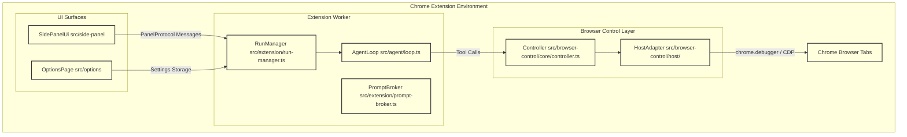
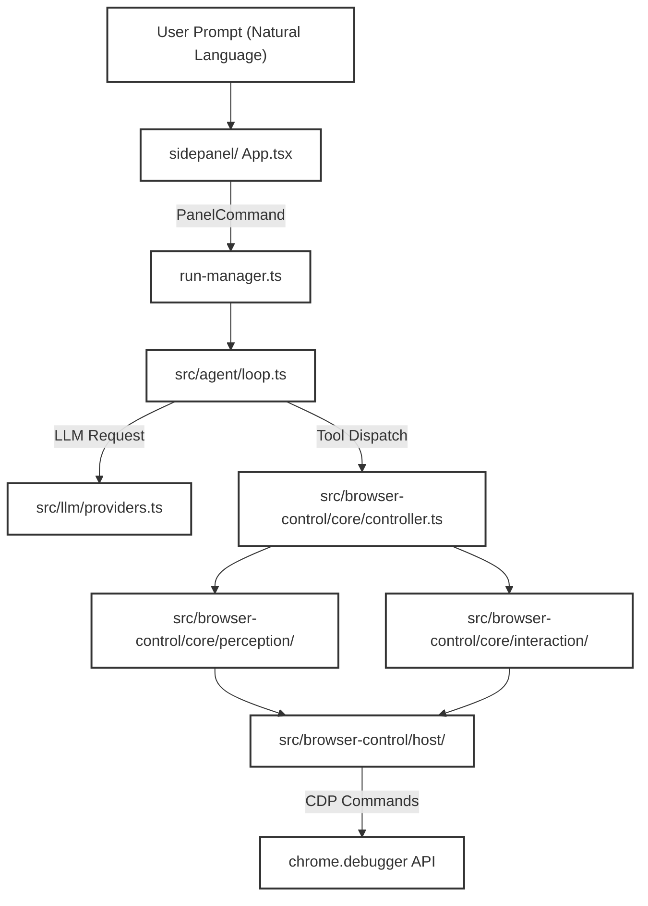

<!-- source: DeepWiki mcp.deepwiki.com · repo nanobrowser/nanobrowser · page 1 Overview · fetched 2026-10-29 -->

# Overview

Relevant source files

The following files were used as context for generating this wiki page:

- [.npmrc](.npmrc)
- [AGENTS.md](AGENTS.md)
- [CLAUDE.md](CLAUDE.md)
- [README.md](README.md)

Nanobrowser is an open-source AI browser-agent extension for Chrome and Edge [README.md:18-19](), [README.md:51-54](). It enables users to execute complex web workflows entirely within their browser via a side panel chat interface [README.md:38-39](). 

The system relies on a clean separation of concerns using a **two-layer architecture**: a deterministic browser control layer that directly interacts with browser primitives, and an extension/agent layer that hosts the single-agent loop, model provider integration, and user-facing controls [CLAUDE.md:7-11]().

This page provides a high-level architectural overview. For detailed technical guides, see the child pages:
- [Installation and Usage](#1.1)
- [Developer Getting Started](#1.2)
- [Architecture Rules and Module Boundaries](#1.3)

## Two-Layer Architecture

Nanobrowser is structured into two primary architectural tiers [CLAUDE.md:7-11]():

1. **The Browser Control Layer (`src/browser-control/`)**: A deterministic, LLM-free automation layer built on `chrome.debugger` (CDP) and Puppeteer frame management [CLAUDE.md:9](), [CLAUDE.md:26-29](). It observes pages, executes actions, and returns structured receipts without running any internal models [CLAUDE.md:9](), [CLAUDE.md:29]().
2. **The Extension and Agent Layer (`src/extension/`, `src/agent/`, `src/side-panel/`)**: Sits on top of the browser control layer, driving conversation loops via the Vercel AI SDK, handling permissions, site rules, user interfaces, and model provider registries [CLAUDE.md:10]().

### Architecture Diagram

Title: Nanobrowser Two-Layer System Architecture

Sources:
- [CLAUDE.md:7-11]()
- [CLAUDE.md:63-68]()

## MV3 Service Worker and Side Panel UI

The extension runs as a Manifest V3 (MV3) Chrome extension. Its execution model depends on:
- **Background Service Worker (`entrypoints/background/`)**: Manages extension lifecycle, orchestrates runs through `RunManager`, and hosts the prompt broker [CLAUDE.md:63]().
- **Side Panel UI (`entrypoints/sidepanel/`)**: Implemented in React, serving as the primary chat interface where users input natural language commands and observe agent progress [README.md:38](), [CLAUDE.md:63]().
- **Additional Entrypoints (`entrypoints/`)**: Includes options settings (`options/`), welcome onboarding (`welcome/`), microphone permission management (`permission/`), offscreen file savers (`offscreen/`), and the developer-only test panel (`testpanel/`) [CLAUDE.md:63]().

Sources:
- [CLAUDE.md:63]()
- [README.md:38]()

## Bridging Natural Language to Code Entities

The following diagram bridges natural language inputs from the user interface down to execution across the extension and browser control layer code entities.

Title: Natural Language to Code Entity Mapping

Sources:
- [CLAUDE.md:63-68]()
- [CLAUDE.md:9-11]()

## Related Child Pages

- **[Installation and Usage](#1.1)** — Extension installation steps, side panel activation shortcuts (`Alt+Shift+N`), model configuration, Ask vs. Auto execution modes, and history management [README.md:23-27](), [README.md:38-49]().
- **[Developer Getting Started](#1.2)** — Node 24 LTS and pnpm 10 toolchain requirements, WXT development scripts, linting, type-checking, and repository directory structure [CLAUDE.md:61-72]().
- **[Architecture Rules and Module Boundaries](#1.3)** — Unchangeable architectural invariants, module import constraints, disposable state handling, and fail-closed element references [CLAUDE.md:19-44]().

Sources:
- [README.md:23-49]()
- [CLAUDE.md:19-72]()

---

