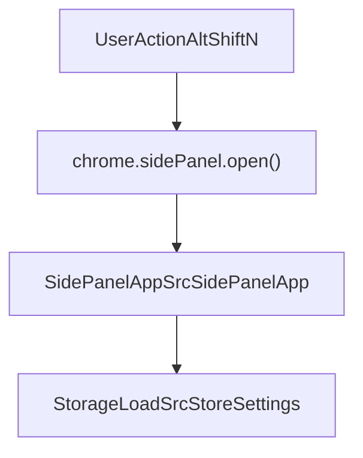
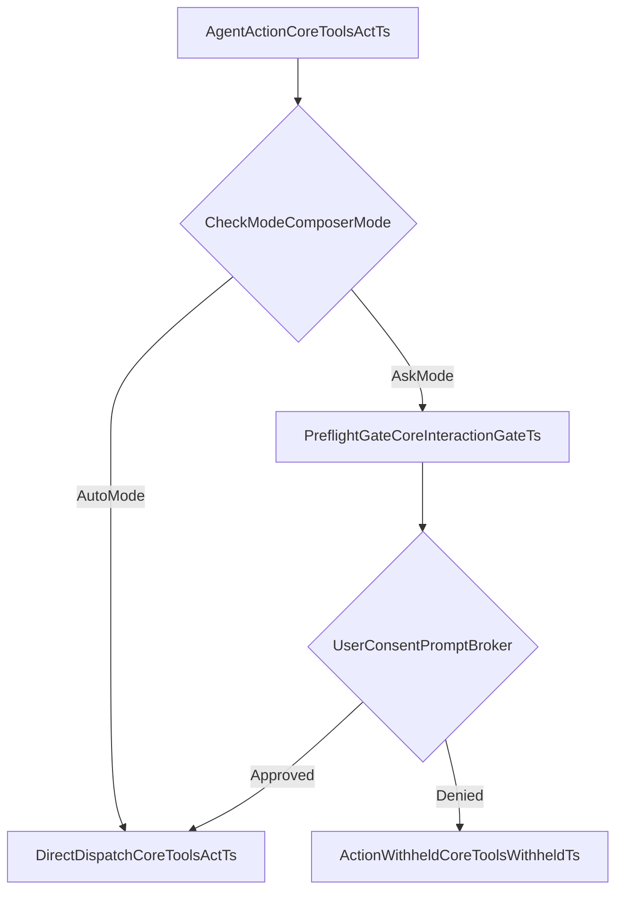

<!-- source: DeepWiki mcp.deepwiki.com · repo nanobrowser/nanobrowser · page 1.1 Installation and Usage · fetched 2026-10-29 -->

# Installation and Usage

<details>
<summary>Relevant source files</summary>

The following files were used as context for generating this wiki page:

- [README.md](README.md)
- [src/ui/locales/en.json](src/ui/locales/en.json)

</details>


This page details how to install the Nanobrowser extension, launch and interact with the side panel, configure model providers and API keys, manage execution modes (Ask vs. Auto), use slash-command shortcuts, and navigate task history and tab groups.

---

## 1. Extension Installation

Nanobrowser can be installed via the Chrome Web Store, through manual unpacked installation, or built directly from source `[README.md:21-34]()`.

### 1.1 Chrome Web Store (Stable)
1. Navigate to the official [Nanobrowser Chrome Web Store page](https://chromewebstore.google.com/detail/nanobrowser/imbddededgmcgfhfpcjmijokokekbkal) `[README.md:23-23]()`.
2. Click **Add to Chrome** and confirm extension permissions.

### 1.2 Manual Unpacked Installation
1. Download and extract the latest release archive (`nanobrowser.zip`) from GitHub `[README.md:52-54]()`.
2. Open `chrome://extensions/` in Chrome or Edge `[README.md:51-54]()`.
3. Enable **Developer mode** in the top right.
4. Click **Load unpacked** and select the extracted folder.

### 1.3 Building from Source
Requirements: Node.js v24+ and pnpm v10+.
```bash
git clone https://github.com/nanobrowser/nanobrowser.git
cd nanobrowser
corepack enable
pnpm install
pnpm build
```
The compiled extension bundle is output to the `dist/` folder. For development with hot reloading, run `pnpm dev`.

Sources: `[README.md:21-34]()`, `[README.md:51-54]()`

---

## 2. Opening the Side Panel and Launching

Once installed, the primary user interface is the extension side panel.

- **Shortcut**: Press `Alt+Shift+N` or click the extension icon in the browser toolbar.
- **Onboarding Flow**: Upon first run, the welcome page guides users through pinning the extension, configuring an initial model provider, and reviewing safety guidelines.

Title: Panel Initialization Data Flow

*Figure 1: Bridging natural language user action to extension entrypoint and storage initialization.*

Sources: `[README.md:36-38]()`, `[src/ui/locales/en.json:59-65]()`

---

## 3. Adding Model Providers and API Keys

Nanobrowser delegates agent intelligence to user-configured cloud or local LLM providers `[README.md:73-85]()`.

- **Supported Providers**: Anthropic, OpenAI, Google Gemini, OpenRouter, xAI Grok, DeepSeek, Mistral, Ollama, LM Studio, and generic OpenAI-compatible servers `[README.md:77-78]()`.
- **Security**: API keys are saved locally in extension storage and transmitted exclusively to their respective endpoints `[src/ui/locales/en.json:29-29]()`.
- **Validation**: Providers can be tested directly from settings `[src/ui/locales/en.json:49-52()`, verifying tool-calling capabilities.

Sources: `[README.md:73-85]()`, `[src/ui/locales/en.json:25-58]()`

---

## 4. Ask vs. Auto Mode and Permissions

The agent operates under two primary execution modes selectable from the composer `[src/ui/locales/en.json:74-78()`, controlling whether consequential actions require user confirmation `[README.md:58-64]()`.

| Action Type | Ask Mode (Default) | Auto Mode |
| --- | --- | --- |
| Read pages, click links, scroll, move tabs | Automatic `[README.md:60-60]()` | Automatic `[README.md:60-60]()` |
| Submit, send, delete, or upload | Requires explicit user confirmation `[README.md:61-61]()` | Automatic `[README.md:61-61]()` |
| Payments, passwords, 2FA codes | Hands control to user `[README.md:62-62]()` | Hands control to user `[README.md:62-62]()` |

Users can also define per-site rules (**Allow**, **Ask**, or **Block**) in the permissions configuration `[README.md:64-64]()`.

Title: Execution Control Flow

*Figure 2: Execution control flow routing agent actions through mode validation and user consent gates.*

Sources: `[README.md:56-72]()`, `[src/ui/locales/en.json:74-78]()`

---

## 5. Shortcuts, Starters, History, and Tab Groups

- **Slash Shortcuts**: Type `/` in the composer to execute saved prompts associated with preset start pages and default models `[README.md:44-44]()`.
- **Tab Groups**: Each long-running conversation runs isolated within dedicated browser tab groups, enabling multitasking without context loss `[README.md:39-39]()`.
- **Chat History**: Past conversations are indexed locally via IndexedDB `[src/ui/locales/en.json:115-125()`, supporting resumption, branching, message editing, and Markdown export `[README.md:48-48]()`.

Sources: `[README.md:39-48]()`, `[src/ui/locales/en.json:115-125]()`

---

