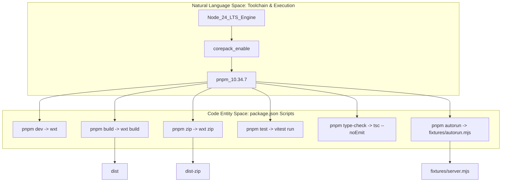
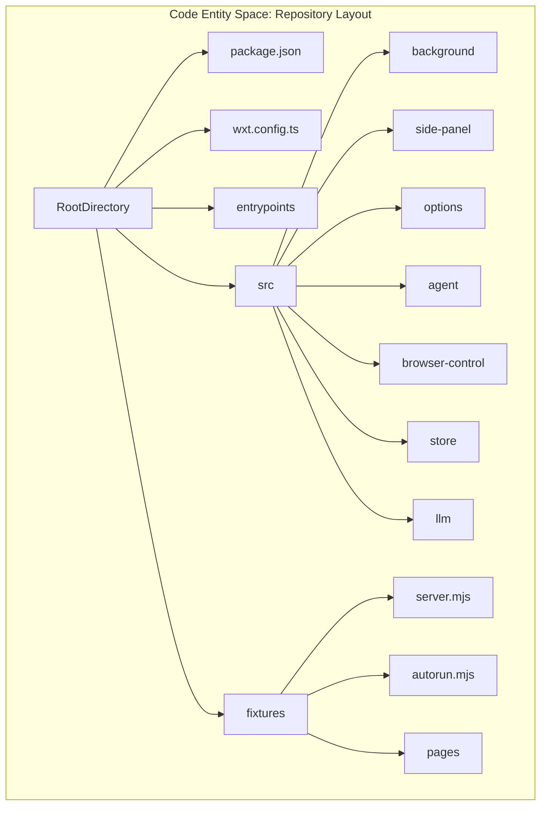

<!-- source: DeepWiki mcp.deepwiki.com · repo nanobrowser/nanobrowser · page 1.2 Developer Getting Started · fetched 2026-10-29 -->

# Developer Getting Started

<details>
<summary>Relevant source files</summary>

The following files were used as context for generating this wiki page:

- [.env.example](.env.example)
- [.github/ISSUE_TEMPLATE/bug_report.yml](.github/ISSUE_TEMPLATE/bug_report.yml)
- [.github/ISSUE_TEMPLATE/feature_request.yml](.github/ISSUE_TEMPLATE/feature_request.yml)
- [.gitignore](.gitignore)
- [CONTRIBUTING.md](CONTRIBUTING.md)
- [LICENSE](LICENSE)
- [package.json](package.json)
- [pnpm-lock.yaml](pnpm-lock.yaml)
- [vite-env.d.ts](vite-env.d.ts)

</details>


This page provides technical documentation for developers setting up the local toolchain, executing build and test scripts, managing environment configurations, and navigating the repository layout of the `nanobrowser` codebase [CONTRIBUTING.md:1-38]().

---

## 1. Toolchain and Package Manager Constraints

The codebase enforces strict toolchain versions to ensure deterministic builds across development environments. Node.js version **24 LTS** (`>=24.11.0`) and **pnpm 10** (`pnpm@10.34.7`) are required [package.json:70-75]().

### Engine and Package Manager Enforcement
- **Node.js**: The engines field in `package.json` specifies `"node": ">=24.11.0"` [package.json:72]().
- **pnpm**: Pinned to `10.34.7` via the `packageManager` field [package.json:70](). Attempting to use `npm` or older package managers triggers the `"npm": "please-use-pnpm"` engine guard [package.json:74]().
- **Dependency Constraints**: The `package.json` defines `onlyBuiltDependencies` for packages like `esbuild` and overrides for `postcss-selector-parser` to maintain secure supply-chain constraints [package.json:76-83]().
- **Corepack**: Developers can initialize the correct package manager using Corepack [CONTRIBUTING.md:14-17]():
  ```bash
  corepack enable
  pnpm install
  ```

Sources: `package.json:70-83](), [CONTRIBUTING.md:12-20]()

---

## 2. Development, Build, and Automation Scripts

The `package.json` defines scripts for WXT-based extension development, type checking, linting, unit testing, and automated headless browser checks [package.json:12-27]().

| Script Name | Target Code / Tool | Purpose |
| :--- | :--- | :--- |
| `pnpm dev` | `wxt` | Starts WXT in development mode with HMR and auto-reload [package.json:14]() |
| `pnpm build` | `wxt build` | Generates the production extension bundle in `dist/` [package.json:15]() |
| `pnpm zip` | `wxt zip` | Bundles the production build into a distributable archive in `dist-zip/` [package.json:16]() |
| `pnpm test` | `vitest run` | Executes unit test suites across `__tests__` directories [package.json:17]() |
| `pnpm type-check` | `wxt prepare && tsc --noEmit` | Runs strict TypeScript compiler checks [package.json:18]() |
| `pnpm lint` | `eslint . --cache` | Runs ESLint with import-boundary rules and caching [package.json:19]() |
| `pnpm autorun` | `node fixtures/autorun.mjs` | Executes background autorun checks against test scenarios [package.json:22]() |
| `pnpm fixtures` | `node fixtures/server.mjs` | Spins up the local test fixture web server [package.json:21]() |

Sources: `package.json:11-27](), [CONTRIBUTING.md:24-34]()



**Figure 1**: Bridging toolchain management to `package.json` execution scripts and output directories.

Sources: `package.json:11-27](), [CONTRIBUTING.md:12-36]()

---

## 3. Environment Variables and Configuration

Configuration values such as analytics keys are managed via environment variables and loaded through Vite's build pipeline [vite-env.d.ts:3-13]().

### `.env.example`
The project provides an environment template file [.env.example:1-5]() containing default analytics parameters:
- `VITE_POSTHOG_API_KEY`: Key for PostHog telemetry ingestion.
- `VITE_POSTHOG_HOST`: Defaults to `https://us.i.posthog.com` [.env.example:5]().

### Type Definitions
Runtime environment metadata is typed via `vite-env.d.ts` [vite-env.d.ts:1-13]():
- `WXT_AUTORUN_URL`: Set during automated test runs (`fixtures/autorun.mjs`) [vite-env.d.ts:5]().
- `VITE_POSTHOG_API_KEY` and `VITE_POSTHOG_HOST` are exposed to frontend runtimes via `import.meta.env` [vite-env.d.ts:6-8]().

Sources: `.env.example:1-5](), [vite-env.d.ts:1-13]()

---

## 4. Repository Layout and Structure

The codebase is organized as a single-package WXT extension workspace containing core service logic, UI components, background orchestrators, and testing fixtures [.gitignore:1-16]().



**Figure 2**: Repository layout mapping root configuration files, `entrypoints/`, `src/` modular layers, and `fixtures/` automation harnesses.

Sources: `package.json:1-84](), [.gitignore:1-16]()

---

## 5. Quality Assurance and Autorun Pipeline

Maintaining code quality requires passing local validation suites before submitting pull requests [CONTRIBUTING.md:35]().

- **Type Checking**: `pnpm type-check` executes WXT preparation followed by TypeScript compilation with `--noEmit` [package.json:18]().
- **Linting**: `pnpm lint` runs ESLint across `.ts` and `.tsx` sources while enforcing import boundaries [package.json:19]().
- **Unit Testing**: `pnpm test` runs Vitest test suites [package.json:17]().
- **Autorun Checks**: Automated headless scenarios are validated via `pnpm autorun`, utilizing local test pages served by `fixtures/server.mjs` [package.json:21-22]().

Sources: `package.json:17-22](), [CONTRIBUTING.md:35-38]()

---

