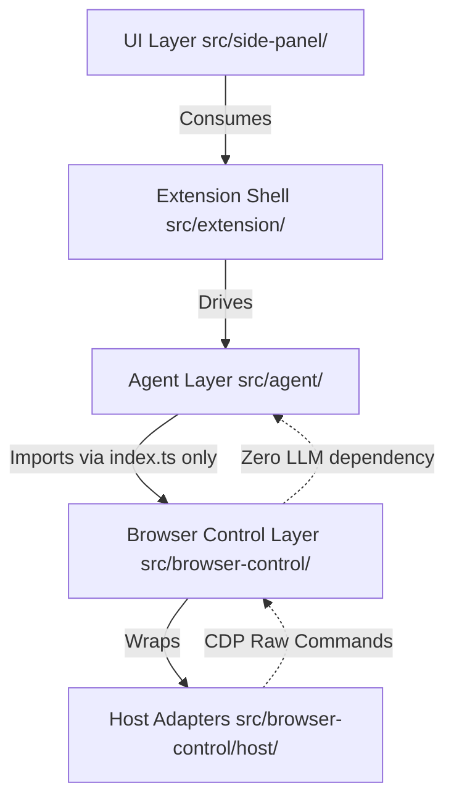
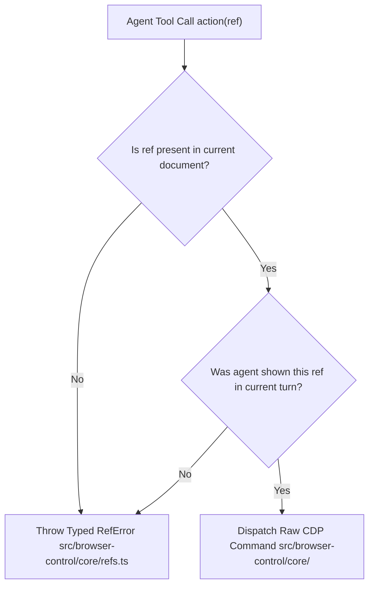

<!-- source: DeepWiki mcp.deepwiki.com · repo nanobrowser/nanobrowser · page 1.3 Architecture Rules and Module Boundaries · fetched 2026-10-29 -->

# Architecture Rules and Module Boundaries

<details>
<summary>Relevant source files</summary>

The following files were used as context for generating this wiki page:

- [.npmrc](.npmrc)
- [AGENTS.md](AGENTS.md)
- [CLAUDE.md](CLAUDE.md)

</details>


### Purpose and Scope
This document outlines the unchangeable design rules, layer invariants, import boundaries, disposable state mechanics, and fail-closed reference semantics governing the Nanobrowser codebase. These constraints ensure a clean separation between the deterministic, low-level browser automation layer and the high-level agent/extension layers.

Sources: [`CLAUDE.md:1-72`]()

---

## 1. Core Layer Invariants and Design Constraints

The architecture is split into two primary domains:
1. **The Browser Control Layer (`src/browser-control/`)**: A deterministic, LLM-free automation layer built on `chrome.debugger` (CDP) and Puppeteer frame management [CLAUDE.md:7-9]().
2. **The Extension & Agent Layer (`src/extension/`, `src/agent/`)**: Sits on top of the browser control layer, handling side panels, conversation state, prompt management, and Vercel AI SDK integration [CLAUDE.md:10]().

### Fixed Design Constraints for the Layer
* **No standalone execution**: The layer is part of a Chrome extension, not a standalone CLI, daemon, or remote CDP socket [CLAUDE.md:25]().
* **CDP via `chrome.debugger` only**: No WebSockets or out-of-process CDP connections are permitted [CLAUDE.md:26]().
* **Puppeteer as Frame Manager**: Puppeteer detects frames, out-of-process iframes, and navigations. No parallel frame or session registries are allowed from raw CDP events [CLAUDE.md:27]().
* **No Puppeteer Element Finding**: Elements are never found through Puppeteer selectors, `ElementHandle` clicks, or selector-based evaluation. Action commands use raw CDP commands routed to the specific frame session reported by Puppeteer [CLAUDE.md:28]().
* **No Model Inside the Layer**: The browser control layer is strictly deterministic. Anything requiring an LLM resides in the agent layer above [CLAUDE.md:29]().

### The Eleven Layer Invariants
1. **One identity**: An action operates on the node the agent was shown, referenced via its browser handle [CLAUDE.md:33]().
2. **Refs fail closed**: A reference is valid *only* for the document it was observed in and *only* if the agent was explicitly shown it. Otherwise, it returns a typed error [CLAUDE.md:34]().
3. **Retries happen before dispatch**: Once an input event is sent, the layer does not execute unprompted retries [CLAUDE.md:35]().
4. **No hidden substitution**: Alternative nodes or mechanisms are chosen explicitly by rule before dispatch and declared in the receipt [CLAUDE.md:36]().
5. **Three outcomes reported separately**: Input dispatched; page reacted; expected state reached [CLAUDE.md:37]().
6. **Observation is read-only**: Capturing state never mutates the page [CLAUDE.md:38]().
7. **Degrade loudly**: Partial captures and truncation must be explicitly reported in results [CLAUDE.md:39]().
8. **Bounded everything**: Commands, waits, and lists carry strict budgets. Unbounded waits are restricted to host-level user confirmations [CLAUDE.md:40]().
9. **State is disposable**: Service worker restarts, debugger detaches, and navigations cleanly invalidate layer state [CLAUDE.md:41]().
10. **No model inside**: Anything requiring an LLM belongs to the agent above the layer [CLAUDE.md:42]().
11. **Consequential actions need a person**: Actions classified as submit, pay, delete, or custom agent-supplied scripts require explicit user approval by default [CLAUDE.md:43]().

Sources: [`CLAUDE.md:19-44`]()

---

## 2. Module Import Boundaries

To maintain clean module boundaries across the codebase, strict rules govern what modules may import from others. The browser control layer exposes a single entry surface (`src/browser-control/index.ts`). No internal sub-modules of `browser-control` (such as `core/`, `host/`, or `probe/`) can be imported directly by external code or the agent/extension layers.

Title: Module Import Hierarchy and Layer Isolation


Sources: [`CLAUDE.md:64-69`]()

---

## 3. Disposable State and Lifecycle Resets

In accordance with invariant #9, all execution state inside the browser control layer is ephemeral and disposable. If the background service worker restarts, the debugger detaches, or a top-level document navigation occurs, internal session caches, element handle mappings, and lock registries are immediately discarded.

Title: Disposable State Invalidation Flow
```mermaid
sequenceDiagram
    participant SW as "ServiceWorker background/"
    participant Ctrl as "Controller src/browser-control/core/controller.ts"
    participant Host as "HostAdapter src/browser-control/host/"
    participant Refs as "RefRegistry src/browser-control/core/refs.ts"

    Note over SW,Refs: "Event Trigger: Detach / Navigation / Restart"
    Host->>Ctrl: "onDebuggerDetach() or navigation event"
    Ctrl->>Refs: "invalidateAll()"
    Ctrl->>Ctrl: "purgeActiveSessions()"
    Ctrl-->>SW: "State cleanly cleared; next command fails-closed until re-initialized"
```

Sources: [`CLAUDE.md:41`](), [`CLAUDE.md:66-68`]()

---

## 4. Fail-Closed Element References

Element references (`refs`) passed back and forth between perception modules and agent tools are strictly bounded by document identity and visibility history via `src/browser-control/core/refs.ts` [CLAUDE.md:33-34]().

Title: Fail-Closed Reference Validation Logic


Sources: [`CLAUDE.md:33-34`](), [`CLAUDE.md:66`]()

---

## 5. Natural Language Space to Code Entity Mapping

The following mapping connects high-level architectural requirements to concrete entities in the codebase:

| Natural Language Concept | Code Entity / Module Path | Role / Responsibility |
| :--- | :--- | :--- |
| **Browser Control Layer** | `src/browser-control/` | Deterministic perception, interaction, and CDP host orchestration [CLAUDE.md:64-69](). |
| **Public Layer API** | `src/browser-control/index.ts` | The sole permitted import entrypoint for external callers [CLAUDE.md:69](). |
| **Frame Manager** | `src/browser-control/host/` | Puppeteer-based frame and session tracking [CLAUDE.md:68](). |
| **Ref Validation** | `src/browser-control/core/refs.ts` | Enforces fail-closed element handle validity per document [CLAUDE.md:34,66](). |
| **Consequential Action Gate** | `src/agent/guards.ts` & `src/browser-control/core/` | Enforces user approval checks for submit, pay, and delete actions [CLAUDE.md:43](). |

Sources: [`CLAUDE.md:25-44`](), [`CLAUDE.md:64-69`]()

---

