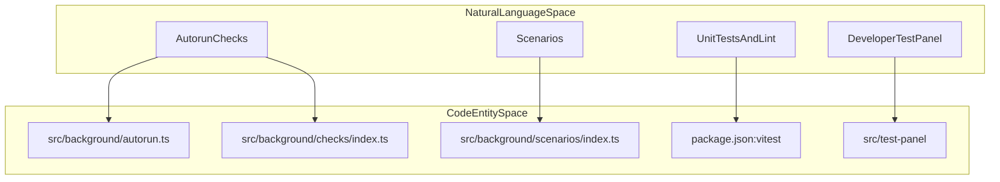

<!-- source: DeepWiki mcp.deepwiki.com · repo nanobrowser/nanobrowser · page 10 Testing and Automation Harness · fetched 2026-10-29 -->

# Testing and Automation Harness

Relevant source files

The following files were used as context for generating this wiki page:

- [src/background/checks/index.ts](src/background/checks/index.ts)
- [src/background/scenarios/index.ts](src/background/scenarios/index.ts)

## Purpose and Scope

This page provides a high-level overview of the quality tooling, automated verification harnesses, and testing infrastructure used across the Nanobrowser codebase. The testing and automation ecosystem coordinates Vitest unit test suites, a background autorun check runner with over 55 distinct verification checks [src/background/checks/index.ts:1-52](), headless scenarios [src/background/scenarios/index.ts:1-27](), a local deterministic fixture server, and a dedicated developer test panel. 

For detailed information on each sub-topic, refer to the child pages linked below:
- **Autorun Checks and Scenarios**: [Autorun Checks and Scenarios](#10.1)
- **Fixture Pages and Local Server**: [Fixture Pages and Local Server](#10.2)
- **Unit Tests, Lint and Type Checks**: [Unit Tests, Lint and Type Checks](#10.3)
- **Developer Test Panel**: [Developer Test Panel](#10.4)

Sources:
- [package.json:17-25]()
- [src/background/checks/index.ts:1-52]()
- [src/background/scenarios/index.ts:1-27]()

---

## 10.1 Autorun Checks and Scenarios

The background autorun harness executes automated verification checks and end-to-end scenarios to ensure extension stability and feature correctness. It includes over 55 specialized checks (such as `panel-chat`, `providers-test`, `keyboard-a11y`, and `host-connection`) registered via index files and driven via headless Chrome for Testing runs [src/background/checks/index.ts:1-52](), complemented by scenario suites [src/background/scenarios/index.ts:1-27]().

For details, see [Autorun Checks and Scenarios](#10.1).

Sources:
- [src/background/checks/index.ts:1-52]()
- [src/background/scenarios/index.ts:1-27]()
- [package.json:22]()

---

## 10.2 Fixture Pages and Local Server

To provide a deterministic testbed free from external network flakiness, the harness runs a lightweight Node HTTP server (`fixtures/server.mjs`). This server hosts deterministic local web pages covering overlays, authentication flows, OAuth, data enrichment, and upgrade paths used by both unit tests and autorun scenarios.

For details, see [Fixture Pages and Local Server](#10.2).

Sources:
- [package.json:21]()

---

## 10.3 Unit Tests, Lint and Type Checks

Code quality is enforced via Vitest unit test suites located across `__tests__` directories, utilizing libraries like `fake-indexeddb` for state isolation. Static analysis and formatting are governed by ESLint import-boundary rules, Prettier configurations, and TypeScript type-checking pipelines defined in `package.json` [package.json:17-20]().

For details, see [Unit Tests, Lint and Type Checks](#10.3).

Sources:
- [package.json:17-20]()

---

## 10.4 Developer Test Panel

The codebase features a developer-only test panel layer (`src/test-panel` and `entrypoints/testpanel`) accessible via specific extension commands (`open-test-panel`). It provides per-capability tabs to interactively test and debug the underlying browser control layer and action primitives.

For details, see [Developer Test Panel](#10.4).

Sources:
- [package.json:1-84]()

---

