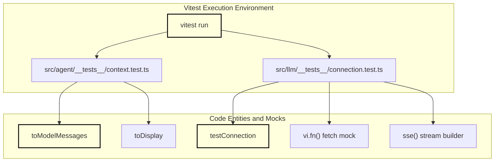
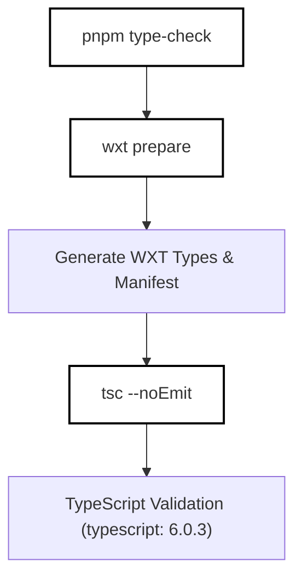

<!-- source: DeepWiki mcp.deepwiki.com · repo nanobrowser/nanobrowser · page 10.3 Unit Tests, Lint and Type Checks · fetched 2026-10-29 -->

# Unit Tests, Lint and Type Checks

Relevant source files

The following files were used as context for generating this wiki page:

- [package.json](package.json)
- [pnpm-lock.yaml](pnpm-lock.yaml)
- [src/agent/__tests__/context.test.ts](src/agent/__tests__/context.test.ts)
- [src/llm/__tests__/connection.test.ts](src/llm/__tests__/connection.test.ts)
- [vite-env.d.ts](vite-env.d.ts)

This page details the quality assurance infrastructure for Nanobrowser, covering Vitest unit test suites across `__tests__` directories, `fake-indexeddb` and `vi.fn()` mocking for database and network primitives, ESLint static analysis and import boundaries, Prettier formatting, the TypeScript type-check pipeline, and workspace test scripts.

Sources:
- [package.json:1-84]()
- [src/agent/__tests__/context.test.ts:1-155]()
- [src/llm/__tests__/connection.test.ts:1-142]()

---

## Vitest Suites and Mocking Infrastructure

Unit tests are executed using Vitest [package.json:67]() and located within `__tests__` directories adjacent to module implementations. Because modules like conversation persistence, prompt construction, and LLM connection management rely on external state or network interfaces, tests utilize `fake-indexeddb` [package.json:60]() and Vitest's mocking facilities (`vi.fn()`) to simulate browser storage and API responses in a Node.js test runner context [src/llm/__tests__/connection.test.ts:35]().

For instance, `src/agent/__tests__/context.test.ts` validates message conversion functions such as `toModelMessages` and display helpers like `toDisplay` [src/agent/__tests__/context.test.ts:1-155](). Similarly, `src/llm/__tests__/connection.test.ts` tests model endpoint probing and `testConnection` behavior by mocking global fetch implementations [src/llm/__tests__/connection.test.ts:33-61]().

**Diagram: Test Execution and Code Entity Mapping**

Sources:
- [src/agent/__tests__/context.test.ts:1-155]()
- [src/llm/__tests__/connection.test.ts:1-61]()

---

## ESLint, Prettier and Code Style Enforcement

Static analysis and code formatting are enforced via ESLint 9 and Prettier [package.json:43-69](). The project configures specialized linting plugins to guard against architectural violations, accessibility regressions, and inconsistent syntax.

Key dependencies configured in `package.json` include:
* `@typescript-eslint/eslint-plugin` and `@typescript-eslint/parser` for static type analysis [package.json:49-50]().
* `eslint-plugin-import` for import-boundary and module resolution rules [package.json:55]().
* `eslint-plugin-react`, `eslint-plugin-react-hooks`, and `eslint-plugin-jsx-a11y` for React component compliance [package.json:56-58]().
* `eslint-plugin-tailwindcss` for Tailwind CSS utility class ordering and best practices [package.json:59]().
* `eslint-config-prettier` to disable formatting rules that conflict with Prettier [package.json:54]().

Linting and formatting tasks are executed through standard workspace scripts:
* `pnpm lint`: Runs ESLint with caching enabled (`node_modules/.cache/.eslintcache`) [package.json:19]().
* `pnpm prettier`: Executes Prettier formatting across the repository with cache optimization [package.json:20]().

Sources:
- [package.json:19-20]()
- [package.json:43-69]()

---

## Type-Check Pipeline

Type safety across the WXT extension architecture is maintained via the `type-check` script defined in `package.json` [package.json:18](). 

The type-checking pipeline executes two sequential operations:
1. `wxt prepare`: Generates auto-imported types, manifest definitions, and entrypoint type declarations required by the WXT build system [package.json:18]().
2. `tsc --noEmit`: Invokes the TypeScript compiler (`typescript: 6.0.3`) to validate types across all source files without emitting compiled output artifacts [package.json:18](), [package.json:65]().

**Diagram: Type-Check Execution Flow**

Sources:
- [package.json:12-27]()
- [package.json:65]()
- [package.json:68]()

---

## Quality Tooling Scripts and CI Workflow Integration

All validation pipelines are exposed uniformly through `package.json` scripts [package.json:12-27](). Developers and CI environments invoke these commands to guarantee code integrity prior to packaging or release building.

| Script Name | Command | Description |
| :--- | :--- | :--- |
| `test` | `vitest run` | Executes all Vitest unit tests across `__tests__` directories [package.json:17]() |
| `type-check` | `wxt prepare && tsc --noEmit` | Prepares WXT environment and performs full static type checking [package.json:18]() |
| `lint` | `eslint . --cache ...` | Runs ESLint static code analysis with caching [package.json:19]() |
| `prettier` | `prettier . --write --cache ...` | Formats codebase files via Prettier [package.json:20]() |

Sources:
- [package.json:12-27]()

---

