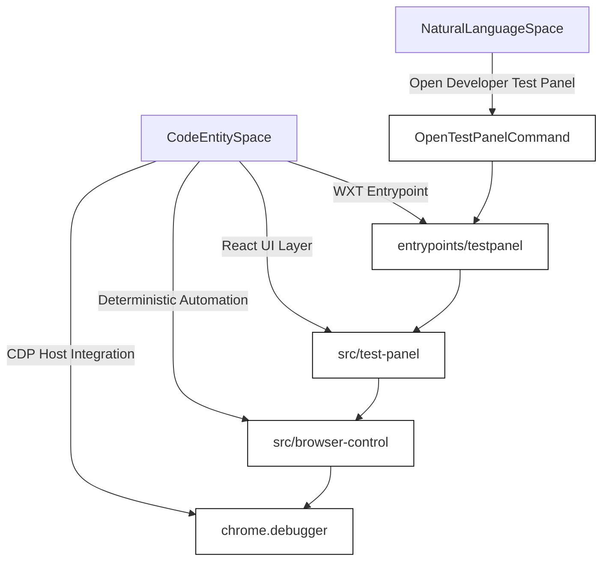
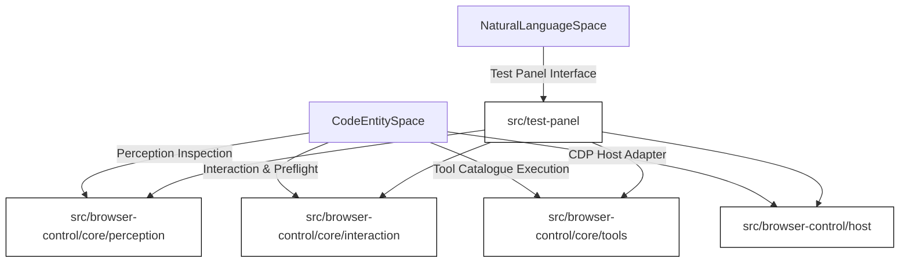

<!-- source: DeepWiki mcp.deepwiki.com · repo nanobrowser/nanobrowser · page 10.4 Developer Test Panel · fetched 2026-10-29 -->

# Developer Test Panel

Relevant source files

The following files were used as context for generating this wiki page:

- [.npmrc](.npmrc)
- [CLAUDE.md](CLAUDE.md)
- [src/side-panel/test-hook.ts](src/side-panel/test-hook.ts)

The Developer Test Panel (`src/test-panel` and `entrypoints/testpanel`) is a dedicated developer-only layer and testing user interface [CLAUDE.md:63-70](). Its primary purpose is to allow developers to directly inspect, test, and exercise the deterministic browser control layer (`src/browser-control`) [CLAUDE.md:14, 64]—including perception, interaction, frame management, and tool primitives—without routing commands through the high-level agent loop.

Sources: [CLAUDE.md:14](), [CLAUDE.md:63-70]()

---

## 1. Entrypoint and Extension Integration

The test panel is packaged as an isolated WXT entrypoint (`entrypoints/testpanel`) [CLAUDE.md:63] that runs within a dedicated extension tab or window. It is invoked via the `open-test-panel` browser command, which is unbound by default and must be configured via `chrome://extensions/shortcuts` [CLAUDE.md:70]. 

Unlike the product side panel (`src/side-panel`) which drives the conversational agent loop [CLAUDE.md:10, 55], the test panel interfaces directly with the browser control layer's low-level APIs and protocol schemas [CLAUDE.md:65]. It respects the layer's strict safety and security invariants—such as enforcing sensitive action policies where submit, pay, and delete actions require explicit confirmation [CLAUDE.md:53].

*Figure 1: Bridging Natural Language invocation to code entities in the test panel subsystem.*

Sources: [CLAUDE.md:53](), [CLAUDE.md:63](), [CLAUDE.md:70]()

---

## 2. Architecture and Per-Capability Tabs

Built as a React single-page application inside `src/test-panel`, the test panel organizes debugging capabilities into modular, tabbed views. Each tab maps directly to a sub-module of the browser control layer (`src/browser-control/core/`, `src/browser-control/host/`, and `src/browser-control/protocol/`) [CLAUDE.md:65-68].

*Figure 2: Test panel modular architecture mapping to underlying browser control directories.*

The tabs typically include:
- **Perception Tab**: Exercises state capture, accessibility tree parsing (`ax`), visual masking, and DOM observation [CLAUDE.md:66].
- **Interaction Tab**: Tests preflight checks, stability/actionability classifiers, pointer/keyboard event dispatch, and guardrails [CLAUDE.md:66].
- **Tool Catalogue Tab**: Invokes individual tool primitives (such as `navigate`, `fill`, `act`, `observe`, and `wait`) directly using Zod-validated protocol schemas [CLAUDE.md:65, 68].
- **Session & Frame Management Tab**: Inspects active Puppeteer frame mappings, out-of-process iframes (OOPIFs), and `chrome.debugger` session attachments [CLAUDE.md:30, 68].

Sources: [CLAUDE.md:30](), [CLAUDE.md:65-68]()

---

## 3. Data Flow and Execution Mechanics

When a developer triggers an action within the test panel UI, the command flows through the extension background worker orchestration layer into the browser control layer. Because state is disposable and designed to fail closed, any disconnection of the debugger or unexpected navigation cleanly invalidate active handles without corrupting background state [CLAUDE.md:42].

1. **User Action**: The developer interacts with a control in `src/test-panel`.
2. **Protocol Validation**: Inputs are validated against Zod schemas defined in `src/browser-control/protocol/` [CLAUDE.md:65].
3. **Controller Dispatch**: Commands are routed to the core controller (`src/browser-control/core/controller.ts`) [CLAUDE.md:66].
4. **Host Execution**: Raw CDP commands are dispatched via `chrome.debugger` wrapped by Puppeteer frame management (`src/browser-control/host/`) [CLAUDE.md:26-28, 68].
5. **Result Reporting**: Structured outcomes (input dispatched, page reacted, expected state reached) are returned to the test panel UI for visual inspection [CLAUDE.md:37].

Sources: [CLAUDE.md:26-28](), [CLAUDE.md:37](), [CLAUDE.md:42](), [CLAUDE.md:65-68]()

---

