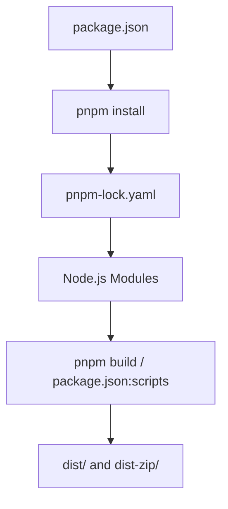
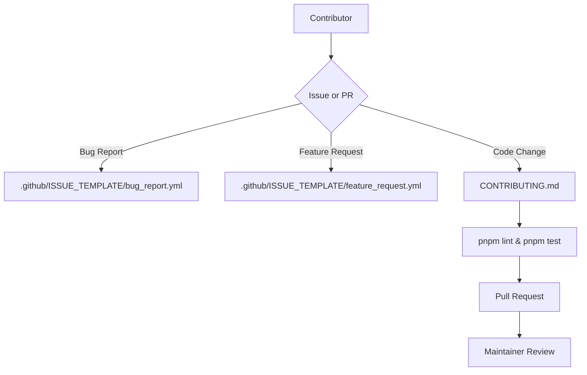

<!-- source: DeepWiki mcp.deepwiki.com · repo nanobrowser/nanobrowser · page 11 Project Operations and Contribution · fetched 2026-10-29 -->

# Project Operations and Contribution

Relevant source files

The following files were used as context for generating this wiki page:

- [.github/ISSUE_TEMPLATE/bug_report.yml](.github/ISSUE_TEMPLATE/bug_report.yml)
- [.github/ISSUE_TEMPLATE/feature_request.yml](.github/ISSUE_TEMPLATE/feature_request.yml)
- [CONTRIBUTING.md](CONTRIBUTING.md)
- [package.json](package.json)
- [pnpm-lock.yaml](pnpm-lock.yaml)

This page provides a high-level overview of the Nanobrowser project's operational governance, including dependency management, release pipelines, community contribution workflows, issue templates, and licensing. Maintaining consistent tooling and clear contribution paths ensures code quality across development and production releases.

For detailed information on specific topics, please refer to the linked child pages:
- [Dependencies, Versioning and Releases](#11.1) — package.json/pnpm-lock.yaml, .npmrc supply-chain rules, pnpm zip packaging, release artifacts.
- [Community, Issues and Licensing](#11.2) — GitHub issue templates (bug, feature, docs, config), FUNDING.yml, CONTRIBUTING.md workflow, SECURITY.md reporting, Apache 2.0 license.

## Dependencies, Versioning and Releases

The project manages its packages using `pnpm` (pinned to version `10.34.7`) and Node.js (`>=24.11.0`), configured via `package.json` [package.json:70-74]() and locked with `pnpm-lock.yaml` [pnpm-lock.yaml:1-53](). Versioning follows semantic versioning standards, with the current release version defined in `package.json` [package.json:3](). Release workflows build and package the extension into distribution archives using WXT build scripts (`wxt zip`) [package.json:16]().

For details, see [Dependencies, Versioning and Releases](#11.1).

### Build Pipeline and Dependency Management

Sources: [package.json:1-84](), [pnpm-lock.yaml:1-53]()

## Community, Issues and Licensing

The Nanobrowser project welcomes community involvement through structured contribution paths defined in `CONTRIBUTING.md` [CONTRIBUTING.md:1-67](). Issue templates standardize reporting for bugs [.github/ISSUE_TEMPLATE/bug_report.yml:1-96]() and features [.github/ISSUE_TEMPLATE/feature_request.yml:1-31](). The codebase is licensed under the permissive Apache License 2.0 [package.json:6](), promoting transparent open-source collaboration.

For details, see [Community, Issues and Licensing](#11.2).

### Contribution and Issue Workflow

Sources: [CONTRIBUTING.md:1-67](), [.github/ISSUE_TEMPLATE/bug_report.yml:1-96](), [.github/ISSUE_TEMPLATE/feature_request.yml:1-31](), [package.json:1-84]()

---

