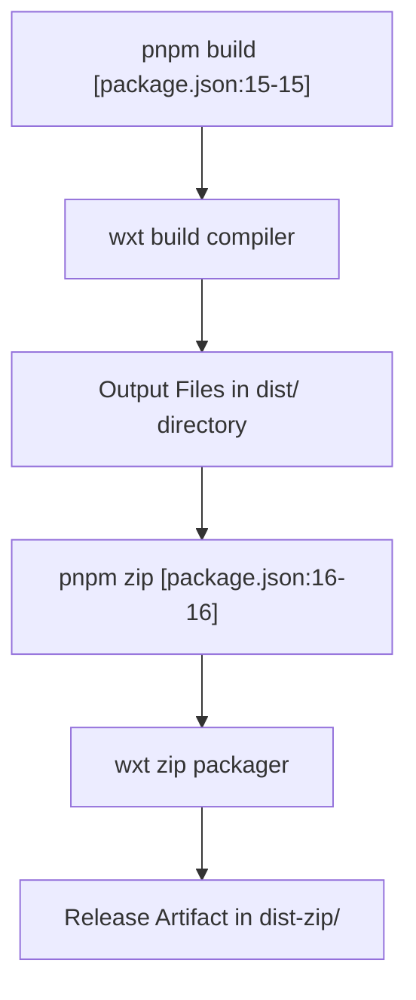

<!-- source: DeepWiki mcp.deepwiki.com · repo nanobrowser/nanobrowser · page 11.1 Dependencies, Versioning and Releases · fetched 2026-10-29 -->

# Dependencies, Versioning and Releases

<details>
<summary>Relevant source files</summary>

The following files were used as context for generating this wiki page:

- [.gitattributes](.gitattributes)
- [.npmrc](.npmrc)
- [CLAUDE.md](CLAUDE.md)
- [package.json](package.json)
- [pnpm-lock.yaml](pnpm-lock.yaml)

</details>


This page details the management of project dependencies, supply-chain constraints, versioning, and the process for creating release artifacts for the Nanobrowser extension. It covers the role of `package.json` [package.json:1-84](), `pnpm-lock.yaml` [pnpm-lock.yaml:1-162](), `.npmrc` security rules [.npmrc:1-3](), and WXT zip packaging scripts [package.json:16-16]().

## Dependency Management and Supply-Chain Rules

The Nanobrowser project uses `pnpm` as its package manager, enforced via `packageManager` and `engines` constraints in `package.json` [package.json:70-75](). The project relies on `@ai-sdk/*` providers, React, Puppeteer, and Zod [package.json:28-42]().

### `.npmrc` Supply-Chain Constraints

To ensure supply-chain integrity and prevent malicious package takeovers, the root `.npmrc` enforces strict build and release age requirements [.npmrc:1-3]():
* `engine-strict=true`: Forces `pnpm` to strictly adhere to Node and package manager version requirements [package.json:71-75](), [.npmrc:1-1]().
* `minimum-release-age=1920`: Refuses package versions published less than 32 hours (1920 minutes) ago [.npmrc:2-3]().

### `package.json` and `pnpm-lock.yaml`

The `package.json` file [package.json:1-84]() specifies production dependencies like `@ai-sdk/anthropic` [package.json:29-29](), `@ai-sdk/google` [package.json:30-30](), `@ai-sdk/openai` [package.json:31-31](), `ai` [package.json:33-33](), `puppeteer-core` [package.json:35-35](), and `zod` [package.json:41-41](). It also defines `pnpm` specific configurations such as `onlyBuiltDependencies` for `esbuild` and version overrides for `postcss-selector-parser` [package.json:76-83]().

The `pnpm-lock.yaml` file [pnpm-lock.yaml:1-162]() locks the dependency tree with explicit integrity hashes and resolved versions [pnpm-lock.yaml:1-129]().

Title: Dependency and Package Resolution Pipeline
```mermaid
graph TD
    "DeveloperOrCIEnvironment" -->|"pnpm install"| B["pnpm install (.npmrc: engine-strict & minimum-release-age) [.npmrc:1-4]"]
    B --> C["pnpm-lock.yaml Integrity Check [pnpm-lock.yaml:1-162]"]
    C --> D["package.json Manifest Validation [package.json:1-84]"]
    D --> E["Postinstall Hook: wxt prepare [package.json:13-13]"]
    E --> F["Configured Dependencies Ready in node_modules"]
```
Sources:
* `package.json:1-84`
* `pnpm-lock.yaml:1-162`
* `.npmrc:1-4`

## Versioning and Build Scripts

Nanobrowser follows semantic versioning, with the current version defined in `package.json` [package.json:3-3](). WXT reads this version when generating the extension manifest.

### Script Definitions

The build and utility scripts are defined under the `"scripts"` field in `package.json` [package.json:12-27]() and executed via `pnpm`:
* `dev`: Executes `wxt` for local development [package.json:14-14]().
* `build`: Executes `wxt build` for production compilation [package.json:15-15]().
* `zip`: Executes `wxt zip` to create a production extension zip bundle [package.json:16-16]().
* `type-check`: Runs `wxt prepare` followed by `tsc --noEmit` [package.json:18-18]().
* `lint`: Runs `eslint` with caching [package.json:19-19]().
* `clean`: Removes build directories (`dist`, `dist-zip`, `.wxt`, `.output`) via `rimraf` [package.json:26-26]().

Title: Build and Zip Workflow

Sources:
* `package.json:12-27`

## Packaging and Release Artifacts

Release artifacts are generated by bundling the compiled Web Extension using WXT's built-in packaging utility.

### WXT Zip Packaging

When the release pipeline runs `pnpm zip` [package.json:16-16](), WXT compiles the extension entrypoints (`background`, `sidepanel`, `options`, `welcome`, `permission`, `offscreen`, `testpanel`) and packages the output into a distributable archive under the `dist-zip` directory. The zip packaging rules ensure all manifest assets, localized strings from `public/_locales`, and compiled scripts are correctly structured for submission to the Chrome Web Store or Edge Add-ons store.

Sources:
* `package.json:12-27`

---

