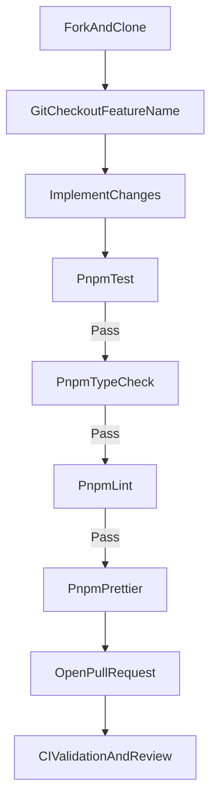

<!-- source: DeepWiki mcp.deepwiki.com · repo nanobrowser/nanobrowser · page 11.2 Community, Issues and Licensing · fetched 2026-10-29 -->

# Community, Issues and Licensing

<details>
<summary>Relevant source files</summary>

The following files were used as context for generating this wiki page:

- [.env.example](.env.example)
- [.github/FUNDING.yml](.github/FUNDING.yml)
- [.github/ISSUE_TEMPLATE/bug_report.yml](.github/ISSUE_TEMPLATE/bug_report.yml)
- [.github/ISSUE_TEMPLATE/config.yml](.github/ISSUE_TEMPLATE/config.yml)
- [.github/ISSUE_TEMPLATE/docs.yml](.github/ISSUE_TEMPLATE/docs.yml)
- [.github/ISSUE_TEMPLATE/feature_request.yml](.github/ISSUE_TEMPLATE/feature_request.yml)
- [.gitignore](.gitignore)
- [CONTRIBUTING.md](CONTRIBUTING.md)
- [LICENSE](LICENSE)
- [SECURITY.md](SECURITY.md)

</details>


This page details how the Nanobrowser project manages community interactions, handles issues and feature requests through structured templates, outlines contribution guidelines, specifies vulnerability reporting workflows, and defines the project's licensing terms under Apache 2.0.

Sources:
*   [CONTRIBUTING.md:1-67]()
*   [SECURITY.md:1-7]()
*   [LICENSE:1-125]()

## GitHub Issue Templates and Configuration

The project uses structured GitHub Issue templates to capture precise debugging details and feature propositions. Blank issues are disabled via `.github/ISSUE_TEMPLATE/config.yml` to enforce template usage and direct general questions to GitHub Discussions [.github/ISSUE_TEMPLATE/config.yml:1-7]().

### Bug Reports (`bug_report.yml`)
The bug report template requires structured inputs to diagnose extension runtime issues across different LLM providers and models [.github/ISSUE_TEMPLATE/bug_report.yml:1-96](). Key fields include:
*   **Nanobrowser Version**: The running extension version [.github/ISSUE_TEMPLATE/bug_report.yml:11-18]().
*   **Bug Description & Steps to Reproduce**: Clear reproduction steps including prompts and user actions [.github/ISSUE_TEMPLATE/bug_report.yml:20-39]().
*   **Browser & LLM Service Provider**: Target browser (Chrome/Edge) and provider selection (Anthropic, OpenAI, Google Gemini, Ollama, LM Studio, etc.) [.github/ISSUE_TEMPLATE/bug_report.yml:41-70]().
*   **Model & Mode**: Specific model designation and execution mode (`Ask` vs `Auto`) [.github/ISSUE_TEMPLATE/bug_report.yml:72-90]().

### Feature Requests and Documentation (`feature_request.yml`, `docs.yml`)
*   **Feature Requests**: Captured via `feature_request.yml`, focusing on the problem solved, proposed solution, and additional mockups [.github/ISSUE_TEMPLATE/feature_request.yml:1-31]().
*   **Documentation Changes**: Captured via `docs.yml`, tracking documentation scope and target audience (end-users vs contributors) [.github/ISSUE_TEMPLATE/docs.yml:1-20]().

```mermaid
graph TD
    "User" -->|"Opens Issue"| B{"Template Type"}
    B -->|"bug_report.yml"| C["CollectVersionBrowserLLMProviderModelSteps"]
    B -->|"feature_request.yml"| D["CollectProblemSolutionContext"]
    B -->|"docs.yml"| E["CollectDocScopeTargetAudience"]
    C & D & E -->|"Submit"| F["GitHubIssuesLabelNeedsTriage"]
```
**Diagram: Issue Submission Workflow**

Sources:
*   [.github/ISSUE_TEMPLATE/bug_report.yml:1-96]()
*   [.github/ISSUE_TEMPLATE/feature_request.yml:1-31]()
*   [.github/ISSUE_TEMPLATE/docs.yml:1-20]()
*   [.github/ISSUE_TEMPLATE/config.yml:1-7]()

## Security Policy and Vulnerability Reporting

Security vulnerabilities must be reported privately rather than through public issues or pull requests [SECURITY.md:1-5](). 

*   **Reporting Mechanism**: Contributors and users are instructed to use the [GitHub Security Advisory](https://github.com/nanobrowser/nanobrowser/security/advisories/new) reporting mechanism [SECURITY.md:7-7]().
*   **Handling**: Private disclosures allow maintainers to patch vulnerabilities before public exposure [SECURITY.md:7-7]().

Sources:
*   [SECURITY.md:1-7]()

## Funding Configuration

Project sponsorship and financial contributions are configured via `.github/FUNDING.yml` [.github/FUNDING.yml:1-3]().
*   **GitHub Sponsors**: Configured for maintainer `alexchenzl` [.github/FUNDING.yml:3-3]().

Sources:
*   [.github/FUNDING.yml:1-3]()

## Contribution Workflow and Development Standards

The project workflow, local setup requirements, and validation standards are defined in `CONTRIBUTING.md` [CONTRIBUTING.md:1-67]().

### Local Development Toolchain
*   **Node & pnpm**: Requires Node.js 24 LTS (v24.11.0+) and pnpm 10 (pinned via `package.json`) [CONTRIBUTING.md:14-15]().
*   **Corepack**: Enabled via `corepack enable` to manage dependencies [CONTRIBUTING.md:17-17]().

| Command | Description |
| ------- | ----------- |
| `pnpm install` | Install workspace dependencies [CONTRIBUTING.md:18-18]() |
| `pnpm dev` | Run WXT development server with hot-reload [CONTRIBUTING.md:19-19]() |
| `pnpm build` | Production build into `dist/` [CONTRIBUTING.md:26-26]() |
| `pnpm zip` | Pack production build into `dist-zip/` [CONTRIBUTING.md:27-27]() |
| `pnpm type-check` | Run TypeScript validation [CONTRIBUTING.md:28-28]() |
| `pnpm lint` | Execute ESLint including import-boundary checks [CONTRIBUTING.md:29-29]() |
| `pnpm test` | Run Vitest unit test suites [CONTRIBUTING.md:30-30]() |
| `pnpm autorun <check>` | Run headless browser checks against local test fixtures [CONTRIBUTING.md:33-33]() |

### Pull Request Quality Gate
Before opening a pull request, contributors must verify that formatting, linting, type-checking, and unit tests pass successfully [CONTRIBUTING.md:35-35]().


**Diagram: Contribution and Quality Gate Workflow**

Sources:
*   [CONTRIBUTING.md:1-67]()

## Licensing and Governance

Nanobrowser is open-source software licensed under the Apache License, Version 2.0 [LICENSE:1-3]().

*   **Copyright Grant**: Contributors grant a perpetual, worldwide, non-exclusive, royalty-free copyright license to reproduce, prepare derivative works, publicly display, and distribute the work [LICENSE:66-71]().
*   **Patent Grant**: Contributors grant a patent license for claims necessarily infringed by their contributions [LICENSE:73-87]().
*   **Redistribution Requirements**: Redistributions must include a copy of the Apache 2.0 license, prominent notices of modified files, and retained copyright/attribution notices [LICENSE:89-122]().
*   **Contributor Agreement**: Submitting a contribution implies agreement that the contribution is licensed under the Apache 2.0 terms [CONTRIBUTING.md:67-67]().

Sources:
*   [LICENSE:1-125]()
*   [CONTRIBUTING.md:67-67]()

---

