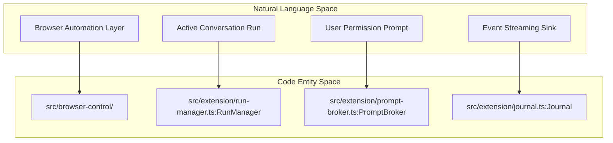
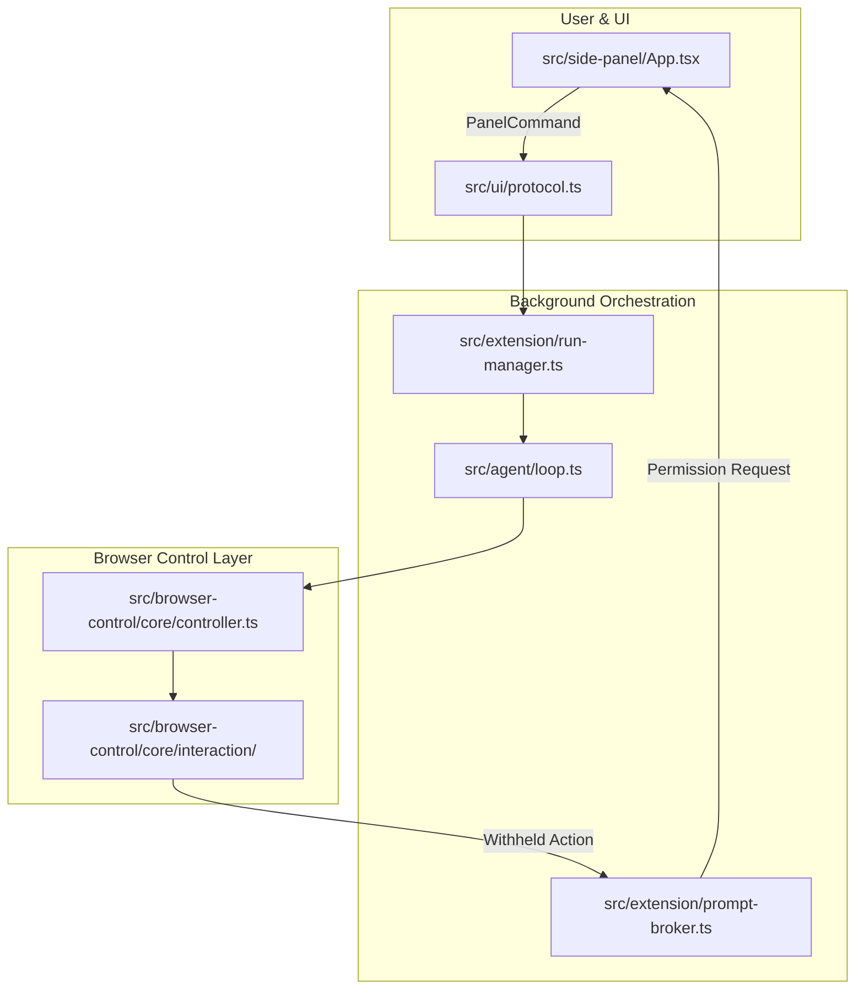

<!-- source: DeepWiki mcp.deepwiki.com · repo nanobrowser/nanobrowser · page 12 Glossary · fetched 2026-10-29 -->

# Glossary

Relevant source files

The following files were used as context for generating this wiki page:

- [.npmrc](.npmrc)
- [CLAUDE.md](CLAUDE.md)
- [src/extension/run-manager.ts](src/extension/run-manager.ts)
- [src/llm/catalogue.ts](src/llm/catalogue.ts)
- [src/options/AboutSection.tsx](src/options/AboutSection.tsx)
- [src/options/App.tsx](src/options/App.tsx)
- [src/ui/links.ts](src/ui/links.ts)
- [src/ui/locales/en.json](src/ui/locales/en.json)

This page defines key technical terms, classes, modules, and architectural concepts across the Nanobrowser codebase. Each entry details its role, implementation, data flow, and relevant code citations.

## Browser Control Layer

The **Browser Control Layer** (`src/browser-control/`) is a deterministic, LLM-free web automation subsystem built directly on top of Chrome's DevTools Protocol (`chrome.debugger`) and Puppeteer frame management [CLAUDE.md:6-10](). It provides perception (snapshots, accessibility trees, element reading) and interaction (preflight, coordinate mapping, input dispatch) APIs exclusively for the extension's internal agent [CLAUDE.md:6-10]().

**Implementation:**
The public surface of the layer is exposed via `src/browser-control/index.ts` [CLAUDE.md:69](). Core execution is handled by `src/browser-control/core/controller.ts`, with frame tracking managed through Puppeteer adapters in `src/browser-control/host/` [CLAUDE.md:26-27]().

**Data Flow:**
The agent requests perception data or issues atomic tool commands (e.g., click, fill) to the controller. The controller validates element references against the current document, performs preflight actionability checks, and dispatches raw CDP commands to the target frame session without utilizing element selectors or heuristics [CLAUDE.md:28]().

*   `src/browser-control/index.ts` [CLAUDE.md:69]()
*   `src/browser-control/core/controller.ts` [CLAUDE.md:66]()
*   `src/browser-control/host/` [CLAUDE.md:68]()

Sources: [CLAUDE.md:6-10](), [CLAUDE.md:26-28](), [CLAUDE.md:66-69]()

---

## Ref

A **Ref** (Reference) is an opaque handle assigned to an interactive DOM node during perception snapshots. Refs ensure that agent interactions operate deterministically on the exact node observed [CLAUDE.md:33-34]().

**Implementation:**
Managed in `src/browser-control/core/refs.ts`, refs follow strict fail-closed invariants: a ref is valid solely for the document session it was captured in and only if the agent was explicitly shown the node [CLAUDE.md:34](). Stale or cross-document references result in typed errors rather than heuristic fallbacks [CLAUDE.md:34]().

*   `src/browser-control/core/refs.ts` [CLAUDE.md:66]()

Sources: [CLAUDE.md:33-34](), [CLAUDE.md:66]()

---

## CDP Session

A **CDP Session** represents an active debugging connection to a specific browser target or frame via Chrome's DevTools Protocol (`chrome.debugger`) [CLAUDE.md:26]().

**Implementation:**
Hosted within `src/browser-control/host/`, CDP sessions manage target attachment, command multiplexing, and event listening. Puppeteer acts as the frame manager, tracking out-of-process iframes (OOPIFs) and mapping their targets to CDP sessions [CLAUDE.md:27]().

*   `src/browser-control/host/` [CLAUDE.md:68]()

Sources: [CLAUDE.md:26-27](), [CLAUDE.md:68]()

---

## Probe

A **Probe** is a lightweight JavaScript snippet injected into target pages to execute read-only perception tasks, extract accessibility trees, or observe DOM mutations [CLAUDE.md:67]().

**Implementation:**
Probes reside in `src/browser-control/probe/` and are compiled into static string constants during the build pipeline [CLAUDE.md:67](). They execute synchronously within the target frame context to return structured JSON payloads to the browser control layer.

*   `src/browser-control/probe/` [CLAUDE.md:67]()

Sources: [CLAUDE.md:67]()

---

## Preflight and Actionability

**Preflight** encompasses the suite of verification checks executed immediately prior to dispatching an input event to a DOM node [CLAUDE.md:35](). 

**Implementation:**
Implemented in `src/browser-control/core/interaction/`, preflight validates element visibility, geometry, stability, and interception state (actionability) [CLAUDE.md:35](). Retries and stabilization checks occur strictly *before* input dispatch; once dispatched, the layer never retries input autonomously [CLAUDE.md:35]().

*   `src/browser-control/core/interaction/` [CLAUDE.md:66]()

Sources: [CLAUDE.md:35](), [CLAUDE.md:66]()

---

## Withheld Action

A **Withheld Action** is a consequential operation (such as a form submit, financial payment, data deletion, or page script evaluation) that is intercepted and held back from execution pending explicit user review [CLAUDE.md:43]().

**Implementation:**
Handled in `src/browser-control/core/interaction/` and orchestrated by `src/extension/run-manager.ts`, sensitive actions trigger a permission card in the side panel [src/extension/run-manager.ts:45](). Execution remains blocked until the user explicitly authorizes or denies the operation [CLAUDE.md:43]().

*   `src/extension/run-manager.ts` [src/extension/run-manager.ts:45]()
*   `src/browser-control/core/interaction/` [CLAUDE.md:66]()

Sources: [CLAUDE.md:43](), [src/extension/run-manager.ts:45]()

---

## Ask / Auto Mode

**Ask Mode** and **Auto Mode** define the extension's execution permission policies governing how much autonomy the agent possesses [CLAUDE.md:47-49]().

**Implementation:**
Mode states are managed by `src/extension/run-manager.ts` and surfaced via the side panel composer UI (`src/ui/protocol.ts`) [src/extension/run-manager.ts:45](). In *Ask Mode* (default), detected writes and submissions prompt the user for approval [CLAUDE.md:49](). In *Auto Mode*, non-sensitive actions execute autonomously [CLAUDE.md:49](). High-risk actions (payments, secrets, prompts) always require explicit user interaction regardless of mode [CLAUDE.md:50]().

*   `src/extension/run-manager.ts` [src/extension/run-manager.ts:45-51]()
*   `src/ui/protocol.ts` [src/extension/run-manager.ts:45]()

Sources: [CLAUDE.md:47-51](), [src/extension/run-manager.ts:45-51]()

---

## Site Rule

A **Site Rule** specifies per-origin security policies (`allow`, `ask`, or `block`) determining how the agent interacts with specific web domains [CLAUDE.md:49]().

**Implementation:**
Stored and enforced via `src/extension/permissions.ts` and integrated into the `RunManager`, site rules dictate whether automation runs freely, prompts the user on every write, or blocks execution entirely on sensitive domains [src/extension/run-manager.ts:88]().

*   `src/extension/permissions.ts` [src/extension/run-manager.ts:88]()
*   `src/extension/run-manager.ts` [src/extension/run-manager.ts:88]()

Sources: [CLAUDE.md:49](), [src/extension/run-manager.ts:88]()

---

## Handover / Takeover

**Handover** and **Takeover** describe state transitions where control of the browser session is relinquished to the human user (e.g., during authentication challenges or payment flows) and subsequently reclaimed once resolved [CLAUDE.md:50]().

**Implementation:**
Managed in `src/agent/restore.ts` and `src/extension/prompt-broker.ts`, these mechanisms pause the agent loop and prompt the user via notifications (`src/extension/notify.ts`) when user-exclusive steps are encountered [src/extension/run-manager.ts:51-52]().

*   `src/agent/restore.ts` [src/extension/run-manager.ts:31]()
*   `src/extension/prompt-broker.ts` [src/extension/run-manager.ts:51]()

Sources: [CLAUDE.md:50](), [src/extension/run-manager.ts:31-52]()

---

## Turn Cap

A **Turn Cap** is the hard limit on the number of reasoning and action steps an agent loop (`AgentLoop`) can execute within a single conversation turn.

**Implementation:**
Defined in `src/agent/loop.ts`, the turn cap prevents runaway execution loops by terminating tasks and returning a capped status when the threshold is reached [src/side-panel:113]().

*   `src/agent/loop.ts` [src/extension/run-manager.ts:3]()

Sources: [src/agent/loop.ts:3](), [src/ui/locales/en.json:113]()

---

## Reasoning Effort & Wire Effort

**Reasoning Effort** is the user-facing setting controlling model thinking depth (`none`, `low`, `medium`, `high`), while **Wire Effort** is the provider-specific translated parameter sent across the API [src/llm/catalogue.ts:9-20]().

**Implementation:**
Defined in `src/llm/catalogue.ts`, these types map high-level user preferences to vendor-specific `reasoning` payload structures required by the Vercel AI SDK [src/llm/catalogue.ts:12-22]().

*   `src/llm/catalogue.ts` [src/llm/catalogue.ts:7-22]()

Sources: [src/llm/catalogue.ts:7-22]()

---

## Catalogue Row

A **Catalogue Row** is a structured record defining metadata, capability constraints, context windows, vision support, and reasoning capabilities for a specific model family [src/llm/catalogue.ts:24-48]().

**Implementation:**
Managed in `src/llm/catalogue.ts`, catalogue rows enable the extension to dynamically adapt prompt budgeting, token limits, and tool-calling validation rules for cloud and local providers [src/llm/catalogue.ts:24-48]().

*   `src/llm/catalogue.ts` [src/llm/catalogue.ts:24-48]()

Sources: [src/llm/catalogue.ts:24-48]()

---

## RunManager

The **RunManager** (`src/extension/run-manager.ts`) is the core orchestrator residing in the extension's background service worker. It manages active conversation runs, persistent state records, panel connections, and execution lifecycles [src/extension/run-manager.ts:1-86]().

**Implementation:**
The `RunManager` class coordinates sessions, tab scoping, permissions, prompt brokering, and journaling [src/extension/run-manager.ts:86-125](). It acts as the central hub bridging UI panel events with background agent execution.

*   `src/extension/run-manager.ts` [src/extension/run-manager.ts:86-125]()

Sources: [src/extension/run-manager.ts:1-125]()

---

## AgentLoop

The **AgentLoop** (`src/agent/loop.ts`) is the single agent execution loop driving conversation turns, planning, tool invocation, and completion [src/extension/run-manager.ts:3]().

**Implementation:**
Replaced the legacy multi-agent planner/navigator architecture with a unified loop per conversation [CLAUDE.md:55](). It processes model completions, validates tool execution, and manages context compaction [src/extension/run-manager.ts:3]().

*   `src/agent/loop.ts` [src/extension/run-manager.ts:3]()

Sources: [CLAUDE.md:55](), [src/extension/run-manager.ts:3]()

---

## PromptBroker

The **PromptBroker** (`src/extension/prompt-broker.ts`) is the mediation layer handling agent permission requests, user prompts, and security overrides [src/extension/run-manager.ts:89]().

**Implementation:**
Initialized inside `RunManager`, `PromptBroker` intercepts layer prompts originating from session tabs, routes approval dialogs to the side panel, and remembers site-level allow rules [src/extension/run-manager.ts:126-132]().

*   `src/extension/prompt-broker.ts` [src/extension/run-manager.ts:89]()

Sources: [src/extension/run-manager.ts:89-132]()

---

## Journal

The **Journal** (`src/extension/journal.ts`) is an event-sourcing sink that streams state changes, run updates, and transcripts to connected side panels [src/extension/run-manager.ts:65]().

**Implementation:**
The `Journal` class records entries and broadcasts them across active panel ports, ensuring that newly opened or reconnected side panels can hydrate their conversation state instantly [src/extension/run-manager.ts:87]().

*   `src/extension/journal.ts` [src/extension/run-manager.ts:65]()

Sources: [src/extension/run-manager.ts:65-87]()

---

## TabScope

**TabScope** (`src/extension/bindings.ts`) manages the association registry linking browser tabs to specific conversation IDs and active agent sessions [src/extension/run-manager.ts:47]().

**Implementation:**
Instantiated within `RunManager`, `TabScope` tracks scoped tabs, detects navigation events, and fires updates when tabs are added or removed from a conversation run [src/extension/run-manager.ts:111-114]().

*   `src/extension/run-manager.ts` [src/extension/run-manager.ts:47]()

Sources: [src/extension/run-manager.ts:47-114]()

---

## Page Border

The **Page Border** (`src/extension/border.ts`) is a visual indicator injected into web pages to signal that the agent is actively working within that tab [src/extension/run-manager.ts:48]().

**Implementation:**
Managed by `PageBorder` and content injection scripts, it observes scoped tabs and applies a glowing border when an active run is interacting with the page [src/extension/run-manager.ts:115-122]().

*   `src/extension/border.ts` [src/extension/run-manager.ts:48]()

Sources: [src/extension/run-manager.ts:48-122]()

---

## Steering Queue

The **Steering Queue** (`src/extension/run-manager.ts`) is an in-memory queue holding messages typed by the user while an agent run is actively executing [src/extension/run-manager.ts:98]().

**Implementation:**
Queued messages are stored per conversation in the background worker and fed into the next agent turn once perception and execution cycles complete [src/extension/run-manager.ts:98]().

*   `src/extension/run-manager.ts` [src/extension/run-manager.ts:98-99]()

Sources: [src/extension/run-manager.ts:98-99]()

---

## Panel Protocol

The **Panel Protocol** (`src/ui/protocol.ts`) defines the typed command and event messaging schema used for communication between side panel views and the extension background worker [src/extension/run-manager.ts:45]().

**Implementation:**
Structured around typed command unions and event bodies, it guarantees type safety across runtime message passing and port connections [src/extension/run-manager.ts:45]().

*   `src/ui/protocol.ts` [src/extension/run-manager.ts:45]()

Sources: [src/extension/run-manager.ts:45]()

---

## Autorun Check

An **Autorun Check** is an automated test case verifying background functionality, UI components, provider connections, or host integrations [CLAUDE.md:71]().

**Implementation:**
Located in `src/background/autorun.ts` and `src/background/checks/`, autorun checks execute within test runners to ensure extension health and regression resistance [CLAUDE.md:71]().

*   `src/background/autorun.ts` [CLAUDE.md:71]()

Sources: [CLAUDE.md:71]()

---

## Scenario

A **Scenario** is an end-to-end headless test suite driving Chrome for Testing to validate complex agent workflows and browser interactions [CLAUDE.md:71]().

**Implementation:**
Stored in `src/background/scenarios/`, scenarios execute automated user journeys across local fixture pages [CLAUDE.md:71]().

*   `src/background/scenarios/` [CLAUDE.md:71]()

Sources: [CLAUDE.md:71]()

---

## Fixture Page

A **Fixture Page** is a deterministic static web page hosted locally to test specific edge cases, overlays, DOM enrichment, and authentication flows [CLAUDE.md:72]().

**Implementation:**
Located in `fixtures/pages/` and served via `fixtures/server.mjs`, fixture pages provide controlled environments for autorun checks and scenarios [CLAUDE.md:72]().

*   `fixtures/` [CLAUDE.md:72]()

Sources: [CLAUDE.md:72]()

---

## Architectural Mapping: Natural Language to Code Entities

Sources: [CLAUDE.md:6-10](), [src/extension/run-manager.ts:65-125]()

---

## Execution Flow & Guardrail Verification

Sources: [src/extension/run-manager.ts:45-132](), [src/agent/loop.ts:1-100](), [src/browser-control/core/controller.ts:1-50]()