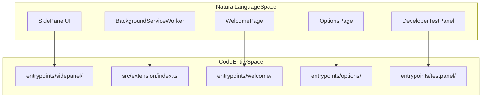
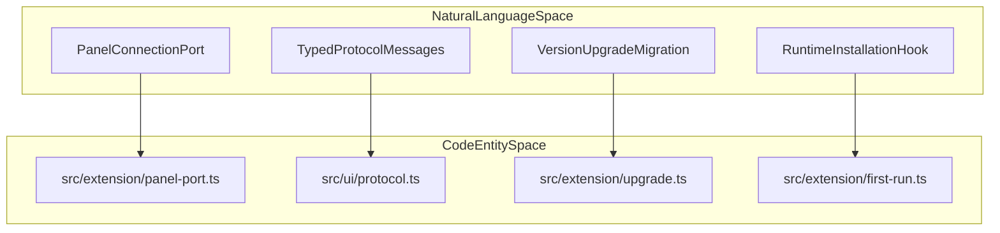

<!-- source: DeepWiki mcp.deepwiki.com · repo nanobrowser/nanobrowser · page 2 Extension Shell and Entrypoints · fetched 2026-10-29 -->

# Extension Shell and Entrypoints

Relevant source files

The following files were used as context for generating this wiki page:

- [.npmrc](.npmrc)
- [CLAUDE.md](CLAUDE.md)
- [src/extension/index.ts](src/extension/index.ts)

Nanobrowser is implemented as a Chrome Extension leveraging the Manifest V3 architecture. This page provides a high-level overview of the extension shell, WXT entrypoints, manifest permissions, and the communication protocols binding the background worker to the various UI panels. 

For detailed information on how these components are packaged and built, see [Entrypoints and WXT Build System](#2.1). For specifics on how UI panels communicate with the background service worker, see [Panel Protocol and Messaging](#2.2). For lifecycle flows such as installation, upgrades, and uninstalls, see [Lifecycle: Install, Upgrade and Uninstall](#2.3).

## Extension Shell Overview

The extension shell consists of multiple isolated Chrome Extension contexts managed through WXT wrappers located in the `entrypoints/` directory [CLAUDE.md:63-63]. The core background worker wiring is initialized synchronously in `src/extension/index.ts`, registering run managers, panel ports, alarms, and message handlers [src/extension/index.ts:1-12].

### Diagram: Extension Entrypoints and Shell Architecture

Sources: [CLAUDE.md:63-71](), [src/extension/index.ts:1-12]()

## Manifest and Permissions

The extension declares its required and optional permissions via manifest configuration and supporting modules. Core features rely on required permissions (such as `debugger`, `tabs`, `sidePanel`, `storage`, and `scripting`), which do not trigger new installation warnings. Optional features utilize runtime permissions to degrade gracefully until authorized by the user.

Sources: [src/extension/index.ts:1-54]()

## Entrypoints and WXT Build System

WXT handles the compilation and bundling of extension targets, configuration via `wxt.config.ts`, static assets in `public/`, and localization files in `_locales/`. 

For a complete breakdown of WXT packaging, manifest generation, and distribution builds, see [Entrypoints and WXT Build System](#2.1).

Sources: [CLAUDE.md:45-47](), [CLAUDE.md:71-75]()

## Panel Protocol and Messaging

Inter-context communication between the side panel and the background service worker is mediated via typed command/event protocols (`src/ui/protocol.ts`) and persistent connection ports (`src/extension/panel-port.ts`).

### Diagram: Panel Messaging and Lifecycle Routing

Sources: [src/extension/index.ts:2-7]()

For detailed documentation on the journal-based event streaming and `PanelClient`, see [Panel Protocol and Messaging](#2.2).

Sources: [src/extension/index.ts:1-12]()

## Lifecycle: Install, Upgrade and Uninstall

The background service worker listens for installation and update triggers via `chrome.runtime.onInstalled`, managing first-run flows, shortcut creation, migration tasks (`src/extension/upgrade.ts`), and what's-new notifications [src/extension/index.ts:20-35].

For full implementation details on data migration, upgrade handlers, and uninstall logging, see [Lifecycle: Install, Upgrade and Uninstall](#2.3).

Sources: [src/extension/index.ts:20-54]()

---

