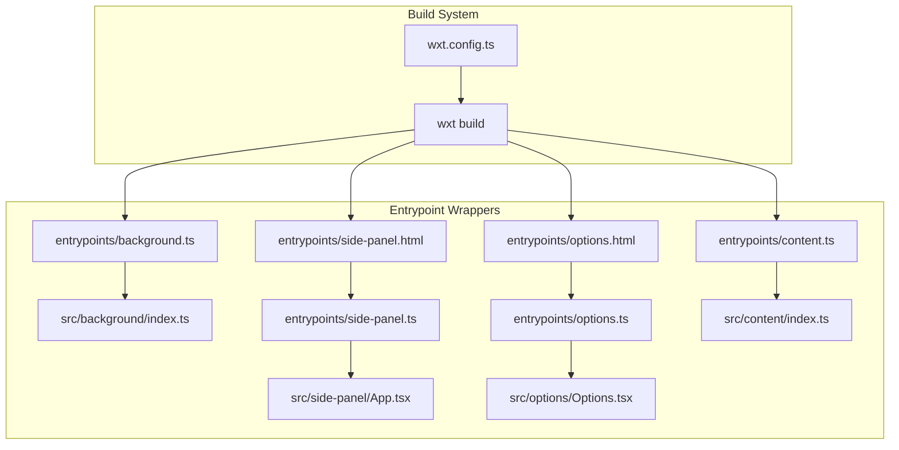
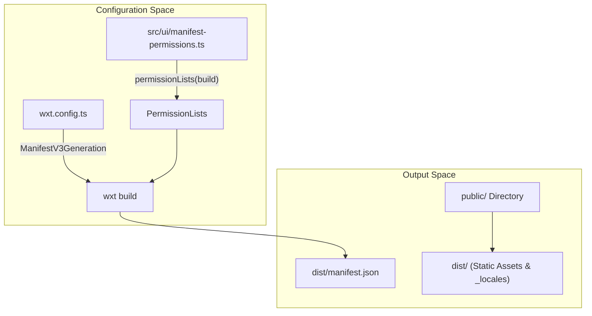

<!-- source: DeepWiki mcp.deepwiki.com · repo nanobrowser/nanobrowser · page 2.1 Entrypoints and WXT Build System · fetched 2026-10-29 -->

# Entrypoints and WXT Build System

Relevant source files

The following files were used as context for generating this wiki page:

- [package.json](package.json)
- [pnpm-lock.yaml](pnpm-lock.yaml)
- [src/ui/__tests__/manifest-permissions.test.ts](src/ui/__tests__/manifest-permissions.test.ts)
- [src/ui/manifest-permissions.ts](src/ui/manifest-permissions.ts)

This page details the entrypoints of the Nanobrowser extension, how the WXT build system processes them, the role of manifest generation and permission configuration modules in `src/ui/manifest-permissions.ts`, the `public/` directory for static assets and `_locales`, and the final packaging process into `dist/` and `dist-zip/`.

Sources: [package.json:1-84](), [src/ui/manifest-permissions.ts:1-42]()

## Extension Entrypoints and Wrappers

Nanobrowser utilizes several entrypoints defined in the `entrypoints/` directory. These serve as thin wrappers that import core logic and UI applications from `src/`.

*   **Background Service Worker**: Acts as the central orchestration hub, managing multi-agent tasks, run records, and host communication via `entrypoints/background.ts`.
*   **Side Panel and Options Pages**: User interfaces such as the chat side panel and options/settings page are structured as HTML entrypoints pointing to TypeScript modules that mount React components (`entrypoints/side-panel.html`, `entrypoints/side-panel.ts`, `entrypoints/options.html`, `entrypoints/options.ts`).
*   **Content Scripts and Web Accessible Resources**: Scripts like `entrypoints/content.ts` inject execution contexts into web pages, while static scripts are copied directly as web-accessible resources for the browser control layer.

### Diagram: Extension Entrypoints to Code Entity Mapping

Sources: [package.json:1-84]()

## WXT Build Configuration and Manifest Generation

The project relies on WXT and Vite for bundling and manifest generation. Permission lists are dynamically defined or structured via `src/ui/manifest-permissions.ts` [src/ui/manifest-permissions.ts:1-42](), which separates core mandatory permissions from optional product permissions to prevent unintended install warnings.

### Permission Management

The extension distinguishes between required permissions that do not alter install warnings and optional permissions that manage additional features [src/ui/manifest-permissions.ts:1-17]().

*   `REQUIRED_PERMISSIONS`: Includes `debugger`, `tabs`, `sidePanel`, `storage`, `webNavigation`, `unlimitedStorage`, `alarms`, `offscreen`, `contextMenus`, and `scripting` [src/ui/manifest-permissions.ts:19-30]().
*   `OPTIONAL_PERMISSIONS`: Includes `tabGroups`, `notifications`, `downloads`, and `downloads.open` [src/ui/manifest-permissions.ts:8-14]().
*   `permissionLists(build)`: Selects between product and autorun manifest permission configurations [src/ui/manifest-permissions.ts:38-42]().

### Diagram: Manifest Permission Generation and Build Pipeline

Sources: [src/ui/manifest-permissions.ts:1-42](), [src/ui/__tests__/manifest-permissions.test.ts:1-34]()

## Public Assets, Localization, and Static Files

Static files residing in the `public/` directory are copied directly into the build output during compilation:
*   Icons (`public/icon/`) for various display resolutions.
*   Internationalization resources (`public/_locales/`) containing multi-language message dictionaries.
*   Permission handler pages (`public/permission/`) used when requesting broad site access or specialized permissions.

Sources: [package.json:1-84](), [src/ui/manifest-permissions.ts:1-42]()

## Packaging into `dist` and `dist-zip`

The build lifecycle is managed through scripts defined in `package.json`:
*   `pnpm build`: Executes `wxt build` to bundle all entrypoints, compile TypeScript code, and output the unpacked extension into the `dist/` directory [package.json:15]().
*   `pnpm zip`: Runs the build process followed by packaging scripts to compress the `dist/` contents into a distributable archive located in `dist-zip/` [package.json:16](), [package.json:26]().
*   `pnpm clean`: Removes build output directories including `dist`, `dist-zip`, `.wxt`, and `.output` [package.json:26]().

Sources: [package.json:12-27]()

---

