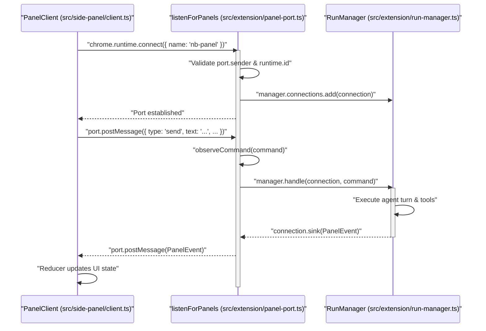
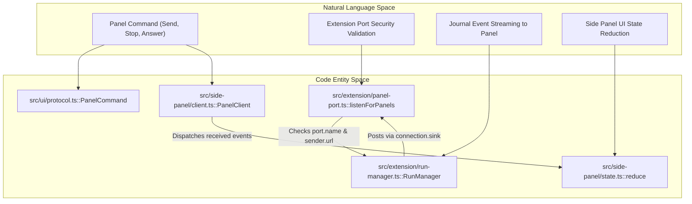

<!-- source: DeepWiki mcp.deepwiki.com · repo nanobrowser/nanobrowser · page 2.2 Panel Protocol and Messaging · fetched 2026-10-29 -->

# Panel Protocol and Messaging

Relevant source files

The following files were used as context for generating this wiki page:

- [src/extension/panel-port.ts](src/extension/panel-port.ts)
- [src/side-panel/App.tsx](src/side-panel/App.tsx)
- [src/ui/protocol.ts](src/ui/protocol.ts)

This page details the communication architecture between the Nanobrowser side panel UI and the extension background service worker. It covers the typed command and event protocol (`src/ui/protocol.ts`), the secure runtime port connection (`src/extension/panel-port.ts`), client-side connection management (`PanelClient`), and journal-based event streaming that ensures the side panel remains synchronized without directly accessing local storage.

Sources:
- [src/ui/protocol.ts:1-2]()
- [src/extension/panel-port.ts:1-7]()

---

## Panel Port Architecture and Security

Communication between the side panel and the background worker is established using a dedicated `chrome.runtime.Port` per panel document [src/ui/protocol.ts:1-2](). Only the extension's internal side panel page is permitted to connect; external listeners or rogue contexts are immediately disconnected [src/extension/panel-port.ts:1-15]().

When a panel document loads, it connects using the port name constant `PANEL_PORT_NAME` (`'nb-panel'`) [src/extension/panel-port.ts:3-10](), [src/ui/protocol.ts:14](). The background service worker listens for connections via `chrome.runtime.onConnect` and applies strict validation checks inside `listenForPanels`:
1. Verifies that `port.name` matches `PANEL_PORT_NAME` [src/extension/panel-port.ts:11]()
2. Verifies that `port.sender.id` matches the extension ID (`chrome.runtime.id`) [src/extension/panel-port.ts:12]()
3. Verifies that `port.sender.url` starts with the side panel URL (`/sidepanel.html`) [src/extension/panel-port.ts:8-12]()

If any check fails, `port.disconnect()` is invoked immediately [src/extension/panel-port.ts:13](). Valid connections are registered inside the background `RunManager` as a `PanelConnection` containing a sink function that posts serialized `PanelEvent` objects back to the panel [src/extension/panel-port.ts:17-24]().

Commands sent from the panel to the worker are processed sequentially through a promise chain to maintain state consistency, with the exception of `answer` commands (responding to interactive cards) which execute immediately to prevent deadlocks when sharing tabs [src/extension/panel-port.ts:43-51]().

Sources:
- [src/extension/panel-port.ts:1-53]()
- [src/ui/protocol.ts:14-14]()
- [src/side-panel/App.tsx:80-80]()

---

## Typed Panel Protocol (`src/ui/protocol.ts`)

The panel protocol enforces strict separation of concerns: **the side panel never reads the persistence stores directly; it renders state purely based on events received from the worker [src/ui/protocol.ts:1-2]().**

### `PanelCommand`
Commands flow from the side panel to the worker via `port.postMessage()` [src/extension/panel-port.ts:44](). Key command types defined in `PanelCommand` include:
- `subscribe`: Binds the panel to a specific `tabId` and optional `conversationId`, requesting events starting from a given sequence number (`sinceSeq`) [src/ui/protocol.ts:29]()
- `send`: Submits a new user prompt along with optional attachments, context chips, permission mode, model references, and reasoning effort [src/ui/protocol.ts:30-45]()
- `queue` / `unqueue`: Manages queued messages for active or pending conversation runs [src/ui/protocol.ts:46-54]()
- `stop`, `resume`, `continue`, `retry`, `edit`, `restart`: Controls agent execution lifecycle [src/ui/protocol.ts:56-60]()
- `answer`: Responds to interactive worker prompts (such as write-cards, handovers, or confirmation dialogs) [src/ui/protocol.ts:58]()
- `screenshot-tab`: Triggers a tab capture through the browser control layer [src/ui/protocol.ts:76]()
- `voice-used`: Reports voice input usage for telemetry and analytics [src/ui/protocol.ts:77-78](), [src/side-panel/App.tsx:80]()

### `PanelEvent` and `DisplayEntry`
Events flow from the worker's run manager back to the panel sink [src/extension/panel-port.ts:20](). They include agent lifecycle markers (`agent_start`, `agent_end`, `turn_start`, `turn_end`) [src/ui/protocol.ts:175-179](), streaming text updates (`message_start`, `message_update`) [src/ui/protocol.ts:180-182](), tool execution rows (`ToolRow`) [src/ui/protocol.ts:81-94](), and UI display entries (`DisplayEntry` representing user messages, assistant replies, notices, and file downloads) [src/ui/protocol.ts:113-140]().

Sources:
- [src/ui/protocol.ts:1-78]()
- [src/ui/protocol.ts:81-140]()
- [src/ui/protocol.ts:175-182]()
- [src/extension/panel-port.ts:20-44]()
- [src/side-panel/App.tsx:80-80]()

---

## Journal-Based Event Streaming

To support reconnections, panel refreshes, and multi-tab state sync, execution logs are maintained in a journal structure. When a panel sends a `subscribe` command with an optional `sinceSeq` parameter [src/ui/protocol.ts:29](), the worker replays journaled events from that sequence onwards before switching to live streaming. This guarantees that side panels do not miss state transitions or tool execution updates if a port re-establishes mid-run.

Sources:
- [src/ui/protocol.ts:29]()
- [src/extension/panel-port.ts:17-24]()

---

## Command and Event Flow Diagrams

### Diagram 1: Panel Port Connection and Command Lifecycle

Sources:
- [src/extension/panel-port.ts:8-53]()
- [src/ui/protocol.ts:27-78]()

---

### Diagram 2: Natural Language Space to Code Entity Space

Sources:
- [src/ui/protocol.ts:1-78]()
- [src/extension/panel-port.ts:1-53]()
- [src/side-panel/client.ts]()

---

