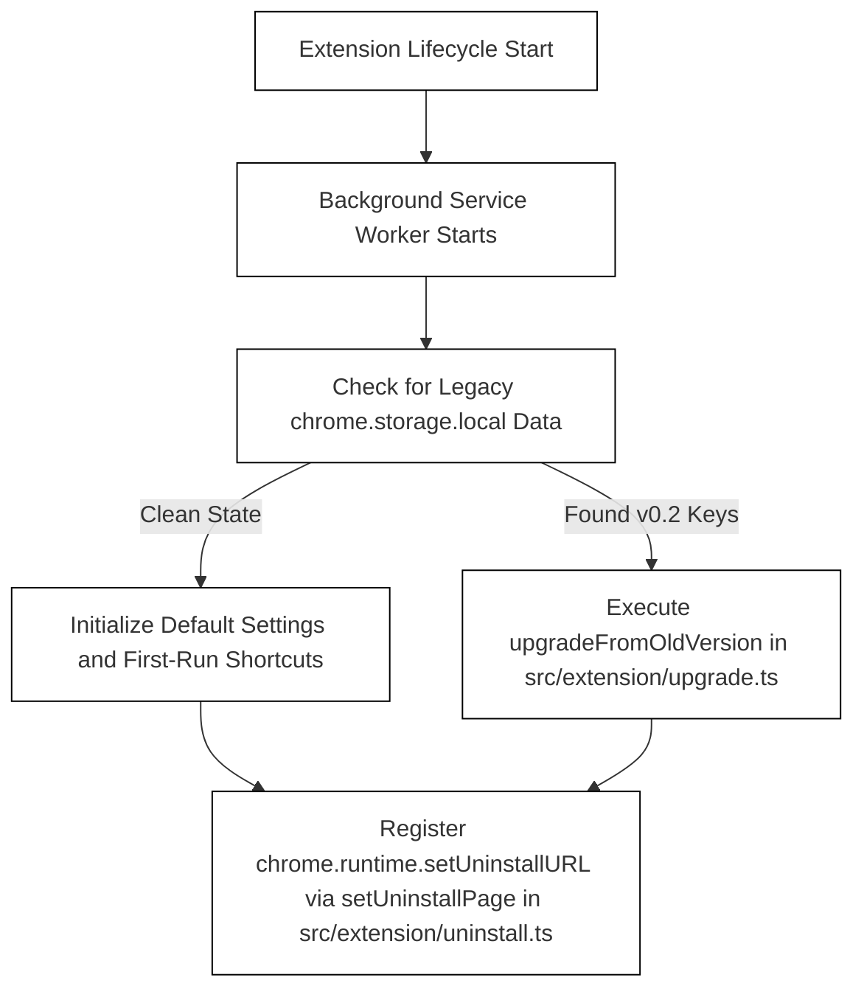
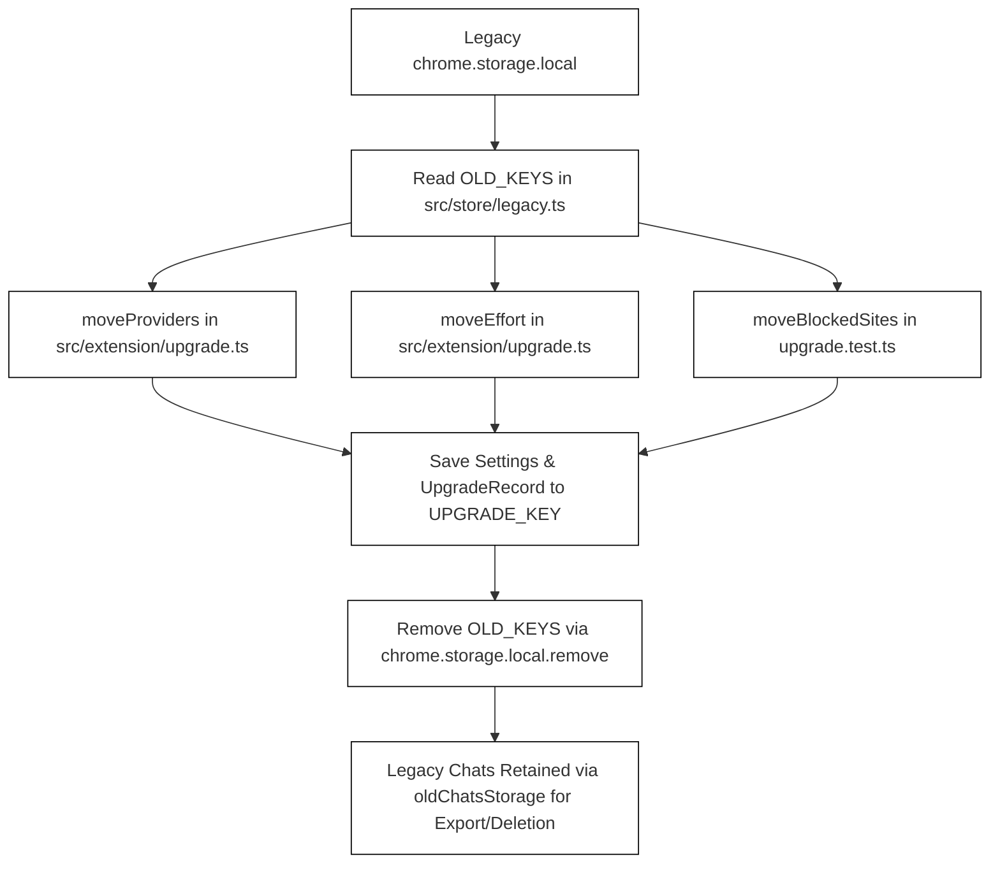
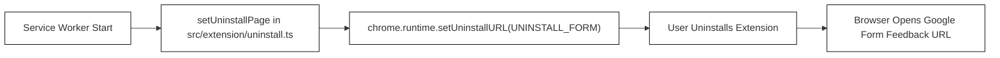

<!-- source: DeepWiki mcp.deepwiki.com · repo nanobrowser/nanobrowser · page 2.3 Lifecycle: Install, Upgrade and Uninstall · fetched 2026-10-29 -->

# Lifecycle: Install, Upgrade and Uninstall

Relevant source files

The following files were used as context for generating this wiki page:

- [src/extension/__tests__/upgrade.test.ts](src/extension/__tests__/upgrade.test.ts)
- [src/extension/uninstall.ts](src/extension/uninstall.ts)
- [src/extension/upgrade.ts](src/extension/upgrade.ts)
- [src/store/legacy.ts](src/store/legacy.ts)

## Purpose and Scope
This page covers extension lifecycle management for Nanobrowser, detailing the first-run initialization flow, version upgrade migrations from legacy version `0.2` [src/extension/upgrade.ts:1-8](), uninstall tracking [src/extension/uninstall.ts:1-9](), and post-update "What's New" card generation [src/extension/upgrade.ts:14-16](). It addresses how persistent storage is initialized, how legacy `chrome.storage.local` schemas are mapped to the current architecture via `src/extension/upgrade.ts` and `src/store/legacy.ts`, and how browser extension lifecycle hooks are registered upon service worker startup.

Sources: 
- `src/extension/upgrade.ts:1-17`
- `src/extension/uninstall.ts:1-9`
- `src/store/legacy.ts:1-17`

---

## 1. First-Run Initialization and Installation Flow

When the Nanobrowser extension is installed or loaded into Chrome or Edge, the background service worker initializes runtime configurations. While fresh installations execute default setup routines (such as seeding initial shortcuts and default models), upgrading installations detect remnants of legacy schema structures in `chrome.storage.local` [src/extension/upgrade.ts:1-8]().

The installation lifecycle ensures that:
1. Default parameters, permission schemas, and settings stores are initialized.
2. The uninstall survey URL is configured via `chrome.runtime.setUninstallURL` [src/extension/uninstall.ts:7-9]() pointing to a localized feedback form (`UNINSTALL_FORM`) [src/extension/uninstall.ts:3-4]().

Sources: 
- `src/extension/upgrade.ts:1-8`
- `src/extension/uninstall.ts:6-9`

---

## 2. Version Upgrade and Legacy Data Migration

Nanobrowser includes a comprehensive migration engine designed to upgrade user data seamlessly from version `0.2` without data loss or breaking changes [src/extension/upgrade.ts:1-8](). Because the extension shares the same Chrome Web Store listing, legacy keys persist in `chrome.storage.local` [src/extension/upgrade.ts:1-8](). 

### Migration Mechanics and Sequence
Upon every worker start, if legacy data is detected, the upgrade routine executes in a strict transaction order:
1. **Shortcuts Migration**: Converts legacy saved prompts/favorites into modern slash-command shortcuts using `saveShortcut` [src/store/legacy.ts:10](), generating unique slugs via `shortcutName` [src/extension/__tests__/upgrade.test.ts:13-15]().
2. **Settings & Providers Translation**: Maps old provider types and model configurations into the modern `ProviderConfig` layout via `moveProviders` [src/extension/upgrade.ts:63-115](). Unsupported or deprecated providers (such as Azure OpenAI, Cerebras, Llama, and Groq) are pruned [src/extension/upgrade.ts:30-31, 107-108]().
3. **Reasoning Effort Mapping**: Translates old effort descriptors using `moveEffort` [src/extension/upgrade.ts:120-134]() to fit current `ReasoningEffort` specs [src/extension/upgrade.ts:11]() (`low`, `medium`, `high`) [src/extension/upgrade.ts:121-125]().
4. **Firewall and Blocked Sites**: Converts legacy deny-lists into structural `Block` site rules via `moveBlockedSites` [src/extension/__tests__/upgrade.test.ts:159-165]().
5. **Commit and Cleanup**: Writes settings along with a persistent `UpgradeRecord` to `UPGRADE_KEY` [src/store/legacy.ts:44], then deletes legacy keys (`OLD_KEYS`) from `chrome.storage.local` [src/store/legacy.ts:7-16]() only after the record is successfully committed [src/extension/upgrade.ts:6-8]().

Legacy chat sessions (`OLD_CHATS_KEY`) are intentionally preserved in storage [src/extension/upgrade.ts:3-4]() so users can export them to Markdown via `oldChatsMarkdown` [src/store/legacy.ts:84-94]() or manually delete them via **Settings → Data** [src/extension/upgrade.ts:4] without automatic deletion.

Sources:
- `src/extension/upgrade.ts:1-162`
- `src/store/legacy.ts:1-117`
- `src/extension/__tests__/upgrade.test.ts:1-170`

---

## 3. Uninstall Handling and Telemetry Feedback

When a user uninstalls Nanobrowser, Chrome opens a post-uninstall feedback form [src/extension/uninstall.ts:1-2](). The background worker sets this URL dynamically upon startup using `setUninstallPage()` [src/extension/uninstall.ts:6-9]().

- **Target Form**: Defined as `UNINSTALL_FORM` in `src/extension/uninstall.ts` [src/extension/uninstall.ts:3-4]().
- **Privacy Design**: The uninstall URL carries no identifying telemetry, tokens, or user data parameters [src/extension/uninstall.ts:1-2]().

Sources:
- `src/extension/uninstall.ts:1-10`

---

## 4. What's-New Cards and User Engagement

Post-upgrade notification states are governed by upgrade records and release metadata [src/extension/upgrade.ts:14-16](). When an upgrade migration succeeds, an `UpgradeRecord` containing counts of migrated favorites and blocked sites is stored [src/store/legacy.ts:25-42](). 

- **UI Integration**: The side panel reads `UPGRADE_KEY` via `upgradeStorage` [src/store/legacy.ts:46]() to render introductory migration cards or release highlight banners for the current version (`releaseOf`) [src/extension/upgrade.ts:16]().
- **Dismissal State**: Users can dismiss the notification card; the underlying `UpgradeRecord` persists with `dismissed: true` to prevent the migration workflow or welcome prompt from repeating on subsequent worker restarts [src/store/legacy.ts:40-41]().

Sources:
- `src/extension/upgrade.ts:10-17`
- `src/store/legacy.ts:25-46`

---

