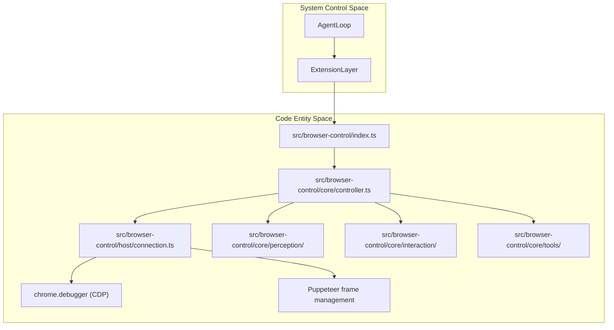
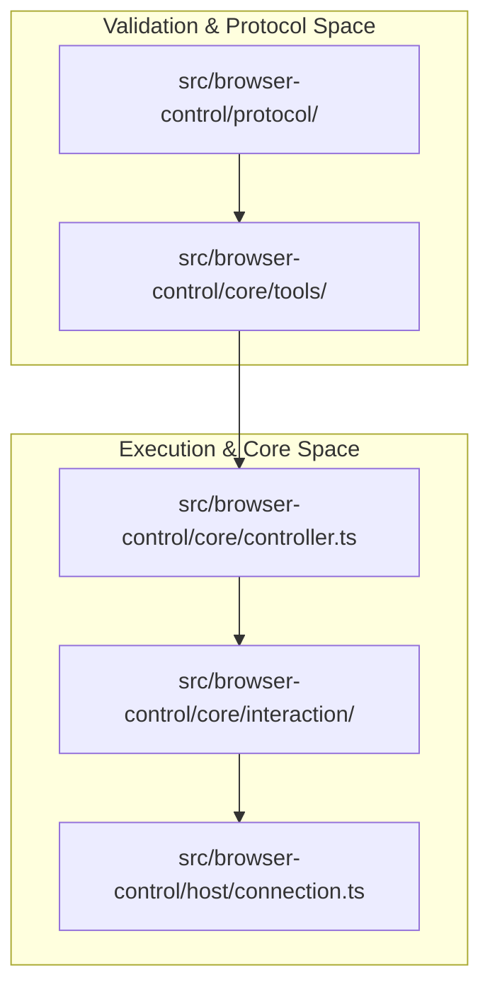

<!-- source: DeepWiki mcp.deepwiki.com · repo nanobrowser/nanobrowser · page 3 Browser Control Layer · fetched 2026-10-29 -->

# Browser Control Layer

Relevant source files

The following files were used as context for generating this wiki page:

- [.npmrc](.npmrc)
- [CLAUDE.md](CLAUDE.md)
- [README.md](README.md)

## Purpose and Scope

The browser control layer (`src/browser-control/`) is a deterministic, LLM-free automation layer built directly on top of `chrome.debugger` (CDP) and Puppeteer frame management [CLAUDE.md:25-30]. It provides the foundational abstraction used by Nanobrowser to observe web pages, track frames (including out-of-process iframes), manage element references (`refs`), and dispatch interaction primitives safely [CLAUDE.md:25-30, CLAUDE.md:64-69]. 

The layer exposes a strictly defined public surface through `src/browser-control/index.ts` [CLAUDE.md:69]. No external consumer or agent may import internal modules directly. All protocol request/response schemas, tool definitions, and error codes are centralized in `src/browser-control/protocol/` [CLAUDE.md:65], ensuring fail-closed invariants and strict type safety.

Title: Diagram: Browser Control Layer Architecture and Module Boundaries

Sources: [CLAUDE.md:25-30](), [CLAUDE.md:64-69]()

---

## 3.1. Controller, Sessions and Refs

The core controller orchestration resides in `src/browser-control/core/controller.ts`, handling session lifecycles, execution locks (`lock.ts`), element reference validity (`refs.ts`), port routing (`ports.ts`), site policies (`site.ts`), URL gating (`url-policy.ts`), and navigation guards (`navigation-guard.ts`) [CLAUDE.md:66]. Element refs are strictly tied to the document in which they were observed and fail closed if a navigation or detachment occurs [CLAUDE.md:41-42].

For details, see [Controller, Sessions and Refs](#3.1).

Sources: [CLAUDE.md:41-42](), [CLAUDE.md:66]()

---

## 3.2. Perception: Snapshots, AX Tree and Reading

Perception modules (`src/browser-control/core/perception/`) construct read-only page states via accessibility trees (`ax.ts`), visual captures (`capture.ts`), diffing (`diff.ts`), enrichment (`enrich.ts`), layout calculation (`layout.ts`), masking sensitive elements (`masking.ts`), observation (`observe.ts`), outlining (`outline.ts`), reading (`read.ts`), and window management (`window.ts`) [CLAUDE.md:66]. In-page scripts (`src/browser-control/probe/`) are injected as string constants to extract structural data without altering page state [CLAUDE.md:38, CLAUDE.md:67].

For details, see [Perception: Snapshots, AX Tree and Reading](#3.2).

Sources: [CLAUDE.md:38](), [CLAUDE.md:66-67]()

---

## 3.3. Interaction: Preflight, Classification and Dispatch

Interaction handling (`src/browser-control/core/interaction/`) validates actionability and visibility through preflight checks (`preflight.ts`, `actionability.ts`), classifies consequential actions (`classify.ts`), manages input evidence (`evidence.ts`), enforces security gates (`gate.ts`), guards keystrokes (`keys/`, `key-guard.ts`), controls pointers (`pointer.ts`), resolves nodes (`resolve.ts`), and handles withheld operations (`withheld.ts`) [CLAUDE.md:43, CLAUDE.md:66]. Destructive or consequential actions are intercepted and held for user approval [CLAUDE.md:43].

For details, see [Interaction: Preflight, Classification and Dispatch](#3.3).

Sources: [CLAUDE.md:43](), [CLAUDE.md:66]()

---

## 3.4. Tool Catalogue and Protocol

The tool catalogue (`src/browser-control/core/tools/`) implements specific automation verbs such as `act`, `ask`, `dialog`, `fill`, `labels`, `navigate`, `observe`, `tabs`, `text`, `upload`, and `wait` [CLAUDE.md:65-66]. These tools are backed by strict Zod validation schemas located in `src/browser-control/protocol/`, defining standardized request shapes, typed error codes, and structured execution receipts.

Title: Diagram: Protocol Schema to Tool Execution Flow

Sources: [CLAUDE.md:65-66]()

For details, see [Tool Catalogue and Protocol](#3.4).

Sources: [CLAUDE.md:65-66]()

---

## 3.5. Host Adapters: chrome.debugger and Puppeteer

Host adapters (`src/browser-control/host/`) bridge the layer to Chrome's extension APIs. Connection management handles CDP session attachment, detachment handling, frame discovery including out-of-process iframes (OOPIFs), and automatic recovery from debugger loss or service worker restarts. Puppeteer is utilized strictly for frame management and topological discovery rather than element selection [CLAUDE.md:27-28, CLAUDE.md:68].

For details, see [Host Adapters: chrome.debugger and Puppeteer](#3.5).

Sources: [CLAUDE.md:27-28](), [CLAUDE.md:68]()

---

