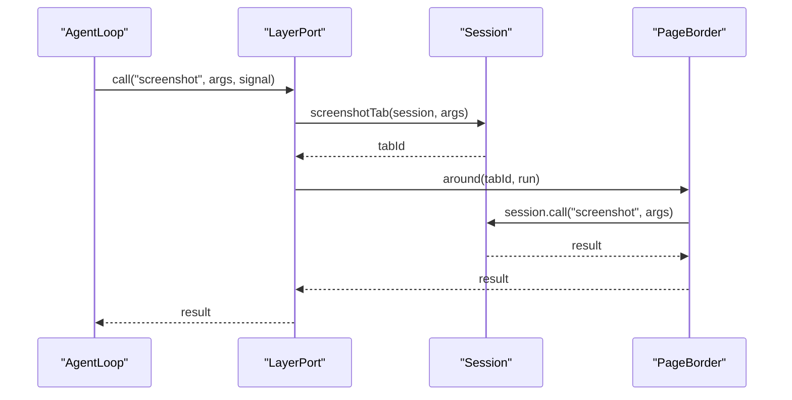

<!-- source: DeepWiki mcp.deepwiki.com · repo nanobrowser/nanobrowser · page 3.1 Controller, Sessions and Refs · fetched 2026-10-29 -->

# Controller, Sessions and Refs

<details>
<summary>Relevant source files</summary>

The following files were used as context for generating this wiki page:

- [.npmrc](.npmrc)
- [CLAUDE.md](CLAUDE.md)
- [src/extension/bindings.ts](src/extension/bindings.ts)

</details>


This section details the core modules of the browser control layer located in `src/browser-control/core/`, specifically focusing on session lifecycles, element reference validity, concurrency locking, site rules, URL policies, and navigation gating as mandated by the project architecture.

Sources: [CLAUDE.md:61-69]()

## Controller and Session Lifecycle

The controller coordinates browser automation state across tabs and frames using `chrome.debugger` and Puppeteer. Sessions encapsulate active browser contexts, state revisions, and capabilities [src/extension/agent-session.ts:14-25](). 

State within the layer is strictly disposable: service worker restarts, debugger detaches, and page navigations invalidate layer state cleanly [CLAUDE.md:41-42]().

```mermaid
classDiagram
    direction "LR"
    class Controller {
        +createSession(config: SessionConfig) Session
        +tabState(tabId: number) TabState
    }
    class Session {
        +controller: Controller
        +activeTabId: number
        +hasTab(tabId: number) boolean
        +call(tool: string, args: Record<string, unknown>, options: object) Promise
        +wrap(text: string, source: string) string
    }
    class TabState {
        +rev: number
        +pending: PendingItem[]
    }
    Controller --> Session : "creates"
    Session --> Controller : "references"
    Session --> TabState : "queries tabState"
```
**Diagram: Controller and Session Relationship**

Sources: [CLAUDE.md:25-30](), [src/extension/agent-session.ts:14-63]()

## Element Refs and Validity (`refs.ts`)

Element references (`refs`) identify DOM nodes across perception and interaction cycles. The ref subsystem enforces strict invariants:
1. **Refs fail closed:** A ref is valid only for the document it was seen in and only if the agent was shown it [CLAUDE.md:33-34](). Otherwise, the operation yields a typed error rather than a guess.
2. **One identity:** An action operates on the node the agent was shown, addressed directly by the browser's handle [CLAUDE.md:33-33]().

Sources: [CLAUDE.md:33-34]()

## Concurrency and Locking (`lock.ts`)

The locking mechanism (`lock.ts`) manages exclusive access to tab resources and execution queues. Because browser automation actions can overlap between user interactions and agent execution steps, locks prevent race conditions during DOM evaluation and event dispatch. Bounded execution budgets ensure operations do not hang indefinitely [CLAUDE.md:39-40]().

Sources: [CLAUDE.md:39-40]()

## Site Rules and URL Policy (`site.ts`, `url-policy.ts`)

Site rules and URL policies govern navigation and interaction permissions per domain. 
- Actions are classified by sensitivity (e.g., submit, pay, delete) [CLAUDE.md:43-44]().
- Sites configured with allow, ask, or block rules restrict agent capabilities accordingly.
- URL policies block access to restricted browser schemes and internal extension pages.

Sources: [CLAUDE.md:43-44]()

## Navigation Gating and Ports (`navigation-guard.ts`, `ports.ts`)

Navigation guards intercept top-level and frame navigations to ensure agents remain within permissible scopes. The port abstraction (`ports.ts` / `src/agent/ports.ts`) provides a clean interface for the agent loop to invoke layer tools, query tab information, and manage execution signals while handling UI overlays such as page borders [src/extension/agent-session.ts:43-63]().


**Diagram: Agent Tool Call Flow with LayerPort and PageBorder**

Sources: [src/extension/agent-session.ts:43-63]()

---

