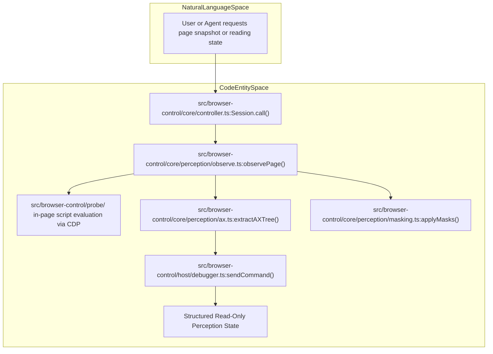
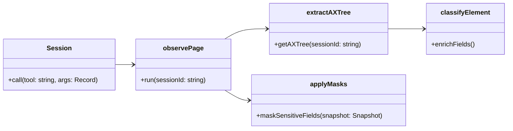

<!-- source: DeepWiki mcp.deepwiki.com · repo nanobrowser/nanobrowser · page 3.2 Perception: Snapshots, AX Tree and Reading · fetched 2026-10-29 -->

# Perception: Snapshots, AX Tree and Reading

Relevant source files

The following files were used as context for generating this wiki page:

- [.npmrc](.npmrc)
- [CLAUDE.md](CLAUDE.md)
- [fixtures/pages/g-enrich.html](fixtures/pages/g-enrich.html)
- [src/background/scenarios/set-g.ts](src/background/scenarios/set-g.ts)

This page details the architecture and implementation of the perception layer within the browser control module (`src/browser-control/core/perception` and `src/browser-control/probe/`). The perception subsystem is responsible for building deterministic, read-only representations of web page state, extracting accessibility trees, capturing screenshots, and masking sensitive content without modifying the underlying page [CLAUDE.md:31-42]().

## Overview of Perception and Invariance

The perception pipeline operates under strict invariants defined by the browser control layer architecture:
1. **Observation is read-only**: Capturing state, taking snapshots, or inspecting the accessibility tree never mutates page state or triggers side effects [CLAUDE.md:38]().
2. **Degrade loudly**: Partial captures, truncation, and missing attributes are explicitly stated in the result object [CLAUDE.md:39]().
3. **Bounded execution**: Every command, capture, and tree traversal operates within a defined performance and time budget [CLAUDE.md:40]().
4. **No model inside the layer**: The perception modules perform purely deterministic parsing and extraction; any semantic reasoning or LLM interpretation occurs entirely in the agent layer above [CLAUDE.md:29]().

Sources:
* [CLAUDE.md:25-44]()

## Sub-Modules in `core/perception`

The perception engine is structured into specialized sub-modules located under `src/browser-control/core/perception/`:

* **`ax`**: Handles extraction and normalization of the browser Accessibility (AX) tree via raw CDP commands sent to the active frame session [CLAUDE.md:64-66]().
* **`capture`**: Coordinates viewport and full-page screenshot generation utilizing CDP page capture methods [CLAUDE.md:64-66]().
* **`diff`**: Computes deterministic state diffs across consecutive perception snapshots to track changes in interactive elements [CLAUDE.md:64-66]().
* **`enrich`**: Performs semantic classification and enrichment of elements (such as login fields, one-time passcode inputs, card fields, and authorization grants) [src/background/scenarios/set-g.ts:1-3](), [fixtures/pages/g-enrich.html:1-3]().
* **`layout`**: Computes bounding boxes, viewport geometry, and spatial relationships for target elements [CLAUDE.md:64-66]().
* **`masking`**: Identifies and obscures sensitive information (e.g., passwords, payment data) during capture and snapshot generation [CLAUDE.md:64-66]().
* **`observe` & `read`**: High-level orchestrators that synthesize AX data, layout metrics, and text content into structured read-only states for agent consumption [CLAUDE.md:64-66]().
* **`outline` & `window`**: Manages visual framing, element highlighting boundaries, and viewport window parameters [CLAUDE.md:64-66]().

Sources:
* [CLAUDE.md:64-68]()
* [src/background/scenarios/set-g.ts:1-3]()
* [fixtures/pages/g-enrich.html:1-3]()

## Data Flow: From Natural Language Intent to Perception Execution

The following diagram bridges the natural language intent of taking a page snapshot or reading state to the concrete code entities within the perception and probe packages.

**Diagram: Perception Pipeline Natural Language to Code Mapping**

Sources:
* [CLAUDE.md:31-42]()
* [src/background/scenarios/set-g.ts:25-45]()

## In-Page Probe Scripts (`src/browser-control/probe/`)

The layer interacts with pages using serialized in-page scripts stored in `src/browser-control/probe/`. These scripts are evaluated within the target frame via CDP (`Runtime.evaluate`) without relying on Puppeteer element selectors or external content scripts [CLAUDE.md:26-28]().

### Key Characteristics of Probe Scripts
* **String Constants**: In-page scripts are compiled as string constants embedded in the layer, ensuring zero runtime file resolution overhead in the extension context [CLAUDE.md:67]().
* **Read-Only Inspection**: Scripts inspect DOM properties, bounding client rects, computed styles, and accessibility attributes without dispatching synthetic user events or modifying DOM nodes [CLAUDE.md:38]().
* **Error Resilience**: Execution failures within probes are caught and returned as typed perception errors rather than crashing the control session [CLAUDE.md:39]().

Sources:
* [CLAUDE.md:26-28]()
* [CLAUDE.md:67]()

## Perception Architecture and Module Relationships

The internal class and function relationship of the perception layer coordinates input streams from CDP frames, extracts semantic nodes, applies security masking, and yields structured results.

**Diagram: Perception Module Architecture**

Sources:
* [CLAUDE.md:31-44]()
* [src/background/scenarios/set-g.ts:1-20]()

---

