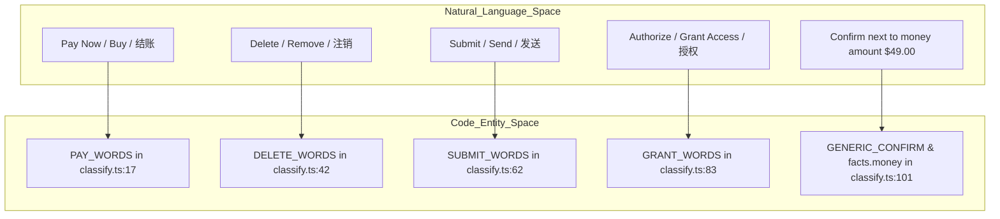

<!-- source: DeepWiki mcp.deepwiki.com · repo nanobrowser/nanobrowser · page 3.3 Interaction: Preflight, Classification and Dispatch · fetched 2026-10-29 -->

# Interaction: Preflight, Classification and Dispatch

<details>
<summary>Relevant source files</summary>

The following files were used as context for generating this wiki page:

- [fixtures/pages/d-overlay.html](fixtures/pages/d-overlay.html)
- [src/browser-control/core/__tests__/classify.test.ts](src/browser-control/core/__tests__/classify.test.ts)
- [src/browser-control/core/interaction/classify.ts](src/browser-control/core/interaction/classify.ts)

</details>


### Purpose and Scope

This section details the browser control layer's interaction engine located in `src/browser-control/core/interaction/`. The interaction engine is responsible for verifying element actionability (visibility, stability, and geometry), classifying consequential actions (such as payments, deletions, submissions, and access grants) into sensitive categories, enforcing security gates, guarding sensitive keystrokes, and resolving element references (`refs`) into raw Chrome DevTools Protocol (CDP) commands for execution. 

In accordance with architectural invariants, all interaction processing is deterministic, model-free, and fails closed when element validity or user authorization is missing [CLAUDE.md:30-44]().

Sources: `[CLAUDE.md:30-44](), [src/browser-control/core/interaction/classify.ts:1-6]()`

---

### Preflight and Actionability Checks

Before any input event (such as a click, fill, or key dispatch) is sent to a target node, the interaction subsystem performs preflight actionability checks. These checks ensure that the target element is present in the current document, fully visible, not obscured by overlays, stable in layout coordinates, and enabled for interaction.

Key responsibilities of the preflight pipeline include:
- Verifying that the target `ref` corresponds to a valid node handle in the active document state [CLAUDE.md:31-34]().
- Checking intersection metrics and visibility flags computed during perception.
- Ensuring retries occur entirely before dispatch; once an input event is sent, the layer does not issue autonomous retries [CLAUDE.md:35]().

Sources: `[CLAUDE.md:31-35]()`

---

### Consequential-Action Classification Engine

The sensitivity classifier (`src/browser-control/core/interaction/classify.ts`) is a deterministic engine that analyzes accessible names, roles, structural facts (`FormFacts`), and URL contexts to determine if an action triggers consequential state changes (payments, data deletions, form submissions, or permission grants) [src/browser-control/core/interaction/classify.ts:1-6](). 

The classification logic uses case-insensitive regular expression matchers for English word boundaries and Chinese character sets (`vocabulary()`) [src/browser-control/core/interaction/classify.ts:11-15]().


Sources: `[src/browser-control/core/interaction/classify.ts:1-176]()`

#### Classification Categories and Rules

The `classify()` function evaluates `ClassifyInput` parameters (`mode`, `name`, `role`, `facts`, `url`) and returns a `Classification` containing a `SensitiveCategory` (`'pay'`, `'delete'`, `'submit'`, or `'grant'`) and a descriptive `reason` [src/browser-control/core/interaction/classify.ts:105-134]().

1. **Payment (`PAY_WORDS`)**: Matches terms like `'pay'`, `'buy'`, `'checkout'`, `'place order'`, `'subscribe'`, `'充值'`, `'付款'`, etc. Additionally, a generic confirmation label (`GENERIC_CONFIRM`) combined with a detected money amount (`facts.money`) is classified as `'pay'` [src/browser-control/core/interaction/classify.ts:17-41, 101-130]().
2. **Access Grant (`GRANT_WORDS`, `AFFIRMATIVE`)**: Matches authorization terms (`'authorize'`, `'allow access'`, `'授权'`) or affirmative labels (`'Allow'`, `'Continue'`, `'同意'`) when executed on a consent page path (matched by `CONSENT_PATH`) [src/browser-control/core/interaction/classify.ts:83-99]().
3. **Deletion (`DELETE_WORDS`)**: Matches destructive terms (`'delete'`, `'remove'`, `'discard'`, `'unsubscribe'`, `'删除'`, `'注销'`) [src/browser-control/core/interaction/classify.ts:42-61]().
4. **Submission (`SUBMIT_WORDS`, `enterSubmits`)**: Matches submission labels (`'submit'`, `'send'`, `'publish'`, `'保存'`, `'提交'`). For keyboard events (`mode: 'enter'`), `enterSubmits(facts)` evaluates HTML implicit form submission rules—determining whether pressing Enter inside an input field triggers form submission based on the presence of enabled default buttons or single blocking fields [src/browser-control/core/interaction/classify.ts:62-79, 139-174]().

Sources: `[src/browser-control/core/interaction/classify.ts:17-174](), [src/browser-control/core/__tests__/classify.test.ts:37-117]()`

---

### Gating, Key-Guards and Withheld Actions

Once an action is classified into a sensitive category, the interaction gate (`src/browser-control/core/interaction/gate.ts` / `withheld.ts`) evaluates whether dispatch is permitted based on the active security policy [CLAUDE.md:43-53]().

- **Consequential Action Rule (Invariant 11)**: By default, any action classified as submit, pay, delete, or grant is withheld from automatic execution unless explicitly approved by the user or running under an allowed auto-mode scope [CLAUDE.md:43]().
- **Key-Guards (`key-guard.ts`)**: Monitors key event sequences for sensitive inputs, password fields, or command injections.
- **Withheld Receipts**: When an action is withheld, the layer returns a structured withheld result containing the classification category and human-readable justification without modifying page state.

Sources: `[CLAUDE.md:43-53]()`

---

### Dispatch, Pointer and Resolution Pipeline

When preflight checks pass and security gates approve execution, the dispatch pipeline executes the command against the target frame session.

```mermaid
graph TD
  subgraph Interaction_Execution
    E1[""Agent Action Request""] --> E2[""preflight() validation""]
    E2 --> E3[""classify() sensitivity check""]
    E3 --> E4[""gate() policy evaluation""]
    E4 -->|Approved| E5[""resolve() ref to CDP Node ID""]
    E5 --> E6[""pointer() or keys() dispatch via chrome.debugger""]
    E6 --> E7[""Execution Receipt""]
  end
```

- **Reference Resolution (`resolve.ts`)**: Translates agent-visible element handles (`refs`) into precise browser element handles within the target document without relying on Puppeteer selector queries [CLAUDE.md:28]().
- **Pointer Events (`pointer.ts`)**: Dispatches low-level mouse and touch events directly via CDP commands to the frame session identified by Puppeteer [CLAUDE.md:27-28]().
- **Key Events (`keys.ts`)**: Dispatches keystrokes and text input sequences with precise modifier tracking.

Sources: `[CLAUDE.md:27-28]()`

---

