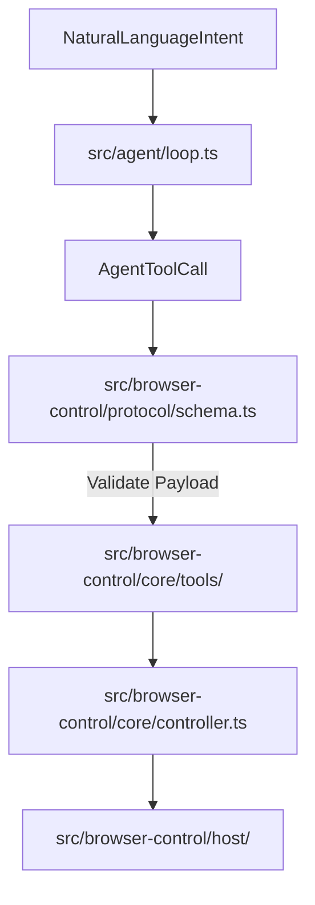
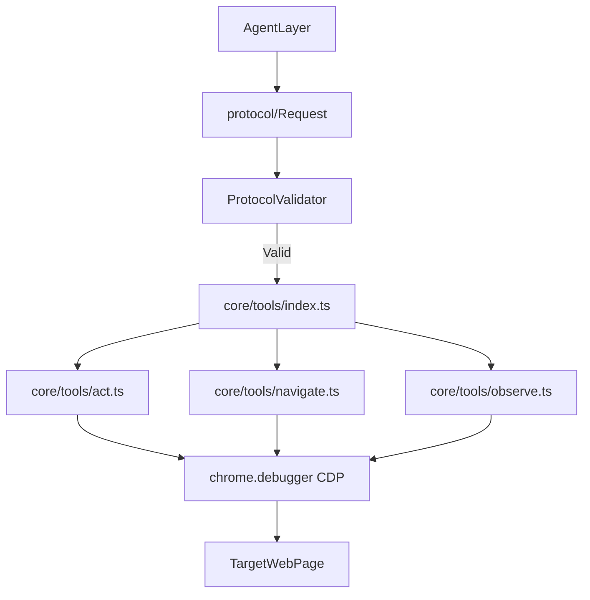

<!-- source: DeepWiki mcp.deepwiki.com · repo nanobrowser/nanobrowser · page 3.4 Tool Catalogue and Protocol · fetched 2026-10-29 -->

# Tool Catalogue and Protocol

Relevant source files

The following files were used as context for generating this wiki page:

- [.npmrc](.npmrc)
- [CLAUDE.md](CLAUDE.md)
- [src/ui/locales/en.json](src/ui/locales/en.json)

This page details the implementation of the deterministic tool catalogue and protocol schemas within the browser control layer (`src/browser-control/`). It covers the Zod-based protocol definitions (`src/browser-control/protocol/`), the concrete tool implementations (`src/browser-control/core/tools/`), and how the system bridges agent instructions to low-level browser operations without containing any embedded LLM logic.

Sources:
- [CLAUDE.md:61-69]()

## Protocol Schemas and Zod Validation

The protocol package (`src/browser-control/protocol/`) defines the strict request and response boundaries for all automation primitives exposed to the agent layer. Using Zod schemas, the layer ensures that every argument provided by the agent is validated at runtime before any browser command is dispatched.

Each tool declaration in the catalogue maps to a distinct Zod schema defining its parameters, return type, and error semantics. This guarantees that refs fail closed and unexpected parameters are rejected immediately without entering page-evaluation state.

Sources:
- [CLAUDE.md:19-44]()

## Tool Catalogue Implementation

The tool catalogue (`src/browser-control/core/tools/`) contains the modular implementations of the browser commands. The suite comprises eleven core tools:

*   `act`: Executes low-level pointer and keyboard actions (clicks, keypresses) on validated element handles.
*   `ask`: Handles user-confirmation prompts for consequential or sensitive actions.
*   `dialog`: Manages browser native modal dialogs (`alert`, `confirm`, `prompt`).
*   `fill`: Inputs text or values into form fields mapped via perceptual refs.
*   `labels`: Retrieves and resolves accessibility label relationships for form inputs.
*   `navigate`: Controls page navigation, history traversal, and URL transitions within policy bounds.
*   `observe`: Captures read-only perceptual snapshots of the DOM and accessibility tree.
*   `tabs`: Manages tab lifecycle, switching, creation, and closing within scoped boundaries.
*   `text`: Extracts text content from specific nodes or full page frames.
*   `upload`: Handles file attachment flows and input manipulation for file uploads.
*   `wait`: Implements bounded waiting mechanisms for network idle, selectors, or state changes.

Sources:
- [CLAUDE.md:61-69]()

## Bridging Natural Language Space to Code Entity Space

The following diagrams illustrate how abstract agent intentions formulated in Natural Language Space are translated into concrete TypeScript classes, Zod validation schemas, and CDP command executions within Code Entity Space.

### Diagram: Natural Language to Tool Protocol Translation

Title: "Natural Language to Protocol Translation Flow"

Sources:
- [CLAUDE.md:61-69]()

### Diagram: Tool Execution and Dispatch Architecture

Title: "Tool Execution and CDP Dispatch Architecture"

Sources:
- [CLAUDE.md:61-69]()

---

