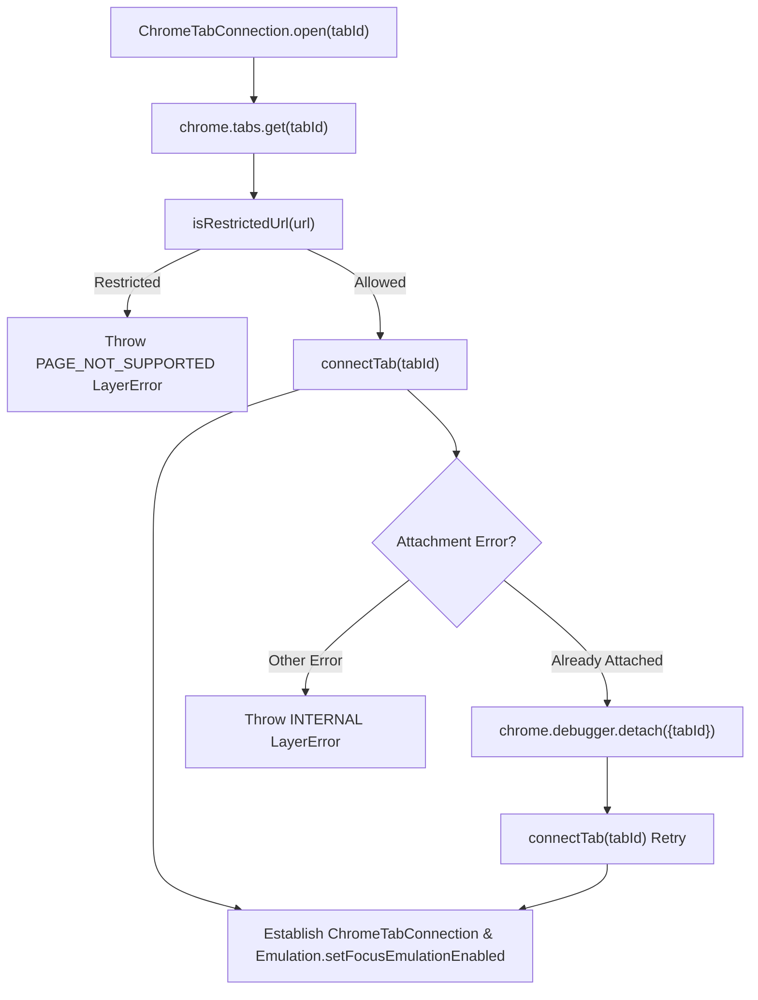
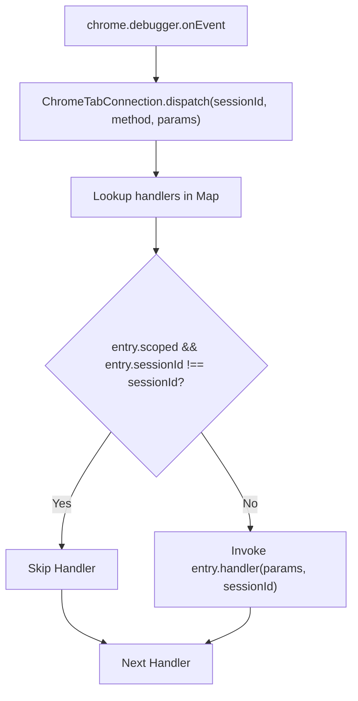

<!-- source: DeepWiki mcp.deepwiki.com · repo nanobrowser/nanobrowser · page 3.5 Host Adapters: chrome.debugger and Puppeteer · fetched 2026-10-29 -->

# Host Adapters: chrome.debugger and Puppeteer

Relevant source files

The following files were used as context for generating this wiki page:

- [src/background/checks/host-connection.ts](src/background/checks/host-connection.ts)
- [src/browser-control/host/connection.ts](src/browser-control/host/connection.ts)

## Purpose and Scope

The host adapters layer (`src/browser-control/host/`) serves as the foundation of the deterministic browser control layer. It bridges Chrome's low-level extension APIs (`chrome.debugger`, `chrome.tabs`) with Puppeteer and raw Chrome DevTools Protocol (CDP) streams. Its core responsibilities include CDP connection management, attach/detach lifecycle handling, per-command timeout enforcement, event fan-out across session boundaries (including Out-Of-Process Iframes / OOPIFs), frame discovery via loader IDs, and robust recovery from debugger disconnections caused by service worker reloads.

Sources: `src/browser-control/host/connection.ts:1-10()`, `src/background/checks/host-connection.ts:1-7()`

---

## 1. CDP Connection Management and Attachment

Connection management centers around the `ChromeTabConnection` class (`src/browser-control/host/connection.ts:61-124()`), which manages an attached browser tab. Before attempting to attach, the host adapter checks whether the target URL is restricted (such as `chrome://`, `chrome-extension://`, or the Chrome Web Store) via `isRestrictedUrl()` (`src/browser-control/host/connection.ts:14-27()`).

When `ChromeTabConnection.open(tabId)` is invoked:
1. It verifies the tab exists via `chrome.tabs.get(tabId)` (`src/browser-control/host/connection.ts:89-90()`).
2. It checks URL restrictions and throws a `LayerError('PAGE_NOT_SUPPORTED', ...)` if the page cannot be controlled (`src/browser-control/host/connection.ts:91-93()`).
3. It attempts to connect via Puppeteer's `connectTab(tabId)` (`src/browser-control/host/connection.ts:96()`). If an `already attached` error occurs (typically caused by a service worker restart while a tab was previously attached), it detaches the stale debugger session and retries connection (`src/browser-control/host/connection.ts:97-102()`).
4. It enables focus emulation via `Emulation.setFocusEmulationEnabled` to ensure the page behaves as focused even when running in a background window (`src/browser-control/host/connection.ts:113-116()`).

*Diagram: Code entity connection workflow mapping high-level attachment requests to `ChromeTabConnection.open` and `connectTab` execution.*

Sources: `src/browser-control/host/connection.ts:14-118()`

---

## 2. Command Dispatch, Timeouts, and Event Fan-Out

The host layer implements a raw command channel with per-command timeout enforcement and structured event routing across CDP session boundaries.

### Command Execution and Timeouts
Commands sent through `ChromeCdpPort` (`src/browser-control/host/connection.ts:45-59()`) delegate to `sendRaw` in `src/browser-control/host/cdp-session.ts`, wrapping `chrome.debugger.sendCommand`. Every command enforces a strict timeout (`DEFAULT_COMMAND_TIMEOUT_MS`), throwing a `CdpTimeoutError` if the browser fails to respond within the allotted duration (`src/background/checks/host-connection.ts:25-34()`).

### Event Fan-Out by Session ID
Chrome DevTools Protocol events arrive globally through `chrome.debugger.onEvent` (`src/browser-control/host/connection.ts:35-38()`). The host adapter normalizes session IDs and dispatches events to registered subscribers (`src/browser-control/host/connection.ts:148-159()`). Subscribers can register for:
- **Session-scoped events**: Reaching only handlers listening to a specific child session (e.g., an OOPIF).
- **Tab-wide events**: Reaching general listeners across the entire tab while annotating the event with its corresponding `sessionId` (`src/background/checks/host-connection.ts:36-53()`).

*Diagram: Event fan-out architecture mapping `chrome.debugger.onEvent` triggers to `ChromeTabConnection.dispatch` handler loops.*

Sources: `src/browser-control/host/connection.ts:35-59()`, `src/browser-control/host/connection.ts:148-159()`, `src/background/checks/host-connection.ts:36-53()`

---

## 3. Detach Handling, Recovery, and Cleanup

The connection layer monitors unexpected debugger detachment via `chrome.debugger.onDetach` (`src/browser-control/host/connection.ts:39-42()`). 

### Detachment Lifecycle
- When a tab is closed or the debugger is forcefully detached by the browser, `markDetached()` flags the connection (`src/browser-control/host/connection.ts:161-162()`).
- Any pending CDP promises race against `#detachedSignal`, causing them to immediately reject with a `LayerError` of code `DEBUGGER_DETACHED` (`src/browser-control/host/connection.ts:70-71()`, `src/background/checks/host-connection.ts:55-69()`).
- Subsequent commands attempted on a detached connection fail fast with `DEBUGGER_DETACHED` (`src/background/checks/host-connection.ts:70-74()`).
- Clean teardown ensures the layer detaches exactly once, preventing unhandled promise rejections from Chrome protocol cleanup refusals (`src/background/checks/host-connection.ts:77-91()`).

Sources: `src/browser-control/host/connection.ts:39-42()`, `src/browser-control/host/connection.ts:130-138()`, `src/background/checks/host-connection.ts:55-91()`

---

## 4. Frame Discovery and OOPIF Topology

Frame structure and Out-Of-Process Iframes (OOPIFs) are discovered and managed via `PuppeteerFrameTopology` (`src/browser-control/host/connection.ts:81()`). 

The topology service inspects target frames, ensuring that:
- Every discovered frame possesses a valid `loaderId` (`src/background/checks/host-connection.ts:20-21()`).
- The main frame operates on the root session (`sessionId === undefined`), while nested child frames and OOPIFs are mapped to their respective CDP session IDs (`src/background/checks/host-connection.ts:22-23()`).

Sources: `src/browser-control/host/connection.ts:81()`, `src/background/checks/host-connection.ts:17-24()`

---

