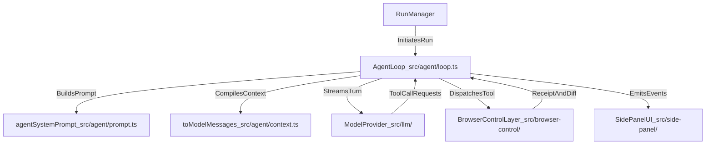
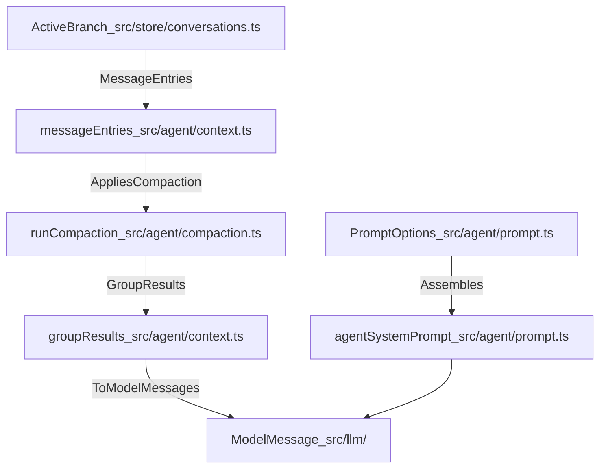

<!-- source: DeepWiki mcp.deepwiki.com · repo nanobrowser/nanobrowser · page 4 Agent Layer · fetched 2026-10-29 -->

# Agent Layer

Relevant source files

The following files were used as context for generating this wiki page:

- [.npmrc](.npmrc)
- [CLAUDE.md](CLAUDE.md)
- [src/agent/loop.ts](src/agent/loop.ts)

Overview of `src/agent`: the single agent loop, prompt construction, context/compaction, tool wiring and run records — plus how the extension worker drives it.

For details on specific sub-topics, see the child pages:
- [Agent Loop and Run Lifecycle](#4.1) — turn loop, turn cap, abort/resume, restart recovery, step validation (`src/agent/loop.ts`, `src/agent/run.ts`, `src/agent/completion.ts`, `src/agent/restore.ts`).
- [Prompting, Context and Compaction](#4.2) — system prompt assembly, context window budgeting, overflow recovery and transcript elision (`src/agent/prompt.ts`, `src/agent/header.ts`, `src/agent/context.ts`, `src/agent/compaction.ts`, `src/agent/elision.ts`, `src/agent/attachments.ts`).
- [Agent Tools, Guards and File Saving](#4.3) — the agent-side tool surface, prompt-injection guards, save/export flows and activity display mapping (`src/agent/tools.ts`, `src/agent/guards.ts`, `src/agent/save-file.ts`, `src/agent/export.ts`, `src/agent/display.ts`).

## Core Agent Architecture and Loop

The agent layer in `src/agent` implements a single agent turn loop [src/agent/loop.ts:1-2](). Instead of a multi-agent hierarchy, it manages conversation turns consisting of one model call and its tool batch, supported by a set of deterministic browser hooks and communication ports [src/agent/loop.ts:1-14](). The extension service worker controls run orchestration, feeding requests into the loop and handling persistence and event streaming.

For details on the turn loop, turn caps, abort/resume operations, and step validation, see [Agent Loop and Run Lifecycle](#4.1).

### Agent Execution Flow

Sources:
- [src/agent/loop.ts:1-86]()
- [src/agent/prompt.ts:39-102]()
- [src/agent/context.ts:104-170]()

## Prompt Construction and Context Management

Prompt generation and context management establish how instructions and conversation history are structured for the LLM. `src/agent/prompt.ts` builds stable system prompts that incorporate strict security contracts against untrusted web content (`CONTRACT`) [src/agent/prompt.ts:14-30](), role constraints, and dynamic tool guidelines [src/agent/prompt.ts:47-88](). Meanwhile, `src/agent/context.ts` transforms stored conversation branches into standardized model messages, managing image attachment pruning and tool result grouping [src/agent/context.ts:1-170]().

For details on system prompt assembly, context window budgeting, overflow recovery, and transcript elision, see [Prompting, Context and Compaction](#4.2).

### Context and Prompt Pipeline

Sources:
- [src/agent/prompt.ts:4-11]()
- [src/agent/prompt.ts:91-102]()
- [src/agent/context.ts:29-44]()
- [src/agent/context.ts:74-101]()
- [src/agent/context.ts:104-170]()

## Tool Wiring, Guards and File Saving

The agent interacts with target pages and handles local assets through tools exposed via `src/agent/tools.ts` [src/agent/loop.ts:24](). Safety guards (`src/agent/guards.ts`) evaluate actions for potential prompt injection vulnerabilities or consequential side-effects, while specialized modules handle file saving, exports, and activity display mapping.

For details on the agent-side tool surface, prompt-injection guards, save/export flows, and activity display mapping, see [Agent Tools, Guards and File Saving](#4.3).

Sources:
- [src/agent/loop.ts:24]()
- [src/agent/prompt.ts:14-30]()

---

