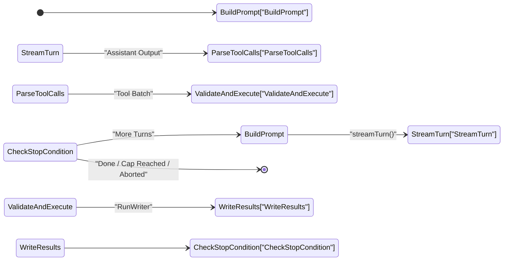
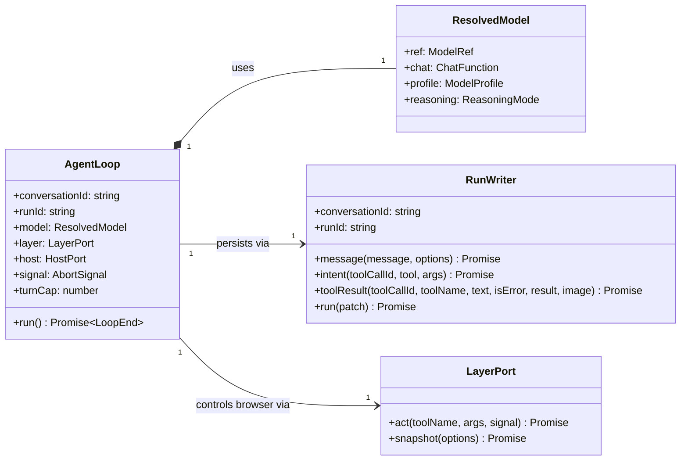

<!-- source: DeepWiki mcp.deepwiki.com · repo nanobrowser/nanobrowser · page 4.1 Agent Loop and Run Lifecycle · fetched 2026-10-29 -->

# Agent Loop and Run Lifecycle

Relevant source files

The following files were used as context for generating this wiki page:

- [src/agent/__tests__/request.test.ts](src/agent/__tests__/request.test.ts)
- [src/agent/loop.ts](src/agent/loop.ts)
- [src/agent/records.ts](src/agent/records.ts)

This page details the implementation of the core agent loop and run lifecycle in Nanobrowser, located across `src/agent/loop.ts`, `src/agent/run.ts`, `src/agent/completion.ts`, and `src/agent/restore.ts`. The agent loop is responsible for orchestrating multi-turn model interactions, executing browser tool batches, managing turn caps, handling user abort/resume signals, performing restart recovery, and validating execution steps.

## Purpose and Scope

The agent layer acts as the autonomous intelligence engine of Nanobrowser. While the browser control layer (`src/browser-control`) provides deterministic, LLM-free automation primitives via `chrome.debugger` (CDP) and Puppeteer, the agent layer (`src/agent`) drives these capabilities through reasoning loops. 

The primary files governing this lifecycle are:
- `src/agent/loop.ts`: Implements `AgentLoop`, managing turn-based model streaming, tool execution batching, context tracking, and stop conditions [src/agent/loop.ts:1-26].
- `src/agent/run.ts`: Coordinates run initialization, model resolution, learning from steps, and loop execution hooks [src/agent/run.ts:1-25].
- `src/agent/completion.ts`: Handles validation, verification debt, refusals, and completion checks [src/agent/completion.ts:1-17].
- `src/agent/restore.ts`: Handles recovery and resumption of interrupted runs after restarts or crashes.
- `src/agent/records.ts`: Implements `RunWriter` and transaction entry logging (`openCalls`) for conversation persistence [src/agent/records.ts:1-16].

Sources:
- [src/agent/loop.ts:1-26]()
- [src/agent/records.ts:1-16]()

## Agent Loop Architecture and Turn Lifecycle

The `AgentLoop` runs iterative turns consisting of one model call and a corresponding batch of tool executions [src/agent/loop.ts:1-2]. The loop coordinates communication through abstract ports (`LayerPort` and `HostPort`) and persists state transitions via `RunWriter`.

### Turn Loop Flow

Sources:
- [src/agent/loop.ts:52-86]()
- [src/agent/records.ts:56-134]()

### Key Code Entities and Component Relations

Sources:
- [src/agent/loop.ts:58-86]()
- [src/agent/records.ts:56-134]()

## Run Lifecycle, Turn Caps, and Abort Handling

A conversation run begins through `run.ts` which instantiates `AgentLoop` with specific model options, system prompts, tool catalogues, and signal handlers. 

### Turn Capping and Limits
- **Turn Cap**: Controlled by `turnCap`, preventing infinite loops by restricting the maximum number of reasoning-action turns per run [src/agent/loop.ts:70].
- **Result Capping**: Tool outputs are automatically truncated to prevent context overflow using `RESULT_CAP` (8,000 characters) [src/agent/loop.ts:28].
- **Context Limits**: If conversation tokens exceed model capacity, execution halts with `CONTEXT_LIMIT` [src/agent/loop.ts:31-33].
- **User Stop**: When the user presses Stop, the loop detects the cancellation signal (`STOPPED_BY_USER`), injects a context note (`STOPPED_NOTE`) so subsequent runs are aware the previous turn was interrupted, and exits gracefully [src/agent/loop.ts:43-46].

Sources:
- [src/agent/loop.ts:28-47]()
- [src/agent/loop.ts:70]()

## Restart Recovery and Interrupted Runs

When an extension worker restarts or a run is interrupted mid-turn, `src/agent/restore.ts` and `openCalls` inspect the existing conversation branch to reconcile uncompleted state [src/agent/records.ts:137-154].

The `openCalls` function scans the conversation history to find assistant tool calls that lack a matching tool result [src/agent/records.ts:137-145]:
1. Traverses the branch entries in reverse to locate the last assistant message containing tool calls [src/agent/records.ts:146-149].
2. Filters out tool calls that already have recorded intents or tool results [src/agent/records.ts:138-144].
3. Returns a list of unresolved calls (`toolCallId`, `toolName`, `hasIntent`), allowing the recovery flow to re-dispatch or synthesize error results for abandoned operations [src/agent/records.ts:149-153].

Sources:
- [src/agent/records.ts:137-153]()

## Step Validation and Completion

Step validation and completion criteria are managed by `src/agent/completion.ts` and `src/agent/loop.ts`. Before tool actions are dispatched, preflight checks and actionability gates validate if target elements are stable [src/browser-control:3.3].

When tools finish executing:
- **Batch Stopping**: Certain receipts (such as page navigations, new tab openings, or pending modals) trigger `stopsBatch`, interrupting the current tool batch to return control to the model with fresh page state [src/agent/loop.ts:143-150].
- **Verification Debt**: `src/agent/completion.ts` tracks verification debt (`clearsDebt`, `createsDebt`, `debtLabel`), ensuring that consequential actions are properly verified before a run claims success [src/agent/completion.ts:1-17].
- **Completion Tool**: The `done` tool terminates the loop successfully or partially, supplying a summary message and outcome status (`success`, `partial`, `failed`) [src/agent/loop.ts:111].

Sources:
- [src/agent/loop.ts:126-150]()
- [src/agent/completion.ts:1-17]()

---

