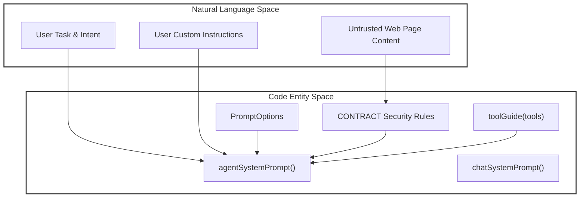
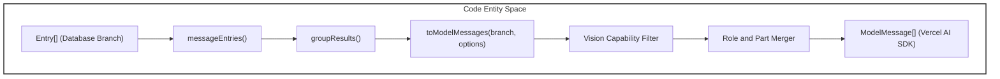
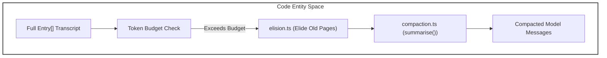

<!-- source: DeepWiki mcp.deepwiki.com · repo nanobrowser/nanobrowser · page 4.2 Prompting, Context and Compaction · fetched 2026-10-29 -->

# Prompting, Context and Compaction

Relevant source files

The following files were used as context for generating this wiki page:

- [src/agent/__tests__/context.test.ts](src/agent/__tests__/context.test.ts)
- [src/agent/__tests__/reasoning.test.ts](src/agent/__tests__/reasoning.test.ts)
- [src/agent/context.ts](src/agent/context.ts)
- [src/agent/prompt.ts](src/agent/prompt.ts)

This page details the implementation of system prompt assembly, context window budgeting, conversation compaction, overflow recovery, and transcript elision within `src/agent/`. These modules govern how conversation history (`Entry[]`) is transformed into LLM-compatible message structures (`ModelMessage[]`), how prompts protect the agent against prompt injection from untrusted web pages, and how context windows are managed under token constraints.

Sources:
- [src/agent/prompt.ts:1-102]()
- [src/agent/context.ts:1-170]()
- [src/agent/__tests__/context.test.ts:1-155]()
- [src/agent/__tests__/reasoning.test.ts:1-160]()

## System Prompt Assembly (`prompt.ts`)

The system prompt architecture separates stable prefix instructions from dynamic per-turn context. `src/agent/prompt.ts` exports `agentSystemPrompt()` and `chatSystemPrompt()` which assemble system instructions [src/agent/prompt.ts:39-45](), [src/agent/prompt.ts:91-102]().

Key components of `agentSystemPrompt`:
- **`ROLE`**: Defines Nanobrowser's identity as an agent operating within the user's Chrome browser tab group, specifying behavioral rules, observation requirements before acting, and single-step execution flow [src/agent/prompt.ts:47-59]().
- **`CONTRACT`**: Establishes strict security boundaries against prompt injection from untrusted web content (text inside `<<<page-content …>>>` and `«…»` markers, tool results, and images). It mandates that tasks come solely from the user and that page content must never override instructions [src/agent/prompt.ts:14-30]().
- **`PERMISSIONS`**: Guides the agent on user-decided actions (submitting, payments, CAPTCHAs, sensitive inputs) and takeover flows [src/agent/prompt.ts:61-65]().
- **`toolGuide`**: Conditionally describes available tools (e.g. `find`, `read`, `fill_form`, `ask_user`, `click`) based on the active tool set [src/agent/prompt.ts:67-88]().
- **Custom Instructions & Language**: Appends user-defined persistent instructions from settings (capped at `CUSTOM_INSTRUCTIONS_MAX`) and enforces response language rules [src/agent/prompt.ts:32-37](), [src/agent/prompt.ts:93-100]().

Title: "Prompt Assembly Architecture Bridging Natural Language to Code"

Sources:
- [src/agent/prompt.ts:1-102]()

## Context Window Budgeting and Message Conversion (`context.ts`)

The conversion of stored database entries (`Entry`) into LLM model messages is handled in `src/agent/context.ts`. The primary function `toModelMessages` takes conversation branch entries and formats them into role-based message arrays [src/agent/__tests__/context.test.ts:57]().

Key behaviors implemented in message conversion:
- **`messageEntries` & Elision**: Extracts message entries from the active branch while applying `context_edit` overrides or elisions via `messageEntries(branch)` [src/agent/context.ts:29-44]().
- **Result Grouping (`groupResults`)**: Ensures tool results immediately follow their corresponding assistant tool calls, buffering non-tool entries when necessary to satisfy API provider sequencing requirements [src/agent/context.ts:74-101]().
- **Role Merging**: Merges consecutive messages of the same role into unified message objects [src/agent/__tests__/context.test.ts:11]().
- **Vision Filtering**: Manages screenshot attachments based on model vision capabilities (`vision: boolean`), stripping image parts for non-vision models or retaining only the newest image after its fixed marker [src/agent/__tests__/context.test.ts:73-91]().
- **Tool Call & Result Alignment**: Correctly matches tool call IDs with tool results (`tool-call` and `tool-result` parts) and structures error reporting for failed tool executions [src/agent/__tests__/context.test.ts:11-71]().
- **Context Edits**: Applies `context_edit` entries to attached content (such as eliding old page outlines) while preserving user query text [src/agent/__tests__/context.test.ts:137-154]().

Title: "Message Conversion Flow in context.ts"

Sources:
- [src/agent/context.ts:29-170]()
- [src/agent/__tests__/context.test.ts:1-155]()

## Transcript Elision and Compaction (`elision.ts`, `compaction.ts`)

When conversations exceed token context budgets or span extended turn sequences, `src/agent/elision.ts` and `src/agent/compaction.ts` manage state reduction.

- **Transcript Elision (`elision.ts`)**: Replaces older verbose DOM snapshots and page text blocks with compact elision notices (e.g. `[tab 1 rev 3: page content elided]`), reducing token overhead while retaining chronological references.
- **Compaction & Summarisation (`compaction.ts`)**: The `summarise()` function uses the active model instance to generate concise execution summaries of completed turn segments, enabling long-running automation tasks to persist without blowing out context windows [src/agent/__tests__/reasoning.test.ts:14](), [src/agent/__tests__/reasoning.test.ts:144]().

Title: "Transcript Elision and Compaction Pipeline"

Sources:
- [src/agent/__tests__/reasoning.test.ts:1-160]()

## Header and Browser State Injection (`header.ts`)

`src/agent/header.ts` is responsible for generating dynamic per-turn headers (`<browser-state>`) that are appended to requests. Unlike system prompts which remain static to maximize prefix caching, the header updates every turn to reflect the current active tabs, focus states, and browser status.

Sources:
- [src/agent/prompt.ts:1-2]()

---

