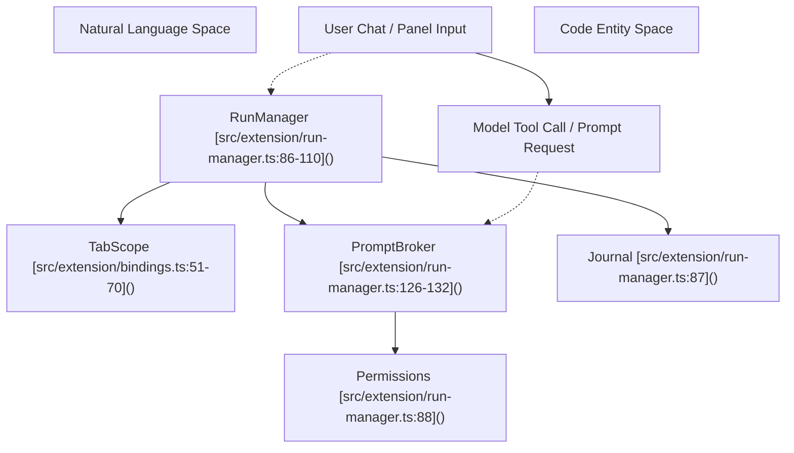
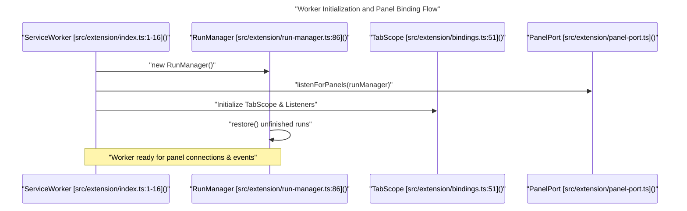

<!-- source: DeepWiki mcp.deepwiki.com · repo nanobrowser/nanobrowser · page 5 Extension Worker Orchestration · fetched 2026-10-29 -->

# Extension Worker Orchestration

Relevant source files

The following files were used as context for generating this wiki page:

- [src/extension/index.ts](src/extension/index.ts)
- [src/extension/run-manager.ts](src/extension/run-manager.ts)

## Purpose and Scope

The extension worker orchestration layer (`src/extension`) serves as the central nervous system of the Nanobrowser extension, executing inside the MV3 background service worker. It bridges the UI panels (`src/ui`, `src/side-panel`), the browser automation layer (`src/browser-control`), and the AI agent loop (`src/agent`) [src/extension/run-manager.ts:1-2](). 

This page provides a high-level overview of how conversation runs, side panel connections, tab scoping, prompt brokerage, site permissions, and visual indicators are managed. 

For deep technical details, refer to the child pages:
- [RunManager and Conversation Runs](#5.1) — Detailed breakdown of `RunManager`, run records, steering queues, and watchdog restoration [src/extension/run-manager.ts:1-1416]().
- [Permissions, Prompt Broker and Handover](#5.2) — Detailed breakdown of site rules, Ask/Auto modes, write cards, and payment handovers [src/extension/run-manager.ts:88]().
- [Tabs, Scope, Border and Thumbnails](#5.3) — Detailed breakdown of tab grouping, page glow borders, and selection flows [src/extension/bindings.ts:1-302]().

---

## Architecture Overview

The extension entrypoint initializes the core orchestration singletons upon service worker startup [src/extension/index.ts:1-16](). The primary coordinator is `RunManager`, which owns the active agent execution loops, manages session bindings across tabs via `TabScope`, coordinates interactive prompt requests through `PromptBroker`, and tracks persistent state [src/extension/run-manager.ts:86-110]().

Sources: [src/extension/run-manager.ts:86-132](), [src/extension/bindings.ts:51-70](), [src/extension/index.ts:1-16]()

---

## Core Orchestration Components

### Run Management and Panel Protocol
`RunManager` tracks active conversation runs, manages panel communication channels, and handles asynchronous queueing of user messages sent while the agent is executing [src/extension/run-manager.ts:86-110](). Panels attach and detach dynamically via `PanelConnection` wrappers, allowing UI windows to close and reopen without interrupting the underlying worker task [src/extension/run-manager.ts:71-76]().

For details, see [RunManager and Conversation Runs](#5.1).

Sources: [src/extension/run-manager.ts:71-110](), [src/extension/index.ts:1-16]()

### Tab Scoping and Agent Sessions
The `TabScope` class maps browser tabs to specific conversations using `chrome.storage.session` [src/extension/bindings.ts:1-23](). It manages tab grouping, color assignment based on conversation IDs, and propagates activation state changes across the extension [src/extension/bindings.ts:51-70](). Each session controls page interaction boundaries.

For details, see [Tabs, Scope, Border and Thumbnails](#5.3).

Sources: [src/extension/bindings.ts:1-70]()

### Permissions, Prompt Broker and Handover
The `PromptBroker` intercepts automated browser-control prompts and routes them through the extension interface when agent actions require user authorization, secrets, or secure dialog confirmation [src/extension/run-manager.ts:126-132](). Concurrently, the `Permissions` module evaluates per-site allow/ask/block rules [src/extension/run-manager.ts:88]().

For details, see [Permissions, Prompt Broker and Handover](#5.2).

Sources: [src/extension/run-manager.ts:88-146]()

---

## Worker Lifecycle and Event Flow

Sources: [src/extension/index.ts:1-16](), [src/extension/run-manager.ts:86-148](), [src/extension/bindings.ts:58-70]()

---

