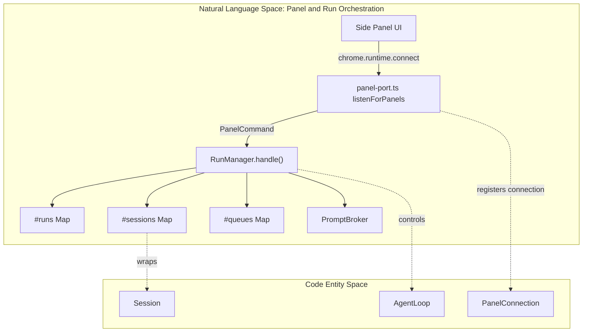
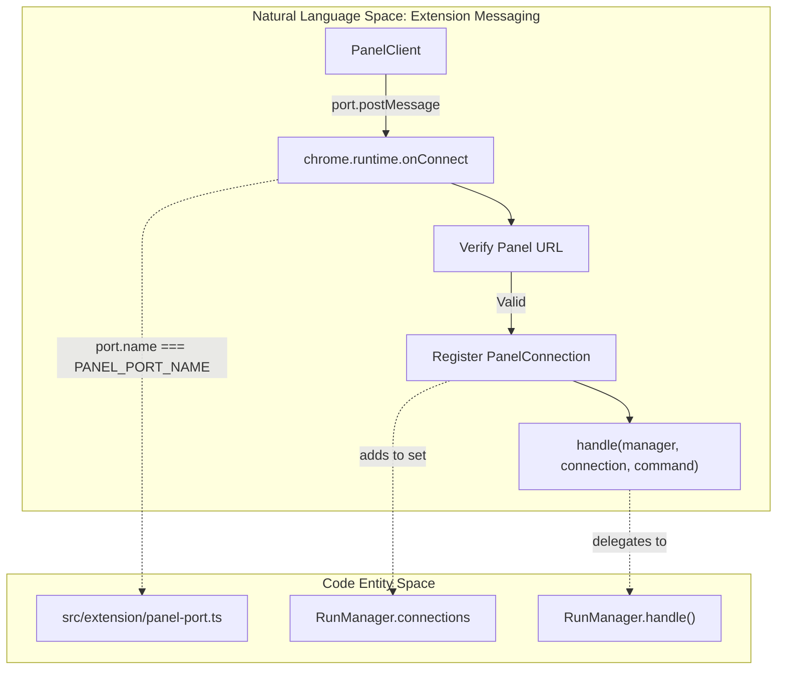

<!-- source: DeepWiki mcp.deepwiki.com · repo nanobrowser/nanobrowser · page 5.1 RunManager and Conversation Runs · fetched 2026-10-29 -->

# RunManager and Conversation Runs

Relevant source files

The following files were used as context for generating this wiki page:

- [src/extension/__tests__/live-pair.test.ts](src/extension/__tests__/live-pair.test.ts)
- [src/extension/models.ts](src/extension/models.ts)
- [src/extension/run-manager.ts](src/extension/run-manager.ts)

## Purpose and Scope

This page covers `src/extension/run-manager.ts` and `src/extension/panel-port.ts`, which implement the `RunManager` class and the background worker's side-panel communication bridge [src/extension/run-manager.ts:1-150](), [src/extension/panel-port.ts:1-59](). `RunManager` serves as the central orchestrator for active conversation runs, worker-side execution queues, panel connection bindings, page-border tracking, model resolution (`src/extension/models.ts`), and lifecycle restoration after browser restarts.

Sources: [src/extension/run-manager.ts:1-150](), [src/extension/panel-port.ts:1-59](), [src/extension/models.ts:1-90]()

---

## Core Classes and State Structures

The extension worker relies on several key runtime structures managed within `RunManager` to track open panels, active AI agent loops, and pending message queues across browser tabs.

### `PanelConnection` and `ActiveRun`
* **`PanelConnection`**: Represents an active connection from a side panel instance. It tracks the associated `tabId`, `conversationId`, a `sink` function to dispatch `PanelEvent` objects back to the UI, and an optional `unsubscribe` handler [src/extension/run-manager.ts:71-76]().
* **`ActiveRun`**: Encapsulates a running conversation execution, containing the `runId`, an `AbortController` for cancellation, a `done` promise tracking completion, and an optional reference to the underlying `AgentLoop` instance [src/extension/run-manager.ts:78-84]().

### Internal Maps and Queues
`RunManager` maintains several private maps to coordinate concurrent operations:
* `#runs`: Maps conversation IDs to active `ActiveRun` instances [src/extension/run-manager.ts:90]().
* `#sessions`: Tracks browser automation `Session` references per conversation [src/extension/run-manager.ts:91]().
* `#queues`: Holds messages typed by users while the agent is actively working on a conversation [src/extension/run-manager.ts:98]().
* `#returned`: Stores queued messages of runs restored after an extension restart, returning them to the composer until a panel subscribes [src/extension/run-manager.ts:107-109]().

Sources: [src/extension/run-manager.ts:71-109](), [src/extension/panel-port.ts:8-53]()

---

## Panel Protocol and Message Handling

The background worker listens for incoming connections from the extension's side panel using `chrome.runtime.onConnect` [src/extension/panel-port.ts:8-10](). 

### Connection Validation and Security
`listenForPanels` validates that incoming port connections originate exclusively from the extension's own `/sidepanel.html` URL and match the expected `PANEL_PORT_NAME` protocol [src/extension/panel-port.ts:10-15](). Any unauthorized connection is immediately disconnected [src/extension/panel-port.ts:13]().

### Sequential Command Processing
Commands received from the panel are processed sequentially through a promise chain (`queue = queue.then(() => run(command))`), ensuring that state mutations (such as a send following a subscribe) resolve deterministically [src/extension/panel-port.ts:43-51](). User answers to interactive cards bypass this sequential queue to prevent deadlocks when interacting with multi-tab prompts [src/extension/panel-port.ts:40-49]().

Sources: [src/extension/panel-port.ts:1-59](), [src/extension/run-manager.ts:71-101]()

---

## Conversation Run Lifecycle and Agent Loop

When a user submits a prompt, `RunManager` initializes or retrieves the session for the target conversation, sets up security policies, resolves models via `livePair` and `resolveModel` [src/extension/models.ts:26-90](), and dispatches the execution to the agent loop.

### Starting and Stopping Runs
* **Start**: Binds the conversation to a `TabScope` [src/extension/run-manager.ts:111-114](), establishes page border highlights [src/extension/run-manager.ts:115-121](), and starts an `AgentLoop` instance.
* **Stop**: Triggered explicitly via user action or implicitly when Chrome's debugger detaches (`chrome.debugger.onDetach` with `canceled_by_user`) [src/extension/run-manager.ts:135-140](). The active `AbortController` is signaled, stopping further tool execution [src/extension/run-manager.ts:80]().

### Steering Queue and Message Queuing
While an agent loop is busy executing steps, additional user messages sent to the same conversation are intercepted and placed into `#queues` [src/extension/run-manager.ts:98](). These queued messages are fed into the context window at subsequent turn boundaries, allowing the user to steer the agent mid-run.

Sources: [src/extension/run-manager.ts:78-146](), [src/agent/loop.ts:1-10](), [src/extension/models.ts:26-90]()

---

## Restoration, Watchdog, and Persistence

Because service workers in Manifest V3 can be terminated by the browser at any time, `RunManager` implements recovery mechanisms to handle unexpected worker lifecycles.

### Crash Recovery and Watchdog
When the extension worker boots up, previously active runs that were interrupted by a worker termination are inspected. Orphaned page borders are cleared [src/extension/run-manager.ts:123-125](), and conversation states are re-synchronized against IndexedDB via storage utilities [src/store/conversations.ts:1-28](). Unfinished runs are marked or staged for user-initiated recovery via `planRestore()` [src/agent/restore.ts:31]().

Sources: [src/extension/run-manager.ts:123-146](), [src/agent/restore.ts:1-35](), [src/store/conversations.ts:1-28]()

---

