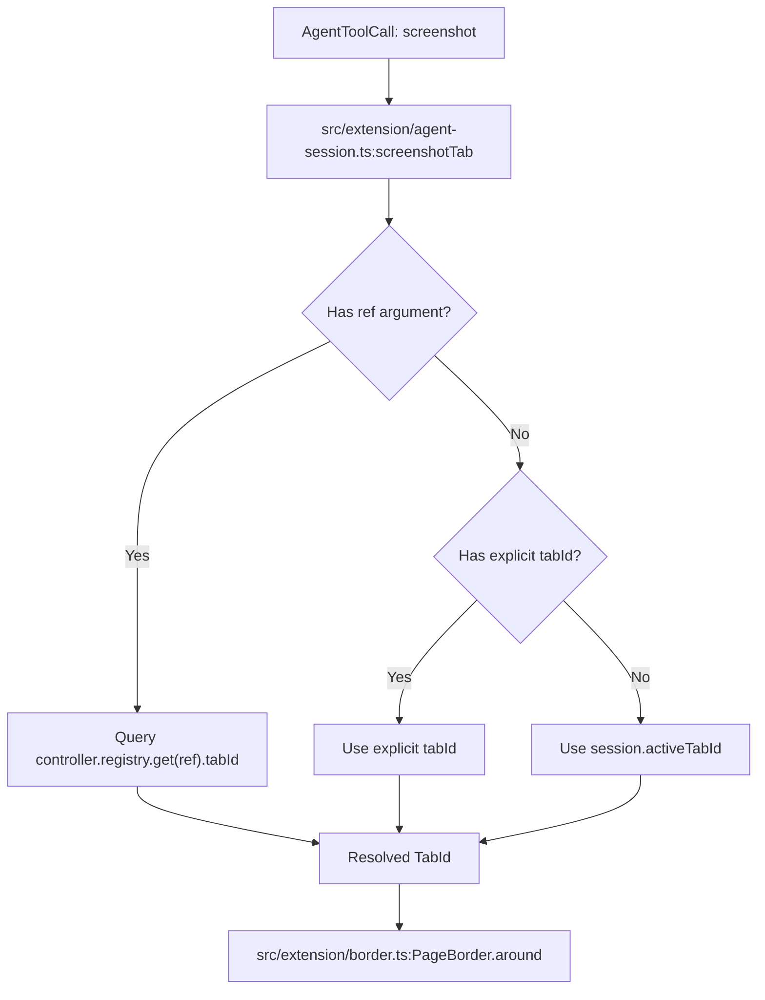
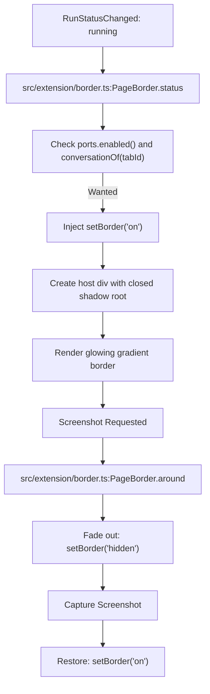

<!-- source: DeepWiki mcp.deepwiki.com · repo nanobrowser/nanobrowser · page 5.3 Tabs, Scope, Border and Thumbnails · fetched 2026-10-29 -->

# Tabs, Scope, Border and Thumbnails

Relevant source files

The following files were used as context for generating this wiki page:

- [src/background/checks/page-border.ts](src/background/checks/page-border.ts)
- [src/extension/__tests__/border.test.ts](src/extension/__tests__/border.test.ts)
- [src/extension/agent-session.ts](src/extension/agent-session.ts)
- [src/extension/border.ts](src/extension/border.ts)

## Purpose and Scope

This page documents the subsystem responsible for managing agent conversation sessions, tab scoping, the visual page glow border, screenshot thumbnail capturing, and text selection flows ("Ask Nanobrowser about this"). It covers how conversation run states map to browser tabs, how the extension visually isolates active agent tabs without leaking into model vision prompts, and how tool execution integrates with session lifecycle hooks.

---

## 1. Agent Sessions and Layer Port Integration

The extension orchestrates browser automation by bridging high-level agent prompts with deterministic browser controls. This is initialized via `createAgentSession` in `src/extension/agent-session.ts`, which configures session capabilities, boundary labels, and timeouts [src/extension/agent-session.ts:14-25]().

### Session Configuration and Capabilities

An agent session sets up strict boundaries and human-in-the-loop fallback mechanisms:
- **Capabilities & Uploads**: Configured with `capabilities: ['human', 'files']`. Upload sources are restricted strictly to chat attachments rather than arbitrary host disk paths [src/extension/agent-session.ts:16-18]().
- **Handover & Timeouts**: Enables handover policies with infinite confirmation timeouts and a 15-minute `askTimeoutMs` to account for users stepping away during `ask_user` prompts [src/extension/agent-session.ts:19-21]().
- **Boundary Defusal**: Exposes `AGENT_LABELS` (`[Nanobrowser note`, `browser-state`, `agent-notes`, `custom-instructions`) to prevent prompt injection via web page text [src/extension/agent-session.ts:8-10]().

### Target Tab Resolution for Screenshots

When the agent requests a visual snapshot via the `screenshot` tool, `screenshotTab` resolves the target tab ID hierarchically:
1. If a DOM element `ref` is provided, it looks up the tab owning that ref via the controller's registry [src/extension/agent-session.ts:31-32]().
2. Falls back to an explicit `tabId` argument if specified [src/extension/agent-session.ts:33]().
3. Defaults to the session's currently active tab (`session.activeTabId`) [src/extension/agent-session.ts:34]().

If a reference points to an unknown tab, it returns `null`, causing the call to fail gracefully without triggering border hiding logic [src/extension/agent-session.ts:28-30]().

Sources: [src/extension/agent-session.ts:1-63](), [src/extension/__tests__/border.test.ts:164-180]()

---

## 2. Page Glow Border Architecture

To provide clear spatial feedback on where an agent is operating, Nanobrowser renders a soft gradient glow border around the top frame of active conversation tabs [src/extension/border.ts:1-4](). 

### `PageBorder` State Machine

Managed by the `PageBorder` class (`src/extension/border.ts`), the border state is governed by conversation run statuses, tab membership changes, and Settings toggles:
- **`on`**: Rendered while a run is active (`status === 'running'`) and the Settings switch is enabled.
- **`hidden`**: Temporarily faded out during screenshot captures so the model receives an uncluttered view of the page.
- **`off`**: Completely removed when the run stops, when tabs leave the conversation, or when the feature is disabled in settings.

### Border Injection and Isolation

The worker injects `setBorder(state)` into the top frame of the target tab using `chrome.scripting.executeScript` [src/extension/border.ts:19-20](). To prevent web page scripts or accessibility trees from detecting or interfering with the border:
- The host element (`[data-nanobrowser-border]`) is created with `aria-hidden="true"` and `pointer-events: none` [src/extension/border.ts:135-138]().
- It attaches a **closed shadow root** (`host.attachShadow({ mode: 'closed' })`), making its internal DOM nodes unreachable from page scripts [src/extension/border.ts:139]().
- It applies a smooth CSS gradient (`blue` and `violet`) with a breathing animation (`breathe 2s ease-in-out infinite alternate`), respecting `prefers-reduced-motion` [src/extension/border.ts:140-147]().

Sources: [src/extension/border.ts:1-218](), [src/background/checks/page-border.ts:1-150](), [src/extension/__tests__/border.test.ts:1-163]()

---

## 3. Screenshot Fading Protocol

When the agent calls `screenshot`, the `layerPort` wrapper intercepts the call to ensure the visual glow border does not contaminate the captured image sent to the vision LLM [src/extension/agent-session.ts:42-51]().

1. **Overlap & Batching**: Multiple overlapping screenshot requests for the same tab share a single fade lifecycle. If a second capture starts while fading out, it waits for the active fade promise [src/extension/border.ts:65-86]().
2. **Timeout Safeguard (`HIDE_WAIT_MS`)**: The system waits up to `300ms` for the border hide injection to settle. If the page is unresponsive or a dialog is open, the capture proceeds regardless to prevent hanging the agent loop [src/extension/border.ts:23-24](), [src/extension/agent-session.ts:37-40](), [src/extension/__tests__/border.test.ts:116-127]().

Sources: [src/extension/agent-session.ts:37-51](), [src/extension/border.ts:23-86](), [src/extension/__tests__/border.test.ts:116-161]()

---

## 4. Tab Scoping, Tab Groups and Selection Flows

### Tab Scoping
Conversations are bound to specific sets of browser tabs (`scopedTabs()`, `tabsOf()`). When an agent performs multi-tab workflows, `PageBorder` tracks tab additions and removals dynamically, applying or removing border injections per tab without affecting unrelated browser tabs [src/extension/border.ts:10-16](), [src/extension/__tests__/border.test.ts:60-70]().

### 'Ask Nanobrowser about this' Selection Flow
When a user highlights text on a web page and invokes the extension context menu or command:
1. The extension captures the selected text and associated DOM metadata.
2. It routes the payload to the active conversation session in the side panel.
3. The composer state prepends the selected context as a chat attachment or scoped reference, allowing the agent to reason directly about the user's highlighted text selection.

Sources: [src/extension/agent-session.ts:1-63](), [src/extension/border.ts:1-218](), [src/extension/__tests__/border.test.ts:1-180]()

---

