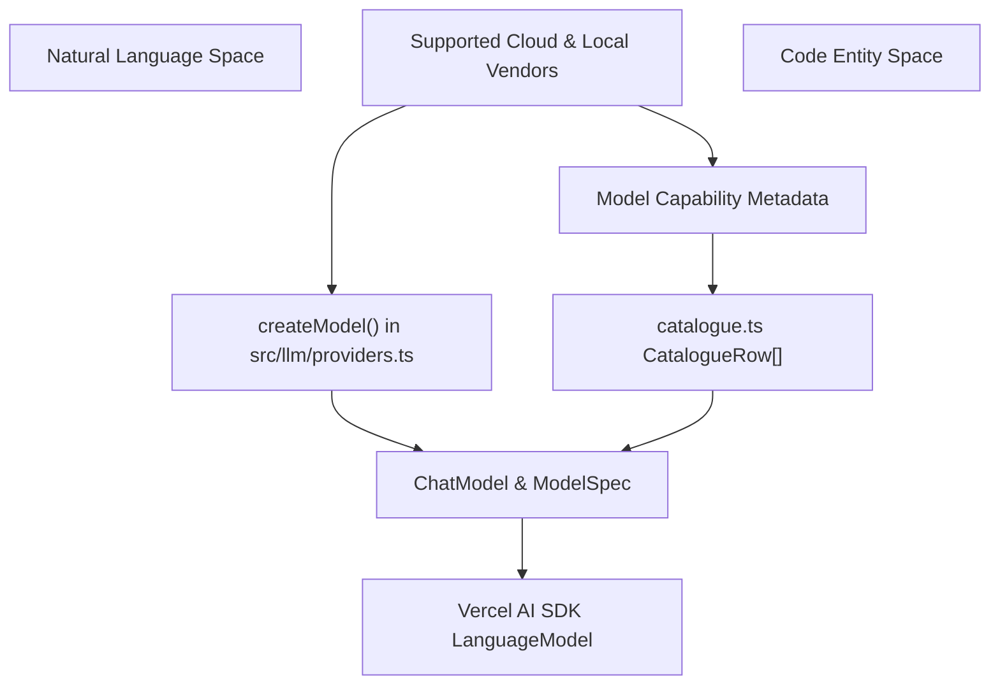
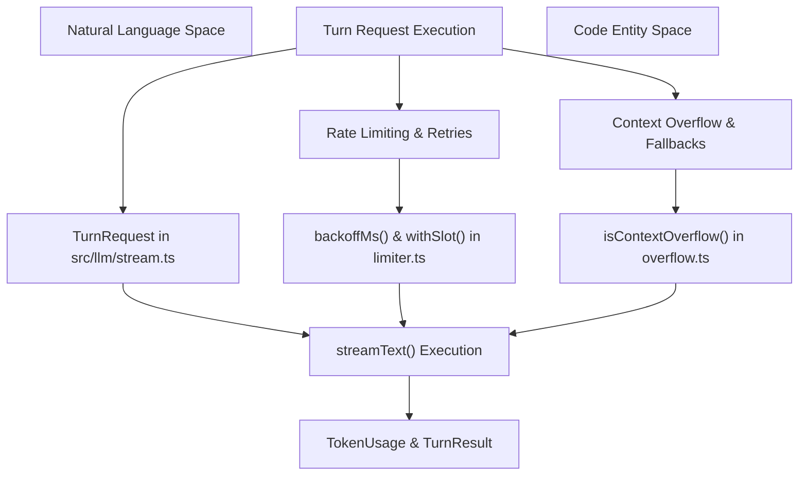

<!-- source: DeepWiki mcp.deepwiki.com · repo nanobrowser/nanobrowser · page 6 LLM Integration · fetched 2026-10-29 -->

# LLM Integration

Relevant source files

The following files were used as context for generating this wiki page:

- [src/llm/catalogue.ts](src/llm/catalogue.ts)
- [src/llm/providers.ts](src/llm/providers.ts)
- [src/options/AboutSection.tsx](src/options/AboutSection.tsx)
- [src/options/App.tsx](src/options/App.tsx)
- [src/ui/links.ts](src/ui/links.ts)

This page provides an overview of Nanobrowser's provider-agnostic Large Language Model (LLM) integration layer located in `src/llm`. Built upon the Vercel AI SDK, this layer abstracts away the complexities of interacting with various LLM vendors, offering a unified interface for model instantiation, catalogue capability lookup, connection testing, streaming turn execution, rate limiting, context overflow recovery, and audio transcription.

For detailed information on specific subsystems, please refer to the child pages:
- [Providers, Profiles and Model Catalogue](#6.1) — `providers.ts`, `profiles.ts`, `catalogue.ts`, `model-info.ts` — supported cloud and local providers, capability metadata (context window, vision, reasoning effort, wire efforts), per-model defaults.
- [Connections, Streaming and Error Handling](#6.2) — `connection.ts`, `stream.ts`, `limiter.ts`, `overflow.ts`, `errors.ts`, `scripted.ts` — model test calls, tool-calling validation, CORS fixes for Ollama/LM Studio, rate limiting, context overflow recovery.
- [Voice Input and Transcription](#6.3) — `src/llm/transcribe.ts`, microphone permission entrypoint, VoiceCard settings and composer voice recording states.

## Provider Architecture and Model Catalogue

The LLM integration layer decouples agent decision-making from vendor-specific APIs. The `ProviderKind` union type identifies supported providers such as `anthropic`, `openai`, `gemini`, `openai-compatible`, `ollama`, `lmstudio`, and `openrouter` [src/llm/providers.ts:9-10](). 

The `createModel` function takes a `ModelSpec` and returns a `ChatModel` instance wrapping the underlying Vercel AI SDK `LanguageModel`, complete with vendor-specific parameters such as prompt caching controls for Anthropic or strict JSON schema flags for OpenAI [src/llm/providers.ts:13-32](), [src/llm/providers.ts:69-123](). 

Model capabilities—including context windows, maximum output tokens, vision support, and reasoning support levels (`none`, `optional`, `always`)—are catalogued declaratively in `catalogue.ts` [src/llm/catalogue.ts:1-48]().

Sources: [src/llm/providers.ts:9-123](), [src/llm/catalogue.ts:1-48]()

For details on configuration schemas, provider factories, and model profiles, see [Providers, Profiles and Model Catalogue](#6.1).

## Streaming, Rate Limiting and Error Management

Turn execution is managed via `streamText` abstractions where a single model call per turn processes messages and returns structured tool call requests [src/llm/stream.ts:1-44](). The subsystem handles retries with exponential backoff and jitter, respects `Retry-After` headers, and limits execution attempts [src/llm/stream.ts:9-12](), [src/llm/stream.ts:111-116](). 

It also provides concurrency slotting (`withSlot`), context overflow detection (`isContextOverflow`), and fallback mechanisms when servers reject reasoning parameters or multimodal image inputs [src/llm/stream.ts:11-12](), [src/llm/stream.ts:143-173]().

Sources: [src/llm/stream.ts:1-90](), [src/llm/stream.ts:111-173]()

For details on connection verification, stream handling, and error recovery policies, see [Connections, Streaming and Error Handling](#6.2).

## Voice Input and Transcription

Audio transcription within Nanobrowser handles microphone permission flows, records audio streams in the UI composer, and transcribes spoken prompts into text tokens using browser-native or dedicated transcription services implemented in `src/llm/transcribe.ts`.

For details on recording states, microphone entrypoints, and transcription execution, see [Voice Input and Transcription](#6.3).

Sources: [src/llm/providers.ts:1-178](), [src/llm/catalogue.ts:1-101](), [src/llm/stream.ts:1-174]()

---

