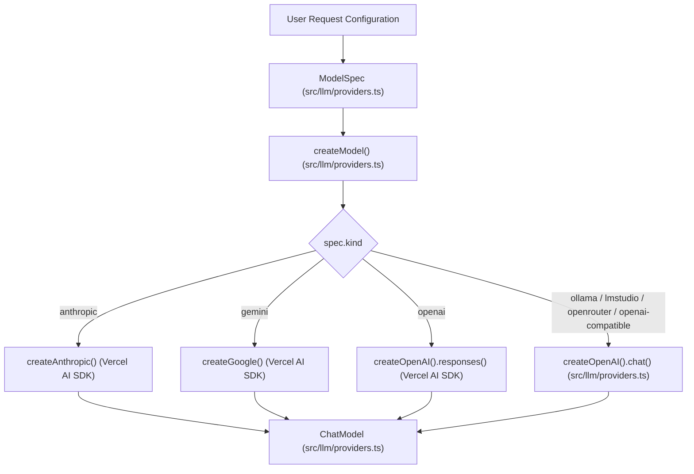
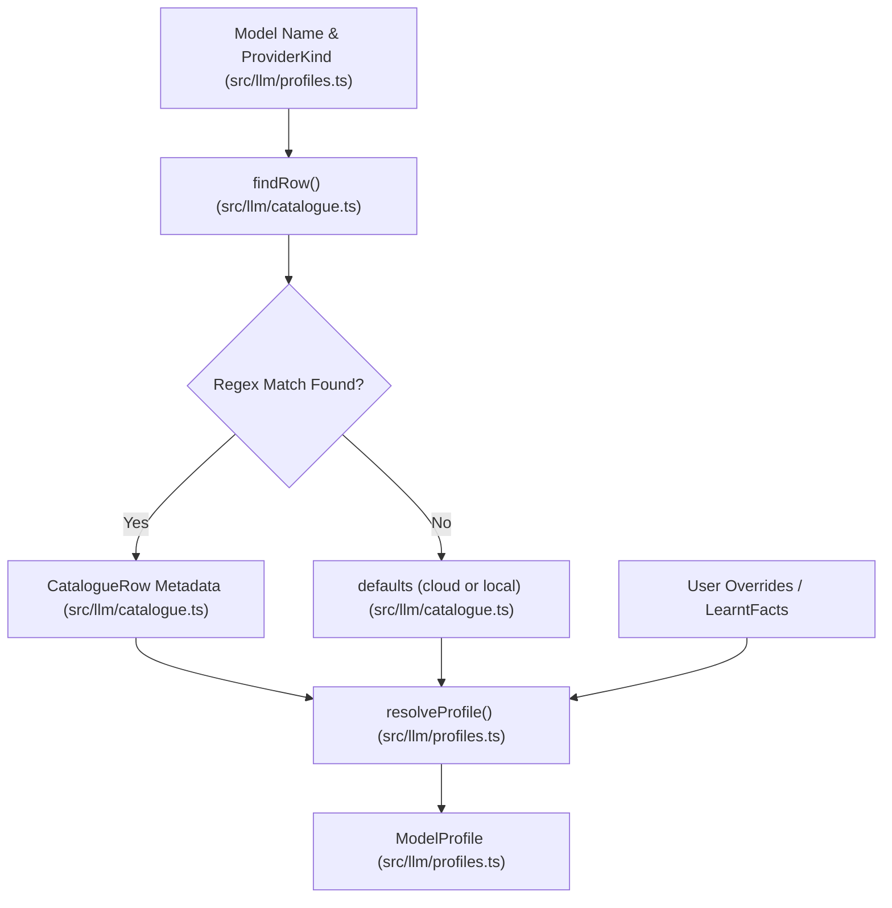

<!-- source: DeepWiki mcp.deepwiki.com · repo nanobrowser/nanobrowser · page 6.1 Providers, Profiles and Model Catalogue · fetched 2026-10-29 -->

# Providers, Profiles and Model Catalogue

Relevant source files

The following files were used as context for generating this wiki page:

- [src/llm/catalogue.ts](src/llm/catalogue.ts)
- [src/llm/profiles.ts](src/llm/profiles.ts)
- [src/llm/providers.ts](src/llm/providers.ts)
- [src/options/AboutSection.tsx](src/options/AboutSection.tsx)
- [src/options/App.tsx](src/options/App.tsx)
- [src/ui/links.ts](src/ui/links.ts)

This page details the implementation of cloud and local model providers, model metadata catalogues, and profile resolution logic in Nanobrowser (`src/llm`). Built around the Vercel AI SDK, this layer manages provider connections (`src/llm/providers.ts`), model capability metadata and regex rules (`src/llm/catalogue.ts`), and runtime profile resolution (`src/llm/profiles.ts`).

## Supported Cloud and Local Providers

Nanobrowser connects to cloud and local LLM endpoints via `src/llm/providers.ts`. The module defines provider kinds, connection specs, chat model wrappers, and specialized fetching mechanisms such as OpenRouter usage accounting and Anthropic browser direct-access headers [src/llm/providers.ts:1-123]().

### Provider Kinds and Specifications

The extension supports seven provider kinds defined in `ProviderKind`: `'anthropic'`, `'openai'`, `'gemini'`, `'openai-compatible'`, `'ollama'`, `'lmstudio'`, and `'openrouter'` [src/llm/providers.ts:9-10](). 

Each model invocation is governed by a `ModelSpec` interface containing connection metadata and constraints [src/llm/providers.ts:13-21](). The `createModel` factory function inspects the `ModelSpec.kind` and instantiates the appropriate Vercel AI SDK provider backend [src/llm/providers.ts:69-123]().

Title: Provider Factory and Model Instantiation Flow

**Diagram: Provider Factory Flow (`createModel`)**

Sources:
* [src/llm/providers.ts:9-21]()
* [src/llm/providers.ts:69-123]()

### Specialized Provider Handling
* **Anthropic**: Injected with the `anthropic-dangerous-direct-browser-access: true` header to support browser extension service worker execution, alongside ephemeral prompt caching controls [src/llm/providers.ts:74-86]().
* **OpenAI**: Configured via `openai.responses` with disabled strict JSON schemas where appropriate and store disabled [src/llm/providers.ts:92-101]().
* **OpenRouter & Local Servers**: Handled through OpenAI-compatible endpoints with custom base URLs managed by `openAICompatibleBaseUrl()` [src/llm/providers.ts:59-67](). OpenRouter requests include usage tracking via `usageAccounting()` to parse cost metadata from stream chunks [src/llm/providers.ts:129-173]().

Sources:
* [src/llm/providers.ts:59-173]()

---

## Model Catalogue and Capability Metadata

The model catalogue (`src/llm/catalogue.ts`) acts as the single source of truth for model capabilities, context windows, max output tokens, vision support, and reasoning behaviors [src/llm/catalogue.ts:1-48]().

### Catalogue Entries and Matching

Each model is catalogued using `CatalogueRow` definitions containing regex match rules, version boundaries, reasoning support types (`none`, `optional`, `always`), and wire effort mappings [src/llm/catalogue.ts:24-48](). 

Title: Catalogue Lookup and Profile Synthesis Pipeline

**Diagram: Catalogue Lookup and Profile Resolution**

Sources:
* [src/llm/catalogue.ts:24-48]()
* [src/llm/catalogue.ts:50-65]()
* [src/llm/profiles.ts:88-108]()

### Default Fallbacks and Wire Efforts

When a model name is unknown to the catalogue, fallback limits apply based on whether the endpoint is local or cloud [src/llm/catalogue.ts:50-65](). Reasoning effort settings are normalized onto wire-compatible values using `WIRE_EFFORTS` [src/llm/catalogue.ts:12-20]().

Sources:
* [src/llm/catalogue.ts:12-65]()

---

## Profile Resolution and Runtime Capabilities

Runtime profiles combine catalogue rows, user overrides, API-discovered facts, and server-detected constraints into a concrete `ModelProfile` via `src/llm/profiles.ts` [src/llm/profiles.ts:1-22]().

### Key Resolution Functions
* `resolveProfile(input: ProfileInput): ModelProfile`: Merges overrides, tested metrics, API responses, catalogue defaults, and detected local context windows [src/llm/profiles.ts:88-108]().
* `capabilityFrom(reasons, acceptsNone)`: Determines whether a model supports reasoning as `none`, `optional`, or `always` [src/llm/profiles.ts:55-62]().
* `probeAsk(input)`: Identifies missing reasoning or vision attributes required for model probing [src/llm/profiles.ts:114-127]().
* `requestOutputLimit(profile)`: Bounds requested output tokens against context window boundaries to prevent exhaustion on small windows [src/llm/profiles.ts:130-132]().
* `wireEffort(profile, effort)`: Maps user-facing reasoning efforts to vendor wire specifications [src/llm/profiles.ts:135-137]().
* `makePair(model, setting, capability)`: Initializes default model and reasoning effort pairs for active conversations [src/llm/profiles.ts:143-149]().

Sources:
* [src/llm/profiles.ts:55-62]()
* [src/llm/profiles.ts:88-108]()
* [src/llm/profiles.ts:114-149]()

---

