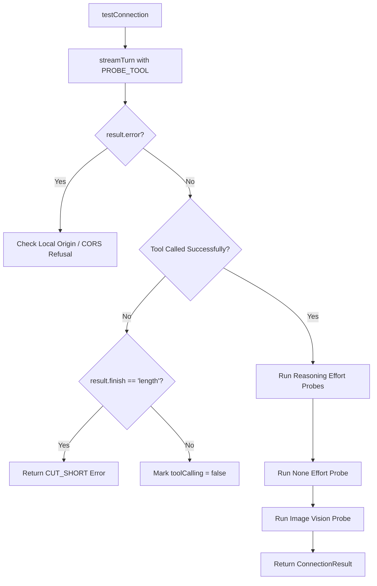
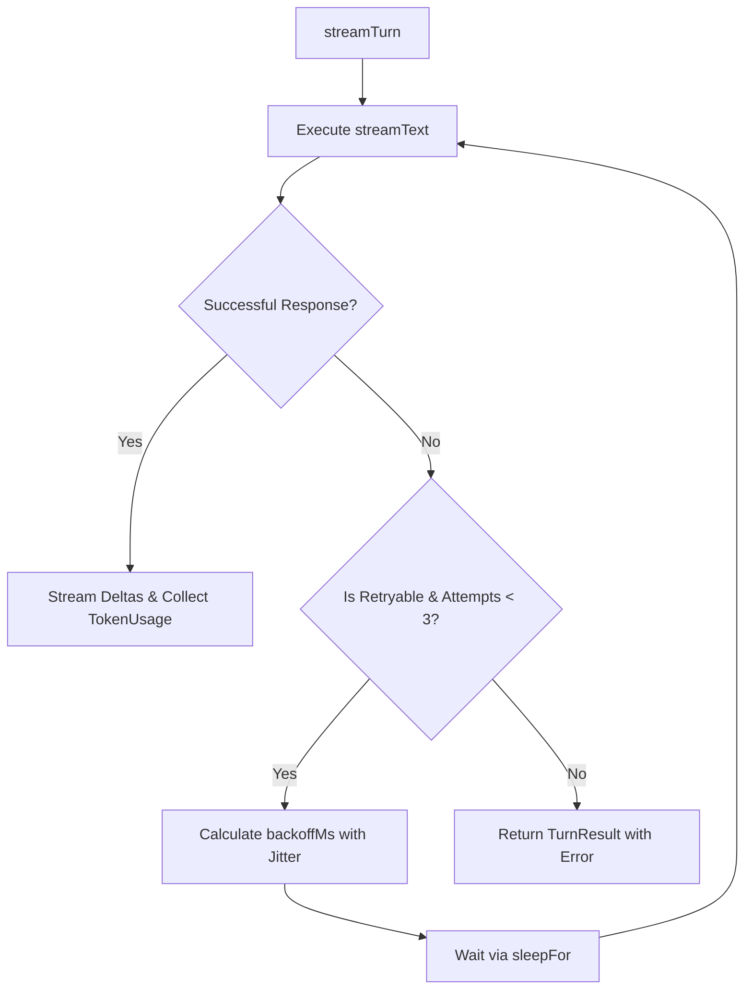
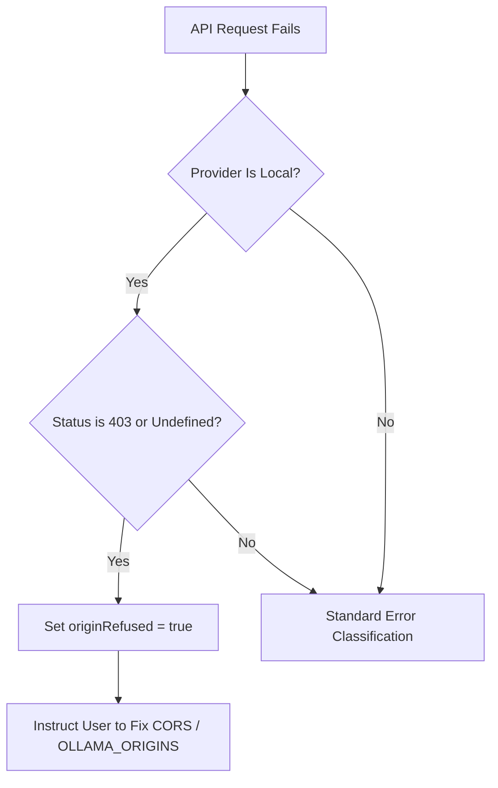

<!-- source: DeepWiki mcp.deepwiki.com · repo nanobrowser/nanobrowser · page 6.2 Connections, Streaming and Error Handling · fetched 2026-10-29 -->

# Connections, Streaming and Error Handling

Relevant source files

The following files were used as context for generating this wiki page:

- [src/llm/__tests__/connection.test.ts](src/llm/__tests__/connection.test.ts)
- [src/llm/connection.ts](src/llm/connection.ts)
- [src/llm/stream.ts](src/llm/stream.ts)
- [src/options/model-test.ts](src/options/model-test.ts)

This wiki page details the implementation of model connection testing, streaming execution per turn, rate limiting, context overflow recovery, and error classification within the Nanobrowser codebase. It covers `src/llm/connection.ts`, `src/llm/stream.ts`, `src/llm/limiter.ts`, `src/llm/overflow.ts`, `src/llm/errors.ts`, and `src/options/model-test.ts`.

## 1. Model Connection Testing and Validation

The `src/llm/connection.ts` module provides connectivity testing for model providers and automated capability probing [src/llm/connection.ts:1-35](). When a user adds or tests a model in the settings interface, `testConnection` validates whether the model correctly executes tool calls and discovers capabilities like reasoning limits and vision support [src/llm/connection.ts:61-65]().

### The Test Flow and Probes

The test begins by submitting a single turn request via `streamTurn` with a dummy test tool (`report_status`) [src/llm/connection.ts:44-74](). 

1. **Tool Calling Check:** The model must reply with a call to `report_status` [src/llm/connection.ts:85](). If the output is cut short due to token limits (`finish === 'length'`), it returns a `CUT_SHORT` error rather than assuming tool-calling failure [src/llm/connection.ts:88-90]().
2. **Reasoning Effort Probe:** For chat-completions providers, the test iterates through reasoning levels (`low`, `medium`, `high`) using `refusesReasoning` to determine acceptance [src/llm/connection.ts:97-107]().
3. **None Effort Probe:** If reasoning is supported, it tests whether `none` (or vendor equivalents like `minimal`) is accepted [src/llm/connection.ts:110-114]().
4. **Vision/Image Probe:** If a model's vision capability is unverified, it tests image handling using a tiny 8x8 pixel red square base64 payload (`PROBE_IMAGE`) via `refusesImages` [src/llm/connection.ts:41-42, 117-133]().

**Diagram: Connection Testing and Probing Flow**
Sources: [src/llm/connection.ts:61-136]()

Model tests are orchestrated via `src/options/model-test.ts`, which distinguishes between full cloud testing and local API inspection (`wholeTestOnAdd`), saving verified state to storage using `saveTest` [src/options/model-test.ts:25-77]().

Sources: [src/llm/connection.ts:1-161](), [src/options/model-test.ts:1-77]()

## 2. Turn Streaming and Retry Mechanics

The `src/llm/stream.ts` module manages streaming model calls on a per-turn basis without automatic tool execution—the agent loop executes tools manually [src/llm/stream.ts:1-4]().

### Retry Policy and Backoff

Requests use a custom exponential backoff retry mechanism with jitter:
* Maximum of 3 attempts (`DEFAULT_RETRY`) [src/llm/stream.ts:69]()
* Base delay of 1000ms, max 30,000ms [src/llm/stream.ts:69]()
* Respects `Retry-After` headers via `backoffMs` [src/llm/stream.ts:111-116]()
* Stops retrying once text has successfully started streaming [src/llm/stream.ts:3-4]()

**Diagram: Turn Streaming and Retry Flow**
Sources: [src/llm/stream.ts:1-116]()

### Degradation Fallbacks

The streaming layer handles unsupported model features on the fly:
* **Reasoning Drops:** If a 400 error names reasoning fields (`refusesReasoning`), reasoning is disabled for the remainder of the run [src/llm/stream.ts:50-54, 143-145]().
* **Image Drops:** If a model refuses image input (`refusesImages`), images are replaced with descriptive text placeholders (`IMAGE_NOT_SENT`) via `withoutImages` [src/llm/stream.ts:57-58, 147-173]().

Sources: [src/llm/stream.ts:1-174]()

## 3. Rate Limiting and Concurrency

Concurrency and rate limits for LLM requests are governed by `src/llm/limiter.ts` using token slots and concurrency wrappers (`withSlot`) [src/llm/stream.ts:11](). This prevents parallel agent tasks from flooding local or cloud providers beyond configured concurrency thresholds.

Sources: [src/llm/limiter.ts:1-28](), [src/llm/stream.ts:11]()

## 4. Context Overflow Recovery

When a model's context window fills up, `src/llm/overflow.ts` detects context overflow conditions via `isContextOverflow` [src/llm/stream.ts:10](). This triggers prompt compaction and transcript elision routines in the agent layer to trim older conversation turns and allow continuation.

Sources: [src/llm/overflow.ts:1-37](), [src/llm/stream.ts:10]()

## 5. Error Classification and Local CORS Fixes

Error classification and handling are defined in `src/llm/errors.ts`, identifying network failures, authentication problems, rate limits, and local server CORS issues.

### Local Server Origin and CORS Handling

Local providers like Ollama and LM Studio often reject requests from browser extensions due to missing CORS headers or strict origin policies. When `testConnection` encounters a 403 status or an undefined error on a local endpoint (`ollama`, `lmstudio`, `openai-compatible`), it flags `originRefused: true` [src/llm/connection.ts:75-83](). The UI uses this flag to prompt the user to configure `OLLAMA_ORIGINS=*` or adjust local server CORS settings [src/llm/connection.ts:17-18]().

**Diagram: Local Origin Refusal and CORS Detection**
Sources: [src/llm/connection.ts:75-83](), [src/llm/errors.ts:1-50]()

Sources: [src/llm/connection.ts:75-83](), [src/llm/errors.ts:1-60]()

---

