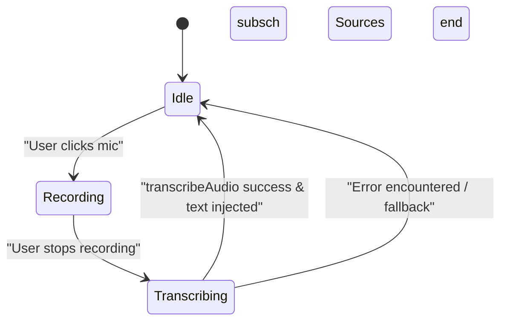

<!-- source: DeepWiki mcp.deepwiki.com · repo nanobrowser/nanobrowser · page 6.3 Voice Input and Transcription · fetched 2026-10-29 -->

# Voice Input and Transcription

<details>
<summary>Relevant source files</summary>

The following files were used as context for generating this wiki page:

- [src/side-panel/App.tsx](src/side-panel/App.tsx)
- [src/ui/locales/en.json](src/ui/locales/en.json)

</details>


## Purpose and Scope

This page documents the voice input and speech-to-transcription subsystem within Nanobrowser. The subsystem enables users to dictate prompts directly into the side panel composer using their microphone, manage microphone permissions, configure speech settings via voice configuration helpers, and process audio streams through `transcribeAudio` handlers [src/side-panel/App.tsx:76-83](), [src/ui/locales/en.json:73-84]().

---

## Microphone Permissions and Extension Lifecycle

Audio capture in a Chrome Extension Manifest V3 environment requires explicit device permissions (`audioCapture`). Nanobrowser requests access dynamically when the user initiates a recording session from the side panel composer.

- **Permission Request Entrypoint:** When a user activates voice input, the application prompts the browser for microphone access via standard media device APIs.
- **State Management:** Permission states and language settings are tracked persistently through settings storage (`src/store/settings`), allowing the options panel to display permission status and configure speech targets.
- **Error Handling:** If permission is denied or no microphone device is detected, the composer gracefully falls back to text-only input and surfaces an error indicator.

```mermaid
graph TD
    UserAction["User Initiates Voice Recording"] --> CheckPermission["navigator.mediaDevices.getUserMedia"]
    CheckPermission -->|"Granted"| StartRecording["Initialize MediaRecorder Stream"]
    CheckPermission -->|"Denied/Error"| Fallback["Display Permission Error & Fallback to Text"]

    subsch Sources
        %% Sources: src/side-panel/App.tsx:76-83, src/ui/locales/en.json:73-84
    end
```

Sources: `src/side-panel/App.tsx:76-83`, `src/ui/locales/en.json:73-84`

---

## Transcription Architecture (`src/llm/transcribe.ts`)

The core transcription logic resides in `src/llm/transcribe.ts`. This module acts as an adapter between raw audio data captured from the microphone stream and the configured language model or transcription backend.

### Key Responsibilities
1. **Voice Setup Resolution:** `voiceSetup` evaluates current settings, providers, and API keys to construct a valid transcription profile [src/side-panel/App.tsx:77]().
2. **Audio Processing (`transcribeAudio`):** `transcribeAudio` transmits audio buffers alongside language metadata (`voiceLanguage(settings.dictationLanguage)`) to the provider endpoint [src/side-panel/App.tsx:78-82]().
3. **Telemetry & Client Messaging:** Dispatches a `'voice-used'` panel command to the worker via `PanelClient` to track feature usage [src/side-panel/App.tsx:80]().

```mermaid
sequenceDiagram
    participant User as "User"
    participant App as "AppComponent"
    participant Voice as "voiceSetup"
    participant Trans as "transcribeAudio"
    participant API as "TranscriptionProvider"

    User->>App: "Click Voice Record"
    App->>Voice: "voiceSetup(settings, providers, apiKeys)"
    Voice-->>App: "Return Voice Provider Config"
    App->>Trans: "transcribeAudio(voice, audio, options)"
    Trans->>API: "Submit Audio Payload"
    API-->>Trans: "Return Transcribed Text"
    Trans-->>App: "Inject Text into Composer"

    subsch Sources
        %% Sources: src/side-panel/App.tsx:76-83, src/ui/locales/en.json:73-84
    end
```

Sources: `src/side-panel/App.tsx:76-83`, `src/ui/locales/en.json:73-84`

---

## Settings and Voice Configuration

User configurations related to voice input, preferred transcription models, and default language parameters are managed via options settings [src/side-panel/App.tsx:70-77]().

- **Voice Configuration Integration:** The `voiceSetup` utility extracts active audio providers and credentials from `settingsStorage`, `providersStorage`, and `keysStorage` [src/side-panel/App.tsx:4-77]().
- **Storage Persistence:** Settings changes are synchronized directly to browser storage hooks, ensuring consistent transcription behavior across side panel instances and background workers.

Sources: `src/side-panel/App.tsx:4-77`, `src/ui/locales/en.json:6-15`

---

## Composer Voice Recording States

The side panel chat composer transitions through distinct UI states during a voice interaction cycle:

1. **Idle:** The microphone icon is ready for input (`composer.placeholder`) [src/ui/locales/en.json:73]().
2. **Recording:** Audio is actively captured; visual indicators appear alongside a stop control.
3. **Transcribing:** Audio capture ceases, and the system displays a loading indicator while awaiting `transcribeAudio` completion.
4. **Error / Completed:** Text is successfully populated into the prompt input, or an error state is presented if transcription fails.



Sources: `src/side-panel/App.tsx:76-83`, `src/ui/locales/en.json:63-73`

---

