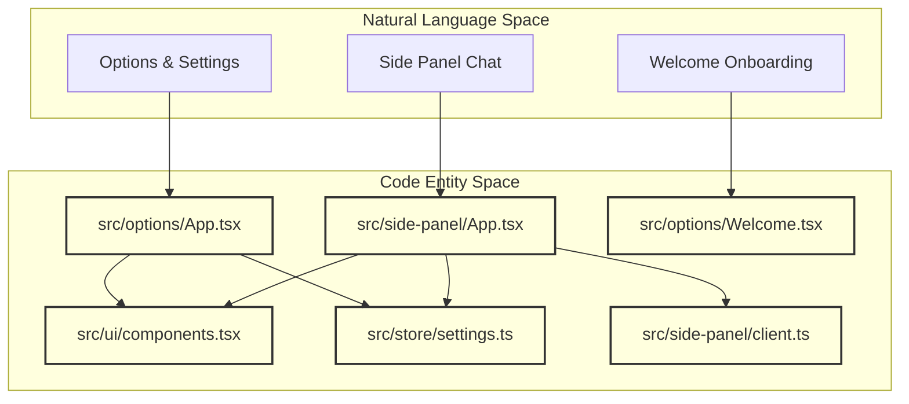

<!-- source: DeepWiki mcp.deepwiki.com · repo nanobrowser/nanobrowser · page 7 User Interfaces · fetched 2026-10-29 -->

# User Interfaces

Relevant source files

The following files were used as context for generating this wiki page:

- [src/llm/catalogue.ts](src/llm/catalogue.ts)
- [src/options/AboutSection.tsx](src/options/AboutSection.tsx)
- [src/options/App.tsx](src/options/App.tsx)
- [src/side-panel/App.tsx](src/side-panel/App.tsx)
- [src/ui/links.ts](src/ui/links.ts)

This page provides an overview of the React-based user surfaces in Nanobrowser: the side panel chat, the options and settings page, the welcome onboarding flow, and the shared UI components and localization infrastructure. 

Nanobrowser's user interfaces are built using React and styled with Tailwind CSS [src/side-panel/App.tsx:1](), [src/options/App.tsx:1](). They interact with extension storage and worker protocols to manage settings, handle active agent conversations, and display real-time events.

For detailed information, refer to the following child pages:
- [Side Panel Chat UI](#7.1) — `src/side-panel` (`App.tsx`, state reducer, transcript, composer, cards, run controls, tab bar, history, model menu, ratings, shortcuts).
- [Options / Settings Pages](#7.2) — `src/options` (`App.tsx`, hash routing, sections for General, Providers, Permissions, Shortcuts, Memory, Data, About, and cards).
- [Onboarding and Welcome Flow](#7.3) — `src/options/Welcome.tsx` and `entrypoints/welcome` (first-run setup, capabilities, branding assets).
- [Shared UI Library and Internationalization](#7.4) — `src/ui` (`components.tsx`, `icons.tsx`, `links.ts`, manifest permissions, themes, and `t()` localizations).

## React Surfaces Architecture

The following diagram bridges the natural language space to code entities, illustrating how the core user interface entry points (`App.tsx` components and shared UI modules) interact with storage systems and the background run architecture.

Sources:
- [src/side-panel/App.tsx:1-86]()
- [src/options/App.tsx:1-34]()

## Side Panel Chat UI Overview

The side panel (`src/side-panel/App.tsx`) is the primary active surface where users interact with AI agents. It does not hold long-term conversation state directly; instead, it renders events dispatched by the background worker via `PanelClient` and proxies commands back [src/side-panel/App.tsx:1](). 

Key modules in `src/side-panel/` include:
- `Transcript.tsx` and `Composer.tsx`: Rendering conversation turns, markdown elements, and accepting input or attached files.
- `RunControls.tsx` and `QueueList`: Managing active execution loops and steering cues.
- `HistoryDrawer` and `TabBar`: Managing past sessions and tab context scopes.

For details, see [Side Panel Chat UI](#7.1).

Sources:
- [src/side-panel/App.tsx:1-120]()

## Options and Settings Pages Overview

The options page (`src/options/App.tsx`) provides configuration using hash-based routing (`#general`, `#providers`, `#permissions`, `#shortcuts`, `#memory`, `#data`, `#about`) [src/options/App.tsx:18-32](). Each section reads and writes directly to extension storage helpers like `settingsStorage` and `providersStorage`.

The `AboutSection` integrates version data from the extension manifest and third-party license lists [src/options/AboutSection.tsx:1]().

For details, see [Options / Settings Pages](#7.2).

Sources:
- [src/options/App.tsx:1-94]()
- [src/options/AboutSection.tsx:1-36]()

## Shared UI Library and Localization

Common elements—such as `Button`, `Field`, `Input`, `Select`, `Card`, `Notice`, and `Switch`—are standardized across the shared UI package. 

Website outbound links are managed via `websiteUrl` in `src/ui/links.ts`, which safely tags external navigation with telemetry parameters for the project site without retaining identifying payloads [src/ui/links.ts:1-6]().

For details, see [Shared UI Library and Internationalization](#7.4).

Sources:
- [src/ui/links.ts:1-6]()

---

