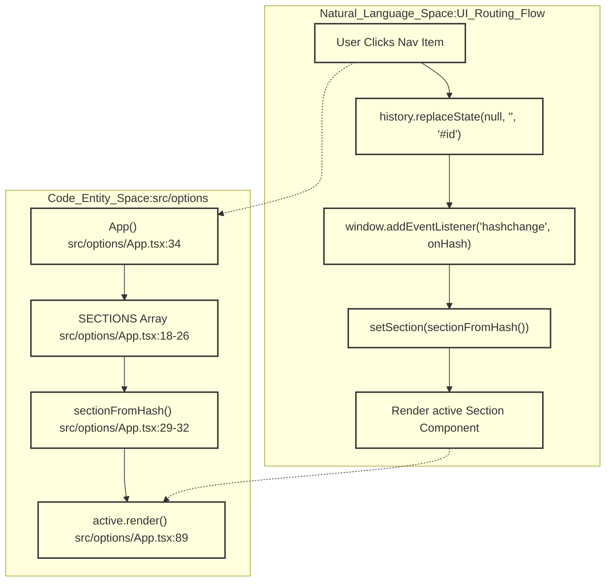
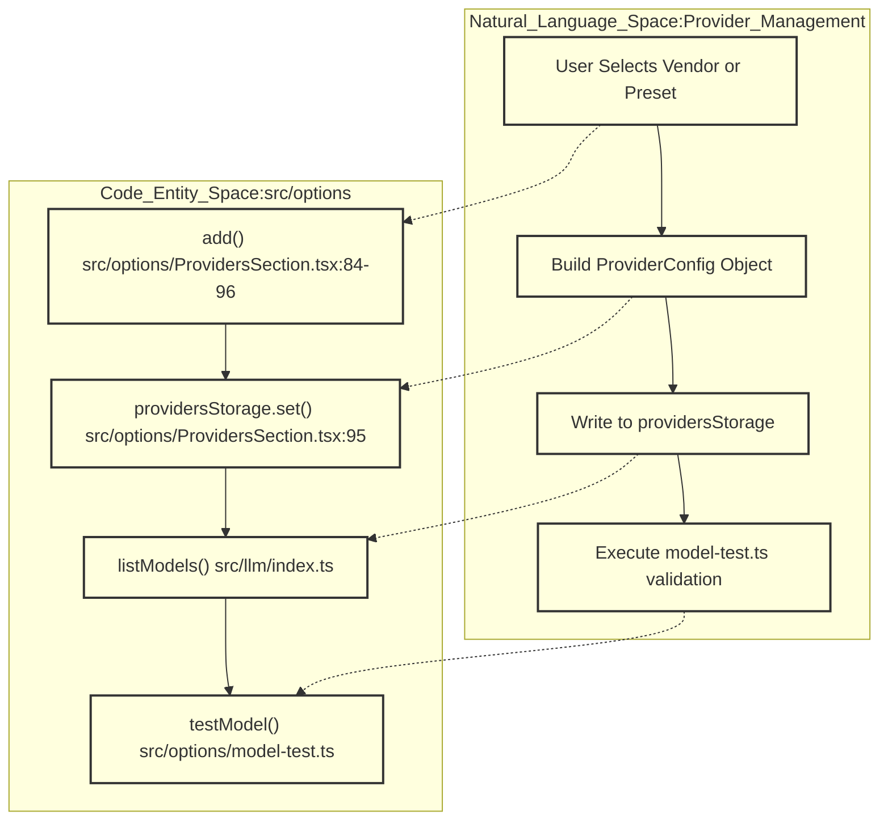

<!-- source: DeepWiki mcp.deepwiki.com · repo nanobrowser/nanobrowser · page 7.2 Options / Settings Pages · fetched 2026-10-29 -->

# Options / Settings Pages

Relevant source files

The following files were used as context for generating this wiki page:

- [src/llm/catalogue.ts](src/llm/catalogue.ts)
- [src/options/AboutSection.tsx](src/options/AboutSection.tsx)
- [src/options/App.tsx](src/options/App.tsx)
- [src/options/DataSection.tsx](src/options/DataSection.tsx)
- [src/options/GeneralSection.tsx](src/options/GeneralSection.tsx)
- [src/options/ProvidersSection.tsx](src/options/ProvidersSection.tsx)
- [src/ui/links.ts](src/ui/links.ts)

This page details the implementation of the Nanobrowser extension's options and settings interface, located primarily in `src/options`. The settings page provides a unified React-based surface for managing general application preferences, LLM providers and API keys, site permissions, keyboard shortcuts, memory items, data retention/privacy, and extension metadata.

## Overview and Routing (`src/options/App.tsx`)

The options page is orchestrated by `App` in `src/options/App.tsx`. It implements a hash-based routing architecture that tracks active settings subsections (`general`, `providers`, `permissions`, `shortcuts`, `memory`, `data`, `about`) via `window.location.hash` and `hashchange` events [src/options/App.tsx:28-50]().

The root component synchronizes internationalization using `useLanguage()` and applies theme changes dynamically via `applyTheme()` [src/options/App.tsx:34-45](). Navigation links update the browser history stack using `history.replaceState` without triggering full page reloads [src/options/App.tsx:47-50]().

Sources:
* [src/options/App.tsx:18-50]()
* [src/options/App.tsx:89-89]()

## General Section (`src/options/GeneralSection.tsx`)

The `GeneralSection` component (`src/options/GeneralSection.tsx`) renders configuration cards for agent behavior, language, appearance, and keyboard controls.

* **Agent Mode & Turn Cap**: Manages `defaultMode` (Ask vs. Auto) and `turnCap` limits (capped between 5 and 500) backed by `settingsStorage` [src/options/GeneralSection.tsx:101-117]().
* **Language Preferences**: Configures `uiLanguage` and `responseLanguage` [src/options/GeneralSection.tsx:118-133]().
* **Appearance & Page Border**: Toggles between system, light, and dark themes via `applyTheme`, and controls the `pageBorder` setting [src/options/GeneralSection.tsx:134-152]().
* **Keyboard Shortcuts**: Queries Chrome's extension command registry using `chrome.commands.getAll()` to display the active shortcut bound to `open-panel` and links to `chrome://extensions/shortcuts` for reconfiguration [src/options/GeneralSection.tsx:19-56]().

Sources:
* [src/options/GeneralSection.tsx:19-156]()

## Providers and LLM Configuration (`src/options/ProvidersSection.tsx`)

The `ProvidersSection` component (`src/options/ProvidersSection.tsx`) handles LLM integration settings, model catalogues, API keys, and voice transcription configuration (`VoiceCard.tsx`).

Sources:
* [src/options/ProvidersSection.tsx:84-96]()
* [src/options/model-test.ts:1-50]()

* **Default Model and Reasoning Effort**: Allows selecting a default model across configured providers and tuning `ReasoningEffort` (`none`, `low`, `medium`, `high`) using capability helpers from `src/llm/catalogue.ts` [src/options/ProvidersSection.tsx:103-149]().
* **Voice Configuration (`VoiceCard.tsx`)**: Manages transcription settings using Gemini or OpenAI speech-to-text models [src/options/ProvidersSection.tsx:151-151]().
* **Provider CRUD & Presets**: Supports standard kinds (Anthropic, OpenAI, Gemini, OpenRouter, Ollama, LM Studio, OpenAI-compatible) and cloud presets (xAI Grok, DeepSeek, Mistral) [src/options/ProvidersSection.tsx:30-62]().

Sources:
* [src/options/ProvidersSection.tsx:30-151]()
* [src/llm/catalogue.ts:1-23]()

## Permissions, Shortcuts and Memory Sections

In addition to General and Providers, the settings navigation registers views for permissions, user-defined shortcuts, and memory persistence:
* **Permissions Section (`PermissionsSection.tsx`)**: Manages domain-specific rules (allow/ask/block) and site-level automated execution policies.
* **Shortcuts Section (`ShortcutsSection.tsx`)**: Configures custom slash-commands and user-defined macro shortcuts.
* **Memory Section (`MemorySection.tsx`)**: Inspects and prunes agent-retained memory items and scratchpad contexts.

Sources:
* [src/options/App.tsx:18-26]()

## Data, Privacy and Legacy Storage (`src/options/DataSection.tsx`)

The `DataSection` component (`src/options/DataSection.tsx`) aggregates storage statistics, privacy controls (`PrivacyCard`), legacy chat migration, and total data erasure.

* **Storage Quota Estimation**: Queries `navigator.storage.estimate()` on mount to display current IndexedDB and cache consumption [src/options/DataSection.tsx:70-75]().
* **Legacy Chat Migration (`src/store/legacy.ts`)**: Detects legacy conversations left by older versions of Nanobrowser, offering options to export them as Markdown or delete them [src/options/DataSection.tsx:15-60]() via `readOldChats()` and `deleteOldChats()` [src/store/legacy.ts:1-50]().
* **Privacy Card (`PrivacyCard.tsx`)**: Renders privacy options and telemetry opt-out flags.
* **Delete Everything**: Dispatches a `DATA_REQUEST` message (`{ op: 'delete-all' }`) to the background worker so that active tasks are safely terminated before wiping stored state [src/options/DataSection.tsx:86-110]().

Sources:
* [src/options/DataSection.tsx:1-113]()
* [src/store/legacy.ts:1-50]()

## About and Licensing (`src/options/AboutSection.tsx`)

The `AboutSection` component (`src/options/AboutSection.tsx`) presents version metadata and legal notices.

* **Manifest Metadata**: Reads version information directly from `chrome.runtime.getManifest()` [src/options/AboutSection.tsx:8-13]().
* **Website Links**: Uses `websiteUrl` from `src/ui/links.ts` to construct tagged UTM links (`utm_source=nanobrowser-extension&utm_medium=about`) pointing to `nanobrowser.ai` [src/options/AboutSection.tsx:16-20](), [src/ui/links.ts:1-6]().
* **Licence Registry**: Maps third-party package licences defined in `LICENCES` (`src/options/licences.ts`) into a scrollable reference list [src/options/AboutSection.tsx:22-33]().

Sources:
* [src/options/AboutSection.tsx:1-36]()
* [src/ui/links.ts:1-6]()

---

