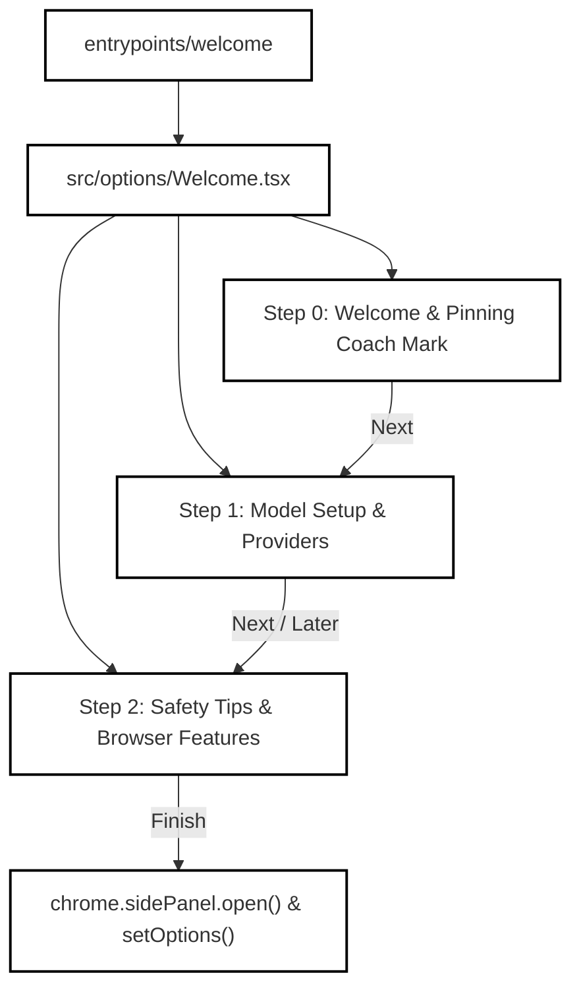
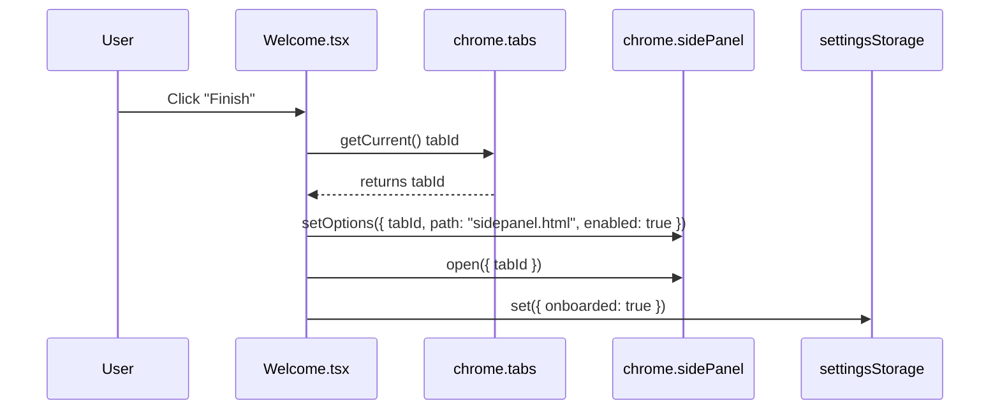

<!-- source: DeepWiki mcp.deepwiki.com · repo nanobrowser/nanobrowser · page 7.3 Onboarding and Welcome Flow · fetched 2026-10-29 -->

# Onboarding and Welcome Flow

Relevant source files

The following files were used as context for generating this wiki page:

- [src/options/Welcome.tsx](src/options/Welcome.tsx)
- [src/ui/icons.tsx](src/ui/icons.tsx)

## Purpose and Scope
This page details the first-run experience, welcome screen architecture, and model onboarding flow for Nanobrowser. The primary implementation resides in `src/options/Welcome.tsx` and the WXT `entrypoints/welcome` entrypoint wrapper. It governs user setup steps—including capability highlights, browser extension pinning guidance (`chrome.action.getUserSettings`), initial LLM provider/model provisioning, and safety/browser-feature configuration before opening the primary side panel interface (`sidepanel.html`).

---

## 1. Architecture of the Welcome Flow
When the Nanobrowser extension is installed or updated on a first-run basis, the extension worker or installer navigates the user to the options/welcome page. The `Welcome` component manages a multi-step wizard state (`step: number`), preserving chosen providers and model configurations across transitions.

Sources: `src/options/Welcome.tsx:27-97`

---

## 2. Step-by-Step Breakdown

### Step 0: Introduction, Capabilities, and Toolbar Pinning
The initial step introduces Nanobrowser's capabilities and includes an active coach mark checking toolbar state via `usePinned()` [src/options/Welcome.tsx:100-113] via `chrome.action.getUserSettings()` [src/options/Welcome.tsx:104-106]. It adapts UI terminology for Google Chrome vs. Microsoft Edge (distinguishing pin and extensions menu glyphs using `IS_EDGE` detection) [src/options/Welcome.tsx:119-127].

### Step 1: Model Setup and Provider Configuration
The second step embeds model selection elements (`ModelStep`), relying on reactive storage hooks from `@src/store/settings` and validation methods (`findModel`, `testModel`) [src/options/Welcome.tsx:10,20]. Users can configure local or cloud model providers or select "Set it later" if no default model is immediately set (`hasModel`) [src/options/Welcome.tsx:31-33].

### Step 2: Safety Tips and Browser Features
The final step displays safety guidelines (`TipsStep`) along with configuration rows for enabling experimental browser features (`BrowserFeaturesRow`) [src/options/Welcome.tsx:18-19]. 

---

## 3. Completion and Side Panel Handover
Upon clicking finish, the `finish()` function performs the user-gesture-bound transition to activate and open the extension side panel:

Sources: `src/options/Welcome.tsx:41-49`

---

## 4. UI Components and Icons
The welcome flow leverages unified design primitives from `@src/ui/components` and icon sets from `@src/ui/icons`:
- **`Button`**: Handles primary, secondary, and ghost variant states with accessibility ring constraints [src/ui/components.tsx:17-29].
- **`Switch`**: Provides toggle switches for browser feature preferences [src/ui/components.tsx:76-97].
- **`Notice`**: Highlights warning, info, and ok states across setup cards [src/ui/components.tsx:65-73].
- **Brand & Action Icons**: Includes `Logo`, `ExtensionsIcon`, `EdgeExtensionsIcon`, `PinIcon`, and `SlantedPinIcon` to render contextual instructions [src/options/Welcome.tsx:21, src/ui/icons.tsx:187-214].

Sources: `src/options/Welcome.tsx:12-21`, `src/ui/components.tsx:1-97`, `src/ui/icons.tsx:1-214`

---

## Sources
- `src/options/Welcome.tsx:1-414`
- `src/ui/icons.tsx:1-232`
- `src/ui/components.tsx:1-98`

---

