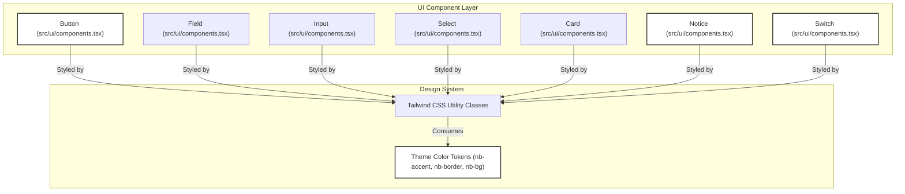
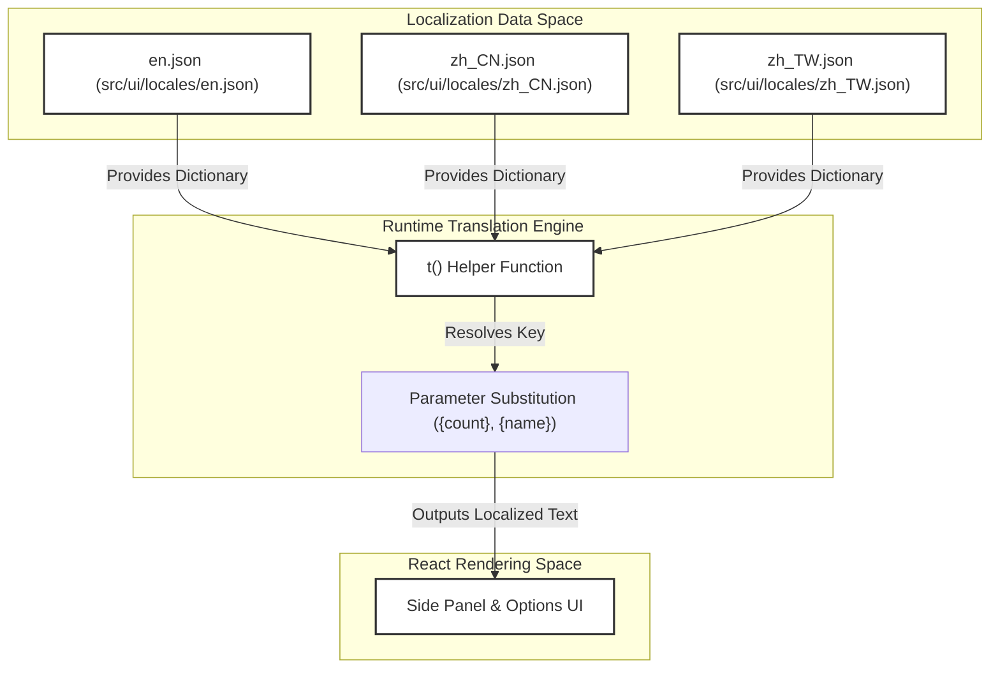

<!-- source: DeepWiki mcp.deepwiki.com · repo nanobrowser/nanobrowser · page 7.4 Shared UI Library and Internationalization · fetched 2026-10-29 -->

# Shared UI Library and Internationalization

Relevant source files

The following files were used as context for generating this wiki page:

- [src/ui/components.tsx](src/ui/components.tsx)
- [src/ui/locales/en.json](src/ui/locales/en.json)
- [src/ui/locales/zh_CN.json](src/ui/locales/zh_CN.json)
- [src/ui/locales/zh_TW.json](src/ui/locales/zh_TW.json)

## 1. Overview and Scope

The `src/ui` module provides the foundational shared user interface components, icon sets, external link registries, manifest permission utilities, theme management tokens, and internationalization (i18n) translation files (`en`, `zh_CN`, `zh_TW`) used across Nanobrowser's React surfaces (side panel, options page, and welcome onboarding). 

By centralizing these elements in `src/ui`, the extension ensures visual consistency, strict adherence to accessibility standards (`aria-checked`, `role="switch"`), localized strings across multiple languages, and a unified design system powered by Tailwind CSS.

Sources:
- [src/ui/components.tsx:1-97]()
- [src/ui/locales/en.json:1-141]()

---

## 2. Shared UI Components (`src/ui/components.tsx`)

The `src/ui/components.tsx` file defines small, reusable functional components used throughout the side panel and settings interfaces. Page and model strings are rendered strictly as text nodes to prevent injection vulnerabilities.

### Component Implementations and Variants

- **`Button`**: Supports variants (`primary`, `secondary`, `ghost`, `danger`) with built-in Tailwind classes for focus rings (`focus-visible:outline-nb-accent`) and disabled states (`disabled:opacity-50`) [src/ui/components.tsx:5-29]().
- **`Field`**: A form field wrapper combining a label, child input element, and an optional hint [src/ui/components.tsx:31-40]().
- **`Input` & `Select`**: Styled form controls featuring consistent border radius, padding, and focus states (`focus:border-nb-accent`, `focus:ring-2`) [src/ui/components.tsx:42-58]().
- **`Card`**: A container box with soft shadows and border styling (`border-nb-border`, `shadow-soft`) [src/ui/components.tsx:60-62]().
- **`Notice`**: A boxed notification banner supporting tones (`info`, `warn`, `error`, `ok`) with dedicated background and border styling [src/ui/components.tsx:64-73]().
- **`Switch`**: An accessible on/off toggle switch implementing `role="switch"` and `aria-checked` bindings with smooth translation transforms [src/ui/components.tsx:75-97]().

**Diagram: Component Tree and Design System Integration**

Sources:
- [src/ui/components.tsx:1-97]()

---

## 3. Icons, External Links, and Permissions

In addition to base components, `src/ui` houses supplementary modules:
- **`icons.tsx`**: Supplies consistent SVG icon primitives utilized across chat controls, settings navigation, and action cards.
- **`links.ts`**: Centralizes external URL constants (repository links, documentation, store rating pages) to maintain a single source of truth for external navigation.
- **`manifest-permissions.ts`**: Manages permission request helpers and description mappings required when prompting users for host or browser capability access.

Sources:
- [src/ui/components.tsx:1-5]()

---

## 4. Theme Handling and Styling

Nanobrowser's styling relies on Tailwind CSS configured with custom CSS variables prefixed with `nb-` (e.g., `nb-bg`, `nb-surface`, `nb-border`, `nb-accent`, `nb-muted`). This allows seamless adaptation between light and dark modes across the side panel (`src/side-panel`) and options page (`src/options`), ensuring high contrast and readable text nodes.

Sources:
- [src/ui/components.tsx:7-15]()
- [src/ui/components.tsx:66-71]()

---

## 5. Internationalization and Locales

Internationalization is structured around JSON locale dictionaries located in `src/ui/locales/`. Nanobrowser currently supports English (`en.json`), Simplified Chinese (`zh_CN.json`), and Traditional Chinese (`zh_TW.json`).

### Locale Structure and Key Naming Conventions

Keys are organized hierarchically using dot-notation categories:
- **`common.*`**: Global actions like `common.add`, `common.remove`, `common.cancel`, `common.save` [src/ui/locales/en.json:2-5]()
- **`settings.*`**: Options navigation and configuration labels [src/ui/locales/en.json:6-9]()
- **`models.*`**: Provider configuration, API key notes, model testing, and error recovery prompts [src/ui/locales/en.json:21-58]()
- **`panel.*`**: Side panel navigation and status text [src/ui/locales/en.json:59-66]()
- **`composer.*`**: Input placeholder and mode selectors [src/ui/locales/en.json:73-86]()
- **`whatsNew.*`**: Upgrade release notes and feature highlights [src/ui/locales/en.json:87-95]()
- **`rating.*`**: Store feedback banners [src/ui/locales/en.json:96-101]()
- **`card.*`**: Approval cards, write actions, and handover dialogs [src/ui/locales/en.json:126-155]()

### Translation Parameter Interpolation

Locales support dynamic string interpolation using curly braces `{variable}`. For example:
- `models.removeModel`: `"Remove {name}"` [src/ui/locales/en.json:27-27]()
- `models.listed`: `"{count} models listed"` [src/ui/locales/en.json:43-43]()
- `activity.worked`: `"Worked for {time}"` [src/ui/locales/en.json:69-69]()

**Diagram: Translation Data Flow and Locale Resolution**

Sources:
- [src/ui/locales/en.json:1-141]()
- [src/ui/locales/zh_CN.json:1-178]()
- [src/ui/locales/zh_TW.json:1-178]()

---

