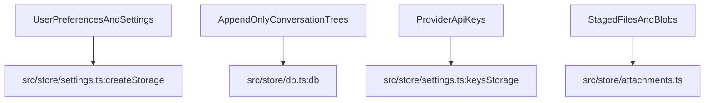
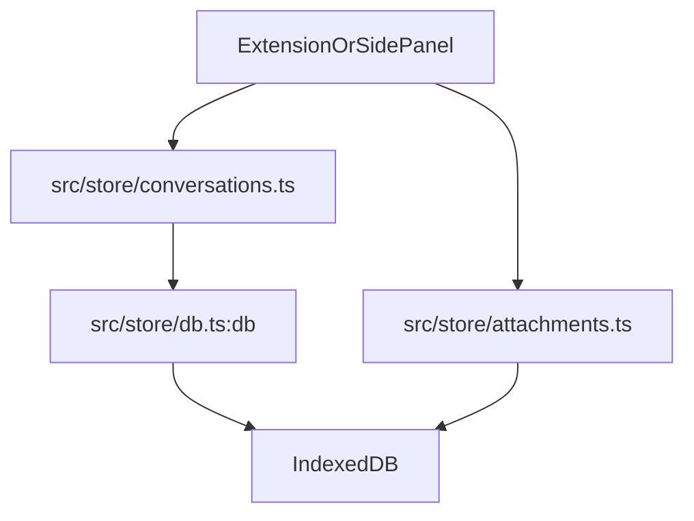

<!-- source: DeepWiki mcp.deepwiki.com · repo nanobrowser/nanobrowser · page 8 Storage and Data Layer · fetched 2026-10-29 -->

# Storage and Data Layer

Relevant source files

The following files were used as context for generating this wiki page:

- [src/store/index.ts](src/store/index.ts)
- [src/store/types.ts](src/store/types.ts)

The storage and data layer (`src/store`) manages persistence for chat conversations, attachments, provider configurations, user settings, and secrets across the extension [src/store/index.ts:1-12](). It provides a unified abstraction combining IndexedDB for structured conversation records and blob storage, with `chrome.storage.local` and `chrome.storage.session` for reactive settings and live session states [src/store/settings.ts:1-174]().

**Diagram: Storage Domain Mapping to Code Entities**

Sources: [src/store/index.ts:1-12](), [src/store/settings.ts:66-119]()

## 8.1. Conversations, Attachments and IndexedDB

The conversation and attachment storage subsystem handles multi-turn conversation trees, branching history, and binary file staging. Data is persisted in IndexedDB through `src/store/db.ts`, while conversation branching and entry management are coordinated by `src/store/conversations.ts` [src/store/index.ts:3-7](). Large files and binary assets are handled via `src/store/attachments.ts` and exported or deleted through `src/store/storage.ts` [src/store/index.ts:3-6]().

For details, see [Conversations, Attachments and IndexedDB](#8.1).

**Diagram: Conversation and Attachment Data Flow**

Sources: [src/store/index.ts:3-7](), [src/store/types.ts:161-175]()

## 8.2. Settings, Shortcuts and Migration

The settings and configuration subsystem provides reactive storage hooks for user preferences, LLM provider endpoints, model catalogues, slash-command shortcuts, ratings, and legacy data migration [src/store/settings.ts:13-69](). Reactive storage is instantiated via `createStorage` in `src/store/storage.ts`, backing persistent options like `settingsStorage`, `providersStorage`, and isolated API keys in `keysStorage` [src/store/settings.ts:66-119](). Upgrade scripts in `src/store/legacy.ts` handle smooth transitions from legacy data formats [src/store/index.ts:8-9]().

For details, see [Settings, Shortcuts and Migration](#8.2).

Sources: [src/store/index.ts:4-12](), [src/store/settings.ts:13-119]()

---

