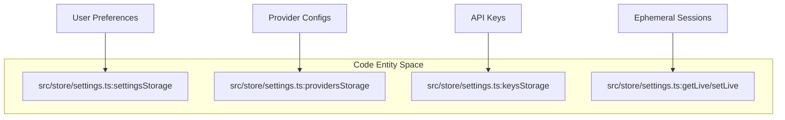
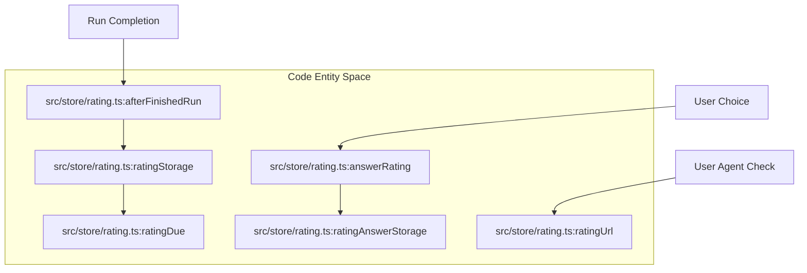

<!-- source: DeepWiki mcp.deepwiki.com · repo nanobrowser/nanobrowser · page 8.2 Settings, Shortcuts and Migration · fetched 2026-10-29 -->

# Settings, Shortcuts and Migration

<details>
<summary>Relevant source files</summary>

The following files were used as context for generating this wiki page:

- [src/store/__tests__/rating.test.ts](src/store/__tests__/rating.test.ts)
- [src/store/legacy.ts](src/store/legacy.ts)
- [src/store/settings.ts](src/store/settings.ts)

</details>


This page documents the implementation of reactive settings storage, model provider registries, API key management, the user rating/feedback tracking engine, and the v0.2 legacy data migration layer located under `src/store/`. These modules provide the persistence backbone for the extension, managing user preferences, ephemeral runtime state, and backward compatibility with earlier versions.

Sources: `src/store/settings.ts`, `src/store/rating.ts`, `src/store/legacy.ts`

---

## 1. Reactive Settings Storage and Configuration

The extension stores user preferences, provider setups, and encrypted credentials using Chrome storage APIs wrapped by a reactive storage abstraction (`createStorage`). 

### Settings Schema and Defaults
The `Settings` interface defines user configurations including model choices, reasoning effort, permission modes, custom instructions, theme, UI language, response language, voice settings, and telemetry flags (`src/store/settings.ts:13-40`). The baseline configuration is instantiated via `DEFAULT_SETTINGS` (`src/store/settings.ts:42-59`). When reading persisted storage, `mergeSettings(stored)` ensures that fields added in newer versions receive their default values without breaking partial states (`src/store/settings.ts:62-64`).

```typescript
export const settingsStorage = createStorage<Settings>('nb.settings', DEFAULT_SETTINGS, {
  liveUpdate: true,
  merge: mergeSettings,
});
```
*(Source: `src/store/settings.ts:66-69`)*

### Providers, Profiles and API Keys
Model providers and their associated model lists are maintained in `providersStorage` (`src/store/settings.ts:116`). Sensitive credentials, such as API keys, are isolated within `keysStorage` keyed by provider ID (`src/store/settings.ts:119`), ensuring they are never logged or exported. Session-bound active states use `chrome.storage.session` via helpers like `getLive`, `setLive`, and `removeLive` (`src/store/settings.ts:163-174`).

Title: "Settings and Storage Bridges"

Sources: `src/store/settings.ts:1-174`

---

## 2. User Rating and Feedback Engine

The rating module (`src/store/rating.ts`, tested via `src/store/__tests__/rating.test.ts`) determines when to display the web store feedback card in the side panel. It tracks successful runs (`RatingUsage`) and user responses (`RatingAnswer`) to prevent prompt fatigue.

### Rating Eligibility Logic
A rating prompt becomes due when specific usage thresholds are satisfied:
1. At least 10 successful runs (`MIN_RUNS`).
2. Runs distributed across at least 3 distinct days (`MIN_DAYS`) within the last 7-day window (`WINDOW_DAYS`).
3. The user has not permanently dismissed the prompt or entered a snooze period (`ratingDue`) (`src/store/__tests__/rating.test.ts:27-34`).

```typescript
export function ratingDue(usage: RatingUsage, answer: RatingAnswer, now: Date): boolean {
  if (answer.done || usage.runs < MIN_RUNS || recent(usage.days, now).length < MIN_DAYS) return false;
  return !answer.notBefore || localDay(now) >= answer.notBefore;
}
```
*(Source: `src/store/__tests__/rating.test.ts:1-98`)*

### Target Store Resolution
`ratingUrl(userAgent)` inspects the browser user agent string to determine whether to direct the user to the Microsoft Edge Add-ons store or the Chrome Web Store (`src/store/__tests__/rating.test.ts:93-97`).

Title: "Rating Engine Bridges"

Sources: `src/store/rating.ts:1-112`, `src/store/__tests__/rating.test.ts:1-98`

---

## 3. Legacy Data Migration (v0.2)

When upgrading from version 0.2, leftover local storage structures must be cleaned up or translated into modern representations. The migration logic resides in `src/store/legacy.ts` and is executed by the background worker upgrade routine.

### Legacy Keys and Conversation Cleanup
Legacy keys defined in `OLD_KEYS` (`src/store/legacy.ts:7-16`) and chat session structures (`OLD_CHATS_KEY`) are scanned and removed after successful migration (`src/store/legacy.ts:112-116`).

```typescript
export const OLD_KEYS = [
  'llm-api-keys',
  'agent-models',
  'favorites',
  'firewall-settings',
  'general-settings',
  'speech-to-text-model',
  'analytics-settings',
  'user-profile',
] as const;
```
*(Source: `src/store/legacy.ts:7-16`)*

### Legacy Chat Export & Conversion
Old conversations can be exported into Markdown format via `oldChatsMarkdown` (`src/store/legacy.ts:84-94`) or read entirely via `readOldChats` (`src/store/legacy.ts:101-109`). The `UpgradeRecord` interface tracks the metadata of the migration process (`src/store/legacy.ts:26-42`).

Sources: `src/store/legacy.ts:1-116`

---

