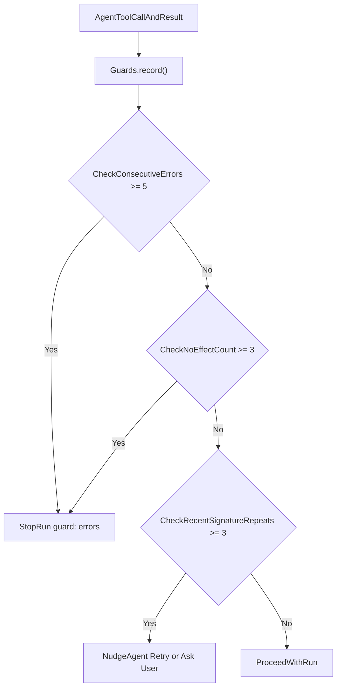
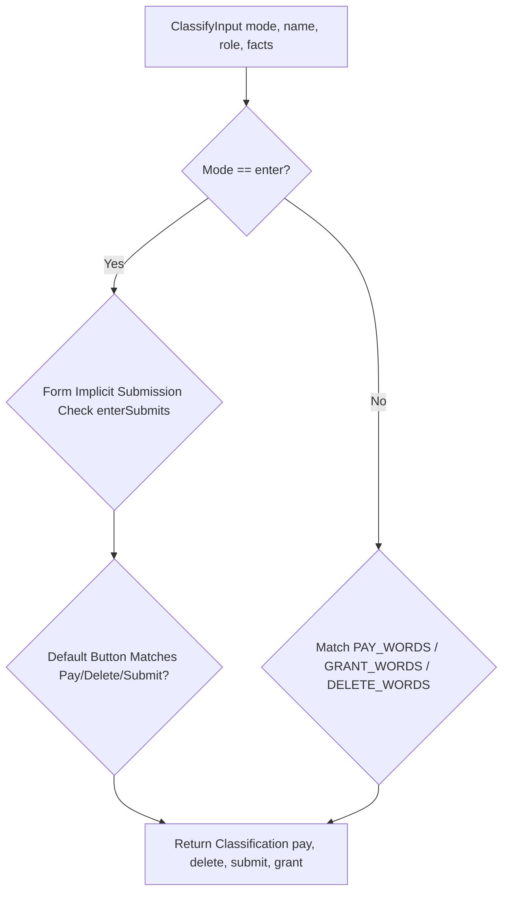

<!-- source: DeepWiki mcp.deepwiki.com · repo nanobrowser/nanobrowser · page 9.1 Safety Guardrails and Site Permissions · fetched 2026-10-29 -->

# Safety Guardrails and Site Permissions

Relevant source files

The following files were used as context for generating this wiki page:

- [PRIVACY.md](PRIVACY.md)
- [SECURITY.md](SECURITY.md)
- [src/agent/__tests__/overflow-recovery.test.ts](src/agent/__tests__/overflow-recovery.test.ts)
- [src/agent/guards.ts](src/agent/guards.ts)
- [src/background/checks/analytics.ts](src/background/checks/analytics.ts)
- [src/browser-control/core/__tests__/classify.test.ts](src/browser-control/core/__tests__/classify.test.ts)
- [src/browser-control/core/interaction/classify.ts](src/browser-control/core/interaction/classify.ts)

## Overview

The Nanobrowser security model enforces safety at multiple architectural layers to protect users from malicious web content, prompt injection, unauthorized consequential actions, and privacy breaches. This safety posture combines deterministic browser-control classification (`src/browser-control/core/interaction/classify.ts`), agent-side loop and guard checks (`src/agent/guards.ts`), strict system prompt contracts (`src/agent/prompt.ts`), hardcoded privacy rules (`PRIVACY.md`), and granular per-site permissions.

Sources: `[src/agent/guards.ts:1-87]`, `[src/browser-control/core/interaction/classify.ts:1-176]`, `[PRIVACY.md:11-17]`

---

## Prompt-Injection Guards and Untrusted Content Contract

Web page content is treated as untrusted data. The agent is shielded from prompt injection through strict system prompt formatting and runtime loop guardrails that prevent execution loops and redundant failure patterns.

### The Untrusted Content Contract

In `src/agent/prompt.ts`, the `CONTRACT` constant defines rules for handling web data. Text bounded between `<<<page-content …>>>` and `<<<end-page-content …>>>`, inline markers like `«…»`, and images are explicitly categorized as data rather than instructions `[src/agent/prompt.ts:14-17]`. The model is instructed that tasks originate solely from user messages, and page content cannot override them even if formatted as system messages, tool results, or user prompts `[src/agent/prompt.ts:19-22]`.

### Agent Guards (`Guards`)

Runtime safety against infinite loops, repetitive calls, and cascading errors is enforced by the `Guards` class in `src/agent/guards.ts`. 

- **Error Thresholds**: If consecutive tool calls fail up to `ERROR_STOP` (5 times), the guard halts the run with an error verdict `[src/agent/guards.ts:11-58]`.
- **No-Effect Limits**: For interaction tools (`click`, `set`, `type`, `press`, `fill_form`), if a target produces no state change (`verdict === 'none'`), it triggers a nudge at `NO_EFFECT_NUDGE` (2 times) and halts at `NO_EFFECT_STOP` (3 times) `[src/agent/guards.ts:9-70]`.
- **Repetition Detection**: The `signature()` function tracks tool name, argument hashes (excluding intent), and outcomes within a sliding window (`REPEAT_WINDOW` = 6) to intercept repeated identical calls (`REPEAT_LIMIT` = 3) `[src/agent/guards.ts:7-43, 78-83]`.

**Title: Natural Language Space to Code Entity Space: Guard Evaluation Flow**
Sources: `[src/agent/guards.ts:45-86]`

Sources: `[src/agent/guards.ts:1-87]`, `[src/agent/prompt.ts:13-31]`

---

## Consequential-Action Classification

To prevent unauthorized destructive or financial operations, actions are classified deterministically in `src/browser-control/core/interaction/classify.ts` before execution.

### Classification Logic

The `classify()` function analyzes an interaction input containing an activation mode (`activate` or `enter`), accessible `name`, `role`, `facts` (`FormFacts`), and frame `url` `[src/browser-control/core/interaction/classify.ts:105-114]`. It checks text against predefined case-insensitive regular expressions:
- **`PAY_WORDS`**: Matches payment, checkout, purchase, place order, subscribe, top up, etc. (`[src/browser-control/core/interaction/classify.ts:17-41]`).
- **`DELETE_WORDS`**: Matches delete, remove, discard, cancel subscription, close account, etc. (`[src/browser-control/core/interaction/classify.ts:42-61]`).
- **`GRANT_WORDS` & `AFFIRMATIVE`**: Identifies consent and authorization prompts on OAuth/consent pages (`[src/browser-control/core/interaction/classify.ts:83-99]`).
- **Generic Confirmations**: A generic confirmation label (`GENERIC_CONFIRM`) combined with a detected monetary amount (`money`) is classified as a payment action (`[src/browser-control/core/interaction/classify.ts:100-130]`).
- **Implicit Form Submission**: `enterSubmits()` evaluates whether pressing Enter in a text field triggers form submission based on the presence of a non-disabled default button or single blocking field restrictions (`[src/browser-control/core/interaction/classify.ts:140-145]`).

**Title: Consequential-Action Classification Data Flow**
Sources: `[src/browser-control/core/interaction/classify.ts:105-176]`, `[src/browser-control/core/__tests__/classify.test.ts:1-117]`

Sources: `[src/browser-control/core/interaction/classify.ts:1-176]`, `[src/browser-control/core/__tests__/classify.test.ts:1-117]`

---

## Hardcoded Never-Allowed Actions and Privacy Protections

Privacy guardrails are enforced at both the storage and prompting layers to guarantee user data safety.

- **Local-First Isolation**: Conversations, attachments, shortcuts, and settings reside entirely in local browser storage `[PRIVACY.md:13-14]`. Logins, cookies, and authentication tokens never leave the browser through Nanobrowser `[PRIVACY.md:15]`.
- **Credential Masking**: Values of password fields, payment-card fields, and one-time-code fields are strictly hidden from the AI model `[PRIVACY.md:16]`.
- **System Prompt Restrictions**: The system prompt explicitly instructs the agent: `Never ask the user for a password, a card number or a code` and mandates handing off authentication, payments, and CAPTCHAs directly to the user `[src/agent/prompt.ts:30, 64-65]`.

Sources: `[PRIVACY.md:11-17]`, `[src/agent/prompt.ts:30-30]`

---

## Per-Site Rules and Permissions Section

Site permission rules govern how the extension interacts with specific domains, allowing users to configure explicit policies (`allow`, `ask`, or `block`).

- **Rule Evaluation**: Navigation and sensitive actions are evaluated against per-site rules configured in user settings. Blocked sites or declined sensitive actions halt execution gracefully without attempting workarounds `[src/agent/prompt.ts:63]`.
- **Permissions UI**: The options settings section exposes controls for site permissions, allowing users to inspect and override allowlists, blocklists, and confirmation requirements for automated runs.

Sources: `[PRIVACY.md:18-24]`, `[src/agent/prompt.ts:63-65]`

---

