# Page: Overview

# Overview

<details>
<summary>Relevant source files</summary>

The following files were used as context for generating this wiki page:

- [.npmrc](.npmrc)
- [AGENTS.md](AGENTS.md)
- [CLAUDE.md](CLAUDE.md)
- [README.md](README.md)

</details>


Nanobrowser is an open-source AI browser-agent extension for Chrome and Edge [README.md:18-19](), [README.md:51-54](). It enables users to execute complex web workflows entirely within their browser via a side panel chat interface [README.md:38-39](). 

The system relies on a clean separation of concerns using a **two-layer architecture**: a deterministic browser control layer that directly interacts with browser primitives, and an extension/agent layer that hosts the single-agent loop, model provider integration, and user-facing controls [CLAUDE.md:7-11]().

This page provides a high-level architectural overview. For detailed technical guides, see the child pages:
- [Installation and Usage](#1.1)
- [Developer Getting Started](#1.2)
- [Architecture Rules and Module Boundaries](#1.3)

## Two-Layer Architecture

Nanobrowser is structured into two primary architectural tiers [CLAUDE.md:7-11]():

1. **The Browser Control Layer (`src/browser-control/`)**: A deterministic, LLM-free automation layer built on `chrome.debugger` (CDP) and Puppeteer frame management [CLAUDE.md:9](), [CLAUDE.md:26-29](). It observes pages, executes actions, and returns structured receipts without running any internal models [CLAUDE.md:9](), [CLAUDE.md:29]().
2. **The Extension and Agent Layer (`src/extension/`, `src/agent/`, `src/side-panel/`)**: Sits on top of the browser control layer, driving conversation loops via the Vercel AI SDK, handling permissions, site rules, user interfaces, and model provider registries [CLAUDE.md:10]().

### Architecture Diagram

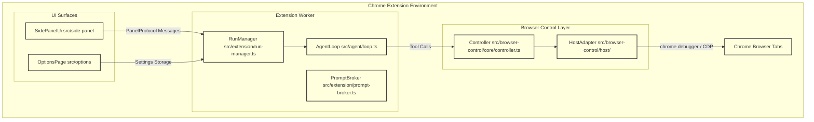
Title: Nanobrowser Two-Layer System Architecture

Sources:
- [CLAUDE.md:7-11]()
- [CLAUDE.md:63-68]()

## MV3 Service Worker and Side Panel UI

The extension runs as a Manifest V3 (MV3) Chrome extension. Its execution model depends on:
- **Background Service Worker (`entrypoints/background/`)**: Manages extension lifecycle, orchestrates runs through `RunManager`, and hosts the prompt broker [CLAUDE.md:63]().
- **Side Panel UI (`entrypoints/sidepanel/`)**: Implemented in React, serving as the primary chat interface where users input natural language commands and observe agent progress [README.md:38](), [CLAUDE.md:63]().
- **Additional Entrypoints (`entrypoints/`)**: Includes options settings (`options/`), welcome onboarding (`welcome/`), microphone permission management (`permission/`), offscreen file savers (`offscreen/`), and the developer-only test panel (`testpanel/`) [CLAUDE.md:63]().

Sources:
- [CLAUDE.md:63]()
- [README.md:38]()

## Bridging Natural Language to Code Entities

The following diagram bridges natural language inputs from the user interface down to execution across the extension and browser control layer code entities.

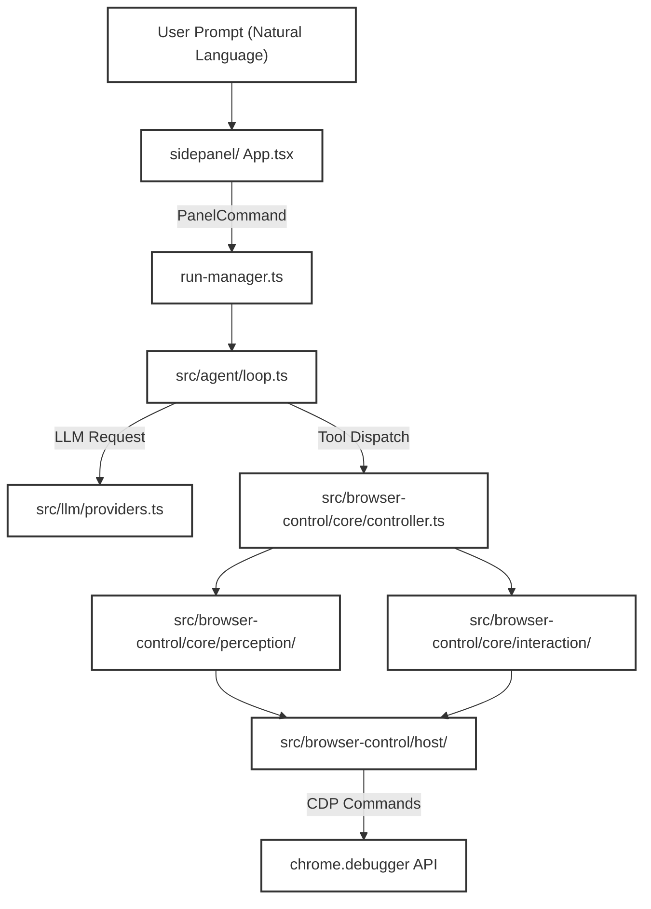
Title: Natural Language to Code Entity Mapping

Sources:
- [CLAUDE.md:63-68]()
- [CLAUDE.md:9-11]()

## Related Child Pages

- **[Installation and Usage](#1.1)** — Extension installation steps, side panel activation shortcuts (`Alt+Shift+N`), model configuration, Ask vs. Auto execution modes, and history management [README.md:23-27](), [README.md:38-49]().
- **[Developer Getting Started](#1.2)** — Node 24 LTS and pnpm 10 toolchain requirements, WXT development scripts, linting, type-checking, and repository directory structure [CLAUDE.md:61-72]().
- **[Architecture Rules and Module Boundaries](#1.3)** — Unchangeable architectural invariants, module import constraints, disposable state handling, and fail-closed element references [CLAUDE.md:19-44]().

Sources:
- [README.md:23-49]()
- [CLAUDE.md:19-72]()

---

# Page: Installation and Usage

# Installation and Usage

<details>
<summary>Relevant source files</summary>

The following files were used as context for generating this wiki page:

- [README.md](README.md)
- [src/ui/locales/en.json](src/ui/locales/en.json)

</details>


This page details how to install the Nanobrowser extension, launch and interact with the side panel, configure model providers and API keys, manage execution modes (Ask vs. Auto), use slash-command shortcuts, and navigate task history and tab groups.

---

## 1. Extension Installation

Nanobrowser can be installed via the Chrome Web Store, through manual unpacked installation, or built directly from source `[README.md:21-34]()`.

### 1.1 Chrome Web Store (Stable)
1. Navigate to the official [Nanobrowser Chrome Web Store page](https://chromewebstore.google.com/detail/nanobrowser/imbddededgmcgfhfpcjmijokokekbkal) `[README.md:23-23]()`.
2. Click **Add to Chrome** and confirm extension permissions.

### 1.2 Manual Unpacked Installation
1. Download and extract the latest release archive (`nanobrowser.zip`) from GitHub `[README.md:52-54]()`.
2. Open `chrome://extensions/` in Chrome or Edge `[README.md:51-54]()`.
3. Enable **Developer mode** in the top right.
4. Click **Load unpacked** and select the extracted folder.

### 1.3 Building from Source
Requirements: Node.js v24+ and pnpm v10+.
```bash
git clone https://github.com/nanobrowser/nanobrowser.git
cd nanobrowser
corepack enable
pnpm install
pnpm build
```
The compiled extension bundle is output to the `dist/` folder. For development with hot reloading, run `pnpm dev`.

Sources: `[README.md:21-34]()`, `[README.md:51-54]()`

---

## 2. Opening the Side Panel and Launching

Once installed, the primary user interface is the extension side panel.

- **Shortcut**: Press `Alt+Shift+N` or click the extension icon in the browser toolbar.
- **Onboarding Flow**: Upon first run, the welcome page guides users through pinning the extension, configuring an initial model provider, and reviewing safety guidelines.

Title: Panel Initialization Data Flow
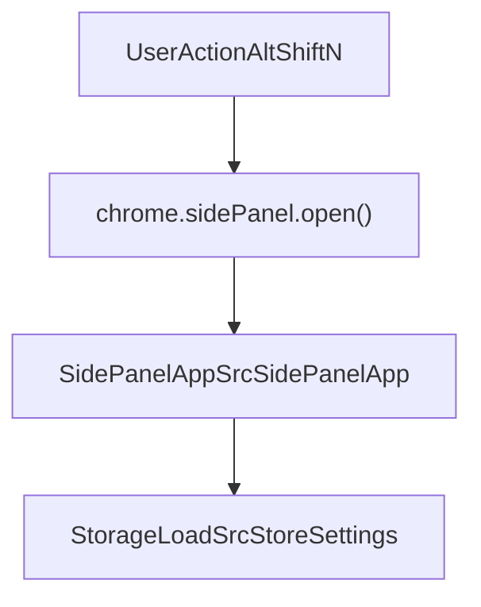
*Figure 1: Bridging natural language user action to extension entrypoint and storage initialization.*

Sources: `[README.md:36-38]()`, `[src/ui/locales/en.json:59-65]()`

---

## 3. Adding Model Providers and API Keys

Nanobrowser delegates agent intelligence to user-configured cloud or local LLM providers `[README.md:73-85]()`.

- **Supported Providers**: Anthropic, OpenAI, Google Gemini, OpenRouter, xAI Grok, DeepSeek, Mistral, Ollama, LM Studio, and generic OpenAI-compatible servers `[README.md:77-78]()`.
- **Security**: API keys are saved locally in extension storage and transmitted exclusively to their respective endpoints `[src/ui/locales/en.json:29-29]()`.
- **Validation**: Providers can be tested directly from settings `[src/ui/locales/en.json:49-52()`, verifying tool-calling capabilities.

Sources: `[README.md:73-85]()`, `[src/ui/locales/en.json:25-58]()`

---

## 4. Ask vs. Auto Mode and Permissions

The agent operates under two primary execution modes selectable from the composer `[src/ui/locales/en.json:74-78()`, controlling whether consequential actions require user confirmation `[README.md:58-64]()`.

| Action Type | Ask Mode (Default) | Auto Mode |
| --- | --- | --- |
| Read pages, click links, scroll, move tabs | Automatic `[README.md:60-60]()` | Automatic `[README.md:60-60]()` |
| Submit, send, delete, or upload | Requires explicit user confirmation `[README.md:61-61]()` | Automatic `[README.md:61-61]()` |
| Payments, passwords, 2FA codes | Hands control to user `[README.md:62-62]()` | Hands control to user `[README.md:62-62]()` |

Users can also define per-site rules (**Allow**, **Ask**, or **Block**) in the permissions configuration `[README.md:64-64]()`.

Title: Execution Control Flow
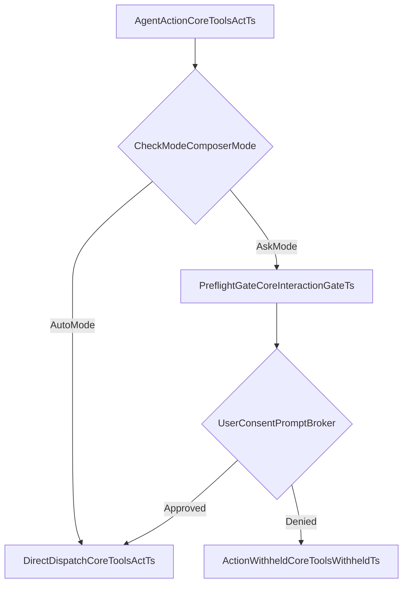
*Figure 2: Execution control flow routing agent actions through mode validation and user consent gates.*

Sources: `[README.md:56-72]()`, `[src/ui/locales/en.json:74-78]()`

---

## 5. Shortcuts, Starters, History, and Tab Groups

- **Slash Shortcuts**: Type `/` in the composer to execute saved prompts associated with preset start pages and default models `[README.md:44-44]()`.
- **Tab Groups**: Each long-running conversation runs isolated within dedicated browser tab groups, enabling multitasking without context loss `[README.md:39-39]()`.
- **Chat History**: Past conversations are indexed locally via IndexedDB `[src/ui/locales/en.json:115-125()`, supporting resumption, branching, message editing, and Markdown export `[README.md:48-48]()`.

Sources: `[README.md:39-48]()`, `[src/ui/locales/en.json:115-125]()`

---

# Page: Developer Getting Started

# Developer Getting Started

<details>
<summary>Relevant source files</summary>

The following files were used as context for generating this wiki page:

- [.env.example](.env.example)
- [.github/ISSUE_TEMPLATE/bug_report.yml](.github/ISSUE_TEMPLATE/bug_report.yml)
- [.github/ISSUE_TEMPLATE/feature_request.yml](.github/ISSUE_TEMPLATE/feature_request.yml)
- [.gitignore](.gitignore)
- [CONTRIBUTING.md](CONTRIBUTING.md)
- [LICENSE](LICENSE)
- [package.json](package.json)
- [pnpm-lock.yaml](pnpm-lock.yaml)
- [vite-env.d.ts](vite-env.d.ts)

</details>


This page provides technical documentation for developers setting up the local toolchain, executing build and test scripts, managing environment configurations, and navigating the repository layout of the `nanobrowser` codebase [CONTRIBUTING.md:1-38]().

---

## 1. Toolchain and Package Manager Constraints

The codebase enforces strict toolchain versions to ensure deterministic builds across development environments. Node.js version **24 LTS** (`>=24.11.0`) and **pnpm 10** (`pnpm@10.34.7`) are required [package.json:70-75]().

### Engine and Package Manager Enforcement
- **Node.js**: The engines field in `package.json` specifies `"node": ">=24.11.0"` [package.json:72]().
- **pnpm**: Pinned to `10.34.7` via the `packageManager` field [package.json:70](). Attempting to use `npm` or older package managers triggers the `"npm": "please-use-pnpm"` engine guard [package.json:74]().
- **Dependency Constraints**: The `package.json` defines `onlyBuiltDependencies` for packages like `esbuild` and overrides for `postcss-selector-parser` to maintain secure supply-chain constraints [package.json:76-83]().
- **Corepack**: Developers can initialize the correct package manager using Corepack [CONTRIBUTING.md:14-17]():
  ```bash
  corepack enable
  pnpm install
  ```

Sources: `package.json:70-83](), [CONTRIBUTING.md:12-20]()

---

## 2. Development, Build, and Automation Scripts

The `package.json` defines scripts for WXT-based extension development, type checking, linting, unit testing, and automated headless browser checks [package.json:12-27]().

| Script Name | Target Code / Tool | Purpose |
| :--- | :--- | :--- |
| `pnpm dev` | `wxt` | Starts WXT in development mode with HMR and auto-reload [package.json:14]() |
| `pnpm build` | `wxt build` | Generates the production extension bundle in `dist/` [package.json:15]() |
| `pnpm zip` | `wxt zip` | Bundles the production build into a distributable archive in `dist-zip/` [package.json:16]() |
| `pnpm test` | `vitest run` | Executes unit test suites across `__tests__` directories [package.json:17]() |
| `pnpm type-check` | `wxt prepare && tsc --noEmit` | Runs strict TypeScript compiler checks [package.json:18]() |
| `pnpm lint` | `eslint . --cache` | Runs ESLint with import-boundary rules and caching [package.json:19]() |
| `pnpm autorun` | `node fixtures/autorun.mjs` | Executes background autorun checks against test scenarios [package.json:22]() |
| `pnpm fixtures` | `node fixtures/server.mjs` | Spins up the local test fixture web server [package.json:21]() |

Sources: `package.json:11-27](), [CONTRIBUTING.md:24-34]()

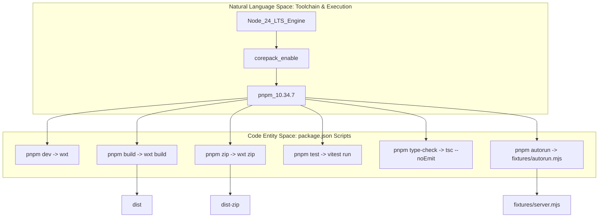

**Figure 1**: Bridging toolchain management to `package.json` execution scripts and output directories.

Sources: `package.json:11-27](), [CONTRIBUTING.md:12-36]()

---

## 3. Environment Variables and Configuration

Configuration values such as analytics keys are managed via environment variables and loaded through Vite's build pipeline [vite-env.d.ts:3-13]().

### `.env.example`
The project provides an environment template file [.env.example:1-5]() containing default analytics parameters:
- `VITE_POSTHOG_API_KEY`: Key for PostHog telemetry ingestion.
- `VITE_POSTHOG_HOST`: Defaults to `https://us.i.posthog.com` [.env.example:5]().

### Type Definitions
Runtime environment metadata is typed via `vite-env.d.ts` [vite-env.d.ts:1-13]():
- `WXT_AUTORUN_URL`: Set during automated test runs (`fixtures/autorun.mjs`) [vite-env.d.ts:5]().
- `VITE_POSTHOG_API_KEY` and `VITE_POSTHOG_HOST` are exposed to frontend runtimes via `import.meta.env` [vite-env.d.ts:6-8]().

Sources: `.env.example:1-5](), [vite-env.d.ts:1-13]()

---

## 4. Repository Layout and Structure

The codebase is organized as a single-package WXT extension workspace containing core service logic, UI components, background orchestrators, and testing fixtures [.gitignore:1-16]().

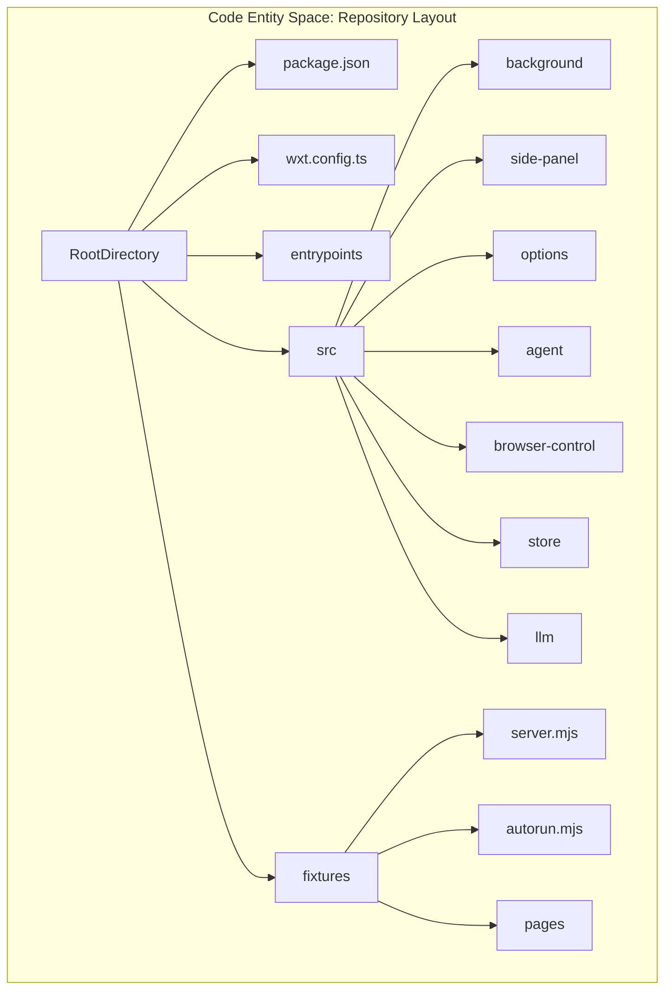

**Figure 2**: Repository layout mapping root configuration files, `entrypoints/`, `src/` modular layers, and `fixtures/` automation harnesses.

Sources: `package.json:1-84](), [.gitignore:1-16]()

---

## 5. Quality Assurance and Autorun Pipeline

Maintaining code quality requires passing local validation suites before submitting pull requests [CONTRIBUTING.md:35]().

- **Type Checking**: `pnpm type-check` executes WXT preparation followed by TypeScript compilation with `--noEmit` [package.json:18]().
- **Linting**: `pnpm lint` runs ESLint across `.ts` and `.tsx` sources while enforcing import boundaries [package.json:19]().
- **Unit Testing**: `pnpm test` runs Vitest test suites [package.json:17]().
- **Autorun Checks**: Automated headless scenarios are validated via `pnpm autorun`, utilizing local test pages served by `fixtures/server.mjs` [package.json:21-22]().

Sources: `package.json:17-22](), [CONTRIBUTING.md:35-38]()

---

# Page: Architecture Rules and Module Boundaries

# Architecture Rules and Module Boundaries

<details>
<summary>Relevant source files</summary>

The following files were used as context for generating this wiki page:

- [.npmrc](.npmrc)
- [AGENTS.md](AGENTS.md)
- [CLAUDE.md](CLAUDE.md)

</details>


### Purpose and Scope
This document outlines the unchangeable design rules, layer invariants, import boundaries, disposable state mechanics, and fail-closed reference semantics governing the Nanobrowser codebase. These constraints ensure a clean separation between the deterministic, low-level browser automation layer and the high-level agent/extension layers.

Sources: [`CLAUDE.md:1-72`]()

---

## 1. Core Layer Invariants and Design Constraints

The architecture is split into two primary domains:
1. **The Browser Control Layer (`src/browser-control/`)**: A deterministic, LLM-free automation layer built on `chrome.debugger` (CDP) and Puppeteer frame management [CLAUDE.md:7-9]().
2. **The Extension & Agent Layer (`src/extension/`, `src/agent/`)**: Sits on top of the browser control layer, handling side panels, conversation state, prompt management, and Vercel AI SDK integration [CLAUDE.md:10]().

### Fixed Design Constraints for the Layer
* **No standalone execution**: The layer is part of a Chrome extension, not a standalone CLI, daemon, or remote CDP socket [CLAUDE.md:25]().
* **CDP via `chrome.debugger` only**: No WebSockets or out-of-process CDP connections are permitted [CLAUDE.md:26]().
* **Puppeteer as Frame Manager**: Puppeteer detects frames, out-of-process iframes, and navigations. No parallel frame or session registries are allowed from raw CDP events [CLAUDE.md:27]().
* **No Puppeteer Element Finding**: Elements are never found through Puppeteer selectors, `ElementHandle` clicks, or selector-based evaluation. Action commands use raw CDP commands routed to the specific frame session reported by Puppeteer [CLAUDE.md:28]().
* **No Model Inside the Layer**: The browser control layer is strictly deterministic. Anything requiring an LLM resides in the agent layer above [CLAUDE.md:29]().

### The Eleven Layer Invariants
1. **One identity**: An action operates on the node the agent was shown, referenced via its browser handle [CLAUDE.md:33]().
2. **Refs fail closed**: A reference is valid *only* for the document it was observed in and *only* if the agent was explicitly shown it. Otherwise, it returns a typed error [CLAUDE.md:34]().
3. **Retries happen before dispatch**: Once an input event is sent, the layer does not execute unprompted retries [CLAUDE.md:35]().
4. **No hidden substitution**: Alternative nodes or mechanisms are chosen explicitly by rule before dispatch and declared in the receipt [CLAUDE.md:36]().
5. **Three outcomes reported separately**: Input dispatched; page reacted; expected state reached [CLAUDE.md:37]().
6. **Observation is read-only**: Capturing state never mutates the page [CLAUDE.md:38]().
7. **Degrade loudly**: Partial captures and truncation must be explicitly reported in results [CLAUDE.md:39]().
8. **Bounded everything**: Commands, waits, and lists carry strict budgets. Unbounded waits are restricted to host-level user confirmations [CLAUDE.md:40]().
9. **State is disposable**: Service worker restarts, debugger detaches, and navigations cleanly invalidate layer state [CLAUDE.md:41]().
10. **No model inside**: Anything requiring an LLM belongs to the agent above the layer [CLAUDE.md:42]().
11. **Consequential actions need a person**: Actions classified as submit, pay, delete, or custom agent-supplied scripts require explicit user approval by default [CLAUDE.md:43]().

Sources: [`CLAUDE.md:19-44`]()

---

## 2. Module Import Boundaries

To maintain clean module boundaries across the codebase, strict rules govern what modules may import from others. The browser control layer exposes a single entry surface (`src/browser-control/index.ts`). No internal sub-modules of `browser-control` (such as `core/`, `host/`, or `probe/`) can be imported directly by external code or the agent/extension layers.

Title: Module Import Hierarchy and Layer Isolation
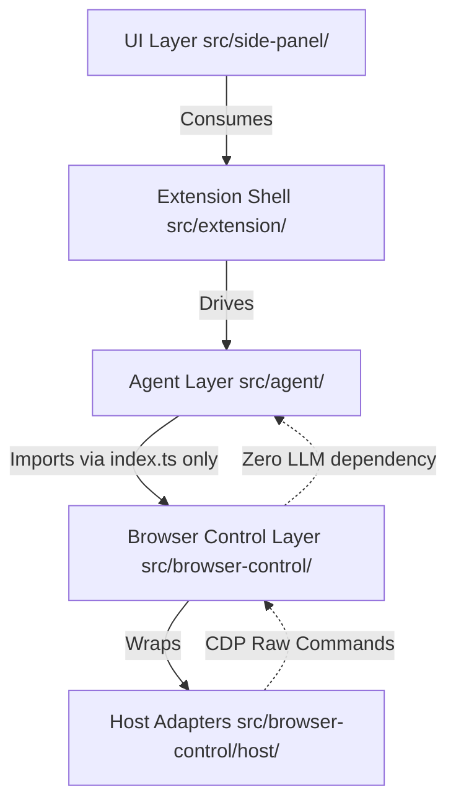

Sources: [`CLAUDE.md:64-69`]()

---

## 3. Disposable State and Lifecycle Resets

In accordance with invariant #9, all execution state inside the browser control layer is ephemeral and disposable. If the background service worker restarts, the debugger detaches, or a top-level document navigation occurs, internal session caches, element handle mappings, and lock registries are immediately discarded.

Title: Disposable State Invalidation Flow
```mermaid
sequenceDiagram
    participant SW as "ServiceWorker background/"
    participant Ctrl as "Controller src/browser-control/core/controller.ts"
    participant Host as "HostAdapter src/browser-control/host/"
    participant Refs as "RefRegistry src/browser-control/core/refs.ts"

    Note over SW,Refs: "Event Trigger: Detach / Navigation / Restart"
    Host->>Ctrl: "onDebuggerDetach() or navigation event"
    Ctrl->>Refs: "invalidateAll()"
    Ctrl->>Ctrl: "purgeActiveSessions()"
    Ctrl-->>SW: "State cleanly cleared; next command fails-closed until re-initialized"
```

Sources: [`CLAUDE.md:41`](), [`CLAUDE.md:66-68`]()

---

## 4. Fail-Closed Element References

Element references (`refs`) passed back and forth between perception modules and agent tools are strictly bounded by document identity and visibility history via `src/browser-control/core/refs.ts` [CLAUDE.md:33-34]().

Title: Fail-Closed Reference Validation Logic
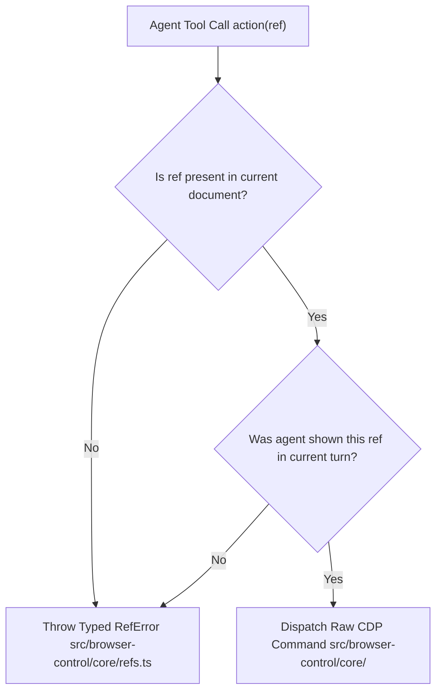

Sources: [`CLAUDE.md:33-34`](), [`CLAUDE.md:66`]()

---

## 5. Natural Language Space to Code Entity Mapping

The following mapping connects high-level architectural requirements to concrete entities in the codebase:

| Natural Language Concept | Code Entity / Module Path | Role / Responsibility |
| :--- | :--- | :--- |
| **Browser Control Layer** | `src/browser-control/` | Deterministic perception, interaction, and CDP host orchestration [CLAUDE.md:64-69](). |
| **Public Layer API** | `src/browser-control/index.ts` | The sole permitted import entrypoint for external callers [CLAUDE.md:69](). |
| **Frame Manager** | `src/browser-control/host/` | Puppeteer-based frame and session tracking [CLAUDE.md:68](). |
| **Ref Validation** | `src/browser-control/core/refs.ts` | Enforces fail-closed element handle validity per document [CLAUDE.md:34,66](). |
| **Consequential Action Gate** | `src/agent/guards.ts` & `src/browser-control/core/` | Enforces user approval checks for submit, pay, and delete actions [CLAUDE.md:43](). |

Sources: [`CLAUDE.md:25-44`](), [`CLAUDE.md:64-69`]()

---

# Page: Extension Shell and Entrypoints

# Extension Shell and Entrypoints

<details>
<summary>Relevant source files</summary>

The following files were used as context for generating this wiki page:

- [.npmrc](.npmrc)
- [CLAUDE.md](CLAUDE.md)
- [src/extension/index.ts](src/extension/index.ts)

</details>


Nanobrowser is implemented as a Chrome Extension leveraging the Manifest V3 architecture. This page provides a high-level overview of the extension shell, WXT entrypoints, manifest permissions, and the communication protocols binding the background worker to the various UI panels. 

For detailed information on how these components are packaged and built, see [Entrypoints and WXT Build System](#2.1). For specifics on how UI panels communicate with the background service worker, see [Panel Protocol and Messaging](#2.2). For lifecycle flows such as installation, upgrades, and uninstalls, see [Lifecycle: Install, Upgrade and Uninstall](#2.3).

## Extension Shell Overview

The extension shell consists of multiple isolated Chrome Extension contexts managed through WXT wrappers located in the `entrypoints/` directory [CLAUDE.md:63-63]. The core background worker wiring is initialized synchronously in `src/extension/index.ts`, registering run managers, panel ports, alarms, and message handlers [src/extension/index.ts:1-12].

### Diagram: Extension Entrypoints and Shell Architecture

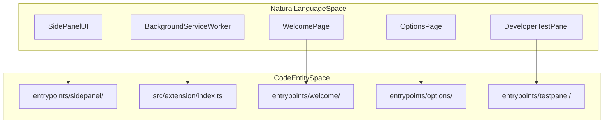
Sources: [CLAUDE.md:63-71](), [src/extension/index.ts:1-12]()

## Manifest and Permissions

The extension declares its required and optional permissions via manifest configuration and supporting modules. Core features rely on required permissions (such as `debugger`, `tabs`, `sidePanel`, `storage`, and `scripting`), which do not trigger new installation warnings. Optional features utilize runtime permissions to degrade gracefully until authorized by the user.

Sources: [src/extension/index.ts:1-54]()

## Entrypoints and WXT Build System

WXT handles the compilation and bundling of extension targets, configuration via `wxt.config.ts`, static assets in `public/`, and localization files in `_locales/`. 

For a complete breakdown of WXT packaging, manifest generation, and distribution builds, see [Entrypoints and WXT Build System](#2.1).

Sources: [CLAUDE.md:45-47](), [CLAUDE.md:71-75]()

## Panel Protocol and Messaging

Inter-context communication between the side panel and the background service worker is mediated via typed command/event protocols (`src/ui/protocol.ts`) and persistent connection ports (`src/extension/panel-port.ts`).

### Diagram: Panel Messaging and Lifecycle Routing

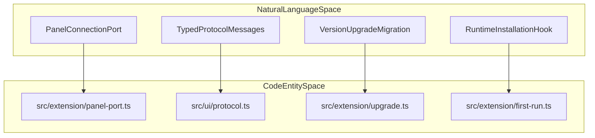
Sources: [src/extension/index.ts:2-7]()

For detailed documentation on the journal-based event streaming and `PanelClient`, see [Panel Protocol and Messaging](#2.2).

Sources: [src/extension/index.ts:1-12]()

## Lifecycle: Install, Upgrade and Uninstall

The background service worker listens for installation and update triggers via `chrome.runtime.onInstalled`, managing first-run flows, shortcut creation, migration tasks (`src/extension/upgrade.ts`), and what's-new notifications [src/extension/index.ts:20-35].

For full implementation details on data migration, upgrade handlers, and uninstall logging, see [Lifecycle: Install, Upgrade and Uninstall](#2.3).

Sources: [src/extension/index.ts:20-54]()

---

# Page: Entrypoints and WXT Build System

# Entrypoints and WXT Build System

<details>
<summary>Relevant source files</summary>

The following files were used as context for generating this wiki page:

- [package.json](package.json)
- [pnpm-lock.yaml](pnpm-lock.yaml)
- [src/ui/__tests__/manifest-permissions.test.ts](src/ui/__tests__/manifest-permissions.test.ts)
- [src/ui/manifest-permissions.ts](src/ui/manifest-permissions.ts)

</details>


This page details the entrypoints of the Nanobrowser extension, how the WXT build system processes them, the role of manifest generation and permission configuration modules in `src/ui/manifest-permissions.ts`, the `public/` directory for static assets and `_locales`, and the final packaging process into `dist/` and `dist-zip/`.

Sources: [package.json:1-84](), [src/ui/manifest-permissions.ts:1-42]()

## Extension Entrypoints and Wrappers

Nanobrowser utilizes several entrypoints defined in the `entrypoints/` directory. These serve as thin wrappers that import core logic and UI applications from `src/`.

*   **Background Service Worker**: Acts as the central orchestration hub, managing multi-agent tasks, run records, and host communication via `entrypoints/background.ts`.
*   **Side Panel and Options Pages**: User interfaces such as the chat side panel and options/settings page are structured as HTML entrypoints pointing to TypeScript modules that mount React components (`entrypoints/side-panel.html`, `entrypoints/side-panel.ts`, `entrypoints/options.html`, `entrypoints/options.ts`).
*   **Content Scripts and Web Accessible Resources**: Scripts like `entrypoints/content.ts` inject execution contexts into web pages, while static scripts are copied directly as web-accessible resources for the browser control layer.

### Diagram: Extension Entrypoints to Code Entity Mapping

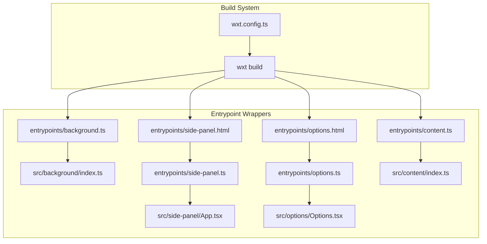
Sources: [package.json:1-84]()

## WXT Build Configuration and Manifest Generation

The project relies on WXT and Vite for bundling and manifest generation. Permission lists are dynamically defined or structured via `src/ui/manifest-permissions.ts` [src/ui/manifest-permissions.ts:1-42](), which separates core mandatory permissions from optional product permissions to prevent unintended install warnings.

### Permission Management

The extension distinguishes between required permissions that do not alter install warnings and optional permissions that manage additional features [src/ui/manifest-permissions.ts:1-17]().

*   `REQUIRED_PERMISSIONS`: Includes `debugger`, `tabs`, `sidePanel`, `storage`, `webNavigation`, `unlimitedStorage`, `alarms`, `offscreen`, `contextMenus`, and `scripting` [src/ui/manifest-permissions.ts:19-30]().
*   `OPTIONAL_PERMISSIONS`: Includes `tabGroups`, `notifications`, `downloads`, and `downloads.open` [src/ui/manifest-permissions.ts:8-14]().
*   `permissionLists(build)`: Selects between product and autorun manifest permission configurations [src/ui/manifest-permissions.ts:38-42]().

### Diagram: Manifest Permission Generation and Build Pipeline

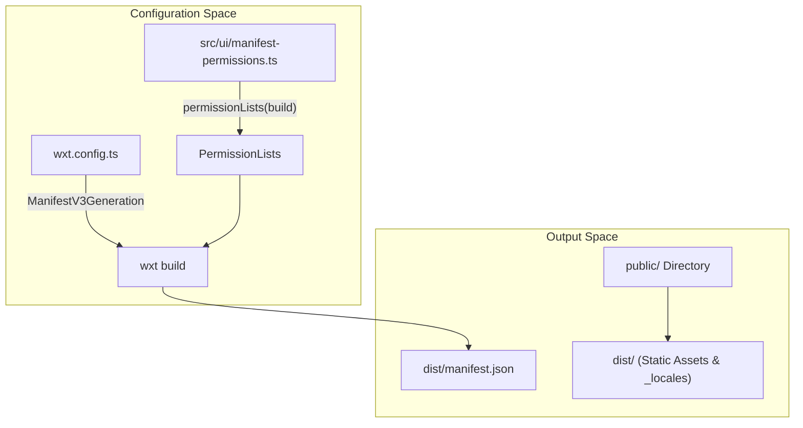
Sources: [src/ui/manifest-permissions.ts:1-42](), [src/ui/__tests__/manifest-permissions.test.ts:1-34]()

## Public Assets, Localization, and Static Files

Static files residing in the `public/` directory are copied directly into the build output during compilation:
*   Icons (`public/icon/`) for various display resolutions.
*   Internationalization resources (`public/_locales/`) containing multi-language message dictionaries.
*   Permission handler pages (`public/permission/`) used when requesting broad site access or specialized permissions.

Sources: [package.json:1-84](), [src/ui/manifest-permissions.ts:1-42]()

## Packaging into `dist` and `dist-zip`

The build lifecycle is managed through scripts defined in `package.json`:
*   `pnpm build`: Executes `wxt build` to bundle all entrypoints, compile TypeScript code, and output the unpacked extension into the `dist/` directory [package.json:15]().
*   `pnpm zip`: Runs the build process followed by packaging scripts to compress the `dist/` contents into a distributable archive located in `dist-zip/` [package.json:16](), [package.json:26]().
*   `pnpm clean`: Removes build output directories including `dist`, `dist-zip`, `.wxt`, and `.output` [package.json:26]().

Sources: [package.json:12-27]()

---

# Page: Panel Protocol and Messaging

# Panel Protocol and Messaging

<details>
<summary>Relevant source files</summary>

The following files were used as context for generating this wiki page:

- [src/extension/panel-port.ts](src/extension/panel-port.ts)
- [src/side-panel/App.tsx](src/side-panel/App.tsx)
- [src/ui/protocol.ts](src/ui/protocol.ts)

</details>


This page details the communication architecture between the Nanobrowser side panel UI and the extension background service worker. It covers the typed command and event protocol (`src/ui/protocol.ts`), the secure runtime port connection (`src/extension/panel-port.ts`), client-side connection management (`PanelClient`), and journal-based event streaming that ensures the side panel remains synchronized without directly accessing local storage.

Sources:
- [src/ui/protocol.ts:1-2]()
- [src/extension/panel-port.ts:1-7]()

---

## Panel Port Architecture and Security

Communication between the side panel and the background worker is established using a dedicated `chrome.runtime.Port` per panel document [src/ui/protocol.ts:1-2](). Only the extension's internal side panel page is permitted to connect; external listeners or rogue contexts are immediately disconnected [src/extension/panel-port.ts:1-15]().

When a panel document loads, it connects using the port name constant `PANEL_PORT_NAME` (`'nb-panel'`) [src/extension/panel-port.ts:3-10](), [src/ui/protocol.ts:14](). The background service worker listens for connections via `chrome.runtime.onConnect` and applies strict validation checks inside `listenForPanels`:
1. Verifies that `port.name` matches `PANEL_PORT_NAME` [src/extension/panel-port.ts:11]()
2. Verifies that `port.sender.id` matches the extension ID (`chrome.runtime.id`) [src/extension/panel-port.ts:12]()
3. Verifies that `port.sender.url` starts with the side panel URL (`/sidepanel.html`) [src/extension/panel-port.ts:8-12]()

If any check fails, `port.disconnect()` is invoked immediately [src/extension/panel-port.ts:13](). Valid connections are registered inside the background `RunManager` as a `PanelConnection` containing a sink function that posts serialized `PanelEvent` objects back to the panel [src/extension/panel-port.ts:17-24]().

Commands sent from the panel to the worker are processed sequentially through a promise chain to maintain state consistency, with the exception of `answer` commands (responding to interactive cards) which execute immediately to prevent deadlocks when sharing tabs [src/extension/panel-port.ts:43-51]().

Sources:
- [src/extension/panel-port.ts:1-53]()
- [src/ui/protocol.ts:14-14]()
- [src/side-panel/App.tsx:80-80]()

---

## Typed Panel Protocol (`src/ui/protocol.ts`)

The panel protocol enforces strict separation of concerns: **the side panel never reads the persistence stores directly; it renders state purely based on events received from the worker [src/ui/protocol.ts:1-2]().**

### `PanelCommand`
Commands flow from the side panel to the worker via `port.postMessage()` [src/extension/panel-port.ts:44](). Key command types defined in `PanelCommand` include:
- `subscribe`: Binds the panel to a specific `tabId` and optional `conversationId`, requesting events starting from a given sequence number (`sinceSeq`) [src/ui/protocol.ts:29]()
- `send`: Submits a new user prompt along with optional attachments, context chips, permission mode, model references, and reasoning effort [src/ui/protocol.ts:30-45]()
- `queue` / `unqueue`: Manages queued messages for active or pending conversation runs [src/ui/protocol.ts:46-54]()
- `stop`, `resume`, `continue`, `retry`, `edit`, `restart`: Controls agent execution lifecycle [src/ui/protocol.ts:56-60]()
- `answer`: Responds to interactive worker prompts (such as write-cards, handovers, or confirmation dialogs) [src/ui/protocol.ts:58]()
- `screenshot-tab`: Triggers a tab capture through the browser control layer [src/ui/protocol.ts:76]()
- `voice-used`: Reports voice input usage for telemetry and analytics [src/ui/protocol.ts:77-78](), [src/side-panel/App.tsx:80]()

### `PanelEvent` and `DisplayEntry`
Events flow from the worker's run manager back to the panel sink [src/extension/panel-port.ts:20](). They include agent lifecycle markers (`agent_start`, `agent_end`, `turn_start`, `turn_end`) [src/ui/protocol.ts:175-179](), streaming text updates (`message_start`, `message_update`) [src/ui/protocol.ts:180-182](), tool execution rows (`ToolRow`) [src/ui/protocol.ts:81-94](), and UI display entries (`DisplayEntry` representing user messages, assistant replies, notices, and file downloads) [src/ui/protocol.ts:113-140]().

Sources:
- [src/ui/protocol.ts:1-78]()
- [src/ui/protocol.ts:81-140]()
- [src/ui/protocol.ts:175-182]()
- [src/extension/panel-port.ts:20-44]()
- [src/side-panel/App.tsx:80-80]()

---

## Journal-Based Event Streaming

To support reconnections, panel refreshes, and multi-tab state sync, execution logs are maintained in a journal structure. When a panel sends a `subscribe` command with an optional `sinceSeq` parameter [src/ui/protocol.ts:29](), the worker replays journaled events from that sequence onwards before switching to live streaming. This guarantees that side panels do not miss state transitions or tool execution updates if a port re-establishes mid-run.

Sources:
- [src/ui/protocol.ts:29]()
- [src/extension/panel-port.ts:17-24]()

---

## Command and Event Flow Diagrams

### Diagram 1: Panel Port Connection and Command Lifecycle

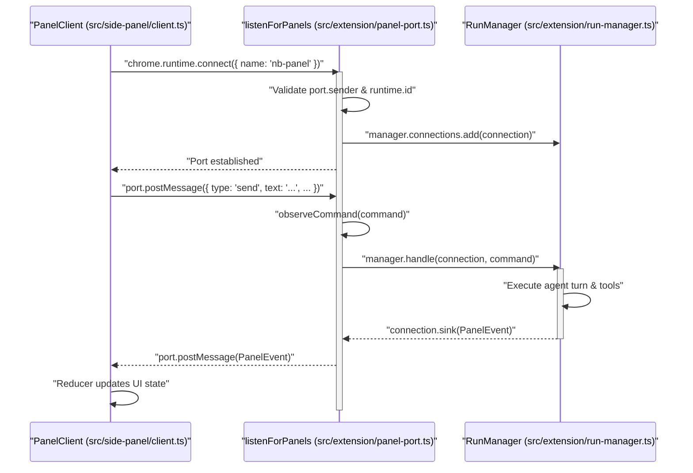
Sources:
- [src/extension/panel-port.ts:8-53]()
- [src/ui/protocol.ts:27-78]()

---

### Diagram 2: Natural Language Space to Code Entity Space

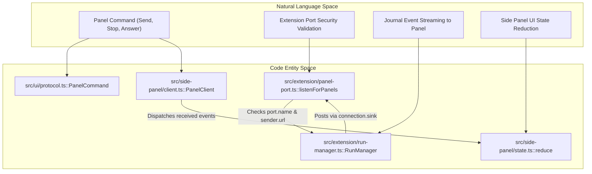
Sources:
- [src/ui/protocol.ts:1-78]()
- [src/extension/panel-port.ts:1-53]()
- [src/side-panel/client.ts]()

---

# Page: Lifecycle: Install, Upgrade and Uninstall

# Lifecycle: Install, Upgrade and Uninstall

<details>
<summary>Relevant source files</summary>

The following files were used as context for generating this wiki page:

- [src/extension/__tests__/upgrade.test.ts](src/extension/__tests__/upgrade.test.ts)
- [src/extension/uninstall.ts](src/extension/uninstall.ts)
- [src/extension/upgrade.ts](src/extension/upgrade.ts)
- [src/store/legacy.ts](src/store/legacy.ts)

</details>


## Purpose and Scope
This page covers extension lifecycle management for Nanobrowser, detailing the first-run initialization flow, version upgrade migrations from legacy version `0.2` [src/extension/upgrade.ts:1-8](), uninstall tracking [src/extension/uninstall.ts:1-9](), and post-update "What's New" card generation [src/extension/upgrade.ts:14-16](). It addresses how persistent storage is initialized, how legacy `chrome.storage.local` schemas are mapped to the current architecture via `src/extension/upgrade.ts` and `src/store/legacy.ts`, and how browser extension lifecycle hooks are registered upon service worker startup.

Sources: 
- `src/extension/upgrade.ts:1-17`
- `src/extension/uninstall.ts:1-9`
- `src/store/legacy.ts:1-17`

---

## 1. First-Run Initialization and Installation Flow

When the Nanobrowser extension is installed or loaded into Chrome or Edge, the background service worker initializes runtime configurations. While fresh installations execute default setup routines (such as seeding initial shortcuts and default models), upgrading installations detect remnants of legacy schema structures in `chrome.storage.local` [src/extension/upgrade.ts:1-8]().

The installation lifecycle ensures that:
1. Default parameters, permission schemas, and settings stores are initialized.
2. The uninstall survey URL is configured via `chrome.runtime.setUninstallURL` [src/extension/uninstall.ts:7-9]() pointing to a localized feedback form (`UNINSTALL_FORM`) [src/extension/uninstall.ts:3-4]().

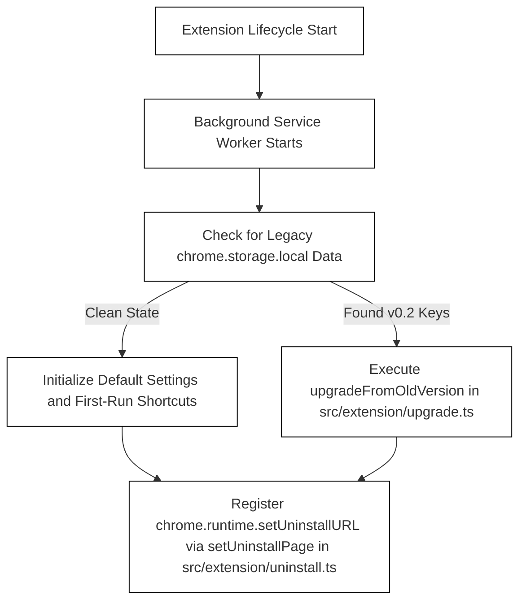
Sources: 
- `src/extension/upgrade.ts:1-8`
- `src/extension/uninstall.ts:6-9`

---

## 2. Version Upgrade and Legacy Data Migration

Nanobrowser includes a comprehensive migration engine designed to upgrade user data seamlessly from version `0.2` without data loss or breaking changes [src/extension/upgrade.ts:1-8](). Because the extension shares the same Chrome Web Store listing, legacy keys persist in `chrome.storage.local` [src/extension/upgrade.ts:1-8](). 

### Migration Mechanics and Sequence
Upon every worker start, if legacy data is detected, the upgrade routine executes in a strict transaction order:
1. **Shortcuts Migration**: Converts legacy saved prompts/favorites into modern slash-command shortcuts using `saveShortcut` [src/store/legacy.ts:10](), generating unique slugs via `shortcutName` [src/extension/__tests__/upgrade.test.ts:13-15]().
2. **Settings & Providers Translation**: Maps old provider types and model configurations into the modern `ProviderConfig` layout via `moveProviders` [src/extension/upgrade.ts:63-115](). Unsupported or deprecated providers (such as Azure OpenAI, Cerebras, Llama, and Groq) are pruned [src/extension/upgrade.ts:30-31, 107-108]().
3. **Reasoning Effort Mapping**: Translates old effort descriptors using `moveEffort` [src/extension/upgrade.ts:120-134]() to fit current `ReasoningEffort` specs [src/extension/upgrade.ts:11]() (`low`, `medium`, `high`) [src/extension/upgrade.ts:121-125]().
4. **Firewall and Blocked Sites**: Converts legacy deny-lists into structural `Block` site rules via `moveBlockedSites` [src/extension/__tests__/upgrade.test.ts:159-165]().
5. **Commit and Cleanup**: Writes settings along with a persistent `UpgradeRecord` to `UPGRADE_KEY` [src/store/legacy.ts:44], then deletes legacy keys (`OLD_KEYS`) from `chrome.storage.local` [src/store/legacy.ts:7-16]() only after the record is successfully committed [src/extension/upgrade.ts:6-8]().

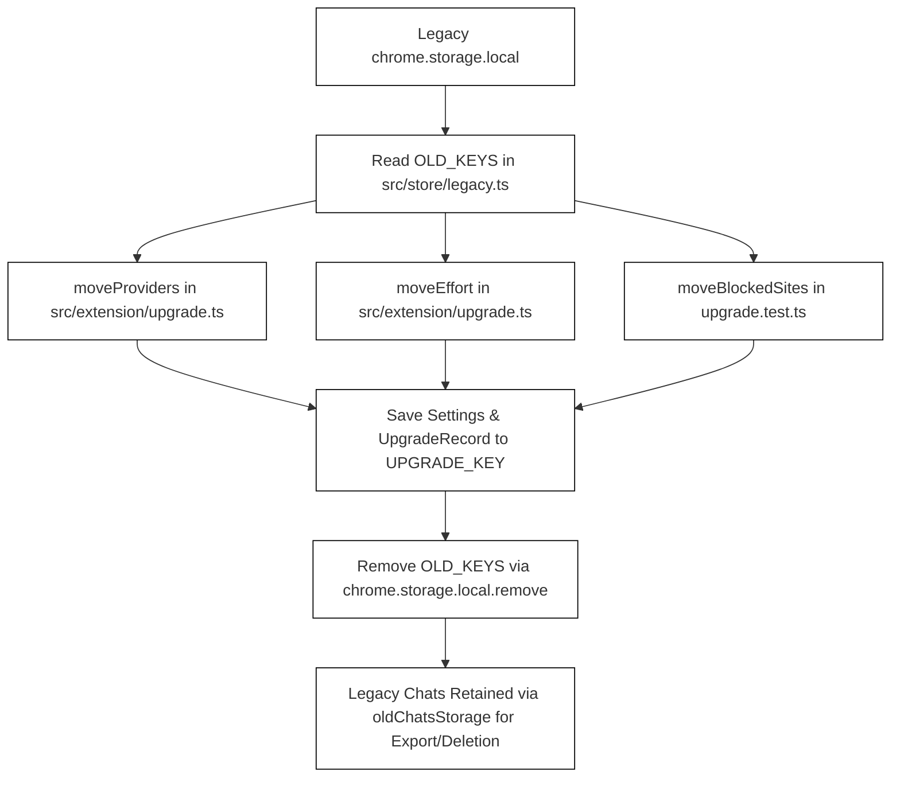

Legacy chat sessions (`OLD_CHATS_KEY`) are intentionally preserved in storage [src/extension/upgrade.ts:3-4]() so users can export them to Markdown via `oldChatsMarkdown` [src/store/legacy.ts:84-94]() or manually delete them via **Settings → Data** [src/extension/upgrade.ts:4] without automatic deletion.

Sources:
- `src/extension/upgrade.ts:1-162`
- `src/store/legacy.ts:1-117`
- `src/extension/__tests__/upgrade.test.ts:1-170`

---

## 3. Uninstall Handling and Telemetry Feedback

When a user uninstalls Nanobrowser, Chrome opens a post-uninstall feedback form [src/extension/uninstall.ts:1-2](). The background worker sets this URL dynamically upon startup using `setUninstallPage()` [src/extension/uninstall.ts:6-9]().

- **Target Form**: Defined as `UNINSTALL_FORM` in `src/extension/uninstall.ts` [src/extension/uninstall.ts:3-4]().
- **Privacy Design**: The uninstall URL carries no identifying telemetry, tokens, or user data parameters [src/extension/uninstall.ts:1-2]().

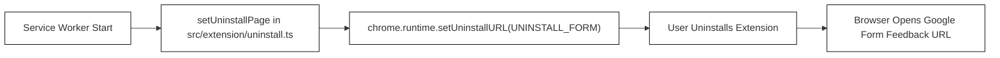

Sources:
- `src/extension/uninstall.ts:1-10`

---

## 4. What's-New Cards and User Engagement

Post-upgrade notification states are governed by upgrade records and release metadata [src/extension/upgrade.ts:14-16](). When an upgrade migration succeeds, an `UpgradeRecord` containing counts of migrated favorites and blocked sites is stored [src/store/legacy.ts:25-42](). 

- **UI Integration**: The side panel reads `UPGRADE_KEY` via `upgradeStorage` [src/store/legacy.ts:46]() to render introductory migration cards or release highlight banners for the current version (`releaseOf`) [src/extension/upgrade.ts:16]().
- **Dismissal State**: Users can dismiss the notification card; the underlying `UpgradeRecord` persists with `dismissed: true` to prevent the migration workflow or welcome prompt from repeating on subsequent worker restarts [src/store/legacy.ts:40-41]().

Sources:
- `src/extension/upgrade.ts:10-17`
- `src/store/legacy.ts:25-46`

---

# Page: Browser Control Layer

# Browser Control Layer

<details>
<summary>Relevant source files</summary>

The following files were used as context for generating this wiki page:

- [.npmrc](.npmrc)
- [CLAUDE.md](CLAUDE.md)
- [README.md](README.md)

</details>


## Purpose and Scope

The browser control layer (`src/browser-control/`) is a deterministic, LLM-free automation layer built directly on top of `chrome.debugger` (CDP) and Puppeteer frame management [CLAUDE.md:25-30]. It provides the foundational abstraction used by Nanobrowser to observe web pages, track frames (including out-of-process iframes), manage element references (`refs`), and dispatch interaction primitives safely [CLAUDE.md:25-30, CLAUDE.md:64-69]. 

The layer exposes a strictly defined public surface through `src/browser-control/index.ts` [CLAUDE.md:69]. No external consumer or agent may import internal modules directly. All protocol request/response schemas, tool definitions, and error codes are centralized in `src/browser-control/protocol/` [CLAUDE.md:65], ensuring fail-closed invariants and strict type safety.

Title: Diagram: Browser Control Layer Architecture and Module Boundaries
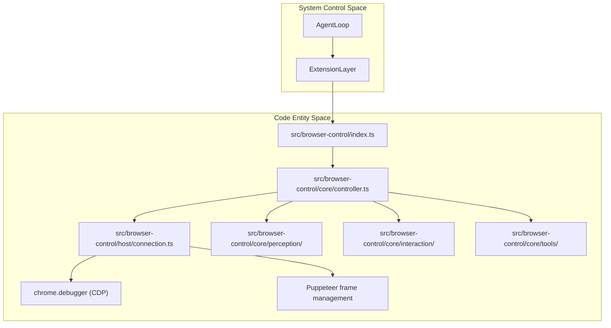
Sources: [CLAUDE.md:25-30](), [CLAUDE.md:64-69]()

---

## 3.1. Controller, Sessions and Refs

The core controller orchestration resides in `src/browser-control/core/controller.ts`, handling session lifecycles, execution locks (`lock.ts`), element reference validity (`refs.ts`), port routing (`ports.ts`), site policies (`site.ts`), URL gating (`url-policy.ts`), and navigation guards (`navigation-guard.ts`) [CLAUDE.md:66]. Element refs are strictly tied to the document in which they were observed and fail closed if a navigation or detachment occurs [CLAUDE.md:41-42].

For details, see [Controller, Sessions and Refs](#3.1).

Sources: [CLAUDE.md:41-42](), [CLAUDE.md:66]()

---

## 3.2. Perception: Snapshots, AX Tree and Reading

Perception modules (`src/browser-control/core/perception/`) construct read-only page states via accessibility trees (`ax.ts`), visual captures (`capture.ts`), diffing (`diff.ts`), enrichment (`enrich.ts`), layout calculation (`layout.ts`), masking sensitive elements (`masking.ts`), observation (`observe.ts`), outlining (`outline.ts`), reading (`read.ts`), and window management (`window.ts`) [CLAUDE.md:66]. In-page scripts (`src/browser-control/probe/`) are injected as string constants to extract structural data without altering page state [CLAUDE.md:38, CLAUDE.md:67].

For details, see [Perception: Snapshots, AX Tree and Reading](#3.2).

Sources: [CLAUDE.md:38](), [CLAUDE.md:66-67]()

---

## 3.3. Interaction: Preflight, Classification and Dispatch

Interaction handling (`src/browser-control/core/interaction/`) validates actionability and visibility through preflight checks (`preflight.ts`, `actionability.ts`), classifies consequential actions (`classify.ts`), manages input evidence (`evidence.ts`), enforces security gates (`gate.ts`), guards keystrokes (`keys/`, `key-guard.ts`), controls pointers (`pointer.ts`), resolves nodes (`resolve.ts`), and handles withheld operations (`withheld.ts`) [CLAUDE.md:43, CLAUDE.md:66]. Destructive or consequential actions are intercepted and held for user approval [CLAUDE.md:43].

For details, see [Interaction: Preflight, Classification and Dispatch](#3.3).

Sources: [CLAUDE.md:43](), [CLAUDE.md:66]()

---

## 3.4. Tool Catalogue and Protocol

The tool catalogue (`src/browser-control/core/tools/`) implements specific automation verbs such as `act`, `ask`, `dialog`, `fill`, `labels`, `navigate`, `observe`, `tabs`, `text`, `upload`, and `wait` [CLAUDE.md:65-66]. These tools are backed by strict Zod validation schemas located in `src/browser-control/protocol/`, defining standardized request shapes, typed error codes, and structured execution receipts.

Title: Diagram: Protocol Schema to Tool Execution Flow
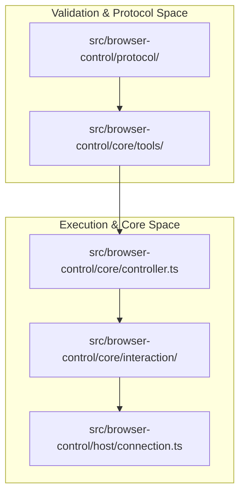
Sources: [CLAUDE.md:65-66]()

For details, see [Tool Catalogue and Protocol](#3.4).

Sources: [CLAUDE.md:65-66]()

---

## 3.5. Host Adapters: chrome.debugger and Puppeteer

Host adapters (`src/browser-control/host/`) bridge the layer to Chrome's extension APIs. Connection management handles CDP session attachment, detachment handling, frame discovery including out-of-process iframes (OOPIFs), and automatic recovery from debugger loss or service worker restarts. Puppeteer is utilized strictly for frame management and topological discovery rather than element selection [CLAUDE.md:27-28, CLAUDE.md:68].

For details, see [Host Adapters: chrome.debugger and Puppeteer](#3.5).

Sources: [CLAUDE.md:27-28](), [CLAUDE.md:68]()

---

# Page: Controller, Sessions and Refs

# Controller, Sessions and Refs

<details>
<summary>Relevant source files</summary>

The following files were used as context for generating this wiki page:

- [.npmrc](.npmrc)
- [CLAUDE.md](CLAUDE.md)
- [src/extension/bindings.ts](src/extension/bindings.ts)

</details>


This section details the core modules of the browser control layer located in `src/browser-control/core/`, specifically focusing on session lifecycles, element reference validity, concurrency locking, site rules, URL policies, and navigation gating as mandated by the project architecture.

Sources: [CLAUDE.md:61-69]()

## Controller and Session Lifecycle

The controller coordinates browser automation state across tabs and frames using `chrome.debugger` and Puppeteer. Sessions encapsulate active browser contexts, state revisions, and capabilities [src/extension/agent-session.ts:14-25](). 

State within the layer is strictly disposable: service worker restarts, debugger detaches, and page navigations invalidate layer state cleanly [CLAUDE.md:41-42]().

```mermaid
classDiagram
    direction "LR"
    class Controller {
        +createSession(config: SessionConfig) Session
        +tabState(tabId: number) TabState
    }
    class Session {
        +controller: Controller
        +activeTabId: number
        +hasTab(tabId: number) boolean
        +call(tool: string, args: Record<string, unknown>, options: object) Promise
        +wrap(text: string, source: string) string
    }
    class TabState {
        +rev: number
        +pending: PendingItem[]
    }
    Controller --> Session : "creates"
    Session --> Controller : "references"
    Session --> TabState : "queries tabState"
```
**Diagram: Controller and Session Relationship**

Sources: [CLAUDE.md:25-30](), [src/extension/agent-session.ts:14-63]()

## Element Refs and Validity (`refs.ts`)

Element references (`refs`) identify DOM nodes across perception and interaction cycles. The ref subsystem enforces strict invariants:
1. **Refs fail closed:** A ref is valid only for the document it was seen in and only if the agent was shown it [CLAUDE.md:33-34](). Otherwise, the operation yields a typed error rather than a guess.
2. **One identity:** An action operates on the node the agent was shown, addressed directly by the browser's handle [CLAUDE.md:33-33]().

Sources: [CLAUDE.md:33-34]()

## Concurrency and Locking (`lock.ts`)

The locking mechanism (`lock.ts`) manages exclusive access to tab resources and execution queues. Because browser automation actions can overlap between user interactions and agent execution steps, locks prevent race conditions during DOM evaluation and event dispatch. Bounded execution budgets ensure operations do not hang indefinitely [CLAUDE.md:39-40]().

Sources: [CLAUDE.md:39-40]()

## Site Rules and URL Policy (`site.ts`, `url-policy.ts`)

Site rules and URL policies govern navigation and interaction permissions per domain. 
- Actions are classified by sensitivity (e.g., submit, pay, delete) [CLAUDE.md:43-44]().
- Sites configured with allow, ask, or block rules restrict agent capabilities accordingly.
- URL policies block access to restricted browser schemes and internal extension pages.

Sources: [CLAUDE.md:43-44]()

## Navigation Gating and Ports (`navigation-guard.ts`, `ports.ts`)

Navigation guards intercept top-level and frame navigations to ensure agents remain within permissible scopes. The port abstraction (`ports.ts` / `src/agent/ports.ts`) provides a clean interface for the agent loop to invoke layer tools, query tab information, and manage execution signals while handling UI overlays such as page borders [src/extension/agent-session.ts:43-63]().

```mermaid
sequenceDiagram
    participant AgentLoop as "AgentLoop"
    participant LayerPort as "LayerPort"
    participant Session as "Session"
    participant PageBorder as "PageBorder"
    
    AgentLoop->>LayerPort: call("screenshot", args, signal)
    LayerPort->>Session: screenshotTab(session, args)
    Session-->>LayerPort: tabId
    LayerPort->>PageBorder: around(tabId, run)
    PageBorder->>Session: session.call("screenshot", args)
    Session-->>PageBorder: result
    PageBorder-->>LayerPort: result
    LayerPort-->>AgentLoop: result
```
**Diagram: Agent Tool Call Flow with LayerPort and PageBorder**

Sources: [src/extension/agent-session.ts:43-63]()

---

# Page: Perception: Snapshots, AX Tree and Reading

# Perception: Snapshots, AX Tree and Reading

<details>
<summary>Relevant source files</summary>

The following files were used as context for generating this wiki page:

- [.npmrc](.npmrc)
- [CLAUDE.md](CLAUDE.md)
- [fixtures/pages/g-enrich.html](fixtures/pages/g-enrich.html)
- [src/background/scenarios/set-g.ts](src/background/scenarios/set-g.ts)

</details>


This page details the architecture and implementation of the perception layer within the browser control module (`src/browser-control/core/perception` and `src/browser-control/probe/`). The perception subsystem is responsible for building deterministic, read-only representations of web page state, extracting accessibility trees, capturing screenshots, and masking sensitive content without modifying the underlying page [CLAUDE.md:31-42]().

## Overview of Perception and Invariance

The perception pipeline operates under strict invariants defined by the browser control layer architecture:
1. **Observation is read-only**: Capturing state, taking snapshots, or inspecting the accessibility tree never mutates page state or triggers side effects [CLAUDE.md:38]().
2. **Degrade loudly**: Partial captures, truncation, and missing attributes are explicitly stated in the result object [CLAUDE.md:39]().
3. **Bounded execution**: Every command, capture, and tree traversal operates within a defined performance and time budget [CLAUDE.md:40]().
4. **No model inside the layer**: The perception modules perform purely deterministic parsing and extraction; any semantic reasoning or LLM interpretation occurs entirely in the agent layer above [CLAUDE.md:29]().

Sources:
* [CLAUDE.md:25-44]()

## Sub-Modules in `core/perception`

The perception engine is structured into specialized sub-modules located under `src/browser-control/core/perception/`:

* **`ax`**: Handles extraction and normalization of the browser Accessibility (AX) tree via raw CDP commands sent to the active frame session [CLAUDE.md:64-66]().
* **`capture`**: Coordinates viewport and full-page screenshot generation utilizing CDP page capture methods [CLAUDE.md:64-66]().
* **`diff`**: Computes deterministic state diffs across consecutive perception snapshots to track changes in interactive elements [CLAUDE.md:64-66]().
* **`enrich`**: Performs semantic classification and enrichment of elements (such as login fields, one-time passcode inputs, card fields, and authorization grants) [src/background/scenarios/set-g.ts:1-3](), [fixtures/pages/g-enrich.html:1-3]().
* **`layout`**: Computes bounding boxes, viewport geometry, and spatial relationships for target elements [CLAUDE.md:64-66]().
* **`masking`**: Identifies and obscures sensitive information (e.g., passwords, payment data) during capture and snapshot generation [CLAUDE.md:64-66]().
* **`observe` & `read`**: High-level orchestrators that synthesize AX data, layout metrics, and text content into structured read-only states for agent consumption [CLAUDE.md:64-66]().
* **`outline` & `window`**: Manages visual framing, element highlighting boundaries, and viewport window parameters [CLAUDE.md:64-66]().

Sources:
* [CLAUDE.md:64-68]()
* [src/background/scenarios/set-g.ts:1-3]()
* [fixtures/pages/g-enrich.html:1-3]()

## Data Flow: From Natural Language Intent to Perception Execution

The following diagram bridges the natural language intent of taking a page snapshot or reading state to the concrete code entities within the perception and probe packages.

```mermaid
graph TD
    subgraph "NaturalLanguageSpace"
        AgentCall["User or Agent requests page snapshot or reading state"]
    end

    subgraph "CodeEntitySpace"
        Controller["src/browser-control/core/controller.ts:Session.call()"] --> PerceptionModule["src/browser-control/core/perception/observe.ts:observePage()"];
        PerceptionModule --> ProbeScript["src/browser-control/probe/ in-page script evaluation via CDP"];
        PerceptionModule --> AXModule["src/browser-control/core/perception/ax.ts:extractAXTree()"];
        PerceptionModule --> MaskingModule["src/browser-control/core/perception/masking.ts:applyMasks()"];
        AXModule --> CDPClient["src/browser-control/host/debugger.ts:sendCommand()"];
        CDPClient --> ResultPayload["Structured Read-Only Perception State"];
    end

    AgentCall --> Controller
```
**Diagram: Perception Pipeline Natural Language to Code Mapping**

Sources:
* [CLAUDE.md:31-42]()
* [src/background/scenarios/set-g.ts:25-45]()

## In-Page Probe Scripts (`src/browser-control/probe/`)

The layer interacts with pages using serialized in-page scripts stored in `src/browser-control/probe/`. These scripts are evaluated within the target frame via CDP (`Runtime.evaluate`) without relying on Puppeteer element selectors or external content scripts [CLAUDE.md:26-28]().

### Key Characteristics of Probe Scripts
* **String Constants**: In-page scripts are compiled as string constants embedded in the layer, ensuring zero runtime file resolution overhead in the extension context [CLAUDE.md:67]().
* **Read-Only Inspection**: Scripts inspect DOM properties, bounding client rects, computed styles, and accessibility attributes without dispatching synthetic user events or modifying DOM nodes [CLAUDE.md:38]().
* **Error Resilience**: Execution failures within probes are caught and returned as typed perception errors rather than crashing the control session [CLAUDE.md:39]().

Sources:
* [CLAUDE.md:26-28]()
* [CLAUDE.md:67]()

## Perception Architecture and Module Relationships

The internal class and function relationship of the perception layer coordinates input streams from CDP frames, extracts semantic nodes, applies security masking, and yields structured results.

```mermaid
classDiagram
    direction LR
    class Session {
        +call(tool: string, args: Record)
    }

    class observePage {
        +run(sessionId: string)
    }

    class extractAXTree {
        +getAXTree(sessionId: string)
    }

    class applyMasks {
        +maskSensitiveFields(snapshot: Snapshot)
    }

    class classifyElement {
        +enrichFields()
    }

    Session --> observePage
    observePage --> extractAXTree
    observePage --> applyMasks
    extractAXTree --> classifyElement
```
**Diagram: Perception Module Architecture**

Sources:
* [CLAUDE.md:31-44]()
* [src/background/scenarios/set-g.ts:1-20]()

---

# Page: Interaction: Preflight, Classification and Dispatch

# Interaction: Preflight, Classification and Dispatch

<details>
<summary>Relevant source files</summary>

The following files were used as context for generating this wiki page:

- [fixtures/pages/d-overlay.html](fixtures/pages/d-overlay.html)
- [src/browser-control/core/__tests__/classify.test.ts](src/browser-control/core/__tests__/classify.test.ts)
- [src/browser-control/core/interaction/classify.ts](src/browser-control/core/interaction/classify.ts)

</details>


### Purpose and Scope

This section details the browser control layer's interaction engine located in `src/browser-control/core/interaction/`. The interaction engine is responsible for verifying element actionability (visibility, stability, and geometry), classifying consequential actions (such as payments, deletions, submissions, and access grants) into sensitive categories, enforcing security gates, guarding sensitive keystrokes, and resolving element references (`refs`) into raw Chrome DevTools Protocol (CDP) commands for execution. 

In accordance with architectural invariants, all interaction processing is deterministic, model-free, and fails closed when element validity or user authorization is missing [CLAUDE.md:30-44]().

Sources: `[CLAUDE.md:30-44](), [src/browser-control/core/interaction/classify.ts:1-6]()`

---

### Preflight and Actionability Checks

Before any input event (such as a click, fill, or key dispatch) is sent to a target node, the interaction subsystem performs preflight actionability checks. These checks ensure that the target element is present in the current document, fully visible, not obscured by overlays, stable in layout coordinates, and enabled for interaction.

Key responsibilities of the preflight pipeline include:
- Verifying that the target `ref` corresponds to a valid node handle in the active document state [CLAUDE.md:31-34]().
- Checking intersection metrics and visibility flags computed during perception.
- Ensuring retries occur entirely before dispatch; once an input event is sent, the layer does not issue autonomous retries [CLAUDE.md:35]().

Sources: `[CLAUDE.md:31-35]()`

---

### Consequential-Action Classification Engine

The sensitivity classifier (`src/browser-control/core/interaction/classify.ts`) is a deterministic engine that analyzes accessible names, roles, structural facts (`FormFacts`), and URL contexts to determine if an action triggers consequential state changes (payments, data deletions, form submissions, or permission grants) [src/browser-control/core/interaction/classify.ts:1-6](). 

The classification logic uses case-insensitive regular expression matchers for English word boundaries and Chinese character sets (`vocabulary()`) [src/browser-control/core/interaction/classify.ts:11-15]().

```mermaid
graph TD
  subgraph Natural_Language_Space
    NL1[""Pay Now / Buy / 结账""]
    NL2[""Delete / Remove / 注销""]
    NL3[""Submit / Send / 发送""]
    NL4[""Authorize / Grant Access / 授权""]
    NL5[""Confirm next to money amount $49.00""]
  end
  subgraph Code_Entity_Space
    C1[""PAY_WORDS in classify.ts:17""]
    C2[""DELETE_WORDS in classify.ts:42""]
    C3[""SUBMIT_WORDS in classify.ts:62""]
    C4[""GRANT_WORDS in classify.ts:83""]
    C5[""GENERIC_CONFIRM & facts.money in classify.ts:101""]
  end
  NL1 --> C1
  NL2 --> C2
  NL3 --> C3
  NL4 --> C4
  NL5 --> C5
```
Sources: `[src/browser-control/core/interaction/classify.ts:1-176]()`

#### Classification Categories and Rules

The `classify()` function evaluates `ClassifyInput` parameters (`mode`, `name`, `role`, `facts`, `url`) and returns a `Classification` containing a `SensitiveCategory` (`'pay'`, `'delete'`, `'submit'`, or `'grant'`) and a descriptive `reason` [src/browser-control/core/interaction/classify.ts:105-134]().

1. **Payment (`PAY_WORDS`)**: Matches terms like `'pay'`, `'buy'`, `'checkout'`, `'place order'`, `'subscribe'`, `'充值'`, `'付款'`, etc. Additionally, a generic confirmation label (`GENERIC_CONFIRM`) combined with a detected money amount (`facts.money`) is classified as `'pay'` [src/browser-control/core/interaction/classify.ts:17-41, 101-130]().
2. **Access Grant (`GRANT_WORDS`, `AFFIRMATIVE`)**: Matches authorization terms (`'authorize'`, `'allow access'`, `'授权'`) or affirmative labels (`'Allow'`, `'Continue'`, `'同意'`) when executed on a consent page path (matched by `CONSENT_PATH`) [src/browser-control/core/interaction/classify.ts:83-99]().
3. **Deletion (`DELETE_WORDS`)**: Matches destructive terms (`'delete'`, `'remove'`, `'discard'`, `'unsubscribe'`, `'删除'`, `'注销'`) [src/browser-control/core/interaction/classify.ts:42-61]().
4. **Submission (`SUBMIT_WORDS`, `enterSubmits`)**: Matches submission labels (`'submit'`, `'send'`, `'publish'`, `'保存'`, `'提交'`). For keyboard events (`mode: 'enter'`), `enterSubmits(facts)` evaluates HTML implicit form submission rules—determining whether pressing Enter inside an input field triggers form submission based on the presence of enabled default buttons or single blocking fields [src/browser-control/core/interaction/classify.ts:62-79, 139-174]().

Sources: `[src/browser-control/core/interaction/classify.ts:17-174](), [src/browser-control/core/__tests__/classify.test.ts:37-117]()`

---

### Gating, Key-Guards and Withheld Actions

Once an action is classified into a sensitive category, the interaction gate (`src/browser-control/core/interaction/gate.ts` / `withheld.ts`) evaluates whether dispatch is permitted based on the active security policy [CLAUDE.md:43-53]().

- **Consequential Action Rule (Invariant 11)**: By default, any action classified as submit, pay, delete, or grant is withheld from automatic execution unless explicitly approved by the user or running under an allowed auto-mode scope [CLAUDE.md:43]().
- **Key-Guards (`key-guard.ts`)**: Monitors key event sequences for sensitive inputs, password fields, or command injections.
- **Withheld Receipts**: When an action is withheld, the layer returns a structured withheld result containing the classification category and human-readable justification without modifying page state.

Sources: `[CLAUDE.md:43-53]()`

---

### Dispatch, Pointer and Resolution Pipeline

When preflight checks pass and security gates approve execution, the dispatch pipeline executes the command against the target frame session.

```mermaid
graph TD
  subgraph Interaction_Execution
    E1[""Agent Action Request""] --> E2[""preflight() validation""]
    E2 --> E3[""classify() sensitivity check""]
    E3 --> E4[""gate() policy evaluation""]
    E4 -->|Approved| E5[""resolve() ref to CDP Node ID""]
    E5 --> E6[""pointer() or keys() dispatch via chrome.debugger""]
    E6 --> E7[""Execution Receipt""]
  end
```

- **Reference Resolution (`resolve.ts`)**: Translates agent-visible element handles (`refs`) into precise browser element handles within the target document without relying on Puppeteer selector queries [CLAUDE.md:28]().
- **Pointer Events (`pointer.ts`)**: Dispatches low-level mouse and touch events directly via CDP commands to the frame session identified by Puppeteer [CLAUDE.md:27-28]().
- **Key Events (`keys.ts`)**: Dispatches keystrokes and text input sequences with precise modifier tracking.

Sources: `[CLAUDE.md:27-28]()`

---

# Page: Tool Catalogue and Protocol

# Tool Catalogue and Protocol

<details>
<summary>Relevant source files</summary>

The following files were used as context for generating this wiki page:

- [.npmrc](.npmrc)
- [CLAUDE.md](CLAUDE.md)
- [src/ui/locales/en.json](src/ui/locales/en.json)

</details>


This page details the implementation of the deterministic tool catalogue and protocol schemas within the browser control layer (`src/browser-control/`). It covers the Zod-based protocol definitions (`src/browser-control/protocol/`), the concrete tool implementations (`src/browser-control/core/tools/`), and how the system bridges agent instructions to low-level browser operations without containing any embedded LLM logic.

Sources:
- [CLAUDE.md:61-69]()

## Protocol Schemas and Zod Validation

The protocol package (`src/browser-control/protocol/`) defines the strict request and response boundaries for all automation primitives exposed to the agent layer. Using Zod schemas, the layer ensures that every argument provided by the agent is validated at runtime before any browser command is dispatched.

Each tool declaration in the catalogue maps to a distinct Zod schema defining its parameters, return type, and error semantics. This guarantees that refs fail closed and unexpected parameters are rejected immediately without entering page-evaluation state.

Sources:
- [CLAUDE.md:19-44]()

## Tool Catalogue Implementation

The tool catalogue (`src/browser-control/core/tools/`) contains the modular implementations of the browser commands. The suite comprises eleven core tools:

*   `act`: Executes low-level pointer and keyboard actions (clicks, keypresses) on validated element handles.
*   `ask`: Handles user-confirmation prompts for consequential or sensitive actions.
*   `dialog`: Manages browser native modal dialogs (`alert`, `confirm`, `prompt`).
*   `fill`: Inputs text or values into form fields mapped via perceptual refs.
*   `labels`: Retrieves and resolves accessibility label relationships for form inputs.
*   `navigate`: Controls page navigation, history traversal, and URL transitions within policy bounds.
*   `observe`: Captures read-only perceptual snapshots of the DOM and accessibility tree.
*   `tabs`: Manages tab lifecycle, switching, creation, and closing within scoped boundaries.
*   `text`: Extracts text content from specific nodes or full page frames.
*   `upload`: Handles file attachment flows and input manipulation for file uploads.
*   `wait`: Implements bounded waiting mechanisms for network idle, selectors, or state changes.

Sources:
- [CLAUDE.md:61-69]()

## Bridging Natural Language Space to Code Entity Space

The following diagrams illustrate how abstract agent intentions formulated in Natural Language Space are translated into concrete TypeScript classes, Zod validation schemas, and CDP command executions within Code Entity Space.

### Diagram: Natural Language to Tool Protocol Translation

```mermaid
graph TD
    NL["NaturalLanguageIntent"] --> AgentLoop["src/agent/loop.ts"]
    AgentLoop --> ToolCall["AgentToolCall"]
    ToolCall --> ZodSchema["src/browser-control/protocol/schema.ts"]
    ZodSchema -- "Validate Payload" --> ToolCatalogue["src/browser-control/core/tools/"]
    ToolCatalogue --> Controller["src/browser-control/core/controller.ts"]
    Controller --> HostAdapter["src/browser-control/host/"]
```
Title: "Natural Language to Protocol Translation Flow"

Sources:
- [CLAUDE.md:61-69]()

### Diagram: Tool Execution and Dispatch Architecture

```mermaid
graph TD
    Agent["AgentLayer"] --> ProtocolReq["protocol/Request"]
    ProtocolReq --> Validator["ProtocolValidator"]
    Validator -- "Valid" --> ToolRouter["core/tools/index.ts"]
    ToolRouter --> ActTool["core/tools/act.ts"]
    ToolRouter --> NavTool["core/tools/navigate.ts"]
    ToolRouter --> ObserveTool["core/tools/observe.ts"]
    ActTool --> CDP["chrome.debugger CDP"]
    NavTool --> CDP
    ObserveTool --> CDP
    CDP --> TargetPage["TargetWebPage"]
```
Title: "Tool Execution and CDP Dispatch Architecture"

Sources:
- [CLAUDE.md:61-69]()

---

# Page: Host Adapters: chrome.debugger and Puppeteer

# Host Adapters: chrome.debugger and Puppeteer

<details>
<summary>Relevant source files</summary>

The following files were used as context for generating this wiki page:

- [src/background/checks/host-connection.ts](src/background/checks/host-connection.ts)
- [src/browser-control/host/connection.ts](src/browser-control/host/connection.ts)

</details>


## Purpose and Scope

The host adapters layer (`src/browser-control/host/`) serves as the foundation of the deterministic browser control layer. It bridges Chrome's low-level extension APIs (`chrome.debugger`, `chrome.tabs`) with Puppeteer and raw Chrome DevTools Protocol (CDP) streams. Its core responsibilities include CDP connection management, attach/detach lifecycle handling, per-command timeout enforcement, event fan-out across session boundaries (including Out-Of-Process Iframes / OOPIFs), frame discovery via loader IDs, and robust recovery from debugger disconnections caused by service worker reloads.

Sources: `src/browser-control/host/connection.ts:1-10()`, `src/background/checks/host-connection.ts:1-7()`

---

## 1. CDP Connection Management and Attachment

Connection management centers around the `ChromeTabConnection` class (`src/browser-control/host/connection.ts:61-124()`), which manages an attached browser tab. Before attempting to attach, the host adapter checks whether the target URL is restricted (such as `chrome://`, `chrome-extension://`, or the Chrome Web Store) via `isRestrictedUrl()` (`src/browser-control/host/connection.ts:14-27()`).

When `ChromeTabConnection.open(tabId)` is invoked:
1. It verifies the tab exists via `chrome.tabs.get(tabId)` (`src/browser-control/host/connection.ts:89-90()`).
2. It checks URL restrictions and throws a `LayerError('PAGE_NOT_SUPPORTED', ...)` if the page cannot be controlled (`src/browser-control/host/connection.ts:91-93()`).
3. It attempts to connect via Puppeteer's `connectTab(tabId)` (`src/browser-control/host/connection.ts:96()`). If an `already attached` error occurs (typically caused by a service worker restart while a tab was previously attached), it detaches the stale debugger session and retries connection (`src/browser-control/host/connection.ts:97-102()`).
4. It enables focus emulation via `Emulation.setFocusEmulationEnabled` to ensure the page behaves as focused even when running in a background window (`src/browser-control/host/connection.ts:113-116()`).

```mermaid
graph TD
  Start["ChromeTabConnection.open(tabId)"] --> CheckTab["chrome.tabs.get(tabId)"]
  CheckTab --> CheckURL["isRestrictedUrl(url)"]
  CheckURL -->|Restricted| ThrowRestricted["Throw PAGE_NOT_SUPPORTED LayerError"]
  CheckURL -->|Allowed| ConnectTab["connectTab(tabId)"]
  ConnectTab --> CatchError{"Attachment Error?"}
  CatchError -->|Already Attached| DetachStale["chrome.debugger.detach({tabId})"]
  DetachStale --> RetryConnect["connectTab(tabId) Retry"]
  CatchError -->|Other Error| ThrowInternal["Throw INTERNAL LayerError"]
  ConnectTab --> Success["Establish ChromeTabConnection & Emulation.setFocusEmulationEnabled"]
  RetryConnect --> Success
```
*Diagram: Code entity connection workflow mapping high-level attachment requests to `ChromeTabConnection.open` and `connectTab` execution.*

Sources: `src/browser-control/host/connection.ts:14-118()`

---

## 2. Command Dispatch, Timeouts, and Event Fan-Out

The host layer implements a raw command channel with per-command timeout enforcement and structured event routing across CDP session boundaries.

### Command Execution and Timeouts
Commands sent through `ChromeCdpPort` (`src/browser-control/host/connection.ts:45-59()`) delegate to `sendRaw` in `src/browser-control/host/cdp-session.ts`, wrapping `chrome.debugger.sendCommand`. Every command enforces a strict timeout (`DEFAULT_COMMAND_TIMEOUT_MS`), throwing a `CdpTimeoutError` if the browser fails to respond within the allotted duration (`src/background/checks/host-connection.ts:25-34()`).

### Event Fan-Out by Session ID
Chrome DevTools Protocol events arrive globally through `chrome.debugger.onEvent` (`src/browser-control/host/connection.ts:35-38()`). The host adapter normalizes session IDs and dispatches events to registered subscribers (`src/browser-control/host/connection.ts:148-159()`). Subscribers can register for:
- **Session-scoped events**: Reaching only handlers listening to a specific child session (e.g., an OOPIF).
- **Tab-wide events**: Reaching general listeners across the entire tab while annotating the event with its corresponding `sessionId` (`src/background/checks/host-connection.ts:36-53()`).

```mermaid
graph TD
  CDPEvent["chrome.debugger.onEvent"] --> Dispatch["ChromeTabConnection.dispatch(sessionId, method, params)"]
  Dispatch --> Lookup["Lookup handlers in Map"]
  Lookup --> Filter{"entry.scoped && entry.sessionId !== sessionId?"}
  Filter -->|Yes| Skip["Skip Handler"]
  Filter -->|No| Invoke["Invoke entry.handler(params, sessionId)"]
  Skip --> Next["Next Handler"]
  Invoke --> Next
```
*Diagram: Event fan-out architecture mapping `chrome.debugger.onEvent` triggers to `ChromeTabConnection.dispatch` handler loops.*

Sources: `src/browser-control/host/connection.ts:35-59()`, `src/browser-control/host/connection.ts:148-159()`, `src/background/checks/host-connection.ts:36-53()`

---

## 3. Detach Handling, Recovery, and Cleanup

The connection layer monitors unexpected debugger detachment via `chrome.debugger.onDetach` (`src/browser-control/host/connection.ts:39-42()`). 

### Detachment Lifecycle
- When a tab is closed or the debugger is forcefully detached by the browser, `markDetached()` flags the connection (`src/browser-control/host/connection.ts:161-162()`).
- Any pending CDP promises race against `#detachedSignal`, causing them to immediately reject with a `LayerError` of code `DEBUGGER_DETACHED` (`src/browser-control/host/connection.ts:70-71()`, `src/background/checks/host-connection.ts:55-69()`).
- Subsequent commands attempted on a detached connection fail fast with `DEBUGGER_DETACHED` (`src/background/checks/host-connection.ts:70-74()`).
- Clean teardown ensures the layer detaches exactly once, preventing unhandled promise rejections from Chrome protocol cleanup refusals (`src/background/checks/host-connection.ts:77-91()`).

Sources: `src/browser-control/host/connection.ts:39-42()`, `src/browser-control/host/connection.ts:130-138()`, `src/background/checks/host-connection.ts:55-91()`

---

## 4. Frame Discovery and OOPIF Topology

Frame structure and Out-Of-Process Iframes (OOPIFs) are discovered and managed via `PuppeteerFrameTopology` (`src/browser-control/host/connection.ts:81()`). 

The topology service inspects target frames, ensuring that:
- Every discovered frame possesses a valid `loaderId` (`src/background/checks/host-connection.ts:20-21()`).
- The main frame operates on the root session (`sessionId === undefined`), while nested child frames and OOPIFs are mapped to their respective CDP session IDs (`src/background/checks/host-connection.ts:22-23()`).

Sources: `src/browser-control/host/connection.ts:81()`, `src/background/checks/host-connection.ts:17-24()`

---

# Page: Agent Layer

# Agent Layer

<details>
<summary>Relevant source files</summary>

The following files were used as context for generating this wiki page:

- [.npmrc](.npmrc)
- [CLAUDE.md](CLAUDE.md)
- [src/agent/loop.ts](src/agent/loop.ts)

</details>


Overview of `src/agent`: the single agent loop, prompt construction, context/compaction, tool wiring and run records — plus how the extension worker drives it.

For details on specific sub-topics, see the child pages:
- [Agent Loop and Run Lifecycle](#4.1) — turn loop, turn cap, abort/resume, restart recovery, step validation (`src/agent/loop.ts`, `src/agent/run.ts`, `src/agent/completion.ts`, `src/agent/restore.ts`).
- [Prompting, Context and Compaction](#4.2) — system prompt assembly, context window budgeting, overflow recovery and transcript elision (`src/agent/prompt.ts`, `src/agent/header.ts`, `src/agent/context.ts`, `src/agent/compaction.ts`, `src/agent/elision.ts`, `src/agent/attachments.ts`).
- [Agent Tools, Guards and File Saving](#4.3) — the agent-side tool surface, prompt-injection guards, save/export flows and activity display mapping (`src/agent/tools.ts`, `src/agent/guards.ts`, `src/agent/save-file.ts`, `src/agent/export.ts`, `src/agent/display.ts`).

## Core Agent Architecture and Loop

The agent layer in `src/agent` implements a single agent turn loop [src/agent/loop.ts:1-2](). Instead of a multi-agent hierarchy, it manages conversation turns consisting of one model call and its tool batch, supported by a set of deterministic browser hooks and communication ports [src/agent/loop.ts:1-14](). The extension service worker controls run orchestration, feeding requests into the loop and handling persistence and event streaming.

For details on the turn loop, turn caps, abort/resume operations, and step validation, see [Agent Loop and Run Lifecycle](#4.1).

### Agent Execution Flow

```mermaid
graph TD
    Worker["RunManager"] -->|InitiatesRun| Loop["AgentLoop_src/agent/loop.ts"]
    Loop -->|BuildsPrompt| Prompt["agentSystemPrompt_src/agent/prompt.ts"]
    Loop -->|CompilesContext| Context["toModelMessages_src/agent/context.ts"]
    Loop -->|StreamsTurn| LLM["ModelProvider_src/llm/"]
    LLM -->|ToolCallRequests| Loop
    Loop -->|DispatchesTool| BrowserLayer["BrowserControlLayer_src/browser-control/"]
    BrowserLayer -->|ReceiptAndDiff| Loop
    Loop -->|EmitsEvents| SidePanel["SidePanelUI_src/side-panel/"]
```
Sources:
- [src/agent/loop.ts:1-86]()
- [src/agent/prompt.ts:39-102]()
- [src/agent/context.ts:104-170]()

## Prompt Construction and Context Management

Prompt generation and context management establish how instructions and conversation history are structured for the LLM. `src/agent/prompt.ts` builds stable system prompts that incorporate strict security contracts against untrusted web content (`CONTRACT`) [src/agent/prompt.ts:14-30](), role constraints, and dynamic tool guidelines [src/agent/prompt.ts:47-88](). Meanwhile, `src/agent/context.ts` transforms stored conversation branches into standardized model messages, managing image attachment pruning and tool result grouping [src/agent/context.ts:1-170]().

For details on system prompt assembly, context window budgeting, overflow recovery, and transcript elision, see [Prompting, Context and Compaction](#4.2).

### Context and Prompt Pipeline

```mermaid
graph TD
    Branch["ActiveBranch_src/store/conversations.ts"] -->|MessageEntries| Context["messageEntries_src/agent/context.ts"]
    Context -->|AppliesCompaction| Compaction["runCompaction_src/agent/compaction.ts"]
    Compaction -->|GroupResults| Grouped["groupResults_src/agent/context.ts"]
    Grouped -->|ToModelMessages| ModelMsgs["ModelMessage_src/llm/"]
    PromptOpts["PromptOptions_src/agent/prompt.ts"] -->|Assembles| SysPrompt["agentSystemPrompt_src/agent/prompt.ts"]
    SysPrompt --> ModelMsgs
```
Sources:
- [src/agent/prompt.ts:4-11]()
- [src/agent/prompt.ts:91-102]()
- [src/agent/context.ts:29-44]()
- [src/agent/context.ts:74-101]()
- [src/agent/context.ts:104-170]()

## Tool Wiring, Guards and File Saving

The agent interacts with target pages and handles local assets through tools exposed via `src/agent/tools.ts` [src/agent/loop.ts:24](). Safety guards (`src/agent/guards.ts`) evaluate actions for potential prompt injection vulnerabilities or consequential side-effects, while specialized modules handle file saving, exports, and activity display mapping.

For details on the agent-side tool surface, prompt-injection guards, save/export flows, and activity display mapping, see [Agent Tools, Guards and File Saving](#4.3).

Sources:
- [src/agent/loop.ts:24]()
- [src/agent/prompt.ts:14-30]()

---

# Page: Agent Loop and Run Lifecycle

# Agent Loop and Run Lifecycle

<details>
<summary>Relevant source files</summary>

The following files were used as context for generating this wiki page:

- [src/agent/__tests__/request.test.ts](src/agent/__tests__/request.test.ts)
- [src/agent/loop.ts](src/agent/loop.ts)
- [src/agent/records.ts](src/agent/records.ts)

</details>


This page details the implementation of the core agent loop and run lifecycle in Nanobrowser, located across `src/agent/loop.ts`, `src/agent/run.ts`, `src/agent/completion.ts`, and `src/agent/restore.ts`. The agent loop is responsible for orchestrating multi-turn model interactions, executing browser tool batches, managing turn caps, handling user abort/resume signals, performing restart recovery, and validating execution steps.

## Purpose and Scope

The agent layer acts as the autonomous intelligence engine of Nanobrowser. While the browser control layer (`src/browser-control`) provides deterministic, LLM-free automation primitives via `chrome.debugger` (CDP) and Puppeteer, the agent layer (`src/agent`) drives these capabilities through reasoning loops. 

The primary files governing this lifecycle are:
- `src/agent/loop.ts`: Implements `AgentLoop`, managing turn-based model streaming, tool execution batching, context tracking, and stop conditions [src/agent/loop.ts:1-26].
- `src/agent/run.ts`: Coordinates run initialization, model resolution, learning from steps, and loop execution hooks [src/agent/run.ts:1-25].
- `src/agent/completion.ts`: Handles validation, verification debt, refusals, and completion checks [src/agent/completion.ts:1-17].
- `src/agent/restore.ts`: Handles recovery and resumption of interrupted runs after restarts or crashes.
- `src/agent/records.ts`: Implements `RunWriter` and transaction entry logging (`openCalls`) for conversation persistence [src/agent/records.ts:1-16].

Sources:
- [src/agent/loop.ts:1-26]()
- [src/agent/records.ts:1-16]()

## Agent Loop Architecture and Turn Lifecycle

The `AgentLoop` runs iterative turns consisting of one model call and a corresponding batch of tool executions [src/agent/loop.ts:1-2]. The loop coordinates communication through abstract ports (`LayerPort` and `HostPort`) and persists state transitions via `RunWriter`.

### Turn Loop Flow

```mermaid
stateDiagram
    direction LR
    [*] --> BuildPrompt["BuildPrompt"]
    BuildPrompt --> StreamTurn["StreamTurn"] : "streamTurn()"
    StreamTurn --> ParseToolCalls["ParseToolCalls"] : "Assistant Output"
    ParseToolCalls --> ValidateAndExecute["ValidateAndExecute"] : "Tool Batch"
    ValidateAndExecute --> WriteResults["WriteResults"] : "RunWriter"
    WriteResults --> CheckStopCondition["CheckStopCondition"]
    CheckStopCondition --> BuildPrompt : "More Turns"
    CheckStopCondition --> [*] : "Done / Cap Reached / Aborted"
```
Sources:
- [src/agent/loop.ts:52-86]()
- [src/agent/records.ts:56-134]()

### Key Code Entities and Component Relations

```mermaid
classDiagram
    direction LR
    class AgentLoop {
        +conversationId: string
        +runId: string
        +model: ResolvedModel
        +layer: LayerPort
        +host: HostPort
        +signal: AbortSignal
        +turnCap: number
        +run() Promise~LoopEnd~
    }
    class RunWriter {
        +conversationId: string
        +runId: string
        +message(message, options) Promise
        +intent(toolCallId, tool, args) Promise
        +toolResult(toolCallId, toolName, text, isError, result, image) Promise
        +run(patch) Promise
    }
    class ResolvedModel {
        +ref: ModelRef
        +chat: ChatFunction
        +profile: ModelProfile
        +reasoning: ReasoningMode
    }
    class LayerPort {
        +act(toolName, args, signal) Promise
        +snapshot(options) Promise
    }

    AgentLoop "1" *-- "1" ResolvedModel : uses
    AgentLoop "1" --> "1" RunWriter : persists via
    AgentLoop "1" --> "1" LayerPort : controls browser via
```
Sources:
- [src/agent/loop.ts:58-86]()
- [src/agent/records.ts:56-134]()

## Run Lifecycle, Turn Caps, and Abort Handling

A conversation run begins through `run.ts` which instantiates `AgentLoop` with specific model options, system prompts, tool catalogues, and signal handlers. 

### Turn Capping and Limits
- **Turn Cap**: Controlled by `turnCap`, preventing infinite loops by restricting the maximum number of reasoning-action turns per run [src/agent/loop.ts:70].
- **Result Capping**: Tool outputs are automatically truncated to prevent context overflow using `RESULT_CAP` (8,000 characters) [src/agent/loop.ts:28].
- **Context Limits**: If conversation tokens exceed model capacity, execution halts with `CONTEXT_LIMIT` [src/agent/loop.ts:31-33].
- **User Stop**: When the user presses Stop, the loop detects the cancellation signal (`STOPPED_BY_USER`), injects a context note (`STOPPED_NOTE`) so subsequent runs are aware the previous turn was interrupted, and exits gracefully [src/agent/loop.ts:43-46].

Sources:
- [src/agent/loop.ts:28-47]()
- [src/agent/loop.ts:70]()

## Restart Recovery and Interrupted Runs

When an extension worker restarts or a run is interrupted mid-turn, `src/agent/restore.ts` and `openCalls` inspect the existing conversation branch to reconcile uncompleted state [src/agent/records.ts:137-154].

The `openCalls` function scans the conversation history to find assistant tool calls that lack a matching tool result [src/agent/records.ts:137-145]:
1. Traverses the branch entries in reverse to locate the last assistant message containing tool calls [src/agent/records.ts:146-149].
2. Filters out tool calls that already have recorded intents or tool results [src/agent/records.ts:138-144].
3. Returns a list of unresolved calls (`toolCallId`, `toolName`, `hasIntent`), allowing the recovery flow to re-dispatch or synthesize error results for abandoned operations [src/agent/records.ts:149-153].

Sources:
- [src/agent/records.ts:137-153]()

## Step Validation and Completion

Step validation and completion criteria are managed by `src/agent/completion.ts` and `src/agent/loop.ts`. Before tool actions are dispatched, preflight checks and actionability gates validate if target elements are stable [src/browser-control:3.3].

When tools finish executing:
- **Batch Stopping**: Certain receipts (such as page navigations, new tab openings, or pending modals) trigger `stopsBatch`, interrupting the current tool batch to return control to the model with fresh page state [src/agent/loop.ts:143-150].
- **Verification Debt**: `src/agent/completion.ts` tracks verification debt (`clearsDebt`, `createsDebt`, `debtLabel`), ensuring that consequential actions are properly verified before a run claims success [src/agent/completion.ts:1-17].
- **Completion Tool**: The `done` tool terminates the loop successfully or partially, supplying a summary message and outcome status (`success`, `partial`, `failed`) [src/agent/loop.ts:111].

Sources:
- [src/agent/loop.ts:126-150]()
- [src/agent/completion.ts:1-17]()

---

# Page: Prompting, Context and Compaction

# Prompting, Context and Compaction

<details>
<summary>Relevant source files</summary>

The following files were used as context for generating this wiki page:

- [src/agent/__tests__/context.test.ts](src/agent/__tests__/context.test.ts)
- [src/agent/__tests__/reasoning.test.ts](src/agent/__tests__/reasoning.test.ts)
- [src/agent/context.ts](src/agent/context.ts)
- [src/agent/prompt.ts](src/agent/prompt.ts)

</details>


This page details the implementation of system prompt assembly, context window budgeting, conversation compaction, overflow recovery, and transcript elision within `src/agent/`. These modules govern how conversation history (`Entry[]`) is transformed into LLM-compatible message structures (`ModelMessage[]`), how prompts protect the agent against prompt injection from untrusted web pages, and how context windows are managed under token constraints.

Sources:
- [src/agent/prompt.ts:1-102]()
- [src/agent/context.ts:1-170]()
- [src/agent/__tests__/context.test.ts:1-155]()
- [src/agent/__tests__/reasoning.test.ts:1-160]()

## System Prompt Assembly (`prompt.ts`)

The system prompt architecture separates stable prefix instructions from dynamic per-turn context. `src/agent/prompt.ts` exports `agentSystemPrompt()` and `chatSystemPrompt()` which assemble system instructions [src/agent/prompt.ts:39-45](), [src/agent/prompt.ts:91-102]().

Key components of `agentSystemPrompt`:
- **`ROLE`**: Defines Nanobrowser's identity as an agent operating within the user's Chrome browser tab group, specifying behavioral rules, observation requirements before acting, and single-step execution flow [src/agent/prompt.ts:47-59]().
- **`CONTRACT`**: Establishes strict security boundaries against prompt injection from untrusted web content (text inside `<<<page-content …>>>` and `«…»` markers, tool results, and images). It mandates that tasks come solely from the user and that page content must never override instructions [src/agent/prompt.ts:14-30]().
- **`PERMISSIONS`**: Guides the agent on user-decided actions (submitting, payments, CAPTCHAs, sensitive inputs) and takeover flows [src/agent/prompt.ts:61-65]().
- **`toolGuide`**: Conditionally describes available tools (e.g. `find`, `read`, `fill_form`, `ask_user`, `click`) based on the active tool set [src/agent/prompt.ts:67-88]().
- **Custom Instructions & Language**: Appends user-defined persistent instructions from settings (capped at `CUSTOM_INSTRUCTIONS_MAX`) and enforces response language rules [src/agent/prompt.ts:32-37](), [src/agent/prompt.ts:93-100]().

```mermaid
graph TD
    subgraph NaturalLanguageSpace["Natural Language Space"]
        UserTask["User Task & Intent"]
        WebPageContent["Untrusted Web Page Content"]
        CustomMemory["User Custom Instructions"]
    end

    subgraph CodeEntitySpace["Code Entity Space"]
        PromptOpts["PromptOptions"]
        AgentPrompt["agentSystemPrompt()"]
        ChatPrompt["chatSystemPrompt()"]
        ContractBlock["CONTRACT Security Rules"]
        ToolGuide["toolGuide(tools)"]
    end

    UserTask --> AgentPrompt
    WebPageContent --> ContractBlock
    CustomMemory --> AgentPrompt
    PromptOpts --> AgentPrompt
    ContractBlock --> AgentPrompt
    ToolGuide --> AgentPrompt

    style NaturalLanguageSpace fill:none,stroke:#333,stroke-width:2px
    style CodeEntitySpace fill:none,stroke:#333,stroke-width:2px
```
Title: "Prompt Assembly Architecture Bridging Natural Language to Code"

Sources:
- [src/agent/prompt.ts:1-102]()

## Context Window Budgeting and Message Conversion (`context.ts`)

The conversion of stored database entries (`Entry`) into LLM model messages is handled in `src/agent/context.ts`. The primary function `toModelMessages` takes conversation branch entries and formats them into role-based message arrays [src/agent/__tests__/context.test.ts:57]().

Key behaviors implemented in message conversion:
- **`messageEntries` & Elision**: Extracts message entries from the active branch while applying `context_edit` overrides or elisions via `messageEntries(branch)` [src/agent/context.ts:29-44]().
- **Result Grouping (`groupResults`)**: Ensures tool results immediately follow their corresponding assistant tool calls, buffering non-tool entries when necessary to satisfy API provider sequencing requirements [src/agent/context.ts:74-101]().
- **Role Merging**: Merges consecutive messages of the same role into unified message objects [src/agent/__tests__/context.test.ts:11]().
- **Vision Filtering**: Manages screenshot attachments based on model vision capabilities (`vision: boolean`), stripping image parts for non-vision models or retaining only the newest image after its fixed marker [src/agent/__tests__/context.test.ts:73-91]().
- **Tool Call & Result Alignment**: Correctly matches tool call IDs with tool results (`tool-call` and `tool-result` parts) and structures error reporting for failed tool executions [src/agent/__tests__/context.test.ts:11-71]().
- **Context Edits**: Applies `context_edit` entries to attached content (such as eliding old page outlines) while preserving user query text [src/agent/__tests__/context.test.ts:137-154]().

```mermaid
graph TD
    subgraph CodeEntitySpace["Code Entity Space"]
        StorageEntries["Entry[] (Database Branch)"]
        MsgEntries["messageEntries()"]
        GroupResults["groupResults()"]
        Converter["toModelMessages(branch, options)"]
        VisionCheck["Vision Capability Filter"]
        RoleMerger["Role and Part Merger"]
        ModelPayload["ModelMessage[] (Vercel AI SDK)"]
    end

    StorageEntries --> MsgEntries
    MsgEntries --> GroupResults
    GroupResults --> Converter
    Converter --> VisionCheck
    VisionCheck --> RoleMerger
    RoleMerger --> ModelPayload

    style CodeEntitySpace fill:none,stroke:#333,stroke-width:2px
```
Title: "Message Conversion Flow in context.ts"

Sources:
- [src/agent/context.ts:29-170]()
- [src/agent/__tests__/context.test.ts:1-155]()

## Transcript Elision and Compaction (`elision.ts`, `compaction.ts`)

When conversations exceed token context budgets or span extended turn sequences, `src/agent/elision.ts` and `src/agent/compaction.ts` manage state reduction.

- **Transcript Elision (`elision.ts`)**: Replaces older verbose DOM snapshots and page text blocks with compact elision notices (e.g. `[tab 1 rev 3: page content elided]`), reducing token overhead while retaining chronological references.
- **Compaction & Summarisation (`compaction.ts`)**: The `summarise()` function uses the active model instance to generate concise execution summaries of completed turn segments, enabling long-running automation tasks to persist without blowing out context windows [src/agent/__tests__/reasoning.test.ts:14](), [src/agent/__tests__/reasoning.test.ts:144]().

```mermaid
graph TD
    subgraph CodeEntitySpace["Code Entity Space"]
        FullTranscript["Full Entry[] Transcript"]
        TokenBudgetChecker["Token Budget Check"]
        ElisionMod["elision.ts (Elide Old Pages)"]
        CompactionMod["compaction.ts (summarise())"]
        CompactTranscript["Compacted Model Messages"]
    end

    FullTranscript --> TokenBudgetChecker
    TokenBudgetChecker -- "Exceeds Budget" --> ElisionMod
    ElisionMod --> CompactionMod
    CompactionMod --> CompactTranscript

    style CodeEntitySpace fill:none,stroke:#333,stroke-width:2px
```
Title: "Transcript Elision and Compaction Pipeline"

Sources:
- [src/agent/__tests__/reasoning.test.ts:1-160]()

## Header and Browser State Injection (`header.ts`)

`src/agent/header.ts` is responsible for generating dynamic per-turn headers (`<browser-state>`) that are appended to requests. Unlike system prompts which remain static to maximize prefix caching, the header updates every turn to reflect the current active tabs, focus states, and browser status.

Sources:
- [src/agent/prompt.ts:1-2]()

---

# Page: Agent Tools, Guards and File Saving

# Agent Tools, Guards and File Saving

<details>
<summary>Relevant source files</summary>

The following files were used as context for generating this wiki page:

- [PRIVACY.md](PRIVACY.md)
- [src/agent/__tests__/overflow-recovery.test.ts](src/agent/__tests__/overflow-recovery.test.ts)
- [src/agent/guards.ts](src/agent/guards.ts)
- [src/background/checks/analytics.ts](src/background/checks/analytics.ts)
- [src/extension/__tests__/downloads.test.ts](src/extension/__tests__/downloads.test.ts)
- [src/extension/downloads.ts](src/extension/downloads.ts)

</details>


This page details the agent-side tool execution surface, run journaling, safety/loop guards, and file saving/export mechanisms in Nanobrowser (`src/agent/guards.ts`, `src/extension/downloads.ts`). It covers how tool calls are structured, how intent is written prior to execution, how infinite loops and prompt injections are mitigated via guard heuristics, and how files generated by the agent are safely written to the user's local disk via offscreen document blob creation and `chrome.downloads`.

---

## 1. Agent Tool Surface and Intent Recording

The agent interacts with the browser control layer through a typed tool catalogue. Every tool execution cycle goes through strict transactional journaling managed by run records and persistence layers (`[src/agent/guards.ts:1-86]()`, `[src/extension/downloads.ts:1-127]()`).

### Key Components & Data Flow
- **Tool Definitions & Execution Surface**: The agent relies on tools defined for runs (`[src/agent/__tests__/overflow-recovery.test.ts:1-164]()`) to perform browser actions, read DOM structures, and manipulate pages.
- **Intent Stored Before Dispatch**: An intent entry (`toolCallId`, `tool`, `args`) is written and awaited *before* a tool mutation is dispatched to the browser control layer. This guarantees that a mutation is never executed without a durable record.
- **Lean Structured Results**: Tool results strip out bulky model context (such as base64 screenshots and large DOM snapshots) while preserving receipts, tab metadata, error codes, and lean data payloads for downstream ledger inspection.

```mermaid
title "Agent Tool Execution and Data Flow"
graph TD
    A["LLM Tool Call"] --> B["Intent Recording"]
    B --> C["IndexedDB Persistence"]
    C --> D["Browser Control Layer Execution"]
    D --> E["Result Received"]
    E --> F["Sanitize & Store Result"]
    F --> G["Final Ledger Entry"]

    subgraph "Natural_Language_Space"
        A
    end

    subgraph "Code_Entity_Space"
        B
        C
        D
        E
        F
        G
    end
```

Sources: `[src/agent/guards.ts:1-87]`, `[src/agent/__tests__/overflow-recovery.test.ts:1-164]()`

---

## 2. Prompt Injection Defense and Loop Guards

To prevent infinite loops, redundant unproductive interactions, and prompt-injection cascading failures, `Guards` (`[src/agent/guards.ts:45-86]()`) inspects every tool call's outcome and maintains running heuristics across the session.

### Guard Parameters and Heuristics
- **`REPEAT_WINDOW` (`[src/agent/guards.ts:7]()`)**: Evaluates the last `6` calls.
- **`REPEAT_LIMIT` (`[src/agent/guards.ts:8]()`)**: Triggers a nudge if the exact same tool signature (tool, non-intent args, and outcome) occurs `3` times within the window (`[src/agent/guards.ts:78-83]()`).
- **No-Effect Guard (`[src/agent/guards.ts:9-10]()`)**: Tracks mutations (`click`, `set`, `type`, `press`, `fill_form` via `[src/agent/guards.ts:20]()`). If a target experiences no DOM effect (`result.receipt.effect.verdict === 'none'`) `2` times, a nudge is injected (`[src/agent/guards.ts:71-76]()`). If it occurs `3` times (`NO_EFFECT_STOP`), the run is aborted (`[src/agent/guards.ts:69-70]()`).
- **Error Stop (`[src/agent/guards.ts:11]()`)**: If `5` consecutive calls fail with errors (`ERROR_STOP`), the guard aborts the run (`[src/agent/guards.ts:57-58]()`).

```mermaid
title "Guard Evaluation Flow for Tool Outcomes"
graph TD
    A["Tool Execution Result"] --> B["signature() generation"]
    B --> C["Update s.recent & s.errorsInRow"]
    C --> D{"s.errorsInRow >= ERROR_STOP?"}
    D -- Yes --> E["Stop Run: errors guard"]
    D -- No --> F{"Is mutation with no effect?"}
    F -- Yes --> G{"Count >= NO_EFFECT_STOP?"}
    G -- Yes --> H["Stop Run: no_effect guard"]
    G -- No --> I{"Count >= NO_EFFECT_NUDGE?"}
    I -- Yes --> J["Return Nudge Message"]
    I -- No --> K{"Repeats >= REPEAT_LIMIT?"}
    K -- Yes --> L["Return Repeat Nudge"]
    K -- No --> M["Return Empty Verdict (OK)"]

    subgraph "Natural_Language_Space"
        J
        L
    end

    subgraph "Code_Entity_Space"
        B
        C
        D
        E
        F
        G
        H
        I
        K
        M
    end
```

Sources: `[src/agent/guards.ts:1-86]()`

---

## 3. File Saving, Downloads and Offscreen Blob Flows

When the agent saves a file (such as a CSV export or scraped text), Nanobrowser uses an offscreen document to construct blob URLs and coordinates with `chrome.downloads` (`[src/extension/downloads.ts:1-127]()`).

### Implementation Mechanics
- **Offscreen Document Management (`[src/extension/downloads.ts:9-21]()`)**: `ensureOffscreen()` verifies whether `offscreen.html` exists (`[src/extension/downloads.ts:4]()`), creating an offscreen document with reason `chrome.offscreen.Reason.BLOBS` (`[src/extension/downloads.ts:16-20]()`).
- **Blob URL Generation & Expiration (`[src/extension/downloads.ts:32-41]()`)**: `blobUrl(content, mimeType)` requests a blob URL from the offscreen document and schedules automatic revocation after 10 minutes (`[src/extension/downloads.ts:39]()`).
- **Conflict Resolution & Naming (`[src/extension/downloads.ts:78-99]()`)**: Because Chrome ignores `filename` overrides during extension downloads when `onDeterminingFilename` conflicts occur, `suggestName` intercepts download items (`[src/extension/downloads.ts:78-86]()`), applying `conflictAction: 'uniquify'` (`[src/extension/downloads.ts:84]()`). `isNumberedCopy(saved, asked)` tests whether Chrome appended a numeric suffix (e.g., `prices (1).csv` for `prices.csv`) (`[src/extension/downloads.ts:94-99]()`, `[src/extension/__tests__/downloads.test.ts:1-19]()`).
- **Download Tracking (`[src/extension/downloads.ts:52-70]()`)**: `follow(downloadId)` returns a promise resolving when `chrome.downloads.onChanged` reports `'complete'` or `'interrupted'` (`[src/extension/downloads.ts:58-62]()`).

```mermaid
title "File Saving and Offscreen Blob Download Architecture"
graph TD
    A["Agent File Save Request"] --> B["ensureOffscreen()"]
    B --> C["Offscreen Document creates Blob URL"]
    C --> D["saveText() registers naming map"]
    D --> E["chrome.downloads.download()"]
    E --> F["suggestName() listener intercepts filename"]
    F --> G["follow() tracks chrome.downloads.onChanged"]
    G --> H["Blob URL Revocation & Cleanup"]

    subgraph "Code_Entity_Space"
        B
        C
        D
        E
        F
        G
        H
    end
```

Sources: `[src/extension/downloads.ts:1-128]`, `[src/extension/__tests__/downloads.test.ts:1-19]()`

---

## 4. Summary of Data Structures and Interfaces

The following table summarizes the primary classes and functions maintaining agent tool state, guards, and file downloads:

| Module Path | Symbol Name | Role & Responsibility |
| :--- | :--- | :--- |
| `[src/agent/guards.ts]()` | `Guards` | Evaluates loop frequencies, consecutive errors, and zero-effect mutations to issue nudges or stops. |
| `[src/agent/guards.ts]()` | `signature` | Constructs a unique string signature of a tool call and its outcome for repeat detection. |
| `[src/extension/downloads.ts]()` | `saveText` | Orchestrates offscreen blob generation, file naming suggestion, download following, and cleanup. |
| `[src/extension/downloads.ts]()` | `isNumberedCopy` | Helper validating whether a downloaded file received a unique numeric suffix from Chrome. |
| `[src/extension/downloads.ts]()` | `blobUrl` | Requests and manages offscreen blob URLs with automatic 10-minute expiration. |

Sources: `[src/agent/guards.ts:1-87]`, `[src/extension/downloads.ts:1-128]`, `[src/extension/__tests__/downloads.test.ts:1-19]()`

---

# Page: Extension Worker Orchestration

# Extension Worker Orchestration

<details>
<summary>Relevant source files</summary>

The following files were used as context for generating this wiki page:

- [src/extension/index.ts](src/extension/index.ts)
- [src/extension/run-manager.ts](src/extension/run-manager.ts)

</details>


## Purpose and Scope

The extension worker orchestration layer (`src/extension`) serves as the central nervous system of the Nanobrowser extension, executing inside the MV3 background service worker. It bridges the UI panels (`src/ui`, `src/side-panel`), the browser automation layer (`src/browser-control`), and the AI agent loop (`src/agent`) [src/extension/run-manager.ts:1-2](). 

This page provides a high-level overview of how conversation runs, side panel connections, tab scoping, prompt brokerage, site permissions, and visual indicators are managed. 

For deep technical details, refer to the child pages:
- [RunManager and Conversation Runs](#5.1) — Detailed breakdown of `RunManager`, run records, steering queues, and watchdog restoration [src/extension/run-manager.ts:1-1416]().
- [Permissions, Prompt Broker and Handover](#5.2) — Detailed breakdown of site rules, Ask/Auto modes, write cards, and payment handovers [src/extension/run-manager.ts:88]().
- [Tabs, Scope, Border and Thumbnails](#5.3) — Detailed breakdown of tab grouping, page glow borders, and selection flows [src/extension/bindings.ts:1-302]().

---

## Architecture Overview

The extension entrypoint initializes the core orchestration singletons upon service worker startup [src/extension/index.ts:1-16](). The primary coordinator is `RunManager`, which owns the active agent execution loops, manages session bindings across tabs via `TabScope`, coordinates interactive prompt requests through `PromptBroker`, and tracks persistent state [src/extension/run-manager.ts:86-110]().

```mermaid
graph TD
    sub5["Natural Language Space"]
    sub5_1["User Chat / Panel Input"] --> sub5_2["Model Tool Call / Prompt Request"]
    
    sub6["Code Entity Space"]
    sub6_1["RunManager [src/extension/run-manager.ts:86-110]()"] --> sub6_2["TabScope [src/extension/bindings.ts:51-70]()"]
    sub6_1 --> sub6_3["PromptBroker [src/extension/run-manager.ts:126-132]()"]
    sub6_1 --> sub6_4["Journal [src/extension/run-manager.ts:87]()"]
    sub6_3 --> sub6_5["Permissions [src/extension/run-manager.ts:88]()"]
    
    sub5_1 -.-> sub6_1
    sub5_2 -.-> sub6_3
```
Sources: [src/extension/run-manager.ts:86-132](), [src/extension/bindings.ts:51-70](), [src/extension/index.ts:1-16]()

---

## Core Orchestration Components

### Run Management and Panel Protocol
`RunManager` tracks active conversation runs, manages panel communication channels, and handles asynchronous queueing of user messages sent while the agent is executing [src/extension/run-manager.ts:86-110](). Panels attach and detach dynamically via `PanelConnection` wrappers, allowing UI windows to close and reopen without interrupting the underlying worker task [src/extension/run-manager.ts:71-76]().

For details, see [RunManager and Conversation Runs](#5.1).

Sources: [src/extension/run-manager.ts:71-110](), [src/extension/index.ts:1-16]()

### Tab Scoping and Agent Sessions
The `TabScope` class maps browser tabs to specific conversations using `chrome.storage.session` [src/extension/bindings.ts:1-23](). It manages tab grouping, color assignment based on conversation IDs, and propagates activation state changes across the extension [src/extension/bindings.ts:51-70](). Each session controls page interaction boundaries.

For details, see [Tabs, Scope, Border and Thumbnails](#5.3).

Sources: [src/extension/bindings.ts:1-70]()

### Permissions, Prompt Broker and Handover
The `PromptBroker` intercepts automated browser-control prompts and routes them through the extension interface when agent actions require user authorization, secrets, or secure dialog confirmation [src/extension/run-manager.ts:126-132](). Concurrently, the `Permissions` module evaluates per-site allow/ask/block rules [src/extension/run-manager.ts:88]().

For details, see [Permissions, Prompt Broker and Handover](#5.2).

Sources: [src/extension/run-manager.ts:88-146]()

---

## Worker Lifecycle and Event Flow

```mermaid
sequenceDiagram
    title "Worker Initialization and Panel Binding Flow"
    participant Worker as "ServiceWorker [src/extension/index.ts:1-16]()"
    participant Manager as "RunManager [src/extension/run-manager.ts:86]()"
    participant Scope as "TabScope [src/extension/bindings.ts:51]()"
    participant Port as "PanelPort [src/extension/panel-port.ts]()"

    Worker->>Manager: "new RunManager()"
    Worker->>Port: "listenForPanels(runManager)"
    Worker->>Scope: "Initialize TabScope & Listeners"
    Manager->>Manager: "restore() unfinished runs"
    Note over Worker,Manager: "Worker ready for panel connections & events"
```
Sources: [src/extension/index.ts:1-16](), [src/extension/run-manager.ts:86-148](), [src/extension/bindings.ts:58-70]()

---

# Page: RunManager and Conversation Runs

# RunManager and Conversation Runs

<details>
<summary>Relevant source files</summary>

The following files were used as context for generating this wiki page:

- [src/extension/__tests__/live-pair.test.ts](src/extension/__tests__/live-pair.test.ts)
- [src/extension/models.ts](src/extension/models.ts)
- [src/extension/run-manager.ts](src/extension/run-manager.ts)

</details>


## Purpose and Scope

This page covers `src/extension/run-manager.ts` and `src/extension/panel-port.ts`, which implement the `RunManager` class and the background worker's side-panel communication bridge [src/extension/run-manager.ts:1-150](), [src/extension/panel-port.ts:1-59](). `RunManager` serves as the central orchestrator for active conversation runs, worker-side execution queues, panel connection bindings, page-border tracking, model resolution (`src/extension/models.ts`), and lifecycle restoration after browser restarts.

Sources: [src/extension/run-manager.ts:1-150](), [src/extension/panel-port.ts:1-59](), [src/extension/models.ts:1-90]()

---

## Core Classes and State Structures

The extension worker relies on several key runtime structures managed within `RunManager` to track open panels, active AI agent loops, and pending message queues across browser tabs.

### `PanelConnection` and `ActiveRun`
* **`PanelConnection`**: Represents an active connection from a side panel instance. It tracks the associated `tabId`, `conversationId`, a `sink` function to dispatch `PanelEvent` objects back to the UI, and an optional `unsubscribe` handler [src/extension/run-manager.ts:71-76]().
* **`ActiveRun`**: Encapsulates a running conversation execution, containing the `runId`, an `AbortController` for cancellation, a `done` promise tracking completion, and an optional reference to the underlying `AgentLoop` instance [src/extension/run-manager.ts:78-84]().

### Internal Maps and Queues
`RunManager` maintains several private maps to coordinate concurrent operations:
* `#runs`: Maps conversation IDs to active `ActiveRun` instances [src/extension/run-manager.ts:90]().
* `#sessions`: Tracks browser automation `Session` references per conversation [src/extension/run-manager.ts:91]().
* `#queues`: Holds messages typed by users while the agent is actively working on a conversation [src/extension/run-manager.ts:98]().
* `#returned`: Stores queued messages of runs restored after an extension restart, returning them to the composer until a panel subscribes [src/extension/run-manager.ts:107-109]().

```mermaid
graph TD
    subgraph "Natural Language Space: Panel and Run Orchestration"
      Panel["Side Panel UI"] -->|chrome.runtime.connect| PanelPort["panel-port.ts listenForPanels"]
      PanelPort -->|PanelCommand| RunMgr["RunManager.handle()"]
      RunMgr --> ActiveRunMap["#runs Map"]
      RunMgr --> SessionMap["#sessions Map"]
      RunMgr --> QueueMap["#queues Map"]
      RunMgr --> PromptBroker["PromptBroker"]
    end
    
    subgraph "Code Entity Space"
      PanelPort -.->|registers connection| RunConnection["PanelConnection"]
      RunMgr -.->|controls| AgentLoop["AgentLoop"]
      SessionMap -.->|wraps| Session["Session"]
    end
```
Sources: [src/extension/run-manager.ts:71-109](), [src/extension/panel-port.ts:8-53]()

---

## Panel Protocol and Message Handling

The background worker listens for incoming connections from the extension's side panel using `chrome.runtime.onConnect` [src/extension/panel-port.ts:8-10](). 

### Connection Validation and Security
`listenForPanels` validates that incoming port connections originate exclusively from the extension's own `/sidepanel.html` URL and match the expected `PANEL_PORT_NAME` protocol [src/extension/panel-port.ts:10-15](). Any unauthorized connection is immediately disconnected [src/extension/panel-port.ts:13]().

### Sequential Command Processing
Commands received from the panel are processed sequentially through a promise chain (`queue = queue.then(() => run(command))`), ensuring that state mutations (such as a send following a subscribe) resolve deterministically [src/extension/panel-port.ts:43-51](). User answers to interactive cards bypass this sequential queue to prevent deadlocks when interacting with multi-tab prompts [src/extension/panel-port.ts:40-49]().

```mermaid
graph TD
    subgraph "Natural Language Space: Extension Messaging"
      ExtensionPanel["PanelClient"] -->|port.postMessage| RuntimeConnect["chrome.runtime.onConnect"]
      RuntimeConnect --> Validate["Verify Panel URL"]
      Validate -->|Valid| Register["Register PanelConnection"]
      Register --> HandleCmd["handle(manager, connection, command)"]
    end

    subgraph "Code Entity Space"
      RuntimeConnect -.->|port.name === PANEL_PORT_NAME| PanelPortFile["src/extension/panel-port.ts"]
      Register -.->|adds to set| ConnectionsSet["RunManager.connections"]
      HandleCmd -.->|delegates to| RunManagerHandle["RunManager.handle()"]
    end
```
Sources: [src/extension/panel-port.ts:1-59](), [src/extension/run-manager.ts:71-101]()

---

## Conversation Run Lifecycle and Agent Loop

When a user submits a prompt, `RunManager` initializes or retrieves the session for the target conversation, sets up security policies, resolves models via `livePair` and `resolveModel` [src/extension/models.ts:26-90](), and dispatches the execution to the agent loop.

### Starting and Stopping Runs
* **Start**: Binds the conversation to a `TabScope` [src/extension/run-manager.ts:111-114](), establishes page border highlights [src/extension/run-manager.ts:115-121](), and starts an `AgentLoop` instance.
* **Stop**: Triggered explicitly via user action or implicitly when Chrome's debugger detaches (`chrome.debugger.onDetach` with `canceled_by_user`) [src/extension/run-manager.ts:135-140](). The active `AbortController` is signaled, stopping further tool execution [src/extension/run-manager.ts:80]().

### Steering Queue and Message Queuing
While an agent loop is busy executing steps, additional user messages sent to the same conversation are intercepted and placed into `#queues` [src/extension/run-manager.ts:98](). These queued messages are fed into the context window at subsequent turn boundaries, allowing the user to steer the agent mid-run.

Sources: [src/extension/run-manager.ts:78-146](), [src/agent/loop.ts:1-10](), [src/extension/models.ts:26-90]()

---

## Restoration, Watchdog, and Persistence

Because service workers in Manifest V3 can be terminated by the browser at any time, `RunManager` implements recovery mechanisms to handle unexpected worker lifecycles.

### Crash Recovery and Watchdog
When the extension worker boots up, previously active runs that were interrupted by a worker termination are inspected. Orphaned page borders are cleared [src/extension/run-manager.ts:123-125](), and conversation states are re-synchronized against IndexedDB via storage utilities [src/store/conversations.ts:1-28](). Unfinished runs are marked or staged for user-initiated recovery via `planRestore()` [src/agent/restore.ts:31]().

Sources: [src/extension/run-manager.ts:123-146](), [src/agent/restore.ts:1-35](), [src/store/conversations.ts:1-28]()

---

# Page: Permissions, Prompt Broker and Handover

# Permissions, Prompt Broker and Handover

<details>
<summary>Relevant source files</summary>

The following files were used as context for generating this wiki page:

- [src/extension/notify.ts](src/extension/notify.ts)
- [src/side-panel/Cards.tsx](src/side-panel/Cards.tsx)
- [src/side-panel/__tests__/cards.test.tsx](src/side-panel/__tests__/cards.test.tsx)
- [src/ui/locales/en.json](src/ui/locales/en.json)

</details>


## Purpose and Scope
This section covers the security, prompting, and user intervention subsystems of Nanobrowser's extension layer (`src/extension/` and `src/side-panel/`). It details how permission modes and site rules handle allow/ask/block states, how the prompt broker coordinates interactive prompts, how cards (`WriteCard`, `HandoverCard`, `TakeoverCard`) render safety gates, and how `notify.ts` raises system notifications when the side panel is unfocused.

---

## 1. Site Rules and Permission Modes (`permissions.ts`)
Nanobrowser operates under two primary agent modes: **Ask** (`composer.modeAsk`) and **Auto** (`composer.modeAuto`), which dictate whether consequential actions require explicit user approval [src/ui/locales/en.json:74-78]. 

In addition to global modes, the extension maintains site-specific permission rules categorized into three states:
- **Allow**: Actions execute automatically without prompting the user.
- **Ask**: The agent must pause and present a confirmation card before executing consequential actions (e.g., submitting forms, deleting resources, uploading files).
- **Block**: The site is blacklisted, preventing the browser control layer from running automation scripts or attaching sessions.

```mermaid
graph TD
    sub: "Natural Language Space"
    NL1["User Sets Ask vs Auto Mode"] --> NL2["User Permits Specific Site Action"]

    sub: "Code Entity Space"
    CE1["Permissions Module (src/extension/permissions.ts)"] --> CE2["RunManager (src/extension/run-manager.ts)"]
    CE2 --> CE3["PromptBroker (src/extension/prompt-broker.ts)"]

    NL1 -.-> CE1
    NL2 -.-> CE3

    style NL1 fill:none
    style NL2 fill:none
    style CE1 fill:none
    style CE2 fill:none
    style CE3 fill:none
```

Sources: [src/ui/locales/en.json:74-78]()

---

## 2. Prompt Broker (`prompt-broker.ts`)
The prompt broker coordinates prompts originating from the browser control layer or the agent loop, dispatching them to the active side panel or triggering fallback notification mechanisms.

When an interaction is required (such as confirming a write action, handling a payment handover, or answering an input request), the prompt broker constructs an `OpenPrompt` object containing metadata about the tab, site, and reason. It routes the prompt and registers waiting states to pause run execution until the user responds.

```mermaid
graph TD
    A["Agent Event Trigger"] --> B["PromptBroker constructs OpenPrompt"]
    B --> C["Side Panel Event Stream"]
    C --> D["User Interaction Input"]

    sub: "Code Entities"
    style A fill:none
    style B fill:none
    style C fill:none
    style D fill:none
```

Sources: [src/side-panel/Cards.tsx:81-124]()

---

## 3. Handover, Takeover and Write Cards (`Cards.tsx`, `cards.test.tsx`)
When the agent encounters operations requiring human intervention—such as completing a payment (`pay`), granting permissions (`grant`), handling secrets (`secret`), or answering prompts—it yields control back to the user via specialized UI cards rendered in the side panel.

### Card Types and Rendering
- **`WriteCard`**: Displayed when the agent attempts a consequential action (submit, delete, upload). It presents the action details, target element, agent purpose, and site rules [src/side-panel/Cards.tsx:81-124]. Users can choose to allow once (`approve`), allow permanently (`approve-remember`), or decline (`decline`). Keyboard shortcuts (`Enter`, `Ctrl+Enter`, `Escape`) are handled locally within card focus.
- **`HandoverCard`**: Invoked during detected payment flows or manual steps. It instructs the user to complete the task directly in the browser tab and click "Done" (`given-back`) when finished [src/side-panel/Cards.tsx:140-165].
- **`TakeoverCard`**: Triggered when the agent detects a high-risk security barrier (such as a password prompt or 2FA challenge) and requests immediate user takeover [src/side-panel/Cards.tsx:167-170].

To prevent prompt injection attacks or layout spoofing from malicious web pages, `Cards.tsx` implements string sanitization via the `plain()` utility, stripping control characters, zero-width spaces, and bidirectional overrides from page-derived text before rendering [src/side-panel/Cards.tsx:11-20]. Additionally, card-level tests validate card rendering and Luhn-based card number checking (`containsCardNumber`) [src/side-panel/__tests__/cards.test.tsx:73-77].

```mermaid
graph TD
    sub: "Natural Language Space: Safety & Intervention"
    NL1["User Reviews Write Action / Payment"] --> NL2["User Approves or Hands Over Control"]

    sub: "Code Entity Space"
    CE1["Cards Component (src/side-panel/Cards.tsx)"] --> CE2["WriteCard / HandoverCard / TakeoverCard"]
    CE2 --> CE3["plain() Sanitizer & Luhn Check (src/side-panel/__tests__/cards.test.tsx)"]
    CE3 --> CE4["Panel Answer Dispatcher"]

    NL1 -.-> CE1
    NL2 -.-> CE4

    style NL1 fill:none
    style NL2 fill:none
    style CE1 fill:none
    style CE2 fill:none
    style CE3 fill:none
    style CE4 fill:none
```

Sources: [src/side-panel/Cards.tsx:11-170](), [src/side-panel/__tests__/cards.test.tsx:73-77]()

---

## 4. System Notifications (`notify.ts`)
When a conversation run requires user attention or finishes while the side panel is closed or unfocused, `notify.ts` raises Chrome system notifications (`chrome.notifications.create`) [src/extension/notify.ts:39-45].

- **`notifyNeeds`**: Extracts the site domain using `siteOfTab` and dispatches a notification warning that Nanobrowser requires user input or approval on that specific site [src/extension/notify.ts:25-29].
- **`notifyFinished`**: Alerts the user when a task completes successfully or halts prematurely [src/extension/notify.ts:31-36].
- **Click Handling**: Clicking a notification invokes `onClicked()`, which activates the corresponding browser tab, focuses its window, and attempts to open the side panel via `chrome.sidePanel.open()` [src/extension/notify.ts:51-60].

```mermaid
graph TD
    A["Run State Changes: Needs User / Finished"] --> B["notify.ts: notifyNeeds() / notifyFinished()"]
    B --> C["chrome.notifications.create()"]
    C --> D["User Clicks System Notification"]
    D --> E["onClicked() listener (src/extension/notify.ts)"]
    E --> F["chrome.sidePanel.open() & chrome.tabs.update()"]

    sub: "Code Entities"
    style A fill:none
    style B fill:none
    style C fill:none
    style D fill:none
    style E fill:none
    style F fill:none
```

Sources: [src/extension/notify.ts:25-60]()

---

# Page: Tabs, Scope, Border and Thumbnails

# Tabs, Scope, Border and Thumbnails

<details>
<summary>Relevant source files</summary>

The following files were used as context for generating this wiki page:

- [src/background/checks/page-border.ts](src/background/checks/page-border.ts)
- [src/extension/__tests__/border.test.ts](src/extension/__tests__/border.test.ts)
- [src/extension/agent-session.ts](src/extension/agent-session.ts)
- [src/extension/border.ts](src/extension/border.ts)

</details>


## Purpose and Scope

This page documents the subsystem responsible for managing agent conversation sessions, tab scoping, the visual page glow border, screenshot thumbnail capturing, and text selection flows ("Ask Nanobrowser about this"). It covers how conversation run states map to browser tabs, how the extension visually isolates active agent tabs without leaking into model vision prompts, and how tool execution integrates with session lifecycle hooks.

---

## 1. Agent Sessions and Layer Port Integration

The extension orchestrates browser automation by bridging high-level agent prompts with deterministic browser controls. This is initialized via `createAgentSession` in `src/extension/agent-session.ts`, which configures session capabilities, boundary labels, and timeouts [src/extension/agent-session.ts:14-25]().

### Session Configuration and Capabilities

An agent session sets up strict boundaries and human-in-the-loop fallback mechanisms:
- **Capabilities & Uploads**: Configured with `capabilities: ['human', 'files']`. Upload sources are restricted strictly to chat attachments rather than arbitrary host disk paths [src/extension/agent-session.ts:16-18]().
- **Handover & Timeouts**: Enables handover policies with infinite confirmation timeouts and a 15-minute `askTimeoutMs` to account for users stepping away during `ask_user` prompts [src/extension/agent-session.ts:19-21]().
- **Boundary Defusal**: Exposes `AGENT_LABELS` (`[Nanobrowser note`, `browser-state`, `agent-notes`, `custom-instructions`) to prevent prompt injection via web page text [src/extension/agent-session.ts:8-10]().

### Target Tab Resolution for Screenshots

When the agent requests a visual snapshot via the `screenshot` tool, `screenshotTab` resolves the target tab ID hierarchically:
1. If a DOM element `ref` is provided, it looks up the tab owning that ref via the controller's registry [src/extension/agent-session.ts:31-32]().
2. Falls back to an explicit `tabId` argument if specified [src/extension/agent-session.ts:33]().
3. Defaults to the session's currently active tab (`session.activeTabId`) [src/extension/agent-session.ts:34]().

If a reference points to an unknown tab, it returns `null`, causing the call to fail gracefully without triggering border hiding logic [src/extension/agent-session.ts:28-30]().

```mermaid
graph TD
    A["AgentToolCall: screenshot"] --> B["src/extension/agent-session.ts:screenshotTab"]
    B --> C{"Has ref argument?"}
    C -->|Yes| D["Query controller.registry.get(ref).tabId"]
    C -->|No| E{"Has explicit tabId?"}
    E -->|Yes| F["Use explicit tabId"]
    E -->|No| G["Use session.activeTabId"]
    D --> H["Resolved TabId"]
    F --> H
    G --> H
    H --> I["src/extension/border.ts:PageBorder.around"]
```
Sources: [src/extension/agent-session.ts:1-63](), [src/extension/__tests__/border.test.ts:164-180]()

---

## 2. Page Glow Border Architecture

To provide clear spatial feedback on where an agent is operating, Nanobrowser renders a soft gradient glow border around the top frame of active conversation tabs [src/extension/border.ts:1-4](). 

### `PageBorder` State Machine

Managed by the `PageBorder` class (`src/extension/border.ts`), the border state is governed by conversation run statuses, tab membership changes, and Settings toggles:
- **`on`**: Rendered while a run is active (`status === 'running'`) and the Settings switch is enabled.
- **`hidden`**: Temporarily faded out during screenshot captures so the model receives an uncluttered view of the page.
- **`off`**: Completely removed when the run stops, when tabs leave the conversation, or when the feature is disabled in settings.

### Border Injection and Isolation

The worker injects `setBorder(state)` into the top frame of the target tab using `chrome.scripting.executeScript` [src/extension/border.ts:19-20](). To prevent web page scripts or accessibility trees from detecting or interfering with the border:
- The host element (`[data-nanobrowser-border]`) is created with `aria-hidden="true"` and `pointer-events: none` [src/extension/border.ts:135-138]().
- It attaches a **closed shadow root** (`host.attachShadow({ mode: 'closed' })`), making its internal DOM nodes unreachable from page scripts [src/extension/border.ts:139]().
- It applies a smooth CSS gradient (`blue` and `violet`) with a breathing animation (`breathe 2s ease-in-out infinite alternate`), respecting `prefers-reduced-motion` [src/extension/border.ts:140-147]().

```mermaid
graph TD
    A["RunStatusChanged: running"] --> B["src/extension/border.ts:PageBorder.status"]
    B --> C["Check ports.enabled() and conversationOf(tabId)"]
    C -->|Wanted| D["Inject setBorder('on')"]
    D --> E["Create host div with closed shadow root"]
    E --> F["Render glowing gradient border"]
    F --> G["Screenshot Requested"]
    G --> H["src/extension/border.ts:PageBorder.around"]
    H --> I["Fade out: setBorder('hidden')"]
    I --> J["Capture Screenshot"]
    J --> K["Restore: setBorder('on')"]
```
Sources: [src/extension/border.ts:1-218](), [src/background/checks/page-border.ts:1-150](), [src/extension/__tests__/border.test.ts:1-163]()

---

## 3. Screenshot Fading Protocol

When the agent calls `screenshot`, the `layerPort` wrapper intercepts the call to ensure the visual glow border does not contaminate the captured image sent to the vision LLM [src/extension/agent-session.ts:42-51]().

1. **Overlap & Batching**: Multiple overlapping screenshot requests for the same tab share a single fade lifecycle. If a second capture starts while fading out, it waits for the active fade promise [src/extension/border.ts:65-86]().
2. **Timeout Safeguard (`HIDE_WAIT_MS`)**: The system waits up to `300ms` for the border hide injection to settle. If the page is unresponsive or a dialog is open, the capture proceeds regardless to prevent hanging the agent loop [src/extension/border.ts:23-24](), [src/extension/agent-session.ts:37-40](), [src/extension/__tests__/border.test.ts:116-127]().

Sources: [src/extension/agent-session.ts:37-51](), [src/extension/border.ts:23-86](), [src/extension/__tests__/border.test.ts:116-161]()

---

## 4. Tab Scoping, Tab Groups and Selection Flows

### Tab Scoping
Conversations are bound to specific sets of browser tabs (`scopedTabs()`, `tabsOf()`). When an agent performs multi-tab workflows, `PageBorder` tracks tab additions and removals dynamically, applying or removing border injections per tab without affecting unrelated browser tabs [src/extension/border.ts:10-16](), [src/extension/__tests__/border.test.ts:60-70]().

### 'Ask Nanobrowser about this' Selection Flow
When a user highlights text on a web page and invokes the extension context menu or command:
1. The extension captures the selected text and associated DOM metadata.
2. It routes the payload to the active conversation session in the side panel.
3. The composer state prepends the selected context as a chat attachment or scoped reference, allowing the agent to reason directly about the user's highlighted text selection.

Sources: [src/extension/agent-session.ts:1-63](), [src/extension/border.ts:1-218](), [src/extension/__tests__/border.test.ts:1-180]()

---

# Page: LLM Integration

# LLM Integration

<details>
<summary>Relevant source files</summary>

The following files were used as context for generating this wiki page:

- [src/llm/catalogue.ts](src/llm/catalogue.ts)
- [src/llm/providers.ts](src/llm/providers.ts)
- [src/options/AboutSection.tsx](src/options/AboutSection.tsx)
- [src/options/App.tsx](src/options/App.tsx)
- [src/ui/links.ts](src/ui/links.ts)

</details>


This page provides an overview of Nanobrowser's provider-agnostic Large Language Model (LLM) integration layer located in `src/llm`. Built upon the Vercel AI SDK, this layer abstracts away the complexities of interacting with various LLM vendors, offering a unified interface for model instantiation, catalogue capability lookup, connection testing, streaming turn execution, rate limiting, context overflow recovery, and audio transcription.

For detailed information on specific subsystems, please refer to the child pages:
- [Providers, Profiles and Model Catalogue](#6.1) — `providers.ts`, `profiles.ts`, `catalogue.ts`, `model-info.ts` — supported cloud and local providers, capability metadata (context window, vision, reasoning effort, wire efforts), per-model defaults.
- [Connections, Streaming and Error Handling](#6.2) — `connection.ts`, `stream.ts`, `limiter.ts`, `overflow.ts`, `errors.ts`, `scripted.ts` — model test calls, tool-calling validation, CORS fixes for Ollama/LM Studio, rate limiting, context overflow recovery.
- [Voice Input and Transcription](#6.3) — `src/llm/transcribe.ts`, microphone permission entrypoint, VoiceCard settings and composer voice recording states.

## Provider Architecture and Model Catalogue

The LLM integration layer decouples agent decision-making from vendor-specific APIs. The `ProviderKind` union type identifies supported providers such as `anthropic`, `openai`, `gemini`, `openai-compatible`, `ollama`, `lmstudio`, and `openrouter` [src/llm/providers.ts:9-10](). 

The `createModel` function takes a `ModelSpec` and returns a `ChatModel` instance wrapping the underlying Vercel AI SDK `LanguageModel`, complete with vendor-specific parameters such as prompt caching controls for Anthropic or strict JSON schema flags for OpenAI [src/llm/providers.ts:13-32](), [src/llm/providers.ts:69-123](). 

Model capabilities—including context windows, maximum output tokens, vision support, and reasoning support levels (`none`, `optional`, `always`)—are catalogued declaratively in `catalogue.ts` [src/llm/catalogue.ts:1-48]().

```mermaid
graph TD
    sub5["Natural Language Space"]
    NL1["Supported Cloud & Local Vendors"] --> NL2["Model Capability Metadata"]
    
    sub6["Code Entity Space"]
    CE1["createModel() in src/llm/providers.ts"] --> CE2["ChatModel & ModelSpec"]
    CE3["catalogue.ts CatalogueRow[]"] --> CE2
    CE2 --> CE4["Vercel AI SDK LanguageModel"]

    NL1 --> CE1
    NL2 --> CE3
```
Sources: [src/llm/providers.ts:9-123](), [src/llm/catalogue.ts:1-48]()

For details on configuration schemas, provider factories, and model profiles, see [Providers, Profiles and Model Catalogue](#6.1).

## Streaming, Rate Limiting and Error Management

Turn execution is managed via `streamText` abstractions where a single model call per turn processes messages and returns structured tool call requests [src/llm/stream.ts:1-44](). The subsystem handles retries with exponential backoff and jitter, respects `Retry-After` headers, and limits execution attempts [src/llm/stream.ts:9-12](), [src/llm/stream.ts:111-116](). 

It also provides concurrency slotting (`withSlot`), context overflow detection (`isContextOverflow`), and fallback mechanisms when servers reject reasoning parameters or multimodal image inputs [src/llm/stream.ts:11-12](), [src/llm/stream.ts:143-173]().

```mermaid
graph TD
    sub7["Natural Language Space"]
    NL3["Turn Request Execution"] --> NL4["Rate Limiting & Retries"]
    NL3 --> NL5["Context Overflow & Fallbacks"]

    sub8["Code Entity Space"]
    CE5["TurnRequest in src/llm/stream.ts"] --> CE6["streamText() Execution"]
    CE6 --> CE7["TokenUsage & TurnResult"]
    CE8["backoffMs() & withSlot() in limiter.ts"] --> CE6
    CE9["isContextOverflow() in overflow.ts"] --> CE6

    NL3 --> CE5
    NL4 --> CE8
    NL5 --> CE9
```
Sources: [src/llm/stream.ts:1-90](), [src/llm/stream.ts:111-173]()

For details on connection verification, stream handling, and error recovery policies, see [Connections, Streaming and Error Handling](#6.2).

## Voice Input and Transcription

Audio transcription within Nanobrowser handles microphone permission flows, records audio streams in the UI composer, and transcribes spoken prompts into text tokens using browser-native or dedicated transcription services implemented in `src/llm/transcribe.ts`.

For details on recording states, microphone entrypoints, and transcription execution, see [Voice Input and Transcription](#6.3).

Sources: [src/llm/providers.ts:1-178](), [src/llm/catalogue.ts:1-101](), [src/llm/stream.ts:1-174]()

---

# Page: Providers, Profiles and Model Catalogue

# Providers, Profiles and Model Catalogue

<details>
<summary>Relevant source files</summary>

The following files were used as context for generating this wiki page:

- [src/llm/catalogue.ts](src/llm/catalogue.ts)
- [src/llm/profiles.ts](src/llm/profiles.ts)
- [src/llm/providers.ts](src/llm/providers.ts)
- [src/options/AboutSection.tsx](src/options/AboutSection.tsx)
- [src/options/App.tsx](src/options/App.tsx)
- [src/ui/links.ts](src/ui/links.ts)

</details>


This page details the implementation of cloud and local model providers, model metadata catalogues, and profile resolution logic in Nanobrowser (`src/llm`). Built around the Vercel AI SDK, this layer manages provider connections (`src/llm/providers.ts`), model capability metadata and regex rules (`src/llm/catalogue.ts`), and runtime profile resolution (`src/llm/profiles.ts`).

## Supported Cloud and Local Providers

Nanobrowser connects to cloud and local LLM endpoints via `src/llm/providers.ts`. The module defines provider kinds, connection specs, chat model wrappers, and specialized fetching mechanisms such as OpenRouter usage accounting and Anthropic browser direct-access headers [src/llm/providers.ts:1-123]().

### Provider Kinds and Specifications

The extension supports seven provider kinds defined in `ProviderKind`: `'anthropic'`, `'openai'`, `'gemini'`, `'openai-compatible'`, `'ollama'`, `'lmstudio'`, and `'openrouter'` [src/llm/providers.ts:9-10](). 

Each model invocation is governed by a `ModelSpec` interface containing connection metadata and constraints [src/llm/providers.ts:13-21](). The `createModel` factory function inspects the `ModelSpec.kind` and instantiates the appropriate Vercel AI SDK provider backend [src/llm/providers.ts:69-123]().

Title: Provider Factory and Model Instantiation Flow
```mermaid
graph TD
    UserRequest["User Request Configuration"] --> ModelSpec["ModelSpec (src/llm/providers.ts)"]
    ModelSpec --> createModel["createModel() (src/llm/providers.ts)"]
    createModel --> KindCheck{"spec.kind"}
    
    KindCheck -- "anthropic" --> Anthropic["createAnthropic() (Vercel AI SDK)"]
    KindCheck -- "gemini" --> Gemini["createGoogle() (Vercel AI SDK)"]
    KindCheck -- "openai" --> OpenAI["createOpenAI().responses() (Vercel AI SDK)"]
    KindCheck -- "ollama / lmstudio / openrouter / openai-compatible" --> OpenAIComp["createOpenAI().chat() (src/llm/providers.ts)"]
    
    Anthropic --> ChatModel["ChatModel (src/llm/providers.ts)"]
    Gemini --> ChatModel
    OpenAI --> ChatModel
    OpenAIComp --> ChatModel
```
**Diagram: Provider Factory Flow (`createModel`)**

Sources:
* [src/llm/providers.ts:9-21]()
* [src/llm/providers.ts:69-123]()

### Specialized Provider Handling
* **Anthropic**: Injected with the `anthropic-dangerous-direct-browser-access: true` header to support browser extension service worker execution, alongside ephemeral prompt caching controls [src/llm/providers.ts:74-86]().
* **OpenAI**: Configured via `openai.responses` with disabled strict JSON schemas where appropriate and store disabled [src/llm/providers.ts:92-101]().
* **OpenRouter & Local Servers**: Handled through OpenAI-compatible endpoints with custom base URLs managed by `openAICompatibleBaseUrl()` [src/llm/providers.ts:59-67](). OpenRouter requests include usage tracking via `usageAccounting()` to parse cost metadata from stream chunks [src/llm/providers.ts:129-173]().

Sources:
* [src/llm/providers.ts:59-173]()

---

## Model Catalogue and Capability Metadata

The model catalogue (`src/llm/catalogue.ts`) acts as the single source of truth for model capabilities, context windows, max output tokens, vision support, and reasoning behaviors [src/llm/catalogue.ts:1-48]().

### Catalogue Entries and Matching

Each model is catalogued using `CatalogueRow` definitions containing regex match rules, version boundaries, reasoning support types (`none`, `optional`, `always`), and wire effort mappings [src/llm/catalogue.ts:24-48](). 

Title: Catalogue Lookup and Profile Synthesis Pipeline
```mermaid
graph TD
    InputName["Model Name & ProviderKind (src/llm/profiles.ts)"] --> FindRow["findRow() (src/llm/catalogue.ts)"]
    FindRow --> MatchCheck{"Regex Match Found?"}
    
    MatchCheck -- "Yes" --> RowMeta["CatalogueRow Metadata (src/llm/catalogue.ts)"]
    MatchCheck -- "No" --> Defaults["defaults (cloud or local) (src/llm/catalogue.ts)"]
    
    RowMeta --> ResolveProfile["resolveProfile() (src/llm/profiles.ts)"]
    Defaults --> ResolveProfile
    
    UserOverrides["User Overrides / LearntFacts"] --> ResolveProfile
    ResolveProfile --> FinalProfile["ModelProfile (src/llm/profiles.ts)"]
```
**Diagram: Catalogue Lookup and Profile Resolution**

Sources:
* [src/llm/catalogue.ts:24-48]()
* [src/llm/catalogue.ts:50-65]()
* [src/llm/profiles.ts:88-108]()

### Default Fallbacks and Wire Efforts

When a model name is unknown to the catalogue, fallback limits apply based on whether the endpoint is local or cloud [src/llm/catalogue.ts:50-65](). Reasoning effort settings are normalized onto wire-compatible values using `WIRE_EFFORTS` [src/llm/catalogue.ts:12-20]().

Sources:
* [src/llm/catalogue.ts:12-65]()

---

## Profile Resolution and Runtime Capabilities

Runtime profiles combine catalogue rows, user overrides, API-discovered facts, and server-detected constraints into a concrete `ModelProfile` via `src/llm/profiles.ts` [src/llm/profiles.ts:1-22]().

### Key Resolution Functions
* `resolveProfile(input: ProfileInput): ModelProfile`: Merges overrides, tested metrics, API responses, catalogue defaults, and detected local context windows [src/llm/profiles.ts:88-108]().
* `capabilityFrom(reasons, acceptsNone)`: Determines whether a model supports reasoning as `none`, `optional`, or `always` [src/llm/profiles.ts:55-62]().
* `probeAsk(input)`: Identifies missing reasoning or vision attributes required for model probing [src/llm/profiles.ts:114-127]().
* `requestOutputLimit(profile)`: Bounds requested output tokens against context window boundaries to prevent exhaustion on small windows [src/llm/profiles.ts:130-132]().
* `wireEffort(profile, effort)`: Maps user-facing reasoning efforts to vendor wire specifications [src/llm/profiles.ts:135-137]().
* `makePair(model, setting, capability)`: Initializes default model and reasoning effort pairs for active conversations [src/llm/profiles.ts:143-149]().

Sources:
* [src/llm/profiles.ts:55-62]()
* [src/llm/profiles.ts:88-108]()
* [src/llm/profiles.ts:114-149]()

---

# Page: Connections, Streaming and Error Handling

# Connections, Streaming and Error Handling

<details>
<summary>Relevant source files</summary>

The following files were used as context for generating this wiki page:

- [src/llm/__tests__/connection.test.ts](src/llm/__tests__/connection.test.ts)
- [src/llm/connection.ts](src/llm/connection.ts)
- [src/llm/stream.ts](src/llm/stream.ts)
- [src/options/model-test.ts](src/options/model-test.ts)

</details>


This wiki page details the implementation of model connection testing, streaming execution per turn, rate limiting, context overflow recovery, and error classification within the Nanobrowser codebase. It covers `src/llm/connection.ts`, `src/llm/stream.ts`, `src/llm/limiter.ts`, `src/llm/overflow.ts`, `src/llm/errors.ts`, and `src/options/model-test.ts`.

## 1. Model Connection Testing and Validation

The `src/llm/connection.ts` module provides connectivity testing for model providers and automated capability probing [src/llm/connection.ts:1-35](). When a user adds or tests a model in the settings interface, `testConnection` validates whether the model correctly executes tool calls and discovers capabilities like reasoning limits and vision support [src/llm/connection.ts:61-65]().

### The Test Flow and Probes

The test begins by submitting a single turn request via `streamTurn` with a dummy test tool (`report_status`) [src/llm/connection.ts:44-74](). 

1. **Tool Calling Check:** The model must reply with a call to `report_status` [src/llm/connection.ts:85](). If the output is cut short due to token limits (`finish === 'length'`), it returns a `CUT_SHORT` error rather than assuming tool-calling failure [src/llm/connection.ts:88-90]().
2. **Reasoning Effort Probe:** For chat-completions providers, the test iterates through reasoning levels (`low`, `medium`, `high`) using `refusesReasoning` to determine acceptance [src/llm/connection.ts:97-107]().
3. **None Effort Probe:** If reasoning is supported, it tests whether `none` (or vendor equivalents like `minimal`) is accepted [src/llm/connection.ts:110-114]().
4. **Vision/Image Probe:** If a model's vision capability is unverified, it tests image handling using a tiny 8x8 pixel red square base64 payload (`PROBE_IMAGE`) via `refusesImages` [src/llm/connection.ts:41-42, 117-133]().

```mermaid
graph TD
    Start["testConnection"] --> SendProbe["streamTurn with PROBE_TOOL"];
    SendProbe --> CheckErr{"result.error?"};
    CheckErr -- Yes --> LocalCheck["Check Local Origin / CORS Refusal"];
    CheckErr -- No --> CheckTool{"Tool Called Successfully?"};
    CheckTool -- No --> CheckLength{"result.finish == 'length'?"};
    CheckLength -- Yes --> ReturnCut["Return CUT_SHORT Error"];
    CheckLength -- No --> MarkNoTool["Mark toolCalling = false"];
    CheckTool -- Yes --> ProbeReason["Run Reasoning Effort Probes"];
    ProbeReason --> ProbeNone["Run None Effort Probe"];
    ProbeNone --> ProbeVision["Run Image Vision Probe"];
    ProbeVision --> ReturnResult["Return ConnectionResult"];
```
**Diagram: Connection Testing and Probing Flow**
Sources: [src/llm/connection.ts:61-136]()

Model tests are orchestrated via `src/options/model-test.ts`, which distinguishes between full cloud testing and local API inspection (`wholeTestOnAdd`), saving verified state to storage using `saveTest` [src/options/model-test.ts:25-77]().

Sources: [src/llm/connection.ts:1-161](), [src/options/model-test.ts:1-77]()

## 2. Turn Streaming and Retry Mechanics

The `src/llm/stream.ts` module manages streaming model calls on a per-turn basis without automatic tool execution—the agent loop executes tools manually [src/llm/stream.ts:1-4]().

### Retry Policy and Backoff

Requests use a custom exponential backoff retry mechanism with jitter:
* Maximum of 3 attempts (`DEFAULT_RETRY`) [src/llm/stream.ts:69]()
* Base delay of 1000ms, max 30,000ms [src/llm/stream.ts:69]()
* Respects `Retry-After` headers via `backoffMs` [src/llm/stream.ts:111-116]()
* Stops retrying once text has successfully started streaming [src/llm/stream.ts:3-4]()

```mermaid
graph TD
    InitiateTurn["streamTurn"] --> ExecuteSdk["Execute streamText"];
    ExecuteSdk --> CheckSuccess{"Successful Response?"};
    CheckSuccess -- Yes --> StreamDeltas["Stream Deltas & Collect TokenUsage"];
    CheckSuccess -- No --> CheckRetry{"Is Retryable & Attempts < 3?"};
    CheckRetry -- Yes --> CalcBackoff["Calculate backoffMs with Jitter"];
    CalcBackoff --> WaitSleep["Wait via sleepFor"];
    WaitSleep --> ExecuteSdk;
    CheckRetry -- No --> ReturnError["Return TurnResult with Error"];
```
**Diagram: Turn Streaming and Retry Flow**
Sources: [src/llm/stream.ts:1-116]()

### Degradation Fallbacks

The streaming layer handles unsupported model features on the fly:
* **Reasoning Drops:** If a 400 error names reasoning fields (`refusesReasoning`), reasoning is disabled for the remainder of the run [src/llm/stream.ts:50-54, 143-145]().
* **Image Drops:** If a model refuses image input (`refusesImages`), images are replaced with descriptive text placeholders (`IMAGE_NOT_SENT`) via `withoutImages` [src/llm/stream.ts:57-58, 147-173]().

Sources: [src/llm/stream.ts:1-174]()

## 3. Rate Limiting and Concurrency

Concurrency and rate limits for LLM requests are governed by `src/llm/limiter.ts` using token slots and concurrency wrappers (`withSlot`) [src/llm/stream.ts:11](). This prevents parallel agent tasks from flooding local or cloud providers beyond configured concurrency thresholds.

Sources: [src/llm/limiter.ts:1-28](), [src/llm/stream.ts:11]()

## 4. Context Overflow Recovery

When a model's context window fills up, `src/llm/overflow.ts` detects context overflow conditions via `isContextOverflow` [src/llm/stream.ts:10](). This triggers prompt compaction and transcript elision routines in the agent layer to trim older conversation turns and allow continuation.

Sources: [src/llm/overflow.ts:1-37](), [src/llm/stream.ts:10]()

## 5. Error Classification and Local CORS Fixes

Error classification and handling are defined in `src/llm/errors.ts`, identifying network failures, authentication problems, rate limits, and local server CORS issues.

### Local Server Origin and CORS Handling

Local providers like Ollama and LM Studio often reject requests from browser extensions due to missing CORS headers or strict origin policies. When `testConnection` encounters a 403 status or an undefined error on a local endpoint (`ollama`, `lmstudio`, `openai-compatible`), it flags `originRefused: true` [src/llm/connection.ts:75-83](). The UI uses this flag to prompt the user to configure `OLLAMA_ORIGINS=*` or adjust local server CORS settings [src/llm/connection.ts:17-18]().

```mermaid
graph TD
    ApiFail["API Request Fails"] --> LocalProvider{"Provider Is Local?"};
    LocalProvider -- Yes --> CheckStatus{"Status is 403 or Undefined?"};
    CheckStatus -- Yes --> SetRefused["Set originRefused = true"];
    SetRefused --> UserPrompt["Instruct User to Fix CORS / OLLAMA_ORIGINS"];
    CheckStatus -- No --> StandardError["Standard Error Classification"];
    LocalProvider -- No --> StandardError;
```
**Diagram: Local Origin Refusal and CORS Detection**
Sources: [src/llm/connection.ts:75-83](), [src/llm/errors.ts:1-50]()

Sources: [src/llm/connection.ts:75-83](), [src/llm/errors.ts:1-60]()

---

# Page: Voice Input and Transcription

# Voice Input and Transcription

<details>
<summary>Relevant source files</summary>

The following files were used as context for generating this wiki page:

- [src/side-panel/App.tsx](src/side-panel/App.tsx)
- [src/ui/locales/en.json](src/ui/locales/en.json)

</details>


## Purpose and Scope

This page documents the voice input and speech-to-transcription subsystem within Nanobrowser. The subsystem enables users to dictate prompts directly into the side panel composer using their microphone, manage microphone permissions, configure speech settings via voice configuration helpers, and process audio streams through `transcribeAudio` handlers [src/side-panel/App.tsx:76-83](), [src/ui/locales/en.json:73-84]().

---

## Microphone Permissions and Extension Lifecycle

Audio capture in a Chrome Extension Manifest V3 environment requires explicit device permissions (`audioCapture`). Nanobrowser requests access dynamically when the user initiates a recording session from the side panel composer.

- **Permission Request Entrypoint:** When a user activates voice input, the application prompts the browser for microphone access via standard media device APIs.
- **State Management:** Permission states and language settings are tracked persistently through settings storage (`src/store/settings`), allowing the options panel to display permission status and configure speech targets.
- **Error Handling:** If permission is denied or no microphone device is detected, the composer gracefully falls back to text-only input and surfaces an error indicator.

```mermaid
graph TD
    UserAction["User Initiates Voice Recording"] --> CheckPermission["navigator.mediaDevices.getUserMedia"]
    CheckPermission -->|"Granted"| StartRecording["Initialize MediaRecorder Stream"]
    CheckPermission -->|"Denied/Error"| Fallback["Display Permission Error & Fallback to Text"]

    subsch Sources
        %% Sources: src/side-panel/App.tsx:76-83, src/ui/locales/en.json:73-84
    end
```

Sources: `src/side-panel/App.tsx:76-83`, `src/ui/locales/en.json:73-84`

---

## Transcription Architecture (`src/llm/transcribe.ts`)

The core transcription logic resides in `src/llm/transcribe.ts`. This module acts as an adapter between raw audio data captured from the microphone stream and the configured language model or transcription backend.

### Key Responsibilities
1. **Voice Setup Resolution:** `voiceSetup` evaluates current settings, providers, and API keys to construct a valid transcription profile [src/side-panel/App.tsx:77]().
2. **Audio Processing (`transcribeAudio`):** `transcribeAudio` transmits audio buffers alongside language metadata (`voiceLanguage(settings.dictationLanguage)`) to the provider endpoint [src/side-panel/App.tsx:78-82]().
3. **Telemetry & Client Messaging:** Dispatches a `'voice-used'` panel command to the worker via `PanelClient` to track feature usage [src/side-panel/App.tsx:80]().

```mermaid
sequenceDiagram
    participant User as "User"
    participant App as "AppComponent"
    participant Voice as "voiceSetup"
    participant Trans as "transcribeAudio"
    participant API as "TranscriptionProvider"

    User->>App: "Click Voice Record"
    App->>Voice: "voiceSetup(settings, providers, apiKeys)"
    Voice-->>App: "Return Voice Provider Config"
    App->>Trans: "transcribeAudio(voice, audio, options)"
    Trans->>API: "Submit Audio Payload"
    API-->>Trans: "Return Transcribed Text"
    Trans-->>App: "Inject Text into Composer"

    subsch Sources
        %% Sources: src/side-panel/App.tsx:76-83, src/ui/locales/en.json:73-84
    end
```

Sources: `src/side-panel/App.tsx:76-83`, `src/ui/locales/en.json:73-84`

---

## Settings and Voice Configuration

User configurations related to voice input, preferred transcription models, and default language parameters are managed via options settings [src/side-panel/App.tsx:70-77]().

- **Voice Configuration Integration:** The `voiceSetup` utility extracts active audio providers and credentials from `settingsStorage`, `providersStorage`, and `keysStorage` [src/side-panel/App.tsx:4-77]().
- **Storage Persistence:** Settings changes are synchronized directly to browser storage hooks, ensuring consistent transcription behavior across side panel instances and background workers.

Sources: `src/side-panel/App.tsx:4-77`, `src/ui/locales/en.json:6-15`

---

## Composer Voice Recording States

The side panel chat composer transitions through distinct UI states during a voice interaction cycle:

1. **Idle:** The microphone icon is ready for input (`composer.placeholder`) [src/ui/locales/en.json:73]().
2. **Recording:** Audio is actively captured; visual indicators appear alongside a stop control.
3. **Transcribing:** Audio capture ceases, and the system displays a loading indicator while awaiting `transcribeAudio` completion.
4. **Error / Completed:** Text is successfully populated into the prompt input, or an error state is presented if transcription fails.

```mermaid
stateDiagram-v2
    [*] --> Idle
    Idle --> Recording : "User clicks mic"
    Recording --> Transcribing : "User stops recording"
    Transcribing --> Idle : "transcribeAudio success & text injected"
    Transcribing --> Idle : "Error encountered / fallback"

    subsch Sources
        %% Sources: src/side-panel/App.tsx:76-83, src/ui/locales/en.json:63-73
    end
```

Sources: `src/side-panel/App.tsx:76-83`, `src/ui/locales/en.json:63-73`

---

# Page: User Interfaces

# User Interfaces

<details>
<summary>Relevant source files</summary>

The following files were used as context for generating this wiki page:

- [src/llm/catalogue.ts](src/llm/catalogue.ts)
- [src/options/AboutSection.tsx](src/options/AboutSection.tsx)
- [src/options/App.tsx](src/options/App.tsx)
- [src/side-panel/App.tsx](src/side-panel/App.tsx)
- [src/ui/links.ts](src/ui/links.ts)

</details>


This page provides an overview of the React-based user surfaces in Nanobrowser: the side panel chat, the options and settings page, the welcome onboarding flow, and the shared UI components and localization infrastructure. 

Nanobrowser's user interfaces are built using React and styled with Tailwind CSS [src/side-panel/App.tsx:1](), [src/options/App.tsx:1](). They interact with extension storage and worker protocols to manage settings, handle active agent conversations, and display real-time events.

For detailed information, refer to the following child pages:
- [Side Panel Chat UI](#7.1) — `src/side-panel` (`App.tsx`, state reducer, transcript, composer, cards, run controls, tab bar, history, model menu, ratings, shortcuts).
- [Options / Settings Pages](#7.2) — `src/options` (`App.tsx`, hash routing, sections for General, Providers, Permissions, Shortcuts, Memory, Data, About, and cards).
- [Onboarding and Welcome Flow](#7.3) — `src/options/Welcome.tsx` and `entrypoints/welcome` (first-run setup, capabilities, branding assets).
- [Shared UI Library and Internationalization](#7.4) — `src/ui` (`components.tsx`, `icons.tsx`, `links.ts`, manifest permissions, themes, and `t()` localizations).

## React Surfaces Architecture

The following diagram bridges the natural language space to code entities, illustrating how the core user interface entry points (`App.tsx` components and shared UI modules) interact with storage systems and the background run architecture.

```mermaid
graph TD
    subgraph "Natural Language Space"
        A["Side Panel Chat"]
        B["Options & Settings"]
        C["Welcome Onboarding"]
    end

    subgraph "Code Entity Space"
        D["src/side-panel/App.tsx"]
        E["src/options/App.tsx"]
        F["src/options/Welcome.tsx"]
        G["src/ui/components.tsx"]
        H["src/store/settings.ts"]
        I["src/side-panel/client.ts"]
    end

    A --> D
    B --> E
    C --> F
    D --> G
    E --> G
    D --> H
    E --> H
    D --> I

    style D fill:none,stroke:#333,stroke-width:2px
    style E fill:none,stroke:#333,stroke-width:2px
    style F fill:none,stroke:#333,stroke-width:2px
    style G fill:none,stroke:#333,stroke-width:2px
    style H fill:none,stroke:#333,stroke-width:2px
    style I fill:none,stroke:#333,stroke-width:2px
```
Sources:
- [src/side-panel/App.tsx:1-86]()
- [src/options/App.tsx:1-34]()

## Side Panel Chat UI Overview

The side panel (`src/side-panel/App.tsx`) is the primary active surface where users interact with AI agents. It does not hold long-term conversation state directly; instead, it renders events dispatched by the background worker via `PanelClient` and proxies commands back [src/side-panel/App.tsx:1](). 

Key modules in `src/side-panel/` include:
- `Transcript.tsx` and `Composer.tsx`: Rendering conversation turns, markdown elements, and accepting input or attached files.
- `RunControls.tsx` and `QueueList`: Managing active execution loops and steering cues.
- `HistoryDrawer` and `TabBar`: Managing past sessions and tab context scopes.

For details, see [Side Panel Chat UI](#7.1).

Sources:
- [src/side-panel/App.tsx:1-120]()

## Options and Settings Pages Overview

The options page (`src/options/App.tsx`) provides configuration using hash-based routing (`#general`, `#providers`, `#permissions`, `#shortcuts`, `#memory`, `#data`, `#about`) [src/options/App.tsx:18-32](). Each section reads and writes directly to extension storage helpers like `settingsStorage` and `providersStorage`.

The `AboutSection` integrates version data from the extension manifest and third-party license lists [src/options/AboutSection.tsx:1]().

For details, see [Options / Settings Pages](#7.2).

Sources:
- [src/options/App.tsx:1-94]()
- [src/options/AboutSection.tsx:1-36]()

## Shared UI Library and Localization

Common elements—such as `Button`, `Field`, `Input`, `Select`, `Card`, `Notice`, and `Switch`—are standardized across the shared UI package. 

Website outbound links are managed via `websiteUrl` in `src/ui/links.ts`, which safely tags external navigation with telemetry parameters for the project site without retaining identifying payloads [src/ui/links.ts:1-6]().

For details, see [Shared UI Library and Internationalization](#7.4).

Sources:
- [src/ui/links.ts:1-6]()

---

# Page: Side Panel Chat UI

# Side Panel Chat UI

<details>
<summary>Relevant source files</summary>

The following files were used as context for generating this wiki page:

- [src/extension/notify.ts](src/extension/notify.ts)
- [src/side-panel/App.tsx](src/side-panel/App.tsx)
- [src/side-panel/Cards.tsx](src/side-panel/Cards.tsx)
- [src/side-panel/RatingCard.tsx](src/side-panel/RatingCard.tsx)
- [src/side-panel/__tests__/cards.test.tsx](src/side-panel/__tests__/cards.test.tsx)
- [src/store/rating.ts](src/store/rating.ts)

</details>


## Purpose and Scope
This page documents the technical implementation of the Nanobrowser side panel chat interface located in `src/side-panel/`. The side panel acts as a React-based view layer [src/side-panel/App.tsx:1-2]() that communicates with the extension background worker via typed messaging ports (`src/side-panel/client.ts`). It holds no authoritative run state and does not directly access conversation data stores. It coordinates user inputs, model selections, file attachments, real-end agent transcripts, interactive prompt cards, execution run controls, history navigation, and keyboard shortcuts.

---

## Architecture and State Management

The side panel is orchestrated by the root `App` component in `src/side-panel/App.tsx`, which manages client connections (`PanelClient`), local drafts, file attachments, quotation chips, and dispatches actions to the state reducer (`src/side-panel/state.ts`) [src/side-panel/App.tsx:68-117]().

Title: Natural Language Space to Code Entity Space Mapping for State and Messaging
```mermaid
graph TD
    UserPrompt[""User Chat Interaction & Prompts""] --> AppRoot[""App component src/side-panel/App.tsx""]
    AppRoot --> StateReducer[""reduce() / INITIAL state src/side-panel/state.ts""]
    AppRoot --> PanelClient[""PanelClient class src/side-panel/client.ts""]
    PanelClient --> PanelPort[""Panel Port src/extension/panel-port.ts""]
    PanelPort --> RunManager[""RunManager src/extension/run-manager.ts""]
    RunManager --> AgentLoop[""Agent Execution Loop src/agent/loop.ts""]
```
Sources: `[src/side-panel/App.tsx:1-117]`, `[src/side-panel/state.ts:1-19]`, `[src/side-panel/client.ts:1-1]`

The runtime communication between the panel and the extension worker follows a typed protocol stream.

Title: Panel Command and Event Flow
```mermaid
graph TD
    SidePanelApp[""App.tsx src/side-panel/App.tsx""] --> SendCommand[""PanelClient.send(PanelCommand)""]
    SendCommand --> PanelPort[""src/extension/panel-port.ts""]
    PanelPort --> RunManager[""src/extension/run-manager.ts""]
    RunManager --> AgentLoop[""Agent Execution / Background Worker""]
    AgentLoop --> EmitEvent[""Worker Event Stream""]
    EmitEvent --> ReceiveMessage[""PanelClient.onMessage()""]
    ReceiveMessage --> DispatchAction[""dispatch(Action)""]
    DispatchAction --> StateReducer[""reduce() src/side-panel/state.ts""]
```
Sources: `[src/side-panel/App.tsx:68-117]`, `[src/extension/notify.ts:1-70]`

---

## Composer, ModelMenu, and Input Handling

The `Composer` component (`src/side-panel/Composer.tsx`) manages user message composition, model selection (`pickModel`, `sameModel`) via `ModelMenu`, file attachments, and dictation states.
- **File Attachment Validation:** Files are validated via `attachmentKind` and size constraints (`MAX_FILE`) before being staged in the local blob store (`src/store/attachments.ts`) [src/side-panel/App.tsx:15-135]().
- **Voice Transcription:** Voice recordings are captured via `voiceSetup` and sent to `transcribeAudio` using the configured dictation language and API keys [src/side-panel/App.tsx:76-83]().
- **Context Quotes & Selections:** Text selections from context menus arrive as quote chips (`quotes`) and are automatically injected into the next message payload [src/side-panel/App.tsx:103-110]().

Sources: `[src/side-panel/App.tsx:1-135]`, `[src/side-panel/Cards.tsx:1-125]`

---

## Transcript and Message Rendering

The `Transcript` component (`src/side-panel/Transcript.tsx`) renders the conversation log, displaying user prompts, model responses, intermediate reasoning blocks, and tool execution steps. It handles automatic scrolling, code block syntax highlighting, and inline citations pointing to captured web page states.

Sources: `[src/side-panel/App.tsx:1-20]`, `[src/side-panel/Cards.tsx:1-20]`

---

## Interactive Cards and Safety Guards

When an agent run requires user intervention, confirmation, or takes over sensitive steps, the panel renders specialized cards (`src/side-panel/Cards.tsx`):

Title: Natural Language Space to Code Entity Space Mapping for Safety Cards
```mermaid
graph TD
    InterventionRequest[""Agent Consequential Action Request""] --> CardsModule[""Cards component src/side-panel/Cards.tsx""]
    CardsModule --> WriteCardRenderer[""WriteCard function src/side-panel/Cards.tsx""]
    CardsModule --> HandoverCardRenderer[""HandoverCard function src/side-panel/Cards.tsx""]
    CardsModule --> TakeoverCardRenderer[""TakeoverCard function src/side-panel/Cards.tsx""]
    WriteCardRenderer --> TextSanitization[""plain() function src/side-panel/Cards.tsx""]
    UserPromptInput[""User Card Interaction""] --> LuhnValidation[""containsCardNumber() src/side-panel/Cards.tsx""]
```
Sources: `[src/side-panel/Cards.tsx:1-170]`, `[src/side-panel/__tests__/cards.test.tsx:1-79]`

- **`WriteCard`:** Displays the layer's deterministic facts (`action`, `target`, `site`, `intent`, `reason`) for consequential actions. Users can choose to allow once, always allow (if permitted), or decline [src/side-panel/Cards.tsx:81-125]().
- **`HandoverCard`:** Renders steps requiring human action (payments, grants, secrets, prompts) where the user must complete the action in the browser and click "Done" [src/side-panel/Cards.tsx:140-164]().
- **Text Sanitization (`plain`):** All page or model text rendered inside cards is passed through `plain()`, which strips control characters, invisible marks, and bidirectional override characters to prevent prompt injection visual spoofs [src/side-panel/Cards.tsx:11-20]().
- **Credit Card Detection:** `containsCardNumber` applies a Luhn algorithm check to detect accidental card number leakage in prompts [src/side-panel/Cards.tsx:73-77]().

Sources: `[src/side-panel/Cards.tsx:1-340]`, `[src/side-panel/__tests__/cards.test.tsx:1-78]`

### Rating and What's New Cards

- **`RatingCard` (`src/side-panel/RatingCard.tsx`):** Periodically prompts users to rate the extension in the Chrome/Edge Web Store after successful runs, taking usage history and user choice storage into account (`ratingStorage`, `ratingAnswerStorage`) [src/side-panel/RatingCard.tsx:1-82](). Usage rules and window checks are handled by `src/store/rating.ts` [src/store/rating.ts:1-111]().
- **`WhatsNewCard` (`src/side-panel/WhatsNewCard.tsx`):** Displays release highlights when the extension upgrades to a new version [src/side-panel/App.tsx:24-24]().

Sources: `[src/side-panel/RatingCard.tsx:1-83]`, `[src/store/rating.ts:1-112]`, `[src/side-panel/App.tsx:21-25]`

---

## Run Controls and Queue Management

The `RunControls` module (`src/side-panel/RunControls.tsx`) exposes components such as `RunBar` and `QueueList`. It allows users to:
- Monitor active execution status [src/side-panel/App.tsx:27-27]().
- Stop or abort ongoing agent loops.
- Inspect and manage queued steering messages.

Sources: `[src/side-panel/App.tsx:27-27]`

---

## Navigation, History, and Tab Bars

- **`TabBar` (`src/side-panel/TabBar.tsx`):** Manages tab scoping, active tab references, and quick access controls within the side panel header [src/side-panel/App.tsx:26-26]().
- **`HistoryDrawer` (`src/side-panel/History.tsx`):** Provides a slide-out drawer for searching, filtering, and switching between past conversation threads stored in IndexedDB [src/side-panel/App.tsx:21-21]().

Sources: `[src/side-panel/App.tsx:21-26]`

---

## Keyboard Shortcuts and Accessibility

The side panel implements keyboard navigation and shortcut handling via `src/ui/shortcuts.ts` [src/side-panel/App.tsx:33-33]():
- **Card Focus & Keybindings:** Cards accept focus explicitly via `tabIndex={0}` and respond to scoped keystrokes (e.g., `Enter` to approve, `Ctrl/Cmd+Enter` to always allow, `Escape` to decline) [src/side-panel/Cards.tsx:47-97]().
- **Global Shortcuts:** Registered via extension shortcut settings to open panels, trigger new chats, or query active selections.

Sources: `[src/side-panel/Cards.tsx:45-97]`, `[src/side-panel/App.tsx:31-33]`

---

# Page: Options / Settings Pages

# Options / Settings Pages

<details>
<summary>Relevant source files</summary>

The following files were used as context for generating this wiki page:

- [src/llm/catalogue.ts](src/llm/catalogue.ts)
- [src/options/AboutSection.tsx](src/options/AboutSection.tsx)
- [src/options/App.tsx](src/options/App.tsx)
- [src/options/DataSection.tsx](src/options/DataSection.tsx)
- [src/options/GeneralSection.tsx](src/options/GeneralSection.tsx)
- [src/options/ProvidersSection.tsx](src/options/ProvidersSection.tsx)
- [src/ui/links.ts](src/ui/links.ts)

</details>


This page details the implementation of the Nanobrowser extension's options and settings interface, located primarily in `src/options`. The settings page provides a unified React-based surface for managing general application preferences, LLM providers and API keys, site permissions, keyboard shortcuts, memory items, data retention/privacy, and extension metadata.

## Overview and Routing (`src/options/App.tsx`)

The options page is orchestrated by `App` in `src/options/App.tsx`. It implements a hash-based routing architecture that tracks active settings subsections (`general`, `providers`, `permissions`, `shortcuts`, `memory`, `data`, `about`) via `window.location.hash` and `hashchange` events [src/options/App.tsx:28-50]().

The root component synchronizes internationalization using `useLanguage()` and applies theme changes dynamically via `applyTheme()` [src/options/App.tsx:34-45](). Navigation links update the browser history stack using `history.replaceState` without triggering full page reloads [src/options/App.tsx:47-50]().

```mermaid
graph TD
    subgraph "Natural_Language_Space:UI_Routing_Flow"
        UserClick["User Clicks Nav Item"] --> UpdateHash["history.replaceState(null, '', '#id')"]
        UpdateHash --> EventTrigger["window.addEventListener('hashchange', onHash)"]
        EventTrigger --> StateChange["setSection(sectionFromHash())"]
        StateChange --> RenderSection["Render active Section Component"]
    end

    subgraph "Code_Entity_Space:src/options"
        App["App() src/options/App.tsx:34"] --> SECTIONS["SECTIONS Array src/options/App.tsx:18-26"]
        SECTIONS --> HashFunc["sectionFromHash() src/options/App.tsx:29-32"]
        HashFunc --> ActiveRender["active.render() src/options/App.tsx:89"]
    end

    UserClick -.-> App
    RenderSection -.-> ActiveRender

    style UserClick fill:none,stroke:#333,stroke-width:2px
    style UpdateHash fill:none,stroke:#333,stroke-width:2px
    style EventTrigger fill:none,stroke:#333,stroke-width:2px
    style StateChange fill:none,stroke:#333,stroke-width:2px
    style RenderSection fill:none,stroke:#333,stroke-width:2px
    style App fill:none,stroke:#333,stroke-width:2px
    style SECTIONS fill:none,stroke:#333,stroke-width:2px
    style HashFunc fill:none,stroke:#333,stroke-width:2px
    style ActiveRender fill:none,stroke:#333,stroke-width:2px
```
Sources:
* [src/options/App.tsx:18-50]()
* [src/options/App.tsx:89-89]()

## General Section (`src/options/GeneralSection.tsx`)

The `GeneralSection` component (`src/options/GeneralSection.tsx`) renders configuration cards for agent behavior, language, appearance, and keyboard controls.

* **Agent Mode & Turn Cap**: Manages `defaultMode` (Ask vs. Auto) and `turnCap` limits (capped between 5 and 500) backed by `settingsStorage` [src/options/GeneralSection.tsx:101-117]().
* **Language Preferences**: Configures `uiLanguage` and `responseLanguage` [src/options/GeneralSection.tsx:118-133]().
* **Appearance & Page Border**: Toggles between system, light, and dark themes via `applyTheme`, and controls the `pageBorder` setting [src/options/GeneralSection.tsx:134-152]().
* **Keyboard Shortcuts**: Queries Chrome's extension command registry using `chrome.commands.getAll()` to display the active shortcut bound to `open-panel` and links to `chrome://extensions/shortcuts` for reconfiguration [src/options/GeneralSection.tsx:19-56]().

Sources:
* [src/options/GeneralSection.tsx:19-156]()

## Providers and LLM Configuration (`src/options/ProvidersSection.tsx`)

The `ProvidersSection` component (`src/options/ProvidersSection.tsx`) handles LLM integration settings, model catalogues, API keys, and voice transcription configuration (`VoiceCard.tsx`).

```mermaid
graph TD
    subgraph "Natural_Language_Space:Provider_Management"
        UserSelect["User Selects Vendor or Preset"] --> CreateConfig["Build ProviderConfig Object"]
        CreateConfig --> StoreUpdate["Write to providersStorage"]
        StoreUpdate --> TestCall["Execute model-test.ts validation"]
    end

    subgraph "Code_Entity_Space:src/options"
        AddFn["add() src/options/ProvidersSection.tsx:84-96"] --> ProvidersStore["providersStorage.set() src/options/ProvidersSection.tsx:95"]
        ProvidersStore --> ModelList["listModels() src/llm/index.ts"]
        ModelList --> TestModel["testModel() src/options/model-test.ts"]
    end

    UserSelect -.-> AddFn
    CreateConfig -.-> ProvidersStore
    StoreUpdate -.-> ModelList
    TestCall -.-> TestModel

    style UserSelect fill:none,stroke:#333,stroke-width:2px
    style CreateConfig fill:none,stroke:#333,stroke-width:2px
    style StoreUpdate fill:none,stroke:#333,stroke-width:2px
    style TestCall fill:none,stroke:#333,stroke-width:2px
    style AddFn fill:none,stroke:#333,stroke-width:2px
    style ProvidersStore fill:none,stroke:#333,stroke-width:2px
    style ModelList fill:none,stroke:#333,stroke-width:2px
    style TestModel fill:none,stroke:#333,stroke-width:2px
```
Sources:
* [src/options/ProvidersSection.tsx:84-96]()
* [src/options/model-test.ts:1-50]()

* **Default Model and Reasoning Effort**: Allows selecting a default model across configured providers and tuning `ReasoningEffort` (`none`, `low`, `medium`, `high`) using capability helpers from `src/llm/catalogue.ts` [src/options/ProvidersSection.tsx:103-149]().
* **Voice Configuration (`VoiceCard.tsx`)**: Manages transcription settings using Gemini or OpenAI speech-to-text models [src/options/ProvidersSection.tsx:151-151]().
* **Provider CRUD & Presets**: Supports standard kinds (Anthropic, OpenAI, Gemini, OpenRouter, Ollama, LM Studio, OpenAI-compatible) and cloud presets (xAI Grok, DeepSeek, Mistral) [src/options/ProvidersSection.tsx:30-62]().

Sources:
* [src/options/ProvidersSection.tsx:30-151]()
* [src/llm/catalogue.ts:1-23]()

## Permissions, Shortcuts and Memory Sections

In addition to General and Providers, the settings navigation registers views for permissions, user-defined shortcuts, and memory persistence:
* **Permissions Section (`PermissionsSection.tsx`)**: Manages domain-specific rules (allow/ask/block) and site-level automated execution policies.
* **Shortcuts Section (`ShortcutsSection.tsx`)**: Configures custom slash-commands and user-defined macro shortcuts.
* **Memory Section (`MemorySection.tsx`)**: Inspects and prunes agent-retained memory items and scratchpad contexts.

Sources:
* [src/options/App.tsx:18-26]()

## Data, Privacy and Legacy Storage (`src/options/DataSection.tsx`)

The `DataSection` component (`src/options/DataSection.tsx`) aggregates storage statistics, privacy controls (`PrivacyCard`), legacy chat migration, and total data erasure.

* **Storage Quota Estimation**: Queries `navigator.storage.estimate()` on mount to display current IndexedDB and cache consumption [src/options/DataSection.tsx:70-75]().
* **Legacy Chat Migration (`src/store/legacy.ts`)**: Detects legacy conversations left by older versions of Nanobrowser, offering options to export them as Markdown or delete them [src/options/DataSection.tsx:15-60]() via `readOldChats()` and `deleteOldChats()` [src/store/legacy.ts:1-50]().
* **Privacy Card (`PrivacyCard.tsx`)**: Renders privacy options and telemetry opt-out flags.
* **Delete Everything**: Dispatches a `DATA_REQUEST` message (`{ op: 'delete-all' }`) to the background worker so that active tasks are safely terminated before wiping stored state [src/options/DataSection.tsx:86-110]().

Sources:
* [src/options/DataSection.tsx:1-113]()
* [src/store/legacy.ts:1-50]()

## About and Licensing (`src/options/AboutSection.tsx`)

The `AboutSection` component (`src/options/AboutSection.tsx`) presents version metadata and legal notices.

* **Manifest Metadata**: Reads version information directly from `chrome.runtime.getManifest()` [src/options/AboutSection.tsx:8-13]().
* **Website Links**: Uses `websiteUrl` from `src/ui/links.ts` to construct tagged UTM links (`utm_source=nanobrowser-extension&utm_medium=about`) pointing to `nanobrowser.ai` [src/options/AboutSection.tsx:16-20](), [src/ui/links.ts:1-6]().
* **Licence Registry**: Maps third-party package licences defined in `LICENCES` (`src/options/licences.ts`) into a scrollable reference list [src/options/AboutSection.tsx:22-33]().

Sources:
* [src/options/AboutSection.tsx:1-36]()
* [src/ui/links.ts:1-6]()

---

# Page: Onboarding and Welcome Flow

# Onboarding and Welcome Flow

<details>
<summary>Relevant source files</summary>

The following files were used as context for generating this wiki page:

- [src/options/Welcome.tsx](src/options/Welcome.tsx)
- [src/ui/icons.tsx](src/ui/icons.tsx)

</details>


## Purpose and Scope
This page details the first-run experience, welcome screen architecture, and model onboarding flow for Nanobrowser. The primary implementation resides in `src/options/Welcome.tsx` and the WXT `entrypoints/welcome` entrypoint wrapper. It governs user setup steps—including capability highlights, browser extension pinning guidance (`chrome.action.getUserSettings`), initial LLM provider/model provisioning, and safety/browser-feature configuration before opening the primary side panel interface (`sidepanel.html`).

---

## 1. Architecture of the Welcome Flow
When the Nanobrowser extension is installed or updated on a first-run basis, the extension worker or installer navigates the user to the options/welcome page. The `Welcome` component manages a multi-step wizard state (`step: number`), preserving chosen providers and model configurations across transitions.

```mermaid
graph TD
    A["entrypoints/welcome"] --> B["src/options/Welcome.tsx"]
    B --> C["Step 0: Welcome & Pinning Coach Mark"]
    B --> D["Step 1: Model Setup & Providers"]
    B --> E["Step 2: Safety Tips & Browser Features"]
    C -->|Next| D
    D -->|Next / Later| E
    E -->|Finish| F["chrome.sidePanel.open() & setOptions()"]
    
    style A fill:none,stroke:#000,stroke-width:2px
    style B fill:none,stroke:#000,stroke-width:2px
    style C fill:none,stroke:#000,stroke-width:2px
    style D fill:none,stroke:#000,stroke-width:2px
    style E fill:none,stroke:#000,stroke-width:2px
    style F fill:none,stroke:#000,stroke-width:2px
```
Sources: `src/options/Welcome.tsx:27-97`

---

## 2. Step-by-Step Breakdown

### Step 0: Introduction, Capabilities, and Toolbar Pinning
The initial step introduces Nanobrowser's capabilities and includes an active coach mark checking toolbar state via `usePinned()` [src/options/Welcome.tsx:100-113] via `chrome.action.getUserSettings()` [src/options/Welcome.tsx:104-106]. It adapts UI terminology for Google Chrome vs. Microsoft Edge (distinguishing pin and extensions menu glyphs using `IS_EDGE` detection) [src/options/Welcome.tsx:119-127].

### Step 1: Model Setup and Provider Configuration
The second step embeds model selection elements (`ModelStep`), relying on reactive storage hooks from `@src/store/settings` and validation methods (`findModel`, `testModel`) [src/options/Welcome.tsx:10,20]. Users can configure local or cloud model providers or select "Set it later" if no default model is immediately set (`hasModel`) [src/options/Welcome.tsx:31-33].

### Step 2: Safety Tips and Browser Features
The final step displays safety guidelines (`TipsStep`) along with configuration rows for enabling experimental browser features (`BrowserFeaturesRow`) [src/options/Welcome.tsx:18-19]. 

---

## 3. Completion and Side Panel Handover
Upon clicking finish, the `finish()` function performs the user-gesture-bound transition to activate and open the extension side panel:

```mermaid
sequenceDiagram
    participant User as User
    participant Welcome as Welcome.tsx
    participant ChromeTabs as chrome.tabs
    participant SidePanel as chrome.sidePanel
    participant Storage as settingsStorage

    User->>Welcome: Click "Finish"
    Welcome->>ChromeTabs: getCurrent() tabId
    ChromeTabs-->>Welcome: returns tabId
    Welcome->>SidePanel: setOptions({ tabId, path: "sidepanel.html", enabled: true })
    Welcome->>SidePanel: open({ tabId })
    Welcome->>Storage: set({ onboarded: true })
```
Sources: `src/options/Welcome.tsx:41-49`

---

## 4. UI Components and Icons
The welcome flow leverages unified design primitives from `@src/ui/components` and icon sets from `@src/ui/icons`:
- **`Button`**: Handles primary, secondary, and ghost variant states with accessibility ring constraints [src/ui/components.tsx:17-29].
- **`Switch`**: Provides toggle switches for browser feature preferences [src/ui/components.tsx:76-97].
- **`Notice`**: Highlights warning, info, and ok states across setup cards [src/ui/components.tsx:65-73].
- **Brand & Action Icons**: Includes `Logo`, `ExtensionsIcon`, `EdgeExtensionsIcon`, `PinIcon`, and `SlantedPinIcon` to render contextual instructions [src/options/Welcome.tsx:21, src/ui/icons.tsx:187-214].

Sources: `src/options/Welcome.tsx:12-21`, `src/ui/components.tsx:1-97`, `src/ui/icons.tsx:1-214`

---

## Sources
- `src/options/Welcome.tsx:1-414`
- `src/ui/icons.tsx:1-232`
- `src/ui/components.tsx:1-98`

---

# Page: Shared UI Library and Internationalization

# Shared UI Library and Internationalization

<details>
<summary>Relevant source files</summary>

The following files were used as context for generating this wiki page:

- [src/ui/components.tsx](src/ui/components.tsx)
- [src/ui/locales/en.json](src/ui/locales/en.json)
- [src/ui/locales/zh_CN.json](src/ui/locales/zh_CN.json)
- [src/ui/locales/zh_TW.json](src/ui/locales/zh_TW.json)

</details>


## 1. Overview and Scope

The `src/ui` module provides the foundational shared user interface components, icon sets, external link registries, manifest permission utilities, theme management tokens, and internationalization (i18n) translation files (`en`, `zh_CN`, `zh_TW`) used across Nanobrowser's React surfaces (side panel, options page, and welcome onboarding). 

By centralizing these elements in `src/ui`, the extension ensures visual consistency, strict adherence to accessibility standards (`aria-checked`, `role="switch"`), localized strings across multiple languages, and a unified design system powered by Tailwind CSS.

Sources:
- [src/ui/components.tsx:1-97]()
- [src/ui/locales/en.json:1-141]()

---

## 2. Shared UI Components (`src/ui/components.tsx`)

The `src/ui/components.tsx` file defines small, reusable functional components used throughout the side panel and settings interfaces. Page and model strings are rendered strictly as text nodes to prevent injection vulnerabilities.

### Component Implementations and Variants

- **`Button`**: Supports variants (`primary`, `secondary`, `ghost`, `danger`) with built-in Tailwind classes for focus rings (`focus-visible:outline-nb-accent`) and disabled states (`disabled:opacity-50`) [src/ui/components.tsx:5-29]().
- **`Field`**: A form field wrapper combining a label, child input element, and an optional hint [src/ui/components.tsx:31-40]().
- **`Input` & `Select`**: Styled form controls featuring consistent border radius, padding, and focus states (`focus:border-nb-accent`, `focus:ring-2`) [src/ui/components.tsx:42-58]().
- **`Card`**: A container box with soft shadows and border styling (`border-nb-border`, `shadow-soft`) [src/ui/components.tsx:60-62]().
- **`Notice`**: A boxed notification banner supporting tones (`info`, `warn`, `error`, `ok`) with dedicated background and border styling [src/ui/components.tsx:64-73]().
- **`Switch`**: An accessible on/off toggle switch implementing `role="switch"` and `aria-checked` bindings with smooth translation transforms [src/ui/components.tsx:75-97]().

```mermaid
graph TD
    subgraph "UI Component Layer"
        Button["Button (src/ui/components.tsx)"]
        Field["Field (src/ui/components.tsx)"]
        Input["Input (src/ui/components.tsx)"]
        Select["Select (src/ui/components.tsx)"]
        Card["Card (src/ui/components.tsx)"]
        Notice["Notice (src/ui/components.tsx)"]
        Switch["Switch (src/ui/components.tsx)"]
    end

    subgraph "Design System"
        Tailwind["Tailwind CSS Utility Classes"]
        ThemeTokens["Theme Color Tokens (nb-accent, nb-border, nb-bg)"]
    end

    Button -->|Styled by| Tailwind
    Field -->|Styled by| Tailwind
    Input -->|Styled by| Tailwind
    Select -->|Styled by| Tailwind
    Card -->|Styled by| Tailwind
    Notice -->|Styled by| Tailwind
    Switch -->|Styled by| Tailwind
    Tailwind -->|Consumes| ThemeTokens

    style Button fill:#fff,stroke:#333,stroke-width:2px
    style Switch fill:#fff,stroke:#333,stroke-width:2px
    style Notice fill:#fff,stroke:#333,stroke-width:2px
    style ThemeTokens fill:#fff,stroke:#333,stroke-width:2px
```
**Diagram: Component Tree and Design System Integration**

Sources:
- [src/ui/components.tsx:1-97]()

---

## 3. Icons, External Links, and Permissions

In addition to base components, `src/ui` houses supplementary modules:
- **`icons.tsx`**: Supplies consistent SVG icon primitives utilized across chat controls, settings navigation, and action cards.
- **`links.ts`**: Centralizes external URL constants (repository links, documentation, store rating pages) to maintain a single source of truth for external navigation.
- **`manifest-permissions.ts`**: Manages permission request helpers and description mappings required when prompting users for host or browser capability access.

Sources:
- [src/ui/components.tsx:1-5]()

---

## 4. Theme Handling and Styling

Nanobrowser's styling relies on Tailwind CSS configured with custom CSS variables prefixed with `nb-` (e.g., `nb-bg`, `nb-surface`, `nb-border`, `nb-accent`, `nb-muted`). This allows seamless adaptation between light and dark modes across the side panel (`src/side-panel`) and options page (`src/options`), ensuring high contrast and readable text nodes.

Sources:
- [src/ui/components.tsx:7-15]()
- [src/ui/components.tsx:66-71]()

---

## 5. Internationalization and Locales

Internationalization is structured around JSON locale dictionaries located in `src/ui/locales/`. Nanobrowser currently supports English (`en.json`), Simplified Chinese (`zh_CN.json`), and Traditional Chinese (`zh_TW.json`).

### Locale Structure and Key Naming Conventions

Keys are organized hierarchically using dot-notation categories:
- **`common.*`**: Global actions like `common.add`, `common.remove`, `common.cancel`, `common.save` [src/ui/locales/en.json:2-5]()
- **`settings.*`**: Options navigation and configuration labels [src/ui/locales/en.json:6-9]()
- **`models.*`**: Provider configuration, API key notes, model testing, and error recovery prompts [src/ui/locales/en.json:21-58]()
- **`panel.*`**: Side panel navigation and status text [src/ui/locales/en.json:59-66]()
- **`composer.*`**: Input placeholder and mode selectors [src/ui/locales/en.json:73-86]()
- **`whatsNew.*`**: Upgrade release notes and feature highlights [src/ui/locales/en.json:87-95]()
- **`rating.*`**: Store feedback banners [src/ui/locales/en.json:96-101]()
- **`card.*`**: Approval cards, write actions, and handover dialogs [src/ui/locales/en.json:126-155]()

### Translation Parameter Interpolation

Locales support dynamic string interpolation using curly braces `{variable}`. For example:
- `models.removeModel`: `"Remove {name}"` [src/ui/locales/en.json:27-27]()
- `models.listed`: `"{count} models listed"` [src/ui/locales/en.json:43-43]()
- `activity.worked`: `"Worked for {time}"` [src/ui/locales/en.json:69-69]()

```mermaid
graph TD
    subgraph "Localization Data Space"
        EnJSON["en.json (src/ui/locales/en.json)"]
        ZhCnJSON["zh_CN.json (src/ui/locales/zh_CN.json)"]
        ZhTwJSON["zh_TW.json (src/ui/locales/zh_TW.json)"]
    end

    subgraph "Runtime Translation Engine"
        Translator["t() Helper Function"]
        Interpolation["Parameter Substitution ({count}, {name})"]
    end

    subgraph "React Rendering Space"
        PanelUI["Side Panel & Options UI"]
    end

    EnJSON -->|Provides Dictionary| Translator
    ZhCnJSON -->|Provides Dictionary| Translator
    ZhTwJSON -->|Provides Dictionary| Translator
    Translator -->|Resolves Key| Interpolation
    Interpolation -->|Outputs Localized Text| PanelUI

    style EnJSON fill:#fff,stroke:#333,stroke-width:2px
    style ZhCnJSON fill:#fff,stroke:#333,stroke-width:2px
    style ZhTwJSON fill:#fff,stroke:#333,stroke-width:2px
    style Translator fill:#fff,stroke:#333,stroke-width:2px
    style PanelUI fill:#fff,stroke:#333,stroke-width:2px
```
**Diagram: Translation Data Flow and Locale Resolution**

Sources:
- [src/ui/locales/en.json:1-141]()
- [src/ui/locales/zh_CN.json:1-178]()
- [src/ui/locales/zh_TW.json:1-178]()

---

# Page: Storage and Data Layer

# Storage and Data Layer

<details>
<summary>Relevant source files</summary>

The following files were used as context for generating this wiki page:

- [src/store/index.ts](src/store/index.ts)
- [src/store/types.ts](src/store/types.ts)

</details>


The storage and data layer (`src/store`) manages persistence for chat conversations, attachments, provider configurations, user settings, and secrets across the extension [src/store/index.ts:1-12](). It provides a unified abstraction combining IndexedDB for structured conversation records and blob storage, with `chrome.storage.local` and `chrome.storage.session` for reactive settings and live session states [src/store/settings.ts:1-174]().

```mermaid
graph TD
    UserPreferences["UserPreferencesAndSettings"] --> SettingsStorage["src/store/settings.ts:createStorage"]
    ConversationTrees["AppendOnlyConversationTrees"] --> DBModule["src/store/db.ts:db"]
    APISecrets["ProviderApiKeys"] --> KeysStorage["src/store/settings.ts:keysStorage"]
    BlobAttachments["StagedFilesAndBlobs"] --> AttachmentsModule["src/store/attachments.ts"]
```
**Diagram: Storage Domain Mapping to Code Entities**

Sources: [src/store/index.ts:1-12](), [src/store/settings.ts:66-119]()

## 8.1. Conversations, Attachments and IndexedDB

The conversation and attachment storage subsystem handles multi-turn conversation trees, branching history, and binary file staging. Data is persisted in IndexedDB through `src/store/db.ts`, while conversation branching and entry management are coordinated by `src/store/conversations.ts` [src/store/index.ts:3-7](). Large files and binary assets are handled via `src/store/attachments.ts` and exported or deleted through `src/store/storage.ts` [src/store/index.ts:3-6]().

For details, see [Conversations, Attachments and IndexedDB](#8.1).

```mermaid
graph TD
    AppCode["ExtensionOrSidePanel"] --> ConvModule["src/store/conversations.ts"]
    ConvModule --> DBInstance["src/store/db.ts:db"]
    DBInstance --> IndexedDBLayer["IndexedDB"]
    AppCode --> AttachModule["src/store/attachments.ts"]
    AttachModule --> IndexedDBLayer
```
**Diagram: Conversation and Attachment Data Flow**

Sources: [src/store/index.ts:3-7](), [src/store/types.ts:161-175]()

## 8.2. Settings, Shortcuts and Migration

The settings and configuration subsystem provides reactive storage hooks for user preferences, LLM provider endpoints, model catalogues, slash-command shortcuts, ratings, and legacy data migration [src/store/settings.ts:13-69](). Reactive storage is instantiated via `createStorage` in `src/store/storage.ts`, backing persistent options like `settingsStorage`, `providersStorage`, and isolated API keys in `keysStorage` [src/store/settings.ts:66-119](). Upgrade scripts in `src/store/legacy.ts` handle smooth transitions from legacy data formats [src/store/index.ts:8-9]().

For details, see [Settings, Shortcuts and Migration](#8.2).

Sources: [src/store/index.ts:4-12](), [src/store/settings.ts:13-119]()

---

# Page: Conversations, Attachments and IndexedDB

# Conversations, Attachments and IndexedDB

<details>
<summary>Relevant source files</summary>

The following files were used as context for generating this wiki page:

- [src/agent/records.ts](src/agent/records.ts)
- [src/store/index.ts](src/store/index.ts)
- [src/store/types.ts](src/store/types.ts)

</details>


## Purpose and Scope
This page covers the local persistence layer of Nanobrowser, located in `src/store/` and complemented by extension-level download handlers and blob staging in `src/extension/downloads.ts`. It details the IndexedDB schema design (`db.ts`), the append-only tree structure used for conversation branches and run records (`conversations.ts`, `src/agent/records.ts`, `types.ts`), blob and file attachment staging (`attachments.ts`), high-level storage operations (`storage.ts`), and blob URL lifecycles managed via offscreen documents for file exports.

Sources: `src/store/index.ts`, `src/store/types.ts`, `src/store/conversations.ts`, `src/agent/records.ts`, `src/extension/downloads.ts`

---

## IndexedDB Schema and Store Initialization

The local persistence backbone uses IndexedDB wrapped with lightweight schema migration and typed accessors. The database is initialized and versioned via `db.ts`, exporting references to the underlying database connection and stores [src/store/index.ts:7](). 

The stored data structures are kept as plain JSON objects (`src/store/types.ts:1-3`), ensuring direct compatibility with IndexedDB and `chrome.storage` backends without requiring complex ORM translation layers.

Sources: `src/store/index.ts`, `src/store/types.ts`, `src/store/db.ts`

---

## Conversation Tree Architecture and Branching

Conversations are not stored as flat message arrays. Instead, they utilize an append-only tree of `Entry` records (`src/store/types.ts:149-155`), allowing users to branch conversations, edit prompts, or roll back turns.

### Data Structures and RunWriter

A conversation entity (`Conversation`) maintains metadata and points to the current active leaf (`leafId`) [src/store/types.ts:161-175]`:

```typescript
export interface Conversation {
  id: string;
  title: string;
  titleByUser?: boolean;
  createdAt: string;
  updatedAt: string;
  leafId: string | null;
  mode: PermissionMode;
  tabs: number[];
  status: RunStatus;
}
```

Each node in the tree is an `Entry` containing an `id`, `parentId`, `conversationId`, timestamp `at`, and a discriminated union body (`EntryBody`) [src/store/types.ts:123-155] supporting messages, tool calls, tool results, compactions, intents, and UI metadata. 

Writes to conversations and run states are coordinated via the `RunWriter` class (`src/agent/records.ts:56-134`), which ensures that intent records are written and awaited before tool execution, and that assistant streams, tool results, and UI notices are correctly appended to the active branch.

### Diagram: Conversation Tree and Entry Mapping (Code Entity Space)

```mermaid
graph TD
    DB["db.ts (IndexedDB)"] --> Stores["conversations store"]
    Stores --> Conv["Conversation { id, leafId, status }"]
    Conv --> Entry1["Entry { id: 'e1', parentId: null, type: 'message' }"]
    Entry1 --> Entry2["Entry { id: 'e2', parentId: 'e1', type: 'intent' }"]
    Entry2 --> Entry3["Entry { id: 'e3', parentId: 'e2', type: 'message' (Leaf) }"]
    Conv -.->|points to current leaf| Entry3
    
    subgraph CodeEntities ["Code Entity Space"]
        StoredMsg["StoredMessage { role, parts }"]
        EntryBody["EntryBody (message | ui | intent | compaction)"]
        RunWriterClass["RunWriter (src/agent/records.ts)"]
    end

    Entry3 --> StoredMsg
    Entry1 --> EntryBody
    RunWriterClass -->|appendEntry()| Stores
```
Sources: `src/store/types.ts`, `src/store/index.ts`, `src/store/conversations.ts`, `src/agent/records.ts`

---

## Attachments, Blobs, and Offscreen Downloading

Files attached to conversations, user uploads, or data exported by agent actions require robust binary blob staging. The extension handles binary contents and download pipelines via an offscreen document and `chrome.downloads` integration (`src/extension/downloads.ts` and `src/store/attachments.ts`).

### Offscreen Blob Staging and Revocation

Because service workers lack full DOM access required for creating certain blob object URLs, `src/extension/downloads.ts` spins up an offscreen document (`offscreen.html`) specifically for blob operations [src/extension/downloads.ts:4-21]`:

1. `ensureOffscreen()` verifies whether the offscreen context exists, creating it with the `BLOBS` reason if needed [src/extension/downloads.ts:9-21].
2. `blobUrl(content, mimeType)` requests the offscreen document to generate a blob URL, registering it in a local tracking set (`held`) with a 10-minute fallback revocation timer [src/extension/downloads.ts:31-41].
3. `revoke(url)` cleans up the tracked blob reference and closes the offscreen document when no active holds remain [src/extension/downloads.ts:23-29].

### Download Management and Naming Collision Handling

When the agent saves a file, `saveText` coordinates the blob generation, custom naming rules via `chrome.downloads.onDeterminingFilename`, and download completion tracking [src/extension/downloads.ts:105-127]:

- `suggestName()` intercepts download filename suggestions to prevent Chrome from overwriting existing files or assigning random hash names to blob URLs [src/extension/downloads.ts:78-86].
- `isNumberedCopy(saved, asked)` validates whether Chrome appended a numeric index (e.g., `prices (1).csv`) to resolve file conflicts [src/extension/downloads.ts:94-99].

### Diagram: Blob Staging and File Save Flow (Code Entity Space)

```mermaid
graph TD
    Agent["Agent / save-file.ts"] -->|saveText()| Downloader["src/extension/downloads.ts"]
    Downloader -->|ensureOffscreen()| Offscreen["offscreen.html (Offscreen Document)"]
    Offscreen -->|blobUrl()| BlobRef["Blob URL string"]
    Downloader -->|chrome.downloads.download()| ChromeAPI["chrome.downloads API"]
    ChromeAPI -->|onDeterminingFilename| Sugg["suggestData / suggestName()"]
    ChromeAPI -->|follow()| Completion["SavedFile { downloadId, name, state }"]
    Downloader -->|revoke()| Cleanup["Offscreen Document Close / Revoke"]

    subgraph AttachmentsModule ["src/store/attachments.ts"]
        StoreAttachment["putAttachment() / getAttachment()"]
    end
    
    Downloader -.-> StoreAttachment
```
Sources: `src/extension/downloads.ts`, `src/store/attachments.ts`, `src/extension/__tests__/downloads.test.ts`

---

## Export and Deletion Flows

High-level storage managers (`src/store/storage.ts`) coordinate transactions across IndexedDB stores. 

- **Deletion Flows**: Removing a conversation triggers a cascading delete of all associated `Entry` nodes sharing the same `conversationId`, along with pruning unreferenced blobs stored in the attachments store (`src/store/conversations.ts`).
- **Export Serialization**: Conversation exports flatten the append-only entry tree into a linear, chronological transcript or a structured JSON dump containing all user messages, assistant replies, tool executions, and ledger metadata (`src/store/types.ts`, `src/store/storage.ts`).

Sources: `src/store/storage.ts`, `src/store/conversations.ts`, `src/store/types.ts`

---

# Page: Settings, Shortcuts and Migration

# Settings, Shortcuts and Migration

<details>
<summary>Relevant source files</summary>

The following files were used as context for generating this wiki page:

- [src/store/__tests__/rating.test.ts](src/store/__tests__/rating.test.ts)
- [src/store/legacy.ts](src/store/legacy.ts)
- [src/store/settings.ts](src/store/settings.ts)

</details>


This page documents the implementation of reactive settings storage, model provider registries, API key management, the user rating/feedback tracking engine, and the v0.2 legacy data migration layer located under `src/store/`. These modules provide the persistence backbone for the extension, managing user preferences, ephemeral runtime state, and backward compatibility with earlier versions.

Sources: `src/store/settings.ts`, `src/store/rating.ts`, `src/store/legacy.ts`

---

## 1. Reactive Settings Storage and Configuration

The extension stores user preferences, provider setups, and encrypted credentials using Chrome storage APIs wrapped by a reactive storage abstraction (`createStorage`). 

### Settings Schema and Defaults
The `Settings` interface defines user configurations including model choices, reasoning effort, permission modes, custom instructions, theme, UI language, response language, voice settings, and telemetry flags (`src/store/settings.ts:13-40`). The baseline configuration is instantiated via `DEFAULT_SETTINGS` (`src/store/settings.ts:42-59`). When reading persisted storage, `mergeSettings(stored)` ensures that fields added in newer versions receive their default values without breaking partial states (`src/store/settings.ts:62-64`).

```typescript
export const settingsStorage = createStorage<Settings>('nb.settings', DEFAULT_SETTINGS, {
  liveUpdate: true,
  merge: mergeSettings,
});
```
*(Source: `src/store/settings.ts:66-69`)*

### Providers, Profiles and API Keys
Model providers and their associated model lists are maintained in `providersStorage` (`src/store/settings.ts:116`). Sensitive credentials, such as API keys, are isolated within `keysStorage` keyed by provider ID (`src/store/settings.ts:119`), ensuring they are never logged or exported. Session-bound active states use `chrome.storage.session` via helpers like `getLive`, `setLive`, and `removeLive` (`src/store/settings.ts:163-174`).

Title: "Settings and Storage Bridges"
```mermaid
graph TD
    A["User Preferences"] --> B["settingsStorage"]
    C["Provider Configs"] --> D["providersStorage"]
    E["API Keys"] --> F["keysStorage"]
    G["Ephemeral Sessions"] --> H["getLive/setLive"]
    
    subgraph CodeSpace ["Code Entity Space"]
        B["src/store/settings.ts:settingsStorage"]
        D["src/store/settings.ts:providersStorage"]
        F["src/store/settings.ts:keysStorage"]
        H["src/store/settings.ts:getLive/setLive"]
    end
```
Sources: `src/store/settings.ts:1-174`

---

## 2. User Rating and Feedback Engine

The rating module (`src/store/rating.ts`, tested via `src/store/__tests__/rating.test.ts`) determines when to display the web store feedback card in the side panel. It tracks successful runs (`RatingUsage`) and user responses (`RatingAnswer`) to prevent prompt fatigue.

### Rating Eligibility Logic
A rating prompt becomes due when specific usage thresholds are satisfied:
1. At least 10 successful runs (`MIN_RUNS`).
2. Runs distributed across at least 3 distinct days (`MIN_DAYS`) within the last 7-day window (`WINDOW_DAYS`).
3. The user has not permanently dismissed the prompt or entered a snooze period (`ratingDue`) (`src/store/__tests__/rating.test.ts:27-34`).

```typescript
export function ratingDue(usage: RatingUsage, answer: RatingAnswer, now: Date): boolean {
  if (answer.done || usage.runs < MIN_RUNS || recent(usage.days, now).length < MIN_DAYS) return false;
  return !answer.notBefore || localDay(now) >= answer.notBefore;
}
```
*(Source: `src/store/__tests__/rating.test.ts:1-98`)*

### Target Store Resolution
`ratingUrl(userAgent)` inspects the browser user agent string to determine whether to direct the user to the Microsoft Edge Add-ons store or the Chrome Web Store (`src/store/__tests__/rating.test.ts:93-97`).

Title: "Rating Engine Bridges"
```mermaid
graph TD
    A["Run Completion"] --> B["afterFinishedRun"]
    B --> C["ratingStorage"]
    C --> D["ratingDue"]
    E["User Choice"] --> F["answerRating"]
    F --> G["ratingAnswerStorage"]
    H["User Agent Check"] --> I["ratingUrl"]

    subgraph CodeSpace ["Code Entity Space"]
        B["src/store/rating.ts:afterFinishedRun"]
        C["src/store/rating.ts:ratingStorage"]
        D["src/store/rating.ts:ratingDue"]
        F["src/store/rating.ts:answerRating"]
        G["src/store/rating.ts:ratingAnswerStorage"]
        I["src/store/rating.ts:ratingUrl"]
    end
```
Sources: `src/store/rating.ts:1-112`, `src/store/__tests__/rating.test.ts:1-98`

---

## 3. Legacy Data Migration (v0.2)

When upgrading from version 0.2, leftover local storage structures must be cleaned up or translated into modern representations. The migration logic resides in `src/store/legacy.ts` and is executed by the background worker upgrade routine.

### Legacy Keys and Conversation Cleanup
Legacy keys defined in `OLD_KEYS` (`src/store/legacy.ts:7-16`) and chat session structures (`OLD_CHATS_KEY`) are scanned and removed after successful migration (`src/store/legacy.ts:112-116`).

```typescript
export const OLD_KEYS = [
  'llm-api-keys',
  'agent-models',
  'favorites',
  'firewall-settings',
  'general-settings',
  'speech-to-text-model',
  'analytics-settings',
  'user-profile',
] as const;
```
*(Source: `src/store/legacy.ts:7-16`)*

### Legacy Chat Export & Conversion
Old conversations can be exported into Markdown format via `oldChatsMarkdown` (`src/store/legacy.ts:84-94`) or read entirely via `readOldChats` (`src/store/legacy.ts:101-109`). The `UpgradeRecord` interface tracks the metadata of the migration process (`src/store/legacy.ts:26-42`).

Sources: `src/store/legacy.ts:1-116`

---

# Page: Privacy, Security and Analytics

# Privacy, Security and Analytics

<details>
<summary>Relevant source files</summary>

The following files were used as context for generating this wiki page:

- [PRIVACY.md](PRIVACY.md)
- [SECURITY.md](SECURITY.md)
- [src/agent/__tests__/overflow-recovery.test.ts](src/agent/__tests__/overflow-recovery.test.ts)
- [src/agent/guards.ts](src/agent/guards.ts)
- [src/background/checks/analytics.ts](src/background/checks/analytics.ts)

</details>


This page provides a high-level overview of Nanobrowser's security posture, safety guardrails, privacy guarantees, and analytics architecture. Nanobrowser is designed around a local-first processing model where user conversations, credentials, and API keys remain strictly local to the browser [PRIVACY.md:13-16](). 

This parent page summarizes key aspects of the safety, privacy, and telemetry implementations. For deep technical details, refer to the child pages:
- [Safety Guardrails and Site Permissions](#9.1) — Covers prompt-injection guards (`src/agent/guards.ts`), consequential-action classification, hardcoded never-allowed actions, per-site allow/ask/block rules, and the permissions UI.
- [Analytics and Telemetry](#9.2) — Covers `src/extension/analytics.ts`, analytics payload structures, opt-out handling, and data collection policies.

---

## 1. Local-First Processing and API Key Management

Nanobrowser operates entirely within the browser environment [PRIVACY.md:13-13](). All user conversations, attachments, saved shortcuts, and custom instructions are stored locally using browser storage APIs [PRIVACY.md:14-14](). Authentication cookies and sensitive field values (such as passwords and payment cards) never leave the local browser context through the extension [PRIVACY.md:15-16]().

API keys supplied by users for LLM providers are stored locally and transmitted exclusively to their respective endpoints [PRIVACY.md:38-41](). They are never exposed in exports or system logs [PRIVACY.md:42-43]().

```mermaid
graph TD
    subgraph "Natural Language Space"
        User[""User API Key Input""]
        BrowserStorage[""Local Browser Storage""]
    end
    
    subgraph "Code Entity Space"
        SettingsStore[""settingsStorage (@src/store)""]
        LLMProviderModule[""src/llm/providers.ts""]
    end
    
    User -->| "Enters Key" | SettingsStore
    SettingsStore -->| "Persists Locally" | BrowserStorage
    BrowserStorage -->| "Loads Key" | LLMProviderModule
    LLMProviderModule -->| "Direct API Call only" | ExternalLLM[""Authorized LLM Endpoint""]
    
    classDef default stroke:#333,stroke-width:2px;
```
**Diagram: Local API Key Isolation and Flow**

Sources:
* [PRIVACY.md:13-16]()
* [PRIVACY.md:38-43]()

---

## 2. Safety Guardrails and Site Permissions

To protect users from unintended actions, malicious web pages, and prompt injection attacks, Nanobrowser enforces deterministic guardrails and permission tiers. The agent treats web page text strictly as data rather than executable instructions.

Key safety mechanisms include:
- **Consequential Action Gating:** Sensitive actions such as submitting, sending, deleting, or uploading require explicit user approval in **Ask mode** (the default).
- **Hardcoded Never-Allowed Actions:** Certain actions, such as direct handling of payment fields or passwords without user handover, are restricted or handed over directly to the user.
- **Loop and Error Defenses:** The `Guards` class in `src/agent/guards.ts` tracks repeated tool calls, consecutive failures, and null-effect loops, issuing nudges or stopping the run automatically [src/agent/guards.ts:45-86]().

For detailed information on prompt-injection defense, action classification, and site rules, see [Safety Guardrails and Site Permissions](#9.1).

```mermaid
graph TD
    subgraph "Natural Language Space"
        AgentGoal[""Agent Tool Call""]
        UserPrompt[""User Approval Prompt""]
    end
    
    subgraph "Code Entity Space"
        GuardsClass[""Guards (src/agent/guards.ts)""]
        RunManager[""RunManager (src/extension/run-manager.ts)""]
        PromptBroker[""PromptBroker (src/extension/prompt-broker.ts)""]
    end
    
    AgentGoal -->| "Inspects Signature" | GuardsClass
    GuardsClass -->| "Evaluates Repeat/Error limits" | RunManager
    RunManager -->| "Checks Ask/Auto Mode" | PromptBroker
    PromptBroker -->| "Requests confirmation if consequential" | UserPrompt
    
    classDef default stroke:#333,stroke-width:2px;
```
**Diagram: Guardrails and Action Dispatch Flow**

Sources:
* [src/agent/guards.ts:45-86]()

---

## 3. Anonymous Analytics and Telemetry

Nanobrowser collects minimal, anonymous telemetry to monitor stability and guide development, utilizing PostHog [PRIVACY.md:19-25](). Analytics are completely optional and can be managed directly via settings or privacy UI cards [PRIVACY.md:22-24]().

- **Daily Pings:** Tracks general metadata such as browser type, UI language, and whether an active run occurred, without identifying specific users [PRIVACY.md:22-22]().
- **Usage Counts:** Counts aggregated daily execution metrics, feature usage (e.g., voice input, attachments, shortcuts), and error codes [PRIVACY.md:23-23]().
- **Opt-Out Control:** Users can turn off daily pings and usage statistics at any time in the settings menu, which immediately flushes pending local counters [PRIVACY.md:50-52]().

For a full breakdown of the analytics event schema, payload fields, and test coverage (`src/background/checks/analytics.ts`), see [Analytics and Telemetry](#9.2).

Sources:
* [PRIVACY.md:19-25]()
* [PRIVACY.md:50-52]()
* [src/background/checks/analytics.ts:1-25]()

---

## 4. LLM Provider Data Flow and Vulnerability Reporting

When executing browser automation tasks, Nanobrowser transmits necessary context (such as text content and tab screenshots) directly between the user's browser and their chosen LLM provider [PRIVACY.md:31-34](). Nanobrowser acts solely as a local conduit; data processing is governed by the respective provider's privacy policies [PRIVACY.md:35-36]().

### Vulnerability Reporting
If you discover a security vulnerability within Nanobrowser, please do not disclose it publicly in issues or pull requests [SECURITY.md:5-5](). Instead, report it confidentially through the [GitHub Security Advisory](https://github.com/nanobrowser/nanobrowser/security/advisories/new) interface so that it can be addressed safely [SECURITY.md:7-7]().

Sources:
* [PRIVACY.md:31-36]()
* [SECURITY.md:5-7]()

---

# Page: Safety Guardrails and Site Permissions

# Safety Guardrails and Site Permissions

<details>
<summary>Relevant source files</summary>

The following files were used as context for generating this wiki page:

- [PRIVACY.md](PRIVACY.md)
- [SECURITY.md](SECURITY.md)
- [src/agent/__tests__/overflow-recovery.test.ts](src/agent/__tests__/overflow-recovery.test.ts)
- [src/agent/guards.ts](src/agent/guards.ts)
- [src/background/checks/analytics.ts](src/background/checks/analytics.ts)
- [src/browser-control/core/__tests__/classify.test.ts](src/browser-control/core/__tests__/classify.test.ts)
- [src/browser-control/core/interaction/classify.ts](src/browser-control/core/interaction/classify.ts)

</details>


## Overview

The Nanobrowser security model enforces safety at multiple architectural layers to protect users from malicious web content, prompt injection, unauthorized consequential actions, and privacy breaches. This safety posture combines deterministic browser-control classification (`src/browser-control/core/interaction/classify.ts`), agent-side loop and guard checks (`src/agent/guards.ts`), strict system prompt contracts (`src/agent/prompt.ts`), hardcoded privacy rules (`PRIVACY.md`), and granular per-site permissions.

Sources: `[src/agent/guards.ts:1-87]`, `[src/browser-control/core/interaction/classify.ts:1-176]`, `[PRIVACY.md:11-17]`

---

## Prompt-Injection Guards and Untrusted Content Contract

Web page content is treated as untrusted data. The agent is shielded from prompt injection through strict system prompt formatting and runtime loop guardrails that prevent execution loops and redundant failure patterns.

### The Untrusted Content Contract

In `src/agent/prompt.ts`, the `CONTRACT` constant defines rules for handling web data. Text bounded between `<<<page-content …>>>` and `<<<end-page-content …>>>`, inline markers like `«…»`, and images are explicitly categorized as data rather than instructions `[src/agent/prompt.ts:14-17]`. The model is instructed that tasks originate solely from user messages, and page content cannot override them even if formatted as system messages, tool results, or user prompts `[src/agent/prompt.ts:19-22]`.

### Agent Guards (`Guards`)

Runtime safety against infinite loops, repetitive calls, and cascading errors is enforced by the `Guards` class in `src/agent/guards.ts`. 

- **Error Thresholds**: If consecutive tool calls fail up to `ERROR_STOP` (5 times), the guard halts the run with an error verdict `[src/agent/guards.ts:11-58]`.
- **No-Effect Limits**: For interaction tools (`click`, `set`, `type`, `press`, `fill_form`), if a target produces no state change (`verdict === 'none'`), it triggers a nudge at `NO_EFFECT_NUDGE` (2 times) and halts at `NO_EFFECT_STOP` (3 times) `[src/agent/guards.ts:9-70]`.
- **Repetition Detection**: The `signature()` function tracks tool name, argument hashes (excluding intent), and outcomes within a sliding window (`REPEAT_WINDOW` = 6) to intercept repeated identical calls (`REPEAT_LIMIT` = 3) `[src/agent/guards.ts:7-43, 78-83]`.

```mermaid
graph TD
    A["AgentToolCallAndResult"] --> B["Guards.record()"];
    B --> C{"CheckConsecutiveErrors >= 5"};
    C -- "Yes" --> D["StopRun guard: errors"];
    C -- "No" --> E{"CheckNoEffectCount >= 3"};
    E -- "Yes" --> D;
    E -- "No" --> F{"CheckRecentSignatureRepeats >= 3"};
    F -- "Yes" --> G["NudgeAgent Retry or Ask User"];
    F -- "No" --> H["ProceedWithRun"];
```
**Title: Natural Language Space to Code Entity Space: Guard Evaluation Flow**
Sources: `[src/agent/guards.ts:45-86]`

Sources: `[src/agent/guards.ts:1-87]`, `[src/agent/prompt.ts:13-31]`

---

## Consequential-Action Classification

To prevent unauthorized destructive or financial operations, actions are classified deterministically in `src/browser-control/core/interaction/classify.ts` before execution.

### Classification Logic

The `classify()` function analyzes an interaction input containing an activation mode (`activate` or `enter`), accessible `name`, `role`, `facts` (`FormFacts`), and frame `url` `[src/browser-control/core/interaction/classify.ts:105-114]`. It checks text against predefined case-insensitive regular expressions:
- **`PAY_WORDS`**: Matches payment, checkout, purchase, place order, subscribe, top up, etc. (`[src/browser-control/core/interaction/classify.ts:17-41]`).
- **`DELETE_WORDS`**: Matches delete, remove, discard, cancel subscription, close account, etc. (`[src/browser-control/core/interaction/classify.ts:42-61]`).
- **`GRANT_WORDS` & `AFFIRMATIVE`**: Identifies consent and authorization prompts on OAuth/consent pages (`[src/browser-control/core/interaction/classify.ts:83-99]`).
- **Generic Confirmations**: A generic confirmation label (`GENERIC_CONFIRM`) combined with a detected monetary amount (`money`) is classified as a payment action (`[src/browser-control/core/interaction/classify.ts:100-130]`).
- **Implicit Form Submission**: `enterSubmits()` evaluates whether pressing Enter in a text field triggers form submission based on the presence of a non-disabled default button or single blocking field restrictions (`[src/browser-control/core/interaction/classify.ts:140-145]`).

```mermaid
graph TD
    A["ClassifyInput mode, name, role, facts"] --> B{"Mode == enter?"};
    B -- "Yes" --> C{"Form Implicit Submission Check enterSubmits"};
    C --> D{"Default Button Matches Pay/Delete/Submit?"};
    B -- "No" --> E{"Match PAY_WORDS / GRANT_WORDS / DELETE_WORDS"};
    D --> F["Return Classification pay, delete, submit, grant"];
    E --> F;
```
**Title: Consequential-Action Classification Data Flow**
Sources: `[src/browser-control/core/interaction/classify.ts:105-176]`, `[src/browser-control/core/__tests__/classify.test.ts:1-117]`

Sources: `[src/browser-control/core/interaction/classify.ts:1-176]`, `[src/browser-control/core/__tests__/classify.test.ts:1-117]`

---

## Hardcoded Never-Allowed Actions and Privacy Protections

Privacy guardrails are enforced at both the storage and prompting layers to guarantee user data safety.

- **Local-First Isolation**: Conversations, attachments, shortcuts, and settings reside entirely in local browser storage `[PRIVACY.md:13-14]`. Logins, cookies, and authentication tokens never leave the browser through Nanobrowser `[PRIVACY.md:15]`.
- **Credential Masking**: Values of password fields, payment-card fields, and one-time-code fields are strictly hidden from the AI model `[PRIVACY.md:16]`.
- **System Prompt Restrictions**: The system prompt explicitly instructs the agent: `Never ask the user for a password, a card number or a code` and mandates handing off authentication, payments, and CAPTCHAs directly to the user `[src/agent/prompt.ts:30, 64-65]`.

Sources: `[PRIVACY.md:11-17]`, `[src/agent/prompt.ts:30-30]`

---

## Per-Site Rules and Permissions Section

Site permission rules govern how the extension interacts with specific domains, allowing users to configure explicit policies (`allow`, `ask`, or `block`).

- **Rule Evaluation**: Navigation and sensitive actions are evaluated against per-site rules configured in user settings. Blocked sites or declined sensitive actions halt execution gracefully without attempting workarounds `[src/agent/prompt.ts:63]`.
- **Permissions UI**: The options settings section exposes controls for site permissions, allowing users to inspect and override allowlists, blocklists, and confirmation requirements for automated runs.

Sources: `[PRIVACY.md:18-24]`, `[src/agent/prompt.ts:63-65]`

---

# Page: Analytics and Telemetry

# Analytics and Telemetry

<details>
<summary>Relevant source files</summary>

The following files were used as context for generating this wiki page:

- [src/extension/__tests__/analytics-payload.test.ts](src/extension/__tests__/analytics-payload.test.ts)
- [src/extension/analytics-payload.ts](src/extension/analytics-payload.ts)
- [src/extension/analytics.ts](src/extension/analytics.ts)
- [src/options/PrivacyCard.tsx](src/options/PrivacyCard.tsx)
- [src/store/analytics.ts](src/store/analytics.ts)

</details>


This page details the implementation of anonymous analytics and telemetry in Nanobrowser. The extension uses a local-first telemetry design that strictly avoids collecting prompts, page contents, URLs, or personal data. Instead, it aggregates usage counts, feature adoption metrics, and optional daily heartbeat pings, giving users absolute control via opt-out settings.

---

## 1. Storage Schema and State Representation

The analytics persistence layer is defined in `src/store/analytics.ts`. Storage keys are isolated in `chrome.storage.local` under namespaced keys: `nb.analytics`, `nb.analytics.counts`, and `nb.analytics.queue` [src/store/analytics.ts:4-8]().

The core interfaces managing runtime telemetry state include:
* `AnalyticsState`: Tracks the user's install week (`installWeek`), whether the install is new (`newInstall`), the day of the last heartbeat ping (`lastPing`), and the last active task timestamp (`ranTaskOn`) [src/store/analytics.ts:12-21]().
* `SentEvent`: Defines the PostHog-compatible shape of dispatched events (`event`, `distinct_id`, `timestamp`, `properties`) [src/store/analytics.ts:24-29]().
* `QueuedEvent`: Wraps `SentEvent` with a `tries` retry counter for offline buffering [src/store/analytics.ts:31-34]().

```mermaid
graph TD
    sub5[""ChromeLocalStorage (chrome.storage.local)""] -->|ReadsAndWrites| st1["AnalyticsState (nb.analytics)[src/store/analytics.ts:4]"
    sub5 -->|ReadsAndWrites| st2["DailyCounts (nb.analytics.counts)[src/store/analytics.ts:6]"
    sub5 -->|ReadsAndWrites| st3["EventQueue (nb.analytics.queue)[src/store/analytics.ts:8]"

    sub5 -.->|"ManagedBy"| mod["src/extension/analytics.ts"]
    st1 -.->|"DefinesSchema"| sch["src/store/analytics.ts"]

    style sub5 stroke:#000,stroke-width:1px
    style mod stroke:#000,stroke-width:1px
    style sch stroke:#000,stroke-width:1px
```

Sources: `src/store/analytics.ts:1-35()`

---

## 2. Event Payload Shape, Buckets, and Constants

Payload generation is separated into pure functions and constant definitions in `src/extension/analytics-payload.ts`. This module contains zero browser storage calls or side effects, ensuring payloads can be validated and tested deterministically (as verified in `src/extension/__tests__/analytics-payload.test.ts:1-221()`).

Key taxonomy structures defined here include:
* `PROVIDER_KINDS`: Supported model providers (`anthropic`, `openai`, `gemini`, `ollama`, etc.) [src/extension/analytics-payload.ts:10-18]().
* `TOOL_NAMES`: Dynamically mapped from all registered agent tools [src/extension/analytics-payload.ts:21]().
* `ENDS` and `CAUSES`: Run termination statuses (`success`, `partial`, `failed`, `stopped`, `capped`, `interrupted`) and failure causes (`guard_errors`, `context`, `provider`, etc.) [src/extension/analytics-payload.ts:25-29]().
* Aggregation buckets: `turnsBucket()`, `durationBucket()`, and `tokensBucket()` which bin raw numerical metrics into privacy-preserving cohorts [src/extension/analytics-payload.ts:92-114]().

The destination resolver `destinationOf()` determines telemetry routing based on environment variables [src/extension/analytics-payload.ts:56-66]():
* When `WXT_AUTORUN_URL` is set, events route to the local fixture test server [src/extension/analytics-payload.ts:62]().
* When `PROD` and valid PostHog environment keys are present, events route to PostHog [src/extension/analytics-payload.ts:63-64]().
* Otherwise, telemetry dispatch is disabled entirely [src/extension/analytics-payload.ts:65]().

```mermaid
graph TD
    subGraph1[""Natural Language Space""] -->|RawRunMetrics| fn1["turnsBucket / durationBucket / tokensBucket[src/extension/analytics-payload.ts:92]"
    fn1 -->|BucketedCohorts| sch["COUNT_KEYS ValidationSet[src/extension/analytics-payload.ts:144]"

    subGraph2[""Code Entity Space""] -->|EnvironmentCheck| dest["destinationOf[src/extension/analytics-payload.ts:56]"
    dest -->|PostHogProductionURL| ph["PostHogEndpoint"]
    dest -->|WXT_AUTORUN_URL| fix["FixtureServerEndpoint"]

    style subGraph1 stroke:#000,stroke-width:1px
    style subGraph2 stroke:#000,stroke-width:1px
    style dest stroke:#000,stroke-width:1px
    style fn1 stroke:#000,stroke-width:1px
```

Sources: `src/extension/analytics-payload.ts:1-172()`, `src/extension/__tests__/analytics-payload.test.ts:1-221()`

---

## 3. Worker Orchestration and Lifecycle

The background service worker coordinates metrics collection, migration upgrades, and event dispatching in `src/extension/analytics.ts`.

### Storage Serialization and Initialization
To prevent race conditions during concurrent asynchronous storage mutations, writes are serialized using a promise chain helper `serial()` [src/extension/analytics.ts:60-66](). 
The start-up routine `analyticsReady()` ensures that legacy version upgrades are processed via `upgradeFromOldVersion()` and missing analytics states are initialized before any telemetry handlers fire [src/extension/analytics.ts:86-110]().

### Event Observation and Counting
The `count()` function records aggregated metrics into daily buckets keyed by UTC date, subject to the `analyticsStats` user toggle [src/extension/analytics.ts:144-154](). 
The worker observes panel events via `observe(body)` [src/extension/analytics.ts:164](), which inspects runtime events such as `tool_execution_end`, `message_end`, and `prompt_open` to increment feature counters without capturing prompt payloads [src/extension/analytics.ts:165-184]().

```mermaid
graph TD
    panelEvent["PanelEventBody (observe)[src/extension/analytics.ts:164]" -->|MatchEventType| sw{{"Switch body.type"}}
    
    sw -->|tool_execution_end| countTool["count('tool.toolname')[src/extension/analytics.ts:169]"
    sw -->|message_end| countDownload["countFeature('file_saved')[src/extension/analytics.ts:177]"
    sw -->|prompt_open| countCard["count('write_card.shown')[src/extension/analytics.ts:183]"

    countTool --> serialLock["serial() MutexLock[src/extension/analytics.ts:60]"
    countDownload --> serialLock
    countCard --> serialLock

    serialLock --> checkSettings{{"analyticsStats enabled?[src/extension/analytics.ts:148]"
    checkSettings -->|Yes| writeLocal["chrome.storage.local update (nb.analytics.counts)[src/extension/analytics.ts:149]"
    checkSettings -->|No| drop["Discard Count"]

    style panelEvent stroke:#000,stroke-width:1px
    style serialLock stroke:#000,stroke-width:1px
    style checkSettings stroke:#000,stroke-width:1px
    style writeLocal stroke:#000,stroke-width:1px
```

Sources: `src/extension/analytics.ts:60-184()`

---

## 4. User Controls and Privacy Settings

User configuration for analytics is exposed in the extension's options interface (`src/options/PrivacyCard.tsx`). 

The component renders two primary controls connected directly to storage hooks:
1. **Anonymous Daily Ping (`analyticsPing`)**: Controls whether an aggregated daily heartbeat is sent to measure active extension installations [src/options/PrivacyCard.tsx:15-21]().
2. **Usage Statistics (`analyticsStats`)**: Controls whether anonymous feature usage counts and error classifications are logged locally and synced [src/options/PrivacyCard.tsx:22-28]().

A direct link to the repository's `PRIVACY.md` policy is maintained in the card UI for user transparency via `PRIVACY_URL` [src/options/PrivacyCard.tsx:9-31]().

Sources: `src/options/PrivacyCard.tsx:1-35()`

---

# Page: Testing and Automation Harness

# Testing and Automation Harness

<details>
<summary>Relevant source files</summary>

The following files were used as context for generating this wiki page:

- [src/background/checks/index.ts](src/background/checks/index.ts)
- [src/background/scenarios/index.ts](src/background/scenarios/index.ts)

</details>


## Purpose and Scope

This page provides a high-level overview of the quality tooling, automated verification harnesses, and testing infrastructure used across the Nanobrowser codebase. The testing and automation ecosystem coordinates Vitest unit test suites, a background autorun check runner with over 55 distinct verification checks [src/background/checks/index.ts:1-52](), headless scenarios [src/background/scenarios/index.ts:1-27](), a local deterministic fixture server, and a dedicated developer test panel. 

For detailed information on each sub-topic, refer to the child pages linked below:
- **Autorun Checks and Scenarios**: [Autorun Checks and Scenarios](#10.1)
- **Fixture Pages and Local Server**: [Fixture Pages and Local Server](#10.2)
- **Unit Tests, Lint and Type Checks**: [Unit Tests, Lint and Type Checks](#10.3)
- **Developer Test Panel**: [Developer Test Panel](#10.4)

```mermaid
graph TD
    subgraph "NaturalLanguageSpace"
        A["AutorunChecks"]
        B["Scenarios"]
        C["UnitTestsAndLint"]
        D["DeveloperTestPanel"]
    end
    subgraph "CodeEntitySpace"
        A --> E["src/background/autorun.ts"]
        A --> F["src/background/checks/index.ts"]
        B --> G["src/background/scenarios/index.ts"]
        C --> H["package.json:vitest"]
        D --> I["src/test-panel"]
    end
```
Sources:
- [package.json:17-25]()
- [src/background/checks/index.ts:1-52]()
- [src/background/scenarios/index.ts:1-27]()

---

## 10.1 Autorun Checks and Scenarios

The background autorun harness executes automated verification checks and end-to-end scenarios to ensure extension stability and feature correctness. It includes over 55 specialized checks (such as `panel-chat`, `providers-test`, `keyboard-a11y`, and `host-connection`) registered via index files and driven via headless Chrome for Testing runs [src/background/checks/index.ts:1-52](), complemented by scenario suites [src/background/scenarios/index.ts:1-27]().

For details, see [Autorun Checks and Scenarios](#10.1).

Sources:
- [src/background/checks/index.ts:1-52]()
- [src/background/scenarios/index.ts:1-27]()
- [package.json:22]()

---

## 10.2 Fixture Pages and Local Server

To provide a deterministic testbed free from external network flakiness, the harness runs a lightweight Node HTTP server (`fixtures/server.mjs`). This server hosts deterministic local web pages covering overlays, authentication flows, OAuth, data enrichment, and upgrade paths used by both unit tests and autorun scenarios.

For details, see [Fixture Pages and Local Server](#10.2).

Sources:
- [package.json:21]()

---

## 10.3 Unit Tests, Lint and Type Checks

Code quality is enforced via Vitest unit test suites located across `__tests__` directories, utilizing libraries like `fake-indexeddb` for state isolation. Static analysis and formatting are governed by ESLint import-boundary rules, Prettier configurations, and TypeScript type-checking pipelines defined in `package.json` [package.json:17-20]().

For details, see [Unit Tests, Lint and Type Checks](#10.3).

Sources:
- [package.json:17-20]()

---

## 10.4 Developer Test Panel

The codebase features a developer-only test panel layer (`src/test-panel` and `entrypoints/testpanel`) accessible via specific extension commands (`open-test-panel`). It provides per-capability tabs to interactively test and debug the underlying browser control layer and action primitives.

For details, see [Developer Test Panel](#10.4).

Sources:
- [package.json:1-84]()

---

# Page: Autorun Checks and Scenarios

# Autorun Checks and Scenarios

<details>
<summary>Relevant source files</summary>

The following files were used as context for generating this wiki page:

- [src/background/checks/index.ts](src/background/checks/index.ts)
- [src/background/checks/keyboard-a11y.ts](src/background/checks/keyboard-a11y.ts)
- [src/background/checks/panel-chat.ts](src/background/checks/panel-chat.ts)
- [src/background/checks/panel-run.ts](src/background/checks/panel-run.ts)
- [src/background/checks/providers-key.ts](src/background/checks/providers-key.ts)
- [src/background/checks/providers-test.ts](src/background/checks/providers-test.ts)
- [src/background/scenarios/drawn-over-pages.ts](src/background/scenarios/drawn-over-pages.ts)
- [src/background/scenarios/index.ts](src/background/scenarios/index.ts)

</details>


## Purpose and Scope
This section covers the testing and automation harness implemented for the Nanobrowser extension, focusing on `src/background/autorun.ts`, the suite of 55 diagnostic checks in `src/background/checks/`, and the regression scenarios in `src/background/scenarios/`. These modules drive headless Chrome for Testing instances, simulate user interactions via the panel and options protocols, interface with local fixture servers, and validate end-to-end agentic behavior, UI reflow, provider integration, and accessibility rules.

---

## 1. Check Registry and Execution Initialization
The autorun infrastructure initializes a suite of deterministic checks through a centralized registration mechanism. The master index `src/background/checks/index.ts` imports all check modules, causing them to register themselves into the global registry (`src/background/checks/registry.ts`).

```mermaid
graph TD
    sub5[""src/background/checks/index.ts""] --> sub1[""src/background/checks/panel-chat.ts""]
    sub5 --> sub2[""src/background/checks/providers-test.ts""]
    sub5 --> sub3[""src/background/checks/keyboard-a11y.ts""]
    sub5 --> sub4[""src/background/scenarios/index.ts""]
    sub1 --> reg[""defineCheck()""]
    sub2 --> reg
    sub3 --> reg
    
    classDef default fill:none,stroke:none;
```
*Figure 1: Check Registration and Module Import Pipeline.*

Sources: `src/background/checks/index.ts:1-53`, `src/background/checks/keyboard-a11y.ts:8-10`, `src/background/checks/panel-chat.ts:4-4`

---

## 2. Panel Chat and Provider Test Flows
The `panel-chat` check `src/background/checks/panel-chat.ts:79-113` validates the end-to-end communication loop between the side panel interface, the background worker, and a mock OpenAI-compatible LLM provider running on the local fixture server (`http://localhost:8787`). Similarly, the `providers-test` check `src/background/checks/providers-test.ts:31-91` verifies provider key validation, model listing, metadata discovery from local endpoints, and probe execution.

```mermaid
graph TD
    check[""panel-chat.ts:run()""] -->|""openPanelTab()""| panelTab[""sidepanel.html""]
    panelTab -->|""panel(tabId, 'type-send')""| backgroundWorker[""Background Worker""]
    backgroundWorker -->|""scriptReplies()""| fixtureServer[""Fixture Server 8787""]
    fixtureServer -->|""Streamed LLM Chunk""| backgroundWorker
    backgroundWorker -->|""reopenPanel(tabId)""| panelTab
    
    classDef default fill:none,stroke:none;
```
*Figure 2: Natural Language Space to Code Entity Space mapping for `panel-chat` execution flow.*

Sources: `src/background/checks/panel-chat.ts:1-114`, `src/background/checks/providers-test.ts:1-91`

---

## 3. Keyboard, Accessibility, and Data Lifecycle Checks
The `keyboard-a11y` check `src/background/checks/keyboard-a11y.ts:39-143` evaluates keyboard shortcut management (`Ctrl+/`, `Ctrl+Shift+P`, `Escape`), live region updates, layout reflow behavior under 200% zoom conditions in narrow side panel windows (`width: 420`), reduced motion queries, and persistent storage deletion via Settings → Data workflows.

```mermaid
graph TD
    checkA[""keyboard-a11y.ts:run()""] -->|""chrome.tabs.create()""| fixturePage[""c-text.html""]
    checkA -->|""chrome.windows.create()""| zoomWin[""Sidepanel Window 420x800""]
    zoomWin -->|""key(tabId, key: '/')""| shortcutHandler[""Shortcut Router""]
    zoomWin -->|""chrome.tabs.setZoom(2.5)""| reflowCheck[""Layout & ScrollWidth Assert""]
    zoomWin -->|""options('click', 'Delete everything')""| dataStore[""IndexedDB / chrome.storage.local""]
    
    classDef default fill:none,stroke:none;
```
*Figure 3: Natural Language Space to Code Entity Space mapping for accessibility and data purge checks.*

Sources: `src/background/checks/keyboard-a11y.ts:1-143`, `src/background/checks/panel-chat.ts:48-50`

---

## 4. Scenarios Framework
The `src/background/scenarios/index.ts` entrypoint aggregates scenario sets (Sets A through I, U, etc.) designed to test complex browser automation anomalies, mid-way page modifications, masked DOM elements, hidden payment frames, focus shifting, and recursive loop containment `src/background/scenarios/index.ts:1-27`. These scenarios drive headless Chrome instances through specific multi-step user flows to prevent regressions in agentic task execution, such as those defined in `src/background/scenarios/drawn-over-pages.ts:24-101`.

Sources: `src/background/scenarios/index.ts:1-28`, `src/background/scenarios/drawn-over-pages.ts:1-102`

---

# Page: Fixture Pages and Local Server

# Fixture Pages and Local Server

<details>
<summary>Relevant source files</summary>

The following files were used as context for generating this wiki page:

- [fixtures/pages/d-overlay.html](fixtures/pages/d-overlay.html)
- [fixtures/pages/g-enrich.html](fixtures/pages/g-enrich.html)
- [fixtures/server.mjs](fixtures/server.mjs)
- [src/background/scenarios/set-g.ts](src/background/scenarios/set-g.ts)

</details>


## Overview and Purpose

The Nanobrowser test and automation harness relies on a deterministic local server (`fixtures/server.mjs`) and a suite of dedicated test web pages (`fixtures/pages/*`) [fixtures/server.mjs:1-40](). These components provide a fully isolated, reproducible web environment for running background checks, unit tests, and headless browser scenarios without depending on external web services or live APIs. 

The local server operates using only native Node.js modules (`node:http`, `node:fs/promises`, `node:path`, `node:events`) [fixtures/server.mjs:36-39]() and listens across multiple loopback addresses simultaneously (`localhost`, `127.0.0.1`, and `[::1]`) [fixtures/server.mjs:1-7]() to simulate cross-origin and cross-site frame hierarchies.

Sources: `fixtures/server.mjs:1-40`

---

## The Local Fixture Server Architecture (`fixtures/server.mjs`)

The server is structured around a central HTTP request handler that routes requests based on path and method [fixtures/server.mjs:105-108](). It supports static file serving, redirection tracking, form submission inspection, delayed responses, and mock APIs for LLMs, PostHog analytics, and autorun state coordination [fixtures/server.mjs:8-35]().

### Title: Server Routing and Mock Architecture
```mermaid
graph TD
    Client["Browser / Test Harness"] -->|HTTP Request| Server["createServer (fixtures/server.mjs)"]
    Server -->|Path starts with /__| ControlRouter["Control & Mock APIs"]
    Server -->|Static Asset| StaticRouter["serveStatic (fixtures/pages/)"]
    Server -->|Redirect| RedirectRouter["Redirect Handler"]
    
    ControlRouter -->|"/__requests"| CounterMap["Counters & Posts Map"]
    ControlRouter -->|"/__llm/*"| MockLLM["Mock OpenAI / Ollama API"]
    ControlRouter -->|"/__posthog/*"| MockAnalytics["Mock PostHog Analytics"]
    ControlRouter -->|"/__autorun/*"| AutorunQueue["Autorun Job Queue & Events"]
    
    StaticRouter -->|Read File| FileSystem["fixtures/pages/*"]
```
*Diagram 1: Natural Language Space to Code Entity Space mapping the test harness components (`fixtures/server.mjs`, `fixtures/pages/*`, `src/background/scenarios/*`).*

Sources: `fixtures/server.mjs:1-110`

### Multi-Origin Loopback Binding and Routing

By binding to loopback interfaces on port `8787` (configurable via `FIXTURE_PORT`), the server exposes the same static assets across distinct origins [fixtures/server.mjs:1-7, 41]():
- `http://localhost:8787`: Main test origin.
- `http://127.0.0.1:8787`: Secondary site used to test cross-site frame isolation, security boundaries, and blocked site policies [fixtures/server.mjs:5]().
- `http://[::1]:8787`: Tertiary site used for deeply nested cross-site frame configurations [fixtures/server.mjs:6]().

Incoming requests are tracked using request counters (`counters` Map) indexed by `host method path`, excluding internal `/__` administrative routes [fixtures/server.mjs:53-70]().

Sources: `fixtures/server.mjs:1-70`

### Mock Backend Endpoints

The server implements several specialized endpoints to support end-to-end browser control scenarios:
- **Static Content**: `GET /<file>` resolves to `fixtures/pages/<file>` or defaults to `index.html`, returning proper MIME types defined in `TYPES` [fixtures/server.mjs:9-9, 44-51, 92-103]().
- **Redirection**: `GET /redirect?to=<url>` issues a `302` redirect, counting each hop [fixtures/server.mjs:10]().
- **Form Inspection**: `POST /submit` accepts form posts, parses bodies, and records submissions [fixtures/server.mjs:11, 55]().
- **Latency Testing**: `GET /api/slow?ms=<n>` delays responses for up to `30,000` ms [fixtures/server.mjs:12]().
- **Mock LLM Endpoints**: `POST /__llm/v1/chat/completions`, `GET /__llm/v1/models`, and transcription routes emulate OpenAI-compatible streaming models and Ollama endpoints [fixtures/server.mjs:18-29]().
- **Mock Telemetry**: `POST /__posthog/i/v0/e/` intercepts analytics payloads, supporting injected failure states (`{ fail: n }`) to verify retry logic [fixtures/server.mjs:30-33]().

Sources: `fixtures/server.mjs:8-35`

---

## Deterministic Test Web Pages (`fixtures/pages/*`)

Test pages located in `fixtures/pages/` are engineered with inline script hooks (e.g., `window.hits = []`, `window.clicks = {}`) that allow test scenarios and checks to verify whether specific automation actions (such as clicks, text entries, form submissions, or dialog handlers) actually reached the DOM or were intercepted by browser control guards [fixtures/pages/g-enrich.html:1-45](), [fixtures/pages/d-overlay.html:1-41]().

### Title: Scenario Assertion Pipeline
```mermaid
graph TD
    Scenario["Scenario Runner (src/background/scenarios/*)"] -->|Evaluate JS / Call Tool| Browser["Headless Browser Tab"]
    Browser -->|Loads Fixture Page| Page["fixtures/pages/*"]
    Page -->|User Action / DOM Event| HitTracker["window.hits / window.clicks"]
    Scenario -->|Read State via evaluate()| HitTracker
    HitTracker -->|Assert Expected Outcomes| Verdict["Scenario Outcome (PASS/FAIL)"]
```
*Diagram 2: Data flow and assertion pipeline between scenarios, fixture pages, and DOM tracking variables.*

Sources: `fixtures/pages/g-enrich.html:1-45`, `fixtures/pages/d-overlay.html:1-41`, `src/background/scenarios/set-g.ts:1-55`

### Enrichment and Permission Pages (`g-enrich.html` and `g-handover.html`)
`fixtures/pages/g-enrich.html` exercises the browser control layer's classifier enrichments—such as sign-in forms, one-time passcode inputs, saved credit card selectors, permission grants, and comment textareas [fixtures/pages/g-enrich.html:1-45](). Each interactive element triggers a `hit(what)` call that pushes identifiers into `window.hits`, allowing test assertions to confirm whether events successfully propagated to the underlying web page or were withheld by safety policies [fixtures/pages/g-enrich.html:9-11]().

Sources: `fixtures/pages/g-enrich.html:1-45`

### Overlay and Shadow DOM Pages (`d-overlay.html`)
`fixtures/pages/d-overlay.html` verifies that UI elements drawn dynamically by the extension over the viewport (such as the page glow border) do not interfere with page perception, outline generation, or hit testing [fixtures/pages/d-overlay.html:1-43](), [src/background/scenarios/drawn-over-pages.ts:1-10](). 

The fixture page script implements `window.addOverlay()` to inject an overlay container with `pointer-events: none`, `aria-hidden="true"`, and a closed shadow root containing visual gradient borders [fixtures/pages/d-overlay.html:43-63](). It also implements `window.fadeFor(ms)` to simulate continuous DOM mutations and opacity transitions during active automation runs [fixtures/pages/d-overlay.html:64-70]().

Sources: `fixtures/pages/d-overlay.html:1-73`, `src/background/scenarios/drawn-over-pages.ts:1-20`

---

## Integration with Scenarios and Checks

Fixture pages are driven by scenario definitions in `src/background/scenarios/` [src/background/scenarios/set-g.ts:1-25](), [src/background/scenarios/drawn-over-pages.ts:1-15](). These scenarios configure mock browser sessions, execute browser control commands, and inspect execution outcomes and page side-effects [src/background/scenarios/set-g.ts:26-55]().

### Scenario Permission and Handover Testing (`set-g.ts`)
`src/background/scenarios/set-g.ts` defines scenarios (such as `G-6.3-pay-button`, `G-6.3-enter-pay-form`, and `G-6.3-prompt-dialog`) that test the browser control layer's handover policies for consequential actions like financial transactions [src/background/scenarios/set-g.ts:77-178](). 

```typescript
// Example helper structure for agent sessions in set-g.ts
export async function agentSession(
  ctx: ScenarioContext,
  url: string,
  config: SessionConfig = {},
): Promise<{
  session: Session;
  tabId: number;
  call: (tool: string, args?: Record<string, unknown>) => Promise<Result>;
}> { ... }
```
*[src/background/scenarios/set-g.ts:26-45]()*.

Using `agentSession`, scenarios instantiate a controller with specific handover configurations and blocked site lists, navigate to `g-handover.html`, execute actions against specific element refs or semantic roles, and verify that `USER_STEP` errors are correctly triggered without dispatching events to the page (`hits.length === 0`) [src/background/scenarios/set-g.ts:35-90]().

Sources: `src/background/scenarios/set-g.ts:1-90`

### Overlay Interference Validation (`drawn-over-pages.ts`)
`src/background/scenarios/drawn-over-pages.ts` validates that overlay elements do not corrupt perception snapshots or trigger `OBSCURED` errors during click and type dispatch [src/background/scenarios/drawn-over-pages.ts:1-75](). 

Scenarios such as `D-overlay-outline` confirm that snapshots generated with and over the overlay match identically (ignoring internal element IDs) [src/background/scenarios/drawn-over-pages.ts:24-40](), while `D-overlay-clicks` verifies that pointer events successfully pass through pointer-events-none boundaries to reach underlying form controls [src/background/scenarios/drawn-over-pages.ts:42-75]().

Sources: `src/background/scenarios/drawn-over-pages.ts:1-102`

---

# Page: Unit Tests, Lint and Type Checks

# Unit Tests, Lint and Type Checks

<details>
<summary>Relevant source files</summary>

The following files were used as context for generating this wiki page:

- [package.json](package.json)
- [pnpm-lock.yaml](pnpm-lock.yaml)
- [src/agent/__tests__/context.test.ts](src/agent/__tests__/context.test.ts)
- [src/llm/__tests__/connection.test.ts](src/llm/__tests__/connection.test.ts)
- [vite-env.d.ts](vite-env.d.ts)

</details>


This page details the quality assurance infrastructure for Nanobrowser, covering Vitest unit test suites across `__tests__` directories, `fake-indexeddb` and `vi.fn()` mocking for database and network primitives, ESLint static analysis and import boundaries, Prettier formatting, the TypeScript type-check pipeline, and workspace test scripts.

Sources:
- [package.json:1-84]()
- [src/agent/__tests__/context.test.ts:1-155]()
- [src/llm/__tests__/connection.test.ts:1-142]()

---

## Vitest Suites and Mocking Infrastructure

Unit tests are executed using Vitest [package.json:67]() and located within `__tests__` directories adjacent to module implementations. Because modules like conversation persistence, prompt construction, and LLM connection management rely on external state or network interfaces, tests utilize `fake-indexeddb` [package.json:60]() and Vitest's mocking facilities (`vi.fn()`) to simulate browser storage and API responses in a Node.js test runner context [src/llm/__tests__/connection.test.ts:35]().

For instance, `src/agent/__tests__/context.test.ts` validates message conversion functions such as `toModelMessages` and display helpers like `toDisplay` [src/agent/__tests__/context.test.ts:1-155](). Similarly, `src/llm/__tests__/connection.test.ts` tests model endpoint probing and `testConnection` behavior by mocking global fetch implementations [src/llm/__tests__/connection.test.ts:33-61]().

```mermaid
graph TD
    subgraph "Vitest Execution Environment"
        A["vitest run"] --> B["src/agent/__tests__/context.test.ts"]
        A --> C["src/llm/__tests__/connection.test.ts"]
    end

    subgraph "Code Entities and Mocks"
        B --> D["toModelMessages"]
        B --> E["toDisplay"]
        C --> F["testConnection"]
        C --> G["vi.fn() fetch mock"]
        C --> H["sse() stream builder"]
    end

    style A fill:none,stroke:#000,stroke-width:2px
    style D fill:none,stroke:#000,stroke-width:2px
    style F fill:none,stroke:#000,stroke-width:2px
```
**Diagram: Test Execution and Code Entity Mapping**

Sources:
- [src/agent/__tests__/context.test.ts:1-155]()
- [src/llm/__tests__/connection.test.ts:1-61]()

---

## ESLint, Prettier and Code Style Enforcement

Static analysis and code formatting are enforced via ESLint 9 and Prettier [package.json:43-69](). The project configures specialized linting plugins to guard against architectural violations, accessibility regressions, and inconsistent syntax.

Key dependencies configured in `package.json` include:
* `@typescript-eslint/eslint-plugin` and `@typescript-eslint/parser` for static type analysis [package.json:49-50]().
* `eslint-plugin-import` for import-boundary and module resolution rules [package.json:55]().
* `eslint-plugin-react`, `eslint-plugin-react-hooks`, and `eslint-plugin-jsx-a11y` for React component compliance [package.json:56-58]().
* `eslint-plugin-tailwindcss` for Tailwind CSS utility class ordering and best practices [package.json:59]().
* `eslint-config-prettier` to disable formatting rules that conflict with Prettier [package.json:54]().

Linting and formatting tasks are executed through standard workspace scripts:
* `pnpm lint`: Runs ESLint with caching enabled (`node_modules/.cache/.eslintcache`) [package.json:19]().
* `pnpm prettier`: Executes Prettier formatting across the repository with cache optimization [package.json:20]().

Sources:
- [package.json:19-20]()
- [package.json:43-69]()

---

## Type-Check Pipeline

Type safety across the WXT extension architecture is maintained via the `type-check` script defined in `package.json` [package.json:18](). 

The type-checking pipeline executes two sequential operations:
1. `wxt prepare`: Generates auto-imported types, manifest definitions, and entrypoint type declarations required by the WXT build system [package.json:18]().
2. `tsc --noEmit`: Invokes the TypeScript compiler (`typescript: 6.0.3`) to validate types across all source files without emitting compiled output artifacts [package.json:18](), [package.json:65]().

```mermaid
graph TD
    A["pnpm type-check"] --> B["wxt prepare"]
    B --> C["Generate WXT Types & Manifest"]
    C --> D["tsc --noEmit"]
    D --> E["TypeScript Validation (typescript: 6.0.3)"]

    style A fill:none,stroke:#000,stroke-width:2px
    style B fill:none,stroke:#000,stroke-width:2px
    style D fill:none,stroke:#000,stroke-width:2px
```
**Diagram: Type-Check Execution Flow**

Sources:
- [package.json:12-27]()
- [package.json:65]()
- [package.json:68]()

---

## Quality Tooling Scripts and CI Workflow Integration

All validation pipelines are exposed uniformly through `package.json` scripts [package.json:12-27](). Developers and CI environments invoke these commands to guarantee code integrity prior to packaging or release building.

| Script Name | Command | Description |
| :--- | :--- | :--- |
| `test` | `vitest run` | Executes all Vitest unit tests across `__tests__` directories [package.json:17]() |
| `type-check` | `wxt prepare && tsc --noEmit` | Prepares WXT environment and performs full static type checking [package.json:18]() |
| `lint` | `eslint . --cache ...` | Runs ESLint static code analysis with caching [package.json:19]() |
| `prettier` | `prettier . --write --cache ...` | Formats codebase files via Prettier [package.json:20]() |

Sources:
- [package.json:12-27]()

---

# Page: Developer Test Panel

# Developer Test Panel

<details>
<summary>Relevant source files</summary>

The following files were used as context for generating this wiki page:

- [.npmrc](.npmrc)
- [CLAUDE.md](CLAUDE.md)
- [src/side-panel/test-hook.ts](src/side-panel/test-hook.ts)

</details>


The Developer Test Panel (`src/test-panel` and `entrypoints/testpanel`) is a dedicated developer-only layer and testing user interface [CLAUDE.md:63-70](). Its primary purpose is to allow developers to directly inspect, test, and exercise the deterministic browser control layer (`src/browser-control`) [CLAUDE.md:14, 64]—including perception, interaction, frame management, and tool primitives—without routing commands through the high-level agent loop.

Sources: [CLAUDE.md:14](), [CLAUDE.md:63-70]()

---

## 1. Entrypoint and Extension Integration

The test panel is packaged as an isolated WXT entrypoint (`entrypoints/testpanel`) [CLAUDE.md:63] that runs within a dedicated extension tab or window. It is invoked via the `open-test-panel` browser command, which is unbound by default and must be configured via `chrome://extensions/shortcuts` [CLAUDE.md:70]. 

Unlike the product side panel (`src/side-panel`) which drives the conversational agent loop [CLAUDE.md:10, 55], the test panel interfaces directly with the browser control layer's low-level APIs and protocol schemas [CLAUDE.md:65]. It respects the layer's strict safety and security invariants—such as enforcing sensitive action policies where submit, pay, and delete actions require explicit confirmation [CLAUDE.md:53].

```mermaid
graph TD
  sub5["NaturalLanguageSpace"]
  sub6["CodeEntitySpace"]

  sub5 -->|"Open Developer Test Panel"| A["OpenTestPanelCommand"]
  sub6 -->|"WXT Entrypoint"| B["entrypoints/testpanel"]
  sub6 -->|"React UI Layer"| C["src/test-panel"]
  sub6 -->|"Deterministic Automation"| D["src/browser-control"]
  sub6 -->|"CDP Host Integration"| E["chrome.debugger"]

  A --> B
  B --> C
  C --> D
  D --> E

  style A fill:none,stroke:#000,stroke-width:1px
  style B fill:none,stroke:#000,stroke-width:1px
  style C fill:none,stroke:#000,stroke-width:1px
  style D fill:none,stroke:#000,stroke-width:1px
  style E fill:none,stroke:#000,stroke-width:1px
```
*Figure 1: Bridging Natural Language invocation to code entities in the test panel subsystem.*

Sources: [CLAUDE.md:53](), [CLAUDE.md:63](), [CLAUDE.md:70]()

---

## 2. Architecture and Per-Capability Tabs

Built as a React single-page application inside `src/test-panel`, the test panel organizes debugging capabilities into modular, tabbed views. Each tab maps directly to a sub-module of the browser control layer (`src/browser-control/core/`, `src/browser-control/host/`, and `src/browser-control/protocol/`) [CLAUDE.md:65-68].

```mermaid
graph TD
  sub7["NaturalLanguageSpace"]
  sub8["CodeEntitySpace"]

  sub7 -->|"Test Panel Interface"| F["src/test-panel"]
  sub8 -->|"Perception Inspection"| G["src/browser-control/core/perception"]
  sub8 -->|"Interaction & Preflight"| H["src/browser-control/core/interaction"]
  sub8 -->|"Tool Catalogue Execution"| I["src/browser-control/core/tools"]
  sub8 -->|"CDP Host Adapter"| J["src/browser-control/host"]

  F --> G
  F --> H
  F --> I
  F --> J

  style F fill:none,stroke:#000,stroke-width:1px
  style G fill:none,stroke:#000,stroke-width:1px
  style H fill:none,stroke:#000,stroke-width:1px
  style I fill:none,stroke:#000,stroke-width:1px
  style J fill:none,stroke:#000,stroke-width:1px
```
*Figure 2: Test panel modular architecture mapping to underlying browser control directories.*

The tabs typically include:
- **Perception Tab**: Exercises state capture, accessibility tree parsing (`ax`), visual masking, and DOM observation [CLAUDE.md:66].
- **Interaction Tab**: Tests preflight checks, stability/actionability classifiers, pointer/keyboard event dispatch, and guardrails [CLAUDE.md:66].
- **Tool Catalogue Tab**: Invokes individual tool primitives (such as `navigate`, `fill`, `act`, `observe`, and `wait`) directly using Zod-validated protocol schemas [CLAUDE.md:65, 68].
- **Session & Frame Management Tab**: Inspects active Puppeteer frame mappings, out-of-process iframes (OOPIFs), and `chrome.debugger` session attachments [CLAUDE.md:30, 68].

Sources: [CLAUDE.md:30](), [CLAUDE.md:65-68]()

---

## 3. Data Flow and Execution Mechanics

When a developer triggers an action within the test panel UI, the command flows through the extension background worker orchestration layer into the browser control layer. Because state is disposable and designed to fail closed, any disconnection of the debugger or unexpected navigation cleanly invalidate active handles without corrupting background state [CLAUDE.md:42].

1. **User Action**: The developer interacts with a control in `src/test-panel`.
2. **Protocol Validation**: Inputs are validated against Zod schemas defined in `src/browser-control/protocol/` [CLAUDE.md:65].
3. **Controller Dispatch**: Commands are routed to the core controller (`src/browser-control/core/controller.ts`) [CLAUDE.md:66].
4. **Host Execution**: Raw CDP commands are dispatched via `chrome.debugger` wrapped by Puppeteer frame management (`src/browser-control/host/`) [CLAUDE.md:26-28, 68].
5. **Result Reporting**: Structured outcomes (input dispatched, page reacted, expected state reached) are returned to the test panel UI for visual inspection [CLAUDE.md:37].

Sources: [CLAUDE.md:26-28](), [CLAUDE.md:37](), [CLAUDE.md:42](), [CLAUDE.md:65-68]()

---

# Page: Project Operations and Contribution

# Project Operations and Contribution

<details>
<summary>Relevant source files</summary>

The following files were used as context for generating this wiki page:

- [.github/ISSUE_TEMPLATE/bug_report.yml](.github/ISSUE_TEMPLATE/bug_report.yml)
- [.github/ISSUE_TEMPLATE/feature_request.yml](.github/ISSUE_TEMPLATE/feature_request.yml)
- [CONTRIBUTING.md](CONTRIBUTING.md)
- [package.json](package.json)
- [pnpm-lock.yaml](pnpm-lock.yaml)

</details>


This page provides a high-level overview of the Nanobrowser project's operational governance, including dependency management, release pipelines, community contribution workflows, issue templates, and licensing. Maintaining consistent tooling and clear contribution paths ensures code quality across development and production releases.

For detailed information on specific topics, please refer to the linked child pages:
- [Dependencies, Versioning and Releases](#11.1) — package.json/pnpm-lock.yaml, .npmrc supply-chain rules, pnpm zip packaging, release artifacts.
- [Community, Issues and Licensing](#11.2) — GitHub issue templates (bug, feature, docs, config), FUNDING.yml, CONTRIBUTING.md workflow, SECURITY.md reporting, Apache 2.0 license.

## Dependencies, Versioning and Releases

The project manages its packages using `pnpm` (pinned to version `10.34.7`) and Node.js (`>=24.11.0`), configured via `package.json` [package.json:70-74]() and locked with `pnpm-lock.yaml` [pnpm-lock.yaml:1-53](). Versioning follows semantic versioning standards, with the current release version defined in `package.json` [package.json:3](). Release workflows build and package the extension into distribution archives using WXT build scripts (`wxt zip`) [package.json:16]().

For details, see [Dependencies, Versioning and Releases](#11.1).

### Build Pipeline and Dependency Management
```mermaid
graph TD
    A["package.json"] --> B["pnpm install"];
    B --> C["pnpm-lock.yaml"];
    C --> D["Node.js Modules"];
    D --> E["pnpm build / package.json:scripts"];
    E --> F["dist/ and dist-zip/"];
```
Sources: [package.json:1-84](), [pnpm-lock.yaml:1-53]()

## Community, Issues and Licensing

The Nanobrowser project welcomes community involvement through structured contribution paths defined in `CONTRIBUTING.md` [CONTRIBUTING.md:1-67](). Issue templates standardize reporting for bugs [.github/ISSUE_TEMPLATE/bug_report.yml:1-96]() and features [.github/ISSUE_TEMPLATE/feature_request.yml:1-31](). The codebase is licensed under the permissive Apache License 2.0 [package.json:6](), promoting transparent open-source collaboration.

For details, see [Community, Issues and Licensing](#11.2).

### Contribution and Issue Workflow
```mermaid
graph TD
    A["Contributor"] --> B{"Issue or PR"};
    B -- "Bug Report" --> C[".github/ISSUE_TEMPLATE/bug_report.yml"];
    B -- "Feature Request" --> D[".github/ISSUE_TEMPLATE/feature_request.yml"];
    B -- "Code Change" --> E["CONTRIBUTING.md"];
    E --> F["pnpm lint & pnpm test"];
    F --> G["Pull Request"];
    G --> H["Maintainer Review"];
```
Sources: [CONTRIBUTING.md:1-67](), [.github/ISSUE_TEMPLATE/bug_report.yml:1-96](), [.github/ISSUE_TEMPLATE/feature_request.yml:1-31](), [package.json:1-84]()

---

# Page: Dependencies, Versioning and Releases

# Dependencies, Versioning and Releases

<details>
<summary>Relevant source files</summary>

The following files were used as context for generating this wiki page:

- [.gitattributes](.gitattributes)
- [.npmrc](.npmrc)
- [CLAUDE.md](CLAUDE.md)
- [package.json](package.json)
- [pnpm-lock.yaml](pnpm-lock.yaml)

</details>


This page details the management of project dependencies, supply-chain constraints, versioning, and the process for creating release artifacts for the Nanobrowser extension. It covers the role of `package.json` [package.json:1-84](), `pnpm-lock.yaml` [pnpm-lock.yaml:1-162](), `.npmrc` security rules [.npmrc:1-3](), and WXT zip packaging scripts [package.json:16-16]().

## Dependency Management and Supply-Chain Rules

The Nanobrowser project uses `pnpm` as its package manager, enforced via `packageManager` and `engines` constraints in `package.json` [package.json:70-75](). The project relies on `@ai-sdk/*` providers, React, Puppeteer, and Zod [package.json:28-42]().

### `.npmrc` Supply-Chain Constraints

To ensure supply-chain integrity and prevent malicious package takeovers, the root `.npmrc` enforces strict build and release age requirements [.npmrc:1-3]():
* `engine-strict=true`: Forces `pnpm` to strictly adhere to Node and package manager version requirements [package.json:71-75](), [.npmrc:1-1]().
* `minimum-release-age=1920`: Refuses package versions published less than 32 hours (1920 minutes) ago [.npmrc:2-3]().

### `package.json` and `pnpm-lock.yaml`

The `package.json` file [package.json:1-84]() specifies production dependencies like `@ai-sdk/anthropic` [package.json:29-29](), `@ai-sdk/google` [package.json:30-30](), `@ai-sdk/openai` [package.json:31-31](), `ai` [package.json:33-33](), `puppeteer-core` [package.json:35-35](), and `zod` [package.json:41-41](). It also defines `pnpm` specific configurations such as `onlyBuiltDependencies` for `esbuild` and version overrides for `postcss-selector-parser` [package.json:76-83]().

The `pnpm-lock.yaml` file [pnpm-lock.yaml:1-162]() locks the dependency tree with explicit integrity hashes and resolved versions [pnpm-lock.yaml:1-129]().

Title: Dependency and Package Resolution Pipeline
```mermaid
graph TD
    "DeveloperOrCIEnvironment" -->|"pnpm install"| B["pnpm install (.npmrc: engine-strict & minimum-release-age) [.npmrc:1-4]"]
    B --> C["pnpm-lock.yaml Integrity Check [pnpm-lock.yaml:1-162]"]
    C --> D["package.json Manifest Validation [package.json:1-84]"]
    D --> E["Postinstall Hook: wxt prepare [package.json:13-13]"]
    E --> F["Configured Dependencies Ready in node_modules"]
```
Sources:
* `package.json:1-84`
* `pnpm-lock.yaml:1-162`
* `.npmrc:1-4`

## Versioning and Build Scripts

Nanobrowser follows semantic versioning, with the current version defined in `package.json` [package.json:3-3](). WXT reads this version when generating the extension manifest.

### Script Definitions

The build and utility scripts are defined under the `"scripts"` field in `package.json` [package.json:12-27]() and executed via `pnpm`:
* `dev`: Executes `wxt` for local development [package.json:14-14]().
* `build`: Executes `wxt build` for production compilation [package.json:15-15]().
* `zip`: Executes `wxt zip` to create a production extension zip bundle [package.json:16-16]().
* `type-check`: Runs `wxt prepare` followed by `tsc --noEmit` [package.json:18-18]().
* `lint`: Runs `eslint` with caching [package.json:19-19]().
* `clean`: Removes build directories (`dist`, `dist-zip`, `.wxt`, `.output`) via `rimraf` [package.json:26-26]().

Title: Build and Zip Workflow
```mermaid
graph TD
    A["pnpm build [package.json:15-15]"] --> B["wxt build compiler"]
    B --> C["Output Files in dist/ directory"]
    C --> D["pnpm zip [package.json:16-16]"]
    D --> E["wxt zip packager"]
    E --> F["Release Artifact in dist-zip/"]
```
Sources:
* `package.json:12-27`

## Packaging and Release Artifacts

Release artifacts are generated by bundling the compiled Web Extension using WXT's built-in packaging utility.

### WXT Zip Packaging

When the release pipeline runs `pnpm zip` [package.json:16-16](), WXT compiles the extension entrypoints (`background`, `sidepanel`, `options`, `welcome`, `permission`, `offscreen`, `testpanel`) and packages the output into a distributable archive under the `dist-zip` directory. The zip packaging rules ensure all manifest assets, localized strings from `public/_locales`, and compiled scripts are correctly structured for submission to the Chrome Web Store or Edge Add-ons store.

Sources:
* `package.json:12-27`

---

# Page: Community, Issues and Licensing

# Community, Issues and Licensing

<details>
<summary>Relevant source files</summary>

The following files were used as context for generating this wiki page:

- [.env.example](.env.example)
- [.github/FUNDING.yml](.github/FUNDING.yml)
- [.github/ISSUE_TEMPLATE/bug_report.yml](.github/ISSUE_TEMPLATE/bug_report.yml)
- [.github/ISSUE_TEMPLATE/config.yml](.github/ISSUE_TEMPLATE/config.yml)
- [.github/ISSUE_TEMPLATE/docs.yml](.github/ISSUE_TEMPLATE/docs.yml)
- [.github/ISSUE_TEMPLATE/feature_request.yml](.github/ISSUE_TEMPLATE/feature_request.yml)
- [.gitignore](.gitignore)
- [CONTRIBUTING.md](CONTRIBUTING.md)
- [LICENSE](LICENSE)
- [SECURITY.md](SECURITY.md)

</details>


This page details how the Nanobrowser project manages community interactions, handles issues and feature requests through structured templates, outlines contribution guidelines, specifies vulnerability reporting workflows, and defines the project's licensing terms under Apache 2.0.

Sources:
*   [CONTRIBUTING.md:1-67]()
*   [SECURITY.md:1-7]()
*   [LICENSE:1-125]()

## GitHub Issue Templates and Configuration

The project uses structured GitHub Issue templates to capture precise debugging details and feature propositions. Blank issues are disabled via `.github/ISSUE_TEMPLATE/config.yml` to enforce template usage and direct general questions to GitHub Discussions [.github/ISSUE_TEMPLATE/config.yml:1-7]().

### Bug Reports (`bug_report.yml`)
The bug report template requires structured inputs to diagnose extension runtime issues across different LLM providers and models [.github/ISSUE_TEMPLATE/bug_report.yml:1-96](). Key fields include:
*   **Nanobrowser Version**: The running extension version [.github/ISSUE_TEMPLATE/bug_report.yml:11-18]().
*   **Bug Description & Steps to Reproduce**: Clear reproduction steps including prompts and user actions [.github/ISSUE_TEMPLATE/bug_report.yml:20-39]().
*   **Browser & LLM Service Provider**: Target browser (Chrome/Edge) and provider selection (Anthropic, OpenAI, Google Gemini, Ollama, LM Studio, etc.) [.github/ISSUE_TEMPLATE/bug_report.yml:41-70]().
*   **Model & Mode**: Specific model designation and execution mode (`Ask` vs `Auto`) [.github/ISSUE_TEMPLATE/bug_report.yml:72-90]().

### Feature Requests and Documentation (`feature_request.yml`, `docs.yml`)
*   **Feature Requests**: Captured via `feature_request.yml`, focusing on the problem solved, proposed solution, and additional mockups [.github/ISSUE_TEMPLATE/feature_request.yml:1-31]().
*   **Documentation Changes**: Captured via `docs.yml`, tracking documentation scope and target audience (end-users vs contributors) [.github/ISSUE_TEMPLATE/docs.yml:1-20]().

```mermaid
graph TD
    "User" -->|"Opens Issue"| B{"Template Type"}
    B -->|"bug_report.yml"| C["CollectVersionBrowserLLMProviderModelSteps"]
    B -->|"feature_request.yml"| D["CollectProblemSolutionContext"]
    B -->|"docs.yml"| E["CollectDocScopeTargetAudience"]
    C & D & E -->|"Submit"| F["GitHubIssuesLabelNeedsTriage"]
```
**Diagram: Issue Submission Workflow**

Sources:
*   [.github/ISSUE_TEMPLATE/bug_report.yml:1-96]()
*   [.github/ISSUE_TEMPLATE/feature_request.yml:1-31]()
*   [.github/ISSUE_TEMPLATE/docs.yml:1-20]()
*   [.github/ISSUE_TEMPLATE/config.yml:1-7]()

## Security Policy and Vulnerability Reporting

Security vulnerabilities must be reported privately rather than through public issues or pull requests [SECURITY.md:1-5](). 

*   **Reporting Mechanism**: Contributors and users are instructed to use the [GitHub Security Advisory](https://github.com/nanobrowser/nanobrowser/security/advisories/new) reporting mechanism [SECURITY.md:7-7]().
*   **Handling**: Private disclosures allow maintainers to patch vulnerabilities before public exposure [SECURITY.md:7-7]().

Sources:
*   [SECURITY.md:1-7]()

## Funding Configuration

Project sponsorship and financial contributions are configured via `.github/FUNDING.yml` [.github/FUNDING.yml:1-3]().
*   **GitHub Sponsors**: Configured for maintainer `alexchenzl` [.github/FUNDING.yml:3-3]().

Sources:
*   [.github/FUNDING.yml:1-3]()

## Contribution Workflow and Development Standards

The project workflow, local setup requirements, and validation standards are defined in `CONTRIBUTING.md` [CONTRIBUTING.md:1-67]().

### Local Development Toolchain
*   **Node & pnpm**: Requires Node.js 24 LTS (v24.11.0+) and pnpm 10 (pinned via `package.json`) [CONTRIBUTING.md:14-15]().
*   **Corepack**: Enabled via `corepack enable` to manage dependencies [CONTRIBUTING.md:17-17]().

| Command | Description |
| ------- | ----------- |
| `pnpm install` | Install workspace dependencies [CONTRIBUTING.md:18-18]() |
| `pnpm dev` | Run WXT development server with hot-reload [CONTRIBUTING.md:19-19]() |
| `pnpm build` | Production build into `dist/` [CONTRIBUTING.md:26-26]() |
| `pnpm zip` | Pack production build into `dist-zip/` [CONTRIBUTING.md:27-27]() |
| `pnpm type-check` | Run TypeScript validation [CONTRIBUTING.md:28-28]() |
| `pnpm lint` | Execute ESLint including import-boundary checks [CONTRIBUTING.md:29-29]() |
| `pnpm test` | Run Vitest unit test suites [CONTRIBUTING.md:30-30]() |
| `pnpm autorun <check>` | Run headless browser checks against local test fixtures [CONTRIBUTING.md:33-33]() |

### Pull Request Quality Gate
Before opening a pull request, contributors must verify that formatting, linting, type-checking, and unit tests pass successfully [CONTRIBUTING.md:35-35]().

```mermaid
graph TD
    A["ForkAndClone"] --> B["GitCheckoutFeatureName"]
    B --> C["ImplementChanges"]
    C --> D["PnpmTest"]
    D -->|"Pass"| E["PnpmTypeCheck"]
    E -->|"Pass"| F["PnpmLint"]
    F -->|"Pass"| G["PnpmPrettier"]
    G --> H["OpenPullRequest"]
    H --> I["CIValidationAndReview"]
```
**Diagram: Contribution and Quality Gate Workflow**

Sources:
*   [CONTRIBUTING.md:1-67]()

## Licensing and Governance

Nanobrowser is open-source software licensed under the Apache License, Version 2.0 [LICENSE:1-3]().

*   **Copyright Grant**: Contributors grant a perpetual, worldwide, non-exclusive, royalty-free copyright license to reproduce, prepare derivative works, publicly display, and distribute the work [LICENSE:66-71]().
*   **Patent Grant**: Contributors grant a patent license for claims necessarily infringed by their contributions [LICENSE:73-87]().
*   **Redistribution Requirements**: Redistributions must include a copy of the Apache 2.0 license, prominent notices of modified files, and retained copyright/attribution notices [LICENSE:89-122]().
*   **Contributor Agreement**: Submitting a contribution implies agreement that the contribution is licensed under the Apache 2.0 terms [CONTRIBUTING.md:67-67]().

Sources:
*   [LICENSE:1-125]()
*   [CONTRIBUTING.md:67-67]()

---

# Page: Glossary

# Glossary

<details>
<summary>Relevant source files</summary>

The following files were used as context for generating this wiki page:

- [.npmrc](.npmrc)
- [CLAUDE.md](CLAUDE.md)
- [src/extension/run-manager.ts](src/extension/run-manager.ts)
- [src/llm/catalogue.ts](src/llm/catalogue.ts)
- [src/options/AboutSection.tsx](src/options/AboutSection.tsx)
- [src/options/App.tsx](src/options/App.tsx)
- [src/ui/links.ts](src/ui/links.ts)
- [src/ui/locales/en.json](src/ui/locales/en.json)

</details>


This page defines key technical terms, classes, modules, and architectural concepts across the Nanobrowser codebase. Each entry details its role, implementation, data flow, and relevant code citations.

## Browser Control Layer

The **Browser Control Layer** (`src/browser-control/`) is a deterministic, LLM-free web automation subsystem built directly on top of Chrome's DevTools Protocol (`chrome.debugger`) and Puppeteer frame management [CLAUDE.md:6-10](). It provides perception (snapshots, accessibility trees, element reading) and interaction (preflight, coordinate mapping, input dispatch) APIs exclusively for the extension's internal agent [CLAUDE.md:6-10]().

**Implementation:**
The public surface of the layer is exposed via `src/browser-control/index.ts` [CLAUDE.md:69](). Core execution is handled by `src/browser-control/core/controller.ts`, with frame tracking managed through Puppeteer adapters in `src/browser-control/host/` [CLAUDE.md:26-27]().

**Data Flow:**
The agent requests perception data or issues atomic tool commands (e.g., click, fill) to the controller. The controller validates element references against the current document, performs preflight actionability checks, and dispatches raw CDP commands to the target frame session without utilizing element selectors or heuristics [CLAUDE.md:28]().

*   `src/browser-control/index.ts` [CLAUDE.md:69]()
*   `src/browser-control/core/controller.ts` [CLAUDE.md:66]()
*   `src/browser-control/host/` [CLAUDE.md:68]()

Sources: [CLAUDE.md:6-10](), [CLAUDE.md:26-28](), [CLAUDE.md:66-69]()

---

## Ref

A **Ref** (Reference) is an opaque handle assigned to an interactive DOM node during perception snapshots. Refs ensure that agent interactions operate deterministically on the exact node observed [CLAUDE.md:33-34]().

**Implementation:**
Managed in `src/browser-control/core/refs.ts`, refs follow strict fail-closed invariants: a ref is valid solely for the document session it was captured in and only if the agent was explicitly shown the node [CLAUDE.md:34](). Stale or cross-document references result in typed errors rather than heuristic fallbacks [CLAUDE.md:34]().

*   `src/browser-control/core/refs.ts` [CLAUDE.md:66]()

Sources: [CLAUDE.md:33-34](), [CLAUDE.md:66]()

---

## CDP Session

A **CDP Session** represents an active debugging connection to a specific browser target or frame via Chrome's DevTools Protocol (`chrome.debugger`) [CLAUDE.md:26]().

**Implementation:**
Hosted within `src/browser-control/host/`, CDP sessions manage target attachment, command multiplexing, and event listening. Puppeteer acts as the frame manager, tracking out-of-process iframes (OOPIFs) and mapping their targets to CDP sessions [CLAUDE.md:27]().

*   `src/browser-control/host/` [CLAUDE.md:68]()

Sources: [CLAUDE.md:26-27](), [CLAUDE.md:68]()

---

## Probe

A **Probe** is a lightweight JavaScript snippet injected into target pages to execute read-only perception tasks, extract accessibility trees, or observe DOM mutations [CLAUDE.md:67]().

**Implementation:**
Probes reside in `src/browser-control/probe/` and are compiled into static string constants during the build pipeline [CLAUDE.md:67](). They execute synchronously within the target frame context to return structured JSON payloads to the browser control layer.

*   `src/browser-control/probe/` [CLAUDE.md:67]()

Sources: [CLAUDE.md:67]()

---

## Preflight and Actionability

**Preflight** encompasses the suite of verification checks executed immediately prior to dispatching an input event to a DOM node [CLAUDE.md:35](). 

**Implementation:**
Implemented in `src/browser-control/core/interaction/`, preflight validates element visibility, geometry, stability, and interception state (actionability) [CLAUDE.md:35](). Retries and stabilization checks occur strictly *before* input dispatch; once dispatched, the layer never retries input autonomously [CLAUDE.md:35]().

*   `src/browser-control/core/interaction/` [CLAUDE.md:66]()

Sources: [CLAUDE.md:35](), [CLAUDE.md:66]()

---

## Withheld Action

A **Withheld Action** is a consequential operation (such as a form submit, financial payment, data deletion, or page script evaluation) that is intercepted and held back from execution pending explicit user review [CLAUDE.md:43]().

**Implementation:**
Handled in `src/browser-control/core/interaction/` and orchestrated by `src/extension/run-manager.ts`, sensitive actions trigger a permission card in the side panel [src/extension/run-manager.ts:45](). Execution remains blocked until the user explicitly authorizes or denies the operation [CLAUDE.md:43]().

*   `src/extension/run-manager.ts` [src/extension/run-manager.ts:45]()
*   `src/browser-control/core/interaction/` [CLAUDE.md:66]()

Sources: [CLAUDE.md:43](), [src/extension/run-manager.ts:45]()

---

## Ask / Auto Mode

**Ask Mode** and **Auto Mode** define the extension's execution permission policies governing how much autonomy the agent possesses [CLAUDE.md:47-49]().

**Implementation:**
Mode states are managed by `src/extension/run-manager.ts` and surfaced via the side panel composer UI (`src/ui/protocol.ts`) [src/extension/run-manager.ts:45](). In *Ask Mode* (default), detected writes and submissions prompt the user for approval [CLAUDE.md:49](). In *Auto Mode*, non-sensitive actions execute autonomously [CLAUDE.md:49](). High-risk actions (payments, secrets, prompts) always require explicit user interaction regardless of mode [CLAUDE.md:50]().

*   `src/extension/run-manager.ts` [src/extension/run-manager.ts:45-51]()
*   `src/ui/protocol.ts` [src/extension/run-manager.ts:45]()

Sources: [CLAUDE.md:47-51](), [src/extension/run-manager.ts:45-51]()

---

## Site Rule

A **Site Rule** specifies per-origin security policies (`allow`, `ask`, or `block`) determining how the agent interacts with specific web domains [CLAUDE.md:49]().

**Implementation:**
Stored and enforced via `src/extension/permissions.ts` and integrated into the `RunManager`, site rules dictate whether automation runs freely, prompts the user on every write, or blocks execution entirely on sensitive domains [src/extension/run-manager.ts:88]().

*   `src/extension/permissions.ts` [src/extension/run-manager.ts:88]()
*   `src/extension/run-manager.ts` [src/extension/run-manager.ts:88]()

Sources: [CLAUDE.md:49](), [src/extension/run-manager.ts:88]()

---

## Handover / Takeover

**Handover** and **Takeover** describe state transitions where control of the browser session is relinquished to the human user (e.g., during authentication challenges or payment flows) and subsequently reclaimed once resolved [CLAUDE.md:50]().

**Implementation:**
Managed in `src/agent/restore.ts` and `src/extension/prompt-broker.ts`, these mechanisms pause the agent loop and prompt the user via notifications (`src/extension/notify.ts`) when user-exclusive steps are encountered [src/extension/run-manager.ts:51-52]().

*   `src/agent/restore.ts` [src/extension/run-manager.ts:31]()
*   `src/extension/prompt-broker.ts` [src/extension/run-manager.ts:51]()

Sources: [CLAUDE.md:50](), [src/extension/run-manager.ts:31-52]()

---

## Turn Cap

A **Turn Cap** is the hard limit on the number of reasoning and action steps an agent loop (`AgentLoop`) can execute within a single conversation turn.

**Implementation:**
Defined in `src/agent/loop.ts`, the turn cap prevents runaway execution loops by terminating tasks and returning a capped status when the threshold is reached [src/side-panel:113]().

*   `src/agent/loop.ts` [src/extension/run-manager.ts:3]()

Sources: [src/agent/loop.ts:3](), [src/ui/locales/en.json:113]()

---

## Reasoning Effort & Wire Effort

**Reasoning Effort** is the user-facing setting controlling model thinking depth (`none`, `low`, `medium`, `high`), while **Wire Effort** is the provider-specific translated parameter sent across the API [src/llm/catalogue.ts:9-20]().

**Implementation:**
Defined in `src/llm/catalogue.ts`, these types map high-level user preferences to vendor-specific `reasoning` payload structures required by the Vercel AI SDK [src/llm/catalogue.ts:12-22]().

*   `src/llm/catalogue.ts` [src/llm/catalogue.ts:7-22]()

Sources: [src/llm/catalogue.ts:7-22]()

---

## Catalogue Row

A **Catalogue Row** is a structured record defining metadata, capability constraints, context windows, vision support, and reasoning capabilities for a specific model family [src/llm/catalogue.ts:24-48]().

**Implementation:**
Managed in `src/llm/catalogue.ts`, catalogue rows enable the extension to dynamically adapt prompt budgeting, token limits, and tool-calling validation rules for cloud and local providers [src/llm/catalogue.ts:24-48]().

*   `src/llm/catalogue.ts` [src/llm/catalogue.ts:24-48]()

Sources: [src/llm/catalogue.ts:24-48]()

---

## RunManager

The **RunManager** (`src/extension/run-manager.ts`) is the core orchestrator residing in the extension's background service worker. It manages active conversation runs, persistent state records, panel connections, and execution lifecycles [src/extension/run-manager.ts:1-86]().

**Implementation:**
The `RunManager` class coordinates sessions, tab scoping, permissions, prompt brokering, and journaling [src/extension/run-manager.ts:86-125](). It acts as the central hub bridging UI panel events with background agent execution.

*   `src/extension/run-manager.ts` [src/extension/run-manager.ts:86-125]()

Sources: [src/extension/run-manager.ts:1-125]()

---

## AgentLoop

The **AgentLoop** (`src/agent/loop.ts`) is the single agent execution loop driving conversation turns, planning, tool invocation, and completion [src/extension/run-manager.ts:3]().

**Implementation:**
Replaced the legacy multi-agent planner/navigator architecture with a unified loop per conversation [CLAUDE.md:55](). It processes model completions, validates tool execution, and manages context compaction [src/extension/run-manager.ts:3]().

*   `src/agent/loop.ts` [src/extension/run-manager.ts:3]()

Sources: [CLAUDE.md:55](), [src/extension/run-manager.ts:3]()

---

## PromptBroker

The **PromptBroker** (`src/extension/prompt-broker.ts`) is the mediation layer handling agent permission requests, user prompts, and security overrides [src/extension/run-manager.ts:89]().

**Implementation:**
Initialized inside `RunManager`, `PromptBroker` intercepts layer prompts originating from session tabs, routes approval dialogs to the side panel, and remembers site-level allow rules [src/extension/run-manager.ts:126-132]().

*   `src/extension/prompt-broker.ts` [src/extension/run-manager.ts:89]()

Sources: [src/extension/run-manager.ts:89-132]()

---

## Journal

The **Journal** (`src/extension/journal.ts`) is an event-sourcing sink that streams state changes, run updates, and transcripts to connected side panels [src/extension/run-manager.ts:65]().

**Implementation:**
The `Journal` class records entries and broadcasts them across active panel ports, ensuring that newly opened or reconnected side panels can hydrate their conversation state instantly [src/extension/run-manager.ts:87]().

*   `src/extension/journal.ts` [src/extension/run-manager.ts:65]()

Sources: [src/extension/run-manager.ts:65-87]()

---

## TabScope

**TabScope** (`src/extension/bindings.ts`) manages the association registry linking browser tabs to specific conversation IDs and active agent sessions [src/extension/run-manager.ts:47]().

**Implementation:**
Instantiated within `RunManager`, `TabScope` tracks scoped tabs, detects navigation events, and fires updates when tabs are added or removed from a conversation run [src/extension/run-manager.ts:111-114]().

*   `src/extension/run-manager.ts` [src/extension/run-manager.ts:47]()

Sources: [src/extension/run-manager.ts:47-114]()

---

## Page Border

The **Page Border** (`src/extension/border.ts`) is a visual indicator injected into web pages to signal that the agent is actively working within that tab [src/extension/run-manager.ts:48]().

**Implementation:**
Managed by `PageBorder` and content injection scripts, it observes scoped tabs and applies a glowing border when an active run is interacting with the page [src/extension/run-manager.ts:115-122]().

*   `src/extension/border.ts` [src/extension/run-manager.ts:48]()

Sources: [src/extension/run-manager.ts:48-122]()

---

## Steering Queue

The **Steering Queue** (`src/extension/run-manager.ts`) is an in-memory queue holding messages typed by the user while an agent run is actively executing [src/extension/run-manager.ts:98]().

**Implementation:**
Queued messages are stored per conversation in the background worker and fed into the next agent turn once perception and execution cycles complete [src/extension/run-manager.ts:98]().

*   `src/extension/run-manager.ts` [src/extension/run-manager.ts:98-99]()

Sources: [src/extension/run-manager.ts:98-99]()

---

## Panel Protocol

The **Panel Protocol** (`src/ui/protocol.ts`) defines the typed command and event messaging schema used for communication between side panel views and the extension background worker [src/extension/run-manager.ts:45]().

**Implementation:**
Structured around typed command unions and event bodies, it guarantees type safety across runtime message passing and port connections [src/extension/run-manager.ts:45]().

*   `src/ui/protocol.ts` [src/extension/run-manager.ts:45]()

Sources: [src/extension/run-manager.ts:45]()

---

## Autorun Check

An **Autorun Check** is an automated test case verifying background functionality, UI components, provider connections, or host integrations [CLAUDE.md:71]().

**Implementation:**
Located in `src/background/autorun.ts` and `src/background/checks/`, autorun checks execute within test runners to ensure extension health and regression resistance [CLAUDE.md:71]().

*   `src/background/autorun.ts` [CLAUDE.md:71]()

Sources: [CLAUDE.md:71]()

---

## Scenario

A **Scenario** is an end-to-end headless test suite driving Chrome for Testing to validate complex agent workflows and browser interactions [CLAUDE.md:71]().

**Implementation:**
Stored in `src/background/scenarios/`, scenarios execute automated user journeys across local fixture pages [CLAUDE.md:71]().

*   `src/background/scenarios/` [CLAUDE.md:71]()

Sources: [CLAUDE.md:71]()

---

## Fixture Page

A **Fixture Page** is a deterministic static web page hosted locally to test specific edge cases, overlays, DOM enrichment, and authentication flows [CLAUDE.md:72]().

**Implementation:**
Located in `fixtures/pages/` and served via `fixtures/server.mjs`, fixture pages provide controlled environments for autorun checks and scenarios [CLAUDE.md:72]().

*   `fixtures/` [CLAUDE.md:72]()

Sources: [CLAUDE.md:72]()

---

## Architectural Mapping: Natural Language to Code Entities

```mermaid
graph TD
    subgraph "Natural Language Space"
        NL_Layer["Browser Automation Layer"]
        NL_Run["Active Conversation Run"]
        NL_Prompt["User Permission Prompt"]
        NL_Stream["Event Streaming Sink"]
    end

    subgraph "Code Entity Space"
        CE_Control["src/browser-control/"]
        CE_Manager["src/extension/run-manager.ts:RunManager"]
        CE_Broker["src/extension/prompt-broker.ts:PromptBroker"]
        CE_Journal["src/extension/journal.ts:Journal"]
    end

    NL_Layer --> CE_Control
    NL_Run --> CE_Manager
    NL_Prompt --> CE_Broker
    NL_Stream --> CE_Journal
```
Sources: [CLAUDE.md:6-10](), [src/extension/run-manager.ts:65-125]()

---

## Execution Flow & Guardrail Verification

```mermaid
graph TD
    subgraph "User & UI"
        Panel["src/side-panel/App.tsx"]
        Protocol["src/ui/protocol.ts"]
    end

    subgraph "Background Orchestration"
        Manager["src/extension/run-manager.ts"]
        Loop["src/agent/loop.ts"]
        Broker["src/extension/prompt-broker.ts"]
    end

    subgraph "Browser Control Layer"
        Controller["src/browser-control/core/controller.ts"]
        Interaction["src/browser-control/core/interaction/"]
    end

    Panel -- "PanelCommand" --> Protocol
    Protocol --> Manager
    Manager --> Loop
    Loop --> Controller
    Controller --> Interaction
    Interaction -- "Withheld Action" --> Broker
    Broker -- "Permission Request" --> Panel
```
Sources: [src/extension/run-manager.ts:45-132](), [src/agent/loop.ts:1-100](), [src/browser-control/core/controller.ts:1-50]()