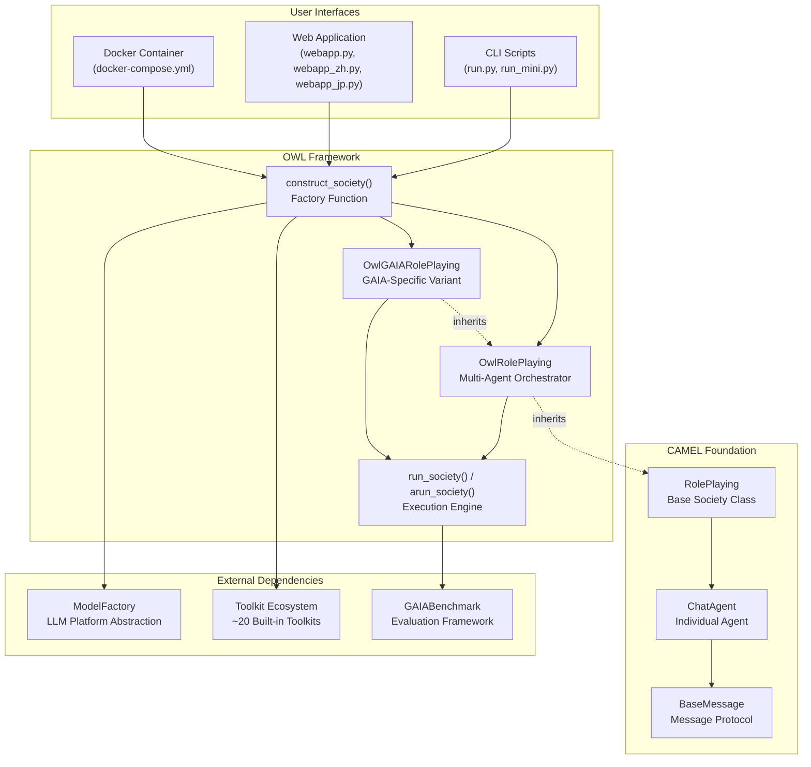
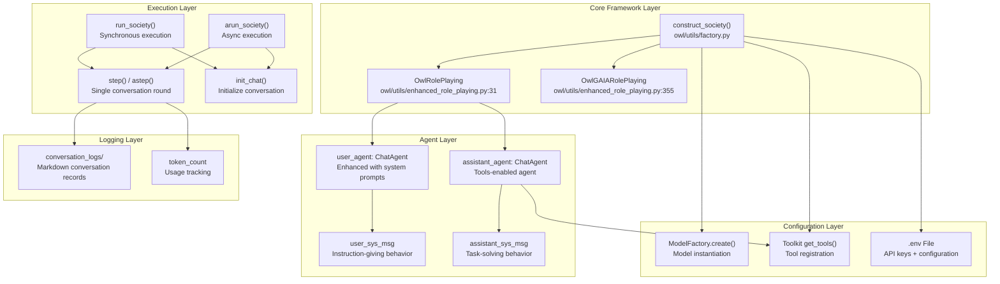
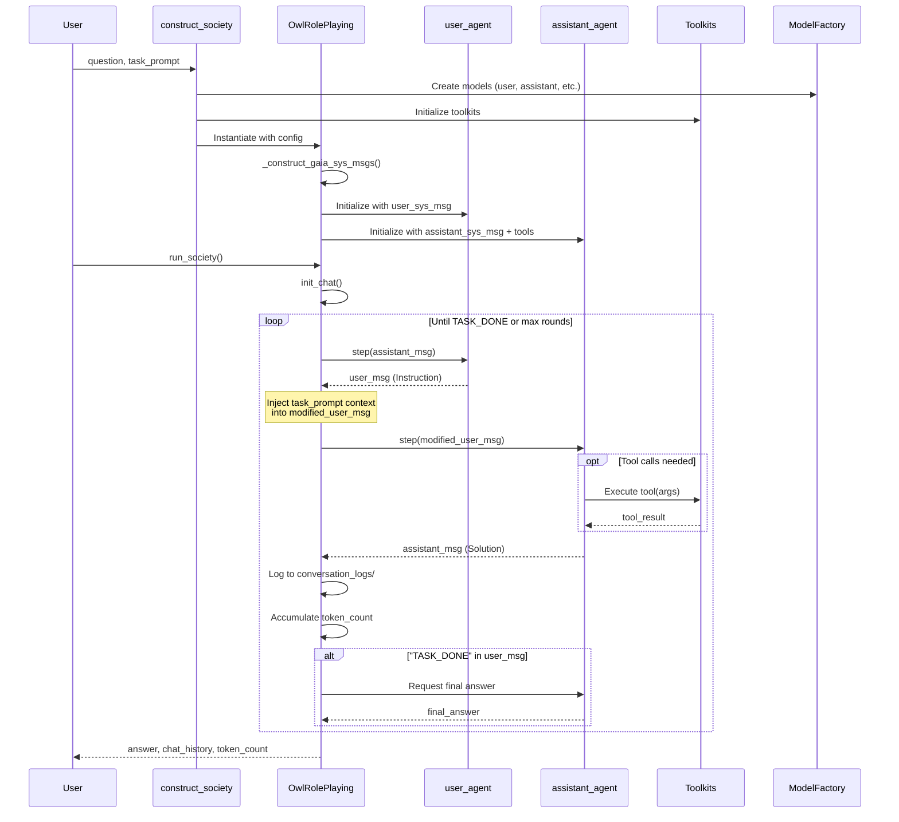

<!-- source: DeepWiki mcp.deepwiki.com · repo camel-ai/owl · page 1 Overview · fetched 2026-10-29 -->

# Overview

Relevant source files

The following files were used as context for generating this wiki page:

- [.gitignore](.gitignore)
- [README.md](README.md)
- [README_ja.md](README_ja.md)
- [README_zh.md](README_zh.md)
- [owl/assets/owl-favicon.ico](owl/assets/owl-favicon.ico)
- [owl/utils/enhanced_role_playing.py](owl/utils/enhanced_role_playing.py)
- [pyproject.toml](pyproject.toml)
- [requirements.txt](requirements.txt)
- [uv.lock](uv.lock)

## Purpose and Scope

This document provides a high-level introduction to OWL (Optimized Workforce Learning), a multi-agent framework for automating real-world tasks. It covers the system's purpose, key capabilities, benchmark performance, and architectural components. For detailed information about specific subsystems, see:

- [Architecture](#2) for design patterns and component interactions
- [Installation & Setup](#3) for deployment instructions
- [Toolkits](#5) for capability extensions
- [Model Integration](#6) for LLM platform configuration
- [Benchmarking & Evaluation](#7) for GAIA performance details

## What is OWL

OWL is a multi-agent framework built on top of the [CAMEL-AI Framework](https://github.com/camel-ai/camel) that orchestrates AI agents to solve complex, real-world tasks through collaborative interactions. The framework implements a role-playing pattern where a user agent and assistant agent communicate iteratively to break down tasks, execute actions using tools, and synthesize results.

The system is designed for task automation scenarios requiring:
- Multi-step reasoning with external tool invocation
- Web navigation and interaction
- Document processing and analysis
- Code generation and execution
- Multimodal understanding (images, videos, audio)

**Important Note**: The current version uses a customized CAMEL installation rather than the latest CAMEL release. For production use with the latest CAMEL features, see the [eigent.py example](https://github.com/camel-ai/camel/blob/master/examples/workforce/eigent.py) in the main CAMEL repository.

Sources: [README.md:1-60]()

## Key Achievements

OWL achieved **69.09%** average accuracy on the [GAIA benchmark](https://huggingface.co/gaia-benchmark), ranking **#1 among open-source frameworks** as of May 2025. This benchmark evaluates AI systems on real-world task automation requiring:
- Web search and navigation
- File processing (PDF, Excel, images, etc.)
- Tool use and multi-step reasoning
- Factual accuracy verification

The system has two documented benchmark configurations:
- **gaia69 branch**: 69.09% accuracy (latest, announced 2025-04-18)
- **gaia58.18 branch**: 58.18% accuracy (earlier release, announced 2025-03-03)

Both branches include customized CAMEL versions in `owl/camel/` with enhanced toolkit stability optimized for benchmark evaluation.

Sources: [README.md:54-56](), [README.md:163](), [README.md:174](), [README.md:622-636]()

## Core Capabilities

| Capability | Description | Key Components |
|------------|-------------|----------------|
| **Online Search** | Multi-engine search (Wikipedia, Google, DuckDuckGo, Baidu, Bocha, SearxNG) | `SearchToolkit` |
| **Browser Automation** | Headless/headed browser control via Playwright (scrolling, clicking, navigation) | `BrowserToolkit` |
| **Document Processing** | Extract content from Word, Excel, PDF, PowerPoint; convert to text/Markdown | `DocumentProcessingToolkit` |
| **Code Execution** | Python code writing and subprocess execution | `CodeExecutionToolkit` |
| **Multimodal Analysis** | Image, video, and audio processing | `ImageAnalysisToolkit`, `VideoAnalysisToolkit`, `AudioAnalysisToolkit` |
| **MCP Integration** | Model Context Protocol for external service integration | `MCPToolkit` |
| **File Operations** | Excel manipulation, file writing, terminal commands | `ExcelToolkit`, `FileWriteToolkit`, `TerminalToolkit` |
| **Specialized Tools** | GitHub, Notion, Google Maps, Weather, Math, etc. | Various domain-specific toolkits |

The framework supports **10+ LLM platforms** including OpenAI, Claude, Gemini, Qwen, DeepSeek, Azure OpenAI, Groq, Together AI, Ollama, and OpenAI-compatible APIs.

Sources: [README.md:185-195](), [README.md:415-420](), [README.md:548-562]()

## System Context

**Diagram: OWL System Context**

OWL extends CAMEL's `RolePlaying` society with two specialized classes: `OwlRolePlaying` for general task automation and `OwlGAIARolePlaying` for GAIA benchmark evaluation. The `construct_society()` factory function creates and configures these societies with appropriate models and toolkits based on the task requirements.

Sources: [README.md:60](), [owl/utils/enhanced_role_playing.py:31-43](), [owl/utils/enhanced_role_playing.py:355-357]()

## Architecture Components

**Diagram: OWL Architecture Components**

The framework consists of four primary layers:

1. **Core Framework**: `construct_society()` factory function creates `OwlRolePlaying` instances configured for specific tasks
2. **Agent Layer**: Two `ChatAgent` instances (user and assistant) with specialized system prompts defined in `_construct_gaia_sys_msgs()`
3. **Execution Layer**: `run_society()` orchestrates conversation rounds via `step()` method until task completion
4. **Configuration Layer**: `ModelFactory` and toolkit `get_tools()` methods inject capabilities into agents

Key code entities:
- `OwlRolePlaying.__init__()`: Initializes agents with system messages at [owl/utils/enhanced_role_playing.py:32-66]()
- `OwlRolePlaying.step()`: Processes one conversation round at [owl/utils/enhanced_role_playing.py:216-284]()
- `OwlRolePlaying._construct_gaia_sys_msgs()`: Defines agent behaviors at [owl/utils/enhanced_role_playing.py:143-214]()

Sources: [owl/utils/enhanced_role_playing.py:31-122](), [owl/utils/enhanced_role_playing.py:216-284]()

## Task Execution Model

**Diagram: Task Execution Flow**

The execution model implements a modified role-playing pattern where:

1. **Initialization**: `construct_society()` creates an `OwlRolePlaying` instance with configured models and tools
2. **System Prompts**: `_construct_gaia_sys_msgs()` defines user as instruction-giver and assistant as task-solver
3. **Conversation Loop**: `run_society()` iterates via `step()` method:
   - User agent generates next instruction
   - Message is modified to inject `task_prompt` context
   - Assistant agent executes instruction using available tools
   - Both messages are logged and token usage tracked
4. **Termination**: Loop ends when user agent outputs `"TASK_DONE"` marker
5. **Answer Extraction**: Final answer is extracted from assistant's response

The `step()` method at [owl/utils/enhanced_role_playing.py:216-284]() implements the message modification pattern, adding contextual information to both user and assistant messages to maintain task focus.

Sources: [owl/utils/enhanced_role_playing.py:216-284](), [owl/utils/enhanced_role_playing.py:143-214]()

## Package Structure

The OWL framework is distributed as a Python package with the following structure:

| Component | Location | Purpose |
|-----------|----------|---------|
| **Package Metadata** | `pyproject.toml` | Version 0.0.1, requires Python 3.10-3.12 |
| **Core Dependency** | `camel-ai[owl]==0.2.57` | CAMEL framework with OWL extras |
| **Additional Dependencies** | `requirements.txt` | Gradio, Firecrawl, MCP servers, document processors |
| **Framework Code** | `owl/` directory | Core classes, utilities, web interfaces |
| **Example Scripts** | `examples/` directory | Task execution scripts for various models |
| **Documentation** | `README.md`, `README_zh.md`, `README_ja.md` | Multi-language documentation |

Key package specifications:
- **License**: Apache 2.0
- **Python Version**: `>=3.10,<3.13`
- **Primary Dependency**: `camel-ai[owl]==0.2.57` (pinned version)
- **Optional Dependencies**: `mistralai>=1.7.0` for Mistral model support

The package can be installed via:
- `uv pip install -e .` (recommended)
- `pip install -r requirements.txt --use-pep517`
- Docker using `docker compose up -d`

Sources: [pyproject.toml:1-71](), [requirements.txt:1-7](), [README.md:196-338]()

## Deployment Options

OWL supports three deployment methods:

**Local Installation** (Python 3.10-3.12):
- `uv` package manager (recommended): Fast dependency resolution
- `venv + pip`: Standard Python virtual environment
- `conda`: Anaconda/Miniconda environment

**Docker Deployment**:
- Pre-built image: `docker compose up -d` (pulls from Docker Hub)
- Local build: Uncomment `build:` section in `docker-compose.yml`
- Includes xvfb for headless browser automation
- Volume mounts for `.env`, `examples/`, `data/`, `.cache/`

**Web Interface**:
- Gradio-based UI with three language variants: `webapp.py` (English), `webapp_zh.py` (Chinese), `webapp_jp.py` (Japanese)
- Features: model selection, environment variable management, real-time conversation logging
- Runs locally on `localhost:7860`

All deployment methods require API keys configured via `.env` file or environment variables. Minimal setup requires only an LLM API key (e.g., `OPENAI_API_KEY`).

Sources: [README.md:196-395](), [README.md:585-617]()

---

