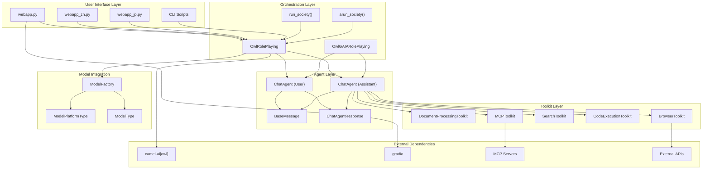
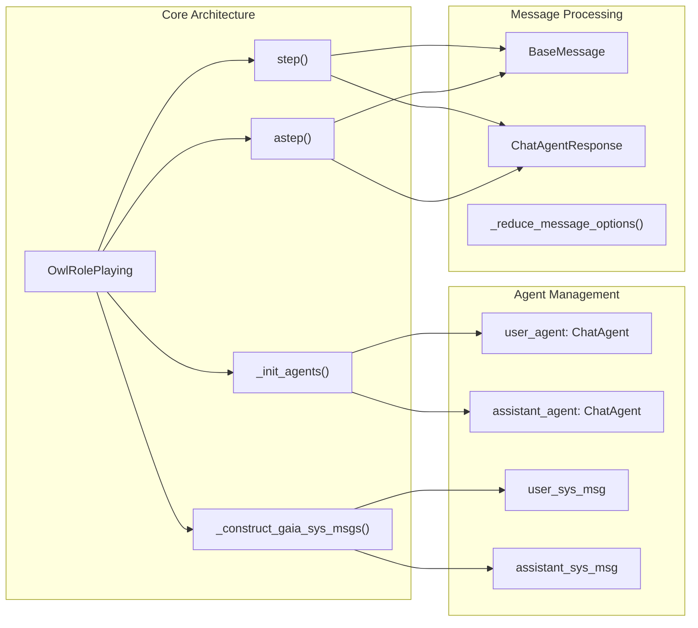
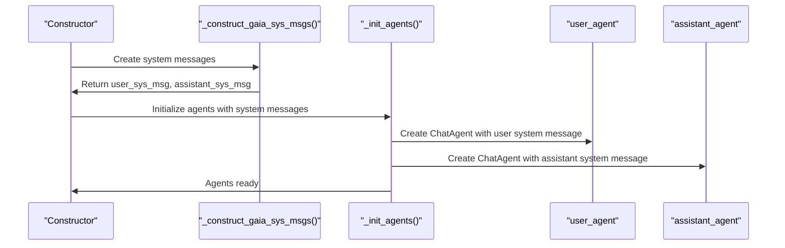
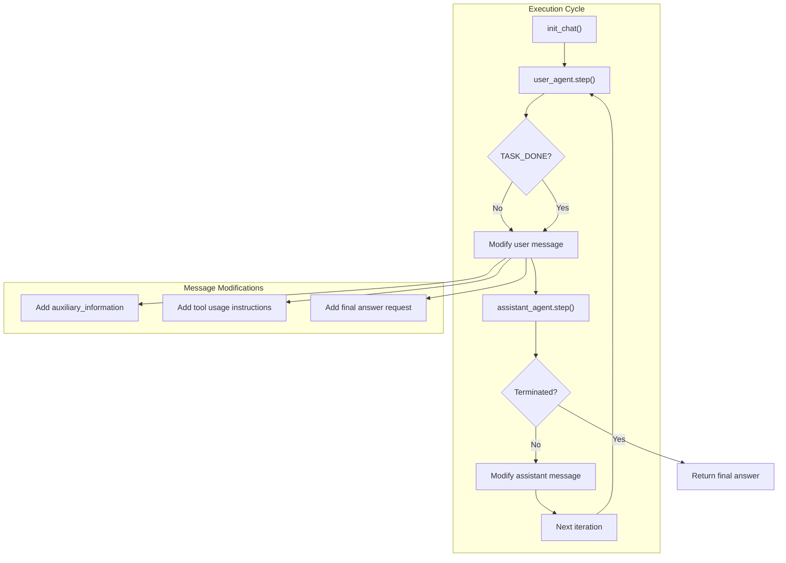
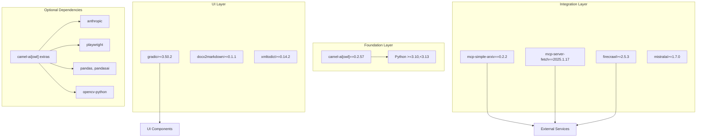
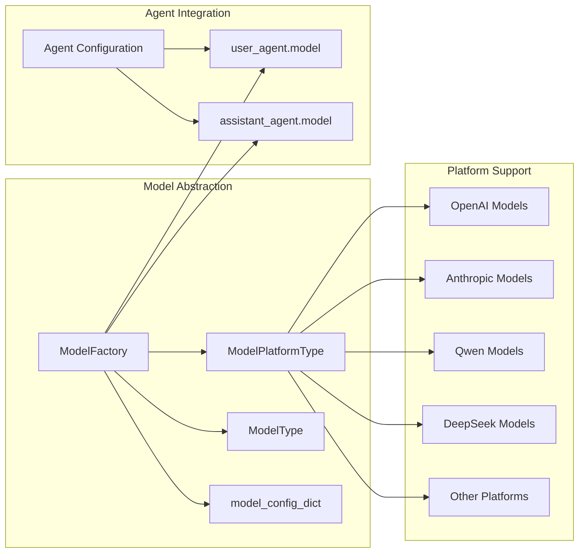
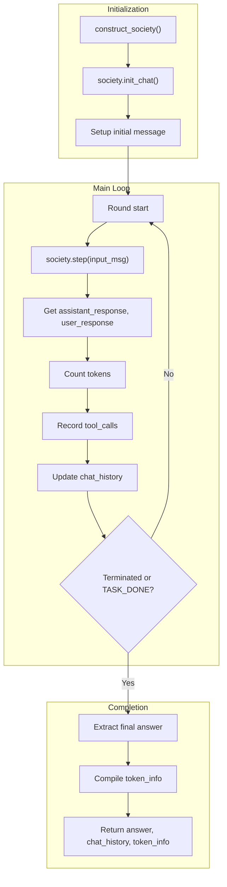
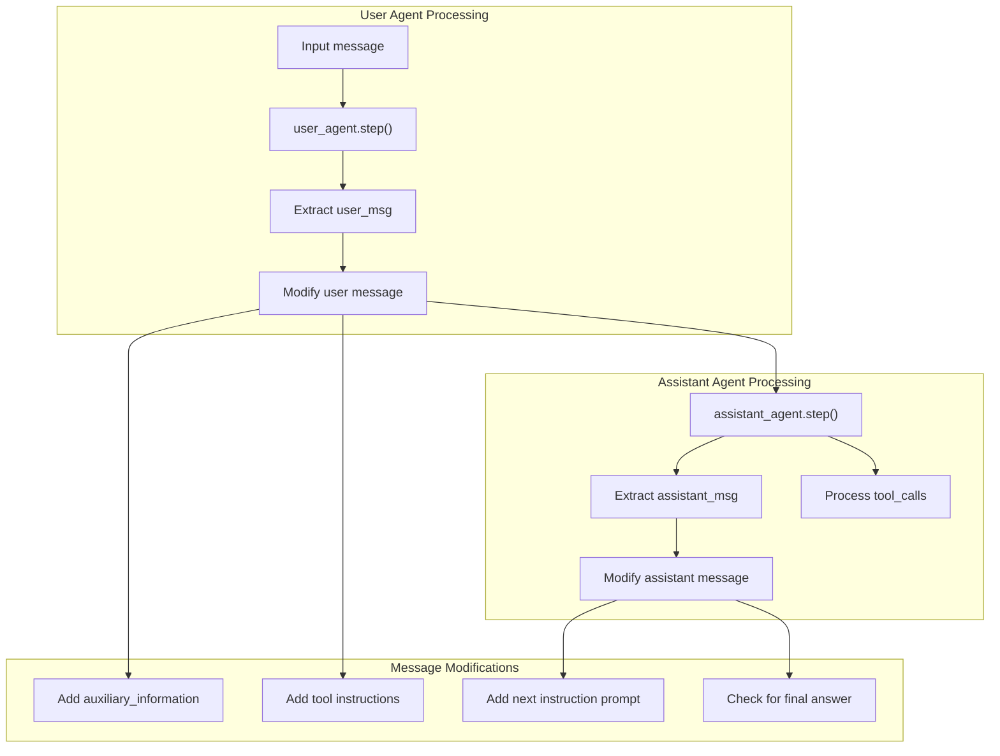

<!-- source: DeepWiki mcp.deepwiki.com · repo camel-ai/owl · page 2 Architecture · fetched 2026-10-29 -->

# Architecture

Relevant source files

The following files were used as context for generating this wiki page:

- [.gitignore](.gitignore)
- [README.md](README.md)
- [README_ja.md](README_ja.md)
- [README_zh.md](README_zh.md)
- [owl/assets/owl-favicon.ico](owl/assets/owl-favicon.ico)
- [owl/utils/enhanced_role_playing.py](owl/utils/enhanced_role_playing.py)
- [pyproject.toml](pyproject.toml)
- [requirements.txt](requirements.txt)
- [uv.lock](uv.lock)

This document describes the overall system architecture of the OWL (Optimized Workforce Learning) framework, including its core components, design patterns, and integration points. The OWL framework is a multi-agent collaboration system built on top of the CAMEL-AI foundation that enables sophisticated task automation through role-playing agent societies.

For information about specific toolkit implementations, see [Toolkits](#5). For deployment and setup details, see [Installation & Setup](#3). For user interface components, see [User Interfaces](#4).

## System Overview

The OWL framework follows a layered architecture pattern with clear separation between user interfaces, orchestration logic, model integration, and external services.

### High-Level Architecture

**Sources:** [owl/utils/enhanced_role_playing.py:1-572](), [pyproject.toml:1-71](), [owl/utils/__init__.py:15-33]()

## Core Components

The OWL framework is built around several key architectural components that work together to provide multi-agent task automation capabilities.

### Primary Classes and Their Responsibilities

| Class | File Location | Primary Responsibility |
|-------|---------------|------------------------|
| `OwlRolePlaying` | [owl/utils/enhanced_role_playing.py:31-354]() | Main orchestration class for agent societies |
| `OwlGAIARolePlaying` | [owl/utils/enhanced_role_playing.py:355-441]() | Specialized role-playing for GAIA benchmarks |
| `DocumentProcessingToolkit` | Referenced in [owl/utils/__init__.py:23]() | Document processing capabilities |
| `run_society` | [owl/utils/enhanced_role_playing.py:442-504]() | Synchronous society execution |
| `arun_society` | [owl/utils/enhanced_role_playing.py:507-571]() | Asynchronous society execution |

### Component Interaction Diagram

**Sources:** [owl/utils/enhanced_role_playing.py:31-67](), [owl/utils/enhanced_role_playing.py:68-122](), [owl/utils/enhanced_role_playing.py:143-214]()

## Agent Architecture

The OWL framework implements a sophisticated two-agent role-playing system where agents collaborate to solve complex tasks through structured conversations.

### Agent Initialization Pattern

The `OwlRolePlaying` class constructor follows this initialization pattern:

1. **System Message Construction**: [owl/utils/enhanced_role_playing.py:143-214]() - Creates specialized system prompts for user and assistant roles
2. **Agent Initialization**: [owl/utils/enhanced_role_playing.py:68-122]() - Instantiates `ChatAgent` objects with appropriate configurations
3. **Model Assignment**: [owl/utils/enhanced_role_playing.py:92-101]() - Assigns LLM models to agents based on configuration

### Role-Playing Execution Flow

The execution flow is managed by the `step` method at [owl/utils/enhanced_role_playing.py:216-284]() and its async counterpart `astep` at [owl/utils/enhanced_role_playing.py:286-352]().

**Sources:** [owl/utils/enhanced_role_playing.py:216-284](), [owl/utils/enhanced_role_playing.py:286-352](), [owl/utils/enhanced_role_playing.py:442-504]()

## Dependency Architecture

The OWL framework is built on a carefully orchestrated set of dependencies that provide different layers of functionality.

### Core Dependencies

The dependency structure is defined in [pyproject.toml:23-32]() for core dependencies and [requirements.txt:1-7]() for the simplified requirement set.

### Model Integration Architecture

**Sources:** [pyproject.toml:23-32](), [requirements.txt:1-7](), [owl/utils/enhanced_role_playing.py:92-107]()

## Execution Flow

The OWL framework processes tasks through a structured execution pipeline that coordinates agent interactions and manages external tool integration.

### Society Execution Pipeline

The main execution functions `run_society` and `arun_society` implement this pipeline:

- **Token Tracking**: [owl/utils/enhanced_role_playing.py:456-463]() - Accumulates token usage across rounds
- **Tool Call Recording**: [owl/utils/enhanced_role_playing.py:465-469]() - Captures tool invocations for history
- **Termination Logic**: [owl/utils/enhanced_role_playing.py:489-494]() - Checks for completion conditions
- **Result Compilation**: [owl/utils/enhanced_role_playing.py:498-503]() - Formats final output

### Message Processing Flow

The message processing is handled by the `step` method which:

1. **Processes User Response**: [owl/utils/enhanced_role_playing.py:219-229]() - Gets user agent's response and extracts messages
2. **Modifies User Message**: [owl/utils/enhanced_role_playing.py:233-246]() - Adds contextual information and tool usage instructions  
3. **Processes Assistant Response**: [owl/utils/enhanced_role_playing.py:249-261]() - Gets assistant agent's response and tool calls
4. **Modifies Assistant Message**: [owl/utils/enhanced_role_playing.py:264-270]() - Adds instructions for next steps

**Sources:** [owl/utils/enhanced_role_playing.py:216-284](), [owl/utils/enhanced_role_playing.py:442-504](), [owl/utils/enhanced_role_playing.py:507-571]()

---

