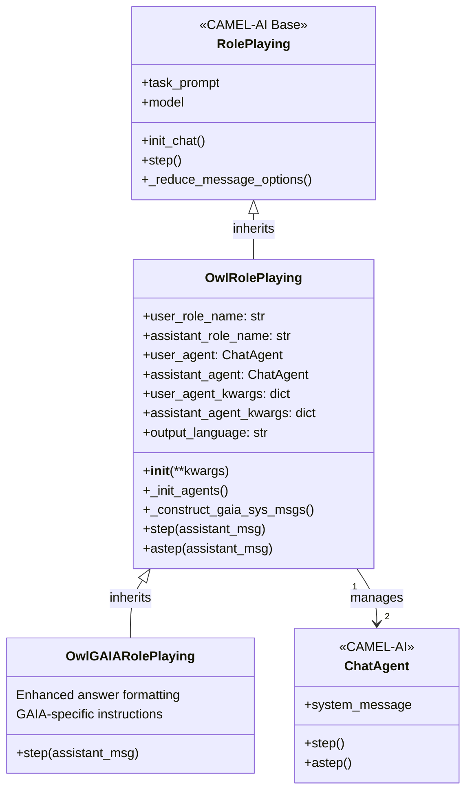
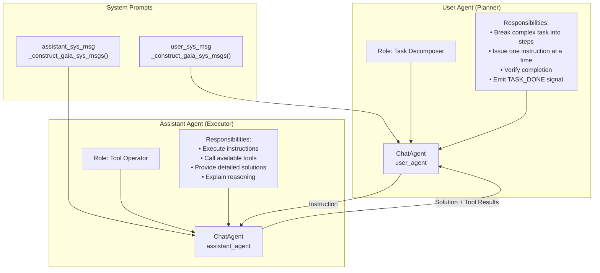
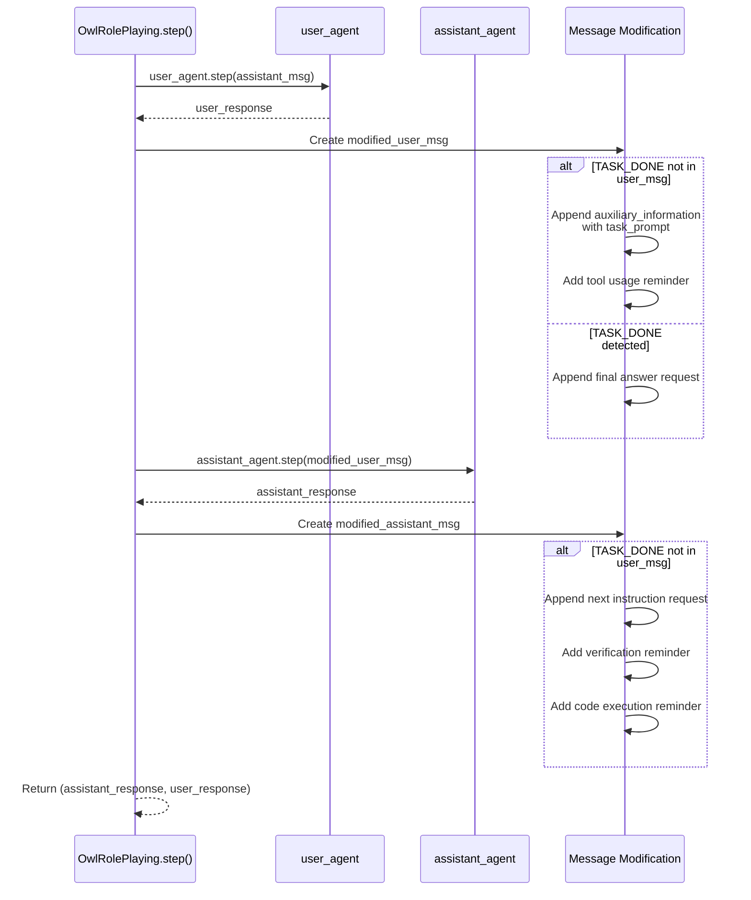
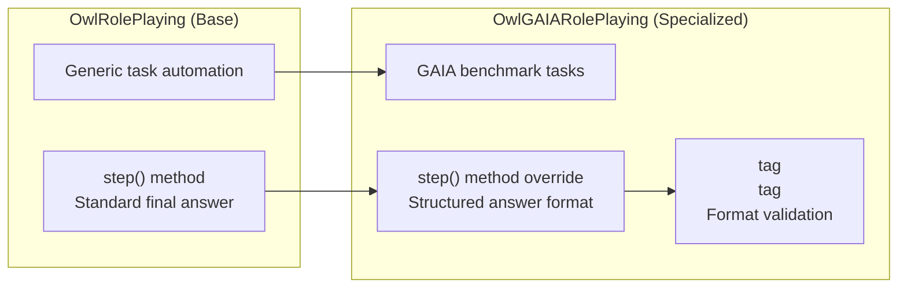
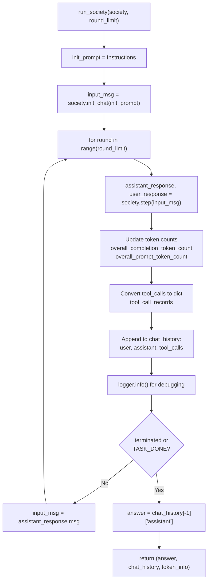

<!-- source: DeepWiki mcp.deepwiki.com · repo camel-ai/owl · page 2.1 Core Framework & Agent System · fetched 2026-10-29 -->

# Core Framework & Agent System

<details>
<summary>Relevant source files</summary>

The following files were used as context for generating this wiki page:

- [owl/utils/document_toolkit.py](owl/utils/document_toolkit.py)
- [owl/utils/enhanced_role_playing.py](owl/utils/enhanced_role_playing.py)
- [owl/utils/gaia.py](owl/utils/gaia.py)
- [pyproject.toml](pyproject.toml)
- [requirements.txt](requirements.txt)
- [uv.lock](uv.lock)

</details>


## Purpose and Scope

This document details the core framework and multi-agent system that powers OWL's task automation capabilities. It focuses on the `OwlRolePlaying` and `OwlGAIARolePlaying` classes, their relationship to the CAMEL-AI foundation, the two-agent collaboration mechanism, and the message flow patterns used for task execution.

For information about the execution pipeline and factory patterns, see [Execution Pipeline](#2.2). For model configuration and specialization, see [Model Factory System](#2.3).

**Sources:** [owl/utils/enhanced_role_playing.py:1-572]()

---

## Class Hierarchy and Foundation

### Inheritance Structure



**Sources:** [owl/utils/enhanced_role_playing.py:31-44](), [owl/utils/enhanced_role_playing.py:355-358]()

---

### Core Components

| Component | Type | Purpose | Configuration |
|-----------|------|---------|---------------|
| `user_agent` | `ChatAgent` | Plans task decomposition, issues instructions | `user_agent_kwargs`, `user_role_name` |
| `assistant_agent` | `ChatAgent` | Executes instructions, uses tools, provides solutions | `assistant_agent_kwargs`, `assistant_role_name` |
| `task_prompt` | `str` | Original user task/question | Inherited from `RolePlaying` |
| `output_language` | `str` | Target language for responses | Optional, affects both agents |

The `OwlRolePlaying` class extends CAMEL's base `RolePlaying` society with specialized system prompts, message modification patterns, and task completion detection logic. Agent initialization occurs in `_init_agents()` [owl/utils/enhanced_role_playing.py:68-122](), which creates two `ChatAgent` instances with their respective system messages and configuration.

**Sources:** [owl/utils/enhanced_role_playing.py:31-67](), [owl/utils/enhanced_role_playing.py:68-122]()

---

## Two-Agent Collaboration Model

### Agent Roles and Responsibilities



The system prompts are constructed in `_construct_gaia_sys_msgs()` [owl/utils/enhanced_role_playing.py:143-214]() and define strict role boundaries:

**User Agent System Prompt Key Rules:**
- Never flip roles or ask questions
- Must instruct step-by-step
- Cannot attempt to solve the task in a single step
- Provides guidance on tool usage strategies
- Emits `<TASK_DONE>` when task is complete

**Assistant Agent System Prompt Key Rules:**
- Never flip roles or instruct the user
- Must leverage available tools
- Start responses with "Solution: [YOUR_SOLUTION]"
- Must verify answers using multiple methods
- Execute and debug code when necessary

**Sources:** [owl/utils/enhanced_role_playing.py:143-214]()

---

### System Prompt Structure

The system prompts embedded in [owl/utils/enhanced_role_playing.py:144-213]() contain critical instructions that shape agent behavior:

**User Agent Prompt Components:**
1. **Role Definition:** Lines 145-147 establish the user as instructor, never asking questions
2. **Step-by-Step Requirement:** Lines 152-153 mandate decomposition
3. **Tool Usage Tips:** Lines 154-164 provide strategic guidance:
   - Search before browsing
   - Verify answers with multiple tools
   - Process video content when mentioned
   - Write code for Excel tasks
4. **Completion Signal:** Line 170 defines `<TASK_DONE>` as the termination marker

**Assistant Agent Prompt Components:**
1. **Role Definition:** Lines 175-176 establish the assistant as tool operator
2. **Solution Format:** Lines 185-187 require "Solution: [YOUR_SOLUTION]" prefix
3. **Best Practices:** Lines 189-202 include:
   - Cross-validation requirements
   - Error handling strategies
   - Code execution reminders
   - Search query optimization

**Sources:** [owl/utils/enhanced_role_playing.py:143-214]()

---

## Message Flow and Conversation Mechanics

### Step Execution Pattern



The core conversation step is implemented in [owl/utils/enhanced_role_playing.py:216-284]() for synchronous execution and [owl/utils/enhanced_role_playing.py:286-352]() for asynchronous execution.

**Sources:** [owl/utils/enhanced_role_playing.py:216-284](), [owl/utils/enhanced_role_playing.py:286-352]()

---

### Message Modification Mechanics

The key innovation in `OwlRolePlaying` is the **message modification pattern** that injects context without polluting the conversation history visible to agents:

#### User Message Modifications

When `TASK_DONE` is NOT present [owl/utils/enhanced_role_playing.py:233-240]():
```
<auxiliary_information>
{self.task_prompt}
</auxiliary_information>
If there are available tools and you want to call them, never say 'I will ...', 
but first call the tool and reply based on tool call's result
```

When `TASK_DONE` IS present [owl/utils/enhanced_role_playing.py:243-246]():
```
Now please make a final answer of the original task based on our conversation: 
<task>{self.task_prompt}</task>
```

#### Assistant Message Modifications

When `TASK_DONE` is NOT present [owl/utils/enhanced_role_playing.py:264-270]():
```
Provide me with the next instruction and input (if needed) based on my response 
and our current task: <task>{self.task_prompt}</task>
Before producing the final answer, please check whether I have rechecked the 
final answer using different toolkit as much as possible. If not, please remind me.
If I have written codes, remind me to run the codes.
If you think our task is done, reply with `TASK_DONE` to end our conversation.
```

This pattern ensures agents always have context about the overall task while maintaining natural conversational flow.

**Sources:** [owl/utils/enhanced_role_playing.py:231-284]()

---

### Task Completion Detection

The system uses the `<TASK_DONE>` marker as an explicit termination signal. Detection occurs in multiple locations:

1. **Within step() method** [owl/utils/enhanced_role_playing.py:489-494]():
   ```python
   if (assistant_response.terminated or 
       user_response.terminated or 
       "TASK_DONE" in user_response.msg.content):
       break
   ```

2. **Message branching logic** [owl/utils/enhanced_role_playing.py:233](), [owl/utils/enhanced_role_playing.py:243]():
   - Changes message modifications based on presence of `TASK_DONE`
   - Triggers final answer extraction when detected

3. **Asynchronous variant** [owl/utils/enhanced_role_playing.py:555-561]():
   - Also checks for Chinese variant: `"任务已完成"`
   - Same termination logic as synchronous version

**Sources:** [owl/utils/enhanced_role_playing.py:489-494](), [owl/utils/enhanced_role_playing.py:555-561]()

---

## GAIA Benchmark Specialization

### OwlGAIARolePlaying Class

The `OwlGAIARolePlaying` class [owl/utils/enhanced_role_playing.py:355-439]() extends `OwlRolePlaying` with specialized behavior for the GAIA benchmark:



**Sources:** [owl/utils/enhanced_role_playing.py:355-439]()

---

### Answer Format Requirements

When `TASK_DONE` is detected, `OwlGAIARolePlaying` injects additional formatting instructions [owl/utils/enhanced_role_playing.py:386-401]():

**Required Output Structure:**
```xml
<analysis>
[Detailed analysis of the reasoning result]
</analysis>

<final_answer>
[Answer in GAIA-compliant format]
</final_answer>
```

**GAIA Format Constraints** [owl/utils/enhanced_role_playing.py:396-400]():
| Answer Type | Rules |
|-------------|-------|
| **Number** | No commas, no units ($, %), unless specified |
| **String** | No articles, no abbreviations, digits as plain text |
| **List** | Comma-separated, apply number/string rules per element |

This structured output enables reliable answer extraction via `extract_pattern(raw_answer, "final_answer")` in [owl/utils/gaia.py:232]().

**Sources:** [owl/utils/enhanced_role_playing.py:386-401](), [owl/utils/gaia.py:232-237]()

---

## Execution Functions

### run_society and arun_society

The execution functions orchestrate the complete conversation lifecycle:



**Key Implementation Details:**

1. **Initialization** [owl/utils/enhanced_role_playing.py:450-453]():
   - Standard initialization prompt instructs step-by-step solving
   - `society.init_chat()` prepares the first message

2. **Loop Mechanics** [owl/utils/enhanced_role_playing.py:454-496]():
   - Maximum `round_limit` iterations (default: 15)
   - Each iteration calls `society.step()`
   - Token usage tracked from response info

3. **Tool Call Recording** [owl/utils/enhanced_role_playing.py:466-469]():
   - Extracts tool calls from `assistant_response.info["tool_calls"]`
   - Converts to dictionary format via `.as_dict()`
   - Preserves complete tool execution history

4. **Chat History Format** [owl/utils/enhanced_role_playing.py:471-481]():
   ```python
   {
       "user": user_response.msg.content,
       "assistant": assistant_response.msg.content,
       "tool_calls": [tool_call.as_dict() for tool_call in tool_calls]
   }
   ```

5. **Token Accumulation** [owl/utils/enhanced_role_playing.py:458-463]():
   - Sums `completion_tokens` and `prompt_tokens` from both agents
   - Returned as `token_info` dictionary

6. **Async Variant** [owl/utils/enhanced_role_playing.py:507-571]():
   - Uses `await society.astep()` instead of `society.step()`
   - Identical logic otherwise
   - Minor bug: Line 524 accumulates completion tokens into prompt count

**Sources:** [owl/utils/enhanced_role_playing.py:442-571]()

---

## Integration with CAMEL-AI Foundation

The `OwlRolePlaying` class depends on several CAMEL-AI components:

| CAMEL Component | Usage in OWL | Import Location |
|-----------------|--------------|-----------------|
| `RolePlaying` | Base class for `OwlRolePlaying` | [owl/utils/enhanced_role_playing.py:22]() |
| `ChatAgent` | Agent instances for user and assistant | [owl/utils/enhanced_role_playing.py:19]() |
| `BaseMessage` | Message creation and manipulation | [owl/utils/enhanced_role_playing.py:21]() |
| `ChatAgentResponse` | Response wrapping and metadata | [owl/utils/enhanced_role_playing.py:20]() |

**Model Assignment Pattern** [owl/utils/enhanced_role_playing.py:92-100]():
```python
if self.model is not None:
    if assistant_agent_kwargs is None:
        assistant_agent_kwargs = {"model": self.model}
    elif "model" not in assistant_agent_kwargs:
        assistant_agent_kwargs.update(dict(model=self.model))
    # Similar for user_agent_kwargs
```

This ensures models specified at the society level propagate to agents unless explicitly overridden in agent-specific kwargs.

**Sources:** [owl/utils/enhanced_role_playing.py:19-28](), [owl/utils/enhanced_role_playing.py:92-100]()

---

## Usage in Benchmark Systems

The `GAIABenchmark` class [owl/utils/gaia.py:36-410]() demonstrates practical usage of `OwlGAIARolePlaying`:

**Benchmark Instantiation Pattern** [owl/utils/gaia.py:222-228]():
```python
society = OwlGAIARolePlaying(
    task_prompt=task["Question"],
    with_task_specify=False,
    user_role_name=user_role_name,
    user_agent_kwargs=user_agent_kwargs,
    assistant_role_name=assistant_role_name,
    assistant_agent_kwargs=assistant_agent_kwargs,
)
```

**Execution and Extraction** [owl/utils/gaia.py:230-237]():
```python
raw_answer, chat_history, token_info = run_society(society)
answer = extract_pattern(raw_answer, "final_answer")
```

This pattern shows how the core framework integrates with evaluation systems, demonstrating the separation between agent orchestration (`OwlRolePlaying`) and task evaluation (`GAIABenchmark`).

**Sources:** [owl/utils/gaia.py:222-237]()

---

